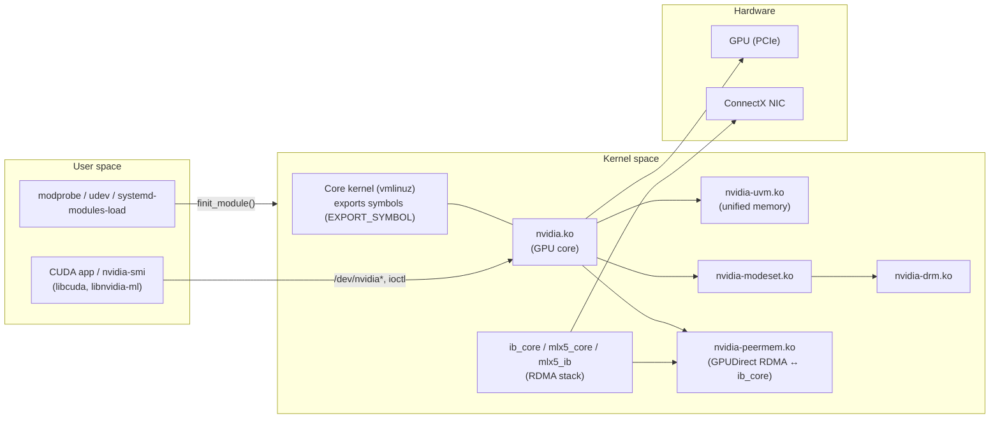
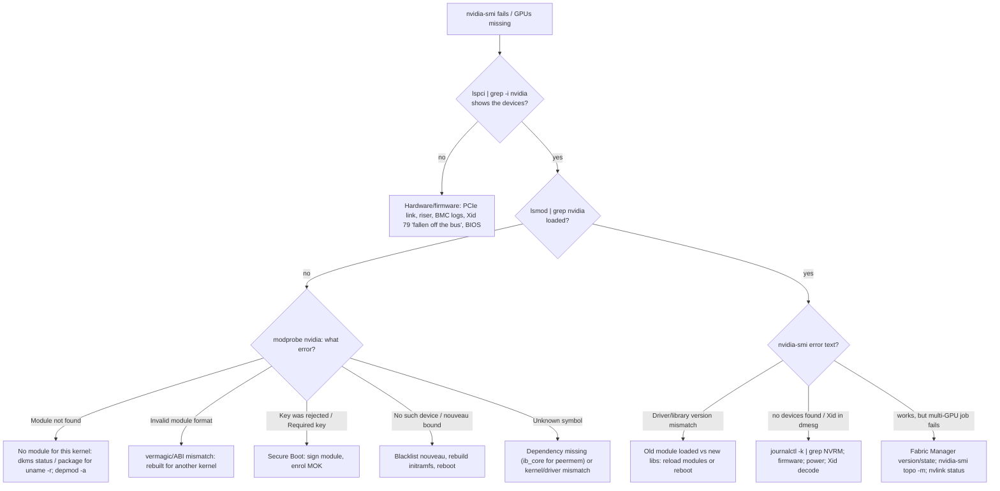

# 1.22 Kernel modules, DKMS and sysctl tuning for GPU nodes

| | |
|---|---|
| Level | Advanced |
| Priority tier | 0 |
| Lab venue | GCP VM (Ubuntu 22.04+; a GPU VM for the driver parts, a plain VM for module basics) |
| Part | Part 1: Linux, from the command line to the kernel and performance |
| Status | Drafted, labs **untested** |

## Why this matters for AI infrastructure

On a GPU node the most fragile single dependency is the pairing **running kernel ↔ NVIDIA kernel modules ↔ user-space driver libraries ↔ CUDA in the container**. A routine `apt upgrade` that installs a new kernel, a reboot after maintenance, or a mismatched driver version produces nodes that boot but have no GPUs: Slurm drains them, Kubernetes shows `nvidia.com/gpu: 0`, `nvidia-smi` says it "couldn't communicate with the NVIDIA driver". Fleet operators therefore treat the kernel and the GPU/NIC drivers as one versioned artefact.

Alongside the modules, the node's behaviour is shaped by a few hundred **kernel parameters** (`sysctl`) and **boot parameters**. The wrong ones cause memory allocation stalls, dropped connections, failing `mmap`s in data loaders, or swap thrashing; the right ones are cheap, repeatable and testable.

Typical incidents this chapter prepares you for:

- After a kernel update `nvidia-smi` fails: the DKMS build did not run, or failed for the new kernel, or Secure Boot refuses the unsigned module.
- A cluster-wide reboot causes a "boot storm" where every node compiles the driver at once, or a subset fails to compile because headers or compilers differ.
- `modprobe nvidia` fails with "Unknown symbol", "Required key not available", "Operation not permitted", or because `nouveau` owns the device.
- Driver upgrade fails because processes (DCGM, Fabric Manager, persistence daemon, a container) still hold `/dev/nvidia*`, so modules cannot be unloaded.
- Data-loader workers crash with `Cannot allocate memory` in `mmap` although RAM is free (`vm.max_map_count`), or with too many open files.
- Network performance differs between nodes because sysctls were applied by hand on some.

## Prerequisites and outcomes

You should know the boot sequence and initramfs (1.14), systemd (1.15), memory and NUMA (1.17), `/proc` and `/sys` (1.10), the ELF/dynamic-linking basics (1.11), and the security layer (1.21, especially Secure Boot).

After this chapter you can:

- Explain what a kernel module is, how it is built against a kernel, how symbols and `vermagic` make it version-specific, and where modules live.
- Use `lsmod`, `modinfo`, `modprobe`, `insmod`, `rmmod`, `depmod`; load modules at boot; pass parameters; blacklist modules; rebuild the initramfs.
- Explain DKMS, how it hooks kernel installation, how to read its status and logs, and why large fleets prefer pre-built or image-baked modules (kmod/kABI packaging, golden images).
- Explain the NVIDIA module family (nvidia, nvidia_uvm, nvidia_modeset, nvidia_drm, nvidia_peermem, nvidia-fs), the open versus proprietary kernel modules, the matching user-space libraries, Fabric Manager and persistence daemon, and how to upgrade a driver safely.
- Explain Secure Boot and module signing for out-of-tree drivers.
- Read and set sysctl parameters persistently; name the important ones for network, VM, filesystem and kernel for GPU/HPC nodes and explain when each helps or harms.
- Build a repeatable procedure: pin kernel, pin driver, canary, validate (`nvidia-smi`, DCGM diagnostics, NCCL tests), roll out.

## 1. What a kernel module is

The Linux kernel is **monolithic** (one address space, one program), but it is built to be **extended at run time** with **loadable kernel modules** (`.ko`, "kernel object" files): drivers for devices, filesystems, network protocols, or any code that does not need to be compiled in. A module runs in kernel mode with full privilege: a bug can crash the machine, and a malicious one owns it. That is why modules are tied to the exact kernel they were built for and why Secure Boot and signing exist.



Facts that explain the failure modes:

- **Module files live under `/lib/modules/<kernel-release>/`** (`uname -r`), organised by subsystem (`kernel/drivers/...`) and by origin (`extra/`, `updates/`, `weak-updates/`, `updates/dkms/`). Each kernel version has its own tree, which is why a new kernel without rebuilt modules has no NVIDIA driver.
- **`vermagic`** (version magic) is a string embedded in the module recording the kernel release and key build options; `modinfo nvidia | grep vermagic`. A mismatch means `insmod: ERROR: could not insert module: Invalid module format`. Some distributions guarantee a stable internal ABI within a major release (RHEL's **kABI** whitelist), so modules built for one minor kernel can be loaded in later ones (`weak-updates` symlinks); Debian/Ubuntu make no such promise, so modules are rebuilt per kernel.
- **Symbol resolution.** Modules call functions exported by the kernel or by other modules. `modprobe` resolves **dependencies** from `modules.dep` (generated by **`depmod`**), loading prerequisites first. "Unknown symbol in module" means a dependency is missing or the kernel does not export it (often because the kernel changed and the module did not).
- **Licence taint.** Proprietary modules *taint* the kernel (`cat /proc/sys/kernel/tainted`); kernel developers decline to debug tainted kernels. NVIDIA's **open kernel modules** (dual MIT/GPL) avoid the proprietary taint for the kernel-side code; the user-space libraries remain proprietary.
- **Loading mechanisms.** The kernel loads modules on demand when hardware appears (udev matches the device's `modalias` and runs `modprobe`); at boot from `/etc/modules-load.d/*.conf` via `systemd-modules-load.service`; from the **initramfs** for storage/boot-critical drivers; and by explicit `modprobe`. `request_module()` is how the kernel itself asks for a module (a filesystem type, a network protocol).

## 2. Working with modules

```bash
uname -r ; ls /lib/modules/                       # running kernel and kernels with module trees
lsmod | head                                      # Module  Size  Used by  (reads /proc/modules)
lsmod | grep -E '^(nvidia|nouveau|mlx5|ib_)'       
modinfo nvidia                                    # filename, version, license, depends, vermagic, signer, sig_key, parm: options
modinfo -p nvidia                                 # only parameters
modinfo -F vermagic nvidia ; modinfo -F signer nvidia
sudo modprobe nvidia                              # load with dependencies (needs depmod data)
sudo modprobe -r nvidia_uvm                       # unload (and unused dependencies); fails if "in use"
sudo insmod /path/foo.ko ; sudo rmmod foo         # low level: no dependency handling, full path
sudo depmod -a                                    # rebuild modules.dep etc. after installing modules
modprobe --show-depends nvidia                    # what would be loaded
ls /sys/module/nvidia/parameters ; cat /sys/module/nvidia/version
cat /sys/module/nvidia/refcnt ; ls /sys/module/nvidia/holders
journalctl -k | grep -iE 'nvidia|NVRM|nouveau' ; dmesg --level=err,warn | tail -30
cat /proc/sys/kernel/tainted ; cat /proc/modules | head -3
```

### Configuring modules persistently

```ini
# /etc/modules-load.d/gpu.conf        -> loaded early at boot by systemd-modules-load
nvidia
nvidia_uvm
nvidia_peermem
```

```ini
# /etc/modprobe.d/nvidia.conf          -> options and policy, read by modprobe
options nvidia NVreg_EnableGpuFirmware=1          # example parameter names are driver-version specific: check modinfo -p
options nvidia NVreg_PreserveVideoMemoryAllocations=1
blacklist nouveau                                  # stop the open-source nouveau driver binding the GPU
options nouveau modeset=0
install nvidia-peermem /sbin/modprobe --ignore-install nvidia-peermem   # 'install' lines can run commands on load
alias char-major-195* nvidia
```

- **`blacklist`** only prevents *alias-based automatic* loading; an explicit `modprobe nouveau` or a dependency can still load it. The stronger form is `install nouveau /bin/false`. For the NVIDIA driver, nouveau must be gone *before* the NVIDIA module loads, and the **initramfs must be rebuilt** (`update-initramfs -u` / `dracut -f`) so the blacklist is honoured during early boot.
- Kernel command-line parameters can set module parameters before userspace (`nvidia.NVreg_...=1`, `module_blacklist=nouveau`, `modprobe.blacklist=nouveau`) and are the most reliable way to enforce early-boot behaviour (chapter 1.14).
- To inspect what actually applies: `sudo modprobe -c | grep -i nvidia` (the merged effective configuration) and `systemd-analyze cat-config modprobe.d`.
- Modules needed to mount the root filesystem or reach the network for boot must be in the **initramfs** (`lsinitrd` on dracut systems, `lsinitramfs /boot/initrd.img-$(uname -r)` on Debian/Ubuntu). A module missing from the initramfs produces "cannot mount root" or a node that never reaches the network on PXE/NFS-root boots.

### Why unloading fails and what to do

`rmmod: ERROR: Module nvidia is in use` means references remain: user-space processes holding `/dev/nvidia*` (training jobs, DCGM host engine `nv-hostengine`, `nvidia-persistenced`, `nvidia-fabricmanager`, `dcgm-exporter`, `gpu-operator` pods, X/Wayland, `nvidia-smi dmon`), or dependent modules (`nvidia_uvm`, `nvidia_modeset`, `nvidia_drm`, `nvidia_peermem`). Method: `sudo lsof /dev/nvidia* 2>/dev/null`, `sudo fuser -v /dev/nvidia*`, `cat /sys/module/nvidia/holders`, `lsmod | grep nvidia`. Stop services in dependency order (workloads, exporters, DCGM, fabric manager, persistence daemon), unload dependents first (`rmmod nvidia_drm nvidia_modeset nvidia_uvm nvidia`), then load the new version. In Kubernetes the GPU Operator's driver container performs this dance; cordon and drain the node first so you do not kill jobs.

## 3. Out-of-tree modules: DKMS

Distributions ship modules for their own kernels. Third-party drivers (NVIDIA, Mellanox OFED, ZFS, VirtualBox, vendor RAID cards) are **out-of-tree** and must be built against the headers of every kernel you run. **DKMS** (Dynamic Kernel Module Support) automates it: the module *source* is stored under `/usr/src/<name>-<version>/` with a `dkms.conf`; hooks run when a kernel is installed (and on boot via a service on some distributions) to compile and install the module for that kernel into `/lib/modules/<kver>/updates/dkms/`.

```bash
dkms status                                       # nvidia/550.xx, 6.8.0-45-generic, x86_64: installed
sudo dkms build   -m nvidia -v 550.xx -k $(uname -r)
sudo dkms install -m nvidia -v 550.xx -k $(uname -r)
sudo dkms remove  -m nvidia -v 550.xx --all
cat /var/lib/dkms/nvidia/550.xx/$(uname -r)/x86_64/log/make.log      # build failures are explained here
dpkg -l | grep -E 'linux-headers|linux-image'   ;   rpm -q kernel-devel kernel-headers      # headers must match the kernel
gcc --version ; cat /proc/version                  # compiler used for kernel vs module
```

Failure modes, in order of frequency:

1. **Missing or mismatched headers** (`linux-headers-$(uname -r)` or `kernel-devel-$(uname -r)` not installed, or newer than the installed kernel): the build cannot start.
2. **Compiler drift**: the kernel was built with GCC *N*; the module must be compatible (kernels check for it); a different default compiler on the node breaks the build.
3. **Kernel API change** that the driver version does not yet support (a very new kernel with an old driver): compile errors in `make.log`; fix by choosing a supported driver/kernel pair, not by patching.
4. **Secure Boot**: build succeeds, load fails because the module is unsigned (below).
5. **Build timing and load**: thousands of nodes compiling at once (CPU spike, delayed readiness); network access needed for headers; disk space (`/usr/src`, `/var/lib/dkms`).
6. **Partial upgrades**: new kernel installed, DKMS failed silently, reboot into the new kernel → no GPU driver. Always verify `dkms status` for the *target* kernel **before** rebooting.

### Why large fleets avoid compiling on nodes

The project's operations notes (Volume 10) state the production reasoning that is worth keeping: compile the driver **once** in CI against a **pinned kernel**, ship the result, and never compile on a compute node. Options:

| Approach | How | Pros | Cons |
|---|---|---|---|
| **Precompiled kmod packages** | Distribution/vendor builds modules per kernel (Ubuntu `linux-modules-nvidia-<ver>-<kernel>` packages; RHEL-family `kmod-nvidia` built against kABI; NVIDIA's precompiled driver packages) | No compiler on nodes; signed by the vendor chain on some distributions; deterministic | Tied to supported kernel list; update cadence follows the vendor |
| **Golden image** (Packer + Ansible, or BCM image build) | Build an image with kernel, headers if needed, driver, MOFED, and tooling; test; stream/PXE it to nodes | Reproducible, rollback = previous image, fits PXE/diskless | Image pipeline needed; per-node identity (SSH host keys, machine-id) must be regenerated |
| **GPU Operator driver container** | Driver compiled/loaded inside a privileged DaemonSet pod per node and kernel (precompiled images exist for common kernels) | Kubernetes-native lifecycle | Needs the node's kernel/headers available to the container; upgrades interact with running pods; Secure Boot and rootfs constraints |
| **DKMS on nodes** | Hooks compile at install time | Easy on a workstation or a tiny cluster | Fragile at scale (above) |

Rule: **kernel, driver, MOFED/DOCA, Fabric Manager, container toolkit and NCCL/CUDA minimum versions are one release train.** Pin and test the combination; allow updates only through the pipeline (hold kernel packages: `apt-mark hold linux-image-generic`, `dnf versionlock`; chapter 1.7), and stage them on a canary node first.

## 4. The NVIDIA driver stack

### Kernel modules and device nodes

| Module / component | Role |
|---|---|
| `nvidia` | Core driver: GPU management, memory, scheduling; creates `/dev/nvidiaN`, `/dev/nvidiactl` |
| `nvidia_uvm` | Unified Virtual Memory (CUDA managed memory, page migration): `/dev/nvidia-uvm`, `/dev/nvidia-uvm-tools` |
| `nvidia_modeset`, `nvidia_drm` | Display/KMS and DRM integration; usually irrelevant on compute nodes but loaded by default |
| `nvidia_peermem` | Exposes GPU memory to the RDMA stack (**GPUDirect RDMA**); requires the MLNX/OFED or in-kernel `ib_core` stack; replaces the older `nv_peer_mem` |
| `nvidia-fs` (GDS) | GPUDirect Storage kernel component (`/dev/nvidia-fs*`) |
| `gdrdrv` | GDRCopy driver (low-latency CPU-GPU copies) |
| `nvidia-caps` | `/dev/nvidia-caps/*` capability nodes for MIG management |
| Fabric Manager (`nvidia-fabricmanager`) | **User-space service** that configures the NVSwitch fabric on HGX/DGX systems (NVLink topology and routing). Its version must exactly match the driver; if it fails, multi-GPU jobs fail even though `nvidia-smi` lists GPUs |
| `nvidia-persistenced` | Daemon that keeps the driver state initialised so GPUs do not tear down and re-initialise between jobs (avoids seconds-long first-call latency; consistent clocks/ECC state) |
| DCGM / `nv-hostengine` | Health monitoring and diagnostics (`dcgmi diag -r 3`) |
| Driver user-space | `libcuda.so.1`, `libnvidia-ml.so.1` (NVML), `nvidia-smi`, `nvidia-modprobe` (setuid helper that creates device nodes), GSP firmware under `/lib/firmware/nvidia/<version>/` |

**Open versus proprietary kernel modules.** NVIDIA publishes an *open GPU kernel module* flavour (the kernel-resident code is open source; the heavy lifting runs in the GPU System Processor firmware). For recent data-centre GPUs (Turing and later, and required for Blackwell-class and Grace-based platforms) the open modules are the supported/recommended path; older GPUs need the proprietary flavour. Choose the flavour at install time (`nvidia-driver-XXX-open` on Ubuntu, `nvidia-open` or `--kernel-module-type=open` in the `.run` installer). Check `modinfo nvidia | grep -i license` and NVIDIA's current support matrix (flag: verify before choosing).

### Installation methods and pitfalls

- **Distribution packages / NVIDIA repository** (`apt`/`dnf`; module streams or meta-packages such as `cuda-drivers`): integrate with package management, upgrades and DKMS/kmod; preferred for fleets.
- **`.run` installer**: convenient for labs, but it bypasses the package manager (hard to track, remove and upgrade) and builds against the running kernel; avoid on managed nodes.
- **Mixing methods** (a `.run` install over an `apt` install, or two driver branches) produces library/module version mismatches ("Failed to initialize NVML: Driver/library version mismatch"): the loaded module is older than the user-space libs after an upgrade until the modules are reloaded or the node rebooted. Remedy: unload and reload the modules (section 2) or reboot.
- **Blacklist nouveau and rebuild initramfs** before first load; ensure no display manager grabs the GPU on compute nodes; keep the `nvidia-persistenced` service enabled.
- **CUDA toolkit versus driver**: the driver is backward compatible with older CUDA user-space; a container needs a host driver at least as new as its CUDA runtime requires (a minimum driver branch per CUDA major version; compatibility packages exist for data-centre GPUs). The book *AI Systems Performance Engineering* states minimum branches by CUDA version; confirm the current numbers in NVIDIA's compatibility tables because they change each release (flag).

### Safe driver upgrade procedure (one node)

1. Cordon/drain the node (Slurm `scontrol update NodeName=n state=drain reason="driver upgrade"`; Kubernetes `kubectl cordon && kubectl drain`).
2. Stop GPU consumers: DCGM exporter/host engine, Fabric Manager, persistence daemon, MIG/monitoring agents, container runtimes using GPUs.
3. Install the new driver packages (and matching Fabric Manager, container toolkit, MOFED/DOCA if coupled).
4. Verify module build for the target kernel (`dkms status` / package contents / `modinfo -F version`).
5. Reboot (the most reliable way to guarantee all old modules are gone) or unload/reload modules.
6. Validate: `nvidia-smi` (versions, all GPUs, ECC, clocks, persistence), `nvidia-smi topo -m`, `dcgmi diag -r 2` (or 3), `nvidia-smi nvlink -s`, a single-node NCCL test (`all_reduce_perf -b 8 -e 8G -f 2 -g 8`), then a multi-node test for fabric health.
7. Uncordon; roll across the fleet in waves with automatic halt on failures; keep the previous image/packages for rollback.

## 5. Module signing, Secure Boot and lockdown

With **Secure Boot** the firmware only starts signed boot loaders; the signed kernel then restricts what can be loaded (kernel **lockdown**), including requiring **signed modules** (`CONFIG_MODULE_SIG_FORCE` or lockdown "integrity" mode). The kernel's trusted keyrings: built-in keys, the firmware `db` (via `shim`), and the **Machine Owner Key (MOK)** list managed with `mokutil`.

Workflow for an out-of-tree driver:

```bash
mokutil --sb-state                                          # SecureBoot enabled/disabled
openssl req -new -x509 -newkey rsa:2048 -keyout MOK.priv -outform DER -out MOK.der -nodes -days 3650 -subj "/CN=Cluster module signing/"
sudo mokutil --import MOK.der                               # asks for a one-time password; confirm at next boot in the MOK manager (console!)
# sign a module (script shipped with kernel headers):
sudo /usr/src/linux-headers-$(uname -r)/scripts/sign-file sha256 MOK.priv MOK.der /path/nvidia.ko
modinfo nvidia | grep -E 'signer|sig_key|sig_hashalgo'
# DKMS signs automatically if configured (e.g. /var/lib/shim-signed/mok/MOK.priv and MOK.der on Ubuntu)
dmesg | grep -iE 'lockdown|Required key|signature'
keyctl list %:.platform ; sudo cat /proc/keys | head
```

Symptoms: `modprobe: ERROR: could not insert 'nvidia': Key was rejected by service` or `Required key not available`; `Lockdown: ... unsigned module loading is restricted`. Fleet considerations: the private key is a crown jewel (keep it in an HSM or a CI secret store), enrolment on bare-metal nodes needs console interaction or a firmware-level key provisioning process (BMC/Redfish `db` updates; chapter 6.x BCM and Redfish), and the signing must be part of the image build. Disabling Secure Boot is the shortcut and is sometimes forbidden by policy.

## 6. sysctl and kernel parameters

### Mechanics

`sysctl` reads and writes **kernel parameters** exposed under `/proc/sys` (the dotted name maps to the path: `vm.swappiness` ↔ `/proc/sys/vm/swappiness`). Changes via `sysctl -w` are **runtime only**; persist them in `/etc/sysctl.d/NN-name.conf` (read in lexical order by `systemd-sysctl.service`; later files win; `/etc/sysctl.conf` is also read; distribution defaults live in `/usr/lib/sysctl.d`).

```bash
sysctl -a | wc -l ; sysctl vm.swappiness ; cat /proc/sys/vm/swappiness
sudo sysctl -w vm.swappiness=1                     # immediate, not persistent
echo 'vm.swappiness = 1' | sudo tee /etc/sysctl.d/90-gpu.conf ; sudo sysctl --system   # reload all files; shows which file set what
sysctl -a -r '^net\.ipv4\.tcp_.*mem'                 # regex filter
systemd-analyze cat-config sysctl.d                  # merged view with sources (newer systemd)
ls /proc/sys ; sysctl -n kernel.osrelease
# per-interface keys are dynamic: net.ipv4.conf.<iface>.rp_filter; per-namespace keys differ inside containers
# boot-time parameters are separate: cat /proc/cmdline  (GRUB: chapter 1.14)
```

Order matters: some parameters only exist after a module is loaded (`net.netfilter.*`, `net.bridge.*` need `br_netfilter`), so a sysctl file applied before the module fails silently. Solutions: load modules via `modules-load.d` earlier, or apply with a service ordered after them. Many sysctls are **namespaced** (network ones per net namespace; `kernel.shm*`, `fs.mqueue.*` per IPC namespace); containers can set only the "safe" namespaced ones (Kubernetes `securityContext.sysctls` with `--allowed-unsafe-sysctls` for the rest), and the node-level values are the defaults they inherit. Always change one thing at a time, measure, and record the reason in the file comments; configuration management (Ansible `sysctl` module) applies them consistently.

### Parameters that matter on GPU/HPC nodes

| Area | Parameter | Typical setting | Why / caution |
|---|---|---|---|
| Memory | `vm.swappiness` | 0 or 1 (or no swap at all) | Avoids swapping host memory that GPUs/data loaders depend on; with cgroup v2 use `memory.swap.max=0` for jobs. `0` does not forbid swapping under extreme pressure |
| | `vm.max_map_count` | 262144 to 1048576+ | Default 65530 breaks many `mmap`-heavy workloads (dataloaders with many shards, Elasticsearch, large pinned/mapped regions); symptom is `ENOMEM` from `mmap` with free RAM |
| | `vm.overcommit_memory`, `vm.overcommit_ratio` | 0 (heuristic) default; 1 for some HPC codes; 2 for strictness | `2` can cause surprising allocation failures with large virtual reservations (CUDA reserves huge virtual ranges) |
| | `vm.dirty_background_ratio` / `vm.dirty_ratio` (or `*_bytes`) | e.g. 5 / 20 (bytes forms for big-RAM nodes) | Percentage-based values on 1-2 TB nodes allow tens of GB of dirty data and long flush stalls during checkpoint writes; prefer `dirty_bytes`. Very high ratios (80) smooth short bursts but risk multi-second stalls |
| | `vm.min_free_kbytes` | Raise modestly on very large-RAM nodes | Keeps reclaim headroom for atomic allocations (NIC) |
| | `vm.zone_reclaim_mode` | 0 | NUMA reclaim can cause stalls (chapter 1.17) |
| | `vm.nr_hugepages` | Sized explicitly if apps use explicit huge pages | Static pages are deterministic; THP is a separate sysfs knob (`/sys/kernel/mm/transparent_hugepage/enabled`: `always`, `madvise`, `never`) |
| | `kernel.numa_balancing` | 0 for pinned workloads | Automatic NUMA balancing induces page faults and migrations; disable when ranks are pinned (and measure) |
| | `vm.vfs_cache_pressure`, `vm.drop_caches` | default; never drop caches in production loops | |
| Files | `fs.file-max`, `fs.nr_open`, per-process `ulimit -n` / `LimitNOFILE` | 1M+ system, 1048576 per service | Many dataloader workers/sockets; systemd services ignore `/etc/security/limits.conf` and need `LimitNOFILE=` |
| | `fs.inotify.max_user_watches`, `max_user_instances` | 524288 / 512+ | File watchers (IDE, Kubernetes agents, log shippers) |
| | `fs.aio-max-nr` | raise for databases / O_DIRECT async I/O | |
| Network (TCP path) | `net.core.rmem_max`, `wmem_max`, `net.ipv4.tcp_rmem`, `tcp_wmem` | up to tens of MB (e.g. 64M to 128M max) | Large bandwidth-delay-product transfers (object storage, checkpoints, cross-site). Does **not** affect RDMA verbs traffic. Gigantic values (2 GB) are wasteful: memory is committed per socket |
| | `net.core.netdev_max_backlog`, `net.core.somaxconn`, `net.ipv4.tcp_max_syn_backlog` | 16384 to 250000 / 4096+ | Burst handling for many connections |
| | `net.ipv4.tcp_congestion_control` (`bbr`, `cubic`), `net.core.default_qdisc` (`fq`) | site-specific | WAN/pacing effects; measure |
| | `net.ipv4.tcp_mtu_probing`, MTU on interfaces | 1 where black holes exist | MTU mismatch causes hangs on large transfers |
| | `net.ipv4.conf.all.rp_filter` | 0 or 2 on multi-homed fabric nodes | Strict mode drops asymmetric-path packets |
| | `net.ipv4.neigh.default.gc_thresh1/2/3` | raise on big flat L2/L3 fabrics | ARP table overflow shows as `neighbour table overflow` |
| | `net.ipv4.ip_local_port_range`, `tcp_tw_reuse` | wider range | Many outgoing connections |
| | `net.ipv4.ip_forward`, `net.bridge.bridge-nf-call-iptables`, `net.ipv4.conf.all.forwarding` | 1 (Kubernetes/CNI hosts) | Needed by container networking |
| | `net.ipv4.tcp_syncookies`, `icmp_echo_ignore_broadcasts` | defaults/on | Hardening |
| Kernel | `kernel.pid_max` | 4194304 on big nodes | Many threads (containers × workers) |
| | `kernel.threads-max`, `kernel.sched_*` | defaults | |
| | `kernel.shmmax`/`shmall`, `kernel.sem` | modern defaults large | Legacy MPI/DB tuning |
| | `kernel.core_pattern`, `fs.suid_dumpable` | `/var/crash/%e.%p.%t` or `systemd-coredump` | Keep cores for NCCL/CUDA crashes (chapter 1.21) |
| | `kernel.yama.ptrace_scope` | 1 | MPI CMA / debuggers vs hardening |
| | `kernel.perf_event_paranoid`, `kernel.kptr_restrict` | 1 or 2 for profiling users | Profiling needs access (1.24) |
| | `kernel.watchdog_thresh`, `kernel.panic`, `kernel.panic_on_oops` | `panic=10` etc. | Auto-reboot nodes that panic (fleet health) |

Boot parameters (not sysctl) often paired with these: `transparent_hugepage=`, `numa_balancing=disable`, `iommu=pt` (passthrough, lowers DMA translation overhead on bare metal while keeping the IOMMU for SR-IOV/VFIO), `intel_iommu=on`/`amd_iommu=on`, `processor.max_cstate`/`intel_idle.max_cstate`, `isolcpus`/`nohz_full`/`rcu_nocbs`, `default_hugepagesz=1G hugepagesz=1G hugepages=N`, `pcie_aspm=off` (only on vendor advice), `crashkernel=`, `console=ttyS0,115200n8`, `audit=1`, `mitigations=`. Some GPU-direct paths have their own IOMMU/ACS requirements (PCIe ACS can force peer-to-peer traffic through the root complex; vendor guidance for GPUDirect RDMA applies; verify). **Notes on contested values**: the books and operations notes disagree on THP (disable for latency-sensitive inference or when compaction stalls appear; leave on or `madvise` for throughput training): choose by measurement (`/proc/vmstat` `thp_*`, `compact_stall`). Likewise `vm.swappiness=0` plus no swap versus small swap with `memory.swap.max`; and IOMMU passthrough versus full translation depending on virtualisation needs.

### Applying settings as code

```yaml
# Ansible (roles/gpu_node/tasks/sysctl.yml)
- name: GPU node sysctls
  ansible.posix.sysctl:
    name: "{{ item.key }}"
    value: "{{ item.value }}"
    sysctl_file: /etc/sysctl.d/90-gpu-node.conf
    sysctl_set: true
    state: present
    reload: true
  loop: "{{ gpu_node_sysctls | dict2items }}"
```

```ini
# /etc/systemd/system.conf.d/limits.conf  (limits for systemd services; PAM limits.d is for login sessions)
[Manager]
DefaultLimitNOFILE=1048576
DefaultLimitMEMLOCK=infinity
```

`ulimit -l` (max locked memory) matters for pinned memory and RDMA: processes pinning large buffers need `memlock unlimited` (`/etc/security/limits.d/*.conf` for login sessions, `LimitMEMLOCK=infinity` for services, `--ulimit memlock=-1` for Docker, container runtime defaults for pods, Slurm `PropagateResourceLimits`/`slurmd` limits). Verify inside the actual job environment (`ulimit -a` in an `srun` step and in a pod), because limits do not propagate the way people assume.

## 7. Troubleshooting flow: "the node has no GPUs"



Additional symptoms:

| Symptom | Cause | Fix |
|---|---|---|
| Works for root, not for users | `/dev/nvidia*` permissions or container/device-cgroup rules | `ls -l /dev/nvidia*`, udev rules, `nvidia-modprobe`, group membership |
| `/dev/nvidia-uvm` missing | `nvidia_uvm` not loaded, device node not created | `modprobe nvidia_uvm`, `nvidia-modprobe -u -c=0` |
| GPUDirect RDMA not active | `nvidia_peermem` missing or MOFED mismatch | `lsmod \| grep peermem`, `ibv_devinfo`, NCCL `NCCL_DEBUG=INFO` shows `GDRDMA` |
| Reboot loop or hang after kernel update | Initramfs lacks storage/network driver; wrong kernel parameters | Boot previous kernel (GRUB menu), rebuild initramfs, check `/proc/cmdline` |
| Different behaviour between "identical" nodes | Sysctl or boot parameters drifted, firmware versions differ | Compare `sysctl -a` and `cat /proc/cmdline` across nodes (Ansible facts, `pdsh`), enforce with config management |
| Memory allocation failures in dataloader | `vm.max_map_count`, `ulimit -l`, `ulimit -n`, cgroup limits | Section 6, chapter 1.18 |
| DKMS compile stampede after maintenance | Compile on boot on every node | Move to precompiled modules or images |

## 8. Lab: modules, DKMS and sysctl (untested)

Part A needs any Ubuntu VM; part B needs a GPU VM (GCP N1/G2/A2 with an NVIDIA GPU) with Secure Boot off first, then on.

**Part A: modules without GPUs**
1. `uname -r`; `ls /lib/modules/$(uname -r)/kernel/drivers | head`; `lsmod | wc -l`.
2. Pick a harmless module (e.g. `dummy` or `loop`): `modinfo dummy`; `sudo modprobe dummy numdummies=2`; `ip -br link | grep dummy`; `lsmod | grep dummy`; `sudo modprobe -r dummy`.
3. Persist with `/etc/modules-load.d/dummy.conf` and `/etc/modprobe.d/dummy.conf` (`options dummy numdummies=2`); reboot; verify; remove the files.
4. Blacklist a module (`blacklist floppy` or another unused one); see `modprobe -c | grep floppy`; rebuild initramfs (`sudo update-initramfs -u`); compare `lsinitramfs` before/after.
5. Write a minimal "hello world" module (`hello.c`, `Makefile` with `obj-m += hello.o`, `make -C /lib/modules/$(uname -r)/build M=$PWD modules`; needs `build-essential` and `linux-headers-$(uname -r)`); `sudo insmod hello.ko`; `dmesg | tail`; `modinfo hello.ko`; `sudo rmmod hello`. Observe `vermagic`. Then try loading it on a different kernel (or inspect with `modinfo -F vermagic`) and note the refusal.
6. Register the same module under DKMS: create `/usr/src/hello-1.0/` with source, `Makefile`, `dkms.conf` (`PACKAGE_NAME`, `PACKAGE_VERSION`, `BUILT_MODULE_NAME[0]`, `DEST_MODULE_LOCATION[0]="/updates/dkms"`, `AUTOINSTALL="yes"`); `sudo dkms add -m hello -v 1.0 && sudo dkms build -m hello -v 1.0 && sudo dkms install -m hello -v 1.0`; install a second kernel (`apt install linux-image-<other>`) and watch DKMS build for it; `dkms status`.

**Part B: the NVIDIA driver (GPU VM)**
7. Record state: `lspci | grep -i nvidia`, `cat /proc/cmdline`, `mokutil --sb-state`, `lsmod | grep -E 'nouveau|nvidia'`.
8. Install the driver from the distribution/NVIDIA repository (note exact version and flavour open/proprietary); check `dkms status`, `modinfo nvidia | grep -E 'version|license|vermagic|signer'`, `nvidia-smi`.
9. Enable persistence: `sudo systemctl enable --now nvidia-persistenced`; `nvidia-smi -q | grep -i persistence`; measure the time of the first `python -c 'import torch; torch.zeros(1).cuda()'` with and without persistence (stop the daemon and unload modules to emulate cold start).
10. Break it on purpose (one at a time, with console access and a snapshot): (a) install a newer kernel *without* headers and observe the DKMS failure in logs, then reboot into it and diagnose; (b) enable Secure Boot with an unsigned module and read the `dmesg` error; sign the module and enrol the key; (c) load `nouveau` by removing the blacklist and see the conflict.
11. Unload/reload: stop all GPU services; `lsof /dev/nvidia*`; `sudo rmmod nvidia_uvm nvidia`; `sudo modprobe nvidia`; confirm.
12. Version mismatch demo (optional): upgrade packages without reboot and observe "Driver/library version mismatch"; fix by reload/reboot.

**Part C: sysctl**
13. Record baseline: `sysctl -a > /tmp/sysctl.before`. Apply a drop-in with the table values you can justify; `sudo sysctl --system`; diff the output.
14. Demonstrate `vm.max_map_count`: a small script that mmaps many small anonymous regions until failure at 65530 (default) then at the raised value.
15. Demonstrate `ulimit -l`: allocate pinned memory (`cudaHostAlloc`, or `mlock` in C/Python via `mmap` + `mlockall`) under a low and unlimited limit, in a systemd service and in a login shell.
16. Measure `vm.dirty_*` effects with a large sequential write (`dd if=/dev/zero of=big bs=1M count=20000`) while watching `/proc/meminfo` Dirty and write stalls with `iostat`/`vmstat`.

Mark the lab tested only after executing it and recording the outputs.

## 9. Common mistakes

- Installing a new kernel and rebooting without checking that the GPU/NIC modules exist for it.
- Compiling drivers on thousands of nodes at boot; letting unattended upgrades change kernels on GPU nodes.
- Mixing driver install methods or branches; forgetting Fabric Manager and the container toolkit must match.
- `blacklist nouveau` without rebuilding the initramfs.
- Disabling Secure Boot to "fix" signing instead of automating signing.
- Setting giant sysctl values (2 GB socket buffers) believing they accelerate RDMA.
- Persisting sysctls that depend on modules not yet loaded.
- Assuming `/etc/security/limits.conf` applies to systemd services or containers.
- Tuning by copy-paste from a blog; no baseline, no measurement, no rollback.
- Treating one benchmark on one node as proof for the fleet; configuration drift between nodes.

## 10. Interview angles

- "After a kernel patch, half the nodes boot with no GPUs. Walk through the investigation." (DKMS status, headers, make.log, Secure Boot, initramfs, nouveau, Fabric Manager.)
- "Why do you ban DKMS on production GPU fleets, and what do you use instead?"
- "How do you upgrade the NVIDIA driver on 1,000 nodes safely?" (cordon, drain, canary, validation with DCGM and NCCL, waves, rollback image.)
- "Open versus proprietary NVIDIA kernel modules?"
- "What are `nvidia-persistenced`, Fabric Manager, `nvidia_peermem`, `nvidia_uvm`?"
- "Which sysctls do you set on a GPU training node and why? Which do you refuse to change?"
- "How does Secure Boot interact with out-of-tree drivers?"

## 11. Checkpoint questions (30)

1. What is a loadable kernel module, and why is it dangerous? **A:** Code loaded into the kernel at run time with full privileges; a bug crashes or compromises the system.
2. Where do modules live? **A:** `/lib/modules/<kernel-release>/` per kernel.
3. What is `vermagic`? **A:** Embedded string with the kernel version and build options that must match the target kernel.
4. Difference between `insmod` and `modprobe`? **A:** `insmod` loads one file with no dependency handling; `modprobe` resolves dependencies via `modules.dep` and applies configuration.
5. What does `depmod` do? **A:** Builds module dependency and alias maps after modules are installed.
6. How does a module load automatically for new hardware? **A:** udev matches the device `modalias` and runs `modprobe`.
7. How do you load a module at boot? **A:** List it in `/etc/modules-load.d/*.conf`, or include it in the initramfs / kernel command line.
8. Where do module parameters go? **A:** `/etc/modprobe.d/*.conf` (`options`) or the kernel command line as `module.param=value`.
9. Why must the initramfs be rebuilt after blacklisting? **A:** Early-boot loading uses the initramfs copy of the configuration.
10. What does "Module X is in use" mean and how do you find the users? **A:** References from processes or dependent modules; `lsof /dev/nvidia*`, `fuser`, `holders`, `lsmod`.
11. What is DKMS? **A:** A framework that rebuilds out-of-tree module source for each installed kernel automatically.
12. Why do DKMS builds fail? **A:** Missing headers, compiler mismatch, kernel API changes, disk/network issues, signing.
13. What must you check before rebooting into a new kernel on a GPU node? **A:** That modules for the new kernel exist/built (`dkms status` or precompiled package) and are signed if Secure Boot.
14. Why do large fleets avoid DKMS on nodes? **A:** Boot storms, nondeterministic builds, nodes without drivers; prefer precompiled kmods or golden images.
15. What is kABI and where is it used? **A:** A stable kernel ABI whitelist (RHEL family) letting modules built for one kernel load in later minor versions.
16. Name the main NVIDIA kernel modules. **A:** `nvidia`, `nvidia_uvm`, `nvidia_modeset`, `nvidia_drm`, plus `nvidia_peermem`, `nvidia-fs`.
17. What does `nvidia_peermem` enable? **A:** GPUDirect RDMA (NIC DMA directly to GPU memory).
18. What is Fabric Manager and what breaks without it? **A:** User-space service configuring NVSwitch/NVLink fabric; multi-GPU on HGX/DGX fails.
19. What does `nvidia-persistenced` do? **A:** Keeps the GPU initialised between jobs, avoiding startup latency and state resets.
20. What causes "Driver/library version mismatch"? **A:** Loaded kernel module older than the user-space libraries after upgrade; reload or reboot.
21. Why blacklist nouveau? **A:** It claims the GPU and conflicts with the NVIDIA driver.
22. What does Secure Boot do to unsigned modules? **A:** Lockdown refuses to load them; sign with a key in MOK/db.
23. How do you sign a module? **A:** `sign-file sha256 key.priv cert.der module.ko`, with the public cert enrolled via `mokutil --import`.
24. How is `sysctl -w` different from a file in `/etc/sysctl.d`? **A:** Runtime-only versus persistent, applied at boot by `systemd-sysctl`.
25. Why does `vm.max_map_count` matter for AI jobs? **A:** Data loaders and frameworks create many mappings; the default 65530 can give ENOMEM with free RAM.
26. Why use `vm.dirty_bytes` on large-memory nodes? **A:** Percent ratios allow huge dirty backlogs and stalls during checkpoints.
27. Do `net.core.rmem_max` changes affect RDMA verbs traffic? **A:** No; only kernel TCP/UDP sockets.
28. Where do you raise open-file limits for a systemd service? **A:** `LimitNOFILE=` in the unit (or manager defaults), not `limits.conf`.
29. What does `ulimit -l` control and why raise it? **A:** Max locked (pinned) memory; RDMA and pinned CUDA host buffers need it large or unlimited.
30. Describe a safe driver upgrade. **A:** Drain/cordon, stop consumers, install matched versions, verify build/signing, reboot, validate with `nvidia-smi`/DCGM/NCCL, canary then waves, keep rollback.

## 12. Sources and review notes

**Written in original words.** Principal sources:

- Brian Ward, *How Linux Works*, 3rd ed., chapter 5 (kernel initialisation, boot options, kernel parameters, boot loaders, GRUB, Secure Boot problems). The boot-loader parts are covered in depth in chapter 1.14; this chapter uses the kernel-parameter and Secure Boot material.
- Chris Fregly, *AI Systems Performance Engineering*, chapter 3 (OS, Docker and Kubernetes tuning for GPU environments): the GPU software stack, `vm.swappiness`, pinned memory and `ulimit -l`, THP trade-offs, IRQ affinity, dirty-page tuning, persistence mode, CUDA/driver compatibility. Container, MIG/MPS, allocator, and topology-manager parts of that chapter are routed to chapters 1.28, Part 7 and Part 8.
- The project's own `nvidia-devops` notes: Volume 10 chapter 3 (DKMS versus kABI/golden-image reasoning, kernel and sysctl tuning, Secure Boot signing workflow, Ansible examples), migrated and rewritten; its provisioning (PXE/Kickstart/storage layout) parts are covered in chapters 1.14, 1.28 and Part 6.
- Manual pages and kernel documentation (`modprobe.d(5)`, `modules-load.d(5)`, `sysctl.d(5)`, `dkms(8)`, `kernel-parameters.txt`, `module-signing`) from general knowledge; verify against the target distribution.

**Flagged for verification before publishing:**

- NVIDIA open/proprietary module support by GPU generation, driver branch and CUDA minimum-driver table.
- Module parameter names (`NVreg_*`) are driver-version specific; confirm with `modinfo -p`.
- Ubuntu package names for precompiled modules; RHEL kmod streams; GPU Operator driver container behaviour with Secure Boot.
- THP, IOMMU passthrough, `numa_balancing` recommendations are workload-dependent; measure.
- All labs are **untested**.
