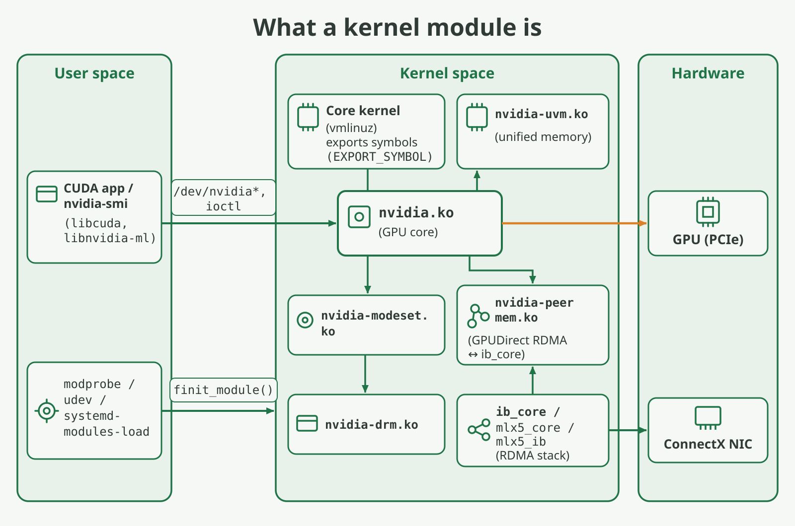
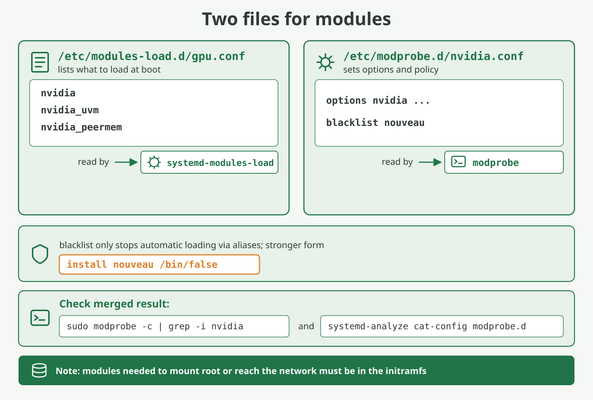
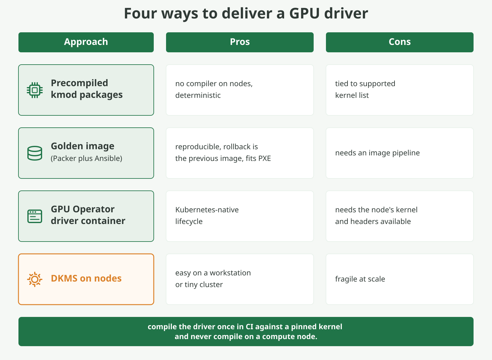
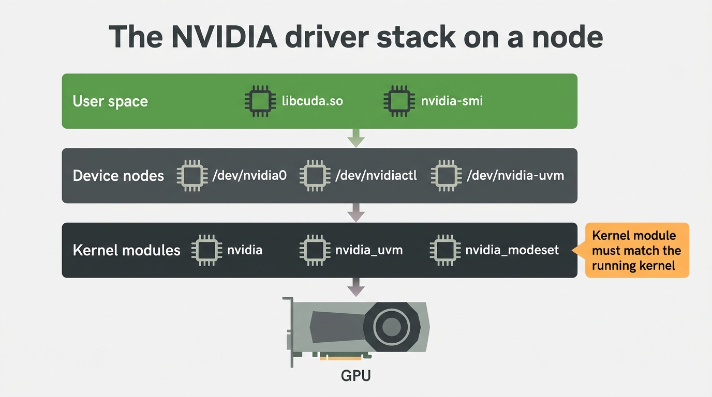
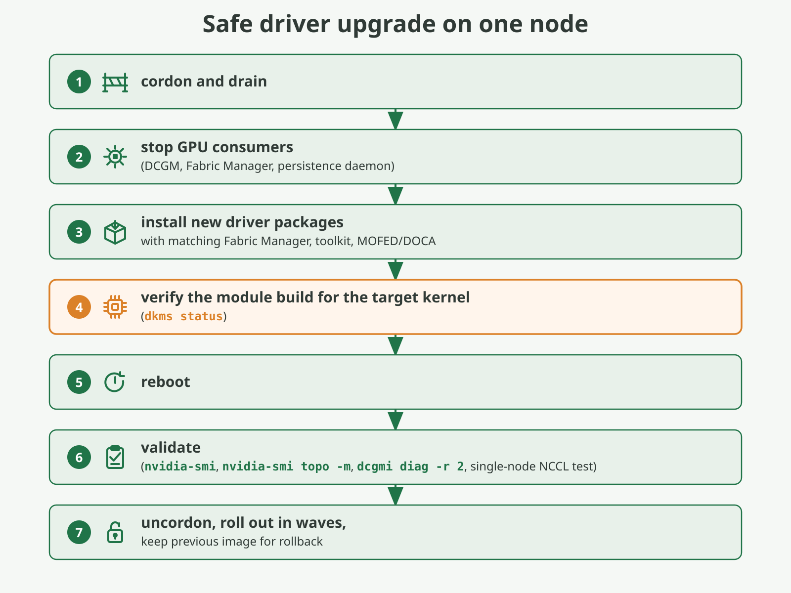
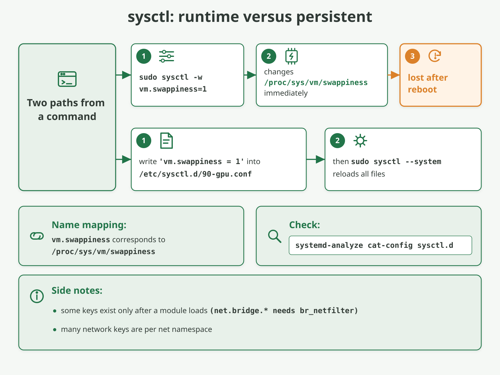
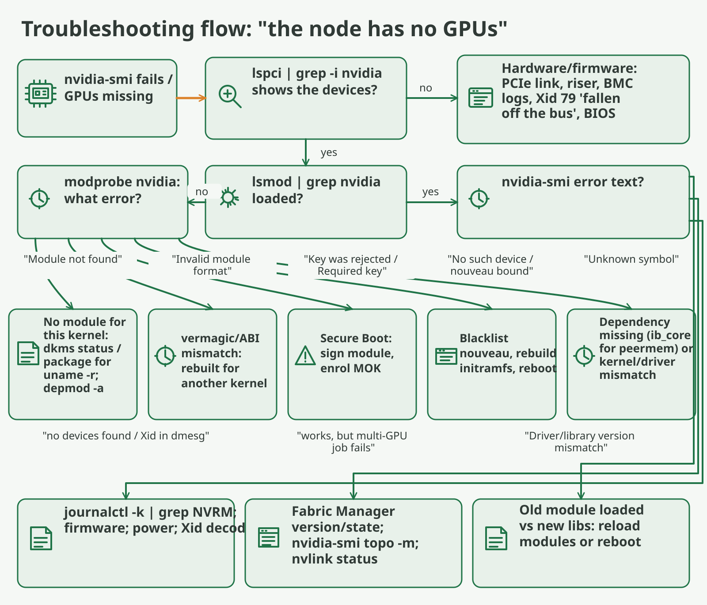

# 1.22 Kernel modules, DKMS and sysctl tuning for GPU nodes

| | |
|---|---|
| Level | Advanced |
| Priority tier | 0 |
| Lab venue | GCP VM (Ubuntu 22.04+; a GPU VM for the driver parts, a plain VM for module basics) |
| Part | Part 1: Linux, from the command line to the kernel and performance |
| Status | Drafted, labs **untested** |

## Why this matters for AI infrastructure

Picture a GPU node that comes back from maintenance. It boots, it accepts your login, and it has no GPUs at all. You look twice before you believe it. Nothing on that node is as fragile as the four-way pairing it depends on: **running kernel ↔ NVIDIA kernel modules ↔ user-space driver libraries ↔ CUDA in the container**. Each link must match the others, and each one can move without warning. A routine `apt upgrade` can install a new kernel, a reboot can follow maintenance, or a driver version can drift. Any one of these breaks the chain. Slurm then drains the node, Kubernetes shows `nvidia.com/gpu: 0`, and `nvidia-smi` reports that it "couldn't communicate with the NVIDIA driver". Fleet operators therefore treat the kernel and the GPU and NIC drivers as one versioned artefact, and so should you.

The modules are not the whole story. A node's behaviour is also shaped by a few hundred **kernel parameters**, which you reach through a tool called `sysctl`, and by **boot parameters** handed to the kernel at startup. Wrong values cause memory allocation stalls, dropped connections, failing `mmap` calls in data loaders, or swap thrashing. Right values are cheap, repeatable and testable, which is why this chapter spends time on them.

Here are the incidents this chapter prepares you to handle.

- After a kernel update `nvidia-smi` fails. Either the DKMS build did not run, or it failed for the new kernel, or Secure Boot refuses the unsigned module.
- A cluster-wide reboot causes a "boot storm" where every node compiles the driver at once, or a subset fails to compile because headers or compilers differ.
- `modprobe nvidia` fails with "Unknown symbol", "Required key not available" or "Operation not permitted", or because `nouveau` owns the device.
- A driver upgrade fails because processes still hold `/dev/nvidia*`, such as DCGM, Fabric Manager, the persistence daemon or a container, so the modules cannot be unloaded.
- Data-loader workers crash with `Cannot allocate memory` in `mmap` although RAM is free (`vm.max_map_count`), or they crash with too many open files.
- Network performance differs between nodes because sysctls were applied by hand on some of them.

Treat the kernel and the drivers as one release, and test any change on a single node before it reaches the fleet.

## Prerequisites and outcomes

Before you tackle a driver failure, you need some background. You should know the boot sequence and initramfs (1.14), systemd (1.15), memory and NUMA (1.17), `/proc` and `/sys` (1.10), the ELF and dynamic-linking basics (1.11), and the security layer (1.21, especially Secure Boot). Each of these explains one part of what happens when a module loads.

By the end of this chapter, you should be able to do seven things.

- Explain what a kernel module is, how it is built against a kernel, how symbols and `vermagic` make it version-specific, and where modules live.
- Use `lsmod`, `modinfo`, `modprobe`, `insmod`, `rmmod` and `depmod`. Load modules at boot, pass parameters to them, blacklist them, and rebuild the initramfs.
- Explain DKMS, how it hooks kernel installation, how to read its status and logs, and why large fleets prefer pre-built or image-baked modules: kmod and kABI packaging, and golden images.
- Explain the NVIDIA module family, which is nvidia, nvidia_uvm, nvidia_modeset, nvidia_drm, nvidia_peermem and nvidia-fs. Explain the open versus proprietary kernel modules, the matching user-space libraries, Fabric Manager and the persistence daemon, and how to upgrade a driver safely.
- Explain Secure Boot and module signing for out-of-tree drivers.
- Read and set sysctl parameters persistently. Name the important ones for network, VM, filesystem and kernel on GPU and HPC nodes, and explain when each helps or harms.
- Build a repeatable procedure: pin kernel, pin driver, canary, validate with `nvidia-smi`, DCGM diagnostics and NCCL tests, then roll out.

Work through these outcomes in order, because each one builds on the one before it.

## 1. What a kernel module is

Suppose a CUDA job fails at startup because the NVIDIA driver is missing from the running kernel. Before you can chase that down, you need one plain idea: what a kernel module is, and where it runs.

The Linux kernel is **monolithic**. That means it runs as one program in one address space, not as a set of small servers that talk to each other. It can still be **extended at run time** with **loadable kernel modules**, which are files ending in `.ko`, short for "kernel object". A module holds drivers for devices, filesystems and network protocols, or any other code that does not need to be compiled in. Picture the kernel as a house whose walls are already built, and a module as a room you slide into the frame while the lights are on. A module runs in kernel mode with full privilege. A bug in it can crash the machine, and a malicious module can take over the machine. That risk is why each module is tied to the exact kernel it was built for, and why Secure Boot and signing exist.



*Figure 1.22.1. What a kernel module is.*

The following facts explain how modules fail, and why.

- **Module files live under `/lib/modules/<kernel-release>/`**, where the release comes from `uname -r`. They are organised by subsystem, under `kernel/drivers/...`, and by origin, under `extra/`, `updates/`, `weak-updates/` and `updates/dkms/`. Each kernel version has its own tree, so a new kernel without rebuilt modules has no NVIDIA driver at all.
- **`vermagic`**, short for version magic, is a string embedded in the module. It records the kernel release and the key build options, and you can read it with `modinfo nvidia | grep vermagic`. A mismatch gives `insmod: ERROR: could not insert module: Invalid module format`. Some distributions guarantee a stable internal ABI within a major release, and RHEL's **kABI** whitelist is the best-known example. Modules built for one minor kernel can then load in later ones, through `weak-updates` symlinks. Debian and Ubuntu make no such promise, so their modules are rebuilt for each kernel.
- **Symbol resolution.** Modules call functions exported by the kernel or by other modules. `modprobe` resolves **dependencies** from `modules.dep`, which **`depmod`** generates, and it loads the prerequisites first. The message "Unknown symbol in module" means a dependency is missing, or the kernel does not export the symbol. This often happens when the kernel changed and the module did not.
- **Licence taint.** Proprietary modules *taint* the kernel, and you can check the flag with `cat /proc/sys/kernel/tainted`. Kernel developers decline to debug tainted kernels. NVIDIA's **open kernel modules** are dual MIT/GPL, so they avoid the proprietary taint for the kernel-side code. The user-space libraries remain proprietary.
- **Loading mechanisms.** The kernel loads modules in four ways. It loads them on demand when hardware appears, because udev matches the device's `modalias` and runs `modprobe`. It loads them at boot from `/etc/modules-load.d/*.conf` through `systemd-modules-load.service`. It loads storage and boot-critical drivers from the **initramfs**. And you can load them yourself with `modprobe`. One more path exists inside the kernel itself: `request_module()` is how the kernel asks for a module, such as a filesystem type or a network protocol.

If a driver seems missing, check first that a module exists for the kernel you are running.

## 2. Working with modules

When a node misbehaves, the module list is usually the first place to look, because it tells you what is actually loaded. The commands below show what is loaded, what a module expects, and what the kernel says about it.

```bash
uname -r ; ls /lib/modules/                       # running kernel and kernels with module trees
lsmod | head                                      # Module  Size  Used by  (reads /proc/modules)
lsmod | grep -E '^(nvidia|nouveau|mlx5|ib_)'       
modinfo nvidia                                    # filename, version, license, depends, vermagic, signer, sig_key, parm: options
modinfo -p nvidia                                 # only parameters
modinfo -F vermagic nvidia ; modinfo -F signer nvidia
sudo modprobe nvidia                              # load with dependencies (needs depmod data)
sudo modprobe -r nvidia_uvm                       # unload (and unused dependencies); fails if "in use"
sudo insmod /path/foo.ko ; sudo rmmod foo         # low level: no dependency handling, full path
sudo depmod -a                                    # rebuild modules.dep etc. after installing modules
modprobe --show-depends nvidia                    # what would be loaded
ls /sys/module/nvidia/parameters ; cat /sys/module/nvidia/version
cat /sys/module/nvidia/refcnt ; ls /sys/module/nvidia/holders
journalctl -k | grep -iE 'nvidia|NVRM|nouveau' ; dmesg --level=err,warn | tail -30
cat /proc/sys/kernel/tainted ; cat /proc/modules | head -3
```

### Configuring modules persistently



*Figure 1.22.2. modules-load.d lists what to load, and modprobe.d sets how and whether it loads.*

Two kinds of file keep a module loaded at boot and set its options. The first lists what to load. The second sets how it loads.

```ini
# /etc/modules-load.d/gpu.conf        -> loaded early at boot by systemd-modules-load
nvidia
nvidia_uvm
nvidia_peermem
```

```ini
# /etc/modprobe.d/nvidia.conf          -> options and policy, read by modprobe
options nvidia NVreg_EnableGpuFirmware=1          # example parameter names are driver-version specific: check modinfo -p
options nvidia NVreg_PreserveVideoMemoryAllocations=1
blacklist nouveau                                  # stop the open-source nouveau driver binding the GPU
options nouveau modeset=0
install nvidia-peermem /sbin/modprobe --ignore-install nvidia-peermem   # 'install' lines can run commands on load
alias char-major-195* nvidia
```

- **`blacklist`** only stops automatic loading that goes through aliases. An explicit `modprobe nouveau`, or another module that depends on it, can still load it. The stronger form is `install nouveau /bin/false`. For the NVIDIA driver, nouveau must be gone before the NVIDIA module loads. The **initramfs** must also be rebuilt, with `update-initramfs -u` or `dracut -f`, so that early boot honours the blacklist.
- You can also set module parameters on the kernel command line. Parameters such as `nvidia.NVreg_...=1`, `module_blacklist=nouveau` and `modprobe.blacklist=nouveau` take effect before userspace starts. That makes them the most reliable way to enforce early-boot behaviour, as chapter 1.14 explains.
- To see what actually applies, run `sudo modprobe -c | grep -i nvidia` for the merged effective configuration. Then run `systemd-analyze cat-config modprobe.d` to see where each line came from.
- Modules needed to mount the root filesystem, or to reach the network during boot, must sit in the **initramfs**. Check them with `lsinitrd` on dracut systems, or with `lsinitramfs /boot/initrd.img-$(uname -r)` on Debian and Ubuntu. A missing module produces "cannot mount root", or a node that never reaches the network on PXE or NFS-root boots.

### Why unloading fails and what to do

You will see `rmmod: ERROR: Module nvidia is in use` when a driver refuses to unload. That message means references still exist, and they come from two places. Some are user-space processes that hold `/dev/nvidia*`: training jobs, the DCGM host engine `nv-hostengine`, `nvidia-persistenced`, `nvidia-fabricmanager`, `dcgm-exporter`, `gpu-operator` pods, X or Wayland, and `nvidia-smi dmon`. Others are dependent modules: `nvidia_uvm`, `nvidia_modeset`, `nvidia_drm` and `nvidia_peermem`.

To find the holders, run `sudo lsof /dev/nvidia*` and `sudo fuser -v /dev/nvidia*`, then check `/sys/module/nvidia/holders` and `lsmod | grep nvidia`. Stop the services in dependency order: workloads, exporters, DCGM, fabric manager, and the persistence daemon. Unload the dependent modules first with `rmmod nvidia_drm nvidia_modeset nvidia_uvm nvidia`, and then load the new version. In Kubernetes, the GPU Operator's driver container performs this sequence. Cordon and drain the node first, so that you do not kill jobs.

Drain the node before you unload anything.

## 3. Out-of-tree modules: DKMS

This is the mechanism behind the failure that opens the chapter. A kernel update lands, the node reboots, and the driver no longer matches the kernel that just booted. Distributions ship modules built for their own kernels, and those are the ones the distribution supports. Third-party drivers sit outside that set. NVIDIA is one, and so are Mellanox OFED, ZFS, VirtualBox and vendor RAID cards. Such drivers are called **out-of-tree**, and you must build them against the headers of every kernel you run. Picture a driver as a piece of furniture cut to fit one room. Change the room, and you cut the furniture again.

**DKMS**, which stands for Dynamic Kernel Module Support, automates that rebuild. The module source lives under `/usr/src/<name>-<version>/` with a `dkms.conf` file. Hooks run when a kernel is installed, and on some distributions a boot service runs them as well. The hooks compile the module for that kernel and install it into `/lib/modules/<kver>/updates/dkms/`.

```bash
dkms status                                       # nvidia/550.xx, 6.8.0-45-generic, x86_64: installed
sudo dkms build   -m nvidia -v 550.xx -k $(uname -r)
sudo dkms install -m nvidia -v 550.xx -k $(uname -r)
sudo dkms remove  -m nvidia -v 550.xx --all
cat /var/lib/dkms/nvidia/550.xx/$(uname -r)/x86_64/log/make.log      # build failures are explained here
dpkg -l | grep -E 'linux-headers|linux-image'   ;   rpm -q kernel-devel kernel-headers      # headers must match the kernel
gcc --version ; cat /proc/version                  # compiler used for kernel vs module
```

Start with `dkms status`. If a build failed, the `make.log` file says why, in the compiler's own words. The last two lines of the block check the headers and the compilers, because both must match the kernel.

One term appears from here on. The **kernel ABI**, or application binary interface, is the set of internal functions and data layouts a module is compiled against. Kernel developers may change it in any release. Some distributions, such as RHEL and its relatives, promise a stable subset called **kABI** for the whole life of a major release. A module built against that subset keeps loading after minor kernel updates, and the kernel tooling, called weak-updates, links it into each new kernel's tree. Without that promise, every new kernel needs a module build of its own.

Six groups cover most DKMS failures. They are listed roughly in the order they happen, and you should check for them in that order.

1. **Missing or mismatched headers.** If `linux-headers-$(uname -r)` or `kernel-devel-$(uname -r)` is not installed, or is newer than the installed kernel, the build cannot start.
2. **Compiler drift.** The kernel was built with GCC *N*, and the module must be compatible with that build, which kernels check for. A different default compiler on the node breaks the build.
3. **Kernel API change.** A very new kernel can be paired with an old driver that does not support its internal APIs. The compile errors appear in `make.log`. The fix is to choose a supported driver and kernel pair, not to patch the source.
4. **Secure Boot.** The build succeeds, but the load fails because the module is unsigned. Section 5 takes that case apart.
5. **Build timing and load.** When thousands of nodes compile at once, the CPU spikes and node readiness slows. Builds also need network access for headers, and disk space in `/usr/src` and `/var/lib/dkms`.
6. **Partial upgrade.** A new kernel is installed, DKMS fails without a clear error, and the reboot lands in the new kernel with no GPU driver. Always verify `dkms status` for the *target* kernel **before** you reboot.

### Why large fleets avoid compiling on nodes



*Figure 1.22.3. Large fleets compile once in CI against a pinned kernel instead of compiling on compute nodes.*

Large fleets work to a single rule. Compile the driver **once** in CI, against a **pinned kernel**. Ship the result, and never compile on a compute node. The table compares the four common ways to deliver it.

| Approach | How | Pros | Cons |
|---|---|---|---|
| **Precompiled kmod packages** | Distribution/vendor builds modules per kernel (Ubuntu `linux-modules-nvidia-<ver>-<kernel>` packages; RHEL-family `kmod-nvidia` built against kABI; NVIDIA's precompiled driver packages) | No compiler on nodes; signed by the vendor chain on some distributions; deterministic | Tied to supported kernel list; update cadence follows the vendor |
| **Golden image** (Packer + Ansible, or BCM image build) | Build an image with kernel, headers if needed, driver, MOFED, and tooling; test; stream/PXE it to nodes | Reproducible, rollback = previous image, fits PXE/diskless | Image pipeline needed; per-node identity (SSH host keys, machine-id) must be regenerated |
| **GPU Operator driver container** | Driver compiled/loaded inside a privileged DaemonSet pod per node and kernel (precompiled images exist for common kernels) | Kubernetes-native lifecycle | Needs the node's kernel/headers available to the container; upgrades interact with running pods; Secure Boot and rootfs constraints |
| **DKMS on nodes** | Hooks compile at install time | Easy on a workstation or a tiny cluster | Fragile at scale (above) |

The GPU Operator driver container needs a closer look. NVIDIA publishes precompiled driver images tagged for a specific driver branch and kernel version. If the node kernel is not on that list, the operator falls back to compiling inside the pod, which brings back every DKMS problem. In practice, pin the node kernel to one the published images cover, and read NVIDIA's support matrix before each kernel bump.

Each approach trades ease of setup against risk at fleet scale. DKMS on nodes is easy on one machine, but it is fragile at scale. Precompiled packages and golden images give you more control over what each node runs.

Treat the kernel, driver, MOFED/DOCA, Fabric Manager, container toolkit, and NCCL/CUDA minimum versions as **one release train**. Pin the combination and test it as a unit, and let updates in only through the pipeline. Hold kernel packages with `apt-mark hold linux-image-generic` or `dnf versionlock`, as chapter 1.7 explains, and stage each change on a canary node first.

Before a kernel update reaches the fleet, confirm that `dkms status` shows the driver built for the target kernel.

## 4. The NVIDIA driver stack

A GPU node runs several NVIDIA pieces, and each one depends on the others. When a job cannot reach a GPU or a network card, the first question is which piece failed. The table in this section shows what each piece does, so you know where to look first.



*Figure 1.22.4. The layers of the NVIDIA stack, from user-space libraries to kernel modules and the GPU.*

### Kernel modules and device nodes

Read the table as a map that runs from each device file to the component that owns it.

| Module / component | Role |
|---|---|
| `nvidia` | Core driver: GPU management, memory, scheduling; creates `/dev/nvidiaN`, `/dev/nvidiactl` |
| `nvidia_uvm` | Unified Virtual Memory (CUDA managed memory, page migration): `/dev/nvidia-uvm`, `/dev/nvidia-uvm-tools` |
| `nvidia_modeset`, `nvidia_drm` | Display/KMS and DRM integration; usually irrelevant on compute nodes but loaded by default |
| `nvidia_peermem` | Exposes GPU memory to the RDMA stack (**GPUDirect RDMA**); requires the MLNX/OFED or in-kernel `ib_core` stack; replaces the older `nv_peer_mem` |
| `nvidia-fs` (GDS) | GPUDirect Storage kernel component (`/dev/nvidia-fs*`) |
| `gdrdrv` | GDRCopy driver (low-latency CPU-GPU copies) |
| `nvidia-caps` | `/dev/nvidia-caps/*` capability nodes for MIG management |
| Fabric Manager (`nvidia-fabricmanager`) | **User-space service** that configures the NVSwitch fabric on HGX/DGX systems (NVLink topology and routing). Its version must exactly match the driver; if it fails, multi-GPU jobs fail even though `nvidia-smi` lists GPUs |
| `nvidia-persistenced` | Daemon (`systemctl enable nvidia-persistenced` or `nvidia-smi -pm 1`) that keeps the driver state initialised so GPUs do not tear down and re-initialise between jobs (saving `1–2 seconds` of cold driver initialization latency; consistent clocks/ECC state) |
| DCGM / `nv-hostengine` | Health monitoring and diagnostics (`dcgmi diag -r 3`) |
| Driver user-space | `libcuda.so.1`, `libnvidia-ml.so.1` (NVML), `nvidia-smi`, `nvidia-modprobe` (setuid helper that creates device nodes), GSP firmware under `/lib/firmware/nvidia/<version>/` |

Most rows are kernel modules. The Fabric Manager and the persistence daemon are the exceptions, because they are user-space services. A failed service looks different from a missing module, so when you read a row, ask first which of the two it is.

**Open versus proprietary kernel modules.** NVIDIA publishes an *open GPU kernel module* flavour. Its kernel-resident code is open source, and the heavy lifting runs in the GPU System Processor firmware. For recent data-centre GPUs, the open modules are the supported and recommended path. They apply to Turing and later GPUs, and they are required for Blackwell-class and Grace-based platforms. Older GPUs need the proprietary flavour.

You choose the flavour at install time, with `nvidia-driver-XXX-open` on Ubuntu, with `nvidia-open`, or with `--kernel-module-type=open` in the `.run` installer. Check `modinfo nvidia | grep -i license` and NVIDIA's current support matrix, and re-check both against each driver release.

### Installation methods and pitfalls

- **Distribution packages or the NVIDIA repository**, installed with `apt` or `dnf`, with module streams or meta-packages such as `cuda-drivers`. These integrate with package management, upgrades and DKMS or kmod, and they are the preferred choice for fleets.
- **The `.run` installer.** It is convenient for labs, but it bypasses the package manager, which makes it hard to track, remove and upgrade. It also builds against the running kernel. Avoid it on managed nodes, where you want the package manager to track each change.
- **Mixing methods.** A `.run` install over an `apt` install, or two driver branches on one node, produces library and module version mismatches. The error looks like "Failed to initialize NVML: Driver/library version mismatch". After an upgrade, the loaded module is older than the user-space libraries until you reload the modules or reboot the node. Unload and reload the modules (section 2), or reboot.
- **Blacklist nouveau and rebuild the initramfs** before the first load. Make sure no display manager grabs the GPU on compute nodes, and keep the `nvidia-persistenced` service enabled.
- **CUDA toolkit versus driver.** The host driver must be at least as recent as the minimum driver the container's CUDA version needs. The CUDA runtime, `libcudart.so`, runs inside the container. It calls the host driver libraries `libcuda.so` and `libnvidia-ml.so`, which are injected from the host. As a typical pairing, CUDA 13.x needs the Linux host driver branch `R580` or newer, and CUDA 12.x needs `R525` or newer. A newer CUDA runtime on an older driver fails to initialize CUDA. The exception is the forward-compatibility packages, `cuda-compat`, which cover supported data-centre GPUs across minor and major updates.

  Device code is a separate matter. `nvcc` packs compiled GPU code for known architectures, and a portable intermediate form called PTX, into one fatbinary. A newer GPU can compile the PTX when it first runs, which is why old binaries keep working on new hardware. Chapter 10.9 covers this in detail.
- **Clocks and framework memory settings.** Benchmark comparisons need stable clocks, and you get them from `nvidia-smi -lgc` for core clocks and `nvidia-smi -ac <mem_clock>,<graphics_clock>` for application clocks. In PyTorch, the caching allocator is tuned with `PYTORCH_ALLOC_CONF`, for example `expandable_segments:True`. Current PyTorch documentation names that variable as the main one and keeps `PYTORCH_CUDA_ALLOC_CONF` only as a backward-compatible alias, so older releases may know only the longer name. TensorFlow pre-allocates GPU memory unless `TF_FORCE_GPU_ALLOW_GROWTH=true` is set. Chapters 10.8 and 14.8 cover clocks and PyTorch tuning. They are not driver-install topics.

### Safe driver upgrade procedure (one node)



*Figure 1.22.5. Cordon, upgrade, verify the build for the target kernel, reboot, validate, then uncordon and roll out in waves.*

Run these seven steps on one node first, before the change goes anywhere near the fleet.

1. Cordon and drain the node. Slurm takes `scontrol update NodeName=n state=drain reason="driver upgrade"`, and Kubernetes takes `kubectl cordon && kubectl drain`.
2. Stop the GPU consumers: DCGM exporter and host engine, Fabric Manager, persistence daemon, MIG and monitoring agents, and container runtimes that use GPUs.
3. Install the new driver packages, along with matching Fabric Manager, container toolkit, and MOFED/DOCA if they are coupled.
4. Verify the module build for the target kernel, with `dkms status`, the package contents, or `modinfo -F version`.
5. Reboot, which is the most reliable way to guarantee that all old modules are gone. You can also unload and reload the modules.
6. Validate with `nvidia-smi`, checking versions, all GPUs, ECC, clocks and persistence. Then run `nvidia-smi topo -m`, `dcgmi diag -r 2` or `-r 3`, `nvidia-smi nvlink -s`, a single-node NCCL test with `all_reduce_perf -b 8 -e 8G -f 2 -g 8`, and finally a multi-node test for fabric health.
7. Uncordon the node. Roll the change across the fleet in waves, with an automatic halt on failures, and keep the previous image or packages for rollback.

Keep the previous image or packages until the new driver passes validation on every wave. If a wave fails, you roll back to the previous image.

## 5. Module signing, Secure Boot and lockdown

A node with Secure Boot turned on can refuse a driver that loads fine on another node. The driver file is the same one that works next door, and this node still rejects it. To see why, you need to know how the firmware and the kernel decide what is trusted.

With **Secure Boot**, the firmware starts only signed boot loaders. The signed kernel then restricts what can be loaded. This restriction is called kernel **lockdown**, and it can require **signed modules**, either through `CONFIG_MODULE_SIG_FORCE` or through lockdown "integrity" mode. The kernel's trusted keyrings come from three places. They are the built-in keys, the firmware `db` reached through `shim`, and the **Machine Owner Key (MOK)** list, which you manage with `mokutil`.

The workflow below does the whole job for an out-of-tree driver. It creates a key, enrolls it, signs the driver, and checks the result.

```bash
mokutil --sb-state                                          # SecureBoot enabled/disabled
openssl req -new -x509 -newkey rsa:2048 -keyout MOK.priv -outform DER -out MOK.der -nodes -days 3650 -subj "/CN=Cluster module signing/"
sudo mokutil --import MOK.der                               # asks for a one-time password; confirm at next boot in the MOK manager (console)
# sign a module (script shipped with kernel headers):
sudo /usr/src/linux-headers-$(uname -r)/scripts/sign-file sha256 MOK.priv MOK.der /path/nvidia.ko
modinfo nvidia | grep -E 'signer|sig_key|sig_hashalgo'
# DKMS signs automatically if configured (e.g. /var/lib/shim-signed/mok/MOK.priv and MOK.der on Ubuntu)
dmesg | grep -iE 'lockdown|Required key|signature'
keyctl list %:.platform ; sudo cat /proc/keys | head
```

Read the output of `modinfo` and `dmesg` after each step, so you can confirm that the module carries a signature the kernel accepts. When signing fails, you see `modprobe: ERROR: could not insert 'nvidia': Key was rejected by service` or `Required key not available`. The kernel can also log `Lockdown: ... unsigned module loading is restricted`.

Fleet operators face three further problems. The private key is a crown jewel, so keep it in an HSM or a CI secret store. Enrolment on bare-metal nodes needs console interaction, or a firmware-level key provisioning process such as BMC or Redfish `db` updates. Redfish is covered in Part 7, and Base Command Manager in Part 8. And the signing step must be part of the image build. Disabling Secure Boot is the shortcut, and sometimes policy forbids it.

Distribution-signed modules can remove the enrolment step. Ubuntu, for example, ships prebuilt and signed `linux-modules-nvidia-*` packages whose signature the standard shim already trusts, so no MOK enrolment is needed. That works only for the kernels and driver branches the distribution builds. If you compile your own modules, automate the signing in your image build rather than turning Secure Boot off to get past a load error.

## 6. sysctl and kernel parameters

Two situations catch people out here. In the first, a node was tuned by hand last month, it behaved perfectly, and after a reboot the tuning is gone. In the second, a setting was written into a file at boot and did nothing at all, because the kernel key it targets only exists once a certain module is loaded. Both are cheap to prevent once you know the mechanism.

### Mechanics



*Figure 1.22.6. Use sysctl -w to test and a sysctl.d file to make the setting survive a reboot.*

`sysctl` reads and writes **kernel parameters** exposed under `/proc/sys`. The dotted name maps to a path, so `vm.swappiness` ↔ `/proc/sys/vm/swappiness`. Changes made with `sysctl -w` are **runtime only**, and that is the trap. The new value works until the next reboot, then it quietly disappears. To keep a change, write it to a file in `/etc/sysctl.d/NN-name.conf`. Those files are read in lexical order by `systemd-sysctl.service`, and later files win. `/etc/sysctl.conf` is also read, and the distribution defaults live in `/usr/lib/sysctl.d`.

```bash
sysctl -a | wc -l ; sysctl vm.swappiness ; cat /proc/sys/vm/swappiness
sudo sysctl -w vm.swappiness=1                     # immediate, not persistent
echo 'vm.swappiness = 1' | sudo tee /etc/sysctl.d/90-gpu.conf ; sudo sysctl --system   # reload all files; shows which file set what
sysctl -a -r '^net\.ipv4\.tcp_.*mem'                 # regex filter
systemd-analyze cat-config sysctl.d                  # merged view with sources (newer systemd)
ls /proc/sys ; sysctl -n kernel.osrelease
# per-interface keys are dynamic: net.ipv4.conf.<iface>.rp_filter; per-namespace keys differ inside containers
# boot-time parameters are separate: cat /proc/cmdline  (GRUB: chapter 1.14)
```

Order matters, and this is where a tuned file can fail without telling you. Some parameters exist only after a module is loaded, and the `net.netfilter.*` and `net.bridge.*` keys need `br_netfilter`. A sysctl file applied before that module loads fails silently. Fix it by loading the module earlier through `modules-load.d`, or by applying the settings with a service that runs after the module.

Many sysctls are **namespaced**. Network keys are per net namespace, and `kernel.shm*` and `fs.mqueue.*` are per IPC namespace. Containers can set only the "safe" namespaced keys, and Kubernetes uses `securityContext.sysctls` with `--allowed-unsafe-sysctls` for the rest. Node-level values are the defaults that containers inherit.

Change one thing at a time, measure the result, and record the reason in the file comments. Configuration management, such as the Ansible `sysctl` module, applies the values consistently.

### Parameters that matter on GPU/HPC nodes

The table groups the parameters by area. Each row gives a typical setting and a caution, so you can see when a value helps and when it harms.

| Area | Parameter | Typical setting | Why / caution |
|---|---|---|---|
| Memory | `vm.swappiness` | 0 or 1 (or no swap at all) | Avoids swapping host memory that GPUs/data loaders depend on; with cgroup v2 use `memory.swap.max=0` for jobs. `0` does not forbid swapping under extreme pressure |
| | `vm.max_map_count` | 262144 to 1048576+ | Default 65530 breaks many `mmap`-heavy workloads (dataloaders with many shards, Elasticsearch, large pinned/mapped regions); symptom is `ENOMEM` from `mmap` with free RAM |
| | `vm.overcommit_memory`, `vm.overcommit_ratio` | 0 (heuristic) default; 1 for some HPC codes; 2 for strictness | `2` can cause surprising allocation failures with large virtual reservations (CUDA reserves huge virtual ranges) |
| | `vm.dirty_background_ratio` / `vm.dirty_ratio` (or `*_bytes`) | e.g. 5 / 20 (bytes forms for big-RAM nodes) | Percentage-based values on 1-2 TB nodes allow tens of GB of dirty data and long flush stalls during checkpoint writes; prefer `dirty_bytes`. Very high ratios (80) smooth short bursts but risk multi-second stalls |
| | `vm.min_free_kbytes` | Raise modestly on very large-RAM nodes | Keeps reclaim headroom for atomic allocations (NIC) |
| | `vm.zone_reclaim_mode` | 0 | NUMA reclaim can cause stalls (chapter 1.17) |
| | `vm.nr_hugepages` | Sized explicitly if apps use explicit huge pages | Static pages are deterministic; THP is a separate sysfs knob (`/sys/kernel/mm/transparent_hugepage/enabled`: `always`, `madvise`, `never`) |
| | `kernel.numa_balancing` | 0 for pinned workloads | Automatic NUMA balancing induces page faults and migrations; disable when ranks are pinned (and measure) |
| | `vm.vfs_cache_pressure`, `vm.drop_caches` | default; never drop caches in production loops | |
| Files | `fs.file-max`, `fs.nr_open`, per-process `ulimit -n` / `LimitNOFILE` | 1M+ system, 1048576 per service | Many dataloader workers/sockets; systemd services ignore `/etc/security/limits.conf` and need `LimitNOFILE=` |
| | `fs.inotify.max_user_watches`, `max_user_instances` | 524288 / 512+ | File watchers (IDE, Kubernetes agents, log shippers) |
| | `fs.aio-max-nr` | raise for databases / O_DIRECT async I/O | |
| Network (TCP path) | `net.core.rmem_max`, `wmem_max`, `net.ipv4.tcp_rmem`, `tcp_wmem` | up to tens of MB (e.g. 64M to 128M max) | Large bandwidth-delay-product transfers (object storage, checkpoints, cross-site). Does **not** affect RDMA verbs traffic. Gigantic values (2 GB) are wasteful: memory is committed per socket |
| | `net.core.netdev_max_backlog`, `net.core.somaxconn`, `net.ipv4.tcp_max_syn_backlog` | 16384 to 250000 / 4096+ | Burst handling for many connections |
| | `net.ipv4.tcp_congestion_control` (`bbr`, `cubic`), `net.core.default_qdisc` (`fq`) | site-specific | WAN/pacing effects; measure |
| | `net.ipv4.tcp_mtu_probing`, MTU on interfaces | 1 where black holes exist | MTU mismatch causes hangs on large transfers |
| | `net.ipv4.conf.all.rp_filter` | 0 or 2 on multi-homed fabric nodes | Strict mode drops asymmetric-path packets |
| | `net.ipv4.neigh.default.gc_thresh1/2/3` | raise on big flat L2/L3 fabrics | ARP table overflow shows as `neighbour table overflow` |
| | `net.ipv4.ip_local_port_range`, `tcp_tw_reuse` | wider range | Many outgoing connections |
| | `net.ipv4.ip_forward`, `net.bridge.bridge-nf-call-iptables`, `net.ipv4.conf.all.forwarding` | 1 (Kubernetes/CNI hosts) | Needed by container networking |
| | `net.ipv4.tcp_syncookies`, `icmp_echo_ignore_broadcasts` | defaults/on | Hardening |
| Kernel | `kernel.pid_max` | 4194304 on big nodes | Many threads (containers × workers) |
| | `kernel.threads-max`, `kernel.sched_*` | defaults | |
| | `kernel.shmmax`/`shmall`, `kernel.sem` | modern defaults large | Legacy MPI/DB tuning |
| | `kernel.core_pattern`, `fs.suid_dumpable` | `/var/crash/%e.%p.%t` or `systemd-coredump` | Keep cores for NCCL/CUDA crashes (chapter 1.21) |
| | `kernel.yama.ptrace_scope` | 1 (hardened default); 0 where MPI needs it | Open MPI and UCX single-copy transfers (CMA) need 0 or the `CAP_SYS_PTRACE` capability; with 1 they fall back to slower paths. Debuggers conflict the same way |
| | `kernel.perf_event_paranoid`, `kernel.kptr_restrict` | 1 or 2 for profiling users | Profiling needs access (1.24) |
| | `kernel.watchdog_thresh`, `kernel.panic`, `kernel.panic_on_oops` | `panic=10` etc. | Auto-reboot nodes that panic (fleet health) |

Boot parameters are a separate set, and they often pair with the values above. You put them on the kernel command line. The common ones are `transparent_hugepage=`, `numa_balancing=disable` and `iommu=pt`. The last one is passthrough: it lowers DMA translation overhead on bare metal, and it keeps the IOMMU for SR-IOV and VFIO. Others are `intel_iommu=on` or `amd_iommu=on`, `processor.max_cstate` or `intel_idle.max_cstate`, `isolcpus`, `nohz_full`, `rcu_nocbs`, `default_hugepagesz=1G hugepagesz=1G hugepages=N`, `pcie_aspm=off` on vendor advice only, `crashkernel=`, `console=ttyS0,115200n8`, `audit=1`, and `mitigations=`.

Some GPU-direct paths have their own IOMMU and ACS requirements. PCIe ACS can force peer-to-peer traffic through the root complex. Follow the vendor guidance for GPUDirect RDMA, and verify it on your hardware.

**Notes on contested values.** Sources disagree about THP. Disable it for latency-sensitive inference, or when compaction stalls appear. Leave it on, or set `madvise`, for throughput training. Choose by measurement, using `/proc/vmstat` `thp_*` and `compact_stall`.

The same disagreement applies to `vm.swappiness=0` with no swap, compared with a small swap plus `memory.swap.max`. It applies again to IOMMU passthrough compared with full translation, which depends on your virtualisation needs.

### Applying settings as code

Keep the values in configuration management, so every node you manage gets the same ones. The Ansible task below writes them to a drop-in file and reloads it.

```yaml
# Ansible (roles/gpu_node/tasks/sysctl.yml)
- name: GPU node sysctls
  ansible.posix.sysctl:
    name: "{{ item.key }}"
    value: "{{ item.value }}"
    sysctl_file: /etc/sysctl.d/90-gpu-node.conf
    sysctl_set: true
    state: present
    reload: true
  loop: "{{ gpu_node_sysctls | dict2items }}"
```

If you set limits only in the login shell, services will not see them, so set the defaults in systemd.

```ini
# /etc/systemd/system.conf.d/limits.conf  (limits for systemd services; PAM limits.d is for login sessions)
[Manager]
DefaultLimitNOFILE=1048576
DefaultLimitMEMLOCK=infinity
```

Locked memory matters for pinned memory and RDMA, which you can check with `ulimit -l`. A process that pins large buffers needs `memlock unlimited`. Where that limit comes from depends on how the process starts. Login sessions read `/etc/security/limits.d/*.conf`, services read `LimitMEMLOCK=infinity`, Docker takes `--ulimit memlock=-1`, pods take the container runtime defaults, and Slurm uses `PropagateResourceLimits` and the `slurmd` limits.

Check the value inside the job itself, with `ulimit -a` in an `srun` step and in a pod, because limits do not propagate the way people assume.

Record the current value of every parameter before you change it, and write down why you want the new one.

## 7. Troubleshooting flow: "the node has no GPUs"

Picture the ticket that reads: "Node 17 has no GPUs." Use this flow when `nvidia-smi` fails, or when the GPUs are missing from a node that should have them. Start at the top and answer one question at a time. Each answer points you to the next check. If you already know where the fault is, you can skip ahead.



*Figure 1.22.7. Troubleshooting flow: "the node has no GPUs".*

Some symptoms do not fit neatly into the flow. The table lists them with their cause and their fix. If you see one of them, jump straight to its row.

| Symptom | Cause | Fix |
|---|---|---|
| Works for root, not for users | `/dev/nvidia*` permissions or container/device-cgroup rules | `ls -l /dev/nvidia*`, udev rules, `nvidia-modprobe`, group membership |
| `/dev/nvidia-uvm` missing | `nvidia_uvm` not loaded, device node not created | `modprobe nvidia_uvm`, `nvidia-modprobe -u -c=0` |
| GPUDirect RDMA not active | `nvidia_peermem` missing or MOFED mismatch | `lsmod \| grep peermem`, `ibv_devinfo`, NCCL `NCCL_DEBUG=INFO` shows `GDRDMA` |
| Reboot loop or hang after kernel update | Initramfs lacks storage/network driver; wrong kernel parameters | Boot previous kernel (GRUB menu), rebuild initramfs, check `/proc/cmdline` |
| Different behaviour between "identical" nodes | Sysctl or boot parameters drifted, firmware versions differ | Compare `sysctl -a` and `cat /proc/cmdline` across nodes (Ansible facts, `pdsh`), enforce with config management |
| Memory allocation failures in dataloader | `vm.max_map_count`, `ulimit -l`, `ulimit -n`, cgroup limits | Section 6, chapter 1.18 |
| DKMS compile stampede after maintenance | Compile on boot on every node | Move to precompiled modules or images |

Work top-down. Check the hardware first, then the module, then the driver's own messages, and only then the configuration. That order keeps you from changing settings before you know the cause.

## 8. Hands-on lab: modules, DKMS, and sysctl

Start with the self-checking Python lab. You can run it on your own machine, and it checks the logic before you touch a real node. Fix any failure there first. It verifies the NVIDIA kernel module unload dependency order, `vermagic` and Secure Boot MOK signature load eligibility, CUDA `12.x` (`R525`) and `13.x` (`R580`) host driver branch compatibility, `Driver/library version mismatch` detection, and GPU-node `sysctl` auditing.

```bash
python3 code/part01/kernel_modules_sysctl_lab.py
```

Next, work through the three parts below. Parts A and C run on a disposable Ubuntu VM. Part B runs on a GPU VM. The commands below were not run on live hardware, so run them on a disposable machine first.

**Part A: modules without GPUs**

1. `uname -r`; `ls /lib/modules/$(uname -r)/kernel/drivers | head`; `lsmod | wc -l`.
2. Pick a harmless module (e.g. `dummy` or `loop`): `modinfo dummy`; `sudo modprobe dummy numdummies=2`; `ip -br link | grep dummy`; `lsmod | grep dummy`; `sudo modprobe -r dummy`.
3. Persist with `/etc/modules-load.d/dummy.conf` and `/etc/modprobe.d/dummy.conf` (`options dummy numdummies=2`); reboot; verify; remove the files.
4. Blacklist a module (`blacklist floppy` or another unused one); see `modprobe -c | grep floppy`; rebuild initramfs (`sudo update-initramfs -u`); compare `lsinitramfs` before/after.
5. Write a minimal "hello world" module (`hello.c`, `Makefile` with `obj-m += hello.o`, `make -C /lib/modules/$(uname -r)/build M=$PWD modules`; needs `build-essential` and `linux-headers-$(uname -r)`); `sudo insmod hello.ko`; `dmesg | tail`; `modinfo hello.ko`; `sudo rmmod hello`. Observe `vermagic`. Then try loading it on a different kernel (or inspect with `modinfo -F vermagic`) and note the refusal.
6. Register the same module under DKMS: create `/usr/src/hello-1.0/` with source, `Makefile`, `dkms.conf` (`PACKAGE_NAME`, `PACKAGE_VERSION`, `BUILT_MODULE_NAME[0]`, `DEST_MODULE_LOCATION[0]="/updates/dkms"`, `AUTOINSTALL="yes"`); `sudo dkms add -m hello -v 1.0 && sudo dkms build -m hello -v 1.0 && sudo dkms install -m hello -v 1.0`; install a second kernel (`apt install linux-image-<other>`) and watch DKMS build for it; `dkms status`.

**Part B: the NVIDIA driver (GPU VM)**

7. Record state: `lspci | grep -i nvidia`, `cat /proc/cmdline`, `mokutil --sb-state`, `lsmod | grep -E 'nouveau|nvidia'`.
8. Install the driver from the distribution or NVIDIA repository. Note the exact version and flavour, open or proprietary. Then check `dkms status`, `modinfo nvidia | grep -E 'version|license|vermagic|signer'`, and `nvidia-smi`.
9. Enable persistence: `sudo systemctl enable --now nvidia-persistenced`; `nvidia-smi -q | grep -i persistence`. Measure the time of the first `python -c 'import torch; torch.zeros(1).cuda()'` with and without persistence. Stop the daemon and unload the modules to emulate a cold start.
10. Break it on purpose, one case at a time, with console access and a snapshot. (a) Install a newer kernel *without* headers, observe the DKMS failure in the logs, then reboot into it and diagnose. (b) Enable Secure Boot with an unsigned module, read the `dmesg` error, then sign the module and enrol the key. (c) Load `nouveau` by removing the blacklist, and see the conflict.
11. Unload and reload: stop all GPU services, run `lsof /dev/nvidia*`, then `sudo rmmod nvidia_uvm nvidia`, then `sudo modprobe nvidia`, and confirm.
12. Version mismatch demo (optional): upgrade the packages without a reboot and observe "Driver/library version mismatch". Fix it by reloading the modules or rebooting.

**Part C: sysctl**

13. Record a baseline with `sysctl -a > /tmp/sysctl.before`. Apply a drop-in with the table values you can justify, run `sudo sysctl --system`, and diff the output.
14. Demonstrate `vm.max_map_count`. Write a small script that mmaps many small anonymous regions until it fails at 65530 (the default), and then again at the raised value.
15. Demonstrate `ulimit -l`. Allocate pinned memory (`cudaHostAlloc`, or `mlock` in C or Python via `mmap` and `mlockall`) under a low limit and under an unlimited one, in a systemd service and in a login shell.
16. Measure `vm.dirty_*` effects with a large sequential write (`dd if=/dev/zero of=big bs=1M count=20000`). Watch `/proc/meminfo` Dirty and the write stalls with `iostat` or `vmstat`.

Run the parts in order, and stop at the first step that surprises you.

## 9. Common mistakes

These are the mistakes teams make most often on GPU nodes. Read the list before you change a node, and look for the one your team most often skips.

- Installing a new kernel and rebooting without checking that the GPU and NIC modules exist for it.
- Compiling drivers on thousands of nodes at boot. Letting unattended upgrades change kernels on GPU nodes.
- Mixing driver install methods or branches, and forgetting that Fabric Manager and the container toolkit must match.
- `blacklist nouveau` without rebuilding the initramfs.
- Disabling Secure Boot to "fix" signing instead of automating signing.
- Setting giant sysctl values, such as 2 GB socket buffers, believing they accelerate RDMA.
- Persisting sysctls that depend on modules not yet loaded.
- Assuming `/etc/security/limits.conf` applies to systemd services or containers.
- Tuning by copy-paste from a blog, with no baseline, no measurement and no rollback.
- Treating one benchmark on one node as proof for the fleet, and accepting configuration drift between nodes.

Put a check for your team's most-skipped item into the runbook, so that the next change does not skip it.

## 10. Interview angles

You may meet these questions when you interview for a role that runs GPU fleets. Each one asks you to explain a mechanism and a trade-off, so practise answering in your own words.

- "After a kernel patch, half the nodes boot with no GPUs. Walk through the investigation." Your answer should cover DKMS status, headers, make.log, Secure Boot, initramfs, nouveau, and Fabric Manager.
- "Why do you ban DKMS on production GPU fleets, and what do you use instead?"
- "How do you upgrade the NVIDIA driver on 1,000 nodes safely?" Your answer should cover cordon, drain, canary, validation with DCGM and NCCL, waves, and a rollback image.
- "Open versus proprietary NVIDIA kernel modules?"
- "What are `nvidia-persistenced`, Fabric Manager, `nvidia_peermem`, `nvidia_uvm`?"
- "Which sysctls do you set on a GPU training node and why? Which do you refuse to change?"
- "How does Secure Boot interact with out-of-tree drivers?"

Practise each answer out loud, and check that it names the command or file you would actually use.

## Exercises

Work through these after you read the chapter. They ask you to explain how the pieces fit together, so try to answer in your own words before you check the text.

1. **Kernel Module Mechanics, `vermagic`, `depmod`, and `insmod` vs. `modprobe`:** (a) Where do `.ko` files live on disk for a given kernel release? What happens when `insmod` or `modprobe` encounters a `vermagic` mismatch (`validate_module_load_eligibility()`)? (b) Contrast `insmod` with `modprobe`. Then explain how `depmod -a`, `modalias`, `/etc/modules-load.d/*.conf`, and `/etc/modprobe.d/*.conf` work together.
2. **Unloading `nvidia.ko`, Blacklisting `nouveau`, and `Driver/library version mismatch`:** (a) You need to unload `nvidia.ko` without rebooting. But `rmmod nvidia` fails with `Module nvidia is in use`. List the commands to find open file descriptors and module holders. State the exact order (`NVIDIA_MODULE_UNLOAD_ORDER`) in which the NVIDIA modules must be unloaded. (b) Why does `blacklist nouveau` require `install nouveau /bin/false` and an `initramfs` rebuild? What causes `Failed to initialize NVML: Driver/library version mismatch`?
3. **DKMS Failure Modes vs. Precompiled `kABI` / Golden Images at Fleet Scale:** List six reasons DKMS builds fail on production GPU nodes. Then compare the four fleet driver delivery strategies (precompiled `kmod`/`kABI` packages, golden images, GPU Operator driver containers, and on-node DKMS).
4. **The NVIDIA Driver Stack, Open vs. Proprietary Modules, and CUDA Compatibility:** (a) State the role of `nvidia`, `nvidia_uvm`, `nvidia_peermem`, `nvidia-fs`, `nvidia-fabricmanager`, and `nvidia-persistenced` (`1–2 s` cold init latency saved). (b) Check `check_cuda_driver_branch_compatibility()` for a container running CUDA `12.x` (`R525+`) or CUDA `13.x` (`R580+`) on a host with driver `R550`, with and without `cuda-compat`. Then explain how `nvcc` fatbinaries combine `CUBIN` (`SASS`) and `PTX`.
5. **UEFI Secure Boot, Kernel Lockdown, and Signing Out-of-Tree `.ko` Modules:** Write the 4-command workflow (`openssl req -new -x509`, `mokutil --import MOK.der`, `sign-file sha256 MOK.priv MOK.der nvidia.ko`, `modinfo -F signer nvidia`) to sign an out-of-tree kernel module for a UEFI Secure Boot node. State what error `modprobe` and `dmesg` print when a module is unsigned.
6. **GPU Node `sysctl` Tuning, `DefaultLimitMEMLOCK=infinity`, and Safe Rollout:** (a) Audit a node with default settings (`vm.swappiness=60`, `vm.max_map_count=65530`, `kernel.numa_balancing=1`) using `audit_gpu_node_sysctls()`. Explain why `net.core.rmem_max` does not accelerate RDMA verbs traffic. (b) Write the 7-step safe driver/kernel rollout procedure for a 1,000-node GPU cluster.

If an answer is hard to write, go back to the section that covers it.

## Checkpoint questions (20)

Try to answer each question before you open its answer.

<details>
<summary>1. What is a loadable kernel module (`.ko`), where do modules live on disk, and what is `vermagic`?</summary>

A loadable kernel module is object code that the kernel links into itself while it runs, in ring 0. Each kernel release has its own module tree under `/lib/modules/$(uname -r)/`. Every `.ko` file carries a **`vermagic`** string, which holds the kernel version, the SMP and preemption flags, and the compiler ABI. The kernel checks that string when it loads the module. A mismatch fails with `Invalid module format`. You can read the string with `modinfo -F vermagic`.
</details>

<details>
<summary>2. What is the difference between `insmod` and `modprobe`, and what does `depmod -a` do?</summary>

`insmod /path/to/foo.ko` is a low-level tool. It loads one file by path. It does not resolve dependencies, and it does not read `/etc/modprobe.d/`. `modprobe foo` is the fuller tool. It looks up `foo` in `/lib/modules/$(uname -r)/modules.dep`, which `sudo depmod -a` generates. It loads every prerequisite module first, and it applies the options and blacklists in `/etc/modprobe.d/*.conf`.
</details>

<details>
<summary>3. How do modules get loaded automatically when hardware is detected or at boot?</summary>

When the kernel finds a PCI or USB device, it sends a `uevent` that contains a `MODALIAS` string. `systemd-udevd` runs `modprobe` on that alias, matched against `modules.alias`. Modules listed in `/etc/modules-load.d/*.conf` load early at boot, through `systemd-modules-load.service`. Root-storage and boot-network drivers are packed inside the `initramfs`.
</details>

<details>
<summary>4. Why is `blacklist nouveau` alone sometimes not enough, and why must you rebuild the `initramfs` after adding it?</summary>

`blacklist nouveau` stops only the automatic loading that goes through module aliases. Another module that depends on `nouveau` can still pull it in. To close that gap, add `install nouveau /bin/false` as well. Early boot loads graphics and KMS drivers from the `initramfs` before the root filesystem mounts. So you must run `sudo update-initramfs -u` (or `sudo dracut -f`). Otherwise the `initramfs` will not include the blacklist.
</details>

<details>
<summary>5. Why does `rmmod nvidia` fail with `Module nvidia is in use`, and what is the exact sequence to unload it cleanly?</summary>

Picture a training node that you must upgrade without a reboot. The kernel refuses to unload a module while a process holds an open file descriptor to `/dev/nvidia*`, or while dependent modules are still loaded. Check `cat /sys/module/nvidia/refcnt` and the `holders` directory to see which. Stop all user-space consumers first, such as workloads, `dcgm`, `nvidia-fabricmanager` and `nvidia-persistenced`. Find them with `sudo lsof /dev/nvidia*`. Then unload the dependent modules in order: `sudo rmmod nvidia_drm nvidia_modeset nvidia_peermem nvidia_uvm nvidia`.
</details>

<details>
<summary>6. How does DKMS work, and what are the six most common reasons a DKMS build fails after a kernel update?</summary>

DKMS keeps module source under `/usr/src/<module>-<version>/`. On each kernel installation, it runs hooks that compile the `.ko` files into `/lib/modules/<kver>/updates/dkms/`. A build fails for six common reasons. First, the matching `linux-headers-<kver>` or `kernel-devel-<kver>` package is missing. Second, the system `gcc` differs from the compiler that built the kernel. Third, the new kernel changed internal C APIs that this driver version does not support, which shows up in `make.log`. Fourth, the compiled `.ko` is left unsigned on a Secure Boot host. Fifth, many nodes build at once and run out of CPU, network or disk in `/usr/src` and `/var/lib/dkms`. Sixth, a partial upgrade leaves the new kernel without a driver, so the node reboots with no GPU.
</details>

<details>
<summary>7. Why do large GPU fleets avoid compiling drivers with DKMS on compute nodes, and what do they use instead?</summary>

Picture a fleet of 1,000+ nodes that all compile the driver at once. That causes boot storms. Node readiness slows down, and nodes drift apart when a few of them fail to compile. Large fleets therefore build once in CI, against a pinned kernel. They deploy one of three things: **precompiled `kmod` packages** (RHEL `kABI` `kmod-nvidia`, or Ubuntu `linux-modules-nvidia-*`), **immutable golden images** (built with Packer or BCM), or prebuilt **GPU Operator driver containers**.
</details>

<details>
<summary>8. Explain the role of each kernel module in the NVIDIA stack: `nvidia`, `nvidia_uvm`, `nvidia_modeset`, `nvidia_drm`, `nvidia_peermem`, and `nvidia-fs`.</summary>

`nvidia` is the core GPU driver, with device nodes `/dev/nvidia0..N` and `/dev/nvidiactl`. `nvidia_uvm` implements CUDA Unified Virtual Memory and page migration, through `/dev/nvidia-uvm`. `nvidia_modeset` and `nvidia_drm` provide display, KMS and DRM support. `nvidia_peermem` registers GPU `HBM` with the InfiniBand or RoCE RDMA stack (`ib_core`), which enables **GPUDirect RDMA**. Finally, `nvidia-fs` enables **GPUDirect Storage (GDS)**.
</details>

<details>
<summary>9. What are `nvidia-fabricmanager` and `nvidia-persistenced`, and what happens if either is stopped or mismatched?</summary>

`nvidia-fabricmanager` is a user-space daemon on NVSwitch servers (HGX or DGX). It trains and configures NVLink routing across the GPUs. Its version must match the driver exactly. If it does not, multi-GPU CUDA or NCCL jobs fail to set up peer access, even though `nvidia-smi` still lists all 8 GPUs. `nvidia-persistenced` keeps the driver state initialized while the GPU is idle. That saves `1–2 seconds` of cold initialization latency per job, and it preserves the clock and power settings.
</details>

<details>
<summary>10. What is the difference between NVIDIA's open GPU kernel modules and proprietary kernel modules?</summary>

The open kernel modules move most hardware management into signed firmware that runs on the GPU's on-die **GSP** (*GPU System Processor*). They also avoid tainting the Linux kernel with a proprietary license flag. The open flavour, `nvidia-open`, is dual MIT/GPL licensed. It is the recommended or required path for modern datacenter architectures, which include Turing, Ampere, Hopper, Blackwell and Grace. The user-space CUDA and NVML libraries stay proprietary, and they are identical in both flavours.
</details>

<details>
<summary>11. What causes `Failed to initialize NVML: Driver/library version mismatch`, and how do you fix it?</summary>

A package upgrade, such as `apt upgrade`, replaced the user-space NVML and driver libraries on disk with a newer version. Those libraries are `libnvidia-ml.so.1` and `nvidia-smi`. The older `nvidia.ko` kernel module stays loaded in RAM. Drain the node. Then either unload and reload the `nvidia*` kernel modules, or reboot.
</details>

<details>
<summary>12. How do CUDA runtime versions inside containers (`CUDA 12.x`, `CUDA 13.x`) relate to the host's NVIDIA driver branch (`R525`, `R580`), and what are `CUBIN` and `PTX`?</summary>

Only the kernel driver, `nvidia.ko`, and the matching user-space driver library, `libcuda.so.1`, come from the host. The CUDA runtime, `libcudart.so`, lives inside the container. The host driver must meet the minimum branch for that CUDA major release. That is `R525+` for CUDA `12.x` and `R580+` for CUDA `13.x`, unless the `cuda-compat` forward-compatibility libraries are installed. For GPU device code, `nvcc` bundles native **`CUBIN`** binaries, which are `SASS`, with virtual **`PTX`** assembly in a fatbinary. Future GPU architectures can then JIT-compile the `PTX`.
</details>

<details>
<summary>13. How do `nvidia-smi -lgc`, `nvidia-smi -ac`, `PYTORCH_ALLOC_CONF`, and `TF_FORCE_GPU_ALLOW_GROWTH=true` tune GPU behavior?</summary>

`nvidia-smi -lgc` locks the GPU core clocks. `nvidia-smi -ac <mem>,<gfx>` locks the memory and graphics clocks. Both remove the thermal and boost frequency jitter that makes benchmark runs differ. `PYTORCH_ALLOC_CONF=expandable_segments:True,max_split_size_mb:128` reduces fragmentation in the PyTorch caching allocator. `TF_FORCE_GPU_ALLOW_GROWTH=true` stops TensorFlow from pre-allocating 100% of VRAM at startup.
</details>

<details>
<summary>14. How do you sign an out-of-tree kernel module (`nvidia.ko`) for a UEFI Secure Boot node, and how do you verify the signature?</summary>

Start by generating an X.509 keypair with `openssl req -new -x509 -newkey rsa:2048 -keyout MOK.priv -outform DER -out MOK.der ...`. Enroll the public key in the Machine Owner Key list with `sudo mokutil --import MOK.der`. You then confirm it on the boot console. You can also enroll it in UEFI `db` through Redfish or the BMC. Next, sign the module with `/usr/src/linux-headers-$(uname -r)/scripts/sign-file sha256 MOK.priv MOK.der nvidia.ko`. Verify the result with `modinfo nvidia | grep -E 'signer|sig_key'`.
</details>

<details>
<summary>15. How do `sysctl` keys map to `/proc/sys/`, how are they persisted, and why can a `/etc/sysctl.d/*.conf` setting fail silently at boot?</summary>

Dots in a `sysctl` key become slashes under `/proc/sys/`, so `vm.swappiness` maps to `/proc/sys/vm/swappiness`. Persist settings in `/etc/sysctl.d/90-gpu-node.conf`, and apply them with `sudo sysctl --system`. A setting can fail silently at boot when it belongs to a module that is not loaded yet. If `systemd-sysctl.service` runs while the module is still unloaded, the `/proc/sys/` file does not exist. `br_netfilter` is one example. List the module in `/etc/modules-load.d/` so that it loads first.
</details>

<details>
<summary>16. Why must `vm.max_map_count` be raised on GPU training nodes, and what symptom appears when the default (`65530`) is hit?</summary>

PyTorch `DataLoader` workers, memory-mapped dataset shards (`safetensors`, `mmap`), CUDA unified and pinned mappings, and JVMs all create tens of thousands of distinct virtual memory areas (`VMA`s). When the count reaches `65530`, `mmap()` or `malloc()` fails with `ENOMEM`, which shows up as `Cannot allocate memory`. That happens even when hundreds of GiB of physical RAM are free. If you hit that symptom, raise `vm.max_map_count` to `262144` or `1048576`.
</details>

<details>
<summary>17. Do `net.core.rmem_max`, `wmem_max`, and `net.ipv4.tcp_rmem` affect InfiniBand or RoCEv2 RDMA verbs traffic?</summary>

No. RDMA verbs, such as `ibv_post_send` and `ibv_post_recv` that NCCL uses over InfiniBand or RoCEv2, bypass the Linux TCP/IP socket stack. They move data directly between registered user or GPU memory buffers. `rmem_max` and `tcp_rmem` tune only kernel TCP and UDP sockets. Those cover S3 object-store downloads, HTTP, and TCP storage. So when you tune those values for an RDMA job, you do not change the RDMA path.
</details>

<details>
<summary>18. Why should multi-homed GPU nodes set `net.ipv4.conf.all.rp_filter = 0` or `2` (loose) and raise `net.ipv4.neigh.default.gc_thresh1/2/3`?</summary>

GPU nodes often have several NICs on overlapping or asymmetric routing fabrics. Strict reverse-path filtering, `rp_filter = 1`, silently drops incoming packets whose return route leaves through a different interface. Setting `0` or `2`, which is loose mode, avoids that drop. On large flat L2 or L3 cluster subnets with thousands of nodes and pods, the ARP table overflows. You will see `neighbour: arp_cache: neighbor table overflow` unless you raise `gc_thresh1/2/3`.
</details>

<details>
<summary>19. How do you ensure `LimitNOFILE=1048576` and `LimitMEMLOCK=infinity` actually take effect for both SSH users and `systemd` services / containers?</summary>

`/etc/security/limits.d/*.conf` is read by `pam_limits.so`, and it applies only to PAM login sessions, such as SSH. `systemd` services such as `kubelet`, `containerd` and `slurmd` ignore `limits.conf`. Set `DefaultLimitNOFILE=1048576` and `DefaultLimitMEMLOCK=infinity` in `/etc/systemd/system.conf.d/limits.conf`, or in per-unit `[Service]` drop-ins. Also set them in the container runtime's default ulimits.
</details>

<details>
<summary>20. Walk through the diagnostic decision tree when `nvidia-smi` fails on a node after maintenance.</summary>

Picture a node that fails `nvidia-smi` right after maintenance. First, run `lspci | grep -i nvidia`. If the device is missing, check the PCIe risers, power, BIOS, or `Xid 79` in the BMC logs or dmesg. If the device is present, run `lsmod | grep nvidia`. When the module is not loaded, run `sudo modprobe nvidia` and read the error. `Module not found` means no module is built for `uname -r`. `Invalid module format` means a `vermagic` mismatch. `Required key not available` means an unsigned module under Secure Boot. A `nouveau` conflict means you should blacklist it and rebuild the initramfs. If the module is loaded, read the `nvidia-smi` message. `Driver/library version mismatch` means you should reload the modules or reboot. On NVSwitch nodes, also check `systemctl is-active nvidia-fabricmanager`.
</details>

## Sources and review notes

- **Sources read in full:**
  - `how-linux-works-3rd-edition` — Brian Ward, *How Linux Works*, 3rd ed., **Chapter 3: Devices** and **Chapter 5: How the Linux Kernel Boots** (kernel initialization, boot options, kernel parameters, and UEFI Secure Boot problems).
  - `ai-systems-performance-engineering` — Chris Fregly, *AI Systems Performance Engineering*, **Chapter 3: OS, Docker, and Kubernetes Tuning for GPU-Based Environments** (the GPU software stack, `PTX`/`CUBIN` fatbinary compatibility, `R525` host driver branch for CUDA `12.x` and `R580` for CUDA `13.x`, `vm.swappiness`, pinned memory and `ulimit -l`, THP trade-offs, IRQ affinity, dirty-page tuning, `nvidia-persistenced` saving `1–2 seconds` initialization latency, clock locking `nvidia-smi -lgc` and `nvidia-smi -ac`, `TF_FORCE_GPU_ALLOW_GROWTH=true` and and `PYTORCH_ALLOC_CONF`).
  - `nvidia-devops/volume-10/03-os-provisioning-and-linux-security-hardening.md` — migrated the DKMS-versus-kABI/golden-image production reasoning, kernel and `sysctl` tuning table, UEFI Secure Boot MOK signing workflow, and Ansible `sysctl` automation (cross-referenced with Chapters 1.7, 1.10, 1.11, 1.14, 1.15, 1.17, 1.18, 1.21, 1.24, and 1.28, plus original study items 21–30).
- **Corrections (2026-11):** DKMS failure groups are now six everywhere. The ptrace_scope row states the MPI conflict. `PYTORCH_ALLOC_CONF` is the primary name and `PYTORCH_CUDA_ALLOC_CONF` the backward-compatible alias, per the PyTorch 2.15 CUDA notes at docs.pytorch.org, read 2026-11-12. The unsourced container-overhead and MLPerf claim was removed. The Ubuntu signed-module and GPU Operator precompiled-image paragraphs rest on general vendor behaviour and should be re-checked against current Ubuntu and NVIDIA documentation.
- **Run here:** `python3 code/part01/kernel_modules_sysctl_lab.py` (19 passed, 0 failed).
- **Explicitly labelled inferences:** The 7-step safe fleet driver upgrade runbook, `nvidia-smi` failure decision tree, `vm.dirty_bytes`, `module.param=value` (`kernel-parameters.txt`, `module-signing`), and `modules-load.d` + `sysctl.d` ordering rules connect Linux kernel module and `sysctl` mechanics to Part 5, Part 6, and Part 8 GPU cluster operations (plus original study items 23, 24, 25, 26, 27, 28, and 29).
- **Not verified on live hardware:** All interactive VM and GPU commands (`modprobe`, `insmod`, `rmmod`, `depmod`, `dkms`, `mokutil`, `sign-file`, `sysctl`, `nvidia-smi`, `dcgmi`, `all_reduce_perf`) were not run on live hardware and must be executed on a disposable VM or canary node.
