# 1.23 Performance methodology: USE, workload characterisation, drill-down

| | |
|---|---|
| Level | Intermediate |
| Priority tier | 0 |
| Lab venue | Any Linux VM (a GPU VM for the GPU exercises) |
| Part | Part 1: Linux, from the command line to the kernel and performance |
| Status | Drafted, labs **untested** |

## Why this matters for AI infrastructure

Picture a bad week on a GPU cluster. A training job runs at 40% of the expected tokens per second. An inference service has a good median latency but a terrible 99th percentile. A node that benchmarked well last month is now 15% slower. A manager asks the obvious question in the Monday meeting: why is the cluster slow? Three engineers answer at once, and each of them gives a different guess.

Most performance failures on GPU clusters are not exotic. They are ordinary resources pushed past their limit, a configuration that drifted, or a load that nobody characterised. What makes them hard is that the cluster never says which of those it is. It only says that a number looks wrong.

Without a method, engineers reach for the first explanation that comes to mind. One opens `nvidia-smi`, sees "GPU-Util 100%" and decides the GPUs are fine. Another blames the network, because the network belongs to another team. A third changes a random kernel parameter found on a forum and calls it tuning. Somewhere else a job scaled from 8 GPUs to 64 GPUs and gained only 3x, and nobody can say whether that is expected. That is how a week gets lost to guessing, and the bill arrives as idle GPU-hours.

With a method, the first ten minutes have a shape. You state the problem precisely. You check every resource for utilisation, saturation and errors. You characterise the load, and then you drill into the one place that explains the time. The shape is the same whether the suspect is a disk, a NIC or a GPU, which is why it is worth learning once and using for years.

This chapter teaches the durable part of performance engineering: **how to think**. It comes before the tool chapters, 1.24 observability and 1.25 benchmarking, and before the tuning chapters, 1.28 and the GPU and network parts. It then applies that thinking to GPU clusters. You apply the USE method to GPUs, NVLink, PCIe, InfiniBand and storage. You apply RED to inference services and goodput and efficiency metrics to training. For multi-GPU scaling you use Amdahl and the Universal Scalability Law, and for batching and capacity you use queueing and Little's law.

## Prerequisites and outcomes

You will get the most from this chapter if you already know the basics. You should be comfortable with processes, CPU scheduling, memory, disks and the observability commands from chapters 1.8, 1.12, 1.17 and 1.18. Networking details come in Part 2, and GPU specifics come in Parts 9 and 10. Here those topics appear only as examples, so do not worry if a few names are new.

By the end, you should be able to define latency, throughput, IOPS, utilisation, saturation, errors, workload and bottleneck precisely. Precise here means you could hand the definition to a colleague and they would measure the same thing. You should also convert each metric to time, so you can compare them. A time-scale picture helps with this, running from a CPU cycle up to a cross-continent round trip, and from DRAM to NVMe to the network. Use that scale to sanity-check any result you see, because a number that cannot fit the scale is usually a measurement error.

You will also learn the method. You apply the problem-statement method, the scientific method and the diagnosis cycle. You learn to spot the anti-methods, the streetlight, the random change and blame-someone-else. You run the Linux 60-second checklist and a GPU-node equivalent, which is the habit that ends most arguments before lunch.

For every resource on a GPU server, you apply the USE method and fill in a USE table. Each cell names the command that answers it, and the table includes the known unknowns, the questions you cannot answer yet. For services, you apply RED. You also use workload characterisation, drill-down, latency analysis, five whys, event tracing, baselines, static performance tuning and the performance mantras.

Last, you learn to tell load problems from architecture problems. Scalability curves help here: linear, contention, coherence, knee and ceiling. You fit Amdahl and USL to them. You use Little's law and the 60% rule for queueing, and percentiles, distributions and averages over intervals for statistics. Finally, you quantify the gain from a fix before you make it, decide when to stop, and write findings that others can verify.

Treat this list as a checklist for the rest of the chapter.

## 1. What "systems performance" covers

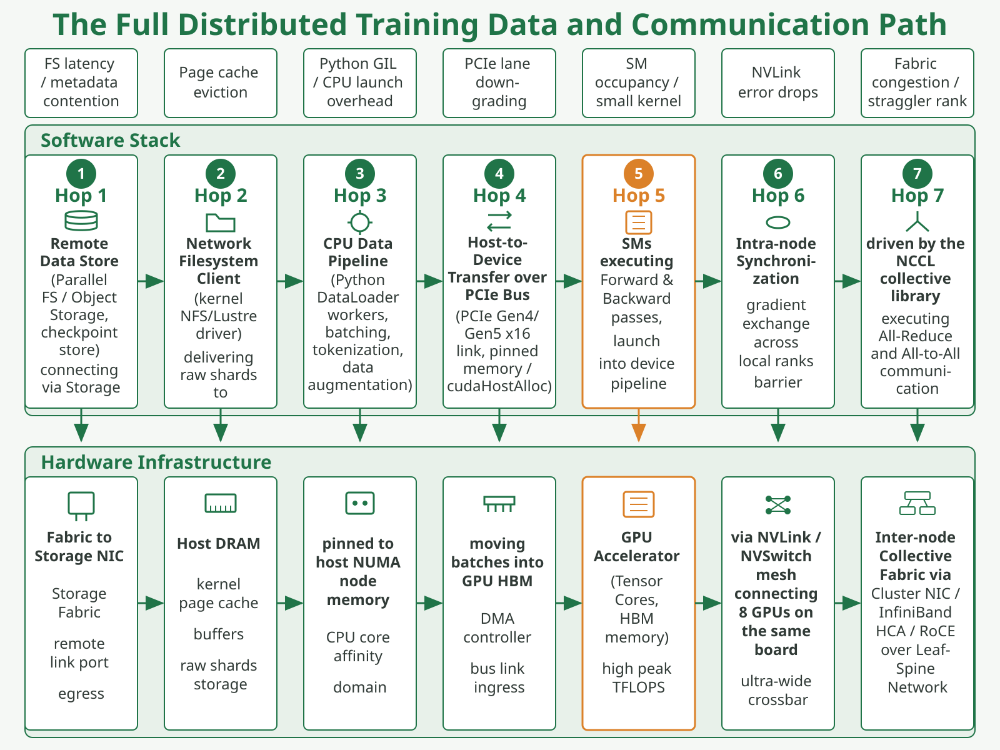

*Figure 1.23.1. A distributed training step traverses storage, host OS, PCIe, GPU accelerators, NVLink switches, and InfiniBand fabric, where any hop can become the bottleneck.*

Start with a distributed training job that runs slower than you expect. One step is slow, but the reason could sit almost anywhere along the path the work travels. Systems performance is the study of that whole path, from the application down to the hardware. The path covers the application, the libraries, the runtime, the kernel, the drivers, the hardware and the network. For a distributed job it also covers every server and service involved, which is where the search becomes wide.

Walk that path once for a training job. The work leaves the data store and crosses the network filesystem and the CPU data pipeline. It continues through host memory, PCIe and the GPU. Then it reaches NVLink and NVSwitch, the NIC and fabric, and the collective library. Any one of those hops can be the slow one. If you have no diagram of that path, draw one first, because you cannot analyse what you have not mapped.

Most performance work aims at one of three goals. You can reduce latency, which shows up as user experience, step time or time to first token. You can raise throughput, which is the rate at which the job or the service completes work. You can also reduce cost by removing waste. On GPU clusters, idle accelerators dominate cost, so cost reduction usually means raising goodput. Goodput is the useful work you get per GPU-hour.

Many people do performance work. Administrators, SREs, developers, network and storage engineers, and dedicated performance engineers all play a part. Each usually works inside its own area, so the network team checks the network and the storage team checks the disks. Hard problems cross those boundaries, and that is why a shared method matters more than any single expert.

Performance work also spans a project's whole life. You set objectives, build models and characterise prototypes. You run non-regression testing, benchmark releases and prove the idea in the target environment. After that come production tuning, monitoring, incident analysis and tooling. Cloud makes canary and blue-green rollouts cheap, which can tempt you to skip the early steps. Do the early steps anyway when you can, because architectural performance mistakes are the most expensive to fix later.

### Two perspectives

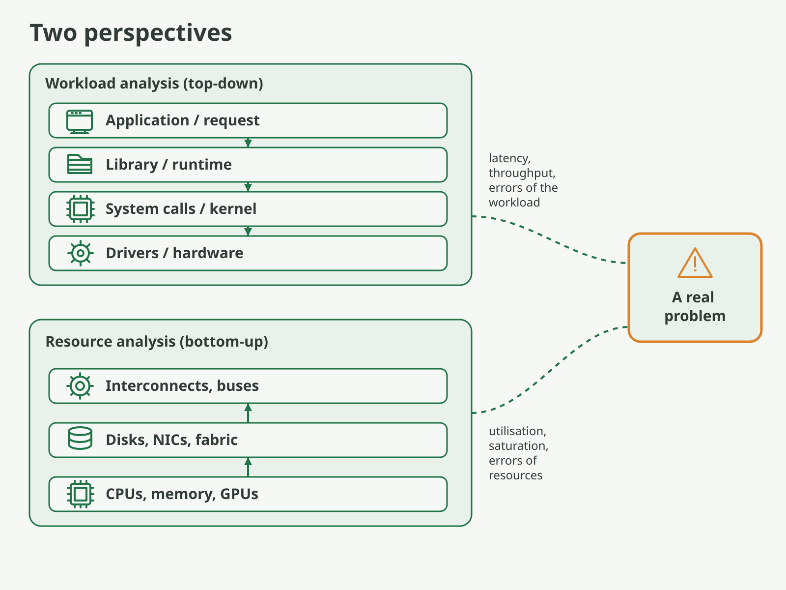

*Figure 1.23.2. Two perspectives.*

The same system looks different depending on where you stand, and both views are honest. Resource analysis looks up from the hardware. Workload analysis looks down from the request.

- Resource analysis is the view administrators usually take. You start with the resources and their metrics: IOPS, throughput, utilisation, saturation and errors. It serves capacity planning and one question: is any resource at its limit?
- Workload analysis is the view developers and SREs usually take. You start with the work being applied and the service's response: request rate, latency and completion, which shows up as errors. The attributes of the workload, the who, what, why and how much, reveal unnecessary or unbalanced work. The fastest request is the one you do not make.

Hard problems benefit from both views, because each one finds what the other quietly assumes away.

### Why performance is hard

Performance is hard for four reasons, and knowing them stops you expecting certainty. First, it is subjective. Is a 1 ms average disk latency good? Nobody can answer that in the abstract, because the answer depends on what you expect. Turn the question into a goal, such as "99% of steps under X s", and then the number can pass or fail.

Second, it is complex. Components interact, failures can cascade, and fixing one bottleneck often moves it somewhere else. Third, it has multiple causes, because three normal events can combine into one problem. Fourth, it has multiple issues. Finding a problem is easy. Finding the one that matters is the real work, so quantify each issue and estimate its speed-up.

Latency is the best metric for that quantification. Time can be compared and summed along a path, which IOPS and utilisation cannot, so a millisecond saved on one hop can be weighed against a millisecond saved on the next.

## 2. Vocabulary and concepts

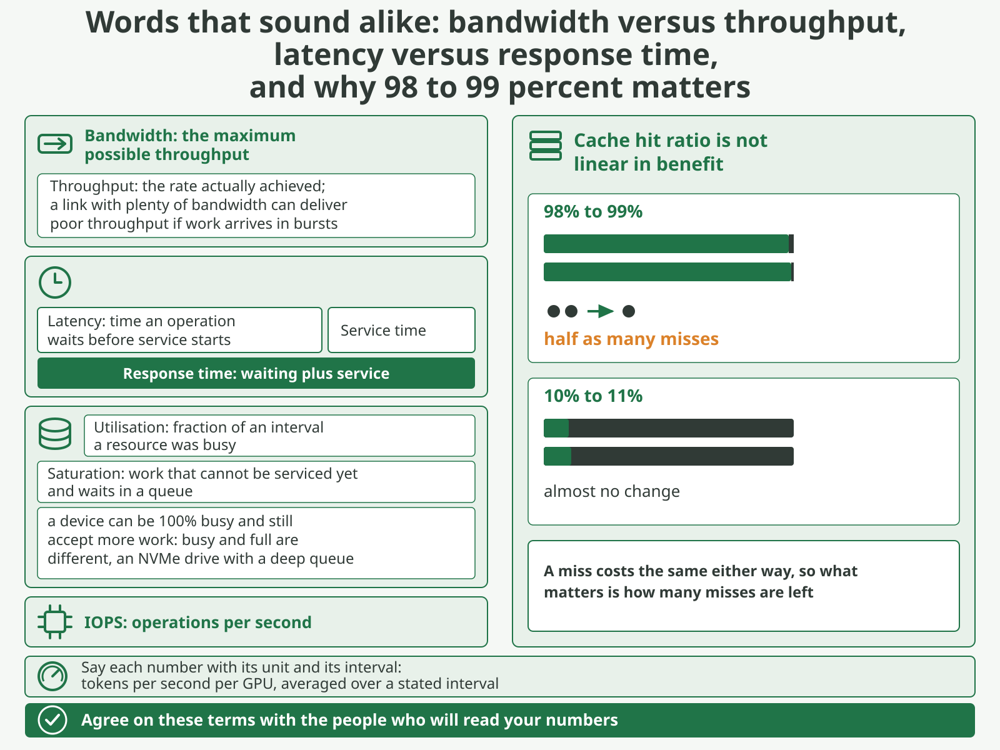

*Figure 1.23.3. Going from a 98 to a 99 percent hit ratio halves the misses, while 10 to 11 percent barely changes them.*

Performance talk uses a few words loosely, and two engineers can argue for an hour before noticing they mean different things. So pin the words down before you measure anything. This chapter uses throughput for the rate of work done, such as requests, tokens or samples per second, and IOPS for operations per second. Latency is the time an operation spends waiting before service starts, and response time is waiting plus service.

Utilisation is the fraction of an interval a resource was busy. Saturation is work that cannot be serviced yet and waits in a queue. Errors are failed or retried operations, which are cheap to check and often decisive. The bottleneck is the resource that limits the whole system, and removing one reveals the next.

A good test is to say each number out loud with its unit and its interval. "Throughput is high" fails that test, because nobody could act on it. Tokens per second per GPU, averaged over a stated interval, passes it, because a colleague would measure the same thing you did.

Two points cause the most confusion. Bandwidth is the maximum possible throughput, while throughput is the rate actually achieved. A link with plenty of bandwidth can still deliver poor throughput if the work arrives in bursts. Utilisation surprises people most. A device can be 100% busy and still accept more work, because busy and full are different things: an NVMe drive with a deep queue is a good example. Likewise, a cache hit ratio is not linear in benefit. Going from 98% to 99% matters far more than going from 10% to 11%. A miss costs the same either way, so what matters is how many misses are left.

### Latency and time scales

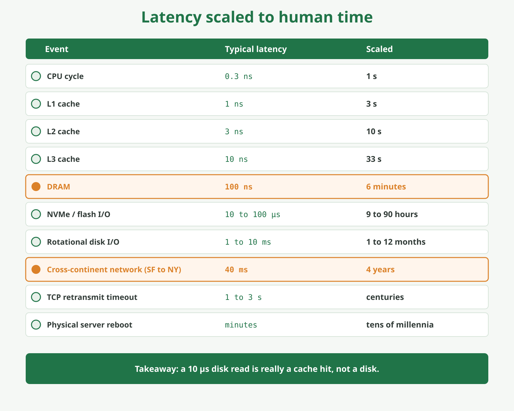

*Figure 1.23.4. Scaling latencies to human time shows how large the gaps between memory, disk and network are.*

Convert everything to time when you can, because time is the one currency every component accepts. You cannot compare 100 network I/Os with 50 disk I/Os. You can compare 100 ms of network time with 50 ms of disk time. It also helps to know the orders of magnitude, so that a suspicious number stands out before you dig. The table below scales things so that a 0.3 ns CPU cycle equals one second. Read the scaled column as a rough map of how far apart the events are.

| Event | Typical latency | Scaled |
|---|---|---|
| CPU cycle | 0.3 ns | 1 s |
| L1 cache | 1 ns | 3 s |
| L2 cache | 3 ns | 10 s |
| L3 cache | 10 ns | 33 s |
| DRAM | 100 ns | 6 minutes |
| NVMe / flash I/O | 10 to 100 µs | 9 to 90 hours |
| Rotational disk I/O | 1 to 10 ms | 1 to 12 months |
| Same-datacentre network round trip | 50 µs to 0.5 ms | days |
| InfiniBand RDMA one-way (switched) | about 1 to 2 µs | hours |
| Cross-continent network (SF to NY) | 40 ms | 4 years |
| TCP retransmit timeout | 1 to 3 s | centuries |
| Physical server reboot | minutes | tens of millennia |

Read the scaled column to feel the gap. A DRAM access feels like 6 minutes, and a cross-continent network round trip feels like 4 years. Keep those two feelings in mind the next time a loop touches memory or a lock waits on a remote node.

The AI-relevant rows are orders of magnitude too, and they depend on your hardware, so verify them on your own platform. HBM access takes hundreds of ns, and an NVLink hop takes around a microsecond or less. A PCIe transfer carries launch overhead in the microseconds, and a GPU kernel launch takes a few microseconds. NCCL small-message latency runs tens of microseconds inside a node and tens to hundreds across nodes. A checkpoint write to a parallel filesystem takes seconds to minutes.

Use the table to spot results that are physically implausible. A "10 µs" disk read is really a cache hit, not a disk. That single check has ended more wild theories than any profiler.

### Other concepts

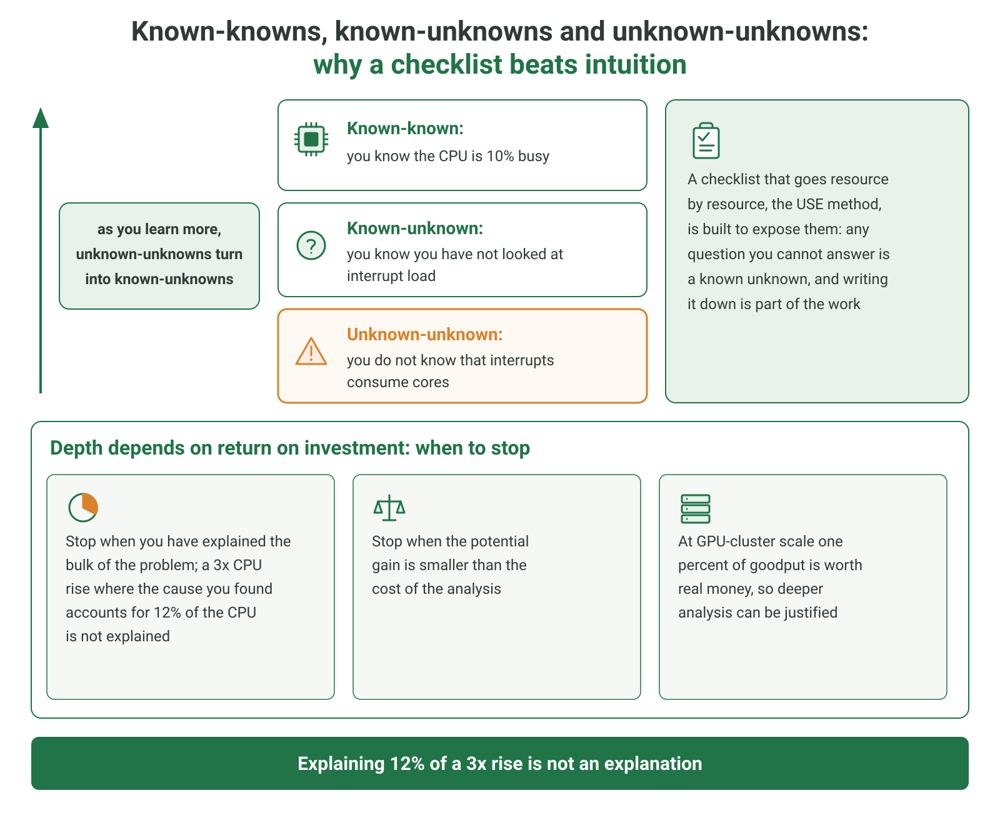

*Figure 1.23.5. A resource-by-resource checklist turns unknown-unknowns into known-unknowns, and you stop only when the bulk of the problem is explained.*

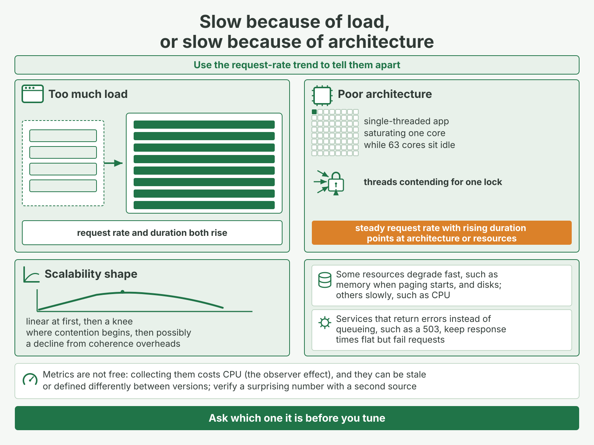

*Figure 1.23.6. If rate and duration both rise it is load, and if the rate is steady while duration rises it points at architecture or resources.*

Every tuning has a price, and you can rarely have good, fast and cheap all at once. You can usually pick two, which is why "just make it faster" is not a plan. Many trade-offs pit CPU against memory, so you either cache results or recompute them. Tunables show the same tension. A small filesystem record size suits random I/O, while a large one suits streaming. Small network buffers suit many connections, and large buffers suit throughput.

Tuning pays off most when it sits close to the work. Eliminating a database query in the application can give 20x. Tuning a storage device may give 20%. For AI, removing a pointless host-device copy or fusing kernels beats tuning TCP buffers. Still, observe from the OS level too, because that view often explains application behaviour.

Depth depends on return on investment, so know when to stop. Stop when you have explained the bulk of the problem. A 3x CPU rise where the cause you found accounts for 12% of the CPU is *not* explained. Stop, too, when the potential gain is smaller than the cost of the analysis, or when a larger payoff exists elsewhere. At GPU-cluster scale, one percent of goodput is worth real money, so a deeper analysis can be justified.

Be careful with values copied from elsewhere. Tunable values from blogs, vendor slides or last year's cluster are like medicine from someone else's cabinet. They may have expired, they may be wrong for your hardware, or they may be workarounds for bugs that are already fixed. Keep each tunable in version control, with a comment that says why it is set and when to re-check it. See chapter 1.22.

Ask whether a system is slow because of load or because of its architecture. Too much load looks like a multithreaded app busy on all CPUs, with requests queueing. A poor architecture looks like a single-threaded app saturating one core while 63 cores sit idle, or threads contending for one lock. The request-rate trend helps you tell them apart. A steady rate with rising duration points at architecture or resources. A rate and duration that both rise point at load.

Scalability describes how performance changes as you add load or resources. It is linear at first. Then it reaches a knee, where contention begins, and it can eventually decline because of coherence overheads. Some resources degrade fast, such as memory when paging starts, and disks. Others degrade slowly, such as CPU. Services that return errors instead of queueing, such as a 503, keep response times flat, but they fail requests.

Metrics are not free or perfect. Collecting them costs CPU, which is the observer effect. Metrics can also be wrong or stale, or they can be defined differently between versions. Verify any surprising number with a second source.

Caches come with their own vocabulary. You track the hit ratio and the miss rate, and you describe a cache as cold, warm or hot. Warm-up can take hours when the next tier is slow. Picture a flash cache of 600 GB, fed at 16 MB/s. It takes ten hours to warm, so benchmarks must report the cache state. On AI jobs, that means the page cache, dataset caches, the first epoch versus later epochs, and the GPU memory allocator's cache.

Known-knowns, known-unknowns and unknown-unknowns form a useful ladder, and it explains why checklists beat intuition. You know the CPU is 10% busy, which is a known-known. You know you have not looked at interrupt load, which is a known-unknown. You do not know that interrupts consume cores, which is an unknown-unknown. As you learn more, unknown-unknowns turn into known-unknowns. A checklist that goes resource by resource, the USE method, is built to expose them.

Before you start measuring, agree on these terms with the people who will read your numbers.

## 3. The problem statement comes first

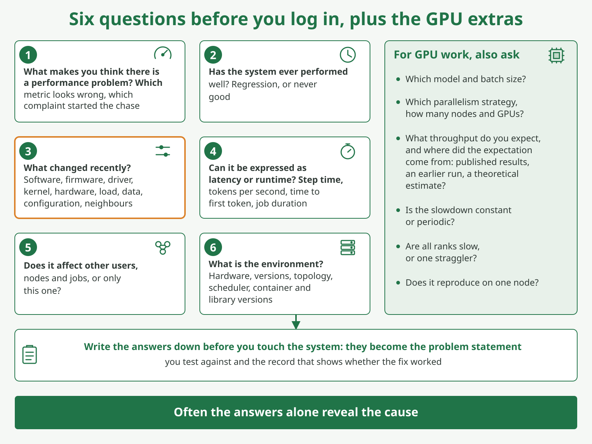

*Figure 1.23.7. Ask the six questions and the GPU extras first, and write the answers down as the problem statement you test against.*

Suppose someone tells you the nightly training run is slower than it used to be. This is the moment where three engineers give three different guesses. Before you log in, stop and ask questions instead. Often the answers alone reveal the cause, even over the phone, and you save the trip entirely.

Ask these six questions first.

1. What makes you think there is a performance problem? Ask which metric looks wrong and which user complaint started the chase.
2. Has the system ever performed well? That tells you whether this is a regression or something that was never good.
3. What changed recently? Think software, firmware, driver, kernel, hardware, load, data, configuration and neighbours.
4. Can the problem be expressed as latency or runtime? Step time, tokens per second, time to first token and job duration all qualify.
5. Does it affect other users, nodes and jobs, or only this one?
6. What is the environment? Record the hardware, versions, topology, scheduler, container and library versions.

For GPU work, add more questions, because the shape of the job matters as much as the machine. Which model and batch size are in use? Which parallelism strategy is running, and how many nodes and GPUs does it use? What throughput do you expect, and where did that expectation come from? Published results, an earlier run and a theoretical estimate are all possible sources. Is the slowdown constant or periodic? Are all ranks slow, or is there one straggler? Does it reproduce on one node?

Write the answers down before you touch the system. They become the problem statement you test against, and later they become the record that shows whether your fix actually worked.

## 4. Anti-methods and good methods

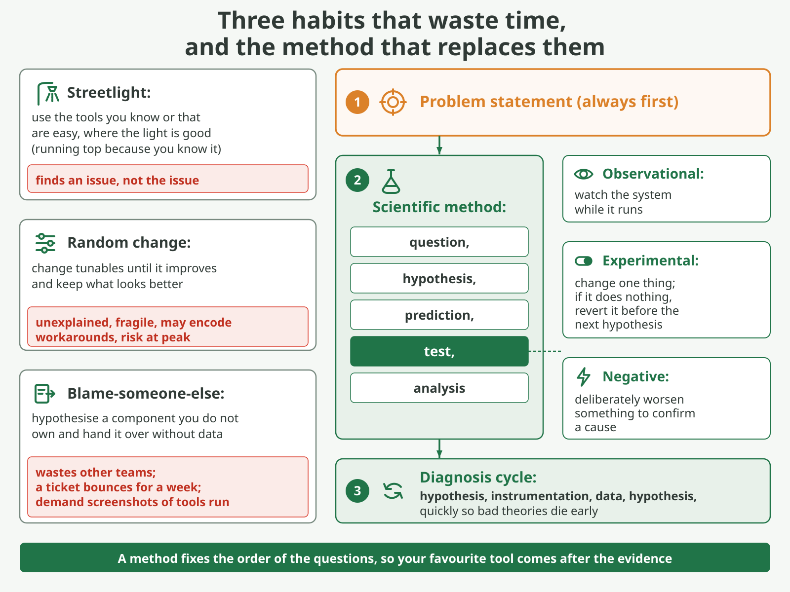

*Figure 1.23.8. Streetlight, random change and blame-someone-else all skip the evidence, so start from the problem statement and run the scientific method.*

Picture the engineer who starts with the tool they know best, because the tool is comfortable and the question is not. A method exists to stop that. It fixes the order of the questions, so your favourite tool comes after the evidence rather than before it. The table compares the habits that waste time with the ones that work.

| Method | Description | Verdict |
|---|---|---|
| **Streetlight** | Use the tools you know or that are easy, wherever the light is good (running `top` because you know it) | Anti-method: finds *an* issue, not *the* issue |
| **Random change** | Change tunables until it improves; keep what looks better | Anti-method: unexplained, fragile, may encode workarounds, risk at peak |
| **Blame-someone-else** | Hypothesise a component you do not own and hand it over without data | Anti-method: wastes other teams; demand screenshots of tools run |
| **Ad hoc checklist** | A list of known checks (e.g. `r_await` over 10 ms) | Fast, but point-in-time and limited to known issues; keep it current |
| **Problem statement** | Section 3 | Always first |
| **Scientific method** | Question, hypothesis, prediction, test, analysis. Observational test or experimental test (change one thing; if it fails, revert before the next hypothesis). "Negative tests" deliberately worsen something to confirm cause | Core |
| **Diagnosis cycle** | hypothesis → instrumentation → data → hypothesis, quickly | Core; move to data fast so bad theories die early |
| **Tools method** | List tools, metrics, interpretations | Works, but only as good as the tool inventory; unaware of what is missing |
| **USE** | For every resource: utilisation, saturation, errors | Systemic bottlenecks fast |
| **RED** | For every service: request rate, errors, duration | User-facing health of services |
| **Workload characterisation** | Who, why, what, how over time | Finds unnecessary or malicious load |
| **Drill-down** | Monitor → identify → analyse; five whys | Root cause |
| **Latency analysis** | Split an operation's time into components, descend into the largest | Binary search through the stack |
| **Method R** | Response-time-based approach from Oracle tuning | Same latency-first idea applied to databases |
| **Event tracing** | Inspect individual events (packets, I/O, syscalls) with timestamps | When summaries hide outliers |
| **Baseline statistics** | Record "normal" for comparison | Answers "is this normal for this system?" |
| **Static performance tuning** | Check configuration at rest | Finds misconfigurations (1 GbE negotiated, failed RAID member, debug mode on) |
| **Cache tuning** | Cache high in the stack; check enabled, hit ratio, size, double-caching | Targeted |
| **Micro-benchmarking** | Artificial simple workloads | Establishes component limits (chapter 1.25) |
| **Performance mantras** | Don't do it; do it but not again; do it less; do it later; do it when they're not looking; do it concurrently; do it more cheaply | Order of effectiveness for fixes |

Take the three anti-methods first, because you will meet them in yourself. Streetlight finds an issue, but not necessarily the issue you need. Random change may make a number look better, but you cannot explain why. Blame-someone-else hands your problem to another team with no evidence, which is how a ticket bounces for a week.

Begin with the problem statement instead, then run the scientific method and the diagnosis cycle. The diagnosis cycle moves from hypothesis to instrumentation to data and back. It should run quickly, so bad theories die early.

An observational test watches the system while it runs. An experimental test changes one thing, and if the change does nothing, you revert it. A negative test deliberately worsens something to confirm a cause, which sounds strange until you need to prove that a suspect is guilty.

The tools method is only as good as your tool inventory, and it cannot show you what that inventory is missing. An ad hoc checklist, such as `r_await` over 10 ms, is quick but point-in-time, so keep it current. USE sweeps every resource and finds systemic bottlenecks fast. RED looks at each service from the user's side.

Workload characterisation asks who, why, what and how, over time. Drill-down moves from monitor to identify to analyse, and five whys takes you to the root cause. Latency analysis splits an operation's time into components and descends into the largest. Method R applies the same latency-first idea to Oracle databases.

Event tracing inspects individual events with timestamps, which helps when summaries hide outliers. Baseline statistics record what normal looks like, and they turn "it feels slower" into a comparison. Static performance tuning catches misconfigurations, such as a link that negotiated 1 GbE, a failed RAID member or debug mode left on. Cache tuning checks that caches are enabled, what the hit ratio is, how big they are, and whether you are caching twice. Micro-benchmarking uses artificial, simple workloads to find component limits.

The performance mantras rank fixes, and the order is the whole point. The best fix is: don't do it. Next comes: do it, but not again. Then do it less, do it later, do it when they're not looking, do it concurrently, and do it more cheaply.

### The Scientific Method in practice (examples)

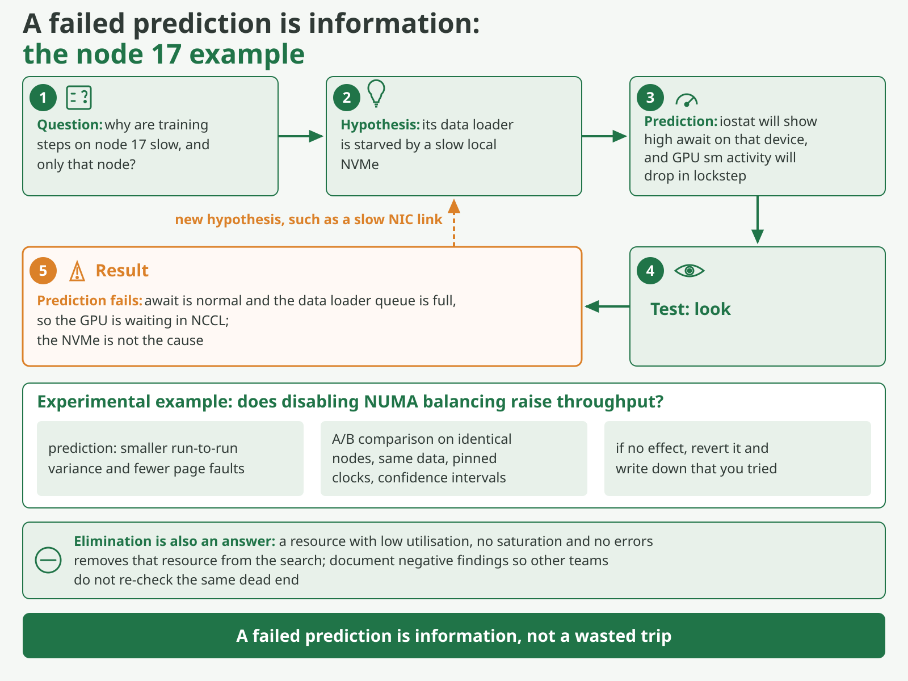

*Figure 1.23.9. When the prediction of high NVMe await fails, the finding eliminates the disk and sends you back with a new hypothesis.*

*Observational.* Suppose training steps on node 17 are slow, and only that node. You suspect its data loader is starved by a slow local NVMe. You predict that `iostat` will show high await on that device, and that GPU `sm` activity will drop in lockstep. Then you look, and the prediction fails. The await is normal and the data loader queue is full, so the GPU is waiting in NCCL. The NVMe is not the cause. Return to step 2 with a new hypothesis, such as a slow NIC link. A failed prediction is information, not a wasted trip.

*Experimental.* Does disabling NUMA balancing raise throughput? Your hypothesis says yes, and the prediction is smaller run-to-run variance and fewer page faults. Run an A/B comparison on identical nodes, with the same data and pinned clocks. Use confidence intervals from section 9. If the setting has no effect, revert it and write down that you tried.

### Elimination is also an answer

A resource with low utilisation, no saturation and no errors is valuable evidence. It removes that resource from the search, which is progress even though nothing was fixed. Document these negative findings as carefully as the positive ones, so other teams do not re-check the same dead end.

## 5. The Linux 60-second checklist

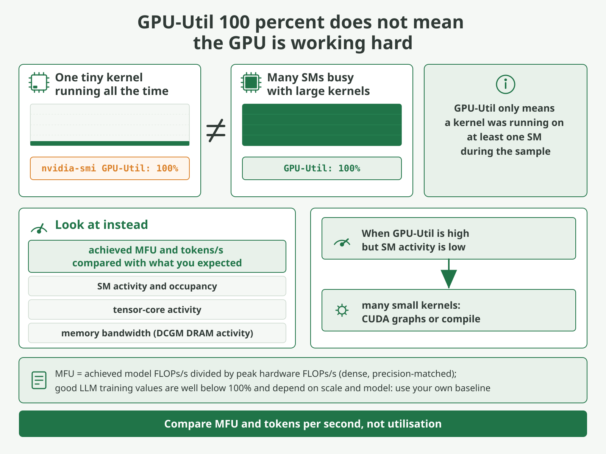

*Figure 1.23.10. GPU-Util only says a kernel was running on at least one SM, so read SM activity, memory bandwidth, MFU and tokens per second.*

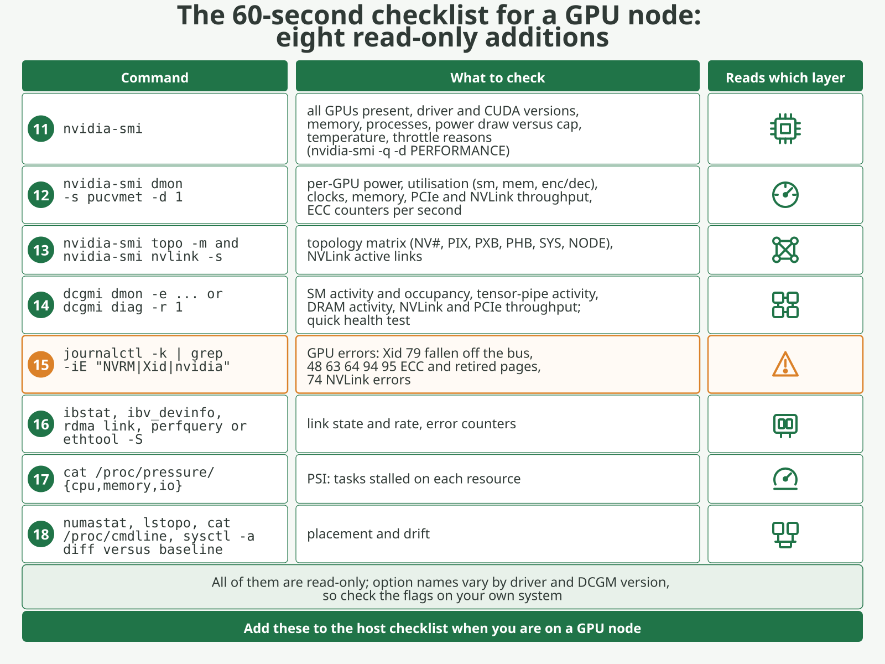

*Figure 1.23.11. Eight read-only GPU checks extend the host checklist to cover GPUs, topology, Xid errors, fabric counters and pressure.*

A host is slow, and someone wants an answer now. Run these commands in the first minute of any investigation on a Linux host. The list is deliberately short, because this is a first look and not the whole investigation. Each one is covered in later chapters, where you will learn to read its output properly. Here, read each output once before you move on.

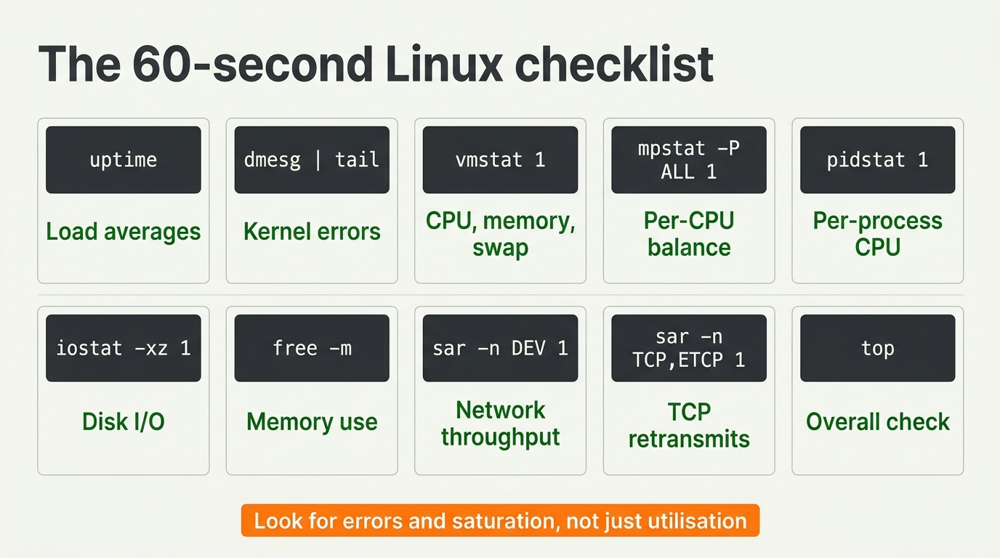

*Figure 1.23.12. Ten commands, one line each, that give a first view of a slow host.*

| # | Command | What to check |
|---|---|---|
| 1 | `uptime` | Load averages 1/5/15 min: trend up or down; compare against logical CPU count; remember it includes uninterruptible tasks |
| 2 | `dmesg -T \| tail` | Kernel errors: OOM kills, hardware errors, GPU Xid/NVRM messages, link flaps, throttling |
| 3 | `vmstat -SM 1` | `r` run queue, `b` blocked, swap `si/so`, `free`, `cs`, `us/sy/id/wa/st` |
| 4 | `mpstat -P ALL 1` | One hot CPU (single-thread bottleneck or interrupts), `%steal`, `%soft` |
| 5 | `pidstat 1` | Which processes use CPU; user versus system time |
| 6 | `iostat -sxz 1` | Disk IOPS, throughput, await, `%util`, queue size |
| 7 | `free -m` | Memory and page cache; available memory |
| 8 | `sar -n DEV 1` | Interface throughput and packet rates versus line rate |
| 9 | `sar -n TCP,ETCP 1` | TCP connection rates and retransmits |
| 10 | `top` | Overview; sanity check of the above |

Add these checks when you are on a GPU node. All of them are read-only. Option names vary by driver and DCGM version, so check the flags on your own system.

| # | Command | What to check |
|---|---|---|
| 11 | `nvidia-smi` | All GPUs present; driver/CUDA versions; memory use; processes; power draw versus cap; temperature; throttle reasons (`nvidia-smi -q -d PERFORMANCE`) |
| 12 | `nvidia-smi dmon -s pucvmet -d 1` | Per-GPU power, utilisation (sm, mem, enc/dec), clocks, memory, PCIe and NVLink throughput, ECC and Xid-related counters per second |
| 13 | `nvidia-smi topo -m` and `nvidia-smi nvlink -s` | Topology matrix (NV#, PIX, PXB, PHB, SYS, NODE), NVLink active links |
| 14 | `dcgmi dmon -e 1002,1003,1004,1005,1009,1010,203,252` (field IDs vary) or `dcgmi diag -r 1` | SM activity/occupancy, tensor-pipe activity, DRAM activity, NVLink and PCIe throughput; quick health test |
| 15 | `journalctl -k \| grep -iE 'NVRM\|Xid\|nvidia'` | GPU errors (Xid 79 fallen off the bus, 48/63/64/94/95 ECC and retired pages, 74 NVLink errors; consult NVIDIA's Xid catalogue) |
| 16 | `ibstat`, `ibv_devinfo`, `rdma link`, `perfquery` or `ethtool -S` | Link state and rate, error counters (symbol errors, link downs, retransmits) |
| 17 | `cat /proc/pressure/{cpu,memory,io}` | PSI: tasks stalled on each resource |
| 18 | `numastat`, `lstopo`, `cat /proc/cmdline`, `sysctl -a` diff vs baseline | Placement and drift |

Be careful with one number in particular, because it misleads almost everyone at first. `GPU-Util` in `nvidia-smi` only means that a kernel was running on at least one SM during the sample. It does not mean the GPU is doing useful, efficient work. If you keep one tiny kernel running, the GPU still shows 100%. For a better picture, look at SM activity and occupancy, tensor-core activity and memory bandwidth. Above all, compare **achieved model FLOPs utilisation (MFU)** and tokens/s against what you expected.

## 6. The USE method

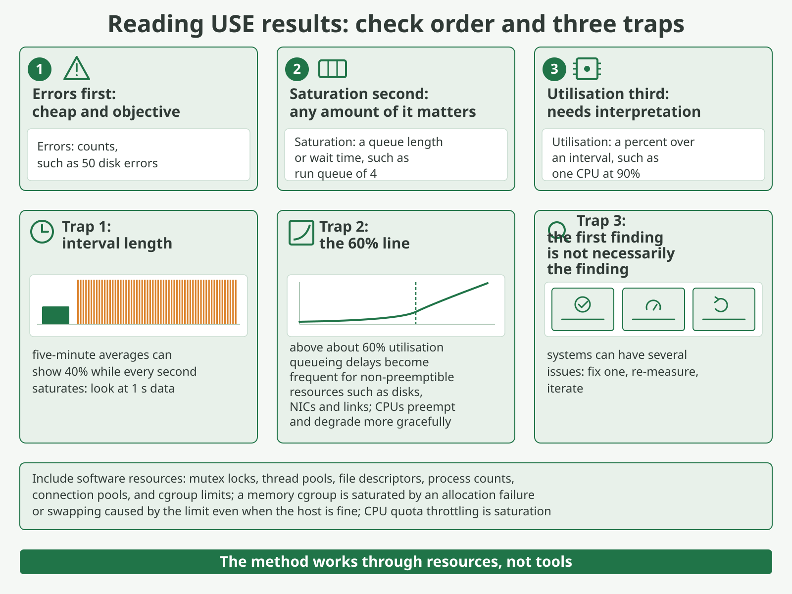

*Figure 1.23.13. Check errors, then saturation, then utilisation, and beware long intervals, the 60 percent line and stopping at the first finding.*

**For every resource, check utilisation, saturation and errors.** Resources are the physical components, and some software ones too. The method works through *resources*, not tools. You build the full list of questions first, then find a tool for each. Any question you cannot answer is a known unknown, and writing it down is part of the work.

The diagram below is the loop, and it is worth reading once as a picture of the habit. For each resource you ask the cheap question first, and only then the expensive ones.

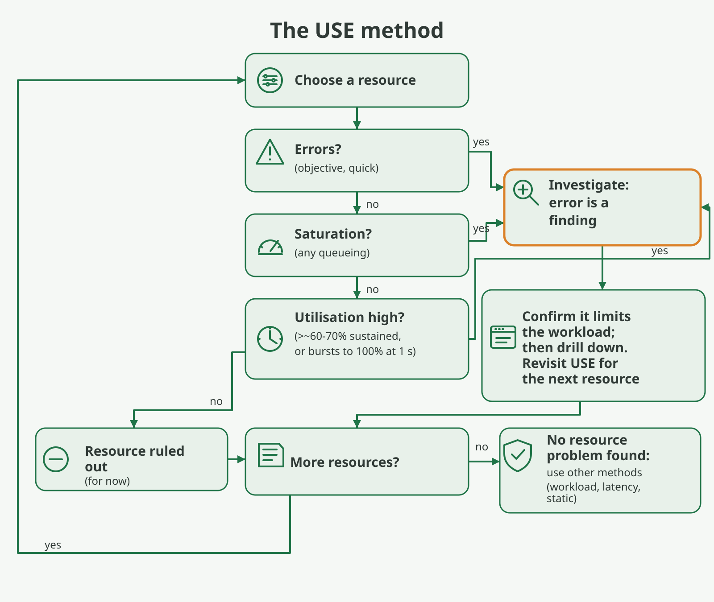

*Figure 1.23.14. The USE method.*

When you read the results, check in this order. Errors come first, because they are cheap and objective. Saturation comes second, because any amount of it matters. Utilisation comes third, because it needs interpretation.

Express each metric in a clear form, so that a colleague can compare it with their own. Utilisation is a percent over an interval, such as "one CPU at 90%". Saturation is a queue length or wait time, such as "run queue of 4". Errors are counts, such as "50 disk errors".

As you work through the table, watch out for three traps. Trap 1 is interval length. Five-minute averages can show 40% while every second saturates, so look at 1 s data. Trap 2 is the 60% line. Above about 60% utilisation, queueing delays become frequent for non-preemptible resources, such as disks, NICs and links. CPUs can preempt, so they degrade more gracefully. Trap 3 is that the first finding is not necessarily the finding. Systems can have several issues, so you fix one, re-measure, and iterate.

Include software resources too, because a sweep that skips them is not a sweep. Mutex locks, thread pools, file descriptors, process counts and connection pools all count. So do resource controls, such as cgroup limits. For a memory cgroup, utilisation is usage versus the cap. Saturation is an allocation failure or swapping caused by the limit, even when the host itself is fine. CPU quota throttling is saturation, as chapter 1.18 explains.

### The USE table for a GPU server

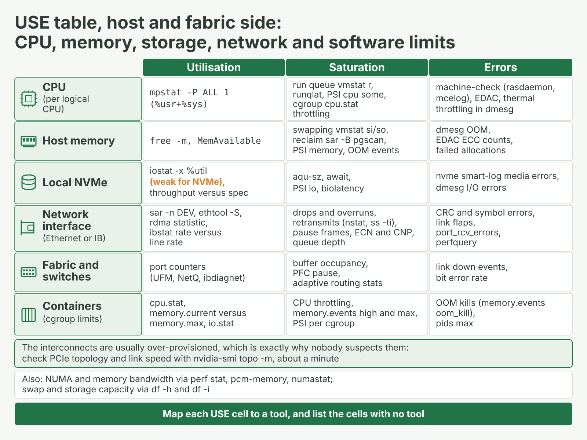

*Figure 1.23.15. The host and fabric rows give each resource a utilisation, saturation and error check, and containers add cgroup limits to the sweep.*

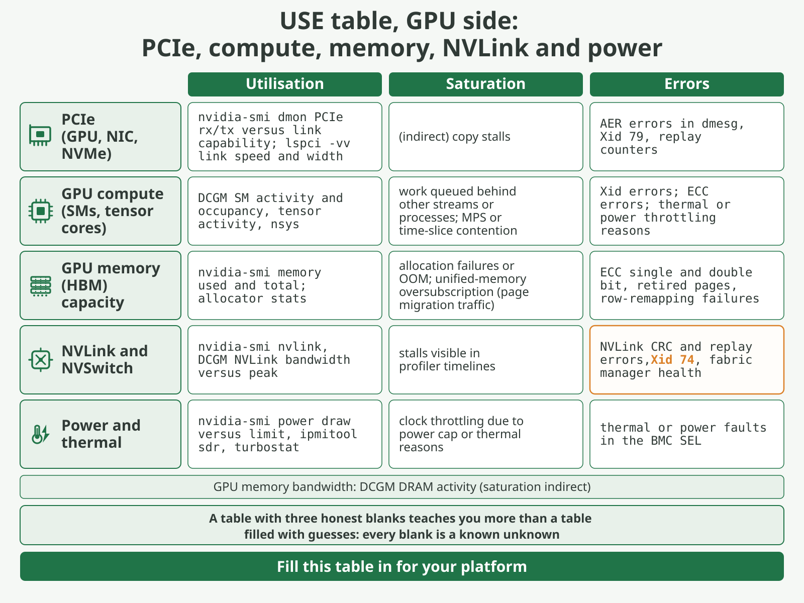

*Figure 1.23.16. Each GPU-side resource gets a utilisation, saturation and error check, and every blank cell is a known unknown to close.*

Fill this table in for your platform. The commands are starting points, and every blank is a known unknown you should close over time. A table with three honest blanks teaches you more than a table filled with guesses.

| Resource | Utilisation | Saturation | Errors |
|---|---|---|---|
| CPU (per logical CPU) | `mpstat -P ALL 1` (`%usr+%sys`) | run queue `vmstat r`, `runqlat`, PSI `cpu some`, cgroup `cpu.stat` throttling | machine-check (`rasdaemon`, `mcelog`), EDAC, thermal throttling in `dmesg` |
| Host memory (capacity) | `free -m`, `MemAvailable` | swapping (`vmstat si/so`), reclaim (`sar -B`, `pgscan`), PSI `memory`, OOM events | `dmesg` OOM, EDAC ECC corrected/uncorrected counts, failed allocations |
| NUMA / memory bandwidth | PMU counters (`perf stat`, `pcm-memory`, `amd uProf`) | high CPI / stall cycles, remote access ratio (`numastat`) | (hardware errors via EDAC) |
| Swap / storage capacity | `df -h`, inode use `df -i` | write stalls, `iostat` queue, PSI `io` | filesystem errors, `smartctl`, `nvme smart-log` |
| Local NVMe devices | `iostat -x %util` (weak for NVMe), throughput versus spec | `aqu-sz`, `await`, PSI `io`, `biolatency` | `nvme smart-log` media/integrity errors, `dmesg` I/O errors |
| Network interface (Ethernet/IB) | `sar -n DEV`, `ethtool -S`, `rdma statistic`, `ibstat` rate versus line rate | drops/overruns, retransmits (`nstat`, `ss -ti`), pause frames, congestion notifications (ECN/CNP), queue depth | CRC/symbol errors, link flaps, `port_rcv_errors`, `ethtool -S rx_errors`, `perfquery` |
| Fabric / switches | port counters and utilisation (UFM, NetQ, `ibdiagnet`) | buffer occupancy, PFC pause, adaptive routing stats | link down events, bit error rate |
| PCIe (GPU, NIC, NVMe) | `nvidia-smi dmon` PCIe rx/tx throughput versus link capability; `lspci -vv` link speed/width | (indirect) copy stalls | AER errors in `dmesg`, `Xid` 79, replay counters (`nvidia-smi -q -d ...`) |
| GPU compute (SMs, tensor cores) | DCGM SM activity/occupancy, tensor activity, `nsys` | work queued behind other streams/processes; MPS/time-slice contention | Xid errors; ECC errors; thermal/power throttling reasons |
| GPU memory (HBM) capacity | `nvidia-smi` memory used/total; allocator stats | allocation failures/OOM; unified-memory oversubscription (page migration traffic) | ECC single/double bit, retired pages, row-remapping failures |
| GPU memory bandwidth | DCGM DRAM activity | (indirect) | ECC |
| NVLink / NVSwitch | `nvidia-smi nvlink`, DCGM NVLink bandwidth versus peak | stalls visible in profiler timelines | NVLink CRC/replay errors, Xid 74, fabric manager health |
| Power / thermal | `nvidia-smi` power draw versus limit, `ipmitool sdr`, `turbostat` | clock throttling due to power cap or thermal reasons | thermal/power faults in BMC SEL |
| Software: file descriptors | `ls /proc/PID/fd \| wc -l` versus `ulimit -n` | waits on allocation | `EMFILE`/`ENFILE` errors |
| Software: pinned memory / `memlock` | locked pages versus `ulimit -l` | allocation stalls | failed pinning (`cudaHostAlloc` errors) |
| Software: threads/PIDs | `cgroup pids.current` vs `pids.max` | fork waits | `Resource temporarily unavailable`, "cannot fork" |
| Software: NCCL/communication | NCCL logs with `NCCL_DEBUG=INFO`, nccl-tests bus bandwidth versus expected | stragglers (a rank late to a collective) | NCCL errors/timeouts, watchdog |
| Containers (cgroup limits) | `cpu.stat`, `memory.current` vs `memory.max`, `io.stat` | CPU throttling, `memory.events` high/max, PSI per cgroup | OOM kills (`memory.events oom_kill`), pids max |

The interconnects, meaning the CPU, memory and I/O buses, are easy to forget, and you should check them anyway. They are usually over-provisioned, which is exactly why nobody suspects them. On GPU servers, though, two things can become the real bottleneck. One is PCIe topology. A NIC and a GPU on different root complexes, or sharing an oversubscribed switch uplink, can limit you. The other is host memory bandwidth for data loading. `nvidia-smi topo -m` plus link speed checks are the cheapest interconnect "static" audit, and they take about a minute.

### RED for services

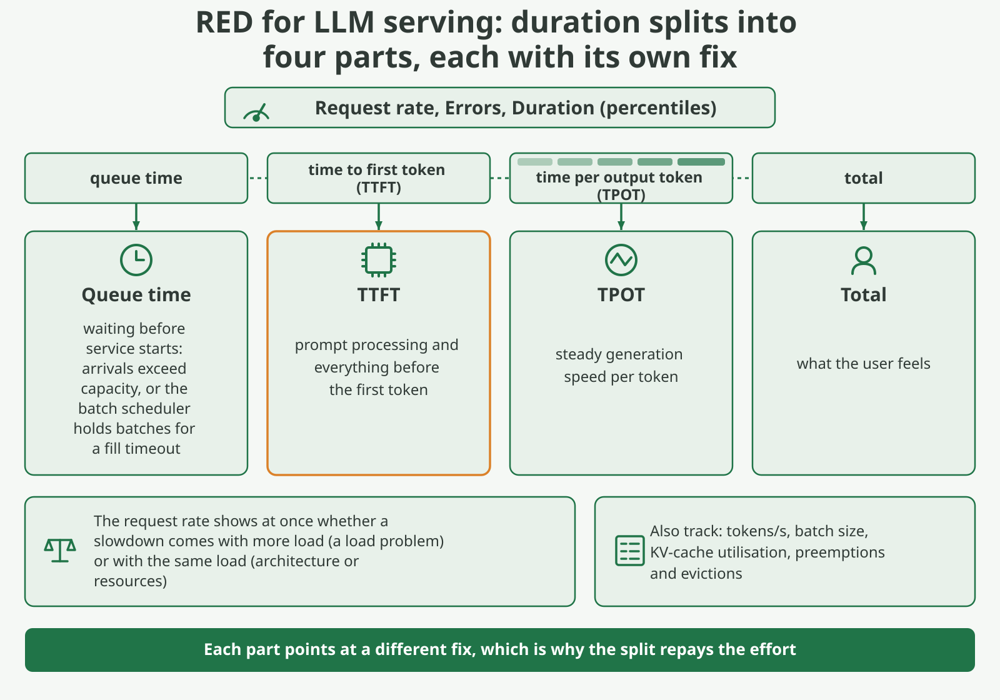

*Figure 1.23.17. LLM serving duration splits into queue time, time to first token, time per output token and total, and each part points at a different fix.*

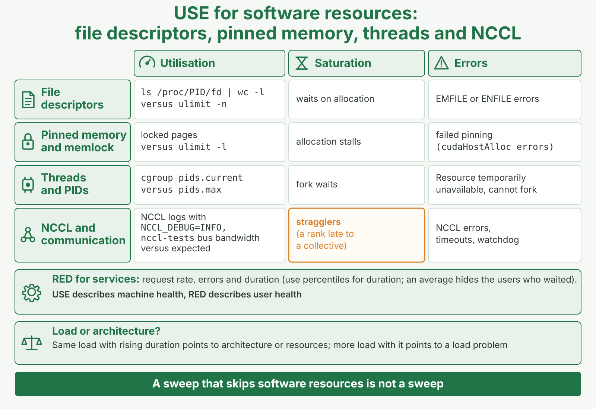

*Figure 1.23.18. Software limits such as descriptors, memlock, pids and NCCL stragglers belong in the USE sweep next to the hardware.*

Now aim the same discipline at services, where the machine can look healthy and the user is still unhappy. Apply RED to every service, such as inference endpoints, schedulers, registries and feature stores. RED stands for **R**equest **r**ate, **E**rrors and **D**uration, and you should use percentiles for duration, because an average hides the users who waited. USE describes machine health, while RED describes user health, and the two complement each other. The request rate shows at once whether a slowdown comes with more load, which is a load problem, or with the same load, which points to architecture or resources.

For LLM serving, duration splits into queue time, time to first token (TTFT), time per output token (TPOT) and total. Each part points at a different fix, which is why the split repays the effort. Track tokens/s, batch size, KV-cache utilisation and the number of preemptions and evictions too, see Part 10. Fill in the USE table for your own GPU server, and treat every blank as a question to answer.

## 7. Workload characterisation

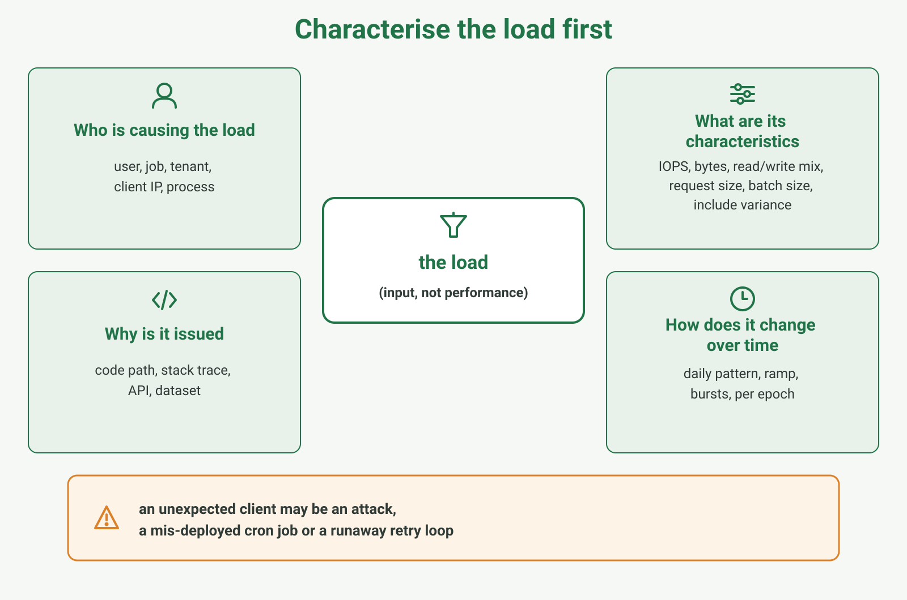

*Figure 1.23.19. Characterise the input load, not the resulting performance.*

A cluster is busy and nobody can say why. Before you study how fast anything runs, look at what is being asked of it. Characterise the **input**, not the resulting performance. Ask four questions about the load:

- Who is causing the load? Name the user, job, tenant, client IP or process.
- Why is the load issued? Look for the code path, the stack trace, the API and the dataset.
- What are its characteristics? Check IOPS, bytes, read/write mix, request size, sequence lengths, batch size, collective types and sizes, and direction. Include the *variance*, not just the averages.
- How does it change over time? Look for a daily pattern, a ramp, bursts, or changes per epoch.

Check even when you expect the answer, because the surprise is where the win hides. An unexpected client is sometimes an attack, a mis-deployed cron job, or a runaway retry loop. The best wins come from eliminating unnecessary work, since removing a job beats making it faster. If you cannot eliminate it, throttle it with resource controls. Take a backup that compresses during peak training. You can limit it with cgroup CPU and I/O limits, as chapter 1.18 explains.

Use the AI version of these questions, because a training job and a web service have different anatomy. For a training run, characterise the step anatomy: data loading time, host-to-device copies, forward, backward, optimizer, all-reduce volume and count per step, and checkpoint cadence and size. For inference, study the request mix: prompt length distribution, output length distribution, concurrency and arrival process. For storage, study the access pattern: many small files versus large shards, sequential versus random, and read-after-write. These feed simulation benchmarks in chapter 1.25 and capacity plans in section 10. Before you size anything, write down the characteristics of the load.

## 8. Drill-down and latency analysis

You now have a suspect. The sweep says a resource is busy, or a user says the service feels slow. What you do not have is the one hop that explains the time. Drill-down is how you get from the suspect to the cause without guessing.

### Three-stage drill-down

Drill-down narrows the search in three stages, from the whole fleet down to one resource. Picture a map: first the country, then the city, then the street. The order matters, because each stage tells the next one where to look.

1. Monitoring runs all the time and covers the whole cluster. It uses high-level metrics and alerts, from Prometheus, Grafana or the DCGM exporter, and exporters expose their counters over HTTP. Monitoring tells you that something is wrong and when it started. It also lets you correlate the problem with changes, such as deploys and driver updates.
2. Identification looks at a suspect node or job. You run the 60-second checklist and USE to find *which* resource or area is involved.
3. Analysis uses profilers and tracers, such as `perf`, flame graphs, bpftrace, Nsight Systems/Compute, the PyTorch profiler and NCCL traces. They find the code path, device or interaction responsible.

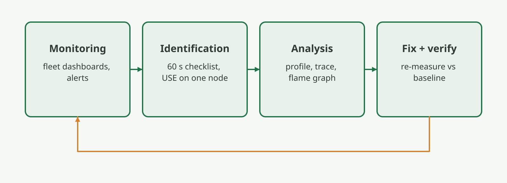

*Figure 1.23.20. Three-stage drill-down.*

### Five whys

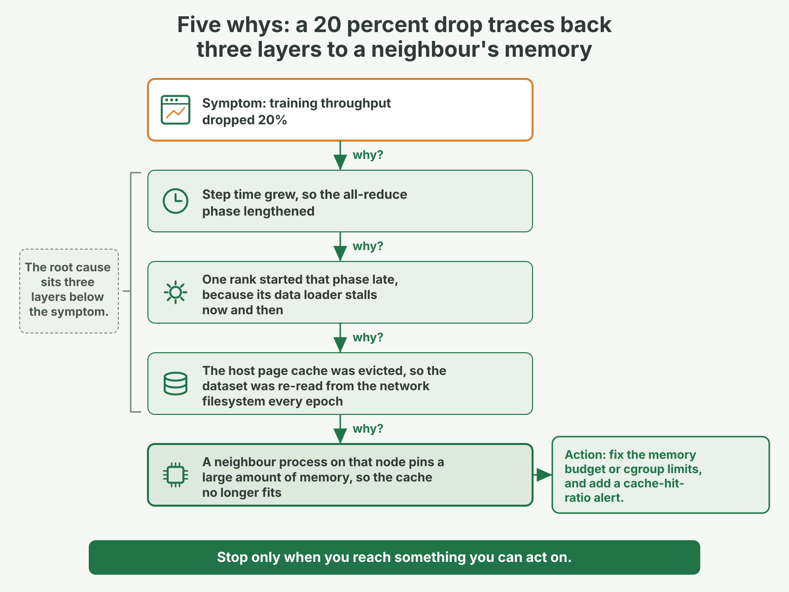

*Figure 1.23.21. A five whys chain moves from a 20 percent throughput drop, through a late all-reduce rank and evicted page cache, to a neighbour process that pins memory.*

Ask "why" repeatedly. Answer each time from evidence, and stop when you reach something you can act on. Here is how that looks in one real incident. Take a training job whose throughput dropped 20%. Its step time grew, so the all-reduce phase lengthened. One rank started that phase late, because its data loader stalls now and then. The host page cache was being evicted, so the dataset was re-read from the network filesystem every epoch. A neighbour process on that node pins a large amount of memory, so the cache no longer fits. Your action is to fix the memory budget or cgroup limits, and to add a cache-hit-ratio alert. The root cause was three layers away from the symptom, which is why stopping at the first plausible answer would have missed it.

### Latency analysis: halve the problem

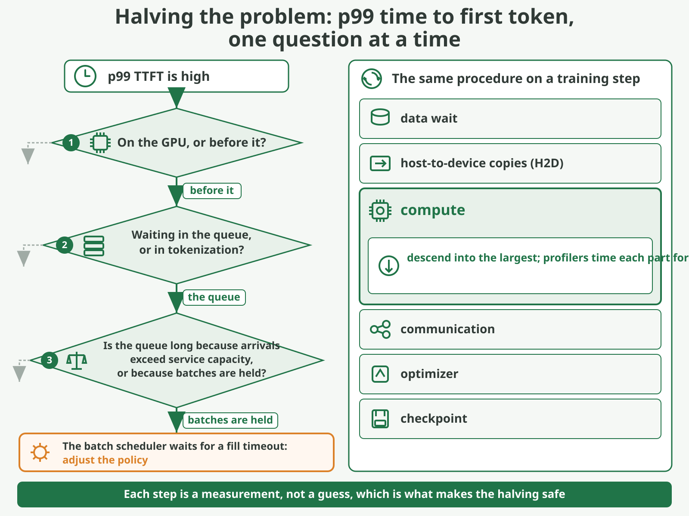

*Figure 1.23.22. Each measurement picks one of two branches, so a handful of questions narrows a high time to first token to the batch fill timeout.*

Break an operation's time into components, then descend into the larger one. Each step is a measurement, not a guess, which is what makes the halving safe. Take an LLM inference request. You find a latency problem, because the p99 TTFT is high. Is the time spent on the GPU or before it? It is before. Is the wait in the queue or in tokenization? It is in the queue. Is the queue long because arrivals exceed service capacity, or because batches are held? The batch scheduler waits for a fill timeout, so you adjust the policy. Each answer picks one of two branches, so a handful of questions covers a very wide stack.

The same procedure works on a training step. Treat the step as data, plus host-to-device copies (H2D), plus compute, plus communication, plus optimizer, plus checkpoint. Time each part, which profilers do for you, and descend into the largest.

### Event tracing

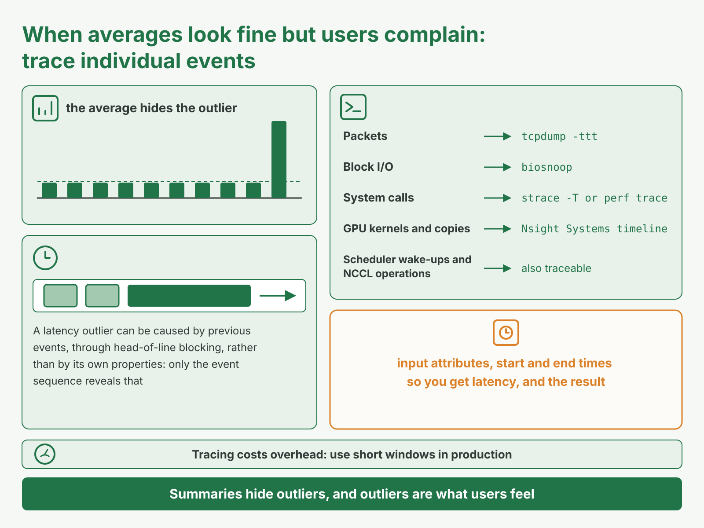

*Figure 1.23.23. Trace individual events with timestamps when summaries hide outliers, and keep the windows short to limit overhead.*

Summaries hide outliers, and outliers are what users feel. When averages look fine but users still complain, trace individual events. Use `tcpdump -ttt` for packets, `biosnoop` for block I/O, `strace -T` or `perf trace` for syscalls, and the Nsight Systems timeline for GPU kernels and copies. You can also trace scheduler wake-ups and NCCL operations. For each event, record its input attributes, its start and end times so you get latency, and its result. A latency outlier can be caused by *previous* events, through head-of-line blocking, rather than by its own properties. Only the event sequence reveals that. Tracing costs overhead, so use short windows in production.

### Baselines and static tuning

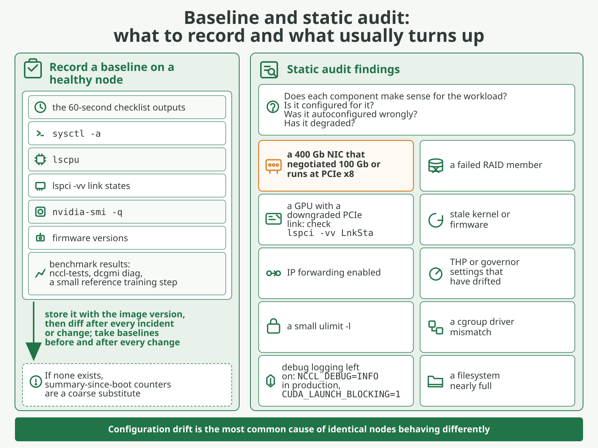

*Figure 1.23.24. Store a baseline with the image version and audit configuration at rest, because drift is the most common cause of identical nodes differing.*

Baseline statistics record what normal looks like, and a baseline is a promise to your future self. On a healthy node, run a script that collects the 60-second checklist outputs, `sysctl -a`, `lscpu`, `lspci -vv` link states, `nvidia-smi -q`, firmware versions and benchmark results. Those benchmarks include `nccl-tests`, `dcgmi diag` and a small reference training step. Store the baseline with the image version. After an incident or a change, diff against it, and take baselines before and after every change. If no baseline exists, "summary since boot" counters are a coarse substitute.

Static performance tuning audits the configuration at rest. Ask whether each component makes sense for the workload, whether it is configured for it, whether it was autoconfigured wrongly, and whether it has degraded. Typical findings include a 400 Gb NIC that negotiated 100 Gb or runs at PCIe x8, a failed RAID member, and a GPU with a downgraded PCIe link. Check that last one with `lspci -vv` `LnkSta`. Other findings include a stale kernel or firmware, IP forwarding enabled, THP or governor settings that have drifted, a small `ulimit -l`, a cgroup driver mismatch, debug logging left on (`NCCL_DEBUG=INFO` in production, `CUDA_LAUNCH_BLOCKING=1`), and a filesystem nearly full. Across a fleet, this is the cheapest and highest-yield check, because configuration drift is the most common cause of "identical" nodes behaving differently.

### Performance mantras

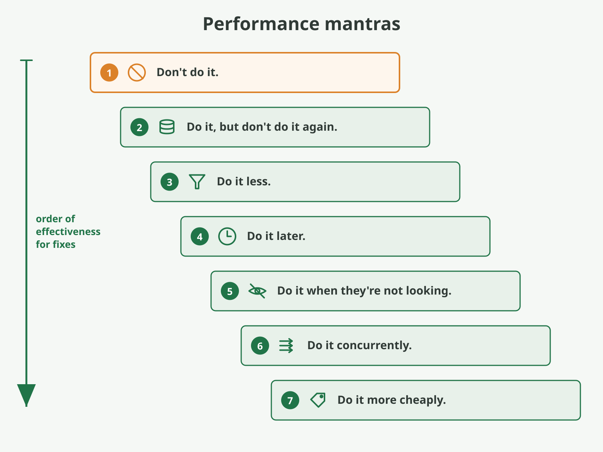

*Figure 1.23.25. The order of the mantras is the point: eliminating work beats making it cheaper.*

Performance mantras rank the fixes, from most effective to least, and the ranking is more useful than the list. Don't do it. Remove unneeded work, such as a redundant copy or a debug sync. Next, do it, but don't do it again. Cache the tokenized data, the compiled kernels or the KV prefix cache. Then do it less, by reducing polling, checkpoint frequency and logging. Do it later with async checkpointing or write-back. Do it when they're not looking, with off-peak maintenance or background compaction. Do it concurrently, overlapping communication and compute with multiple streams or data-loader workers. Last, do it more cheaply with faster hardware, lower precision or a better algorithm.

Before you tune anything, check the configuration at rest and compare it against your baseline.

## 9. Scalability, modelling and queueing

### Reading scalability curves

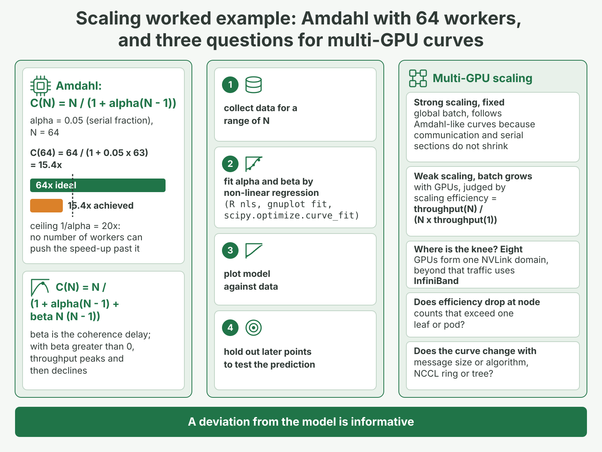

*Figure 1.23.26. With a 5 percent serial fraction, 64 workers give only 15.4x and the ceiling is 20x, and multi-GPU curves are read by knee, topology and message size.*

Plot the performance you deliver, such as tokens/s, samples/s or requests/s, against a scaling dimension, such as GPUs, nodes, threads or clients. The shape of the curve tells you what limits you, often before any profiler does. Learn the shapes first, because you will recognise them in a graph long before you can name the cause.

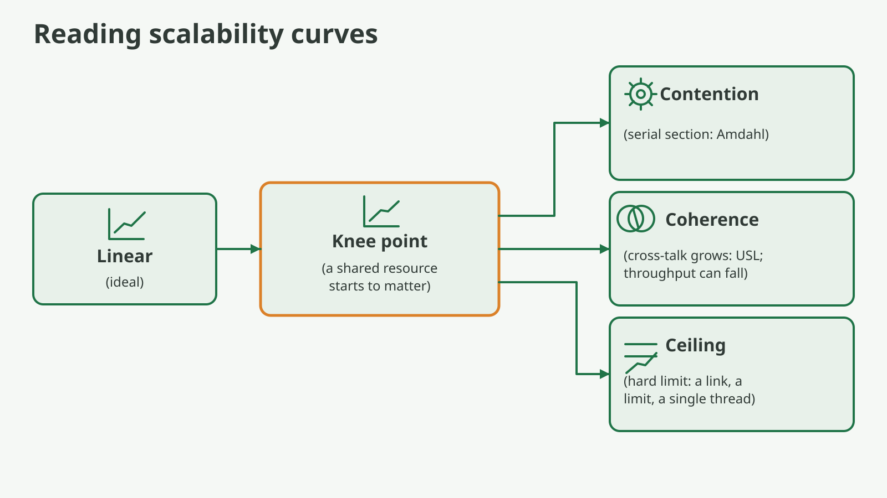

*Figure 1.23.27. Reading scalability curves.*

- Linear: performance grows in proportion. That rarely lasts.
- Contention: part of the work is serial or shared. A lock, a data loader, the all-reduce or a single metadata server can be that part.
- Coherence: the cost of keeping parts in agreement grows with N. All-to-all traffic, synchronisation and cache coherence all add to it.
- Knee: a factor changes the slope, so investigate the settings near the knee. That is the point where a thread count equals physical cores, where traffic leaves an NVLink domain, or where a job spans more leaf switches.
- Ceiling: a hard limit, such as a link at line rate, a software resource cap, or a single-threaded client generating the load.

Amdahl's law of scalability gives the relative capacity as C(N) = N / (1 + α(N − 1)). Here α, which runs from 0 to 1, is the serial fraction. Take α = 0.05 and 64 workers. Then C(64) = 64 / (1 + 0.05 × 63) = 15.4x. The ceiling is 1/α = 20x, so no number of workers can push the speed-up past it.

The Universal Scalability Law (USL) adds a coherence term: C(N) = N / (1 + α(N − 1) + βN(N − 1)). The β term is the coherence delay. With β greater than 0, throughput peaks and then declines.

Here is the method, and it fits on a page. Collect data for a range of N, either observed or from a controlled experiment. Fit α, and β if needed, by non-linear regression. You can use R `nls`, gnuplot `fit` or Python `scipy.optimize.curve_fit`. Plot the model against the data, and hold out the later points to test the prediction. A deviation from the model is informative. Either your understanding of the system is incomplete, or something specific, such as a switch hop or a single filesystem server, is limiting you.

Multi-GPU scaling follows the same ideas. Strong scaling, with a fixed global batch, follows Amdahl-like curves, because communication and serial sections do not shrink. Weak scaling, where the batch grows with the GPUs, is judged by **scaling efficiency** = throughput(N) / (N × throughput(1)). Ask three diagnostic questions. Where is the knee? Eight GPUs form one NVLink domain, and beyond that traffic uses InfiniBand. Does efficiency drop at node counts that exceed one leaf or pod? Does the curve change with message size or with the algorithm, NCCL ring or tree? Chapters in Parts 8 and 9 apply this to NCCL and fabric design.

### Queueing theory in four lines

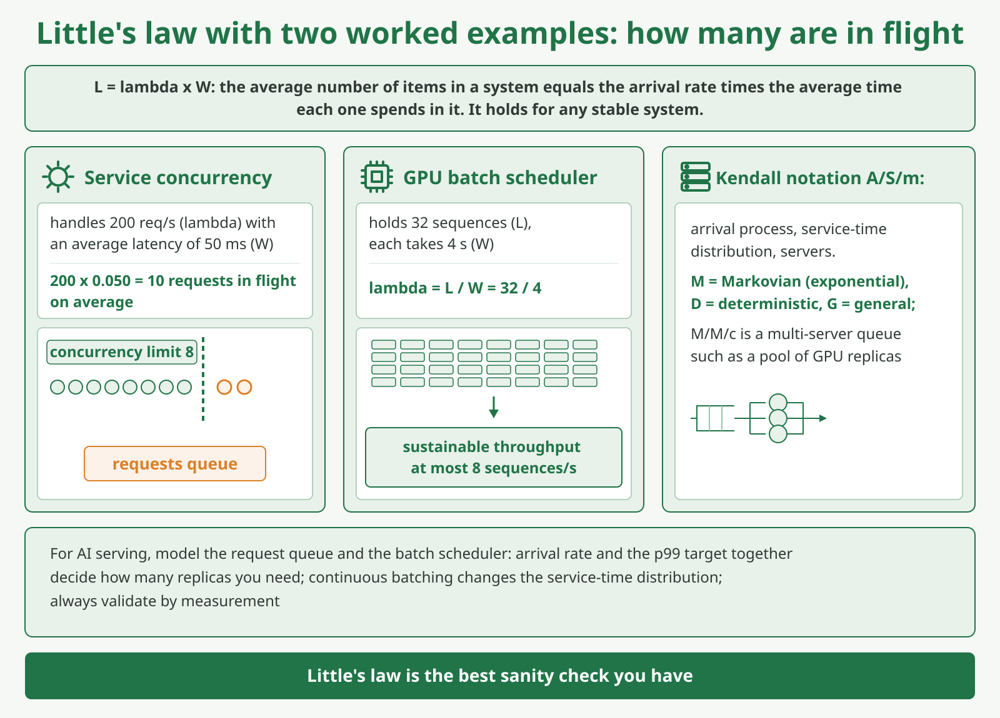

*Figure 1.23.28. At 200 req/s and 50 ms there are 10 requests in flight, so a concurrency limit of 8 makes them queue.*

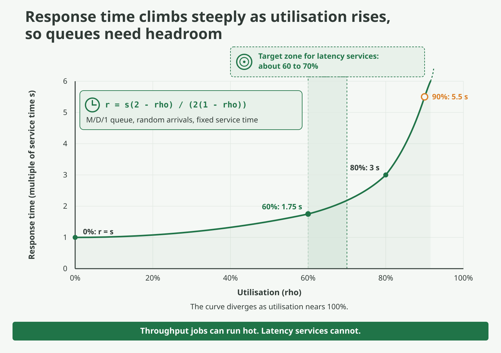

*Figure 1.23.29. Response time for a queue rises from one service time at zero load to 5.5 times at 90 percent utilisation, so latency services keep headroom.*

Many components are queues: a request queue, a disk, a NIC, a GPU stream and a scheduler. Four results cover most of what you need, and they are worth learning by heart.

- Little's law: L = λW. The average number of items in a system equals the arrival rate times the average time each one spends in it. It holds for any stable system, and it is the best sanity check you have. A service handles 200 req/s with an average latency of 50 ms. On average, it therefore has 10 requests in flight. If your concurrency limit is 8, requests queue. A GPU batch scheduler holds 32 sequences, and each takes 4 s. Sustainable throughput is therefore at most 8 sequences/s.
- Utilisation and response time: for an M/D/1 queue, with random arrivals and a fixed service time s, the response time is r = s(2 − ρ) / (2(1 − ρ)). Here ρ is the utilisation. At ρ = 0 the response is s. At 60% it is 1.75 s, so the response is already well above the bare service time. The same curve passes 1.6 s at about 55%, so the damage starts before the graph looks alarming. At 80% it is 3 s. At 90% it is 5.5 s, and it diverges as utilisation nears 100%. Higher variance in service time, as in M/M/1 or M/G/1, is worse, and percentiles degrade much faster than means. This is why disk, network and GPU-serving utilisation targets sit around 60 to 70%, not 100%, when latency matters. It is also why throughput jobs such as training can run hot while latency services cannot.
- Kendall notation: A/S/m reads as arrival process, service-time distribution and servers. M means Markovian, or exponential. D means deterministic, and G means general. M/M/c is a multi-server queue, such as a pool of GPU replicas.
- Saturation shows up as queueing delay first. Then, when queues are bounded, it shows up as drops and errors.

For AI serving, model the request queue and the batch scheduler. The arrival rate and the p99 target together decide how many replicas you need. Continuous batching changes the service-time distribution, so account for it. Always validate the model by measurement.

## 10. Capacity planning

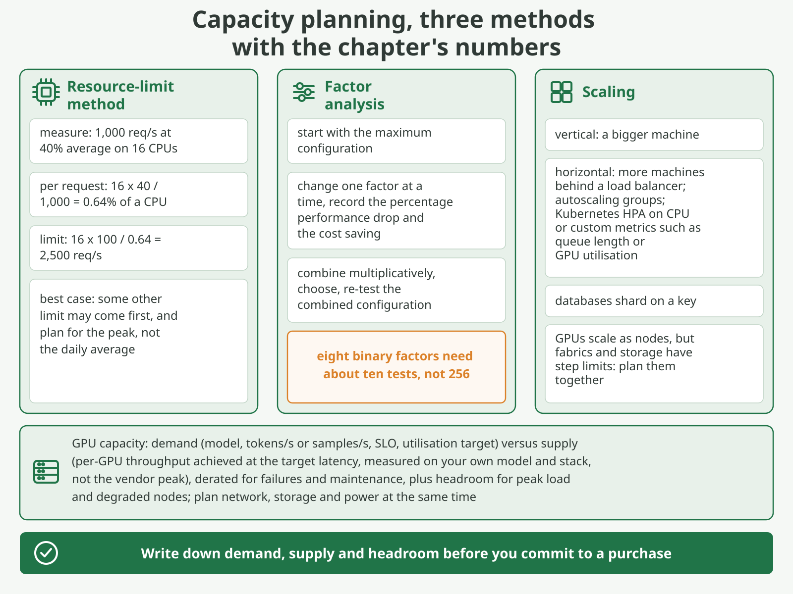

*Figure 1.23.30. The resource-limit method turns 40 percent CPU at 1,000 req/s into a 2,500 req/s ceiling, and factor analysis needs about ten tests for eight factors.*

Sooner or later someone asks how many GPUs to buy, and "more" is not an answer. Capacity planning is how you turn that question into numbers with assumptions attached, so the decision can be argued with instead of guessed. Three methods do most of the work.

- Resource-limit method. Measure the request rate and the resource each request uses. Then extrapolate to the first resource that reaches 100%. Take 1,000 req/s at 40% average on 16 CPUs. That works out to 0.64% of a CPU per request (16 × 40 / 1,000), so the CPU limit sits at 16 × 100 / 0.64 = 2,500 req/s. Treat that as a best case. Some other limit may come first, and you must plan for the peak, not the daily average.
- Factor analysis. To pick the cheapest configuration that meets a target, start with the maximum configuration. Change one factor at a time, and record the percentage performance drop and the cost saving for each. Combine them multiplicatively, make your choice, and re-test the combined configuration. Eight binary factors need about ten tests, not 256.
- Scaling. You can scale vertically, with a bigger machine, or horizontally, with more machines behind a load balancer. Autoscaling groups do the horizontal work, and Kubernetes HPA can scale on CPU or on custom metrics, such as queue length or GPU utilisation. Databases shard on a key. GPUs scale as nodes, but fabrics and storage have step limits, so plan them together.

For GPU capacity, start with demand. Express it as a model, tokens/s or samples/s, an SLO and a utilisation target. Then work out supply: the per-GPU throughput you can actually achieve at the target latency. Measure that on a benchmark of your own model and stack, not on the vendor peak. Derate the supply for failures and maintenance, and add headroom for peak load and for degraded nodes. Plan the network, storage and power at the same time. Keep the benchmark methodology from chapter 1.25 and the cost model next to the plan.

Write down demand, supply and headroom before you commit to a purchase.

## 11. Statistics you must get right

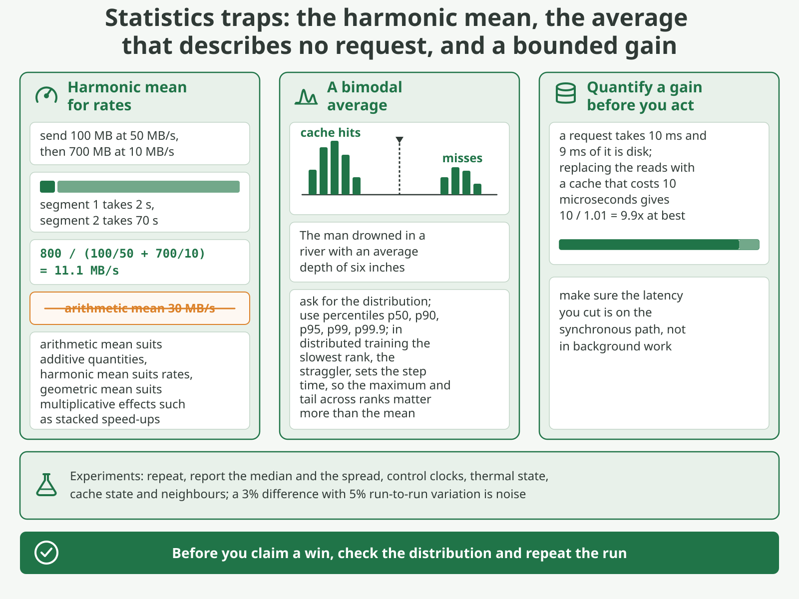

*Figure 1.23.31. Two transfers at 50 and 10 MB/s average 11.1 MB/s by harmonic mean, not 30, and an average can describe no actual request.*

Averages hide things, and they hide them politely, which is the danger. The average of a bimodal latency distribution, with fast cache hits and slow misses, can describe *no actual request*. Think of the saying: "The man drowned in a river with an average depth of six inches." So always ask for the distribution. When a dashboard shows only one number, ask what that number hides.

Percentiles, such as p50, p90, p95, p99 and p99.9, describe the slow tail, and SLAs are written with them. The median shows where the bulk is. Standard deviation and the coefficient of variation (σ / mean) express spread. A standard deviation of 50 means little without the mean.

Choose the right mean for the data. The arithmetic mean suits additive quantities. The **harmonic mean** suits rates. Say you send 100 MB at 50 MB/s, and then 700 MB at 10 MB/s. The harmonic mean is 800 / (100/50 + 700/10) = 11.1 MB/s, not 30. The geometric mean suits multiplicative effects, such as speed-ups from stacked layers.

Averages also depend on the interval you choose. A "50% utilised" CPU was busy half of *some interval*. Five-minute averages hide second-long saturations. Decayed averages, such as the load average, weight recent time more heavily.

Outliers hide too. Rare 1,000 ms I/Os among 1 ms ones are invisible in means, and often in standard deviation. Histograms, scatter plots and heat maps expose them. In distributed training, one slow rank, a straggler, sets the step time for everyone. So the **maximum and tail across ranks** matter more than the mean.

Experiments need repetition. Run enough repeats, report the median and the spread, and control confounders such as clocks, thermal state, cache state and neighbours. Compare like with like. A 3% difference with 5% run-to-run variation is noise. Write the setup down with the result, so someone else can repeat it.

Quantify a gain before you act on it. Start from an observation. Say a request takes 10 ms, and 9 ms of that is disk. Replacing the disk reads with a cache that costs 10 µs would give about 10 / 1.01 = 9.9x at best. The other route is experimental. Apply the change, and compare before and after with a reliable metric. Make sure the latency you cut is on the synchronous path, not in background work.

Before you claim a win, check the distribution and repeat the run.

## 12. Visualisation and monitoring

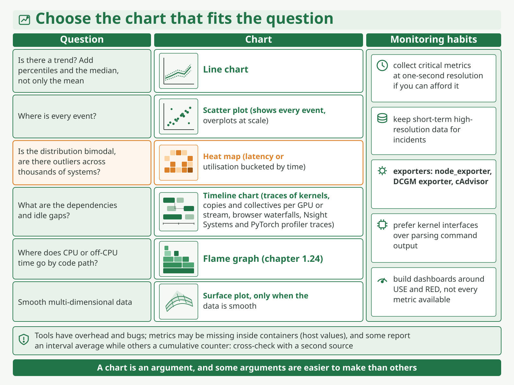

*Figure 1.23.32. Pick line charts for trends, heat maps for distributions and outliers, timelines for dependencies and flame graphs for code paths.*

Monitoring records metrics over time, so you can compare past with present. It shows daily and weekly patterns, quantifies growth and sets alerts. Patterns repeat hourly, daily, weekly, quarterly and yearly. Irregular events add to them, such as a new release, a holiday or a job queue draining.

Collect critical metrics at one-second resolution if you can afford it. At least keep short-term, high-resolution data for incidents, because that is the window where most answers live. Agents, or exporters, such as node_exporter, the DCGM exporter and cAdvisor, publish the metrics. Prefer collection from kernel interfaces over parsing command output. Build dashboards around USE and RED, rather than showing every metric available.

Choose the chart that fits the question, because a chart is an argument and some arguments are easier to make than others. Line charts show trends, and you should add percentiles and the median, not only the mean. Scatter plots show every event, but they overplot at scale. Heat maps bucket latency, or utilisation, by time. They reveal bimodal distributions and outliers across thousands of systems. Timeline charts show dependencies and idle gaps. Traces of kernels, copies and collectives per GPU or stream are timeline charts, and so are browser waterfalls. Nsight Systems and PyTorch profiler traces are timeline charts too. Flame graphs show where CPU, or off-CPU, time goes by code path, as chapter 1.24 covers. Surface plots and multi-dimensional views help only when the data is smooth.

Observing the observability matters too, which sounds circular until a tool lies to you. Tools have overhead and bugs. Metrics may not mean what their names suggest. They may be missing inside containers, where you see host values. Some tools report a per-interval average, while others report a cumulative counter. Cross-check surprising values with a second source. Tool inventories have blind spots as well, so map each USE cell to a tool, and list the cells that have no tool.

### Observability tool taxonomy (preview of chapter 1.24)

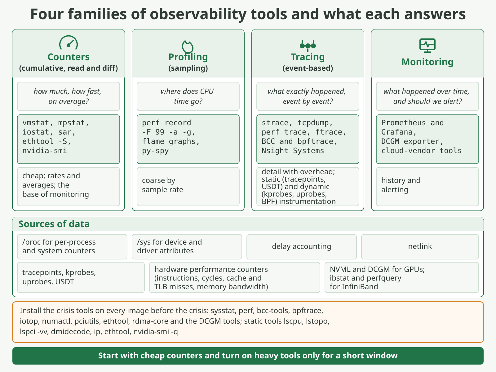

*Figure 1.23.33. Counters, profilers, tracers and monitoring each answer a different kind of question, and the crisis tools must be installed before the crisis.*

The table previews four families of tools. Each family answers a different kind of question.

| Type | Examples | Notes |
|---|---|---|
| **Counters** (cumulative, read and diff) | `vmstat`, `mpstat`, `iostat`, `sar`, `ethtool -S`, `nvidia-smi` | Cheap; show rates and averages; the base of monitoring |
| **Profiling** (sampling) | `perf record -F 99 -a -g`, flame graphs, `py-spy` | Where CPU time goes; coarse by sample rate |
| **Tracing** (event-based) | `strace`, `tcpdump`, `perf trace`, ftrace, BCC/bpftrace, Nsight Systems | Detail, overhead; static (tracepoints, USDT) and dynamic (kprobes, uprobes, BPF) instrumentation |
| **Monitoring** | Prometheus + Grafana, DCGM exporter, cloud-vendor tools | History and alerting |

Sources of observability data include `/proc` for per-process and system counters, and `/sys` for device and driver attributes. Delay accounting shows the time each task spends waiting for CPU, I/O or swap. Netlink carries network configuration and statistics. Tracepoints, kprobes, uprobes and USDT give you static and dynamic probes. Hardware performance monitoring counters report instructions, cycles, cache and TLB misses, and memory bandwidth. Vendor sources cover the rest, such as NVML and DCGM for GPUs, and `ibstat` and `perfquery` for InfiniBand.

Install the crisis tools on every image *before* the crisis, because nobody can install a tracer while a job is stalled and a queue is waiting. They include `sysstat`, `perf`, `bcc-tools`, `bpftrace`, `iotop`, `numactl`, `pciutils`, `ethtool`, `rdma-core` and the DCGM tools. Static tools, such as `lscpu`, `lstopo`, `lspci -vv`, `dmidecode`, `ip`, `ethtool` and `nvidia-smi -q`, answer configuration questions. Chapter 1.24 covers the details, the interpretation and more examples.

Before the next incident, check that every host has the crisis tools installed.

## 13. AI-specific measures of efficiency

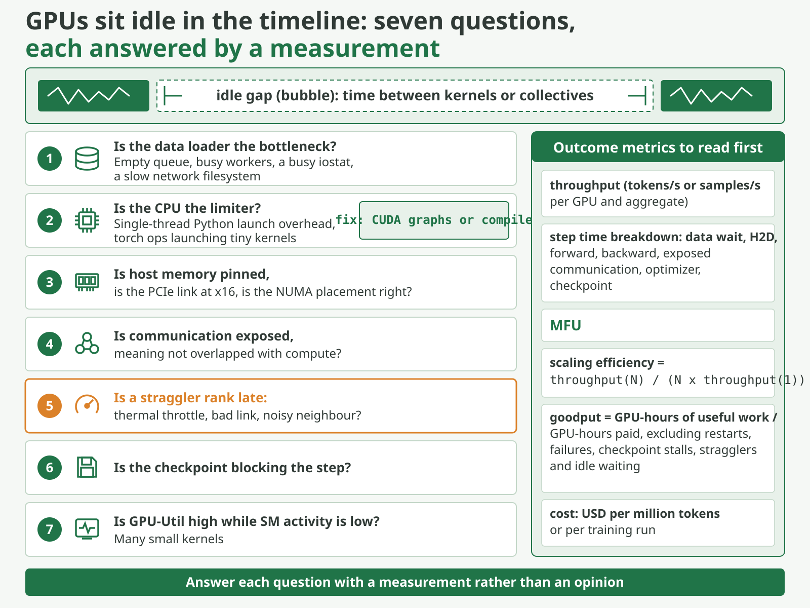

*Figure 1.23.34. Work through seven starvation questions with measurements, and read throughput, step breakdown, MFU and goodput before tuning anything.*

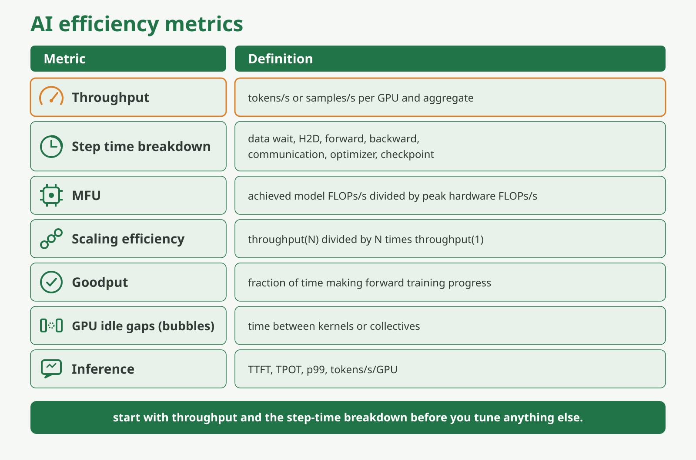

*Figure 1.23.35. Use outcome metrics rather than raw utilisation because they measure work delivered.*

Raw utilisation numbers are weak signals on accelerators, as the `GPU-Util` example in section 5 showed. Use the outcome metrics in the table below, because they measure work delivered rather than time occupied.

| Metric | Definition | Use |
|---|---|---|
| **Throughput** | tokens/s or samples/s per GPU and aggregate | Primary training/inference KPI |
| **Step time and its breakdown** | data wait, H2D, forward, backward, communication (exposed), optimizer, checkpoint | Find the largest component |
| **MFU** (model FLOPs utilisation) | achieved model FLOPs/s ÷ peak hardware FLOPs/s (dense, precision-matched) | Efficiency versus theoretical; published good LLM training values are well below 100% and depend on scale and model (flag: use your own baseline) |
| **Scaling efficiency** | throughput(N) ÷ (N × throughput(1)) | Multi-GPU/multi-node health |
| **Goodput** | fraction of wall-clock (or cluster time) spent making forward training progress, excluding restarts, failures, checkpoint stalls, stragglers, idle waiting | Cluster-level cost metric: GPU-hours of useful work ÷ GPU-hours paid |
| **GPU idle gaps (bubbles)** | time between kernels/collectives in a timeline | Pipeline stalls, CPU launch overhead, data starvation |
| **Inference: TTFT, TPOT, p99, tokens/s/GPU, queue time, KV-cache hit/utilisation, batch occupancy** | RED plus LLM-specific | Serving SLOs |
| **Cost** | USD per million tokens, USD per training run, GPU-hours per epoch | Business translation |

Read the table from the top. Throughput is the primary KPI for training and inference. The step-time breakdown then tells you which component to fix first.

The GPU-starvation checklist helps when GPUs sit idle in the timeline. Work through the questions in turn, and answer each one with a measurement rather than an opinion. Is the data loader the bottleneck, with an empty queue, busy workers, a busy `iostat` and a slow network filesystem? Is the CPU the limiter, through single-thread Python launch overhead or `torch` ops that launch tiny kernels? If so, use CUDA graphs or compile. Is host memory pinned, and is the PCIe link at x16 with the right NUMA placement? Is communication exposed, meaning not overlapped with compute? Is a straggler rank late, because of a thermal throttle, a bad link or a noisy neighbour? Is the checkpoint blocking the step? Is `GPU-Util` high while SM activity is low, which suggests many small kernels? Each question maps to a USE cell or to a characterisation question you have already seen.

Start with throughput and the step-time breakdown before you tune anything else.

## 14. Two worked case studies

### Case 1: "Slow disks" becomes "slow data loading"

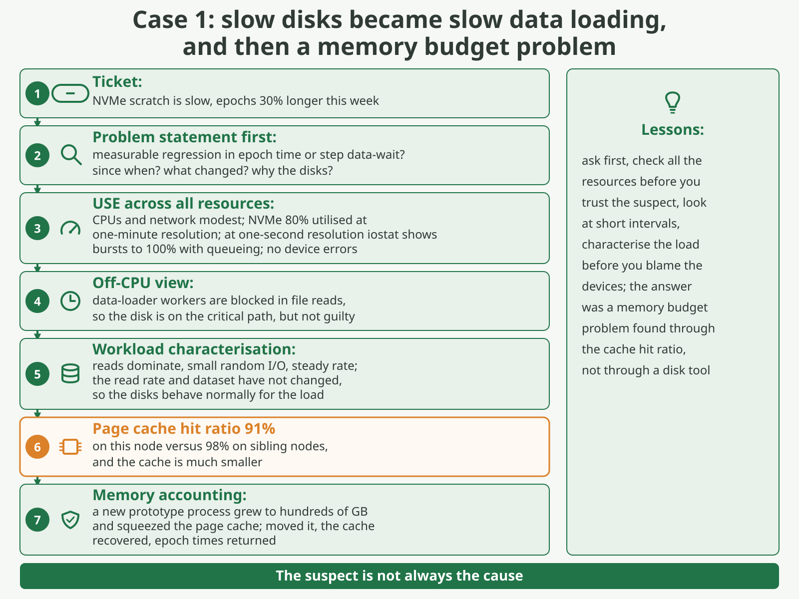

*Figure 1.23.36. The slow disks ticket ended at a prototype process squeezing the page cache, found through the cache hit ratio rather than a disk tool.*

A training team files a ticket, and their wording already contains the answer they expect. The NVMe scratch is slow, they say, and epochs got 30% longer this week. The administrator starts with the problem statement, not the disks. Is there a measurable regression, in epoch time or in step data-wait? Since when? What changed, and why were the disks suspected in the first place?

The team's monitoring shows the disks busy, but its interval is one minute. The administrator applies USE across all the resources. The CPUs and the network look modest. The NVMe devices show 80% utilisation at one-minute resolution. At one-second resolution, `iostat` shows bursts to 100% with queueing, which is saturation, and higher latency. There are no device errors. An off-CPU view of the data-loader workers shows they spend their time blocked in file reads. So the disk sits on the critical path, but that does not make it guilty.

Next comes workload characterisation. Reads dominate, I/O sizes are small and random, and the rate is steady. The training job's read rate has not changed, and neither has the dataset. So the disks behave normally for the load. The real question is why the load is higher than before. A quick check of the page cache hit ratio shows 91% against 98% on sibling nodes, and this node's cache is much smaller. Memory accounting reveals a new prototype process. It has grown to consume hundreds of GB, which squeezes the page cache. Previously cached shards are now re-read from NVMe. The team moves the prototype, the cache recovers, and epoch times return.

The lessons are worth keeping. Ask first. Check all the resources before you trust the suspect. Look at short intervals. Characterise the load before you blame the devices. The answer was a memory budget problem, found through the cache hit ratio and not through a disk tool.

### Case 2: non-regression test of a software change

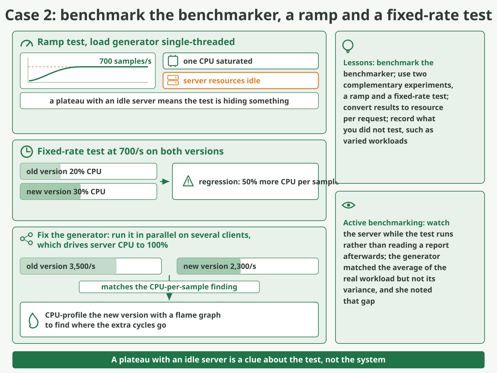

*Figure 1.23.37. A plateau at 700 samples per second with an idle server exposed the single-threaded load generator, and the fixed-rate test showed 50 percent more CPU per sample.*

An engineer must find out whether a new data-pipeline library version hurts throughput. She acquires an idle node and configures it as production. Then she characterises the real workload from logs, to check that her load generator resembles it. It matches the average but not the variance, and she notes that gap instead of ignoring it.

She ramps the load in steps and runs **active benchmarking**, which means watching the server while the test runs rather than reading a report afterwards. The server resources are idle, even though throughput plateaus at 700 samples/s for both versions. That plateau with an idle server troubles her, because it means the test is hiding something. So she switches to fixed-rate testing. Both versions run at 700/s, and she compares resource use. The new version uses 30% CPU against 20% for the old one, on the same work. That is a regression of 50% more CPU per sample.

To find the 700/s ceiling, she examines the *load generator*. It is single-threaded and saturates one CPU, so it limits the test itself. She runs the generator in parallel on several clients, which drives the server CPU to 100%. The old version reaches 3,500/s and the new one reaches 2,300/s. That matches the CPU-per-sample finding. She then CPU-profiles the new version with a flame graph, to find where the extra cycles go. She reports the regression with evidence, and she files a bug about the single-threaded generator.

If you run a test like this, check each of these points before you report a result. The lessons: benchmark the benchmarker. Use two complementary experiments, a ramp and a fixed-rate test. Convert results to resource per request. And record what you did not test, such as varied workloads.

## 15. Putting a method into practice: a template

Here is the whole chapter as one flow, the way you would walk through it during an incident. Nothing in it is new by this point, and that is the point: a template is only useful once each step feels familiar.

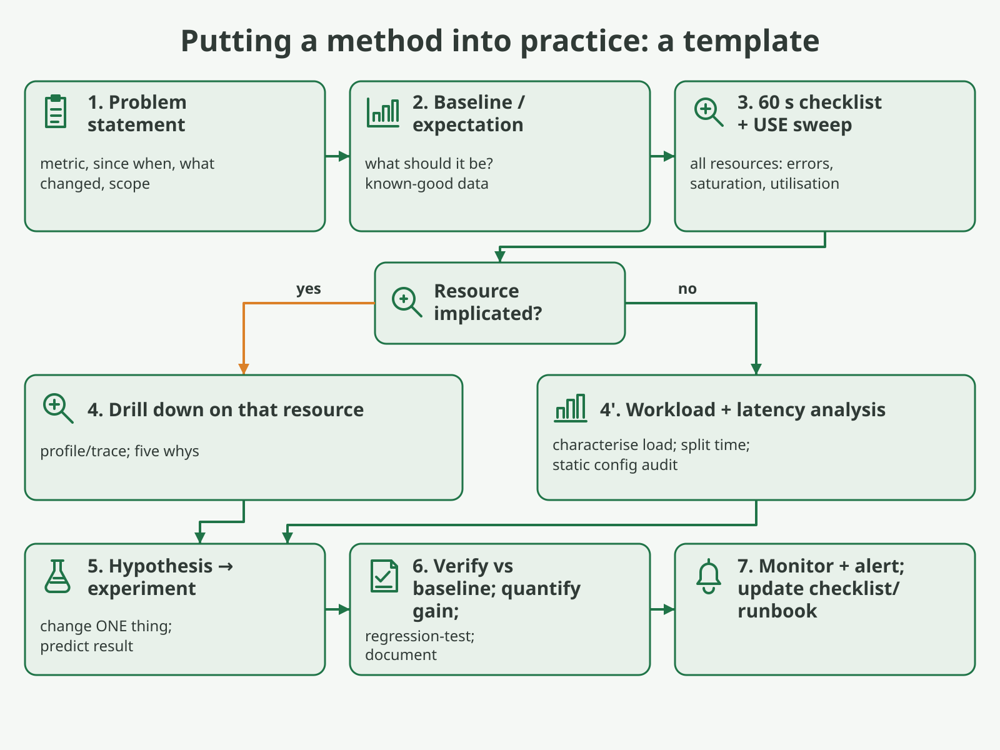

*Figure 1.23.38. Putting a method into practice: a template.*

Follow the flow in the diagram. Start with the problem statement, then set a baseline. Run the 60-second checklist and a USE sweep. If a resource is implicated, drill down on it. Otherwise, analyse the workload and latency, and audit the static configuration. Form a hypothesis, change one thing, and predict the result. Then verify against the baseline, quantify the gain and document the work. Finally, add monitoring and alerts, and update the checklist or runbook.

Always write down what you observed, with commands and timestamps. Write down the hypothesis, the test, the result and the decision too. That turns firefighting into a team asset, for incident reviews and runbooks, and it is how a team stops solving the same problem twice.

## 16. Hands-on lab: practise the method

First, run the self-checking Python lab at `code/part01/perf_methodology_use_lab.py`. It verifies the 10-command Linux 60-second checklist, Amdahl's law (`15.42x` at `N=64, α=0.05`) against Gunther's USL (`β > 0`), Little's law (`L = λW`), M/D/1 queueing response time (`r = s(2 - ρ)/(2(1 - ρ))`), the weighted harmonic mean of transfer rates (`11.1 MB/s`), and the resource-limit CPU ceiling extrapolation (`2,500.0 req/s`). Run it before you touch a VM.

```bash
python3 code/part01/perf_methodology_use_lab.py
```

Next, work through the steps below on a disposable Linux VM with 4 or more vCPUs. You need `stress-ng`, `sysstat`, `fio` and `iperf3`, and `bpfcc-tools` is optional. Steps 8 and 9 need a GPU VM. The commands below were not run on live hardware.

1. Baseline. Write `baseline.sh` to store `uptime`, `vmstat 1 5`, `mpstat -P ALL 1 3`, `iostat -sxz 1 3`, `free -m`, `sar -n DEV 1 3`, `ss -s`, `lscpu`, `cat /proc/pressure/*`, `sysctl -a`, `lspci -vv | grep -E 'LnkSta|LnkCap'`, and, on a GPU VM, `nvidia-smi -q`. Run it on an idle VM and keep the output, because you will compare against it later.
2. Fault injection and diagnosis. Have a partner choose the faults, or randomise them yourself. The options are: (a) `stress-ng --cpu 1` pinned to one core, a single-thread bottleneck; (b) `stress-ng --vm 2 --vm-bytes 90% ` with swap on, memory saturation; (c) `fio --rw=randread --bs=4k --iodepth=32`, disk saturation; (d) `tc qdisc add dev eth0 root netem delay 50ms loss 1%`, network latency and loss; and (e) a cgroup `cpu.max` limit on a busy process, which causes throttling. Without being told which fault is active, apply the 60-second checklist and then a USE table. Name the fault and the evidence for each one.
3. USE table. Fill in the table in section 6 for your VM. Give each cell a concrete command, and mark the cells you cannot answer as known unknowns.
4. Workload characterisation. Run a mixed `fio` job file, with a 70/30 read/write mix and mixed sizes. Answer who, why, what and when, using `iostat`, `biosnoop` and `biolatency` from BCC, or `blktrace` if it is available.
5. Latency analysis. Time a `python -c` script that reads a file, parses it and writes output. Use `strace -c -f`, `time` and `perf stat` to split the time into CPU, system and I/O. Then drill into the largest part.
6. Amdahl and USL fit. Run a CPU-parallel benchmark, such as `sysbench cpu --threads=N` or a small multiprocessing job, for N from 1 to 2×vCPUs. Record the throughput. Fit α, and β, in Python with `scipy.optimize.curve_fit`. Plot the data against the model, and explain the knee.
7. Queueing check. Run a simple service, such as `python -m http.server` with an artificial 10 ms delay, under a load generator at several arrival rates. Plot mean and p99 latency against utilisation, and compare with the M/D/1 curve. Then verify Little's law, L = λW, from the measured concurrency.
8. GPU 60-second checklist (GPU VM). Run the GPU additions from section 5 during a PyTorch matmul loop. Then run them during an idle loop that starves the data loader, by inserting `time.sleep` in the loader. Compare `GPU-Util`, SM activity, power, clocks and PCIe throughput. Explain why `GPU-Util` alone misleads you.
9. Scaling experiment (multi-GPU VM or two nodes). Run `nccl-tests` `all_reduce_perf` for 1, 2, 4 and 8 GPUs at several message sizes. Plot bus bandwidth, locate the knee, and relate it to topology with `nvidia-smi topo -m`.
10. Write the report. For each exercise, write a one-page report with a problem statement, evidence, hypothesis, test, result and decision.

Start with step 1, because the baseline makes every later comparison possible.

## 17. Common mistakes

Most mistakes come from skipping the method, and they share a family resemblance. Starting with a favourite tool instead of a method is common. So is changing tunables without a hypothesis or a baseline. Changing several things at once is another trap, and so is not reverting failed experiments, which leaves the system carrying a change nobody understands.

Don't trust a single number. `GPU-Util`, the load average and a five-minute CPU average each look like a verdict, but none of them is one. Report averages only with percentiles and distributions.

Optimising a component that is not on the critical path, such as asynchronous work, wastes effort. Benchmarking the load generator, a warm cache or a single run gives you a number you cannot trust, because you measured the instrument rather than the system.

Forgetting resource controls, such as cgroup throttling and memlock limits, leaves holes in the USE sweep. Ignoring errors and small counters, like corrected ECC, link retrains and PCIe replays, lets them grow into outages at the worst possible moment.

Skipping baselines means you never know what normal is. Fixing the first problem you find, and then stopping, is risky. Before you close an investigation, check that your fix explains the bulk of the symptom.

## 18. Interview angles

Interviewers ask these questions to see whether you have a method, not whether you have memorised a tool list. Think through each one before you read the hints.

"A training job is 30% slower than last week. What do you do in the first 15 minutes?" Start with the problem statement and what changed. Then diff against the baseline, run the 60-second checklist and a USE sweep, check for stragglers, and drill down.

"GPU-Util shows 100% but throughput is low. Why?" Explain what utilisation means on a GPU. Then point to small kernels, communication, MFU and SM activity.

"Explain USE and RED. When do you use each?"

"What is the difference between a load problem and an architecture problem? How do you tell?"

"Explain Little's law and apply it to LLM serving capacity."

"Why not run a serving cluster at 95% utilisation?" Talk about queueing and tail latency.

"How would you prove that a kernel parameter change helped?" Talk about A/B tests, repeats, variance and confidence.

"Scaling from 8 to 64 GPUs gives only 3x. Hypotheses and tests?" Talk about Amdahl and USL, topology, message sizes, stragglers and the data pipeline.

"Describe a performance investigation you led: what was your method and how did you know when to stop?"

### When the method itself fails

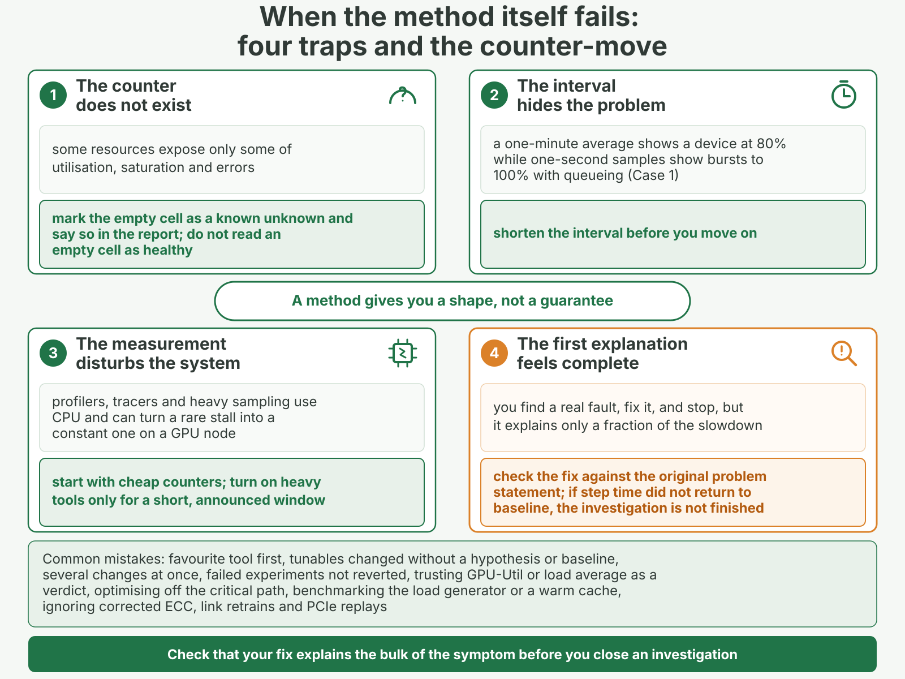

*Figure 1.23.39. Mark missing counters as unknowns, shorten the interval, start with cheap tools, and check the fix against the original symptom.*

A method gives you a shape, not a guarantee. Four failure modes are worth knowing before an incident teaches them to you the hard way.

1. The counter does not exist. USE needs utilisation, saturation and errors for every resource, but some resources expose only some of the three. If a cell in your table is empty, mark it as a known unknown and say so in the report. Do not read an empty cell as "healthy".
2. The interval hides the problem. A one-minute average can show a device at 80% while one-second samples show bursts to 100% with queueing. Case 1 above turned on exactly this. When a resource looks fine but the symptom is real, shorten the interval before you move on.
3. The measurement disturbs the system. Profilers, tracers and heavy sampling use CPU and can slow the job you are studying. On a GPU node this can turn a rare stall into a constant one. Start with cheap counters, and turn on heavy tools only for a short, announced window.
4. The first explanation feels complete. You find a real fault, fix it, and stop, but it explains only a fraction of the slowdown. Check the fix against the original problem statement. If the step time did not return to its baseline, the investigation is not finished.

Also keep one trap in mind for GPUs. `GPU-Util` reports the share of time in which at least one kernel was running. It says nothing about how much of the GPU that kernel used. A node can show 100% there and still deliver a small fraction of its peak work.

## Exercises

Work through these once you have read the chapter. Each one asks for a number or an explanation, so keep your answers short, and write them down before you check the lab output.

1. Problem statement, anti-methods and time-scale sanity checks. (a) Contrast the three anti-methods, streetlight, random change and blame-someone-else, with the 6-question problem statement and the scientific method. Explain how observational and experimental tests differ. (b) Use the time-scale table, where a `0.3 ns` CPU cycle equals `1 s`. Explain why a benchmark that claims a `"10 µs"` read from a rotational HDD, which takes `1–10 ms`, is physically impossible. Then say what it actually measured.
2. The Linux 60-second checklist and the GPU-node USE method. (a) List the 10 commands of the Linux 60-second checklist (`LINUX_60S_CHECKLIST` in `code/part01/perf_methodology_use.py`) and state what each one checks. (b) Explain why the USE method evaluates **Errors -> Saturation -> Utilization** in that order. Explain also why `nvidia-smi` can show `GPU-Util = 100%` while the GPU achieves less than 10% Model FLOPs Utilization (`MFU`).
3. USE versus RED, load versus architecture problems, and five whys. (a) On an LLM inference cluster, how do USE and RED complement each other, using `TTFT`, `TPOT` and `p99`? How does the request-rate trend tell an external load spike from an internal architecture or resource regression? (b) Trace the five whys in case study 1, from the ticket "NVMe scratch is 30% slower" to the true root cause, which is page-cache eviction from an uncontained process.
4. Amdahl's law versus Gunther's Universal Scalability Law (`USL`). (a) Use `amdahl_relative_capacity()` to compute the relative speed-up at `N = 64` GPUs when the serial, non-overlapped fraction is `α = 0.05` (`5%`). Then compute the theoretical ceiling as `N -> ∞`. (b) Compare `usl_relative_capacity(16, 0.04, 0.002)` with `usl_relative_capacity(64, 0.04, 0.002)`. Explain physically what the coherence parameter `β` represents in multi-node training.
5. Little's law (`L = λW`) and the M/D/1 queueing response-time curve. (a) Use `littles_law_in_flight()` to compute the average number of requests in flight for an inference endpoint that handles `λ = 200 req/s` at an average response time of `W = 50 ms` (`0.050 s`). Then compute the maximum sustainable throughput, in `seq/s`, of a batch scheduler that holds `L = 32` concurrent sequences with a `4 s` average residence time. (b) Compute `md1_response_time(1.0, ρ)` at `ρ = 0.0`, `0.60`, `0.80` and `0.90`. Explain why latency-critical services target `60%–70%` utilization.
6. Resource-limit capacity extrapolation and the harmonic mean of transfer rates. (a) A 16-CPU server handles `1,000 req/s` at `40%` average CPU utilization. Use `extrapolate_cpu_max_request_rate()` to compute the `%CPU` per request and the theoretical `100%` CPU ceiling in req/s. (b) A job transfers `100 MB` at `50 MB/s` and `700 MB` at `10 MB/s`. Compute the overall transfer rate with `weighted_harmonic_mean_rate()`, and explain why the arithmetic mean, `30 MB/s`, is wrong.

Start with exercise 1, then check your answers against the lab output.

## Checkpoint questions (20)

<details>
<summary>1. What is the difference between latency, response time, throughput, bandwidth, and IOPS?</summary>

Response time is the total time an operation takes, which is the wait time plus the service time. Latency is the time spent waiting before service. You can qualify it as request or network latency. Throughput is the rate of work actually done, in bytes/s, tokens/s or requests/s. Bandwidth is the theoretical maximum throughput of a link or bus. IOPS counts I/O operations per second, whatever the size of each transfer.
</details>

<details>
<summary>2. Why should you convert performance metrics into time (`latency`) whenever possible?</summary>

Counts like "100 network packets" and "50 disk reads" cannot be added or compared directly. Utilisation percentages have the same problem. Convert both to time, and they become comparable. Say you spend 100 ms in network I/O and 50 ms in disk I/O along the synchronous path. Now you can compare the two directly, and you can calculate the exact Amdahl speedup of fixing each one.
</details>

<details>
<summary>3. Define Utilization, Saturation, and Errors in the USE method, and explain why `100%` time-based utilization does not always mean `100%` capacity.</summary>

Utilisation is the fraction of time a resource was busy, or the fraction of its capacity in use. Saturation is the degree to which extra work cannot be serviced at once, so it must queue. Errors are counts of failed or retried operations. Time-based utilisation can read 100% even when capacity is not full. A parallel resource, such as an NVMe SSD with 64k queues or a multi-lane NIC, counts as "100% busy" whenever a single request is active. It can still have more than 90% of its parallel capacity unused.
</details>

<details>
<summary>4. Name the three anti-methods and how the Problem Statement + Scientific Method replace them.</summary>

The three anti-methods are the streetlight anti-method, which means running familiar tools where the light is good, random change, which means guessing and tweaking tunables until something seems faster, and blame-someone-else, which means passing the ticket to another team without evidence. Replace them by first answering the 6-question problem statement. Then apply the scientific method: `Question -> Hypothesis -> Prediction -> Test -> Analysis`. Change one variable at a time, and revert the failed tests.
</details>

<details>
<summary>5. List the ten commands of the Linux 60-second checklist and what each reveals.</summary>

The ten commands, and what each one reveals, are these. `uptime` shows the 1, 5 and 15-minute load averages. `dmesg -T | tail` shows OOM kills and Xid, NVRM and other hardware errors. `vmstat -SM 1` shows the run queue `r`, blocked `b`, swap `si/so`, and the CPU split `us/sy/id/wa/st`. `mpstat -P ALL 1` shows per-core balance, a hot CPU, `%soft` and `%steal`. `pidstat 1` shows CPU per process. `iostat -sxz 1` shows disk `await`, `aqu-sz` and `%util`. `free -m` shows `MemAvailable` and the cache. `sar -n DEV 1` shows NIC throughput and packets. `sar -n TCP,ETCP 1` shows TCP connects and retransmits. Last, `top` gives a combined overview.
</details>

<details>
<summary>6. What additional commands belong on a 60-second checklist for an 8-GPU training or inference node?</summary>

Add these for an 8-GPU training or inference node. Run `nvidia-smi` and `nvidia-smi -q -d PERFORMANCE` to check presence, power draw against the cap, and thermal or power throttle reasons. Run `nvidia-smi dmon -s pucvmet -d 1` for 1-second SM and memory clocks, PCIe and NVLink throughput, and ECC. Use `nvidia-smi topo -m` and `nvidia-smi nvlink -s` for topology and active NVLink lanes. Use `dcgmi dmon` or `dcgmi diag -r 1` for SM occupancy and tensor-pipe activity. Run `journalctl -k | grep -iE 'NVRM|Xid'` to find GPU errors. Check `ibstat`, `perfquery` or `ethtool -S` for RDMA link state and symbol or CRC errors. Finally, read `cat /proc/pressure/{cpu,memory,io}`.
</details>

<details>
<summary>7. Why is `GPU-Util` in `nvidia-smi` a misleading efficiency metric, and what should you measure instead?</summary>

`GPU-Util` only reports the share of sampling intervals in which at least one kernel ran on at least one Streaming Multiprocessor (SM). Suppose a tiny kernel uses 1 of 132 SMs and runs continuously. It still shows `100% GPU-Util`. So measure what the GPU actually does. Look at DCGM SM occupancy, Tensor Core activity, DRAM bandwidth utilisation, Model FLOPs Utilization (`MFU`), and tokens/s or samples/s.
</details>

<details>
<summary>8. In what order does the USE method check U, S, and E, and why must software resources and cgroup limits be included?</summary>

Check errors first, because they are quick to read, objective and rarely harmless. Check saturation second, because any queueing adds latency directly. Check utilisation third. You must also check software resources, such as mutexes, thread pools, file descriptors and `RLIMIT_MEMLOCK`. Include container cgroup limits too, such as `cpu.stat` `nr_throttled`, and `memory.current` against `memory.max`. A container often hits its cgroup cap while the physical host is mostly idle.
</details>

<details>
<summary>9. Why do 5-minute monitoring averages hide saturation, and what is the 60% utilization rule?</summary>

Picture a resource that is 100% saturated for 10 seconds of every minute, and idle for the other 50 seconds, shows a calm 17% average over a 5-minute window. Meanwhile, requests suffer severe queueing spikes during each burst. So always inspect 1-second intervals, with `vmstat 1`, `iostat 1` or `dmon -d 1`, or check the PSI counters. For non-preemptible resources, such as disks, NICs and GPU inference streams, queueing delay rises nonlinearly above about 60% to 70% average utilisation. By 60% utilisation, the M/D/1 waiting time has doubled.
</details>

<details>
<summary>10. What is the RED method, and how does it distinguish a load problem from an architecture/resource problem?</summary>

RED monitors every service through Request rate, Errors and Duration. Duration means latency percentiles, such as p50, p95 and p99, plus `TTFT` and `TPOT` for LLM serving. If Duration rises at the same time as the Request rate spikes, applied load is driving the slowdown. If Duration rises while the Request rate stays constant, the cause is an internal resource bottleneck, configuration drift or architectural contention.
</details>

<details>
<summary>11. What four questions does Workload Characterization ask, and why can it achieve larger speedups than hardware tuning?</summary>

Workload characterisation asks four questions. Who is generating the load, by PID, user, tenant or IP? Why is it being called, by code path, stack trace or API? What is the profile, covering IOPS, bytes, the R/W ratio, batch and sequence sizes, and variance? And how does it vary over time? This can beat hardware tuning. Eliminating unnecessary work at the top of the stack is the "fastest request is the one you never make" idea. It routinely yields 10x to 20x gains, compared with 10% to 20% from low-level kernel tuning.
</details>

<details>
<summary>12. Explain the three stages of Drill-Down Analysis, Latency Analysis (binary search), and the Five Whys.</summary>

The three-stage drill-down moves from fleet-wide monitoring, with dashboards and alerts, to node-level identification, with the 60-second checklist and USE. Then it goes to deep analysis, with profiling and tracing using `perf`, `bpftrace` and `Nsight Systems`. Latency analysis splits the total operation time into two or more synchronous phases, such as `data + H2D + compute + collective + checkpoint`. It then drills into the largest fraction, and repeats. Five whys chains evidence-backed causes until you reach the root cause you can act on.
</details>

<details>
<summary>13. What is Static Performance Tuning, and what are six common static misconfigurations found on GPU nodes?</summary>

Static performance tuning audits the configured state of hardware and software at rest, not the live load. Six findings are common on GPU nodes. First, a PCIe link is downtrained, such as x8 or Gen3 instead of x16 Gen5 in `lspci -vv`. Second, a NIC negotiated at 100 GbE instead of 400 GbE, or has the wrong MTU. Third, the CPU frequency governor is left on `powersave` instead of `performance`. Fourth, `nvidia-persistenced` or `nvidia-fabricmanager` is inactive. Fifth, `ulimit -l` (`memlock`) or `vm.max_map_count` is left at defaults. Sixth, debug flags, `NCCL_DEBUG=INFO` or `CUDA_LAUNCH_BLOCKING=1`, stay enabled in production.
</details>

<details>
<summary>14. List the seven performance mantras in order from most effective to least effective.</summary>

The seven performance mantras, from most effective to least, are these. Don't do it, which means eliminating unnecessary work. Do it, but don't do it again, which means caching results. Do it less, by coalescing, sampling or reducing frequency. Do it later, by deferring work or writing back asynchronously. Do it when they're not looking, during off-peak windows. Do it concurrently, by parallelising and overlapping compute with communication. Do it more cheaply, using faster hardware or lower precision.
</details>

<details>
<summary>15. State Amdahl's Law and Gunther's Universal Scalability Law (`USL`), and explain why throughput can decline at high GPU counts under USL.</summary>

Amdahl's law is C(N) = N / (1 + α(N - 1)), where α is the serial or contended fraction. Capacity approaches a ceiling of 1 / α. Gunther's USL adds a pairwise coherence, or crosstalk, penalty, β: C(N) = N / (1 + α(N - 1) + βN(N - 1)). When β is greater than 0, as with all-to-all or all-reduce synchronisation across nodes, the quadratic term βN(N - 1) grows faster than N. Aggregate throughput then peaks and falls as you add workers.
</details>

<details>
<summary>16. State Little's Law (`L = λW`) and the M/D/1 response-time formula, and apply both to an inference server.</summary>

Little's law says that average concurrency equals the arrival rate times the mean residence time, L = λW. At λ = 200 req/s and W = 0.050 s, L = 10 requests are in flight. For an M/D/1 queue, with Poisson arrivals, a deterministic service time s and utilisation ρ, the mean response time is r = s(2 - ρ) / (2(1 - ρ)). At ρ = 60%, r = 1.75s. At ρ = 80%, r = 3.0s. At ρ = 90%, r = 5.5s.
</details>

<details>
<summary>17. Why are arithmetic averages dangerous for latency and transfer rates, and when must you use percentiles and the harmonic mean?</summary>

Latency distributions are often bimodal, with fast cache hits and slow misses, and they carry long tails. The arithmetic mean describes neither mode. So SLOs and straggler analysis in distributed training must use percentiles, such as p50, p95 and p99, plus histograms and heat maps. When you average rates, such as MB/s or tokens/s across equal or weighted work segments, use the harmonic mean: `total_work / sum(work_i / rate_i)`. Do not use the arithmetic mean.
</details>

<details>
<summary>18. Contrast the four primary observability tool types: Counters, Profiling, Tracing, and Monitoring.</summary>

Counters, such as `vmstat`, `iostat`, `sar`, `ethtool -S` and `nvidia-smi`, read cheap cumulative kernel and hardware registers. You compute rates and averages from them. Profiling, with `perf record -F 99`, `py-spy` and flame graphs, samples running stack traces to show where time goes. Tracing, with `strace`, `tcpdump`, `bpftrace` and `Nsight Systems`, captures individual events with timestamps, which exposes outliers and ordering. Monitoring, with Prometheus, Grafana and the DCGM exporter, records time series and triggers alerts across the fleet.
</details>

<details>
<summary>19. Define Model FLOPs Utilization (`MFU`), Scaling Efficiency, and Goodput on an AI training cluster.</summary>

MFU is the achieved model arithmetic FLOPs per second, worked out from the model architecture and tokens/s, divided by the GPU's peak theoretical dense FLOPs/s at that precision. Scaling efficiency is `throughput(N) / (N * throughput(1))`. Goodput is the fraction of paid cluster GPU-hours that produce committed forward training progress. It excludes time lost to node crashes, restarts, checkpoint stalls, data starvation and straggler waits.
</details>

<details>
<summary>20. In Case Study 2 ("benchmarking a data-pipeline change"), why did both library versions plateau at `700 samples/s`, and what two lessons follow?</summary>

In Case Study 2, the single-threaded load generator on the client saturated 100% of one CPU core at 700 samples/s. So it capped the test before the server was stressed. A fixed-rate test at 700/s then showed the new library used 30% CPU against 20%, which is 1.5x more CPU per sample. Parallelising the load generator revealed the true server ceilings: 3,500/s for the old version and 2,300/s for the new one. The two lessons are to benchmark the benchmarker, which is active benchmarking, and to normalise results to resource cost per request.
</details>

## Sources and review notes

- **Sources read in full:**
  - `systems-performance-2nd-edition` — Brendan Gregg, *Systems Performance: Enterprise and the Cloud*, 2nd ed., **Chapter 1: Introduction** (systems performance roles, activities, workload vs resource perspectives, why performance is hard, latency, observability, experimentation, the Linux 60-second checklist, and the two case studies), **Chapter 2: Methodologies** (terminology, models, latency time scales, trade-offs, tuning closest to the work, when to stop, point-in-time recommendations, load vs architecture, scalability, known-unknowns, anti-methods, problem statement, scientific method, diagnosis cycle, tools method, USE method, RED method, workload characterization, drill-down and Five Whys, latency analysis, Method R, event tracing, baseline statistics, static performance tuning, cache tuning, micro-benchmarking, performance mantras, Amdahl's Law and Gunther's Universal Scalability Law USL, Little's Law and M/D/1 queueing theory, resource-limit capacity planning and factor analysis, statistics harmonic/geometric means and bimodal distributions, and visualizations), and **Chapter 4: Observability Tools** (section 4.1 tool taxonomy preview; full coverage in Chapter 1.24).
- **Run here:** `python3 code/part01/perf_methodology_use_lab.py` (17 passed, 0 failed).
- **Explicitly labelled inferences:** The GPU-server USE table (GPUs, HBM, NVLink/NVSwitch, PCIe, InfiniBand/RoCE, `memlock`, `NCCL`), the GPU 60-second checklist additions (`nvidia-smi dmon`, `dcgmi dmon`, `ibstat`, `perfquery`), and the AI efficiency metrics (`MFU`, `goodput`, `TTFT`, `TPOT`) translate Gregg's methodology to Part 6, Part 9, and Part 10 GPU cluster operations (no `nvidia-devops` file is directly mapped to `1.23`; cross-referenced with Chapters 1.22, 1.24, 1.25, 1.28, and original study items 21, 22, 24, 25, 26, 27, 28, and 29).
- **Not verified on live hardware:** All interactive VM and GPU commands in the checklists and lab (`vmstat`, `mpstat`, `pidstat`, `iostat`, `sar`, `nvidia-smi`, `dcgmi`, `stress-ng`, `fio`, `tc`, `nccl-tests`) were not run on live hardware and should be executed on a disposable VM or test cluster.
