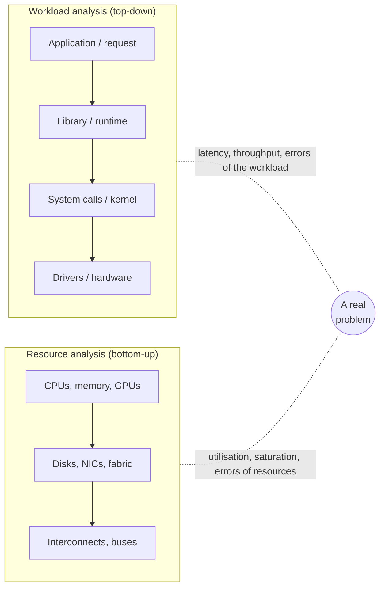
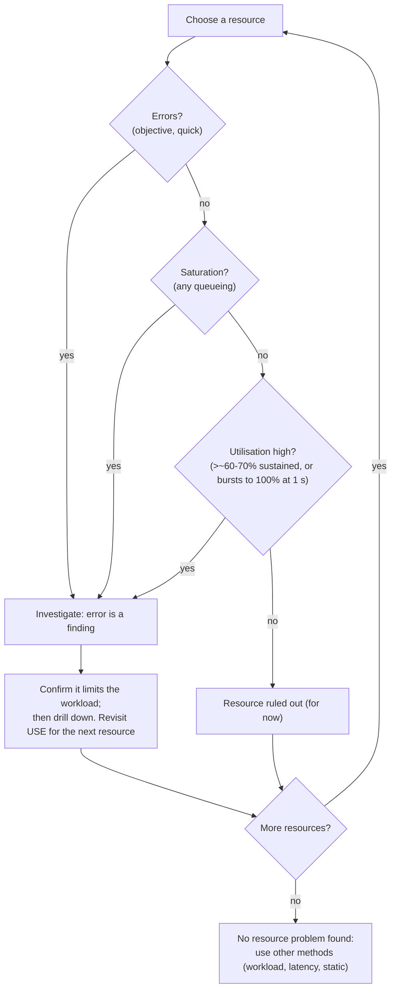
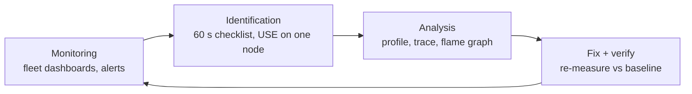
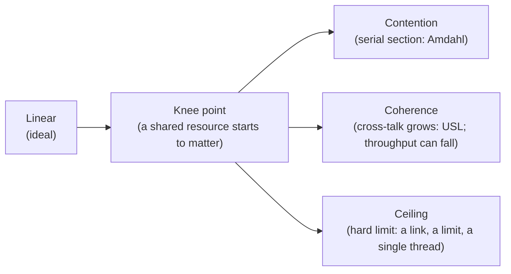
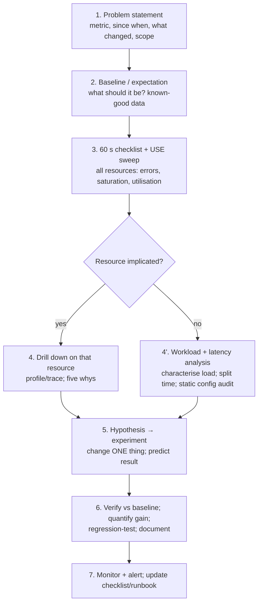

# 1.23 Performance methodology: USE, workload characterisation, drill-down

| | |
|---|---|
| Level | Intermediate |
| Priority tier | 0 |
| Lab venue | Any Linux VM (a GPU VM for the GPU exercises) |
| Part | Part 1: Linux, from the command line to the kernel and performance |
| Status | Drafted, labs **untested** |

## Why this matters for AI infrastructure

Most performance failures on GPU clusters are not exotic. A training job runs at 40% of the expected tokens per second; an inference service has a good median latency and a terrible 99th percentile; a node that benchmarked well last month is now 15% slower; scaling from 8 to 64 GPUs gives 3x. Without a method, engineers open `nvidia-smi`, see "GPU-Util 100%" and conclude the GPUs are fine, or blame the network, or change a random kernel parameter found on a forum. With a method, the first ten minutes are structured: state the problem precisely, check every resource for utilisation, saturation and errors, characterise the load, then drill into the one place that explains the time.

This chapter teaches the durable part of performance engineering: **how to think**, before the tool chapters (1.24 observability, 1.25 benchmarking) and the tuning chapters (1.28 and the GPU/network parts). It follows Brendan Gregg's *Systems Performance* (introduction and methodologies chapters) and adds the GPU/AI translation: the USE method over GPUs, NVLink, PCIe, InfiniBand and storage; RED for inference services; goodput and efficiency metrics for training; Amdahl and the Universal Scalability Law for multi-GPU scaling; queueing and Little's law for batching and capacity.

## Prerequisites and outcomes

You should be comfortable with processes, CPU scheduling, memory, disks and the observability commands introduced in chapters 1.8, 1.12, 1.17 and 1.18. Networking details come in Part 2 and GPU specifics in Parts 7 and 8; here they are used only as examples.

After this chapter you can:

- Define latency, throughput, IOPS, utilisation, saturation, errors, workload and bottleneck precisely, and convert metrics to time so they can be compared.
- Give a time-scale intuition (CPU cycle to cross-continent round trip, DRAM to NVMe to network) and use it to sanity-check results.
- Apply the problem-statement method, the scientific method and the diagnosis cycle; recognise and avoid the anti-methods (streetlight, random change, blame-someone-else).
- Run the Linux 60-second checklist and a GPU-node equivalent.
- Apply the USE method to every resource on a GPU server and fill a USE table with the commands that answer each cell, including the "known unknowns".
- Apply RED to services, workload characterisation, drill-down, latency analysis, five whys, event tracing, baselines, static performance tuning and the performance mantras.
- Distinguish load problems from architecture problems; read scalability curves (linear, contention, coherence, knee, ceiling) and fit Amdahl/USL.
- Use basic queueing theory (Little's law, the 60% rule) and statistics (percentiles, distributions, averages over intervals) correctly.
- Quantify the gain from a fix before making it, decide when to stop, and write findings that others can verify.

## 1. What "systems performance" covers

Systems performance studies the **entire path** work takes: application, libraries, runtime, kernel, drivers, hardware, network, and for distributed systems every server and service involved. For a distributed training job the path includes the data store, network filesystem, CPU data pipeline, host memory, PCIe, the GPU, NVLink and NVSwitch, the NIC and fabric, and the collective library. If you have no diagram of the data path, draw one first: you cannot analyse what you have not mapped.

Typical goals: **reduce latency** (user experience, step time, time to first token), **raise throughput**, and **reduce cost** by removing inefficiency. On GPU clusters cost is dominated by idle accelerators, so cost reduction is almost always "raise **goodput**": useful work per GPU-hour.

Roles: administrators, SREs, developers, network and storage engineers, and dedicated performance engineers all do performance work, usually bounded by their area ("the network team checks the network"). Hard problems cross boundaries, which is why a shared method matters. Performance activities across a project's life include setting objectives, modelling, prototype characterisation, non-regression testing, benchmarking releases, proof-of-concept in the target environment, production tuning, monitoring, incident analysis and tooling. Cloud makes canary and blue-green rollouts cheap, which is an excuse to skip early steps; do the early steps anyway when practical, because architectural performance mistakes are the most expensive to fix later.

### Two perspectives



- **Resource analysis** (administrators): start with the resources; metrics IOPS, throughput, utilisation, saturation, errors; used for capacity planning and "is any resource at its limit?".
- **Workload analysis** (developers, SRE): start with the work applied and the service's response: request rate, latency, completion (errors). Attributes of the workload (who, what, why, how much) show unnecessary or unbalanced work. "The fastest request is the one you do not make."

Hard problems benefit from both.

### Why performance is hard

It is **subjective** ("is a 1 ms average disk latency good?" depends on expectations; turn it into goals such as "99% of steps under X s"), **complex** (interacting components; cascading failures; fixing one bottleneck moves it elsewhere), has **multiple causes** (three normal events combine) and **multiple issues** (finding a problem is easy; finding the one that matters is the work: quantify each and estimate its speed-up). Latency is the best metric for that quantification because time can be compared and summed along a path, unlike IOPS or utilisation.

## 2. Vocabulary and concepts

| Term | Meaning |
|---|---|
| **IOPS** | I/O operations per second (reads plus writes); a throughput measure for operations, not bytes |
| **Throughput** | Rate of work done: bytes/s, requests/s, tokens/s, samples/s. Careful: "bandwidth" is the *maximum* possible throughput |
| **Response time** | Total time for an operation: waiting plus service |
| **Latency** | Time spent waiting before service; sometimes used for the whole response time. Always qualify: connection latency, request latency, queue latency, time to first token |
| **Utilisation** | *Time-based*: fraction of an interval the resource was busy (B/T). *Capacity-based*: fraction of capacity used. 100% busy does not mean 100% capacity (an elevator that is always moving can still take passengers; an NVMe with queue depth can accept more) |
| **Saturation** | Work that cannot be serviced and queues (run-queue length, I/O wait queue, pressure). Any non-zero saturation is a latency source |
| **Errors** | Counted failed or retried operations; often cheap to check and decisive |
| **Bottleneck** | The resource that limits system performance; removing one reveals the next |
| **Workload** | The input applied to the system |
| **Cache** | Faster tier holding a subset of a slower tier; the **hit ratio** is not linear in benefit: 98% to 99% matters more than 10% to 11% |

### Latency and time scales

Convert everything to time when you can. "100 network I/Os versus 50 disk I/Os" cannot be compared; "100 ms of network versus 50 ms of disk" can. Know the orders of magnitude (scaled to make a 0.3 ns CPU cycle equal one second):

| Event | Typical latency | Scaled |
|---|---|---|
| CPU cycle | 0.3 ns | 1 s |
| L1 cache | 1 ns | 3 s |
| L2 cache | 3 ns | 10 s |
| L3 cache | 10 ns | 33 s |
| DRAM | 100 ns | 6 minutes |
| NVMe / flash I/O | 10 to 100 µs | 9 to 90 hours |
| Rotational disk I/O | 1 to 10 ms | 1 to 12 months |
| Same-datacentre network round trip | 50 µs to 0.5 ms | days |
| InfiniBand RDMA one-way (switched) | about 1 to 2 µs | hours |
| Cross-continent network (SF to NY) | 40 ms | 4 years |
| TCP retransmit timeout | 1 to 3 s | centuries |
| Physical server reboot | minutes | tens of millennia |

AI-relevant additions (order of magnitude, hardware dependent: verify for your platform): HBM access hundreds of ns, NVLink hop around a microsecond or less, PCIe transfer launch overhead microseconds, GPU kernel launch a few microseconds, NCCL small-message latency tens of microseconds intra-node and tens to hundreds across nodes, checkpoint write to parallel filesystem seconds to minutes. Use the table to spot results that are physically implausible (a "10 µs" disk read is cache, not disk).

### Other concepts

- **Trade-offs.** Good/fast/cheap (pick two). CPU versus memory (cache results or recompute). Tunables: filesystem record size (small for random I/O, large for streaming), network buffers (small for many connections, large for throughput). Every tuning has a price.
- **Tuning is most effective closest to the work.** Eliminating a database query in the application can give 20x; tuning a storage device may give 20%. For AI: removing a pointless host-device copy or fusing kernels beats tuning TCP buffers. But observe from the OS level too, which often explains application behaviour.
- **Appropriateness and when to stop.** Depth depends on return on investment. Stop when you have explained the bulk of the problem (a 3x CPU rise where the found cause is 12% of CPU is *not* explained), when the potential gain is smaller than the cost of analysis, or when a larger payoff exists elsewhere. At GPU-cluster scale, one percent of goodput is worth real money, so deeper analysis is justified.
- **Point-in-time recommendations.** Tunable values from blogs, vendor slides or last year's cluster are medicine from someone else's cabinet: they may be expired, wrong for your hardware, or workarounds for fixed bugs. Keep tunables in version control with a comment explaining why and when to re-check (chapter 1.22).
- **Load versus architecture.** Is the system slow because too much load is applied (a multithreaded app busy on all CPUs with queueing requests) or because of how it is built (a single-threaded app saturating one core while 63 idle; threads contending for one lock)? The request-rate trend distinguishes them: steady rate with rising duration points at architecture or resources; both rising points at load.
- **Scalability.** Performance versus load or resources: linear, then a **knee** where contention begins, and eventually decline from coherence overheads. Fast degradation (memory when paging starts, disks) versus slow (CPU). Services that return errors instead of queueing (503) keep response times flat but fail requests.
- **Metrics have costs and flaws.** Collecting metrics costs CPU (observer effect); metrics can be wrong, stale, or defined differently between versions. Verify surprising numbers with a second source.
- **Caching terminology.** Hit ratio and miss rate; cold, warm, hot; warm-up time can be hours when the next tier is slow (a 600 GB flash cache fed at 16 MB/s takes ten hours to warm). Benchmarks must report cache state. For AI jobs: page cache, dataset caches, the first epoch versus later epochs, and the GPU memory allocator's cache.
- **Known-knowns, known-unknowns, unknown-unknowns.** You know the CPU is 10% busy; you know you have not looked at interrupt load; you do not know that interrupts consume cores. The more you learn, the more unknown-unknowns become known-unknowns, which is exactly what a checklist-by-resource (USE) exposes.

## 3. The problem statement comes first

Before logging in, ask (these questions alone often reveal the cause, even over the phone):

1. What makes you think there is a performance problem? (which metric, which user complaint)
2. Has the system ever performed well? (regression versus never good)
3. What changed recently? Software, firmware, driver, kernel, hardware, load, data, configuration, neighbours.
4. Can the problem be expressed in latency or runtime? (step time, tokens/s, time to first token, job duration)
5. Does it affect other users, nodes, jobs, or only this one?
6. What is the environment? Hardware, versions, topology, scheduler, container, library versions.

Add for GPU work: which model and batch size; which parallelism strategy; how many nodes/GPUs; what the expected throughput is and where that expectation came from (published results, an earlier run, a theoretical estimate); is the slowdown constant or periodic; are all ranks slow or one straggler; does it reproduce on one node.

## 4. Anti-methods and good methods

| Method | Description | Verdict |
|---|---|---|
| **Streetlight** | Use the tools you know or that are easy, wherever the light is good (running `top` because you know it) | Anti-method: finds *an* issue, not *the* issue |
| **Random change** | Change tunables until it improves; keep what looks better | Anti-method: unexplained, fragile, may encode workarounds, risk at peak |
| **Blame-someone-else** | Hypothesise a component you do not own and hand it over without data | Anti-method: wastes other teams; demand screenshots of tools run |
| **Ad hoc checklist** | A list of known checks (e.g. `r_await` over 10 ms) | Fast, but point-in-time and limited to known issues; keep it current |
| **Problem statement** | Section 3 | Always first |
| **Scientific method** | Question, hypothesis, prediction, test, analysis. Observational test or experimental test (change one thing; if it fails, revert before the next hypothesis). "Negative tests" deliberately worsen something to confirm cause | Core |
| **Diagnosis cycle** | hypothesis → instrumentation → data → hypothesis, quickly | Core; move to data fast so bad theories die early |
| **Tools method** | List tools, metrics, interpretations | Works, but only as good as the tool inventory; unaware of what is missing |
| **USE** | For every resource: utilisation, saturation, errors | Systemic bottlenecks fast |
| **RED** | For every service: request rate, errors, duration | User-facing health of services |
| **Workload characterisation** | Who, why, what, how over time | Finds unnecessary or malicious load |
| **Drill-down** | Monitor → identify → analyse; five whys | Root cause |
| **Latency analysis** | Split an operation's time into components, descend into the largest | Binary search through the stack |
| **Method R** | Response-time-based approach from Oracle tuning | Same latency-first idea applied to databases |
| **Event tracing** | Inspect individual events (packets, I/O, syscalls) with timestamps | When summaries hide outliers |
| **Baseline statistics** | Record "normal" for comparison | Answers "is this normal for this system?" |
| **Static performance tuning** | Check configuration at rest | Finds misconfigurations (1 GbE negotiated, failed RAID member, debug mode on) |
| **Cache tuning** | Cache high in the stack; check enabled, hit ratio, size, double-caching | Targeted |
| **Micro-benchmarking** | Artificial simple workloads | Establishes component limits (chapter 1.25) |
| **Performance mantras** | Don't do it; do it but not again; do it less; do it later; do it when they're not looking; do it concurrently; do it more cheaply | Order of effectiveness for fixes |

### The Scientific Method in practice (examples)

*Observational.* Question: why are training steps slow on node 17 only? Hypothesis: its data loader is starved by a slow local NVMe. Prediction: `iostat` shows high await on that device and GPU `sm` activity drops in lockstep. Test: record both while a job runs. Analysis: await is normal, data loader queue is full, GPU is waiting in NCCL, so the NVMe is not the cause; return to step 2 with a new hypothesis (a slow NIC link, a degraded PCIe link, a thermally throttled GPU).

*Experimental.* Question: does disabling NUMA balancing raise throughput? Hypothesis yes; prediction: smaller run-to-run variance and fewer page faults. Test: A/B on identical nodes with the setting toggled, repeated runs, same data, pinned clocks. Analysis with confidence intervals (section 9). If no effect, revert.

### Elimination is also an answer

"Low utilisation, no saturation, no errors" on a resource is valuable: it removes that resource from the search and narrows the scope. Document negative findings; they prevent teams from re-checking the same dead end.

## 5. The Linux 60-second checklist

Run these in the first minute of any investigation on a Linux host (each is covered in later chapters). Read each output once before moving on.

| # | Command | What to check |
|---|---|---|
| 1 | `uptime` | Load averages 1/5/15 min: trend up or down; compare against logical CPU count; remember it includes uninterruptible tasks |
| 2 | `dmesg -T \| tail` | Kernel errors: OOM kills, hardware errors, GPU Xid/NVRM messages, link flaps, throttling |
| 3 | `vmstat -SM 1` | `r` run queue, `b` blocked, swap `si/so`, `free`, `cs`, `us/sy/id/wa/st` |
| 4 | `mpstat -P ALL 1` | One hot CPU (single-thread bottleneck or interrupts), `%steal`, `%soft` |
| 5 | `pidstat 1` | Which processes use CPU; user versus system time |
| 6 | `iostat -sxz 1` | Disk IOPS, throughput, await, `%util`, queue size |
| 7 | `free -m` | Memory and page cache; available memory |
| 8 | `sar -n DEV 1` | Interface throughput and packet rates versus line rate |
| 9 | `sar -n TCP,ETCP 1` | TCP connection rates and retransmits |
| 10 | `top` | Overview; sanity check of the above |

**GPU-node additions** (all read-only; flag: option names vary by driver and DCGM version):

| # | Command | What to check |
|---|---|---|
| 11 | `nvidia-smi` | All GPUs present; driver/CUDA versions; memory use; processes; power draw versus cap; temperature; throttle reasons (`nvidia-smi -q -d PERFORMANCE`) |
| 12 | `nvidia-smi dmon -s pucvmet -d 1` | Per-GPU power, utilisation (sm, mem, enc/dec), clocks, memory, PCIe and NVLink throughput, ECC and Xid-related counters per second |
| 13 | `nvidia-smi topo -m` and `nvidia-smi nvlink -s` | Topology matrix (NV#, PIX, PXB, PHB, SYS, NODE), NVLink active links |
| 14 | `dcgmi dmon -e 1002,1003,1004,1005,1009,1010,203,252` (field IDs vary) or `dcgmi diag -r 1` | SM activity/occupancy, tensor-pipe activity, DRAM activity, NVLink and PCIe throughput; quick health test |
| 15 | `journalctl -k \| grep -iE 'NVRM\|Xid\|nvidia'` | GPU errors (Xid 79 fallen off the bus, 48/63/64/94/95 ECC and retired pages, 74 NVLink errors; consult NVIDIA's Xid catalogue) |
| 16 | `ibstat`, `ibv_devinfo`, `rdma link`, `perfquery` or `ethtool -S` | Link state and rate, error counters (symbol errors, link downs, retransmits) |
| 17 | `cat /proc/pressure/{cpu,memory,io}` | PSI: tasks stalled on each resource |
| 18 | `numastat`, `lstopo`, `cat /proc/cmdline`, `sysctl -a` diff vs baseline | Placement and drift |

`GPU-Util` in `nvidia-smi` means "a kernel was running on at least one SM during the sample", **not** that the GPU is doing useful, efficient work. A GPU running one tiny kernel continuously shows 100%. Use SM activity/occupancy, tensor-core activity, memory bandwidth, and above all **achieved model FLOPs utilisation (MFU)** and tokens/s versus expectation.

## 6. The USE method

**For every resource, check utilisation, saturation and errors.** Resources are the physical (and some software) components. The method iterates over *resources*, not tools: you build the complete list of questions first, then find a tool for each; unanswered questions are your known-unknowns.



Order: errors first (cheap, objective), saturation second (any amount matters), utilisation third (needs interpretation). Express metrics like this: utilisation as percent over an interval ("one CPU at 90%"), saturation as a queue length or wait time ("run queue of 4"), errors as counts ("50 disk errors").

Cautions: (1) **Interval length hides bursts.** Five-minute averages can show 40% while every second saturates; look at 1 s data. (2) **Above about 60% utilisation** queueing delays become frequent for non-preemptible resources (disks, NICs, links); CPUs can preempt, so they degrade more gracefully. (3) **First finding is not necessarily the finding.** Systems can have several issues; fix, re-measure, iterate. (4) Include **software resources** (mutex locks, thread pools, file descriptors, process counts, connection pools) and **resource controls** (cgroup limits: memory capacity "utilisation" is usage versus the cap, "saturation" is limit-induced allocation failure or swapping even if the host is fine; CPU quota throttling is saturation, chapter 1.18).

### The USE table for a GPU server

Fill it in for your platform; the commands are starting points, and blanks are known-unknowns to close over time.

| Resource | Utilisation | Saturation | Errors |
|---|---|---|---|
| CPU (per logical CPU) | `mpstat -P ALL 1` (`%usr+%sys`) | run queue `vmstat r`, `runqlat`, PSI `cpu some`, cgroup `cpu.stat` throttling | machine-check (`rasdaemon`, `mcelog`), EDAC, thermal throttling in `dmesg` |
| Host memory (capacity) | `free -m`, `MemAvailable` | swapping (`vmstat si/so`), reclaim (`sar -B`, `pgscan`), PSI `memory`, OOM events | `dmesg` OOM, EDAC ECC corrected/uncorrected counts, failed allocations |
| NUMA / memory bandwidth | PMU counters (`perf stat`, `pcm-memory`, `amd uProf`) | high CPI / stall cycles, remote access ratio (`numastat`) | (hardware errors via EDAC) |
| Swap / storage capacity | `df -h`, inode use `df -i` | write stalls, `iostat` queue, PSI `io` | filesystem errors, `smartctl`, `nvme smart-log` |
| Local NVMe devices | `iostat -x %util` (weak for NVMe), throughput versus spec | `aqu-sz`, `await`, PSI `io`, `biolatency` | `nvme smart-log` media/integrity errors, `dmesg` I/O errors |
| Network interface (Ethernet/IB) | `sar -n DEV`, `ethtool -S`, `rdma statistic`, `ibstat` rate versus line rate | drops/overruns, retransmits (`nstat`, `ss -ti`), pause frames, congestion notifications (ECN/CNP), queue depth | CRC/symbol errors, link flaps, `port_rcv_errors`, `ethtool -S rx_errors`, `perfquery` |
| Fabric / switches | port counters and utilisation (UFM, NetQ, `ibdiagnet`) | buffer occupancy, PFC pause, adaptive routing stats | link down events, bit error rate |
| PCIe (GPU, NIC, NVMe) | `nvidia-smi dmon` PCIe rx/tx throughput versus link capability; `lspci -vv` link speed/width | (indirect) copy stalls | AER errors in `dmesg`, `Xid` 79, replay counters (`nvidia-smi -q -d ...`) |
| GPU compute (SMs, tensor cores) | DCGM SM activity/occupancy, tensor activity, `nsys` | work queued behind other streams/processes; MPS/time-slice contention | Xid errors; ECC errors; thermal/power throttling reasons |
| GPU memory (HBM) capacity | `nvidia-smi` memory used/total; allocator stats | allocation failures/OOM; unified-memory oversubscription (page migration traffic) | ECC single/double bit, retired pages, row-remapping failures |
| GPU memory bandwidth | DCGM DRAM activity | (indirect) | ECC |
| NVLink / NVSwitch | `nvidia-smi nvlink`, DCGM NVLink bandwidth versus peak | stalls visible in profiler timelines | NVLink CRC/replay errors, Xid 74, fabric manager health |
| Power / thermal | `nvidia-smi` power draw versus limit, `ipmitool sdr`, `turbostat` | clock throttling due to power cap or thermal reasons | thermal/power faults in BMC SEL |
| Software: file descriptors | `ls /proc/PID/fd \| wc -l` versus `ulimit -n` | waits on allocation | `EMFILE`/`ENFILE` errors |
| Software: pinned memory / `memlock` | locked pages versus `ulimit -l` | allocation stalls | failed pinning (`cudaHostAlloc` errors) |
| Software: threads/PIDs | `cgroup pids.current` vs `pids.max` | fork waits | `Resource temporarily unavailable`, "cannot fork" |
| Software: NCCL/communication | NCCL logs with `NCCL_DEBUG=INFO`, nccl-tests bus bandwidth versus expected | stragglers (a rank late to a collective) | NCCL errors/timeouts, watchdog |
| Containers (cgroup limits) | `cpu.stat`, `memory.current` vs `memory.max`, `io.stat` | CPU throttling, `memory.events` high/max, PSI per cgroup | OOM kills (`memory.events oom_kill`), pids max |

The **interconnects** (CPU, memory, I/O buses) are easy to forget. They are usually over-provisioned, but on GPU servers PCIe topology (a NIC and GPU on different root complexes, or sharing an oversubscribed switch uplink) and host memory bandwidth for data loading can be the actual bottleneck. `nvidia-smi topo -m` plus link speed checks are the cheapest interconnect "static" audit.

### RED for services

For every service (inference endpoints, schedulers, registries, feature stores): **R**equest **r**ate, **E**rrors, **D**uration (use percentiles). USE describes machine health; RED describes user health; they complement. The request rate tells you at once whether a slowdown coincides with more load (a load problem) or the same load (architecture or resource problem). For LLM serving, duration splits into queue time, time to first token (TTFT), time per output token (TPOT) and total; plus tokens/s, batch size, KV-cache utilisation and the number of preemptions/evictions (Part 10).

## 7. Workload characterisation

Characterise the **input**, not the resulting performance. Ask:

- **Who** is causing the load (user, job, tenant, client IP, process)?
- **Why** is the load issued (code path, stack trace, which API, which dataset)?
- **What** are its characteristics (IOPS, bytes, read/write mix, request size, sequence lengths, batch size, collective types and sizes, direction), including *variance*, not just averages?
- **How** does it change over time (daily pattern, ramp, bursts, per epoch)?

Check even when you expect the answer; an unexpected client is sometimes an attack, a mis-deployed cron job, or a runaway retry loop. The best wins come from eliminating unnecessary work; if it cannot be eliminated, throttle it with resource controls (a backup compressing during peak training can be limited by cgroup CPU and I/O limits, chapter 1.18).

AI examples: for a training run, characterise the **step anatomy** (data loading time, host-to-device copies, forward, backward, optimizer, all-reduce volume and count per step, checkpoint cadence and size); for inference, **request mix** (prompt length distribution, output length distribution, concurrency, arrival process); for storage, **access pattern** (many small files versus large shards; sequential versus random; read-after-write). These feed simulation benchmarks (chapter 1.25) and capacity plans (section 10).

## 8. Drill-down and latency analysis

### Three-stage drill-down

1. **Monitoring**: continuous, cluster-wide high-level metrics and alerts (Prometheus/Grafana/DCGM exporter; exporters expose counters over HTTP). Finds that something is wrong and when it started, and correlates with changes (deploys, driver updates).
2. **Identification**: examine a suspect node/job with the 60-second checklist and USE to find *which* resource or area.
3. **Analysis**: profilers and tracers (`perf`, flame graphs, bpftrace, Nsight Systems/Compute, PyTorch profiler, NCCL traces) to find the code path, device or interaction responsible.



### Five whys

Ask "why" repeatedly, answering from evidence, until you reach something actionable. Example: training throughput dropped 20%. Why? Step time grew. Why? The all-reduce phase lengthened. Why? One rank starts it late. Why? Its data loader stalls periodically. Why? The host page cache is being evicted and the dataset is re-read from the network filesystem every epoch. Why? A neighbour process on that node pins a large amount of memory so the cache no longer fits. Action: fix the memory budget or cgroup limits (and add a cache-hit-ratio alert). The root cause was three layers away from the symptom.

### Latency analysis: halve the problem

Break an operation's time into components and descend into the larger. Example for an LLM inference request: is there a latency problem? (yes, p99 TTFT) → is the time on the GPU or before it? (before) → in the queue or in tokenization? (queue) → is the queue long because arrivals exceed service capacity or because batches are held? (batch scheduler waits for a fill timeout) → adjust the policy. Each step is a measurement, not a guess; each answer is one of two branches. The same procedure on a training step: step = data + H2D + compute + communication + optimizer + checkpoint; time each (profilers do this) and descend into the largest.

### Event tracing

Summaries hide outliers. When averages look fine but users complain, trace events individually: packets (`tcpdump -ttt`), block I/O (`biosnoop`), syscalls (`strace -T`, `perf trace`), scheduler wake-ups, GPU kernels and copies (Nsight Systems timeline), NCCL operations. Record input attributes, start/end times (so you get latency), and the result. A latency outlier can be caused by *previous* events (head-of-line blocking) rather than its own properties, which only the event sequence reveals. Tracing costs overhead; use short windows in production.

### Baselines and static tuning

- **Baseline statistics.** Record "normal": run a script that collects the 60-second checklist outputs, `sysctl -a`, `lscpu`, `lspci -vv` link states, `nvidia-smi -q`, firmware versions, and benchmark results (`nccl-tests`, `dcgmi diag`, a small reference training step) on a healthy node; store it with the image version. After incidents or changes, diff. Also take baselines before and after changes. Where no baseline exists, "summary since boot" counters are a coarse substitute.
- **Static performance tuning.** Audit the configuration at rest: Does each component make sense for the workload? Is it configured for it? Was it autoconfigured wrongly? Is it degraded? Typical findings: a 400 Gb NIC negotiated 100 Gb or running at PCIe x8; a failed RAID member; a GPU with a downgraded PCIe link (`lspci -vv` `LnkSta`); a stale kernel or firmware; IP forwarding enabled; THP or governor settings drifted; `ulimit -l` small; the cgroup driver mismatch; debug logging left on (`NCCL_DEBUG=INFO` in production, `CUDA_LAUNCH_BLOCKING=1`); a filesystem nearly full. Fleet-wide, this is the cheapest and highest-yield check because configuration drift is the most common cause of "identical" nodes behaving differently.

### Performance mantras

In order of effectiveness: **don't do it** (remove unneeded work: skip a redundant copy, drop a debug sync), **do it, but don't do it again** (cache: tokenized data, compiled kernels, KV prefix cache), **do it less** (reduce polling, checkpoint frequency, logging), **do it later** (async checkpointing, write-back), **do it when they're not looking** (off-peak maintenance, background compaction), **do it concurrently** (overlap communication and compute, multi-stream, data-loader workers), **do it more cheaply** (faster hardware, lower precision, better algorithm).

## 9. Scalability, modelling and queueing

### Reading scalability curves

Plot delivered performance (tokens/s, samples/s, requests/s) against a scaling dimension (GPUs, nodes, threads, clients). Learn the shapes:



- **Linear**: performance grows in proportion. Rarely lasts.
- **Contention**: part of the work is serial or shared (a lock, a data-loader, the all-reduce, a single metadata server).
- **Coherence**: the cost of keeping parts in agreement grows with N (all-to-all traffic, synchronisation, cache coherence).
- **Knee**: a factor changes the slope; investigate settings near the knee (the point where a thread count equals physical cores, where traffic leaves a NVLink domain, where a job spans more leaf switches).
- **Ceiling**: hard limit such as a link at line rate, a software resource cap, or a single-threaded client generating the load.

**Amdahl's law of scalability**: relative capacity C(N) = N / (1 + α(N − 1)), where α (0 to 1) is the serial fraction. With α = 0.05, 64 workers give 64 / (1 + 0.05 × 63) = 15.4x, never more than 1/α = 20x. **Universal Scalability Law (USL)**: C(N) = N / (1 + α(N − 1) + βN(N − 1)), adding β for coherence delay; with β > 0 throughput peaks and then **declines**. Method: collect data for a range of N (observed or by controlled experiment), fit α (and β) by non-linear regression (R `nls`, gnuplot `fit`, or Python `scipy.optimize.curve_fit`), plot model against data, and hold out later points to test the prediction. Deviation from the model is informative: either your understanding of the system is incomplete, or something specific (a switch hop, a single filesystem server) is limiting.

Multi-GPU relevance: strong scaling (fixed global batch) follows Amdahl-like curves because communication and serial sections do not shrink; weak scaling (batch grows with GPUs) is judged by **scaling efficiency** = throughput(N) / (N × throughput(1)). Typical diagnostic questions: where is the knee (8 GPUs = one NVLink domain; beyond it traffic uses InfiniBand)? Does efficiency drop at node counts that exceed one leaf/pod? Does the curve change with message size or algorithm (NCCL ring versus tree)? Chapters in Parts 8 and 9 apply this to NCCL and fabric design.

### Queueing theory in four lines

Many components are queues: a request queue, a disk, a NIC, a GPU stream, a scheduler. Key results:

- **Little's law**: L = λW. The average number of items in a system equals the arrival rate times the average time each spends in it. It holds for any stable system and is the best sanity check you have: a service handling 200 req/s with average latency 50 ms must have on average 10 requests in flight; if your concurrency limit is 8, requests queue; if a GPU batch scheduler holds 32 sequences and each takes 4 s, sustainable throughput is at most 8 sequences/s.
- **Utilisation and response time**: for an M/D/1 queue (random arrivals, fixed service time s), response time r = s(2 − ρ) / (2(1 − ρ)). At ρ = 0 it is s; at 60% it is about 1.6 s (it has *doubled* the waiting part); at 80% it is 3 s; at 90% it is 5.5 s; it diverges near 100%. Higher variance in service time (M/M/1, M/G/1) is worse, and percentiles degrade much faster than means. This is the reason disk, network and GPU-serving utilisation targets are about 60 to 70%, not 100%, when latency matters; and why throughput jobs (training) can run hot while latency services cannot.
- **Kendall notation**: A/S/m = arrival process / service-time distribution / servers; M = Markovian (exponential), D = deterministic, G = general. M/M/c is a multi-server queue (a pool of GPU replicas).
- **Saturation shows up as queueing delay first**, then as drops/errors when queues are bounded.

Used for AI serving: model the request queue and the batch scheduler; the arrival rate and the p99 target determine how many replicas you need; continuous batching changes the service-time distribution; always validate the model by measurement.

## 10. Capacity planning

- **Resource-limit method.** Measure request rate and the resource each request uses; extrapolate to the first resource that reaches 100%. Example: 1,000 req/s at 40% average on 16 CPUs means 0.64% CPU per request (16 × 40 / 1,000), so the CPU limit is at 16 × 100 / 0.64 = 2,500 req/s. It is a best case; some other limit may come first, and the peak (not the daily average) must be planned for.
- **Factor analysis.** To pick a configuration with minimum cost that meets a target, start with the maximum configuration, change one factor at a time, record the percentage performance drop and cost saving of each, combine multiplicatively, choose, and re-test the combined configuration (eight binary factors need about ten tests, not 256).
- **Scaling.** Vertical (bigger machine) versus horizontal (more machines behind a load balancer; autoscaling groups, Kubernetes HPA on CPU or custom metrics such as queue length or GPU utilisation); databases shard on a key. GPUs scale as nodes, but fabrics and storage have step limits that must be planned together.
- **For GPU capacity**: express demand as model, tokens/s or samples/s, SLO, and utilisation target; supply as per-GPU achievable throughput at the target latency (from a benchmark of your actual model and stack, not vendor peak), derated for failures and maintenance; add headroom for peak and for degraded nodes; plan network, storage and power at the same time. Keep the benchmark methodology (chapter 1.25) and the cost model next to the plan.

## 11. Statistics you must get right

- **Averages hide.** The average of a bimodal latency distribution (fast cache hits, slow misses) can describe *no actual request*. "The man drowned in a river with an average depth of six inches." Always ask for the distribution.
- **Percentiles** (p50, p90, p95, p99, p99.9) describe the slow tail; SLAs are written with them. **Median** shows where the bulk is. Standard deviation and **coefficient of variation** (σ / mean) express spread; a standard deviation of 50 means little without the mean.
- **Mean types**: arithmetic mean for additive quantities; **harmonic mean** for rates (sending 100 MB at 50 MB/s and 700 MB at 10 MB/s averages 800 / (100/50 + 700/10) = 11.1 MB/s, not 30); **geometric mean** for multiplicative effects (speed-ups of stacked layers).
- **Averages over time depend on the interval.** A "50% utilised" CPU was busy half of *some interval*; five-minute averages hide second-long saturations. Decayed averages (load average) weight recent time more.
- **Outliers** (rare 1,000 ms I/Os among 1 ms ones) are invisible in means and often in standard deviation; histograms, scatter plots and heat maps expose them. In distributed training one slow rank (a straggler) sets the step time for everyone, so **maximum and tail across ranks** matter more than the mean.
- **Experiments need repetition.** Run enough repeats, report median and spread, control confounders (clocks, thermal state, cache state, neighbours), and compare like with like. A 3% difference with 5% run-to-run variation is noise.
- **Quantify gains before acting.** Observation-based: a request takes 10 ms, of which 9 ms is disk; replacing the disk reads with a cache costing 10 µs would give about 10 / 1.01 = 9.9x at best. Experiment-based: apply the change and compare before/after with a reliable metric. Ensure the latency you cut is on the synchronous path, not background work.

## 12. Visualisation and monitoring

- **Monitoring** records metrics over time to compare past and present, find daily/weekly patterns, quantify growth and set alerts. Patterns repeat hourly, daily, weekly, quarterly, yearly, plus irregular events (a new release, a holiday, a job queue draining). Collect at one-second resolution for critical metrics if you can afford it; at least keep short-term high-resolution data for incidents. Agents (exporters) such as node_exporter, DCGM exporter and cAdvisor publish metrics; prefer collection from kernel interfaces over parsing command output. Use dashboards built around USE and RED rather than "every metric available".
- **Line charts** for trends; add percentiles and the median, not only the mean. **Scatter plots** show every event but overplot at scale. **Heat maps** bucket latency (or utilisation) by time and show bimodal distributions and outliers for thousands of systems. **Timeline charts** (traces of kernels, copies and collectives per GPU/stream; browser waterfalls) show dependencies and idle gaps: Nsight Systems and PyTorch profiler traces are timeline charts. **Flame graphs** show where CPU (or off-CPU) time goes by code path (chapter 1.24). **Surface plots** and multi-dimensional views help only when the data is smooth.
- **Observing the observability.** Tools have overhead and bugs; metrics may not mean what the name suggests, may be missing in containers (host values shown), or may be a per-interval average in some tools and a cumulative counter in others. Cross-check surprising values with a second source. Tool inventories also have blind spots: map each USE cell to a tool and list what has no tool.

### Observability tool taxonomy (preview of chapter 1.24)

| Type | Examples | Notes |
|---|---|---|
| **Counters** (cumulative, read and diff) | `vmstat`, `mpstat`, `iostat`, `sar`, `ethtool -S`, `nvidia-smi` | Cheap; show rates and averages; the base of monitoring |
| **Profiling** (sampling) | `perf record -F 99 -a -g`, flame graphs, `py-spy` | Where CPU time goes; coarse by sample rate |
| **Tracing** (event-based) | `strace`, `tcpdump`, `perf trace`, ftrace, BCC/bpftrace, Nsight Systems | Detail, overhead; static (tracepoints, USDT) and dynamic (kprobes, uprobes, BPF) instrumentation |
| **Monitoring** | Prometheus + Grafana, DCGM exporter, cloud-vendor tools | History and alerting |

Sources of observability data: `/proc` (per-process and system counters), `/sys` (device and driver attributes), delay accounting (time waiting for CPU/IO/swap per task), netlink (network configuration and statistics), tracepoints and kprobes/uprobes/USDT (dynamic and static probes), hardware **performance monitoring counters** (instructions, cycles, cache and TLB misses, memory bandwidth) and vendor-specific sources (NVML/DCGM for GPUs, `ibstat`/`perfquery` for InfiniBand). **Crisis tools** should be installed on every image *before* the crisis (`sysstat`, `perf`, `bcc-tools`/`bpftrace`, `iotop`, `numactl`, `pciutils`, `ethtool`, `rdma-core`, DCGM tools); **static tools** (`lscpu`, `lstopo`, `lspci -vv`, `dmidecode`, `ip`, `ethtool`, `nvidia-smi -q`) answer configuration questions. Details, interpretation and examples are in chapter 1.24.

## 13. AI-specific measures of efficiency

Raw utilisation numbers are weak signals on accelerators. Use outcome metrics:

| Metric | Definition | Use |
|---|---|---|
| **Throughput** | tokens/s or samples/s per GPU and aggregate | Primary training/inference KPI |
| **Step time and its breakdown** | data wait, H2D, forward, backward, communication (exposed), optimizer, checkpoint | Find the largest component |
| **MFU** (model FLOPs utilisation) | achieved model FLOPs/s ÷ peak hardware FLOPs/s (dense, precision-matched) | Efficiency versus theoretical; published good LLM training values are well below 100% and depend on scale and model (flag: use your own baseline) |
| **Scaling efficiency** | throughput(N) ÷ (N × throughput(1)) | Multi-GPU/multi-node health |
| **Goodput** | fraction of wall-clock (or cluster time) spent making forward training progress, excluding restarts, failures, checkpoint stalls, stragglers, idle waiting | Cluster-level cost metric: GPU-hours of useful work ÷ GPU-hours paid |
| **GPU idle gaps (bubbles)** | time between kernels/collectives in a timeline | Pipeline stalls, CPU launch overhead, data starvation |
| **Inference: TTFT, TPOT, p99, tokens/s/GPU, queue time, KV-cache hit/utilisation, batch occupancy** | RED plus LLM-specific | Serving SLOs |
| **Cost** | $/million tokens, $/training run, GPU-hours per epoch | Business translation |

A **GPU-starvation checklist** for "GPUs idle in the timeline": Is the data loader a bottleneck (queue empty, workers busy, `iostat` busy, network filesystem slow)? Is the CPU the limiter (single-thread Python launch overhead, `torch` ops launching tiny kernels; use CUDA graphs/compile)? Is host memory pinned? Is the PCIe link at x16 and the NUMA placement right? Is communication exposed (not overlapped)? Is a straggler rank late (thermal throttle, bad link, noisy neighbour)? Is the checkpoint blocking the step? Is `GPU-Util` high yet SM activity low (many small kernels)? Each question maps to a USE cell or a characterisation question above.

## 14. Two worked case studies (adapted)

### Case 1: "Slow disks" becomes "slow data loading"

A training team files a ticket: "the NVMe scratch is slow; epochs got 30% longer this week." The administrator first builds the **problem statement**: is there a measurable regression (epoch time, step data-wait), since when, what changed, why were disks suspected? The team's monitoring shows disk busy, but the monitoring interval is one minute. The administrator applies **USE** across resources and confirms: CPUs and network are modest; the NVMe devices show 80% utilisation at one-minute resolution; at one-second resolution `iostat` shows bursts to 100% with queueing (saturation) and higher latency; no device errors. An off-CPU view of the data-loader workers shows they spend their time blocked in file reads, so the disk is on the critical path. **Workload characterisation**: reads dominate, I/O sizes small and random, rate steady, the training job's read rate had not changed, and neither had the dataset. So the disks behave normally *for the load*; why is the load higher than before? A quick check of the page cache hit ratio shows 91% versus 98% on sibling nodes, and the cache is much smaller. Memory accounting reveals a new prototype process on the node that has grown to consume hundreds of GB, squeezing the page cache so that previously cached shards are re-read from NVMe. The prototype is moved; the cache recovers; epoch times return. Lessons: ask first; check all resources before trusting the suspect; look at short intervals; characterise load before blaming devices; the answer was a memory budget problem, found by the cache hit ratio, not by a tool for disks.

### Case 2: non-regression test of a software change

An engineer must determine whether a new data-pipeline library version hurts throughput. She acquires an idle node, configures it as production, and characterises the real workload from logs to check that her load generator resembles it (it matches the average but not the variance, which she notes). She ramps load in steps and runs **active benchmarking**: while the test runs she inspects server resources and finds them idle even though throughput plateaus at 700 samples/s for both versions. Disappointed, she switches to fixed-rate testing: both versions at 700/s, comparing resource use: the new version uses 30% CPU versus 20% for the old one on the same work, a regression of 50% more CPU per sample. To find the 700/s ceiling she examines the *load generator* and discovers it is single-threaded and saturating one CPU, the limiter of the test itself. Running the generator in parallel on several clients drives the server CPU to 100%: old 3,500/s versus new 2,300/s, consistent with the CPU-per-sample finding. She then CPU-profiles the new version (a flame graph) to find where the extra cycles go, reports the regression with evidence, and files a bug about the single-threaded generator. Lessons: benchmark the benchmarker; use two complementary experiments (ramp and fixed-rate); convert to resource-per-request; record what you did not test (varied workloads).

## 15. Putting a method into practice: a template



Always write down: what was observed, with commands and timestamps; the hypothesis; the test; the result; the decision. This turns firefighting into a team asset (incident reviews, runbooks, canary criteria).

## 16. Hands-on lab: practise the method

First, run the self-checking Python lab (`code/part01/perf_methodology_use_lab.py`) locally. It verifies the 10-command Linux 60-second checklist, Amdahl's law (`15.42x` at `N=64, α=0.05`) vs Gunther's USL (`β > 0`), Little's law (`L = λW`), M/D/1 queueing response time (`r = s(2 - ρ)/(2(1 - ρ))`), weighted harmonic mean of transfer rates (`11.1 MB/s`), and resource-limit CPU ceiling extrapolation (`2,500.0 req/s`).

```bash
python3 code/part01/perf_methodology_use_lab.py
```

Next, on a disposable Linux VM with 4 or more vCPUs (`stress-ng`, `sysstat`, `fio`, `iperf3`, `bpfcc-tools` optional; a GPU VM for steps 8 to 9; all interactive VM commands below are `untested here`), work through these steps:

1. **Baseline**: write `baseline.sh` that stores `uptime`, `vmstat 1 5`, `mpstat -P ALL 1 3`, `iostat -sxz 1 3`, `free -m`, `sar -n DEV 1 3`, `ss -s`, `lscpu`, `cat /proc/pressure/*`, `sysctl -a`, `lspci -vv | grep -E 'LnkSta|LnkCap'`, and (GPU) `nvidia-smi -q`; run it on an idle VM and keep it.
2. **Fault injection and diagnosis** (have a partner choose, or randomise): (a) `stress-ng --cpu 1` pinned to one core (single-thread bottleneck); (b) `stress-ng --vm 2 --vm-bytes 90% ` with swap on (memory saturation); (c) `fio --rw=randread --bs=4k --iodepth=32` (disk saturation); (d) `tc qdisc add dev eth0 root netem delay 50ms loss 1%` (network latency and loss); (e) a cgroup `cpu.max` limit on a busy process (throttling). Without being told which, apply the 60-second checklist, then a USE table, and name the fault and the evidence for each.
3. **USE table**: fill the table in section 6 for your VM with a concrete command per cell and mark unanswered cells as known-unknowns.
4. **Workload characterisation**: run a mixed `fio` job file (70/30 read/write, mixed sizes) and answer who/why/what/when using `iostat`, `biosnoop`/`biolatency` (BCC) or `blktrace` if available.
5. **Latency analysis**: time a `python -c` script that reads a file, parses it, and writes output; use `strace -c -f`, `time`, and `perf stat` to split time into CPU, system, and I/O; drill into the largest.
6. **Amdahl/USL fit**: run a CPU-parallel benchmark (`sysbench cpu --threads=N` or a small multiprocessing job) for N = 1..2×vCPUs, record throughput; fit α (and β) in Python (`scipy.optimize.curve_fit`) and plot data versus model; explain the knee.
7. **Queueing check**: run a simple service (e.g. `python -m http.server` with an artificial 10 ms delay) under a load generator at several arrival rates; plot mean and p99 latency versus utilisation and compare with the M/D/1 curve; verify Little's law (L = λW) from measured concurrency.
8. **GPU 60-second checklist** (GPU VM): run section 5's GPU additions during a PyTorch matmul loop and during an idle data-loader-starved loop (insert `time.sleep` in the loader); compare `GPU-Util`, SM activity, power, clocks, PCIe throughput; explain why `GPU-Util` alone misleads.
9. **Scaling experiment** (multi-GPU VM or 2 nodes): run `nccl-tests` `all_reduce_perf` for 1, 2, 4, 8 GPUs at several message sizes; plot bus bandwidth; locate the knee; relate to topology (`nvidia-smi topo -m`).
10. **Write the report**: for each exercise a problem statement, evidence, hypothesis, test, result, decision, in a one-page format.

## 17. Common mistakes

- Starting with a favourite tool instead of a method; changing tunables without a hypothesis or baseline.
- Trusting `GPU-Util`, load average, or a five-minute CPU average as a verdict.
- Reporting averages without percentiles and distributions.
- Changing several things at once; not reverting failed experiments.
- Optimising a component that is not on the critical path (asynchronous work).
- Benchmarking the load generator, a warm cache, or a single run.
- Forgetting resource controls (cgroup throttling, memlock limits) in the USE sweep.
- Ignoring errors and "small" counters (corrected ECC, link retrains, PCIe replays) until they become outages.
- Skipping baselines, then not knowing what "normal" is.
- Fixing the first problem found and stopping without checking it explains the bulk of the symptom.

## 18. Interview angles

- "A training job is 30% slower than last week. What do you do in the first 15 minutes?" (problem statement, what changed, baseline diff, 60-second checklist, USE sweep, stragglers, drill-down.)
- "GPU-Util shows 100% but throughput is low. Why?" (utilisation definition, small kernels, communication, MFU, SM activity.)
- "Explain USE and RED. When do you use each?"
- "What is the difference between a load problem and an architecture problem? How do you tell?"
- "Explain Little's law and apply it to LLM serving capacity."
- "Why not run a serving cluster at 95% utilisation?" (queueing, tail latency.)
- "How would you prove that a kernel parameter change helped?" (A/B, repeats, variance, confidence.)
- "Scaling from 8 to 64 GPUs gives only 3x. Hypotheses and tests?" (Amdahl/USL, topology, message sizes, stragglers, data pipeline.)
- "Describe a performance investigation you led: what was your method and how did you know when to stop?"

## Exercises

1. **Problem Statement, Anti-Methods vs. Scientific Method, and Time-Scale Sanity Checking:** (a) Contrast the three anti-methods (*streetlight*, *random change*, *blame-someone-else*) with the 6-question Problem Statement and the Scientific Method (observational vs experimental tests); (b) using the time-scale table (`0.3 ns` CPU cycle = `1 s`), explain why a benchmark claiming a `"10 µs"` read latency from a rotational HDD (`1–10 ms`) is physically impossible and what it actually measured.
2. **The Linux 60-Second Checklist and the GPU-Node USE Method:** (a) List the 10 commands of the Linux 60-second checklist (`LINUX_60S_CHECKLIST` in `code/part01/perf_methodology_use.py`) and state what each checks; (b) why does the USE method evaluate **Errors -> Saturation -> Utilization** in that order, and why can `nvidia-smi` show `GPU-Util = 100%` while the GPU is achieving `< 10%` Model FLOPs Utilization (`MFU`)?
3. **USE vs. RED, Load vs. Architecture Problems, and Five Whys:** (a) How do USE and RED complement each other on an LLM inference cluster (`TTFT`, `TPOT`, `p99`), and how does the request-rate trend distinguish an external load spike from an internal architecture/resource regression? (b) Trace the Five Whys in Case Study 1 from the user ticket ("NVMe scratch is 30% slower") to the true root cause (page-cache eviction from an uncontained process).
4. **Amdahl's Law vs. Gunther's Universal Scalability Law (`USL`):** (a) Using `amdahl_relative_capacity()`, compute the relative speedup at `N = 64` GPUs when the serial/non-overlapped fraction is `α = 0.05` (`5%`), as well as the theoretical ceiling as `N -> ∞`; (b) compare `usl_relative_capacity(16, 0.04, 0.002)` and `usl_relative_capacity(64, 0.04, 0.002)` and explain physically what the coherence parameter `β` represents in multi-node training.
5. **Little's Law (`L = λW`) and the M/D/1 Queueing Response-Time Curve:** (a) Using `littles_law_in_flight()`, compute the average number of requests in flight for an inference endpoint handling `λ = 200 req/s` at an average response time of `W = 50 ms` (`0.050 s`), and compute the maximum sustainable throughput (`seq/s`) of a batch scheduler holding `L = 32` concurrent sequences with a `4 s` average residence time; (b) compute `md1_response_time(1.0, ρ)` at `ρ = 0.0`, `0.60`, `0.80`, and `0.90`, and explain why latency-critical services target `60%–70%` utilization.
6. **Resource-Limit Capacity Extrapolation and Harmonic Mean of Transfer Rates:** (a) A 16-CPU server handles `1,000 req/s` at `40%` average CPU utilization; use `extrapolate_cpu_max_request_rate()` to compute the `%CPU` per request and the theoretical `100%` CPU ceiling (`req/s`); (b) a job transfers `100 MB` at `50 MB/s` and `700 MB` at `10 MB/s`; compute the overall transfer rate using `weighted_harmonic_mean_rate()` and explain why the arithmetic mean (`30 MB/s`) is wrong.

## Checkpoint questions (20)

<details>
<summary>1. What is the difference between latency, response time, throughput, bandwidth, and IOPS?</summary>

**Response time** is the total time for an operation to complete (`wait time + service time`); **latency** is the time spent waiting before service (or qualified as request/network latency); **throughput** is the actual rate of work completed (`bytes/s`, `tokens/s`, `requests/s`); **bandwidth** is the theoretical maximum possible throughput of a link/bus; and **IOPS** is the rate of I/O operations per second regardless of transfer size.
</details>

<details>
<summary>2. Why should you convert performance metrics into time (`latency`) whenever possible?</summary>

Counts like `"100 network packets"` versus `"50 disk reads"` or utilization percentages cannot be added or compared directly. Converting both to time (`100 ms` spent in network I/O vs `50 ms` spent in disk I/O along the synchronous path) lets you compare components directly and calculate the exact Amdahl speedup of fixing each one.
</details>

<details>
<summary>3. Define Utilization, Saturation, and Errors in the USE method, and explain why `100%` time-based utilization does not always mean `100%` capacity.</summary>

**Utilization** is the fraction of time a resource was busy (or fraction of capacity used); **Saturation** is the degree to which extra work cannot be serviced immediately and must queue; and **Errors** are counts of failed or retried operations. A parallel resource (such as an NVMe SSD with 64k queues or a multi-lane NIC) is "100% busy" whenever a single request is active, even when it has `> 90%` of its parallel capacity still unused.
</details>

<details>
<summary>4. Name the three anti-methods described by Brendan Gregg and how the Problem Statement + Scientific Method replace them.</summary>

The three anti-methods are the **Streetlight anti-method** (running familiar tools where the light is good), **Random change** (guessing and tweaking tunables until something seems faster), and **Blame-someone-else** (passing the ticket to the network/storage team without evidence). Replace them by first answering the 6-question **Problem Statement**, then applying the **Scientific Method** (`Question -> Hypothesis -> Prediction -> Test -> Analysis`, changing one variable at a time and reverting failed tests).
</details>

<details>
<summary>5. List the ten commands of the Linux 60-second checklist and what each reveals.</summary>

(1) `uptime` (1/5/15-min load averages), (2) `dmesg -T | tail` (OOM kills, Xid/NVRM/hardware errors), (3) `vmstat -SM 1` (run queue `r`, blocked `b`, swap `si/so`, CPU `us/sy/id/wa/st`), (4) `mpstat -P ALL 1` (per-core balance, hot CPU, `%soft`, `%steal`), (5) `pidstat 1` (per-process CPU), (6) `iostat -sxz 1` (disk `await`, `aqu-sz`, `%util`), (7) `free -m` (`MemAvailable` and cache), (8) `sar -n DEV 1` (NIC throughput/packets), (9) `sar -n TCP,ETCP 1` (TCP connects and retransmits), and (10) `top` (combined overview).
</details>

<details>
<summary>6. What additional commands belong on a 60-second checklist for an 8-GPU training or inference node?</summary>

`nvidia-smi` and `nvidia-smi -q -d PERFORMANCE` (presence, power draw vs cap, thermal/power throttle reasons), `nvidia-smi dmon -s pucvmet -d 1` (1-second SM/mem clocks, PCIe/NVLink throughput, ECC), `nvidia-smi topo -m` and `nvidia-smi nvlink -s` (topology and active NVLink lanes), `dcgmi dmon` / `dcgmi diag -r 1` (SM occupancy, tensor-pipe activity), `journalctl -k | grep -iE 'NVRM|Xid'`, `ibstat` / `perfquery` / `ethtool -S` (RDMA link state and symbol/CRC errors), and `cat /proc/pressure/{cpu,memory,io}`.
</details>

<details>
<summary>7. Why is `GPU-Util` in `nvidia-smi` a misleading efficiency metric, and what should you measure instead?</summary>

`GPU-Util` only reports the percentage of sampling intervals during which *at least one* kernel was executing on *at least one* Streaming Multiprocessor (SM)—a tiny kernel using 1 of 132 SMs continuously reports `100% GPU-Util`. Measure DCGM **SM occupancy**, **Tensor Core activity**, **DRAM bandwidth utilization**, **Model FLOPs Utilization (`MFU`)**, and actual **tokens/s or samples/s**.
</details>

<details>
<summary>8. In what order does the USE method check U, S, and E, and why must software resources and cgroup limits be included?</summary>

Check **Errors** first (because they are fast to read, objective, and rarely benign), **Saturation** second (because any queueing directly adds latency), and **Utilization** third. You must also check software resources (mutexes, thread pools, file descriptors, `RLIMIT_MEMLOCK`) and container **cgroup limits** (`cpu.stat` `nr_throttled`, `memory.current` vs `memory.max`), because a container frequently hits its software cgroup cap while the physical host is mostly idle.
</details>

<details>
<summary>9. Why do 5-minute monitoring averages hide saturation, and what is the 60% utilization rule?</summary>

A resource that is 100% saturated for 10 seconds every minute and idle for 50 seconds reports a calm `17%` average over a 5-minute window while requests suffer severe queueing spikes during each burst; always inspect 1-second intervals (`vmstat 1`, `iostat 1`, `dmon -d 1`) or PSI counters. For non-preemptible resources (disks, NICs, GPU inference streams), queueing delay rises nonlinearly above **`~60%–70%` average utilization** (`M/D/1` waiting time doubles by `60%`).
</details>

<details>
<summary>10. What is the RED method, and how does it distinguish a load problem from an architecture/resource problem?</summary>

RED monitors every service by **Request rate**, **Errors**, and **Duration** (latency percentiles `p50`, `p95`, `p99`, plus `TTFT` and `TPOT` for LLM serving). If **Duration** rises at the same time **Request rate** spikes, the slowdown is driven by applied load; if **Duration** rises while **Request rate** is constant, the cause is an internal resource bottleneck, configuration drift, or architectural contention.
</details>

<details>
<summary>11. What four questions does Workload Characterization ask, and why can it achieve larger speedups than hardware tuning?</summary>

Workload characterization asks: (1) **Who** is generating the load (PID, user, tenant, IP)? (2) **Why** is it being called (code path, stack trace, API)? (3) **What** is the workload profile (IOPS, bytes, R/W ratio, batch/sequence sizes, variance)? and (4) **How** does it vary over time? Eliminating unnecessary work at the top of the stack ("the fastest request is the one you never make") routinely yields `10x–20x` gains compared to `10%–20%` from low-level kernel tuning.
</details>

<details>
<summary>12. Explain the three stages of Drill-Down Analysis, Latency Analysis (binary search), and the Five Whys.</summary>

**Three-stage drill-down** moves from fleet-wide **Monitoring** (dashboards/alerts) -> node-level **Identification** (60-second checklist + USE) -> deep **Analysis** (profiling/tracing with `perf`, `bpftrace`, `Nsight Systems`). **Latency analysis** splits total operation time into two (or more) synchronous phases (`data + H2D + compute + collective + checkpoint`) and recursively drills into the largest fraction. **Five Whys** chains evidence-backed causes until reaching the actionable root cause.
</details>

<details>
<summary>13. What is Static Performance Tuning, and what are six common static misconfigurations found on GPU nodes?</summary>

Static performance tuning audits the configured state of hardware and software at rest rather than live load. Six common GPU-node findings are: (1) PCIe link downtrained (`x8` or Gen3 instead of `x16` Gen5 in `lspci -vv`), (2) NIC negotiated at `100 GbE` instead of `400 GbE` or wrong MTU, (3) CPU frequency governor left on `powersave` instead of `performance`, (4) `nvidia-persistenced` or `nvidia-fabricmanager` inactive, (5) `ulimit -l` (`memlock`) or `vm.max_map_count` left at defaults, and (6) debug flags (`NCCL_DEBUG=INFO`, `CUDA_LAUNCH_BLOCKING=1`) left enabled in production.
</details>

<details>
<summary>14. List Brendan Gregg's seven Performance Mantras in order from most effective to least effective.</summary>

(1) **Don't do it** (eliminate unnecessary work), (2) **Do it, but don't do it again** (cache results), (3) **Do it less** (coalesce, sample, or reduce frequency), (4) **Do it later** (defer/asynchronous write-back), (5) **Do it when they're not looking** (run during off-peak windows), (6) **Do it concurrently** (parallelize and overlap compute with communication), and (7) **Do it more cheaply** (use faster hardware or lower precision).
</details>

<details>
<summary>15. State Amdahl's Law and Gunther's Universal Scalability Law (`USL`), and explain why throughput can decline at high GPU counts under USL.</summary>

**Amdahl's Law** is `C(N) = N / (1 + α(N - 1))`, where `α` is the serial/contended fraction; capacity approaches an asymptotic ceiling of `1 / α`. **Gunther's USL** adds a pairwise coherence/crosstalk penalty `β`: `C(N) = N / (1 + α(N - 1) + βN(N - 1))`. When `β > 0` (such as all-to-all/all-reduce synchronization overhead across nodes), the quadratic `βN(N - 1)` denominator grows faster than `N`, causing aggregate throughput to peak and then **fall** as more workers are added.
</details>

<details>
<summary>16. State Little's Law (`L = λW`) and the M/D/1 response-time formula, and apply both to an inference server.</summary>

**Little's Law** states that average concurrency in a system equals arrival rate times mean residence time (`L = λW`): at `λ = 200 req/s` and `W = 0.050 s`, `L = 10` requests are in flight. For an **M/D/1** queue (Poisson arrivals, deterministic service time `s`, utilization `ρ`), mean response time is `r = s(2 - ρ) / (2(1 - ρ))`: at `ρ = 60%`, `r = 1.75s`; at `ρ = 80%`, `r = 3.0s`; and at `ρ = 90%`, `r = 5.5s`.
</details>

<details>
<summary>17. Why are arithmetic averages dangerous for latency and transfer rates, and when must you use percentiles and the harmonic mean?</summary>

Latency distributions are frequently **bimodal** (fast cache hits + slow misses) with long tails; the arithmetic mean describes neither mode, so SLOs and distributed-training straggler analysis must use **percentiles** (`p50`, `p95`, `p99`) and histograms/heat maps. When averaging **rates** (such as `MB/s` or `tokens/s` across equal or weighted work segments), you must use the **harmonic mean** (`total_work / sum(work_i / rate_i)`), not the arithmetic mean.
</details>

<details>
<summary>18. Contrast the चार primary observability tool types: Counters, Profiling, Tracing, and Monitoring.</summary>

**Counters** (`vmstat`, `iostat`, `sar`, `ethtool -S`, `nvidia-smi`) read cheap cumulative kernel/hardware registers to compute rates and averages; **Profiling** (`perf record -F 99`, `py-spy`, flame graphs) samples running stack traces to show where time is spent; **Tracing** (`strace`, `tcpdump`, `bpftrace`, `Nsight Systems`) captures individual events with timestamps to expose outliers and ordering; and **Monitoring** (`Prometheus`, `Grafana`, `DCGM exporter`) records time series and triggers alerts across the fleet.
</details>

<details>
<summary>19. Define Model FLOPs Utilization (`MFU`), Scaling Efficiency, and Goodput on an AI training cluster.</summary>

**MFU** is the ratio of achieved model arithmetic FLOPs/s (from the model architecture and tokens/s) to the GPU's peak theoretical dense FLOPs/s at that precision. **Scaling efficiency** is `throughput(N) / (N * throughput(1))`. **Goodput** is the fraction of paid cluster GPU-hours that produce committed forward training progress—excluding time lost to node crashes, restarts, checkpoint stalls, data starvation, and straggler waits.
</details>

<details>
<summary>20. In Case Study 2 ("benchmarking a data-pipeline change"), why did both library versions plateau at `700 samples/s`, and what two lessons follow?</summary>

The single-threaded **load generator** on the client was saturating 100% of one CPU core at `700 samples/s`, capping the test before the server was stressed. Switching to a **fixed-rate test** at `700/s` revealed the new library used `30%` CPU vs `20%` (`1.5x` more CPU per sample), and parallelizing the load generator proved the true server ceilings (`3,500/s` vs `2,300/s`). Always **benchmark the benchmarker** (`active benchmarking`) and normalize to **resource cost per request**.
</details>

## Sources and review notes

- **Sources read in full:**
  - `systems-performance-2nd-edition` — Brendan Gregg, *Systems Performance: Enterprise and the Cloud*, 2nd ed., **Chapter 1: Introduction** (systems performance roles, activities, workload vs resource perspectives, why performance is hard, latency, observability, experimentation, the Linux 60-second checklist, and the two case studies), **Chapter 2: Methodologies** (terminology, models, latency time scales, trade-offs, tuning closest to the work, when to stop, point-in-time recommendations, load vs architecture, scalability, known-unknowns, anti-methods, problem statement, scientific method, diagnosis cycle, tools method, USE method, RED method, workload characterization, drill-down and Five Whys, latency analysis, Method R, event tracing, baseline statistics, static performance tuning, cache tuning, micro-benchmarking, performance mantras, Amdahl's Law and Gunther's Universal Scalability Law USL, Little's Law and M/D/1 queueing theory, resource-limit capacity planning and factor analysis, statistics harmonic/geometric means and bimodal distributions, and visualizations), and **Chapter 4: Observability Tools** (section 4.1 tool taxonomy preview; full coverage in Chapter 1.24).
- **Run here:** `python3 code/part01/perf_methodology_use_lab.py` (17 passed, 0 failed).
- **Explicitly labelled inferences:** The GPU-server USE table (GPUs, HBM, NVLink/NVSwitch, PCIe, InfiniBand/RoCE, `memlock`, `NCCL`), the GPU 60-second checklist additions (`nvidia-smi dmon`, `dcgmi dmon`, `ibstat`, `perfquery`), and the AI efficiency metrics (`MFU`, `goodput`, `TTFT`, `TPOT`) translate Gregg's methodology to Part 6, Part 9, and Part 10 GPU cluster operations (no `nvidia-devops` file is directly mapped to `1.23`; cross-referenced with Chapters 1.22, 1.24, 1.25, 1.28, and original study items 21, 22, 24, 25, 26, 27, 28, and 29).
- **Not verified on live hardware:** All interactive VM and GPU commands in the checklists and lab (`vmstat`, `mpstat`, `pidstat`, `iostat`, `sar`, `nvidia-smi`, `dcgmi`, `stress-ng`, `fio`, `tc`, `nccl-tests`) are marked (untested here) and should be executed on a disposable VM or test cluster.
