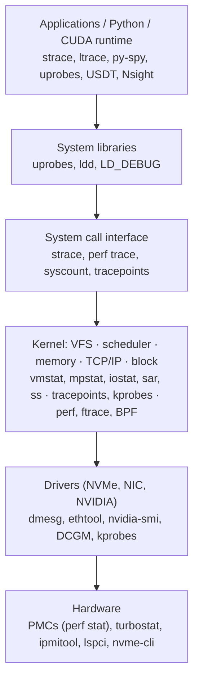
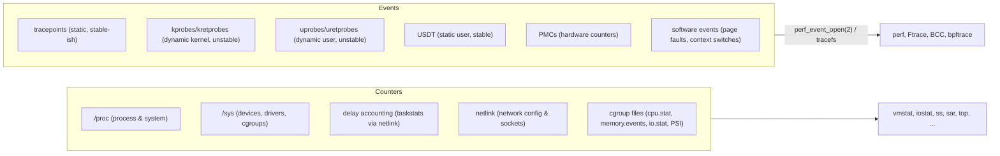
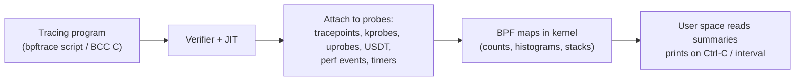
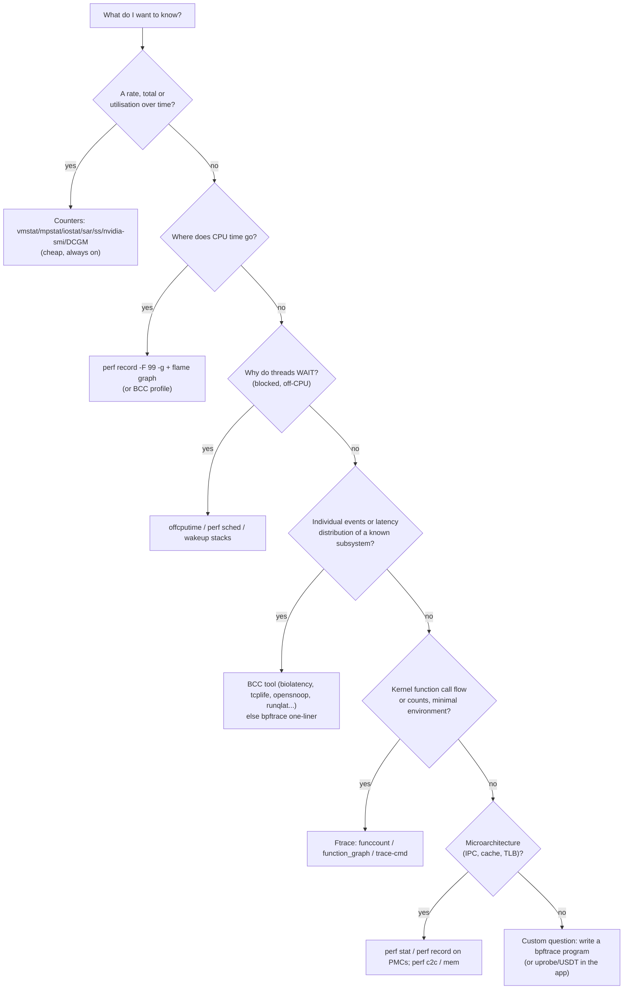

# 1.24 Observability tools: perf, ftrace, BPF and bpftrace

| | |
|---|---|
| Level | Advanced |
| Priority tier | 0 |
| Lab venue | Any Ubuntu VM (root needed); a GPU VM for the GPU-specific tooling |
| Part | Part 1: Linux, from the command line to the kernel and performance |
| Status | Drafted, labs **untested** |

## Why this matters for AI infrastructure

The method chapter (1.23) tells you which question to ask. This chapter gives you the instruments to answer it. On a GPU node, "why is this slow?" often reduces to a CPU or kernel question that no GPU tool can answer: which threads burn host CPU launching tiny kernels, why a data-loader worker blocks in the kernel, where a process spends time off-CPU waiting on a lock or a filesystem, which file reads come from the network filesystem, why TCP retransmits spike, which function in the NVIDIA driver is slow, why a syscall takes 400 ms every few minutes. The Linux tracing tools (perf, ftrace, BPF with BCC and bpftrace) answer these questions on a live production system, usually without restarting anything.

Typical uses on AI infrastructure:

- Profile the **host side** of a training job (`perf record -g`, flame graphs): Python interpreter, data decoding, `memcpy`, page faults, lock contention.
- Find **off-CPU** time (`offcputime`, `perf sched`): data loader workers waiting on NFS/Lustre, threads blocked on `futex`, `D`-state tasks.
- Trace **file and network I/O** (`opensnoop`, `biolatency`, `tcpretrans`, `tcplife`): which files are read, with what latency, from which process; retransmits on checkpoint transfers.
- Explain **scheduler latency**, run-queue length, interrupt cost (`runqlat`, `hardirqs`, `softirqs`), complementing the cgroup throttling analysis from 1.18.
- Measure **IPC and cache misses** with PMCs (`perf stat`) to separate memory-bound from compute-bound host code.
- Debug production incidents: short-lived processes (`execsnoop`), unexpected signals (`killsnoop`), OOM kills (`oomkill`), slow syscalls (`syscount`, `funclatency`).

This chapter explains the tools and, more importantly, their **data sources** and **costs**, so you can choose the cheapest tool that answers the question, know what it cannot see, and avoid perturbing a production workload.

## Prerequisites and outcomes

You should know the method chapter (1.23: USE, drill-down, the 60-second checklist), processes and system calls (1.8, 1.11), `/proc` and `/sys` (1.10), memory (1.17) and scheduling (1.18). No programming background beyond shell is needed.

After this chapter you can:

- Classify observability tools as counters, profilers or tracers, system-wide or per-process, and estimate their overhead.
- Explain the kernel data sources behind them: `/proc`, `/sys`, delay accounting, netlink, tracepoints, kprobes, uprobes, USDT, hardware counters (PMCs), software events, and the `perf_event_open` and tracefs interfaces.
- Configure `sar` (sysstat) for history, and install a crisis-tool kit on node images and debug containers, with the kernel options and symbol/stack-walking prerequisites.
- Use `perf` for counting (`stat`), profiling (`record`, `report`, `script`, `top`), tracing (`trace`, tracepoints, probes), flame graphs, scheduler and memory analysis, in hosts and containers.
- Use Ftrace through tracefs by hand (function profiler, function tracer, events, filters, triggers, kprobe/uprobe events, `function_graph`, `hwlat`, hist triggers, synthetic events) and through `trace-cmd`, `perf ftrace` and `perf-tools`.
- Use BCC tools and write bpftrace one-liners and short programs (probes, filters, maps, histograms, timing functions).
- Decide between perf, Ftrace and BPF; keep overhead low; avoid common pitfalls (frequency sampling surprises, missing stacks, privileges, containers).
- Place these tools next to the GPU-side profilers (DCGM, Nsight Systems, PyTorch profiler) in one workflow.

## 1. Tool coverage: what can each tool see?

Picture the system as a stack: applications, system libraries, system-call interface, kernel subsystems (VFS and filesystems, scheduler, memory manager, TCP/IP, block layer), device drivers, devices. Most tools focus on one resource; a few are **multi-tools** that reach every layer: `perf`, Ftrace, BCC and bpftrace.



**Static performance tools** examine configuration at rest: `lscpu`, `lspci -vv`, `lsblk`, `dmidecode`, `ip`/`ethtool`, `mount`, `sysctl`, `nvidia-smi -q`. They implement the static-tuning method (1.23): wrong link speed, a degraded PCIe width, a disabled cache, a mismatched MTU.

**Crisis tools** are the ones you need when the system is already in trouble, which is the worst time to discover they are not installed (installing packages on a thrashing node may take minutes, and a node with a full disk or broken network may not be able to at all). Bake them into node images, or ship a privileged **debug container/image** that you can deploy on a node (sharing the target's namespaces when needed). Recommended packages (Debian/Ubuntu names; others differ):

| Package | Provides |
|---|---|
| `procps` | `ps`, `top`, `vmstat`, `uptime`, `free` |
| `util-linux` | `dmesg`, `lsblk`, `lscpu`, `lsns`, `nsenter` |
| `sysstat` | `iostat`, `mpstat`, `pidstat`, `sar` |
| `iproute2` | `ip`, `ss`, `nstat`, `tc` |
| `numactl` | `numactl`, `numastat` |
| `linux-tools-common`, `linux-tools-$(uname -r)` | `perf`, `turbostat` (kernel-matched) |
| `bpfcc-tools` (aka `bcc-tools`) | `opensnoop`, `execsnoop`, `runqlat`, `runqlen`, `biolatency`, `biosnoop`, `tcplife`, `tcpretrans`, `profile`, `funccount`, `trace`, `argdist`, `stackcount`, … |
| `bpftrace` | `bpftrace` plus tool scripts |
| `trace-cmd`, `kernelshark` | Ftrace front end and GUI |
| `perf-tools-unstable` / github perf-tools | Ftrace-based shell tools (`funccount`, `funcgraph`, `iosnoop`, `execsnoop`, `kprobe`, `uprobe`) |
| `ethtool`, `nicstat`, `iperf3`, `tcpdump` | NIC counters, throughput, packets |
| `msr-tools`, `linux-cpupower`, `rasdaemon`, `ipmitool`, `smartmontools`, `nvme-cli`, `pciutils` | Hardware state, errors and sensors |
| `rdma-core`, `infiniband-diags`, `perftest` | RDMA/IB state, counters and micro-benchmarks |
| NVIDIA: `nvidia-smi`, DCGM (`dcgmi`), Nsight Systems CLI (`nsys`), Nsight Compute (`ncu`) | GPU state, health, profiling |

Installing the packages is not enough. **Tracing tools need kernel options** (`CONFIG_FTRACE`, `CONFIG_BPF`, `CONFIG_BPF_SYSCALL`, `CONFIG_BPF_EVENTS`, `CONFIG_KPROBES`, `CONFIG_UPROBES`, `CONFIG_PERF_EVENTS`, BTF `CONFIG_DEBUG_INFO_BTF` for modern CO-RE tools, `CONFIG_SCHEDSTATS`/`CONFIG_PSI`/`CONFIG_TASK_DELAY_ACCT` for scheduler/delay statistics); **profilers need stack-walking support** (frame pointers: modern distributions are re-enabling them by default; or DWARF/ORC with debug symbols; Python needs perf trampoline/map support or a Python-aware profiler); and tools must be **validated before the crisis** (run each tool on a healthy node and keep a saved example of normal output).

## 2. Tool types

Two axes: **system-wide versus per-process**, and **counter-based versus event-based**.

| | System-wide | Per-process |
|---|---|---|
| **Counters** | `vmstat`, `mpstat`, `iostat`, `nstat`, `sar`, `ethtool -S`, `nvidia-smi dmon` | `ps`, `top`, `pmap`, `pidstat`, `/proc/PID/*` |
| **Events: profiling (sampling)** | `perf record`, BCC `profile`, `perf top` | `gprof`, valgrind/cachegrind, `py-spy`, language profilers (JFR, Go pprof, Python cProfile) |
| **Events: tracing (every event)** | `perf trace`, Ftrace, BCC, bpftrace, `tcpdump`, `biosnoop`, `execsnoop` | `strace`, `ltrace`, `gdb` (stops the process) |

### Fixed counters

The kernel maintains integer counters incremented as events occur (packets, I/Os, interrupts, context switches, page faults). A common design is a **pair** of cumulative counters: one for the count and one for total time in the event; reading them twice, one second apart, gives the per-second rate and the average latency. Counters are effectively free (always on); the only cost is reading them. `vmstat 1` prints deltas; the **first line is a summary since boot** (and on some versions mixes boot and current values), so ignore or understand it. Per-process counters come from `/proc/PID/`; system-wide from `/proc` and `/sys`.

### Profiling

Profiling samples the state of the system at a fixed rate (e.g., the instruction pointer or the whole stack at 99 Hz on every CPU for 30 s) and studies the set of samples. Typical choice is **99 Hz rather than 100 Hz** to avoid sampling in lockstep with periodic activity. Overhead is predictable from the sampling rate, so timer-based profiling is generally safe in production. It paints a coarse picture of where time goes, not every event.

### Tracing

Tracing records every occurrence of an event (or runs code on each) and so has overhead proportional to the event rate; it can distort timing. **Logging** is low-frequency tracing always enabled. Prefer system-wide tracers with filters (`perf`, BPF) to per-process stoppers (`gdb`, `strace`), which can slow the target by 100x or more because `ptrace` stops it at each event.

### Monitoring

Continuous recording over time: `sar` for a single host; Prometheus with exporters (node_exporter, DCGM exporter, cAdvisor), Performance Co-Pilot, collectd, SNMP for devices; dashboards in Grafana. Monitoring products mostly present the same kernel-counter statistics that the CLI tools show, so learning `vmstat`/`iostat`/`sar` metrics explains the dashboards. Prefer agents that read kernel interfaces directly over those that run tools and parse their output.

## 3. Observability sources



### /proc

A virtual, in-memory filesystem created dynamically by the kernel, exposing kernel data structures as files (not stored on disk). Per-process directories `/proc/PID/` hold: `stat`/`status` (state, CPU times, memory), `statm`, `maps`/`smaps`/`smaps_rollup` (memory mappings with usage), `fd`/`fdinfo` (open files), `limits`, `io` (bytes read/written), `sched`/`schedstat` (scheduler statistics: run time, wait time, switches), `cgroup`, `ns/`, `cmdline`, `environ`, `task/` (per-thread data), `wchan`, `stack` (kernel stack), `syscall`. System-wide files include `cpuinfo`, `meminfo`, `vmstat`, `stat`, `loadavg`, `interrupts`, `softirqs`, `diskstats`, `net/dev`, `net/tcp`, `net/netstat`, `pressure/{cpu,memory,io}` (PSI), `schedstat`, `slabinfo`, `zoneinfo`, `buddyinfo`, and `sys/` (tunables, chapter 1.22). Many tools simply read these: `strace vmstat` shows it opening `/proc/meminfo`, `/proc/stat`, `/proc/vmstat`; `top` repeats `open/read/close` of each process's `stat` file on every refresh, which can make `top` itself a top consumer on hosts with thousands of processes. Reading is cheap, except for files that walk page tables (`smaps`). Text formatting costs some CPU compared with binary interfaces (netlink).

**CPU accounting accuracy.** `/proc/stat` times are accounted by default with clock-tick granularity (`CONFIG_TICK_CPU_ACCOUNTING`, e.g., 4 ms at HZ=250); more precise accounting options exist (`VIRT_CPU_ACCOUNTING`, `IRQ_TIME_ACCOUNTING`) at a small cost. Some files require kernel options (`schedstat` → `CONFIG_SCHEDSTATS`, `sched` → `CONFIG_SCHED_DEBUG`, `pressure` → `CONFIG_PSI`). Documentation: `proc(5)`, kernel `Documentation/filesystems/proc`.

### /sys

`sysfs` provides device, driver, bus and kernel-subsystem attributes in a regular directory structure, with tens of thousands of read-only statistics and many writable controls (CPU online/offline, governors, block queue settings, NIC queue parameters, PCI device attributes, GPU/NVMe/IB attributes). Examples: cache sizes and levels under `/sys/devices/system/cpu/cpu0/cache/index*/`, topology under `.../topology/`, `class/net/<if>/statistics/*`, `block/<dev>/queue/*`, `bus/pci/devices/*/current_link_speed`, `class/infiniband/*/ports/*/counters/*`, `fs/cgroup` for cgroup statistics. Use `grep . path/*` to print file names with values.

### Delay accounting

With `CONFIG_TASK_DELAY_ACCT`, the kernel tracks per-task time spent **waiting** for CPU (scheduler latency), block I/O, swapping (paging under memory pressure) and memory reclaim. It is read through the **taskstats** netlink interface (kernel example `tools/accounting/getdelays.c`; also `iotop`/`atop` use similar data). It directly answers "is this process slow because it waits for CPU/IO/memory?". Enable at boot (`delayacct` parameter) if not already on.

### netlink

A socket family (`AF_NETLINK`) for binary, efficient exchange of kernel information and notifications: routes (`NETLINK_ROUTE`: `ip`), socket diagnostics (`NETLINK_SOCK_DIAG`: `ss`), SELinux events, audit, crypto, SCSI transport. More efficient than parsing text from `/proc/net`; `ip`, `ss`, `routel` use it (the older `ifconfig`/`netstat` read `/proc`).

### Tracepoints

**Static instrumentation** hard-coded in the kernel at logical places: system call entry/exit, scheduler events, block I/O issue/complete, TCP, filesystem operations, memory events, power, IRQs. Introduced in Linux 2.6.32 (2009). Names look like `block:block_rq_issue`, `sched:sched_switch`, `tcp:tcp_retransmit_skb`, `raw_syscalls:sys_enter`, `syscalls:sys_enter_openat`. Technically a *tracepoint* is the hook in kernel source; the named thing tools attach to is a *trace event* defined by the `TRACE_EVENT` macro, which also defines its arguments and format, visible under tracefs (`events/<subsystem>/<event>/format`). Tracepoints are a **best-effort stable API** (name, format, arguments), limited in number (roughly 1,000 to 2,000 depending on kernel, many for syscalls), and each disabled one costs a no-op instruction. Enabled cost per event is small (on the order of 100 ns of CPU); Gregg's rule of thumb: below ~10,000 events/s negligible, above ~100,000 events/s measurable. Disk events are typically below 10k/s; scheduler events can exceed 100k/s and are expensive to trace. Raw tracepoints (Linux 4.7+) skip argument construction and cost less.

```bash
sudo perf list tracepoint | head                       # list static events (needs tracefs)
sudo cat /sys/kernel/tracing/events/block/block_rq_issue/format     # arguments and print format (or /sys/kernel/debug/tracing)
sudo perf trace -e block:block_rq_issue --filter 'bytes > 65536'   # live, filtered (perf trace --filter needs Linux 5.5+)
sudo bpftrace -e 't:block:block_rq_issue { printf("size: %d\n", args->bytes); }'
```

### kprobes

**Dynamic instrumentation** of almost any kernel function or instruction (Linux 2.6.9+): the kernel patches the running code to call your handler; **kretprobes** trace function return (and return value) through a trampoline. Tens of thousands of possible probe points, **no stability guarantee** (function names and arguments change between kernel versions), no overhead until enabled, and when enabled the cost is similar to tracepoints for function entry (tens of ns minimum), higher for offsets and kretprobes. kprobes are the last resort before modifying and recompiling the kernel. Use via `perf probe`, tracefs `kprobe_events`, BCC/bpftrace.

| | kprobes | tracepoints |
|---|---|---|
| Type | Dynamic | Static |
| Number of events | 50,000+ | 1,000+ |
| Stable API | No | Yes (best-effort) |
| Disabled overhead | None | Tiny (nops) |
| Needs kernel maintenance | No | Yes |

### uprobes

Like kprobes for user-space code (Linux 3.5+): instrument a function in a binary or shared library at run time (`bash:readline`, `libc:malloc`, `libcuda.so:cuLaunchKernel`). Unstable (binary-specific), and **expensive**: each hit traps into the kernel (on the order of a microsecond or more, uretprobes more), so tracing hot functions such as `malloc` perturbs the target badly. A mistaken offset can corrupt the target process (raw tracefs interface), so prefer high-level front ends (BCC, bpftrace, `perf probe`) that resolve symbols.

### USDT

User-level statically defined tracing probes: tracepoints for applications and libraries (libc, JVM hotspot, PostgreSQL, Python with `--with-dtrace`, Node.js). Stable and documented, implemented on top of uprobes (so hit cost is uprobe cost, plus a nop when off). Probes are compiled in; many packaged binaries have them disabled. Check with `readelf -n binary` or `bpftrace -l 'usdt:/path/to/lib:*'`. JIT or interpreted languages need dynamic USDT libraries. In AI stacks, Python 3.12+ can expose perf trampolines and some builds ship USDT probes (flag: verify per version); NVIDIA tools (CUPTI/NVTX ranges) play the equivalent role on the GPU side.

### Hardware counters (PMCs)

Processors expose programmable registers that count low-level events at cycle granularity: cycles, instructions retired, branch misses, L1/L2/LLC references and misses, TLB misses, stalled cycles, memory bandwidth (uncore). Only PMCs can tell you instruction efficiency (IPC), cache hit ratios, memory-bus utilisation and stall cycles. Details:

- Access: `perf_event_open(2)`; consumed by `perf stat` (counting, essentially free) and `perf record` (overflow sampling, one sample per N events or per frequency).
- Only a handful of registers (about 4 to 8, plus fixed counters) exist per core: asking for more events makes `perf` **multiplex** them in time slices and scale (shown as a percentage); results then become estimates.
- **Skid**: the instruction pointer recorded at a PMC overflow interrupt may be several instructions after the culprit. **Precise events** (Intel PEBS, AMD IBS; `:p`, `:pp`, `:ppp` modifiers) reduce or remove skid.
- Intel's seven "architectural" PMCs (unhalted core cycles, instructions retired, reference cycles, LLC references, LLC misses, branches, branch misses) are what `perf stat` shows by default; `insn per cycle` is the headline number.
- **Availability in the cloud**: many hypervisors disable PMCs for guests; some expose a subset (architectural set or IPC only), and bare-metal instances expose all. GPU cloud instances are often bare metal or large VMs; check `perf stat -e cycles,instructions true` and `dmesg | grep -i pmu`.
- Vendor documentation: Intel SDM Vol. 3, AMD processor programming reference, Arm ARM; `perf list` shows names mapped by the kernel (occasionally wrongly: cross-check with raw event codes).

### Other sources

MSRs (model-specific registers: clock rates, temperatures, power; `rdmsr`, `turbostat`); `ptrace(2)` (debuggers, `strace`; slow, per-process); function profiling hooks (`__fentry__`/mcount patched to nops until Ftrace enables them); packet capture (libpcap/tcpdump, conntrack); process accounting (`atop`, `sa`); software events (page faults, context switches, CPU migrations via `perf_event_open`); `getrusage(2)`; `blktrace`; `lockstat`; `debugfs`; hardware-specific tracers (Intel PT / Arm CoreSight for instruction-level traces); GPU interfaces (NVML, DCGM, CUPTI). Solaris-style Kstat is a counterexample of a uniform hierarchical counter framework; Linux's `/proc` and `/sys` are less uniform and need text parsing.

**How to find what a tool uses:** run it under `strace` (`strace -e openat,socket,perf_event_open -f tool`) and see whether it reads `/proc` files, opens netlink sockets, or calls `perf_event_open`; that tells you its overhead class and data source.

## 4. sar: system activity reporter

`sar` (package `sysstat`) is a counter-based monitor with a collector (`sadc`, run by cron or a systemd timer) that archives system-wide statistics and a reporter (`sar`, `sadf`). It covers CPU, memory, paging, swap, I/O and block devices, network interfaces and protocols (TCP, UDP, ICMP, IP errors), interrupts, softirqs, context switches, load, run queue, power/temperature/fan sensors, filesystems, and (with `-S XALL`) more breakdowns. It is old, self-documenting (the man page names SNMP equivalents) and reliable, and often enough to solve a problem by itself because it provides **history** for a host that has no monitoring.

```bash
# enable collection (Ubuntu): set ENABLED="true" in /etc/default/sysstat, then restart; collect every 5 min, all stats:
#   */5 * * * * root command -v debian-sa1 > /dev/null && debian-sa1 1 1 -S ALL        (in /etc/cron.d/sysstat)
sudo systemctl enable --now sysstat
sar                              # today's CPU history (archive in /var/log/sysstat/saDD)
sar -u -n TCP,ETCP               # CPU, TCP rates, TCP errors/retransmits from the archive
sar -q -r -B -b -d -p -n DEV 1 5 # LIVE: run queue/load, memory, paging, I/O, disks (pretty names), NICs; 5 samples at 1 s
sar -f /var/log/sysstat/sa17 -s 02:00:00 -e 03:00:00     # a past window
sadf -j -- -n TCP | jq .         # JSON;  sadf -d (CSV/DB);  sadf -g (SVG graphs)
man sar                          # statistic definitions incl. SNMP names, e.g. active/s [tcpActiveOpens]
```

Collect at 1 to 5 minute intervals for history, and use live mode (`sar 1`) for per-second behaviour. Remember that 5-minute averages hide bursts (section 6 of 1.23).

## 5. Observing the observability

Observability tools and metrics are software and can be wrong. Problems seen in practice: tools or kernel counters with bugs; man pages that have not kept up with the code; incomplete metrics (added by developers for their own debugging, never designed from operator needs); confusing or poorly named metrics; collectors that parse tool output and break (a benchmarking company once stripped units from `fio` results, producing 1024x errors, and dropped decimal points); processing errors in scripts or spreadsheets; container views that show **host** values. Defences:

1. **Cross-check** overlapping tools from different instrumentation frameworks (e.g., `iostat` against `biolatency`, `perf` against Ftrace) and use dynamic instrumentation to double-check a doubtful metric.
2. **Apply a known workload** (`fio`, `iperf3`, `stress-ng`, a CUDA kernel benchmark) and check that the tools agree with what you know you did.
3. **Be skeptical of new statistics**, read the source or documentation, and write down what you did not verify.
4. **Find what is missing**: the absence of a metric is harder to notice than a bad metric; the USE table (1.23) exposes gaps.
5. Remember the **observer effect**: your measurement costs resources; measure the tool's overhead (e.g., `perf stat` a counting run first to see the event rate before tracing every event).

## 6. perf

`perf` is the official Linux profiler, a multi-tool that lives in the kernel source tree (`tools/perf`) and front-ends the kernel's `perf_events` subsystem. It began with PMC counting and sampling and grew to trace tracepoints, kprobes, uprobes and USDT, plus subcommands for scheduler, locks, memory and cache-line analysis. It is especially good at **CPU profiling** (sampling stack traces), **PMC analysis** (microarchitecture), and **scheduler tracing**. It answers: which code paths use CPU? are CPUs stalled on memory? why do threads leave the CPU? what does the disk I/O pattern look like?

Installation: package `linux-tools-$(uname -r)` (Ubuntu) / `perf` (RHEL); it must match the running kernel closely. Permissions: unprivileged use is governed by `kernel.perf_event_paranoid` (2 or higher blocks most for non-root; `-1` allows all) and capabilities (`CAP_PERFMON`, `CAP_SYS_ADMIN`); containers need these plus an unconfined seccomp profile (chapter 1.21).

### Subcommands

| Command | Purpose |
|---|---|
| `perf list` | List events (hardware, software, cache, PMU, tracepoint, probe, SDT) |
| `perf stat` | Count events (PMCs, software, tracepoints) for a command, PID or system; shows IPC |
| `perf record` | Sample/trace events to `perf.data` |
| `perf report` | Summarise `perf.data` (TUI or `--stdio`) |
| `perf script` | Print raw samples; feed flame graph generators and custom scripts |
| `perf top` | Live profile |
| `perf trace` | Live system-call and event tracing (low-overhead `strace` replacement, system-wide) |
| `perf probe` | Create kprobes, uprobes, USDT-based dynamic events |
| `perf sched` | Scheduler latency and timeline analysis (`record`, `latency`, `map`, `timehist`) |
| `perf mem`, `perf c2c` | Memory access profiling; cache-line contention and false sharing |
| `perf lock`, `perf kmem`, `perf kvm`, `perf ftrace`, `perf diff`, `perf annotate`, `perf timechart`, `perf bench`, `perf buildid-cache`, `perf inject` | Locks, slab, KVM guests, Ftrace wrapper, differential profiles, annotated disassembly, charts, micro-benchmarks, symbol cache, stream editing |

### Events

`perf list` shows event kinds: **hardware events** (`cycles`, `instructions`, `branch-misses`, `cache-misses`, `bus-cycles`: PMC-based), **hardware cache events** (`L1-dcache-load-misses`, `LLC-loads`…), **software events** (`cpu-clock`, `task-clock`, `page-faults`, `context-switches`, `cpu-migrations`), **kernel PMU / vendor events** (many hundreds, e.g. `mem_load_l3_hit_retired.*`, `cycle_activity.*`), **raw** (`rNNN`, `cpu/event=0x3c,umask=0x0/`), **tracepoint events** (`sched:sched_switch`, `block:block_rq_issue`, `syscalls:sys_enter_*`, also initialised kprobes/uprobes) and **SDT events** (USDT). Hardware events use human-readable mappings that can be wrong or missing for new processors; if a PMC result looks suspicious, try the raw event code.

**Frequency versus period sampling.** `perf record` on PMC or software events defaults to *frequency* sampling (about 4,000 Hz per CPU) so not every event is captured: counts in `perf.data` are samples, not totals. Tracepoint events default to period 1 (every event). Options: `-F 99` (frequency), `-c N` (one sample per N events, "overflow sampling"), `-c 1` (everything; careful with context switches). `perf stat` always counts all events. Limits: `kernel.perf_event_max_sample_rate` (throttles) and `kernel.perf_cpu_time_max_percent` (CPU budget for the sampling interrupt, e.g. 25%); check for lost events (`perf report -D | tail`).

### perf stat: counting

```bash
sudo perf stat -a -- sleep 5                       # whole system, default counters (IPC shown as a shadow statistic)
perf stat ./prog                                   # a command: task-clock, context-switches, cpu-migrations, page-faults, cycles, instructions (insn per cycle), branches, branch-misses
perf stat -p PID -- sleep 10                       # an existing process
perf stat -e cycles,instructions,cache-misses,LLC-load-misses,dTLB-load-misses -p PID -- sleep 10
perf stat -e 'sched:sched_switch' -a -I 1000       # per-second interval counts (Ctrl-C ends)
perf stat -e sched:sched_switch -a -A -I 1000      # per-CPU (balance); --per-core, --per-socket aggregate
perf stat -G docker/<id> -a -- sleep 10            # a cgroup (containers; cgroup event name as in perf_event hierarchy)
perf stat -e raw_syscalls:sys_enter -I 1000 -a     # syscalls/sec system-wide
perf stat -e 'block:*' -a -- sleep 10              # block event rates (check before recording)
```

Use `perf stat` **first** to check an event's rate before tracing or recording it (overhead estimate), and to measure IPC: *insn per cycle* below about 0.5 suggests memory stalls; above about 1.5 to 2 suggests the CPU is executing efficiently (chapter 1.18). Filters (`--filter 'prev_pid == 25467'`) apply to tracepoints.

### perf record / report / script: profiling and tracing

```bash
sudo perf record -F 99 -a -g -- sleep 30           # system-wide CPU profile with stacks (frame-pointer unwinding)
sudo perf record -F 99 -p PID --call-graph dwarf -- sleep 10    # DWARF unwinding (needs debuginfo; big files, higher overhead)
sudo perf record -F 99 -a --call-graph lbr -- sleep 10          # Intel LBR (shallow depth)
sudo perf record -F 99 -e cpu-clock --cgroup=<cgroup-path> -a -- sleep 10    # one container/cgroup
sudo perf record -e cycles:pp -c 100000 -p PID -- sleep 5       # precise cycle sampling
sudo perf record -e LLC-load-misses -c 100 -ag -- sleep 5       # stacks leading to every 100th LLC miss
sudo perf record -e sched:sched_switch/max-stack=5/ -a -- sleep 1       # context switches with 5-frame stacks
sudo perf record -e block:block_rq_issue,block:block_rq_complete -a -- sleep 10
sudo perf report --stdio -n                        # text summary with sample counts; TUI by default
sudo perf report --stdio --no-children --sort comm,dso,sym
sudo perf script --header -F comm,pid,tid,cpu,time,event,ip,sym,dso | head      # raw samples + metadata header
```

With no `-e`, `record` chooses the best CPU-profiling event available in this order: `cycles:ppp`, `cycles:pp`, `cycles:p`, `cycles`, then software `cpu-clock` (the last when PMCs are unavailable, e.g., in many VMs). **Stack walking** uses frame pointers by default (`--call-graph fp`); binaries built without frame pointers (`-fomit-frame-pointer`, the historical default in distribution packages) show broken or missing stacks. Fixes: use distributions/builds with frame pointers (Ubuntu 24.04 and Fedora enabled them by default), recompile with `-fno-omit-frame-pointer`, or use `--call-graph dwarf` (needs `-dbgsym` packages) or LBR. Python profiles show interpreter frames, not Python functions, unless you use Python 3.12's perf trampoline (`python -X perf`), `PYTHONPERFSUPPORT=1`, `py-spy`, or `perf` map files. Report layouts: `children` (cumulative incl. callees) versus `self`; `caller` versus `callee` call graph order.

### Flame graphs

A flame graph turns thousands of stack samples into one picture: each box is a function, width is proportional to the time (samples) in it and its callees, the y-axis is stack depth; look for **wide plateaus**.

```bash
sudo perf record -F 99 -a -g -- sleep 30
sudo perf script > out.perf
git clone https://github.com/brendangregg/FlameGraph
./FlameGraph/stackcollapse-perf.pl out.perf | ./FlameGraph/flamegraph.pl > cpu.svg        # open in a browser (clickable, searchable)
# newer perf (5.8+):  sudo perf script report flamegraph
```

Variants: **off-CPU flame graphs** (stacks weighted by time blocked, from `offcputime` or scheduler tracepoints) show *why threads wait*; **memory flame graphs** (malloc/page-fault stacks); **differential flame graphs** (before/after). Combine with a **subsecond-offset heat map** (FlameScope) to examine variation within a profile. Flame graphs are among the highest-value tools after basic metrics: CPU time spent in spin locks, `memcpy`, allocation, page faults, compression, or slow legacy kernel paths becomes obvious.

### perf trace: lightweight tracing

`perf trace` prints events live without writing `perf.data` and by default traces system calls system-wide with far less overhead than `strace` (which uses `ptrace`):

```bash
sudo perf trace -p PID                                      # syscalls of a process, low overhead
sudo perf trace -e 'syscalls:sys_enter_openat' --filter 'filename ~ "*.safetensors"' -a    # filtered, system-wide
sudo perf trace -e block:block_rq_issue,block:block_rq_complete --no-syscalls
sudo perf trace --duration 10 -a                            # syscalls slower than 10 ms
```

### perf probe: dynamic events

Create probes on functions that have no tracepoint. Kernel debuginfo (or BTF) lets you name variables; without it you must name registers according to the ABI.

```bash
sudo perf probe --add do_nanosleep                          # kprobe;  --add 'tcp_sendmsg%return $retval' for a kretprobe
sudo perf probe -V tcp_sendmsg                              # list available variables (needs debuginfo)
sudo perf probe --add 'tcp_sendmsg size'                    # capture an argument
sudo perf record -e probe:tcp_sendmsg -aR -- sleep 5 ; sudo perf script
sudo perf probe -x /lib/x86_64-linux-gnu/libc.so.6 --add fopen    # uprobe
sudo perf probe -x /usr/lib/x86_64-linux-gnu/libcuda.so.1 -F | grep -i launch | head    # find symbols to trace in the CUDA driver library (illustrative)
sudo perf probe -d '*'                                      # delete all probes you created
```

On x86-64 the first arguments are in `%di`, `%si`, `%dx`, `%cx`, `%r8`, `%r9` (AMD64 ABI); a string argument needs dereference syntax such as `filename=+0(%di):string`. For USDT: `perf buildid-cache --add /path/to/binary` then `perf probe sdt_<provider>:<probe>`. Probes are unstable across versions; always clean them up.

### perf sched, mem, c2c, top, diff

```bash
sudo perf sched record -- sleep 5 ; sudo perf sched latency --sort max     # per-task scheduler delay, max and average
sudo perf sched timehist -V                                                 # per-event timeline: wait time, sched delay, run time
sudo perf mem record -a -- sleep 5 ; sudo perf mem report                   # memory load/store latency samples (needs PMU support)
sudo perf c2c record -a -- sleep 10 ; sudo perf c2c report                  # false sharing / hot cache lines between cores
sudo perf top -F 49 -ns comm,dso                                           # live view of what burns CPU
sudo perf diff perf.data.old perf.data                                      # compare two profiles
sudo perf annotate --stdio -s function                                      # disassembly with per-instruction percentages (needs symbols)
```

`perf c2c` is relevant to multi-threaded host code (counters in a shared struct, queue head/tail on one cache line). `perf mem` and PMC memory-bandwidth events relate to the NUMA analysis in chapter 1.17.

### perf in AI workflows (practical notes)

- To profile a **PyTorch training process**: attach with `perf record -F 99 -g -p <pid>`; expect `libtorch`, `libcudart`/`libcuda` driver calls, `memcpy`, Python interpreter loops, and kernel time in `futex`/`ioctl` (the CUDA driver communicates with the GPU via `ioctl` on `/dev/nvidia*`; heavy time in `ioctl`/spin-waiting inside `libcuda` often means the CPU is waiting for the GPU or polling a synchronisation). Large `[unknown]` blocks mean missing symbols or frame pointers.
- Use `perf trace -s` or `strace -c -f -p PID` to see syscall time summaries; many tiny `ioctl` calls suggest launch-bound code (too many small kernels; use CUDA graphs or `torch.compile`).
- In containers, run `perf` from the host (it sees all processes and kernel symbols) and select the container's cgroup or PID; resolve symbols for the container's binaries using the container's mount namespace (`nsenter -t PID -m`) or `perf record` with the right `--symfs`.
- Compare **host CPU profiles** with GPU timelines (Nsight Systems) on the same step to attribute gaps.
- Keep sampling at 49 to 99 Hz for production; 30 to 60 seconds is typically enough to see dominant stacks.

### Documentation

`man perf`, `perf <subcommand> --help` (man pages named `perf-record(1)`, `perf-stat(1)`, …), the kernel's `tools/perf/Documentation`, the perf wiki, and published one-liner lists. perf gains features with every kernel; check release notes (KernelNewbies).

## 7. Ftrace

Ftrace is the official Linux tracer (Steven Rostedt; Linux 2.6.27, 2008): a set of **profilers** (counts, histograms) and **tracers** (per-event details) controlled entirely through a filesystem, **tracefs**, so it needs no user-space tools (a shell with `echo` and `cat` suffices). That makes it ideal for embedded or minimal systems, and valuable for **kernel code-path analysis**: how often is a function called? what path led to it? what child functions does it call and how long does each take? what is the longest time interrupts or preemption were disabled?

### tracefs

Mount: `mount -t tracefs tracefs /sys/kernel/tracing` (also visible as `/sys/kernel/debug/tracing` when debugfs is mounted). If missing, the kernel lacks `CONFIG_FTRACE`. Key files:

| File / directory | Meaning |
|---|---|
| `available_tracers`, `current_tracer` | Tracers present (`function`, `function_graph`, `wakeup`, `wakeup_rt`, `irqsoff`, `preemptoff`, `preemptirqsoff`, `blk`, `hwlat`, `mmiotrace`, `nop`); write a name to select, `nop` to disable |
| `tracing_on` | Master switch for the output buffer |
| `trace` | Output ring buffer (re-readable; write `>` to clear) |
| `trace_pipe` | Output stream that **consumes** events and blocks for more (use for live viewing; use `trace` for saved captures) |
| `set_ftrace_filter`, `set_ftrace_notrace` | Which functions to trace (globs like `tcp_*`, `*sleep`) |
| `set_graph_function`, `set_graph_notrace`, `max_graph_depth` | Function-graph targeting |
| `function_profile_enabled`, `trace_stat/` | Function profiler control and per-CPU results |
| `events/` | Event tracers (tracepoints, kprobes, uprobes): `enable`, `filter`, `trigger`, `format`, `hist`, `id` per event |
| `kprobe_events`, `uprobe_events`, `kprobe_profile`, `uprobe_profile` | Dynamic probe definitions and hit counts |
| `trace_options`, `options/` | Output formatting (e.g. `stacktrace`, `userstacktrace`, `irq-info`, `funcgraph-*`) |
| `instances/` | Independent tracing instances for concurrent users |
| `tracing_thresh`, `tracing_max_latency`, `hwlat_detector/` | Latency tracer thresholds and results |
| `synthetic_events`, `dynamic_events` | Synthetic and combined dynamic events |
| `buffer_size_kb`, `tracing_cpumask`, `set_ftrace_pid`, `set_event_pid`, `trace_clock` | Buffer sizing, CPU and PID restriction, clock source |

Ftrace originally supported one user; for concurrency create a directory under `instances/` (each has its own `current_tracer` and output files).

### Function profiler (counts and times)

Needs `CONFIG_FUNCTION_PROFILER`. Uses the compiler-inserted `__fentry__` hooks, which are patched to nops until enabled, so overhead is low.

```bash
cd /sys/kernel/tracing                            # or /sys/kernel/debug/tracing
echo 'tcp*' > set_ftrace_filter                   # limit to TCP functions (an empty filter profiles all kernel functions: higher overhead)
echo 1 > function_profile_enabled ; sleep 10 ; echo 0 > function_profile_enabled
echo > set_ftrace_filter
head trace_stat/function*                          # per CPU: Function, Hit, Time, Avg, s^2
```

Beware shell redirection pitfalls: write `0 > file` with a space (`0>` redirects file descriptor 0). The profiler is the best first step to learn **which functions run and how often** before choosing per-event tracing.

### Function tracer

Prints each call of the selected functions with process, CPU, flags, timestamp and the caller. Best for functions called fewer than about 1,000 times per second.

```bash
echo 1 > tracing_on
echo '*sleep' > set_ftrace_filter
echo function > current_tracer
sleep 10 ; cat trace > /tmp/out.txt               # TASK-PID CPU# flags TIMESTAMP FUNCTION <-CALLER
echo nop > current_tracer ; echo > set_ftrace_filter
echo 1 > options/stacktrace                        # add kernel stack to each event (why was this called?)
```

### Event tracing: tracepoints, filters, triggers

```bash
echo 1 > events/block/block_rq_issue/enable ; cat trace_pipe          # enable and stream
echo 'bytes > 65536' > events/block/block_rq_insert/filter           # only large I/O (fields from the 'format' file; operators == != < <= > >= & ~ with && ||)
echo 'traceoff if bytes > 65536' > events/block/block_rq_insert/trigger    # stop tracing at the interesting event, freeze the lead-up in the buffer
cat events/block/block_rq_issue/trigger           # lists available triggers: traceon traceoff snapshot stacktrace enable_event disable_event hist ...
echo 0 > events/block/block_rq_issue/enable
```

Triggers run an action when an event fires: `traceoff`/`snapshot` preserve the buffer around an error condition; `stacktrace` records the call path; `enable_event` chains events; `hist` builds histograms (below).

### kprobe and uprobe events

```bash
echo 'p:myprobe do_nanosleep' >> kprobe_events                         # p = probe, r = return probe, -:name = delete
echo 'p:myprobe do_nanosleep mode=$arg2' >> kprobe_events              # $argN named arguments (Linux 4.20+); older kernels use registers like %si
echo 'r:myret do_nanosleep ret=$retval' >> kprobe_events
echo 1 > events/kprobes/myprobe/enable ; cat trace_pipe ; echo 0 > events/kprobes/myprobe/enable ; echo '-:myprobe' >> kprobe_events
cat kprobe_profile                                                      # name, hits, misses
# uprobes need PATH:OFFSET (offset from readelf/objdump); a wrong offset can corrupt the target - prefer perf probe, BCC or bpftrace:
echo 'p:readline_probe /bin/bash:0xb61e0' >> uprobe_events
```

### function_graph tracer

Shows the **call tree with durations**, great for finding which child function makes a parent slow. Marks long calls with symbols (`+` over 10 µs, bang `!` over 100 µs, `#` over 1 ms, `*` over 10 ms, `@` over 100 ms, `$` over 1 s). Tracing all children inflates durations; restrict with `set_ftrace_filter` for accuracy.

```bash
echo do_nanosleep > set_graph_function ; echo function_graph > current_tracer ; cat trace_pipe
echo 'vfs_read' > set_graph_function ; echo 3 > max_graph_depth          # limit depth
```

### hwlat and latency tracers

`hwlat` detects **external perturbations** that the OS cannot see: system management interrupts (SMIs), firmware and BMC activity, hypervisor steal. It spins in a tight loop with interrupts disabled and reports gaps longer than a threshold (default 10 µs, `tracing_thresh`; parameters `width` and `window` under `hwlat_detector/`). It is a micro-benchmark, not passive observation (it makes one CPU busy for the width). Very relevant for jitter investigations on HPC and AI nodes (chapter 1.18 isolation, BIOS settings). `irqsoff`, `preemptoff` and `wakeup` tracers measure the longest periods with interrupts or preemption disabled and the worst wake-up latency of real-time tasks (`CONFIG_PREEMPTIRQ_EVENTS`).

### Hist triggers and synthetic events

Hist triggers (Linux 4.7+) build kernel-side histograms from events with no user-space tooling:

```bash
echo 'hist:key=common_pid.execname' > events/raw_syscalls/sys_enter/trigger       # syscall counts by process
sleep 10 ; cat events/raw_syscalls/sys_enter/hist ; echo '!hist:key=common_pid.execname' > events/raw_syscalls/sys_enter/trigger
echo 'hist:key=id.syscall if common_pid==1234' > events/raw_syscalls/sys_enter/trigger     # syscall mix of one PID
echo 'hist:key=stacktrace' > events/block/block_rq_issue/trigger                  # which code paths issue block I/O
```

Syntax: `hist:keys=...[:values=...][:sort=...][:size=#][:pause|continue|clear][:name=..][:handler.action] [if filter]`. Modifiers: `.execname` (PID with name), `.syscall` (ID to name), `.log2` (log buckets), `.hex`, `.usecs`. Multiple keys and a stack trace key are allowed. **Synthetic events** let one event store a timestamp and another compute the delta (e.g. syscall latency): save `ts0=common_timestamp.usecs` at `sys_enter` keyed by PID, compute `lat_us=common_timestamp.usecs-$ts0` at `sys_exit`, `onmatch(...).trace(syscall_latency,$lat_us,id)`, then histogram the synthetic event. To remove, echo each definition again prefixed with `!` in reverse order. Powerful but verbose; BPF is usually easier for custom latency histograms.

### Front ends: trace-cmd, perf ftrace, perf-tools, KernelShark

```bash
sudo trace-cmd record -p function_graph -g vfs_read sleep 10 ; trace-cmd report | less      # Ftrace via trace-cmd (safer cleanup)
sudo trace-cmd record -e sched:sched_switch -e sched:sched_wakeup -a sleep 5 ; kernelshark  # timeline GUI, per-CPU view
sudo trace-cmd record -e block_rq_issue -T sleep 5                                          # -T adds stack traces
sudo trace-cmd list -e | head ; sudo trace-cmd list -t                                     # events, tracers
sudo perf ftrace -T do_nanosleep -a sleep 10 ; sudo perf ftrace -G vfs_read -a sleep 5      # wrapper for function / function_graph
# perf-tools (github.com/brendangregg/perf-tools): single-purpose and multi-purpose shell tools needing only a shell and awk:
sudo ./execsnoop ; sudo ./iolatency ; sudo ./opensnoop ; sudo ./killsnoop ; sudo ./tcpretrans ; sudo ./cachestat
sudo ./funccount 'vfs_*' ; sudo ./funcgraph vfs_read ; sudo ./funcslower vfs_read 10000 ; sudo ./kprobe 'p:do_sys_open filename=+0($arg2):string' ; sudo ./uprobe p:bash:readline
```

`trace-cmd` is more concise and safer than hand-editing tracefs (it restores state), can record to a binary `trace.dat`, stream over the network, and works well with KernelShark. Compared with `perf`: trace-cmd has better function/function_graph support, very low output overhead and network capture; perf has PMCs, timed sampling, and complete kprobe/uprobe/USDT integration. The perf-tools collection predates BPF; some tools (`funccount` using the function profiler, `funcgraph`) remain better or lighter than their BCC counterparts, and they work on kernels without BPF or on resource-constrained systems. **Documentation**: `Documentation/trace/*` in the kernel source (ftrace, events, kprobetrace, uprobetracer, histogram), the trace-cmd site.

## 8. BPF, BCC and bpftrace

**Extended BPF (eBPF)** is a safe in-kernel virtual machine: you load small programs that run when events fire (tracepoints, kprobes, uprobes, USDT, timers, perf events, network hooks). The kernel **verifier** checks the program cannot crash the kernel (bounded loops, memory-safe access), then it is JIT-compiled. Compared with other tracers, BPF is **programmable**: programs can filter, store state in **maps** (hash tables, arrays, per-CPU maps, histograms), compute latency, aggregate **in the kernel** and send only summaries to user space. That makes tools such as per-event latency histograms and stack counting affordable on production systems that would drown if every event were copied to user space. BPF also powers networking (XDP, tc, Cilium), security (Falco, Tetragon, seccomp-bpf) and observability products; here we cover the tracing front ends.



Requirements: Linux 4.9+ for most tools (4.4+ for basic BCC), kernel options `CONFIG_BPF`, `CONFIG_BPF_SYSCALL`, `CONFIG_BPF_EVENTS`; for modern **CO-RE** ("compile once, run everywhere") tools, BTF (`/sys/kernel/btf/vmlinux`). Running requires root or `CAP_BPF` + `CAP_PERFMON` (+ `CAP_SYS_ADMIN` on older kernels); container security profiles typically block it (chapter 1.21). Kernel upgrade policy matters: kprobe-based tools can break when internal functions change; tracepoint-based tools are more stable.

### BCC: canned tools and a framework

BCC (BPF Compiler Collection) offers 80+ ready-made tools (Python front ends with C BPF programs) with man pages and example files (`/usr/share/bcc/tools/*`, `*_example.txt`). Start with a tool, not a script. The names are the vocabulary of modern Linux performance work:

| Area | Tools |
|---|---|
| CPU / scheduler | `execsnoop` (new processes), `runqlat` (run-queue latency histogram), `runqlen`, `runqslower`, `cpudist` (on/off-CPU time), `profile` (stack sampling), `offcputime` (blocked time by stack), `offwaketime`, `wakeuptime`, `cpuunclaimed`, `llcstat`, `hardirqs`, `softirqs`, `syscount` |
| Memory | `memleak`, `oomkill`, `drsnoop` (direct reclaim), `slabratetop`, `cachestat`, `cachetop` |
| File systems | `opensnoop`, `filelife`, `vfsstat`, `vfscount`, `fileslower`, `ext4slower`/`xfsslower`/`nfsslower`/`btrfsslower`, `ext4dist`/`xfsdist`/`nfsdist`, `filetop`, `mountsnoop` |
| Disk | `biolatency`, `biosnoop`, `biotop`, `bitesize`, `biopattern`, `blkthrot`, `ioprofile` |
| Network | `tcplife` (sessions with duration/bytes), `tcpconnect`, `tcpaccept`, `tcpretrans`, `tcptop`, `tcpdrop`, `tcpstates`, `tcpsynbl`, `sockstat`, `gethostlatency`, `solisten`, `netqtop` |
| Languages / apps | `funccount`, `funclatency`, `funcslower`, `stackcount`, `trace`, `argdist` (multi-tools), `dbslower`, `mysqld_qslower`, `pythoncalls`/`javacalls`/`phpflow`-style tools, `ucalls`, `uflow`, `ugc`, `gethostlatency` |
| Security / misc | `killsnoop`, `capable`, `sslsniff`, `syncsnoop`, `mountsnoop`, `bashreadline`, `criticalstat` |

```bash
sudo runqlat 10 1                 # scheduler latency histogram (10 s, 1 report)
sudo runqlat --cgroupmap ...      # per-cgroup variants exist in newer versions (flag: check version)
sudo biolatency -m -D 10 1        # block I/O latency in ms, per disk
sudo biosnoop | head              # per-I/O: process, disk, bytes, latency
sudo opensnoop -T -x              # file opens with timestamps and failures
sudo execsnoop -t                 # short-lived processes (cron, health checks, 'nvidia-smi' storms)
sudo tcplife -T                   # TCP connections: pid, local/remote, tx/rx KB, duration
sudo tcpretrans -l                # retransmits with kernel state
sudo offcputime -p $(pgrep -n python) 30 > off.txt    # off-CPU stacks (feed flamegraph.pl)
sudo profile -F 99 -f 30 > cpu.folded                  # folded CPU stacks for flame graphs
sudo funccount 'vfs_*' ; sudo funccount -i 1 't:block:*' ; sudo funclatency vfs_read
sudo stackcount t:block:block_rq_insert                # which stacks create block I/O
sudo trace 'do_sys_open "%s", arg2'                    # printf-style kernel tracing
sudo argdist -H 'r::vfs_read()'                        # histogram of vfs_read return values (sizes/errors)
sudo hardirqs -d ; sudo softirqs -d                    # IRQ time distributions (NIC/NVMe cost on cores)
```

Newer distributions package the CO-RE versions as `*-bpfcc` (Debian/Ubuntu: `runqlat-bpfcc`) or in libbpf-tools (`runqlat`, no Python/LLVM dependency, lower startup cost). Use `-h` and the examples file for options. BCC is like C programming (powerful, complex: a typical tool is 200+ lines); bpftrace is like shell scripting.

### bpftrace: a high-level tracing language

bpftrace is "awk for tracing": programs are probes with optional filters and actions.

```text
probe[,probe...] /filter/ { action; action; }
```

**Probe types**: `tracepoint:subsys:event` (`t:`), `kprobe:func` (`k:`), `kretprobe:func` (`kr:`), `uprobe:/path:func` (`u:`), `uretprobe:` (`ur:`), `usdt:/path:provider:probe` (`U:`), `software:`, `hardware:` (PMCs), `profile:hz:99` (timed sampling on all CPUs), `interval:s:1` (timed reporting), `watchpoint:`, `kfunc:`/`kretfunc:` (BPF trampolines, low overhead, need BTF), `BEGIN`, `END`. Wildcards: `kprobe:vfs_*` (list matches first with `bpftrace -l 'kprobe:vfs_*'`; cap `BPFTRACE_MAX_PROBES`, default 512).

**Variables**: built-ins `pid`, `tid`, `uid`, `comm`, `nsecs`, `elapsed`, `cpu`, `kstack`, `ustack`, `arg0..argN`, `args->field` (tracepoint fields), `retval`, `probe`, `func`, `curtask`, `cgroup`, `$1..` (script parameters); scratch variables `$x` (local to an action block); **maps** `@name` (global, auto-printed on exit; keys with `@m[pid, comm]`).

**Map functions**: `count()`, `sum(x)`, `avg(x)`, `min(x)`, `max(x)`, `stats(x)`, `hist(x)` (power-of-2 histogram), `lhist(x, min, max, step)` (linear histogram), `delete(@m[k])`, `clear(@m)`, `print(@m)`, `zero(@m)`.

**Functions**: `printf()`, `str(ptr)`, `ksym()`/`usym()`, `kaddr()`, `ntop()`, `join()`, `system()`, `cat()`, `time()`, `signal()`, `exit()`, `override()` (dangerous), `cgroupid()`.

```bash
# one-liners (run as root)
bpftrace -e 'tracepoint:syscalls:sys_enter_openat { printf("%s %s\n", comm, str(args->filename)); }'
bpftrace -e 'tracepoint:raw_syscalls:sys_enter { @[comm] = count(); }'                          # syscalls by process
bpftrace -e 'profile:hz:49 /pid == 189/ { @[ustack] = count(); }'                               # user stacks of one PID
bpftrace -e 'tracepoint:syscalls:sys_exit_read { @bytes = hist(args->ret); }'                   # read() sizes
bpftrace -e 't:block:block_rq_issue { @bytes = hist(args->bytes); }'                           # block I/O size histogram
bpftrace -e 'kr:tcp_recvmsg /retval >= 0/ { @recv_bytes[comm] = hist(retval); }'               # TCP receive size by process
bpftrace -e 'kprobe:vfs_* { @[probe] = count(); }'                                              # which VFS functions run
bpftrace -e 't:sched:sched_switch { @[kstack, comm] = count(); }'                               # why threads switch (stack)
bpftrace -e 'k:vfs_read { @ts[tid] = nsecs; } kr:vfs_read /@ts[tid]/ { @us = hist((nsecs - @ts[tid]) / 1000); delete(@ts[tid]); }'
bpftrace -e 'tracepoint:syscalls:sys_enter_kill { printf("%s -> pid %d sig %d\n", comm, args->pid, args->sig); }'
bpftrace -lv 'tracepoint:syscalls:sys_enter_read'                                               # fields available in args
bpftrace -e 'k:vfs_read { @ = count(); } interval:s:1 { exit(); }'                              # measure an event's rate cheaply
```

A program as a file (`vfsread.bt`, execute with `bpftrace vfsread.bt` or `chmod +x` with a `#!/usr/bin/bpftrace` line):

```text
// time vfs_read() and print a latency histogram in microseconds
kprobe:vfs_read { @start[tid] = nsecs; }
kretprobe:vfs_read /@start[tid]/ {
    $duration_us = (nsecs - @start[tid]) / 1000;
    @us = hist($duration_us);
    delete(@start[tid]);
}
```

Pattern to remember: **entry probe stores a timestamp in a map keyed by thread ID; return probe computes the delta, aggregates it in a histogram, and deletes the key**. The `/@start[tid]/` filter protects against calls already in flight when tracing began (otherwise the delta is "now minus zero"). Name maps meaningfully (`@us`, `@bytes`) because the name appears in the output. Extra keys give breakdowns: `@us[pid, comm] = hist(...)`, `@us[args->...]`. Control flow: `if/else`, ternary `?:`, `unroll()`, and `while()` loops on Linux 5.3+ kernels.

### BCC versus bpftrace

| | BCC | bpftrace |
|---|---|---|
| Typical use | Canned, option-rich production tools; daemons; complex logic | Ad hoc one-liners and short custom tools |
| Language | Python/C/C++ user side, C kernel side | bpftrace DSL |
| Difficulty / size | Hard / about 230 lines on average | Easy / about 30 lines |
| Output | Anything | Text/JSON, histograms, counts |
| Workflow | Use a tool; port a bpftrace prototype if it must become a product | Prototype quickly; run |

Large companies install both on every host; BCC tools are the first reach for storage, network and process questions; bpftrace is the flashlight for new questions. Kubernetes-oriented wrappers exist: Inspektor Gadget (`ig`, `kubectl gadget`) packages BCC-style gadgets per pod/namespace; `kubectl-trace` runs bpftrace jobs on nodes; Pixie, Parca, Pyroscope and Cilium Hubble provide continuous eBPF-based observability (flag: verify current projects and their kernel/privilege requirements before adopting).

### Overhead and safety rules

1. **Count first**: measure the event rate (`perf stat -e event -a sleep 1`, `funccount`, `bpftrace -e 'k:func { @=count(); } interval:s:1 {exit();}'`).
2. Rough guide: under about 10k events/s is negligible; above about 100k/s needs care; scheduler, memory allocation, network packet and syscall-per-sample events can exceed 1M/s on busy GPU hosts.
3. Prefer **tracepoints** over kprobes (stability, lower cost) and **kprobes** over **uprobes** (trap cost); avoid uprobes on hot functions (`malloc`, `memcpy`, CUDA launch paths at high rates).
4. Prefer **in-kernel aggregation** (maps, histograms) to per-event printing.
5. Use **filters** (PID, cgroup, comm, size thresholds) and short durations; stop tracing when done; remove perf/ftrace probes.
6. Test new tools on a non-production node; watch `perf_event_max_sample_rate` throttling and "lost events" warnings; BPF programs consume memory (maps) and can fail to attach on kernels lacking features.
7. Be careful with `override()`, `signal()`, and `system()`.
8. Remember hypervisors may block PMCs, and containers may block tracing.

## 9. Joining the host tools to the GPU tools

Linux tracers see the **host**: CPU, kernel, drivers, NIC, storage. GPU-side activity needs GPU-aware profilers. A complete investigation uses both and aligns them in time.

| Question | Tool | Notes |
|---|---|---|
| Is the GPU healthy and busy? | `nvidia-smi`, `nvidia-smi dmon -s pucvmet`, DCGM (`dcgmi dmon`, `dcgmi diag`), DCGM exporter to Prometheus | Counters: utilisation, SM and tensor activity, memory-bandwidth activity, clocks, power, temperature, ECC, NVLink and PCIe throughput, Xid errors. Low overhead, always-on |
| What does the GPU timeline look like (kernels, copies, streams, NCCL, CPU threads)? | **Nsight Systems** (`nsys profile -t cuda,nvtx,osrt,cudnn,cublas -o report python train.py`) | System-wide timeline with CPU thread states, OS runtime calls, CUDA API/kernels/memcpy, NVTX ranges, NCCL, NIC/IB metrics (plugins/GPU metrics sampling); finds bubbles, CPU launch gaps, exposed communication |
| Why is one kernel slow? | **Nsight Compute** (`ncu --set full -k regex -c N python ...`) | Per-kernel hardware metrics (occupancy, memory throughput, roofline); high overhead; use on short targeted runs |
| Where does the framework spend time? | PyTorch profiler (`torch.profiler`, Chrome/Perfetto/TensorBoard trace), `torch.cuda.Event` timing, memory snapshots | Operator-level view with CUDA kernel correlation |
| Where is time in annotated code? | **NVTX** ranges (`torch.cuda.nvtx.range_push/pop`, `nvtx.annotate`) | Makes Nsight timelines readable |
| Is communication the problem? | `NCCL_DEBUG=INFO`/`WARN`, `NCCL_DEBUG_SUBSYS`, `nccl-tests` (`all_reduce_perf`), NCCL inspector/profiler plugins, Nsight Systems NCCL traces, IB counters | Chapter 1.25 and Part 8 |
| Is the host starving the GPU? | `perf`/flame graphs, `offcputime`, `iostat`, PSI, DataLoader profiling, `py-spy dump/record` | Host CPU, off-CPU, I/O |
| Is the kernel-mode driver slow? | `perf record` with kernel stacks, `bpftrace` on `nvidia` module symbols (kprobes) | Rare; the open GPU kernel modules make symbols easier to reason about; flag: symbol names change per driver version |
| CPU-GPU transfer/PCIe/NUMA problems? | `nvidia-smi topo -m`, `bandwidthTest`, `nvbandwidth`, PMC memory counters, `numastat` | |
| What is the NIC/fabric doing? | `ethtool -S`, `rdma statistic`, `perfquery`, `ibstat`, switch telemetry (UFM, NetQ), `tcpretrans`/`tcplife` for TCP paths | Parts 2, 8, 9 |

Workflow for "training throughput dropped":

1. **Monitoring** (DCGM + node exporter): which jobs/nodes, since when, correlation with changes.
2. **Per-node 60-second checklist + USE** (1.23): errors (Xid, ECC, link flaps, PSI), saturation (run queue, I/O wait, throttling), utilisation.
3. **Straggler hunt**: compare per-rank step time; run the same single-node benchmark on the suspect node versus a healthy one (`dcgmi diag -r 3`, `nccl-tests`, a fixed reference model step).
4. **Nsight Systems** on a few steps of the suspect job: is there GPU idle time? What is the CPU doing in those gaps (the OS runtime and thread view)?
5. **Host tracing** (`perf`, `offcputime`, `biolatency`, `tcpretrans`) during the gap to explain it.
6. **Fix and verify** against the baseline; add a monitor/alert for the cause.

## 10. Choosing a tool



Rules of thumb: (1) start with counters, then profiling, then tracing; (2) use the cheapest tool that can answer the question and the highest-level one that can see it; (3) confirm important conclusions with a second tool; (4) keep a library of your own one-liners and saved "normal" outputs.

## 11. Worked examples

**A. "Data-loader workers are slow".** `pidstat -u -t 1` shows low CPU, so workers are waiting. `offcputime -p <worker> 20` shows stacks blocked in `read()` → `nfs_file_read`... So the time is off-CPU in NFS reads. `nfsslower 10` lists reads over 10 ms with file names; `nfsdist` shows a bimodal latency: fast cache hits and slow ~40 ms misses. `tcpretrans` is clean, `sar -n DEV` shows the NIC far from line rate, `nfsstat -c` shows many `GETATTR`: metadata storm from `os.stat()` on millions of tiny files. Fix: pack into shards, cache metadata, raise attribute-cache timeout, use local NVMe staging (chapter 1.13).

**B. "Periodic 3-second freezes on one node".** `runqlat` and PSI show no CPU saturation; `vmstat` shows no swap; `dmesg` shows nothing; `hwlat` tracer reports 2 ms gaps every few seconds on all CPUs: **SMI/firmware** interruptions (power management or BMC polling). Fix in BIOS (disable SMI-heavy features, update firmware) after checking with the vendor; compare against a healthy node.

**C. "Training process uses 100% of one core and GPUs idle in bursts".** `perf record -F 99 -g -p PID`; the flame graph shows time in the Python interpreter and `libcuda` `cuLaunchKernel` → `ioctl`; `perf stat` IPC is high; `nsys` shows many tiny kernels with gaps: launch-bound. Fix with CUDA graphs, `torch.compile`, fusing ops, increasing batch/microbatch size.

**D. "Intermittent TCP stalls on checkpoint upload".** `tcpretrans -l` shows retransmits on one peer; `tcplife` shows connections with long durations and low throughput; `ss -ti` shows small congestion windows; the path has a lossy hop. Evidence for the network team (replacing blame-someone-else with data).

**E. "Mysterious `nvidia-smi` calls slow the node"** (monitoring agents): `execsnoop` shows `nvidia-smi` forked every second by three different agents; each takes the GPU driver lock briefly. Consolidate on DCGM/NVML-based exporters.

## 12. Hands-on lab: use perf, Ftrace, BCC, and bpftrace

First, run the self-checking Python lab (`code/part01/observability_perf_bpf_lab.py`) locally. It verifies event-rate tracing overhead regimes (tracepoints vs kprobes vs uprobes vs `ptrace`), Ftrace `function_graph` duration markers (`+`, `!`, `#`, `*`, `@`, `$`), `bpftrace` power-of-2 `hist()` bucketing, and the `bpftrace` `@start[tid]` entry/return latency pattern with `/@start[tid]/` in-flight filtering.

```bash
python3 code/part01/observability_perf_bpf_lab.py
```

Next, on a disposable Ubuntu 22.04+ VM with `root` (and a GPU VM for Step 14; all interactive VM commands below are `untested here`), work through these steps:

1. **Tool inventory**: check each crisis-tool package, run `perf stat -e cycles,instructions true` (are PMCs available?), `bpftrace -l 'tracepoint:syscalls:*' | wc -l`, `mount | grep -E 'tracefs|debugfs'`, `ls /sys/kernel/btf/vmlinux`. Record what is missing.
2. **Sources**: `strace -f -e openat vmstat 1 2 2>&1 | grep -E 'proc|sys'`; `strace -e socket ss -t` (netlink); `strace -e perf_event_open perf stat true`; interpret each tool's data source and overhead class. Read `/proc/PID/{status,sched,schedstat,limits,io,smaps_rollup}` for a busy process; read `/proc/pressure/*`.
3. **sar**: enable `sysstat` with 1-minute collection, generate load for 10 minutes (`stress-ng --cpu 2 --vm 1 --io 1`), then `sar -u -r -b -n DEV -q`; export with `sadf -j`.
4. **Delay accounting** (if enabled with `delayacct`): build `getdelays.c` from the kernel tree or use `iotop`, observe CPU/IO/swap delay for a loaded process.
5. **perf stat/record**: profile a CPU-bound program for 30 s (`perf record -F 99 -g`), `perf report --stdio`, generate a flame graph; compare `--call-graph fp` with `dwarf` and observe broken stacks for a binary without frame pointers.
6. **perf trace and probes**: `perf trace -p PID`; add a kprobe on `do_nanosleep` and a uprobe on `libc fopen`, record, `perf script`, delete probes.
7. **perf sched**: `perf sched record -- sleep 10` while running `stress-ng --cpu 8` on 4 CPUs; `perf sched latency`; compare to `runqlat`.
8. **Ftrace by hand**: function profiler for `tcp*` while running `iperf3`; function tracer on `*sleep`; `function_graph` on `vfs_read`; a kprobe event with an argument; a trigger `traceoff if bytes > 65536`; a `hist` trigger by `common_pid.execname` on `sys_enter`; clean up everything.
9. **trace-cmd and perf-tools**: `trace-cmd record -e sched_switch sleep 5`, view in `kernelshark` (copy the file to a desktop); run perf-tools `execsnoop`, `iolatency`, `funccount 'vfs_*'`.
10. **BCC**: `execsnoop`, `opensnoop`, `biolatency` and `biosnoop` during an `fio` run, `runqlat` and `cpudist` during `stress-ng`, `tcplife` and `tcpretrans` during `iperf3` (add `tc netem loss 1%` to see retransmits), `offcputime` on a blocked process, `profile` with a flame graph.
11. **bpftrace**: write `vfsread.bt` and run it; write a program that histograms `tcp_sendmsg` sizes by process; one that counts syscalls by process for 10 s; one that prints every `execve` with arguments; add `interval:s:1 { print(@x); clear(@x); }` for periodic output.
12. **Overhead measurement**: run a fixed benchmark (`sysbench cpu`) alone, then with `perf record -F 99`, with `perf record -e sched:sched_switch`, with `bpftrace` tracing `raw_syscalls:sys_enter` (high rate) and compare runtime; record the overheads.
13. **Observing observability**: apply a known workload (`fio` 4k random reads at QD32, `iperf3` at a rate limit) and compare `iostat`/`biolatency`/`fio` reports; compare `top` CPU with `perf stat` task-clock; find a discrepancy and explain it.
14. **GPU (GPU VM)**: run a PyTorch loop with a deliberately slow data loader; collect `nvidia-smi dmon`, then `nsys profile` for 30 s; open the timeline (copy the `.nsys-rep` to a workstation) and identify GPU gaps; during the gaps run `offcputime`/`perf record` on the loader processes and explain the cause.
15. **Container**: run a workload in Docker; profile it from the host with `perf record --cgroup` or by PID; resolve symbols; try running `perf`/`bpftrace` inside an unprivileged container and record the errors; run a privileged debug container with the tools installed.

## 13. Common mistakes

- Installing tools during the incident; never testing that stacks and symbols resolve.
- Forgetting that frequency-sampled `perf record` data are samples, not totals; trusting sample counts across different events.
- Reading flame graphs from binaries without frame pointers or symbols and concluding "nothing there".
- Tracing very high-rate events (scheduler, `malloc`, per-packet) system-wide on production.
- Using `strace` on a hot production process (ptrace slows it 100x or more) instead of `perf trace`/BPF.
- Believing tool output without cross-checking; treating `top` snapshots, five-minute averages or `GPU-Util` as truth.
- Leaving probes, trace sessions, or `perf.data` files behind (disk full, ongoing overhead).
- Running tracing in a container and concluding the system is untraceable; trace from the host.
- Reading container `top`/`free`/`mpstat` as container-only metrics.
- Treating uprobes/kprobes as stable APIs in scripts that will run across kernel versions without testing.

## 14. Interview angles

- "Explain the difference between counters, profiling and tracing, and give overhead characteristics."
- "What is the difference between a tracepoint, a kprobe, a uprobe and USDT?"
- "How would you find why a process is slow when CPU is low?" (off-CPU analysis, delay accounting, `offcputime`, `strace -T`, PSI.)
- "Walk through producing and reading a CPU flame graph; what do missing stacks mean?"
- "What does `perf stat` IPC tell you and what are its limits in the cloud?"
- "When would you pick Ftrace over perf or BPF?" (no dependencies, function graph, kernel code paths, embedded.)
- "How does eBPF stay safe in the kernel? What is a map?"
- "BCC versus bpftrace?"
- "How do you profile the host side of a GPU training job and correlate with the GPU timeline?"
- "What are the risks of tracing in production and how do you control them?"

## Exercises

1. **Counters vs. Profiling vs. Tracing, Observability Sources, and Event-Rate Overhead:** (a) Contrast counters (`vmstat`, `sar`), profiling (`perf record -F 99`), and tracing (`perf trace`, Ftrace, eBPF), and explain why CPU profiling uses `99 Hz` rather than `100 Hz`; (b) using `classify_event_rate_overhead()` in `code/part01/observability_perf_bpf.py`, compare the CPU cost and safety regime of tracing `5,000` vs `200,000` tracepoints/s, `80,000` uprobes/s (`malloc`), and `50,000` syscalls/s under `ptrace` (`strace`).
2. **`perf stat`, `perf record`, Stack Unwinding (`fp`, `dwarf`, `lbr`), and Flame Graphs:** (a) Why should you run `perf stat` on an event *before* running `perf record` or `bpftrace` on it, and what is the difference between `perf record -F 99` and `perf record -c 1000`? (b) Compare `--call-graph fp`, `--call-graph dwarf`, and `--call-graph lbr`, and state how to make Python 3.12+ functions appear in `perf` flame graphs.
3. **Ftrace via `tracefs`, `trace` vs. `trace_pipe`, `function_graph` Marks, and `hwlat`:** (a) Distinguish `trace` from `trace_pipe` under `/sys/kernel/tracing`, and state the duration threshold for each of the six `function_graph` markers (`+`, `!`, `#`, `*`, `@`, `$` via `ftrace_function_graph_mark()`); (b) what does the `hwlat` tracer measure, and why did it catch the periodic 2 ms freezes in Worked Example B when `vmstat` and `runqlat` showed nothing?
4. **eBPF Safety, BCC Canned Tools, and the `bpftrace` Latency Pattern:** (a) How do the kernel eBPF verifier, JIT compiler, and in-kernel BPF maps make production tracing safe and efficient? (b) Trace `simulate_bpftrace_latency_map()` on `vfsread.bt` (`kprobe:vfs_read { @start[tid] = nsecs; } kretprobe:vfs_read /@start[tid]/ { ... }`), explaining why the `/@start[tid]/` filter and `delete(@start[tid])` are mandatory, and state which power-of-2 bucket `hist(65536)` lands in (`bpftrace_hist_bucket_range()`).
5. **Choosing the Right BCC or `bpftrace` Tool for AI Host Incidents:** For each of the following scenarios, name the exact BCC tool or `bpftrace` one-liner and the evidence it produces: (a) data-loader workers have low CPU utilization and are suspected of blocking on slow NFS reads; (b) a training rank's single host thread is at 100% CPU launching tiny CUDA kernels; (c) checkpoint uploads over TCP intermittently stall; and (d) three monitoring agents are secretly forking `nvidia-smi` every second.
6. **Aligning Linux Host Tracers with GPU Profilers (`DCGM`, `Nsight Systems`, `Nsight Compute`):** Outline the 6-step workflow in Section 9 that joins fleet monitoring (`DCGM` + `node_exporter`), the 60-second checklist, **Nsight Systems** (`nsys profile -t cuda,nvtx,osrt,cudnn,cublas`), host tracers (`perf`, `offcputime`, `biolatency`), and **Nsight Compute** (`ncu`) to diagnose a training throughput regression.

## Checkpoint questions (20)

<details>
<summary>1. Contrast the three observability collection mechanisms—Counters, Profiling, and Tracing—and their overhead models.</summary>
**Counters** (`vmstat`, `iostat`, `sar`, `nvidia-smi`) increment in-memory integers in the kernel/hardware; they are always on and nearly free to read. **Profiling** (`perf record -F 99`, `py-spy`) takes timer- or PMC-driven samples at a fixed rate (`49` or `99` Hz), giving predictable, low overhead. **Tracing** (`perf trace`, Ftrace, BCC, `bpftrace`) executes on every occurrence of an event, so its overhead scales directly with the event rate.
</details>

<details>
<summary>2. Why do CPU profilers sample at `99 Hz` (or `49 Hz`) instead of `100 Hz`, and why is `strace` dangerous on production workloads?</summary>
Sampling at `99 Hz` avoids lockstep aliasing with `100 Hz` (`10 ms`) operating-system or application timers. `strace` uses `ptrace(2)`, which stops the target process and context-switches twice on every single system call, slowing syscall-heavy workloads by `10x` to `100x+`.
</details>

<details>
<summary>3. Compare the five primary kernel/user event sources: `tracepoints`, `kprobes`, `uprobes`, `USDT`, and `PMCs`.</summary>
**Tracepoints** (`block:block_rq_issue`) are static kernel hooks (~`1,000–2,000` events) with a best-effort stable API and low cost (`~100 ns`). **kprobes**/**kretprobes** dynamically patch any of `50,000+` kernel functions (`no` API stability across kernels). **uprobes**/**uretprobes** dynamically instrument user-space functions (`libc:malloc`, `libcuda.so`), trapping into the kernel on every hit (`~1 µs+`, high overhead on hot functions). **USDT** are static user-space probes compiled into binaries/libraries. **PMCs** are hardware Performance Monitoring Counter registers measuring cycles, instructions, cache misses, and TLB misses.
</details>

<details>
<summary>4. What is Gregg's event-rate rule of thumb for tracing overhead, and how do you check an event's rate before tracing it?</summary>
For kernel tracepoints/kprobes with in-kernel aggregation, rates below **`~10,000` events/s** have negligible overhead, whereas rates above **`~100,000` events/s** (such as `sched:sched_switch`, `malloc`, or per-packet events) add measurable overhead. Always count the event rate first using `sudo perf stat -e <event> -a -- sleep 1`, `funccount`, or `bpftrace -e 'k:func { @=count(); } interval:s:1 { exit(); }'`.
</details>

<details>
<summary>5. What does Linux Delay Accounting (`CONFIG_TASK_DELAY_ACCT`) measure, and why do `ip` and `ss` use `netlink` instead of `/proc/net`?</summary>
Delay accounting tracks per-task time spent **waiting** for four resources: (1) CPU run-queue latency, (2) block I/O completion, (3) swap-in paging, and (4) memory reclaim (exposed via `taskstats` netlink to `iotop`, `atop`, and `getdelays`). `ip` and `ss` use binary `AF_NETLINK` sockets (`NETLINK_ROUTE`, `NETLINK_SOCK_DIAG`), avoiding the CPU cost of formatting and parsing huge text tables in `/proc/net/tcp`.
</details>

<details>
<summary>6. What are PMC multiplexing and instruction-pointer skid, and why might `perf stat` fail to report hardware counters in a cloud VM?</summary>
Each CPU core has only `4` to `8` programmable PMC registers; if you request more events simultaneously, `perf` time-multiplexes them and scales the estimates. **Skid** is the lag between the instruction that caused a PMC overflow and the instruction pointer recorded when the interrupt fires—reduced or eliminated by Intel PEBS / AMD IBS precise events (`cycles:p`, `:pp`, `:ppp`). Cloud hypervisors often hide guest PMU access unless running on bare-metal or dedicated GPU instances.
</details>

<details>
<summary>7. How does `sar` (`sysstat`) work, and why should it be enabled on every cluster node even when Prometheus is deployed?</summary>
`sadc` runs periodically (via a systemd timer or `/etc/cron.d/sysstat`) to record hundreds of kernel counters into binary daily archives (`/var/log/sysstat/saDD`), which `sar` and `sadf -j` (JSON) query either historically (`sar -f /var/log/sysstat/sa17 -s 02:00:00`) or live (`sar -q -r -B -d -n DEV 1 5`). Because `sadc` writes locally with almost zero overhead, it preserves historical evidence even when a node loses network connectivity to Prometheus.
</details>

<details>
<summary>8. What is the difference between `perf record -F 99` (frequency sampling) and `perf record -c 10000` (period/overflow sampling)?</summary>
`-F 99` adjusts the sampling period dynamically to capture approximately `99` samples per CPU per second, whereas `-c 10000` records one sample every `10,000` occurrences of the event. By default, `perf record` uses frequency sampling (~`4,000 Hz`) on hardware/software events and period `1` (every event) on tracepoints.
</details>

<details>
<summary>9. Compare the three `perf record --call-graph` stack-walking modes (`fp`, `dwarf`, `lbr`).</summary>
`fp` (default) walks the frame-pointer register chain—it is fast and low-overhead, but produces truncated stacks if binaries were compiled with `-fomit-frame-pointer`. `dwarf` unwinds stacks using DWARF debug tables (`-dbgsym`), working without frame pointers at the cost of large `perf.data` files and higher CPU overhead. `lbr` uses Intel Last Branch Record hardware registers (`16` or `32` branches deep).
</details>

<details>
<summary>10. How do `perf trace`, `perf sched`, and `perf c2c` work?</summary>
`perf trace` traces system calls and tracepoints live via ring buffers without stopping the process like `strace` (`perf trace --duration 10 -p PID` shows only syscalls slower than `10 ms`). `perf sched record` / `perf sched latency` / `timehist` measures per-task scheduler wakeup and run-queue delays. `perf c2c` (*cache-to-cache*) uses precise memory PMCs to pinpoint cache-line false sharing across CPU cores.
</details>

<details>
<summary>11. On `x86-64` (AMD64 ABI), which registers hold the first six function arguments when creating a raw `perf probe` or Ftrace `kprobe` without debuginfo?</summary>
The first six integer/pointer arguments are passed in `%di` (`$arg1`), `%si` (`$arg2`), `%dx` (`$arg3`), `%cx` (`$arg4`), `%r8` (`$arg5`), and `%r9` (`$arg6`), with the return value in `$retval` (`%ax`).
</details>

<details>
<summary>12. How is Ftrace controlled without any user-space binary packages, and how do you isolate concurrent Ftrace users?</summary>
Ftrace is controlled entirely by echoing strings into and reading files from the `tracefs` filesystem mounted at `/sys/kernel/tracing` (or `/sys/kernel/debug/tracing`). To run concurrent independent Ftrace sessions without colliding on `current_tracer`, create a subdirectory under `/sys/kernel/tracing/instances/<name>`.
</details>

<details>
<summary>13. In Ftrace `tracefs`, what is the difference between `trace` and `trace_pipe`, and what does the Function Profiler (`function_profile_enabled`) provide?</summary>
`trace` is a non-consuming view of the ring buffer that can be read repeatedly; `trace_pipe` is a blocking stream that **consumes** events as they are read. Enabling `echo 1 > function_profile_enabled` (with `set_ftrace_filter`) records per-CPU call counts, total time, average time, and variance for matched kernel functions in `trace_stat/function*` with very low overhead.
</details>

<details>
<summary>14. What do the Ftrace `function_graph` duration symbols (`+`, `!`, `#`, `*`, `@`, `$`) mean, and what does the `hwlat` tracer detect?</summary>
In `function_graph` output, `+` means duration `> 10 µs`, `!` `> 100 µs`, `#` `> 1 ms`, `*` `> 10 ms`, `@` `> 100 ms`, and `$` `> 1 s`. The `hwlat` (*hardware latency*) tracer spins in a tight kernel loop with interrupts disabled to detect CPU time stolen outside the OS kernel—such as BIOS System Management Interrupts (`SMI`s), BMC firmware polling, or hypervisor steal.
</details>

<details>
<summary>15. What are Ftrace event triggers (`traceoff`, `stacktrace`, `hist`) and synthetic events?</summary>
Event triggers execute an action in the kernel when a tracepoint matches a filter: `traceoff` freezes the ring buffer immediately when an anomaly occurs (e.g., `traceoff if bytes > 65536`), `stacktrace` records the kernel stack, and `hist:key=...` builds an in-kernel histogram read from the event's `hist` file. Synthetic events combine two tracepoints (such as `sys_enter` and `sys_exit`) to compute and histogram latencies purely inside `tracefs`.
</details>

<details>
<summary>16. How does eBPF guarantee kernel safety and low overhead compared to copying raw events to user space?</summary>
Before an eBPF program is attached to a probe, the kernel **verifier** statically proves that it terminates (no unbounded loops), never dereferences unchecked pointers, and stays within stack/instruction limits; the kernel then **JIT-compiles** it to native machine code. By filtering and aggregating counts, stacks, and histograms inside **BPF maps** in kernel memory, only compact summaries cross to user space.
</details>

<details>
<summary>17. Match the core BCC / `libbpf-tools` utilities to their purpose: `execsnoop`, `opensnoop`, `biolatency`, `biosnoop`, `runqlat`, `offcputime`, `tcplife`, and `tcpretrans`.</summary>
`execsnoop`: traces short-lived `execve()` processes; `opensnoop`: traces `openat()` file opens and `ENOENT` failures; `biolatency`: block I/O latency histogram per disk; `biosnoop`: per-request block I/O log with PID and latency; `runqlat`: scheduler run-queue latency histogram; `offcputime`: stack traces weighted by time spent blocked off-CPU; `tcplife`: TCP session lifespan and byte counters; and `tcpretrans`: TCP retransmissions with socket state.
</details>

<details>
<summary>18. Write the canonical `bpftrace` program to measure the microsecond latency histogram of `vfs_read()`, and explain why `/@start[tid]/` and `delete(@start[tid])` are required.</summary>
`kprobe:vfs_read { @start[tid] = nsecs; } kretprobe:vfs_read /@start[tid]/ { @us = hist((nsecs - @start[tid]) / 1000); delete(@start[tid]); }`
Keying `@start` by `tid` handles concurrent threads; the `/@start[tid]/` predicate skips return events whose entry occurred before `bpftrace` attached (preventing a bogus `nsecs - 0` delta); and `delete(@start[tid])` frees the map entry so stale timestamps do not leak or corrupt later calls.
</details>

<details>
<summary>19. When should you use BCC (`libbpf-tools`) versus `bpftrace`?</summary>
Use **BCC / `libbpf-tools`** first when one of its `80+` canned, option-rich tools (`biolatency -D`, `tcplife -T`, `offcputime -p PID`) already answers the question. Use **`bpftrace`** (~`30` lines of high-level DSL vs ~`230` lines of C/Python in BCC) when you need a quick custom one-liner or custom filter/histogram on specific kernel or application probes.
</details>

<details>
<summary>20. How do you combine **Nsight Systems** (`nsys`), **Nsight Compute** (`ncu`), and Linux host tracers (`perf`, `offcputime`, `biolatency`) when debugging a slow GPU training job?</summary>
First capture a multi-step timeline with **Nsight Systems** (`nsys profile -t cuda,nvtx,osrt,cudnn,cublas`) to see whether the slowdown comes from **GPU idle bubbles** (gaps between kernels), **exposed NCCL collectives**, or **slow GPU kernels**. If there are GPU idle gaps, use `perf record -F 99 -g`, `offcputime`, and `biolatency`/`nfsslower` on the host to see whether the CPU is launch-bound in Python/`ioctl` or blocked in storage/network I/O. If a specific GPU kernel is slow, drill into that kernel alone with **Nsight Compute** (`ncu`).
</details>

## Sources and review notes

- **Sources read in full:**
  - `systems-performance-2nd-edition` — Brendan Gregg, *Systems Performance*, 2nd ed., **Chapter 4: Observability Tools** (tool coverage, static and crisis tools, tool types counters/profiling/tracing/monitoring, observability sources `/proc`, `/sys`, delay accounting, netlink, tracepoints, kprobes, uprobes, USDT, PMCs, `sar`, and observing observability), **Chapter 13: perf** (`perf list`, `perf stat`, `perf record`, `perf report`, `perf script`, `perf top`, `perf trace`, `perf probe` AMD64 ABI registers, `perf sched`/`mem`/`c2c`, and flame graphs), **Chapter 14: Ftrace** (`tracefs`, function profiler, function tracer, tracepoints/filters/triggers, kprobe/uprobe events, `function_graph`, `hwlat` and latency tracers, hist triggers and synthetic events, `trace-cmd`, `perf ftrace`, and `perf-tools`), and **Chapter 15: BPF** (eBPF verifier/JIT/maps, BCC 80+ tool suite, `bpftrace` probes/variables/map functions/timing pattern, and BCC vs `bpftrace`).
- **Run here:** `python3 code/part01/observability_perf_bpf_lab.py` (14 passed, 0 failed).
- **Explicitly labelled inferences:** The Section 9 host-to-GPU tool alignment table (`DCGM`, `Nsight Systems` `nsys`, `Nsight Compute` `ncu`, `torch.profiler`, `NVTX`, `nccl-tests`) and Section 11 AI infrastructure worked examples (NFS `GETATTR` metadata storm, `hwlat` BIOS SMI gaps, Python `cuLaunchKernel` `ioctl` launch-bound gaps, and `execsnoop` `nvidia-smi` polling storms) connect Linux kernel tracers to Part 6, Part 9, and Part 10 GPU cluster operations (no `nvidia-devops` file is directly mapped to `1.24`; cross-referenced with Chapters 1.8, 1.10, 1.11, 1.13, 1.17, 1.18, 1.21, 1.22, 1.23, 1.25, and 1.28, plus original study items 21, 22, 23, 26, 28, and 29).
- **Not verified on live hardware:** All interactive VM and GPU tracing commands (`perf`, `trace-cmd`, `bpftrace`, BCC tools, `sar`, `nsys`, `ncu`) are marked (untested here) and must be executed on a disposable VM or test node.
