# 1.24 Observability tools: perf, ftrace, BPF and bpftrace

| | |
|---|---|
| Level | Advanced |
| Priority tier | 0 |
| Lab venue | Any Ubuntu VM (root needed); a GPU VM for the GPU-specific tooling |
| Part | Part 1: Linux, from the command line to the kernel and performance |
| Status | Drafted, labs **untested** |

## Why this matters for AI infrastructure

The method chapter (1.23) tells you which question to ask. This chapter hands you the instruments that answer it. Picture a training job that runs far slower than its benchmark, while every GPU dashboard looks calm. On a GPU node, the cause often sits in a CPU or kernel question that no GPU tool can answer. Which threads burn host CPU launching tiny kernels? Why does a data-loader worker block in the kernel? Where does a process spend time off-CPU, waiting on a lock or a filesystem? Which file reads come from the network filesystem? Why do TCP retransmits spike, which function in the NVIDIA driver is slow, and why does a syscall take 400 ms every few minutes?

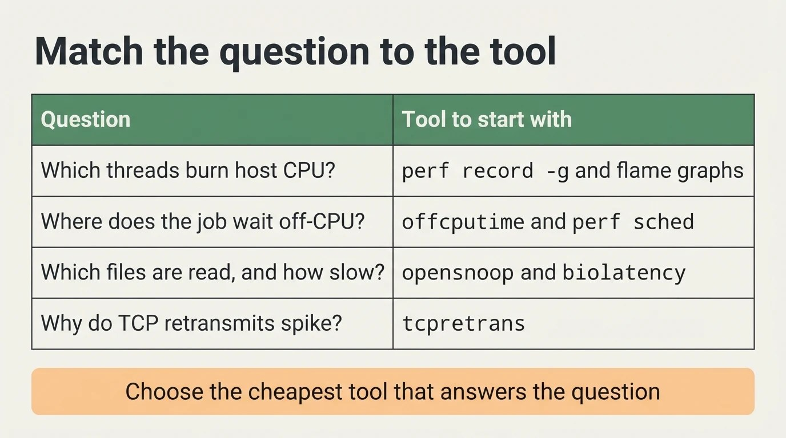
*Figure 1.24.1. Pick the cheapest observability tool that answers your question.*


The Linux tracing tools answer these questions on a live production system, usually without restarting anything. They are perf, ftrace, and BPF with BCC and bpftrace. Here is what that looks like on AI infrastructure.

- Profile the **host side** of a training job with `perf record -g` and flame graphs. That shows the Python interpreter, data decoding, `memcpy`, page faults and lock contention.
- Look for **off-CPU** time with `offcputime` and `perf sched`. Off-CPU time is the time a thread spends not running at all. The stacks then show data loader workers waiting on NFS or Lustre, threads blocked on `futex`, and `D`-state tasks.
- Trace **file and network I/O** with `opensnoop`, `biolatency`, `tcpretrans` and `tcplife`. You learn which files are read, how long each read takes, and which process reads them. You also see retransmits on checkpoint transfers.
- Explain **scheduler latency**, run-queue length and interrupt cost with `runqlat`, `hardirqs` and `softirqs`. These complement the cgroup throttling analysis from 1.18.
- Measure **IPC and cache misses** with PMCs using `perf stat`. IPC stands for instructions per cycle, and the numbers tell you whether host code is limited by memory or by compute.
- Debug production incidents. Use `execsnoop` for short-lived processes, `killsnoop` for unexpected signals, `oomkill` for OOM kills, and `syscount` and `funclatency` for slow syscalls.

Above all, this chapter is about the **data sources** and the **costs** behind each tool. Once you know both, you can choose the cheapest tool that answers the question. You also learn what a tool cannot see, so you can measure a production workload without disturbing it.

## Prerequisites and outcomes

Before you start, you should know the method chapter (1.23: USE, drill-down, the 60-second checklist). You should also be comfortable with processes and system calls (1.8 and 1.11), `/proc` and `/sys` (1.10), memory (1.17) and scheduling (1.18). No programming background beyond the shell is needed.

When you finish this chapter, you will be able to do the following.

- Sort observability tools into counters, profilers or tracers, and into system-wide or per-process tools. Then estimate what each one costs to run.
- Explain the kernel data sources behind these tools. They include `/proc`, `/sys`, delay accounting, netlink, tracepoints, kprobes, uprobes, USDT, hardware counters (PMCs), software events, and the `perf_event_open` and tracefs interfaces.
- Configure `sar` (sysstat) to keep history. You will also install a crisis-tool kit on node images and debug containers, with the kernel options and the symbol and stack-walking prerequisites it needs.
- Use `perf` for counting (`stat`), profiling (`record`, `report`, `script`, `top`), tracing (`trace`, tracepoints, probes), flame graphs, and scheduler and memory analysis, on hosts and in containers.
- Use Ftrace through tracefs by hand. That covers the function profiler, the function tracer, events, filters, triggers, kprobe and uprobe events, `function_graph`, `hwlat`, hist triggers and synthetic events. You will also use `trace-cmd`, `perf ftrace` and `perf-tools`.
- Use BCC tools, and write bpftrace one-liners and short programs with probes, filters, maps, histograms and timing functions.
- Decide between perf, Ftrace and BPF. You will keep overhead low and avoid common pitfalls such as frequency sampling surprises, missing stacks, privileges and containers.
- Place these tools next to the GPU-side profilers (DCGM, Nsight Systems, PyTorch profiler) in one workflow.

Set up a disposable Ubuntu 22.04 or newer VM with root access before you start the labs in section 12.

## 1. Tool coverage: what can each tool see?

Suppose a training job is slow and you finally have a shell on the node. Before you type anything, picture the machine the way the tools see it. At the top are applications, then system libraries, then the system-call interface. Below those sit the kernel subsystems: VFS and filesystems, the scheduler, the memory manager, TCP/IP and the block layer. Device drivers and devices sit at the bottom.

Most tools focus on one resource. A few are **multi-tools** that reach every layer, and those are `perf`, Ftrace, BCC and bpftrace.

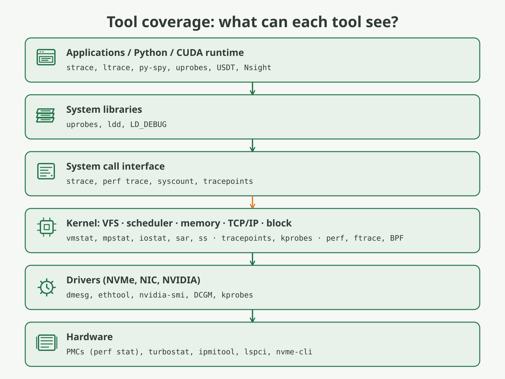

*Figure 1.24.2. Tool coverage: what can each tool see?.*

It helps to think of these four names as three lenses on the same machine. `perf` samples and counts, using hardware events and stacks. Ftrace reads the kernel's own call flow through tracefs. BPF loads small programs that run whenever an event fires. Each lens sees something the other two miss, and each one costs something different to run.

**Static performance tools** examine configuration at rest. Good examples are `lscpu`, `lspci -vv`, `lsblk`, `dmidecode`, `ip` and `ethtool`, `mount`, `sysctl`, and `nvidia-smi -q`. They support the static-tuning method from 1.23. A static check catches a wrong link speed, a degraded PCIe width, a disabled cache, or a mismatched MTU. It is also the calmest work you will do all week.

**Crisis tools** are the ones you need when the system is already in trouble. That is the worst time to discover they are missing. Installing packages on a thrashing node may take minutes. A node with a full disk or a broken network may not be able to install anything at all. So bake the crisis tools into node images, or ship a privileged **debug container/image** that you can deploy on a node. Share the target's namespaces when you need to. Picture the alternative: a panicking node at three in the morning and no `perf` on it.

The table lists the recommended packages, using Debian and Ubuntu names. Other distributions name them differently.

| Package | Provides |
|---|---|
| `procps` | `ps`, `top`, `vmstat`, `uptime`, `free` |
| `util-linux` | `dmesg`, `lsblk`, `lscpu`, `lsns`, `nsenter` |
| `sysstat` | `iostat`, `mpstat`, `pidstat`, `sar` |
| `iproute2` | `ip`, `ss`, `nstat`, `tc` |
| `numactl` | `numactl`, `numastat` |
| `linux-tools-common`, `linux-tools-$(uname -r)` | `perf`, `turbostat` (kernel-matched) |
| `bpfcc-tools` (aka `bcc-tools`) | `opensnoop`, `execsnoop`, `runqlat`, `runqlen`, `biolatency`, `biosnoop`, `tcplife`, `tcpretrans`, `profile`, `funccount`, `trace`, `argdist`, `stackcount`, … |
| `bpftrace` | `bpftrace` plus tool scripts |
| `trace-cmd`, `kernelshark` | Ftrace front end and GUI |
| `perf-tools-unstable` / github perf-tools | Ftrace-based shell tools (`funccount`, `funcgraph`, `iosnoop`, `execsnoop`, `kprobe`, `uprobe`) |
| `ethtool`, `nicstat`, `iperf3`, `tcpdump` | NIC counters, throughput, packets |
| `msr-tools`, `linux-cpupower`, `rasdaemon`, `ipmitool`, `smartmontools`, `nvme-cli`, `pciutils` | Hardware state, errors and sensors |
| `rdma-core`, `infiniband-diags`, `perftest` | RDMA/IB state, counters and micro-benchmarks |
| NVIDIA: `nvidia-smi`, DCGM (`dcgmi`), Nsight Systems CLI (`nsys`), Nsight Compute (`ncu`) | GPU state, health, profiling |

The last row covers the NVIDIA tools, which later sections join to the host tools.

Installing the packages is not enough, because tracing tools also need kernel options. The kernel must provide `CONFIG_FTRACE`, `CONFIG_BPF`, `CONFIG_BPF_SYSCALL`, `CONFIG_BPF_EVENTS`, `CONFIG_KPROBES`, `CONFIG_UPROBES` and `CONFIG_PERF_EVENTS`. Modern CO-RE tools also need BTF, which is `CONFIG_DEBUG_INFO_BTF`. Scheduler and delay statistics depend on `CONFIG_SCHEDSTATS`, `CONFIG_PSI` and `CONFIG_TASK_DELAY_ACCT`.

Profilers need stack-walking support, which is a separate prerequisite from the packages. You can use frame pointers, which modern distributions are re-enabling by default. You can also use DWARF or ORC with debug symbols. Python needs perf trampoline or map support, or a Python-aware profiler.

Finally, validate each tool before the crisis arrives. Run it on a healthy node, and keep a saved example of its normal output. That saved baseline is worth more than any manual page on the day something breaks.

## 2. Tool types

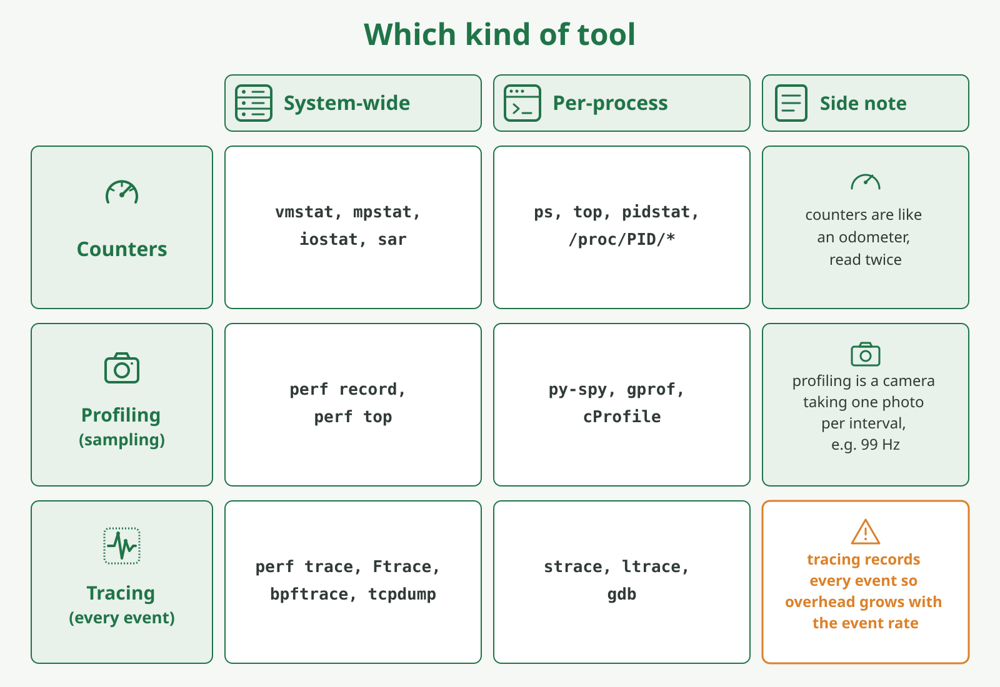

*Figure 1.24.3. Two questions sort the tools: whole system or one process, and counting, sampling or tracing.*

A node is slow, and a dozen tool names are competing for your attention. Two questions sort them faster than any list of names. The first asks whether a tool looks at the whole system or at one process. The second asks whether it counts things or reacts to events. The table places common tools on that grid.

| | System-wide | Per-process |
|---|---|---|
| **Counters** | `vmstat`, `mpstat`, `iostat`, `nstat`, `sar`, `ethtool -S`, `nvidia-smi dmon` | `ps`, `top`, `pmap`, `pidstat`, `/proc/PID/*` |
| **Events: profiling (sampling)** | `perf record`, BCC `profile`, `perf top` | `gprof`, valgrind/cachegrind, `py-spy`, language profilers (JFR, Go pprof, Python cProfile) |
| **Events: tracing (every event)** | `perf trace`, Ftrace, BCC, bpftrace, `tcpdump`, `biosnoop`, `execsnoop` | `strace`, `ltrace`, `gdb` (stops the process) |

### Fixed counters

The kernel keeps integer counters that go up as events happen, such as packets, I/Os, interrupts, context switches and page faults. Think of a car odometer. It only ever goes up, and you learn your speed by reading it twice. A common design here is a pair of cumulative counters. One counts the events, and the other sums the total time spent in them. Read both twice, one second apart, and the difference gives you the per-second rate and the average latency. Counters are effectively free because they are always on. The only cost is reading them.

`vmstat 1` prints deltas, but its first line is a summary since boot. On some versions that line mixes boot values with current values, so you should ignore it or understand it first. Per-process counters come from `/proc/PID/`. System-wide counters come from `/proc` and `/sys`.

### Profiling

Profiling samples the state of the system at a fixed rate. Picture a security camera that takes one photograph per interval. For example, a profiler can record the instruction pointer, or the whole stack, at 99 Hz on every CPU for 30 seconds. It then studies the set of samples. The typical choice is 99 Hz rather than 100 Hz, so the samples do not fall in step with periodic activity. The overhead follows directly from the sampling rate, which is why timer-based profiling is generally safe in production. The result is a coarse picture of where time goes, not a record of every event.

### Tracing

Tracing records every occurrence of an event, or runs code on each one. Its overhead therefore grows with the event rate, and it can distort timing. Logging is low-frequency tracing that is always enabled. Prefer system-wide tracers with filters, such as `perf` and BPF, over per-process stoppers such as `gdb` and `strace`. The stoppers can slow the target by 100x or more, because `ptrace` stops the process at each event.

### Monitoring

Monitoring records metrics continuously over time. `sar` does this for a single host. For a fleet, teams use Prometheus with exporters such as node_exporter, the DCGM exporter and cAdvisor. Other options include Performance Co-Pilot, collectd, and SNMP for devices, with Grafana for dashboards. Most monitoring products show the same kernel-counter statistics that the CLI tools show. That means learning the `vmstat`, `iostat` and `sar` metrics also explains the dashboards. Prefer agents that read kernel interfaces directly, rather than agents that run tools and parse their output.

## 3. Observability sources

You have three tools that disagree about the same metric. Before you blame the tools, it helps to know where each number was born. Every tool in this chapter reads from one of a few kernel sources, so those sources are the real map of what is knowable. The diagram below groups them into counters and events. The tools on the right use them.

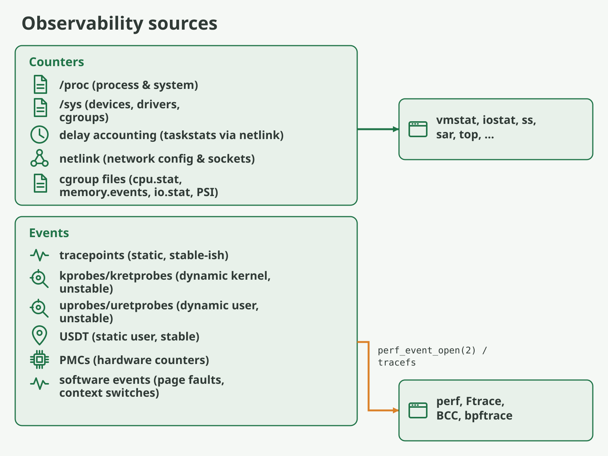

*Figure 1.24.4. Observability sources.*

### /proc

`/proc` is a virtual, in-memory filesystem. Virtual here means the kernel builds each file as you read it, and exposes its data structures that way, so nothing is stored on disk. Each process gets a directory, `/proc/PID/`. It holds `stat` and `status` for the state, CPU times and memory of the process. It also holds `statm`, `maps`, `smaps` and `smaps_rollup` for memory mappings and usage, and `fd` and `fdinfo` for open files. Other entries include `limits`, `io` for bytes read and written, `sched` and `schedstat` for run time, wait time and switches, `cgroup`, `ns/`, `cmdline`, `environ`, `task/` for per-thread data, `wchan`, `stack` for the kernel stack, and `syscall`.

System-wide files include `cpuinfo`, `meminfo`, `vmstat`, `stat`, `loadavg`, `interrupts`, `softirqs`, `diskstats`, `net/dev`, `net/tcp`, `net/netstat`, `pressure/{cpu,memory,io}` for PSI, `schedstat`, `slabinfo`, `zoneinfo` and `buddyinfo`. The `sys/` directory holds the tunables covered in chapter 1.22.

Many tools simply read these files. For example, running `strace vmstat` shows it opening `/proc/meminfo`, `/proc/stat` and `/proc/vmstat`. `top` repeats `open/read/close` on each process's `stat` file on every refresh. On a host with thousands of processes, that can make `top` itself a heavy consumer. You can read most of these files cheaply, except for files that walk page tables, such as `smaps`. Text formatting costs some CPU compared with binary interfaces such as netlink.

**CPU accounting accuracy.** By default, `/proc/stat` times use clock-tick granularity, which `CONFIG_TICK_CPU_ACCOUNTING` controls. A clock tick is the kernel's periodic timer beat. At HZ=250, that means 4 ms per tick. More precise options exist, namely `VIRT_CPU_ACCOUNTING` and `IRQ_TIME_ACCOUNTING`, at a small cost. Some files need kernel options. `schedstat` needs `CONFIG_SCHEDSTATS`, `sched` needs `CONFIG_SCHED_DEBUG`, and `pressure` needs `CONFIG_PSI`. The reference documents are `proc(5)` and the kernel's `Documentation/filesystems/proc`.

### /sys

If `/proc` is mostly about processes, `sysfs` is mostly about the hardware and the kernel's knobs. It presents device, driver, bus and kernel-subsystem attributes in a regular directory tree. It holds tens of thousands of read-only statistics, along with many writable controls. The controls cover CPU online and offline state, governors, block queue settings, NIC queue parameters, PCI device attributes, and GPU, NVMe and InfiniBand attributes. Cache sizes and levels live under `/sys/devices/system/cpu/cpu0/cache/index*/`, and topology lives under `.../topology/`.

The paths reward a little memorising. Network statistics sit under `class/net/<if>/statistics/*`, block queue settings under `block/<dev>/queue/*`, and PCI link speeds under `bus/pci/devices/*/current_link_speed`. InfiniBand counters sit under `class/infiniband/*/ports/*/counters/*`, and cgroup statistics under `fs/cgroup`. To print each file name with its value, run `grep . path/*`.

### Delay accounting

With `CONFIG_TASK_DELAY_ACCT`, the kernel tracks how long each task spends **waiting**. The waits cover CPU (scheduler latency), block I/O, swapping under memory pressure, and memory reclaim. You read this data through the **taskstats** netlink interface. The kernel example `tools/accounting/getdelays.c` shows how, and `iotop` and `atop` use similar data. Delay accounting answers a direct question: is this process slow because it waits for CPU, I/O or memory? Follow that question down into the numbers before you blame the code. If you find it is not on yet, enable it at boot with the `delayacct` parameter.

### netlink

netlink is a socket family, `AF_NETLINK`, for binary and efficient exchange of kernel information and notifications. A socket is one endpoint of a conversation, and a socket family is one dialect of that conversation. netlink carries routes (`NETLINK_ROUTE`, used by `ip`), socket diagnostics (`NETLINK_SOCK_DIAG`, used by `ss`), SELinux events, audit, crypto and SCSI transport. It is more efficient than parsing text from `/proc/net`. `ip`, `ss` and `routel` use it, while the older `ifconfig` and `netstat` read `/proc`.

### Tracepoints

**Static instrumentation** is hard-coded into the kernel at logical places. Somebody decided in advance where to put a marker, and that marker is now part of the code. Examples include system-call entry and exit, scheduler events, block I/O issue and completion, TCP, filesystem operations, memory events, power, and IRQs. Tracepoints were introduced in Linux 2.6.32, in 2009.

Their names look like `block:block_rq_issue`, `sched:sched_switch`, `tcp:tcp_retransmit_skb`, `raw_syscalls:sys_enter` and `syscalls:sys_enter_openat`. Strictly, a *tracepoint* is the hook in kernel source. The thing tools attach to is a *trace event*, defined by the `TRACE_EVENT` macro. A trace event also defines its arguments and its format, and you can see them under tracefs at `events/<subsystem>/<event>/format`.

Tracepoints are a best-effort stable API, which means their name, format and arguments are meant to stay the same. There are only roughly 1,000 to 2,000 of them, depending on the kernel, and many are for syscalls. Each disabled tracepoint costs a no-op instruction, which is an instruction that does nothing. An enabled one costs on the order of 100 ns of CPU per event. Gregg's rule of thumb is that below about 10,000 events per second the cost is negligible, and above about 100,000 events per second it is measurable. Disk events usually stay below 10k/s. For example, scheduler events can exceed 100k/s, which makes them expensive to trace. Raw tracepoints, from Linux 4.7, skip argument construction and cost less.

```bash
sudo perf list tracepoint | head                       # list static events (needs tracefs)
sudo cat /sys/kernel/tracing/events/block/block_rq_issue/format     # arguments and print format (or /sys/kernel/debug/tracing)
sudo perf trace -e block:block_rq_issue --filter 'bytes > 65536'   # live, filtered (perf trace --filter needs Linux 5.5+)
sudo bpftrace -e 't:block:block_rq_issue { printf("size: %d\n", args->bytes); }'
```

### kprobes

**Dynamic instrumentation** is the opposite idea. Rather than relying on markers the kernel authors left behind, it lets you probe almost any kernel function or instruction. It has been available since Linux 2.6.9. The kernel patches the running code so that it calls your handler. **kretprobes** trace a function's return, along with its return value, through a trampoline, which is a small piece of code that jumps to your handler and back.

The trade is reach for stability. There are tens of thousands of possible probe points, and none of them has a stability guarantee. Function names and arguments change between kernel versions. A kprobe costs nothing until you enable it. Once enabled, its cost at function entry is similar to a tracepoint, with tens of nanoseconds at minimum. The cost is higher for offsets and kretprobes. Treat kprobes as the last resort before you modify and recompile the kernel. You can use them through `perf probe`, the tracefs `kprobe_events` file, BCC or bpftrace.

| | kprobes | tracepoints |
|---|---|---|
| Type | Dynamic | Static |
| Number of events | 50,000+ | 1,000+ |
| Stable API | No | Yes (best-effort) |
| Disabled overhead | None | Tiny (nops) |
| Needs kernel maintenance | No | Yes |

### uprobes

Uprobes work like kprobes, but for user-space code. They appeared in Linux 3.5. You can instrument a function in a binary or a shared library while the program runs. Examples include `bash:readline`, `libc:malloc` and `libcuda.so:cuLaunchKernel`. Uprobes are unstable because they depend on the specific binary. They are also expensive. Each hit traps into the kernel, and a trap is a deliberate switch into kernel mode, which costs on the order of a microsecond or more. uretprobes cost more. Tracing a hot function such as `malloc` therefore disturbs the target badly. A mistaken offset can corrupt the target process when you use the raw tracefs interface. Prefer high-level front ends like BCC, bpftrace and `perf probe`, which resolve symbols for you.

### USDT

USDT stands for user-level statically defined tracing. Think of these probes as tracepoints that application and library authors ship inside their own code. Examples include libc, the JVM HotSpot, PostgreSQL, Python built with `--with-dtrace`, and Node.js. They are stable and documented. They run on top of uprobes, so each hit costs what a uprobe costs, plus a nop when the probe is off. The probes are compiled in, and many packaged binaries ship with them disabled. To check a binary, run `readelf -n binary` or `bpftrace -l 'usdt:/path/to/lib:*'`. JIT-compiled and interpreted languages need dynamic USDT libraries.

In AI stacks, Python 3.12 and later can expose perf trampolines, and some builds ship USDT probes. Verify this for your version. On the GPU side, NVIDIA tools such as CUPTI and NVTX ranges play the equivalent role.

### Hardware counters (PMCs)

Processors expose programmable registers that count low-level events at cycle granularity. A register here is a small storage slot inside the CPU. The events include cycles, instructions retired, branch misses, L1, L2 and LLC references and misses, TLB misses, stalled cycles, and uncore memory bandwidth. Only PMCs can show instruction efficiency (IPC), cache hit ratios, memory-bus utilisation and stall cycles. They are the closest thing you have to a stopwatch on the silicon itself. The details follow.

- Access goes through `perf_event_open(2)`. `perf stat` uses it for counting, which is essentially free. `perf record` uses it for overflow sampling, which takes one sample per N events or per frequency.
- Each core has only about 4 to 8 programmable registers, plus fixed counters. If you request more events, `perf` time-multiplexes them in slices and scales the results. It shows the share as a percentage, and the results then become estimates.
- **Skid** is the gap between the instruction that caused a PMC overflow and the instruction pointer recorded when the interrupt fires. Precise events reduce or remove skid. Intel PEBS and AMD IBS provide them, and you select them with the `:p`, `:pp` and `:ppp` modifiers.
- Intel's seven architectural PMCs are what `perf stat` shows by default. They are unhalted core cycles, instructions retired, reference cycles, LLC references, LLC misses, branches and branch misses. The headline number is `insn per cycle`.
- Cloud availability varies. Many hypervisors disable PMCs for guests. Some expose only a subset, such as the architectural set or IPC alone, while bare-metal instances expose all of them. GPU cloud instances are often bare metal or large VMs. Check with `perf stat -e cycles,instructions true` and `dmesg | grep -i pmu`.
- The vendor manuals are the Intel SDM Vol. 3, the AMD processor programming reference, and the Arm ARM. `perf list` shows names that the kernel maps, and the mapping is sometimes wrong. Cross-check doubtful results with raw event codes.

### Other sources

Several other sources exist, and each answers a narrower question. Model-specific registers, or MSRs, hold clock rates, temperatures and power. You read them with `rdmsr` or `turbostat`. `ptrace(2)` is what debuggers and `strace` use. It is slow, and it works one process at a time. Function profiling hooks, `__fentry__` or mcount, are patched to nops until Ftrace enables them.

Packet capture uses libpcap and tcpdump, or conntrack. Process accounting comes from `atop` and `sa`. Software events include page faults, context switches and CPU migrations, and `perf_event_open` gives you access to them. The list also includes `getrusage(2)`, `blktrace`, `lockstat`, `debugfs`, and hardware-specific tracers such as Intel PT and Arm CoreSight, which record instruction-level traces. On the GPU side, you can use NVML, DCGM and CUPTI.

Solaris-style Kstat is a uniform, hierarchical counter framework. Linux's `/proc` and `/sys` are less uniform, so you need text parsing to read them.

**How to find what a tool uses:** run it under `strace` with `strace -e openat,socket,perf_event_open -f tool`. You will see whether it reads `/proc` files, opens netlink sockets or calls `perf_event_open`. That tells you the tool's overhead class and its data source, which is exactly what you need before you run it on a busy node.

## 4. sar: system activity reporter

A job failed at 02:40 last night. By the time you log in, every counter looks healthy again. `sar` is the counter-based monitor from the `sysstat` package, and it was built for that exact moment, because it keeps history.

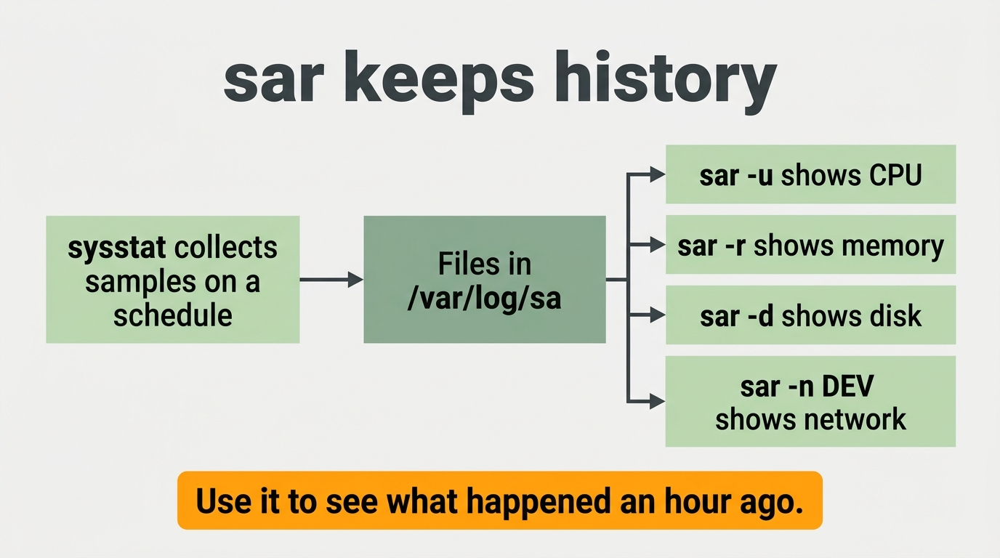

*Figure 1.24.5. sar records history, so you can look at what happened an hour ago.*

Two parts make it work. The collector, `sadc`, runs from cron or a systemd timer and archives system-wide statistics. The reporter, `sar` with `sadf`, reads those statistics back. The archive covers CPU, memory, paging, swap, I/O and block devices. It also covers network interfaces and protocols such as TCP, UDP, ICMP and IP errors. Interrupts, softirqs, context switches, load, run queue, power, temperature and fan sensors, and filesystems are included too. Add `-S XALL` for more breakdowns.

The tool is old, but it is reliable. Its man page names the SNMP equivalent of each statistic. It often solves a problem by itself, because it gives you **history** on a host that has no monitoring. The commands below turn on collection on Ubuntu, read the archive, and print live samples.

```bash
# enable collection (Ubuntu): set ENABLED="true" in /etc/default/sysstat, then restart; collect every 5 min, all stats:
#   */5 * * * * root command -v debian-sa1 > /dev/null && debian-sa1 1 1 -S ALL        (in /etc/cron.d/sysstat)
sudo systemctl enable --now sysstat
sar                              # today's CPU history (archive in /var/log/sysstat/saDD)
sar -u -n TCP,ETCP               # CPU, TCP rates, TCP errors/retransmits from the archive
sar -q -r -B -b -d -p -n DEV 1 5 # LIVE: run queue/load, memory, paging, I/O, disks (pretty names), NICs; 5 samples at 1 s
sar -f /var/log/sysstat/sa17 -s 02:00:00 -e 03:00:00     # a past window
sadf -j -- -n TCP | jq .         # JSON;  sadf -d (CSV/DB);  sadf -g (SVG graphs)
man sar                          # statistic definitions incl. SNMP names, e.g. active/s [tcpActiveOpens]
```

Collect at 1 to 5 minute intervals when you want history. Use live mode, `sar 1`, when you need to see per-second behaviour. As section 6 of 1.23 explains, five-minute averages hide bursts.

## 5. Observing the observability

Observability tools and metrics are software, and software can be wrong. You have probably met the moment already: the dashboard says the node is healthy, and the job is still slow. Several problems show up in practice. Some tools and kernel counters have bugs. Some man pages have not kept up with the code. Some metrics are incomplete, because developers added them for their own debugging and never designed them from operator needs. Other metrics are confusing or poorly named.

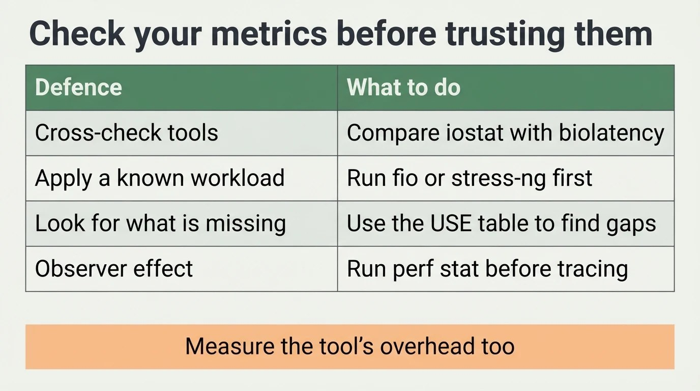
*Figure 1.24.6. Metrics can be wrong or incomplete, so verify them before you act on them.*


Collectors that parse tool output can break, and their numbers can be quietly wrong. One benchmarking company once stripped units from `fio` results, which produced 1024x errors and dropped decimal points. Scripts and spreadsheets can introduce processing errors. Container views can also show **host** values instead of container values.

Five defences help you catch these problems.

1. Cross-check overlapping tools that come from different instrumentation frameworks. For example, compare `iostat` against `biolatency`, or `perf` against Ftrace. Use dynamic instrumentation to double-check a doubtful metric. When two independent frameworks agree, your confidence should rise.
2. Apply a known workload, such as `fio`, `iperf3`, `stress-ng` or a CUDA kernel benchmark. Then check that the tools agree with what you know you did.
3. Be skeptical of new statistics. Read the source or the documentation, and write down what you did not verify.
4. Look for what is missing. The absence of a metric is harder to notice than a bad metric, so the USE table from 1.23 helps you find the gaps.
5. Remember the **observer effect**. Your measurement costs resources, so measure the tool's overhead too. For example, run a counting pass with `perf stat` first. It shows the event rate before you trace every event.

## 6. perf

Suppose the job is slow and you suspect the CPU side. `perf` is the first lens to reach for. It is the official Linux profiler. It is a multi-tool that lives in the kernel source tree, under `tools/perf`, and it front-ends the kernel's `perf_events` subsystem. It began with PMC counting and sampling. It later grew to trace tracepoints, kprobes, uprobes and USDT. It also gained subcommands for the scheduler, locks, memory and cache-line analysis. `perf` is especially good at **CPU profiling**, which samples stack traces. It also handles **PMC analysis** of the microarchitecture, and **scheduler tracing**. Use it to answer four kinds of question. Which code paths use the CPU? Are the CPUs stalled on memory? Why do threads leave the CPU? What does the disk I/O pattern look like?

Install the `linux-tools-$(uname -r)` package on Ubuntu, or `perf` on RHEL. The package must match the running kernel closely. Unprivileged use is governed by `kernel.perf_event_paranoid`. A value of 2 or higher blocks most access for non-root users, and `-1` allows everything. Capabilities matter too, namely `CAP_PERFMON` and `CAP_SYS_ADMIN`. Containers need these capabilities, plus an unconfined seccomp profile, which chapter 1.21 covers.

### Subcommands

The table lists the subcommands you will use most. The last row groups the less common ones.

| Command | Purpose |
|---|---|
| `perf list` | List events (hardware, software, cache, PMU, tracepoint, probe, SDT) |
| `perf stat` | Count events (PMCs, software, tracepoints) for a command, PID or system; shows IPC |
| `perf record` | Sample/trace events to `perf.data` |
| `perf report` | Summarise `perf.data` (TUI or `--stdio`) |
| `perf script` | Print raw samples; feed flame graph generators and custom scripts |
| `perf top` | Live profile |
| `perf trace` | Live system-call and event tracing (low-overhead `strace` replacement, system-wide) |
| `perf probe` | Create kprobes, uprobes, USDT-based dynamic events |
| `perf sched` | Scheduler latency and timeline analysis (`record`, `latency`, `map`, `timehist`) |
| `perf mem`, `perf c2c` | Memory access profiling; cache-line contention and false sharing |
| `perf lock`, `perf kmem`, `perf kvm`, `perf ftrace`, `perf diff`, `perf annotate`, `perf timechart`, `perf bench`, `perf buildid-cache`, `perf inject` | Locks, slab, KVM guests, Ftrace wrapper, differential profiles, annotated disassembly, charts, micro-benchmarks, symbol cache, stream editing |

### Events

`perf list` shows the event kinds. **Hardware events** are PMC-based, and the common ones are `cycles`, `instructions`, `branch-misses`, `cache-misses` and `bus-cycles`. **Hardware cache events** include `L1-dcache-load-misses` and `LLC-loads`. **Software events** include `cpu-clock`, `task-clock`, `page-faults`, `context-switches` and `cpu-migrations`.

**Kernel PMU and vendor events** run to many hundreds, for example `mem_load_l3_hit_retired.*` and `cycle_activity.*`. **Raw** events look like `rNNN` or `cpu/event=0x3c,umask=0x0/`. **Tracepoint events** look like `sched:sched_switch`, `block:block_rq_issue` or `syscalls:sys_enter_*`, and they include initialised kprobes and uprobes. **SDT events** are the USDT probes.

Hardware events use human-readable names, which can be wrong or missing on new processors. If a PMC result looks suspicious, try the raw event code.

**Frequency versus period sampling.** This distinction surprises people, so it is worth slowing down for. On PMC or software events, `perf record` defaults to frequency sampling, at about 4,000 Hz per CPU. It does not capture every event, so the counts in `perf.data` are samples, not totals. At about 4,000 Hz, a 30-second run collects roughly 120,000 samples per CPU. At `-F 99`, the same run collects about 2,970. Tracepoint events default to period 1, which means every event.

You can choose `-F 99` for a frequency, `-c N` for one sample per N events (overflow sampling), or `-c 1` for everything. Use `-c 1` with care, especially for context switches. `perf stat` always counts all events.

Two kernel limits apply. `kernel.perf_event_max_sample_rate` throttles sampling, and `kernel.perf_cpu_time_max_percent` sets the CPU budget for the sampling interrupt, for example 25%. Check for lost events with `perf report -D | tail`.

### perf stat: counting

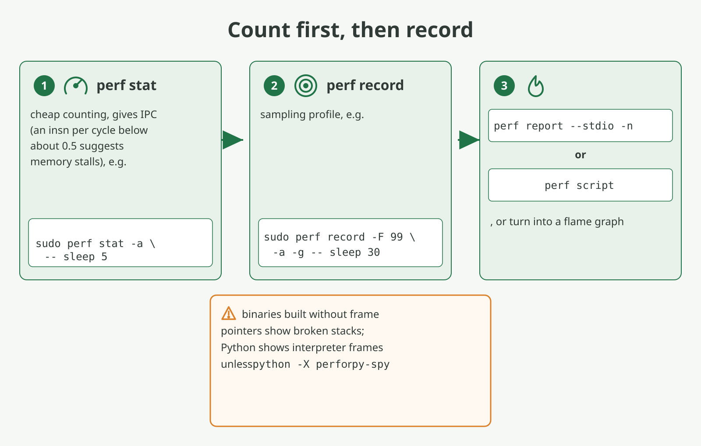

*Figure 1.24.7. Run perf stat first because counting is cheap, then record and report only where it matters.*

Run `perf stat` first to check an event's rate before you trace or record it. Counting is cheap, so this is always the first step, and it gives you an overhead estimate. It also gives you IPC. An *insn per cycle* below about 0.5 suggests memory stalls. Above about 1.5 to 2, the CPU is executing efficiently, as chapter 1.18 explains. Filters such as `--filter 'prev_pid == 25467'` apply to tracepoints.

```bash
sudo perf stat -a -- sleep 5                       # whole system, default counters (IPC shown as a shadow statistic)
perf stat ./prog                                   # a command: task-clock, context-switches, cpu-migrations, page-faults, cycles, instructions (insn per cycle), branches, branch-misses
perf stat -p PID -- sleep 10                       # an existing process
perf stat -e cycles,instructions,cache-misses,LLC-load-misses,dTLB-load-misses -p PID -- sleep 10
perf stat -e 'sched:sched_switch' -a -I 1000       # per-second interval counts (Ctrl-C ends)
perf stat -e sched:sched_switch -a -A -I 1000      # per-CPU (balance); --per-core, --per-socket aggregate
perf stat -G docker/<id> -a -- sleep 10            # a cgroup (containers; cgroup event name as in perf_event hierarchy)
perf stat -e raw_syscalls:sys_enter -I 1000 -a     # syscalls/sec system-wide
perf stat -e 'block:*' -a -- sleep 10              # block event rates (check before recording)
```

### perf record / report / script: profiling and tracing

The commands below record a profile, summarise it, and print the raw samples.

```bash
sudo perf record -F 99 -a -g -- sleep 30           # system-wide CPU profile with stacks (frame-pointer unwinding)
sudo perf record -F 99 -p PID --call-graph dwarf -- sleep 10    # DWARF unwinding (needs debuginfo; big files, higher overhead)
sudo perf record -F 99 -a --call-graph lbr -- sleep 10          # Intel LBR (shallow depth)
sudo perf record -F 99 -e cpu-clock --cgroup=<cgroup-path> -a -- sleep 10    # one container/cgroup
sudo perf record -e cycles:pp -c 100000 -p PID -- sleep 5       # precise cycle sampling
sudo perf record -e LLC-load-misses -c 100 -ag -- sleep 5       # stacks leading to every 100th LLC miss
sudo perf record -e sched:sched_switch/max-stack=5/ -a -- sleep 1       # context switches with 5-frame stacks
sudo perf record -e block:block_rq_issue,block:block_rq_complete -a -- sleep 10
sudo perf report --stdio -n                        # text summary with sample counts; TUI by default
sudo perf report --stdio --no-children --sort comm,dso,sym
sudo perf script --header -F comm,pid,tid,cpu,time,event,ip,sym,dso | head      # raw samples + metadata header
```

With no `-e`, `record` picks the best CPU-profiling event it can find. It tries `cycles:ppp`, then `cycles:pp`, then `cycles:p`, then `cycles`. If PMCs are unavailable, which is common in many VMs, it falls back to the software event `cpu-clock`.

Stack walking uses frame pointers by default, through `--call-graph fp`. A binary built without frame pointers shows broken or missing stacks. Distribution packages used `-fomit-frame-pointer` as their historical default. You can fix this in three ways. Use a distribution or build that keeps frame pointers, such as Ubuntu 24.04 or Fedora, which enable them by default. Recompile with `-fno-omit-frame-pointer`. Or use `--call-graph dwarf`, which needs `-dbgsym` packages, or use LBR.

Python profiles show interpreter frames, not Python functions, unless you use Python 3.12's perf trampoline (`python -X perf`), `PYTHONPERFSUPPORT=1`, `py-spy` or perf map files. Report layouts differ too. `children` shows the cumulative time including callees, while `self` shows only the time spent in the function. `caller` and `callee` set the order of the call graph.

### Flame graphs

Two engineers are arguing about where the time goes. A flame graph ends that argument in about a minute. It turns thousands of stack samples into one picture. Each box is a function. Its width is proportional to the time, measured in samples, spent in that function and its callees. The y-axis is the stack depth. Look for **wide plateaus**.

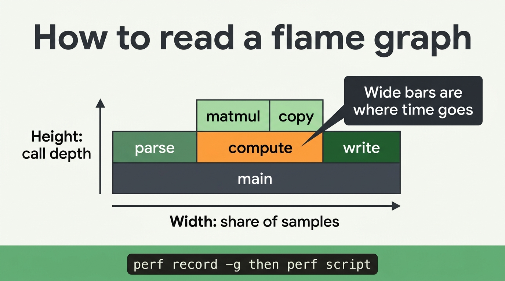

*Figure 1.24.8. In a flame graph, width is the share of samples and height is call depth.*

```bash
sudo perf record -F 99 -a -g -- sleep 30
sudo perf script > out.perf
git clone https://github.com/brendangregg/FlameGraph
./FlameGraph/stackcollapse-perf.pl out.perf | ./FlameGraph/flamegraph.pl > cpu.svg        # open in a browser (clickable, searchable)
# newer perf (5.8+):  sudo perf script report flamegraph
```

Three variants are common. **Off-CPU flame graphs** weight stacks by the time threads spend blocked, from `offcputime` or scheduler tracepoints, and they show why threads wait. **Memory flame graphs** cover malloc and page-fault stacks. **Differential flame graphs** compare a before and an after. You can also combine a flame graph with a **subsecond-offset heat map**, called FlameScope, to examine variation within a profile. Flame graphs rank among the most valuable tools once you have the basic metrics. CPU time spent in spin locks, `memcpy`, allocation, page faults, compression or slow legacy kernel paths becomes obvious in them.

### perf trace: lightweight tracing

`perf trace` prints events live. It does not write `perf.data`. By default it traces system calls system-wide, with far less overhead than `strace`, which uses `ptrace`. Reach for it when a single syscall looks suspicious and you want the whole system's view.

```bash
sudo perf trace -p PID                                      # syscalls of a process, low overhead
sudo perf trace -e 'syscalls:sys_enter_openat' --filter 'filename ~ "*.safetensors"' -a    # filtered, system-wide
sudo perf trace -e block:block_rq_issue,block:block_rq_complete --no-syscalls
sudo perf trace --duration 10 -a                            # syscalls slower than 10 ms
```

### perf probe: dynamic events

Use `perf probe` to create probes on functions that have no tracepoint. Kernel debuginfo, or BTF, lets you name variables. Without it, you must name the registers yourself, according to the ABI, which is the agreement about how a function receives its arguments.

```bash
sudo perf probe --add do_nanosleep                          # kprobe;  --add 'tcp_sendmsg%return $retval' for a kretprobe
sudo perf probe -V tcp_sendmsg                              # list available variables (needs debuginfo)
sudo perf probe --add 'tcp_sendmsg size'                    # capture an argument
sudo perf record -e probe:tcp_sendmsg -aR -- sleep 5 ; sudo perf script
sudo perf probe -x /lib/x86_64-linux-gnu/libc.so.6 --add fopen    # uprobe
sudo perf probe -x /usr/lib/x86_64-linux-gnu/libcuda.so.1 -F | grep -i launch | head    # find symbols to trace in the CUDA driver library (illustrative)
sudo perf probe -d '*'                                      # delete all probes you created
```

On x86-64, the first arguments arrive in `%di`, `%si`, `%dx`, `%cx`, `%r8` and `%r9`, following the AMD64 ABI. A string argument needs dereference syntax, such as `filename=+0(%di):string`. For USDT probes, run `perf buildid-cache --add /path/to/binary` first, and then `perf probe sdt_<provider>:<probe>`. Probes change between versions, so always clean them up.

### perf sched, mem, c2c, top, diff

```bash
sudo perf sched record -- sleep 5 ; sudo perf sched latency --sort max     # per-task scheduler delay, max and average
sudo perf sched timehist -V                                                 # per-event timeline: wait time, sched delay, run time
sudo perf mem record -a -- sleep 5 ; sudo perf mem report                   # memory load/store latency samples (needs PMU support)
sudo perf c2c record -a -- sleep 10 ; sudo perf c2c report                  # false sharing / hot cache lines between cores
sudo perf top -F 49 -ns comm,dso                                           # live view of what burns CPU
sudo perf diff perf.data.old perf.data                                      # compare two profiles
sudo perf annotate --stdio -s function                                      # disassembly with per-instruction percentages (needs symbols)
```

`perf c2c` matters for multi-threaded host code, such as counters in a shared struct, or a queue head and tail sitting on one cache line. `perf mem` and the PMC memory-bandwidth events relate to the NUMA analysis in chapter 1.17.

### perf in AI workflows (practical notes)

- To profile a **PyTorch training process**, attach with `perf record -F 99 -g -p <pid>`. Expect `libtorch`, `libcudart` and `libcuda` driver calls, `memcpy`, Python interpreter loops, and kernel time in `futex` and `ioctl`. The CUDA driver talks to the GPU through `ioctl` calls on `/dev/nvidia*`. Heavy time in `ioctl`, or spin-waiting inside `libcuda`, often means the CPU is waiting for the GPU or polling a synchronisation. Large `[unknown]` blocks mean missing symbols or frame pointers.
- Use `perf trace -s` or `strace -c -f -p PID` to see summaries of syscall time. Many tiny `ioctl` calls suggest launch-bound code, with too many small kernels. The fix is CUDA graphs or `torch.compile`.
- In containers, run `perf` from the host, because the host sees all processes and kernel symbols. Select the container's cgroup or PID. Resolve symbols for the container's binaries through its mount namespace with `nsenter -t PID -m`, or through `perf record` with the right `--symfs`.
- Compare host CPU profiles with the GPU timelines from Nsight Systems, using the same step, to attribute the gaps.
- Keep sampling at 49 to 99 Hz in production. Thirty to 60 seconds is typically enough to see the dominant stacks.

### Documentation

Read `man perf`, and run `perf <subcommand> --help` for the man pages named `perf-record(1)`, `perf-stat(1)` and so on. The kernel's `tools/perf/Documentation` and the perf wiki also help, along with published one-liner lists. `perf` gains features with every kernel, so check the release notes on KernelNewbies before you assume a feature exists.

## 7. Ftrace

The CPU profile says a function is hot, and you still do not know who called it. Ftrace is the official Linux tracer, and it is the second lens. Steven Rostedt wrote it, and it arrived in Linux 2.6.27 in 2008. It is a set of **profilers**, which produce counts and histograms, and **tracers**, which show per-event details. You control all of it through a filesystem called **tracefs**, so it needs no user-space tools. A shell with `echo` and `cat` is enough. That makes Ftrace ideal for embedded or minimal systems, and for the day when nothing else is installed.

Ftrace is also valuable for **kernel code-path analysis**. Use it to answer questions such as: how often is a function called? What path led to it? Which child functions does it call, and how long does each one take? What is the longest time that interrupts or preemption stayed disabled?

### tracefs

Mount it with `mount -t tracefs tracefs /sys/kernel/tracing`. It also appears as `/sys/kernel/debug/tracing` when debugfs is mounted. If the mount fails, the kernel probably lacks `CONFIG_FTRACE`. Tracefs is the control panel for the tracer: you write a string to a file, and the tracer changes behaviour. The table lists the key files.

| File / directory | Meaning |
|---|---|
| `available_tracers`, `current_tracer` | Tracers present (`function`, `function_graph`, `wakeup`, `wakeup_rt`, `irqsoff`, `preemptoff`, `preemptirqsoff`, `blk`, `hwlat`, `mmiotrace`, `nop`); write a name to select, `nop` to disable |
| `tracing_on` | Master switch for the output buffer |
| `trace` | Output ring buffer (re-readable; write `>` to clear) |
| `trace_pipe` | Output stream that **consumes** events and blocks for more (use for live viewing; use `trace` for saved captures) |
| `set_ftrace_filter`, `set_ftrace_notrace` | Which functions to trace (globs like `tcp_*`, `*sleep`) |
| `set_graph_function`, `set_graph_notrace`, `max_graph_depth` | Function-graph targeting |
| `function_profile_enabled`, `trace_stat/` | Function profiler control and per-CPU results |
| `events/` | Event tracers (tracepoints, kprobes, uprobes): `enable`, `filter`, `trigger`, `format`, `hist`, `id` per event |
| `kprobe_events`, `uprobe_events`, `kprobe_profile`, `uprobe_profile` | Dynamic probe definitions and hit counts |
| `trace_options`, `options/` | Output formatting (e.g. `stacktrace`, `userstacktrace`, `irq-info`, `funcgraph-*`) |
| `instances/` | Independent tracing instances for concurrent users |
| `tracing_thresh`, `tracing_max_latency`, `hwlat_detector/` | Latency tracer thresholds and results |
| `synthetic_events`, `dynamic_events` | Synthetic and combined dynamic events |
| `buffer_size_kb`, `tracing_cpumask`, `set_ftrace_pid`, `set_event_pid`, `trace_clock` | Buffer sizing, CPU and PID restriction, clock source |

Ftrace originally supported one user at a time. For concurrent work, create a directory under `instances/`. Each instance has its own `current_tracer` and output files.

### Function profiler (counts and times)

The function profiler needs `CONFIG_FUNCTION_PROFILER`. It relies on the compiler-inserted `__fentry__` hooks. Those hooks are patched to nops until you enable them, so the overhead stays low. Use it to learn which functions run and how often, before you choose per-event tracing.

```bash
cd /sys/kernel/tracing                            # or /sys/kernel/debug/tracing
echo 'tcp*' > set_ftrace_filter                   # limit to TCP functions (an empty filter profiles all kernel functions: higher overhead)
echo 1 > function_profile_enabled ; sleep 10 ; echo 0 > function_profile_enabled
echo > set_ftrace_filter
head trace_stat/function*                          # per CPU: Function, Hit, Time, Avg, s^2
```

Watch out for shell redirection. Write `0 > file` with a space, because `0>` redirects file descriptor 0.

### Function tracer

The function tracer prints each call to the selected functions. Each line shows the process, the CPU, flags, a timestamp and the caller. It works best for functions called fewer than about 1,000 times per second.

```bash
echo 1 > tracing_on
echo '*sleep' > set_ftrace_filter
echo function > current_tracer
sleep 10 ; cat trace > /tmp/out.txt               # TASK-PID CPU# flags TIMESTAMP FUNCTION <-CALLER
echo nop > current_tracer ; echo > set_ftrace_filter
echo 1 > options/stacktrace                        # add kernel stack to each event (why was this called?)
```

Setting `options/stacktrace` adds the kernel stack to each event, which answers the question of why the function was called.

### Event tracing: tracepoints, filters, triggers

The commands below enable one event, filter it, and attach a trigger to it.

```bash
echo 1 > events/block/block_rq_issue/enable ; cat trace_pipe          # enable and stream
echo 'bytes > 65536' > events/block/block_rq_insert/filter           # only large I/O (fields from the 'format' file; operators == != < <= > >= & ~ with && ||)
echo 'traceoff if bytes > 65536' > events/block/block_rq_insert/trigger    # stop tracing at the interesting event, freeze the lead-up in the buffer
cat events/block/block_rq_issue/trigger           # lists available triggers: traceon traceoff snapshot stacktrace enable_event disable_event hist ...
echo 0 > events/block/block_rq_issue/enable
```

For example, a trigger can freeze the buffer the moment a large I/O arrives. A filter is a condition, and a trigger is an action that runs when the condition matches. `traceoff` and `snapshot` preserve the buffer around an error condition. `stacktrace` records the call path. `enable_event` chains events together. `hist` builds histograms, which the next subsections cover.

### kprobe and uprobe events

Uprobes need an offset from `readelf` or `objdump`, and a wrong offset can corrupt the target process. The block below shows both kinds of probe.

```bash
echo 'p:myprobe do_nanosleep' >> kprobe_events                         # p = probe, r = return probe, -:name = delete
echo 'p:myprobe do_nanosleep mode=$arg2' >> kprobe_events              # $argN named arguments (Linux 4.20+); older kernels use registers like %si
echo 'r:myret do_nanosleep ret=$retval' >> kprobe_events
echo 1 > events/kprobes/myprobe/enable ; cat trace_pipe ; echo 0 > events/kprobes/myprobe/enable ; echo '-:myprobe' >> kprobe_events
cat kprobe_profile                                                      # name, hits, misses
# uprobes need PATH:OFFSET (offset from readelf/objdump); a wrong offset can corrupt the target - prefer perf probe, BCC or bpftrace:
echo 'p:readline_probe /bin/bash:0xb61e0' >> uprobe_events
```

### function_graph tracer

The function_graph tracer shows the call tree with durations. It is the quickest way to find which child function makes a parent slow. It marks long calls with symbols. `+` marks calls over 10 µs, `!` marks calls over 100 µs, and `#` marks calls over 1 ms. `*` marks calls over 10 ms, `@` marks calls over 100 ms, and `$` marks calls over 1 s. Tracing every child inflates the durations, so restrict the trace with `set_ftrace_filter` when you need accurate numbers.

```bash
echo do_nanosleep > set_graph_function ; echo function_graph > current_tracer ; cat trace_pipe
echo 'vfs_read' > set_graph_function ; echo 3 > max_graph_depth          # limit depth
```

### hwlat and latency tracers

For example, the `hwlat` tracer detects external disturbances that the OS cannot see. When the OS loses time it cannot account for, something outside the OS stole it. These disturbances include system management interrupts (SMIs), firmware and BMC activity, and hypervisor steal. The tracer spins in a tight loop with interrupts disabled, and it reports any gap longer than a threshold. The default threshold is 10 µs, set by `tracing_thresh`. The `width` and `window` parameters sit under `hwlat_detector/`.

Keep in mind that `hwlat` is a micro-benchmark, not a passive observer. It keeps one CPU busy for the width. It is very relevant to jitter investigations on HPC and AI nodes, where chapter 1.18 covers isolation and BIOS settings. The `irqsoff`, `preemptoff` and `wakeup` tracers measure the longest periods with interrupts or preemption disabled. They also measure the worst wake-up latency of real-time tasks. They require `CONFIG_PREEMPTIRQ_EVENTS`.

### Hist triggers and synthetic events

Hist triggers, available from Linux 4.7, build histograms inside the kernel from events. You need no user-space tooling for them.

```bash
echo 'hist:key=common_pid.execname' > events/raw_syscalls/sys_enter/trigger       # syscall counts by process
sleep 10 ; cat events/raw_syscalls/sys_enter/hist ; echo '!hist:key=common_pid.execname' > events/raw_syscalls/sys_enter/trigger
echo 'hist:key=id.syscall if common_pid==1234' > events/raw_syscalls/sys_enter/trigger     # syscall mix of one PID
echo 'hist:key=stacktrace' > events/block/block_rq_issue/trigger                  # which code paths issue block I/O
```

The syntax is `hist:keys=...[:values=...][:sort=...][:size=#][:pause|continue|clear][:name=..][:handler.action] [if filter]`. The modifiers include `.execname`, which shows the PID with its name, and `.syscall`, which turns an ID into a name. `.log2` gives log buckets, and `.hex` and `.usecs` change the output format. You can use several keys, and a stack trace can be one of them.

**Synthetic events** let one event store a timestamp, and let another event compute the delta, for example for syscall latency. Save `ts0=common_timestamp.usecs` at `sys_enter`, keyed by PID. At `sys_exit`, compute `lat_us=common_timestamp.usecs-$ts0`, then call `onmatch(...).trace(syscall_latency,$lat_us,id)`. Finally, histogram the synthetic event. To remove the definitions, echo each one again with a `!` prefix, in reverse order. Hist triggers are powerful but verbose. For custom latency histograms, BPF is usually easier.

### Front ends: trace-cmd, perf ftrace, perf-tools, KernelShark

Several front ends sit on top of Ftrace, so you do not have to edit tracefs by hand.

```bash
sudo trace-cmd record -p function_graph -g vfs_read sleep 10 ; trace-cmd report | less      # Ftrace via trace-cmd (safer cleanup)
sudo trace-cmd record -e sched:sched_switch -e sched:sched_wakeup -a sleep 5 ; kernelshark  # timeline GUI, per-CPU view
sudo trace-cmd record -e block_rq_issue -T sleep 5                                          # -T adds stack traces
sudo trace-cmd list -e | head ; sudo trace-cmd list -t                                     # events, tracers
sudo perf ftrace -T do_nanosleep -a sleep 10 ; sudo perf ftrace -G vfs_read -a sleep 5      # wrapper for function / function_graph
# perf-tools (github.com/brendangregg/perf-tools): single-purpose and multi-purpose shell tools needing only a shell and awk:
sudo ./execsnoop ; sudo ./iolatency ; sudo ./opensnoop ; sudo ./killsnoop ; sudo ./tcpretrans ; sudo ./cachestat
sudo ./funccount 'vfs_*' ; sudo ./funcgraph vfs_read ; sudo ./funcslower vfs_read 10000 ; sudo ./kprobe 'p:do_sys_open filename=+0($arg2):string' ; sudo ./uprobe p:bash:readline
```

`trace-cmd` is more concise than hand-editing tracefs, and it is safer because it restores the state when it finishes. It can record to a binary `trace.dat` file, stream over the network, and work well with KernelShark. Compared with `perf`, `trace-cmd` has better function and function_graph support, very low output overhead, and network capture. `perf` has PMCs, timed sampling, and complete kprobe, uprobe and USDT integration.

The perf-tools collection predates BPF. Some of its tools remain better or lighter than their BCC counterparts. `funccount` uses the function profiler, and `funcgraph` is another example. These tools also work on kernels without BPF, and on resource-constrained systems. For documentation, read `Documentation/trace/*` in the kernel source, and the trace-cmd site.

## 8. BPF, BCC and bpftrace

Suppose you want a histogram of `read()` sizes across the whole machine, updated live. What would you even write that in? **Extended BPF (eBPF)** is a safe virtual machine inside the kernel, and it is the third lens. You load small programs, and they run when events fire. Those events can be tracepoints, kprobes, uprobes, USDT, timers, perf events or network hooks. The kernel **verifier** checks that the program cannot crash the kernel, using bounded loops and memory-safe access. Only then does the program get JIT-compiled.

Unlike older tracers, BPF is programmable. A program can filter events and store state in **maps**, such as hash tables, arrays, per-CPU maps and histograms. A map is a small key-value store that lives in the kernel and survives between events. A program can compute latency too. It aggregates **in the kernel** and sends only summaries to user space. That makes per-event latency histograms and stack counting affordable on production systems. Copying every event to user space would drown those systems. BPF also powers networking (XDP, tc, Cilium), security (Falco, Tetragon, seccomp-bpf) and observability products. This chapter covers the tracing front ends.

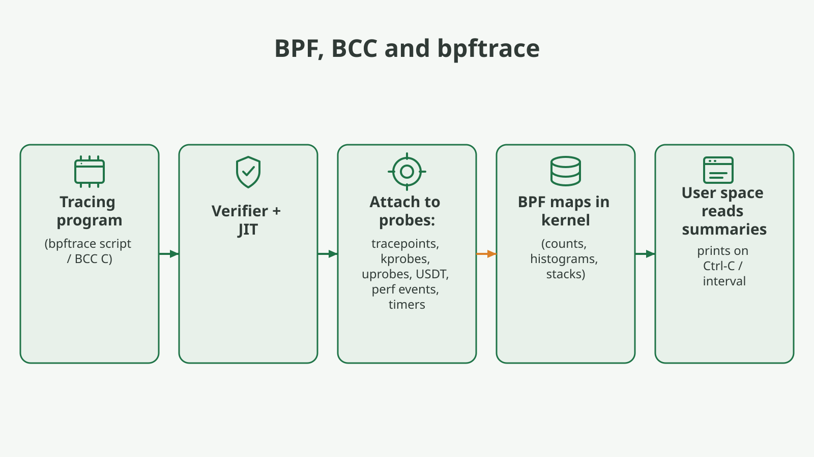

*Figure 1.24.9. BPF, BCC and bpftrace.*

BPF needs Linux 4.9 or later for most tools, and 4.4 or later for basic BCC. The kernel options `CONFIG_BPF`, `CONFIG_BPF_SYSCALL` and `CONFIG_BPF_EVENTS` must be present. Modern **CO-RE** ("compile once, run everywhere") tools also need BTF, which lives at `/sys/kernel/btf/vmlinux`. Running a tool requires root, or `CAP_BPF` with `CAP_PERFMON`, and `CAP_SYS_ADMIN` on older kernels. Container security profiles typically block BPF, as chapter 1.21 explains. Your kernel upgrade policy matters here. kprobe-based tools can break when internal functions change, while tracepoint-based tools are more stable.

### BCC: canned tools and a framework

BCC, the BPF Compiler Collection, is the first of the two BPF front ends, and it offers more than 80 ready-made tools. They are Python front ends with C BPF programs. Each one comes with a man page and example files under `/usr/share/bcc/tools/*` and `*_example.txt`. Start with a tool, not a script. The tool names are the vocabulary of modern Linux performance work. The table groups them by area.

| Area | Tools |
|---|---|
| CPU / scheduler | `execsnoop` (new processes), `runqlat` (run-queue latency histogram), `runqlen`, `runqslower`, `cpudist` (on/off-CPU time), `profile` (stack sampling), `offcputime` (blocked time by stack), `offwaketime`, `wakeuptime`, `cpuunclaimed`, `llcstat`, `hardirqs`, `softirqs`, `syscount` |
| Memory | `memleak`, `oomkill`, `drsnoop` (direct reclaim), `slabratetop`, `cachestat`, `cachetop` |
| File systems | `opensnoop`, `filelife`, `vfsstat`, `vfscount`, `fileslower`, `ext4slower`/`xfsslower`/`nfsslower`/`btrfsslower`, `ext4dist`/`xfsdist`/`nfsdist`, `filetop`, `mountsnoop` |
| Disk | `biolatency`, `biosnoop`, `biotop`, `bitesize`, `biopattern`, `blkthrot`, `ioprofile` |
| Network | `tcplife` (sessions with duration/bytes), `tcpconnect`, `tcpaccept`, `tcpretrans`, `tcptop`, `tcpdrop`, `tcpstates`, `tcpsynbl`, `sockstat`, `gethostlatency`, `solisten`, `netqtop` |
| Languages / apps | `funccount`, `funclatency`, `funcslower`, `stackcount`, `trace`, `argdist` (multi-tools), `dbslower`, `mysqld_qslower`, `pythoncalls`/`javacalls`/`phpflow`-style tools, `ucalls`, `uflow`, `ugc`, `gethostlatency` |
| Security / misc | `killsnoop`, `capable`, `sslsniff`, `syncsnoop`, `mountsnoop`, `bashreadline`, `criticalstat` |

The commands below show what the most common tools answer. Each one prints a histogram, a log or a count.

```bash
sudo runqlat 10 1                 # scheduler latency histogram (10 s, 1 report)
sudo runqlat --cgroupmap ...      # per-cgroup variants exist in newer versions (flag: check version)
sudo biolatency -m -D 10 1        # block I/O latency in ms, per disk
sudo biosnoop | head              # per-I/O: process, disk, bytes, latency
sudo opensnoop -T -x              # file opens with timestamps and failures
sudo execsnoop -t                 # short-lived processes (cron, health checks, 'nvidia-smi' storms)
sudo tcplife -T                   # TCP connections: pid, local/remote, tx/rx KB, duration
sudo tcpretrans -l                # retransmits with kernel state
sudo offcputime -p $(pgrep -n python) 30 > off.txt    # off-CPU stacks (feed flamegraph.pl)
sudo profile -F 99 -f 30 > cpu.folded                  # folded CPU stacks for flame graphs
sudo funccount 'vfs_*' ; sudo funccount -i 1 't:block:*' ; sudo funclatency vfs_read
sudo stackcount t:block:block_rq_insert                # which stacks create block I/O
sudo trace 'do_sys_open "%s", arg2'                    # printf-style kernel tracing
sudo argdist -H 'r::vfs_read()'                        # histogram of vfs_read return values (sizes/errors)
sudo hardirqs -d ; sudo softirqs -d                    # IRQ time distributions (NIC/NVMe cost on cores)
```

Newer distributions package the CO-RE versions as `*-bpfcc`. On Debian and Ubuntu, for example, that is `runqlat-bpfcc`. They also ship libbpf-tools, such as `runqlat`. Those need no Python or LLVM dependency, and they start up at lower cost. You can use `-h` and the examples file to learn the options. BCC resembles C programming. It is powerful but complex, and a typical tool runs 200+ lines. bpftrace resembles shell scripting.

### bpftrace: a high-level tracing language

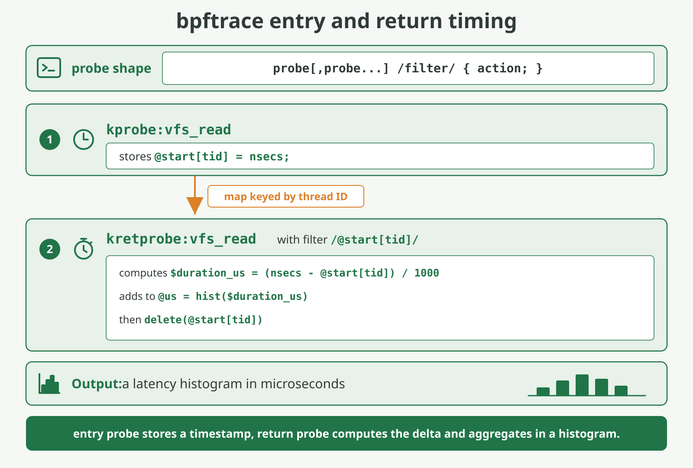

*Figure 1.24.10. The filter on the return probe protects against calls that began before tracing started.*

bpftrace is "awk for tracing". If you know awk, you already know the shape: a pattern, and an action that runs when the pattern matches. A program is a set of probes. Each probe has an optional filter and one or more actions.

```text
probe[,probe...] /filter/ { action; action; }
```

The **probe types** include `tracepoint:subsys:event` (`t:`), `kprobe:func` (`k:`), `kretprobe:func` (`kr:`), `uprobe:/path:func` (`u:`), `uretprobe:` (`ur:`), `usdt:/path:provider:probe` (`U:`), `software:`, `hardware:` for PMCs, `profile:hz:99` for timed sampling on all CPUs, and `interval:s:1` for timed reporting. There are also `watchpoint:`, `kfunc:` and `kretfunc:`, which use BPF trampolines and need BTF, plus the special `BEGIN` and `END` probes. Wildcards work too, as in `kprobe:vfs_*`. List the matches first with `bpftrace -l 'kprobe:vfs_*'`. The cap is set by `BPFTRACE_MAX_PROBES`, which defaults to 512.

The **variables** include built-ins such as `pid`, `tid`, `uid`, `comm`, `nsecs`, `elapsed`, `cpu`, `kstack`, `ustack`, `arg0..argN`, `args->field` for tracepoint fields, `retval`, `probe`, `func`, `curtask`, `cgroup`, and `$1..` for script parameters. Scratch variables such as `$x` are local to an action block. Maps such as `@name` are global, and bpftrace prints them on exit. Keys look like `@m[pid, comm]`.

The **map functions** are `count()`, `sum(x)`, `avg(x)`, `min(x)`, `max(x)`, `stats(x)`, `hist(x)` for a power-of-2 histogram, `lhist(x, min, max, step)` for a linear histogram, `delete(@m[k])`, `clear(@m)`, `print(@m)` and `zero(@m)`. The **functions** include `printf()`, `str(ptr)`, `ksym()`, `usym()`, `kaddr()`, `ntop()`, `join()`, `system()`, `cat()`, `time()`, `signal()`, `exit()`, `override()`, which is dangerous, and `cgroupid()`.

Run the one-liners below as root.

```bash
# one-liners (run as root)
bpftrace -e 'tracepoint:syscalls:sys_enter_openat { printf("%s %s\n", comm, str(args->filename)); }'
bpftrace -e 'tracepoint:raw_syscalls:sys_enter { @[comm] = count(); }'                          # syscalls by process
bpftrace -e 'profile:hz:49 /pid == 189/ { @[ustack] = count(); }'                               # user stacks of one PID
bpftrace -e 'tracepoint:syscalls:sys_exit_read { @bytes = hist(args->ret); }'                   # read() sizes
bpftrace -e 't:block:block_rq_issue { @bytes = hist(args->bytes); }'                           # block I/O size histogram
bpftrace -e 'kr:tcp_recvmsg /retval >= 0/ { @recv_bytes[comm] = hist(retval); }'               # TCP receive size by process
bpftrace -e 'kprobe:vfs_* { @[probe] = count(); }'                                              # which VFS functions run
bpftrace -e 't:sched:sched_switch { @[kstack, comm] = count(); }'                               # why threads switch (stack)
bpftrace -e 'k:vfs_read { @ts[tid] = nsecs; } kr:vfs_read /@ts[tid]/ { @us = hist((nsecs - @ts[tid]) / 1000); delete(@ts[tid]); }'
bpftrace -e 'tracepoint:syscalls:sys_enter_kill { printf("%s -> pid %d sig %d\n", comm, args->pid, args->sig); }'
bpftrace -lv 'tracepoint:syscalls:sys_enter_read'                                               # fields available in args
bpftrace -e 'k:vfs_read { @ = count(); } interval:s:1 { exit(); }'                              # measure an event's rate cheaply
```

You can also keep a program in a file, such as `vfsread.bt`. Run it with `bpftrace vfsread.bt`, or make it executable with a `#!/usr/bin/bpftrace` line. The file below times `vfs_read()` and prints a latency histogram in microseconds.

```text
// time vfs_read() and print a latency histogram in microseconds
kprobe:vfs_read { @start[tid] = nsecs; }
kretprobe:vfs_read /@start[tid]/ {
    $duration_us = (nsecs - @start[tid]) / 1000;
    @us = hist($duration_us);
    delete(@start[tid]);
}
```

The pattern is worth remembering. **An entry probe stores a timestamp in a map keyed by thread ID. The return probe computes the delta, aggregates it in a histogram, and deletes the key.** The `/@start[tid]/` filter protects against calls that were already in flight when tracing began. Without that filter, the delta would be "now minus zero". Name your maps meaningfully, such as `@us` or `@bytes`, because the name appears in the output. Extra keys give you breakdowns, such as `@us[pid, comm] = hist(...)`. For control flow, bpftrace offers `if/else`, the ternary `?:`, `unroll()`, and `while()` loops on Linux 5.3 and later kernels.

### BCC versus bpftrace

| | BCC | bpftrace |
|---|---|---|
| Typical use | Canned, option-rich production tools; daemons; complex logic | Ad hoc one-liners and short custom tools |
| Language | Python/C/C++ user side, C kernel side | bpftrace DSL |
| Difficulty / size | Hard / about 230 lines on average | Easy / about 30 lines |
| Output | Anything | Text/JSON, histograms, counts |
| Workflow | Use a tool; port a bpftrace prototype if it must become a product | Prototype quickly; run |

Large companies install both on every host. For example, BCC tools are the first reach for storage, network and process questions. bpftrace is the flashlight for new questions. Kubernetes-oriented wrappers exist too. Inspektor Gadget, run as `ig` or `kubectl gadget`, packages BCC-style gadgets per pod and namespace. `kubectl-trace` runs bpftrace jobs on nodes. Pixie, Parca, Pyroscope and Cilium Hubble provide continuous eBPF-based observability. Verify the current projects, and their kernel and privilege requirements, before you adopt one.

### Overhead and safety rules

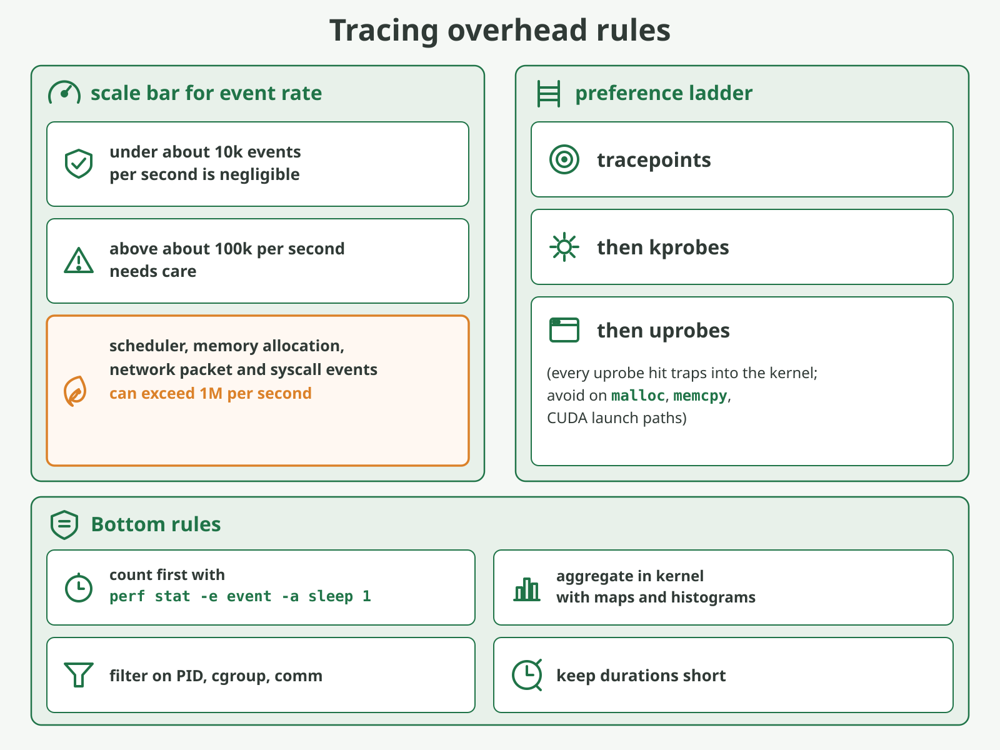

*Figure 1.24.11. Count the event rate first and prefer tracepoints over kprobes over uprobes.*

1. Count first. Measure the event rate with `perf stat -e event -a sleep 1`, `funccount`, or `bpftrace -e 'k:func { @=count(); } interval:s:1 {exit();}'`.
2. As a rough guide, under about 10k events per second is negligible, and above about 100k per second needs care. Scheduler, memory allocation, network packet and syscall-per-sample events can exceed 1M per second on busy GPU hosts.
3. Prefer tracepoints over kprobes, for stability and lower cost. Prefer kprobes over uprobes, because every uprobe hit traps into the kernel. Avoid uprobes on hot functions, such as `malloc`, `memcpy` and CUDA launch paths at high rates.
4. Prefer in-kernel aggregation, with maps and histograms, over printing every event.
5. Use filters on PID, cgroup, comm and size thresholds, and keep durations short. Stop tracing when you are done, and remove the perf and ftrace probes.
6. Test new tools on a non-production node. Watch for `perf_event_max_sample_rate` throttling and "lost events" warnings. BPF programs consume memory through their maps, and they can fail to attach on kernels that lack a feature.
7. Be careful with `override()`, `signal()` and `system()`.
8. Remember that hypervisors may block PMCs, and containers may block tracing.

## 9. Joining the host tools to the GPU tools

Picture a training step that is slow while the GPUs sit idle for part of every step. The GPU timeline shows the gaps, but it cannot tell you why they are there. Linux tracers see the **host**: the CPU, the kernel, the drivers, the NIC and the storage. GPU-side activity needs GPU-aware profilers. A complete investigation uses both, and it lines them up in time. If you use only one side, you may miss the cause.

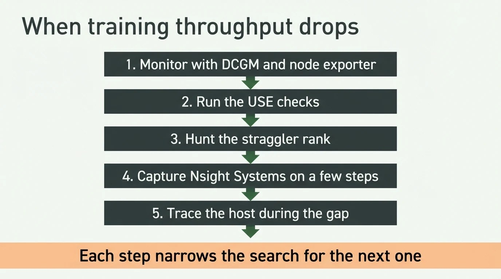
*Figure 1.24.12. A fixed order of checks finds the cause of a throughput drop without guessing.*


The table is organised by question. Each row starts from something you want to know, and it names the tool that answers it.

| Question | Tool | Notes |
|---|---|---|
| Is the GPU healthy and busy? | `nvidia-smi`, `nvidia-smi dmon -s pucvmet`, DCGM (`dcgmi dmon`, `dcgmi diag`), DCGM exporter to Prometheus | Counters: utilisation, SM and tensor activity, memory-bandwidth activity, clocks, power, temperature, ECC, NVLink and PCIe throughput, Xid errors. Low overhead, always-on |
| What does the GPU timeline look like (kernels, copies, streams, NCCL, CPU threads)? | **Nsight Systems** (`nsys profile -t cuda,nvtx,osrt,cudnn,cublas -o report python train.py`) | System-wide timeline with CPU thread states, OS runtime calls, CUDA API/kernels/memcpy, NVTX ranges, NCCL, NIC/IB metrics (plugins/GPU metrics sampling); finds bubbles, CPU launch gaps, exposed communication |
| Why is one kernel slow? | **Nsight Compute** (`ncu --set full -k regex -c N python ...`) | Per-kernel hardware metrics (occupancy, memory throughput, roofline); high overhead; use on short targeted runs |
| Where does the framework spend time? | PyTorch profiler (`torch.profiler`, Chrome/Perfetto/TensorBoard trace), `torch.cuda.Event` timing, memory snapshots | Operator-level view with CUDA kernel correlation |
| Where is time in annotated code? | **NVTX** ranges (`torch.cuda.nvtx.range_push/pop`, `nvtx.annotate`) | Makes Nsight timelines readable |
| Is communication the problem? | `NCCL_DEBUG=INFO`/`WARN`, `NCCL_DEBUG_SUBSYS`, `nccl-tests` (`all_reduce_perf`), NCCL inspector/profiler plugins, Nsight Systems NCCL traces, IB counters | Chapter 1.25 and Part 8 |
| Is the host starving the GPU? | `perf`/flame graphs, `offcputime`, `iostat`, PSI, DataLoader profiling, `py-spy dump/record` | Host CPU, off-CPU, I/O |
| Is the kernel-mode driver slow? | `perf record` with kernel stacks, `bpftrace` on `nvidia` module symbols (kprobes) | Rare; the open GPU kernel modules make symbols easier to reason about; flag: symbol names change per driver version |
| CPU-GPU transfer/PCIe/NUMA problems? | `nvidia-smi topo -m`, `bandwidthTest`, `nvbandwidth`, PMC memory counters, `numastat` | |
| What is the NIC/fabric doing? | `ethtool -S`, `rdma statistic`, `perfquery`, `ibstat`, switch telemetry (UFM, NetQ), `tcpretrans`/`tcplife` for TCP paths | Parts 2, 8, 9 |

Read the table as a set of starting points. Start from the question you have, and you will find the tool that sees that part of the system.

When training throughput drops, you should work through the steps below in order. Each step narrows the search for the next one.

Workflow for "training throughput dropped":

1. **Monitoring** with DCGM and node exporter shows which jobs and nodes are affected, since when, and whether a change lines up with the drop.
2. Run the per-node 60-second checklist and the USE method from 1.23. Look for errors such as Xid, ECC, link flaps and PSI. Look for saturation in the run queue, the I/O wait and throttling. Then check utilisation.
3. Hunt for the straggler. Compare the step time of each rank. Then run the same single-node benchmark on the suspect node and on a healthy one, using `dcgmi diag -r 3`, `nccl-tests`, or a fixed reference model step.
4. Capture **Nsight Systems** on a few steps of the suspect job. Ask whether the GPU sits idle. Then ask what the CPU is doing in those gaps, using the OS runtime and thread view.
5. Run host tracing during the gap, with `perf`, `offcputime`, `biolatency` and `tcpretrans`, to explain it.
6. Fix the cause, verify the result against the baseline, and add a monitor or an alert for that cause.

## 10. Choosing a tool

You have collected three screens of numbers and still have to decide what to run next. Start with the question, and let the flowchart point you to a tool family.

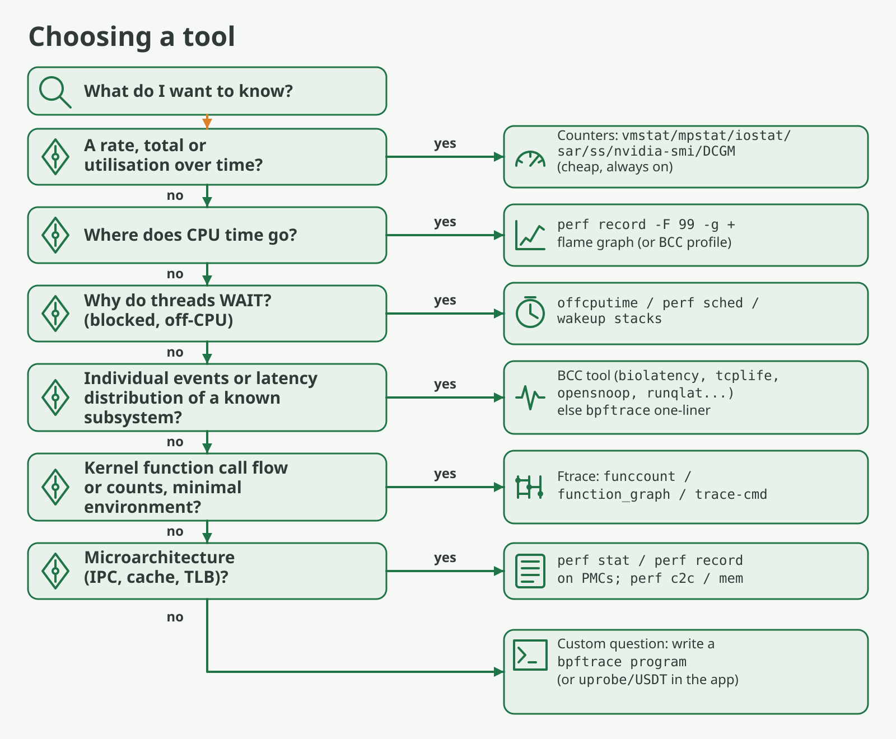

*Figure 1.24.13. Choosing a tool.*

Four rules of thumb cover most choices. Rule 1 is to start with counters, then profiling, then tracing. Rule 2 is to use the cheapest tool that can answer the question, and the highest-level tool that can still see the thing you are measuring. Rule 3 is to confirm important conclusions with a second tool. Rule 4 is to keep a library of your own one-liners and of saved "normal" outputs.

## 11. Worked examples

Each example below starts with a symptom and follows the evidence to a cause. Read them as short detective stories, with the tools as witnesses and the numbers as testimony.

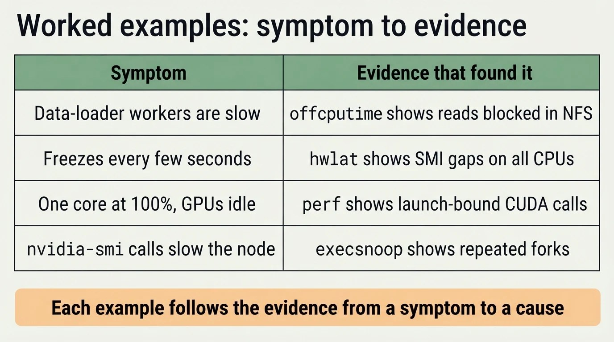
*Figure 1.24.14. Each performance symptom is traced to a cause by following the evidence.*


**A. "Data-loader workers are slow".** Your data-loader workers are slow. `pidstat -u -t 1` shows low CPU use, so the workers are waiting rather than computing. `offcputime -p <worker> 20` shows stacks blocked in `read()`, which lead into `nfs_file_read`. The time is therefore off-CPU, spent in NFS reads.

`nfsslower 10` lists the reads that take longer than 10 ms, with their file names. `nfsdist` shows a bimodal latency. Fast cache hits sit in one group, and slow misses of about 40 ms sit in another. `tcpretrans` is clean, and `sar -n DEV` shows the NIC far below line rate.

`nfsstat -c` shows many `GETATTR` calls. That points to a metadata storm, with `os.stat()` calls running over millions of tiny files. The fix is to pack the files into shards, cache the metadata, raise the attribute-cache timeout, or stage the data on local NVMe, as chapter 1.13 describes.

**B. "Periodic 3-second freezes on one node".** The freezes come back every few seconds on one node. `runqlat` and PSI show no CPU saturation. `vmstat` shows no swap, and `dmesg` shows nothing. The `hwlat` tracer, however, reports 2 ms gaps every few seconds on all CPUs. Those gaps are **SMI or firmware** interruptions, perhaps from power management or BMC polling. Check the BIOS, disable the SMI-heavy features, and update the firmware, but first check with the vendor. Then compare the behaviour against a healthy node.

**C. "Training process uses 100% of one core and GPUs idle in bursts".** A training process pins one core at 100%, while its GPUs sit idle in bursts. If your GPUs wait this way, look at the host first. Run `perf record -F 99 -g -p PID`. The flame graph shows time in the Python interpreter and in `cuLaunchKernel` inside `libcuda`, which leads down to `ioctl`. `perf stat` reports a high IPC. `nsys` shows many tiny kernels with gaps between them. The job is launch-bound. The fix is CUDA graphs, `torch.compile`, fused ops, or a larger batch or microbatch size.

**D. "Intermittent TCP stalls on checkpoint upload".** Checkpoint uploads stall now and then. `tcpretrans -l` shows retransmits to one peer. `tcplife` shows long-lived connections with low throughput, and `ss -ti` shows small congestion windows. The path has a lossy hop. You can hand that evidence to the network team, so the discussion rests on data rather than on blame.

**E. "Mysterious `nvidia-smi` calls slow the node"**, caused by monitoring agents. `execsnoop` shows `nvidia-smi` forked every second by three different agents. Each call takes the GPU driver lock briefly. If you run several agents on one node, check which of them call `nvidia-smi`. The fix is to consolidate on DCGM or NVML-based exporters.

## 12. Hands-on lab: use perf, Ftrace, BCC, and bpftrace

Start with the self-checking Python lab, `code/part01/observability_perf_bpf_lab.py`. Run it locally before you touch a VM. It checks the overhead regimes for tracing with tracepoints, kprobes, uprobes and `ptrace`. It also checks the Ftrace `function_graph` duration markers, `+`, `!`, `#`, `*`, `@` and `$`. Two more checks cover the power-of-2 bucketing of `bpftrace` `hist()`, and the `@start[tid]` entry and return latency pattern with its `/@start[tid]/` in-flight filter.

```bash
python3 code/part01/observability_perf_bpf_lab.py
```

Next, move to a disposable Ubuntu 22.04 or newer VM with root access. Step 14 also needs a GPU VM. All interactive VM commands below have not been run on live hardware, so you must run them yourself and check the results.

1. **Tool inventory**: Check each crisis-tool package. Run `perf stat -e cycles,instructions true` to see whether PMCs are available. Count the syscall tracepoints with `bpftrace -l 'tracepoint:syscalls:*' | wc -l`. Check the tracefs and debugfs mounts with `mount | grep -E 'tracefs|debugfs'`, and check for BTF with `ls /sys/kernel/btf/vmlinux`. Record anything that is missing.
2. **Sources**: Run `strace -f -e openat vmstat 1 2 2>&1 | grep -E 'proc|sys'` to see which files `vmstat` opens. Run `strace -e socket ss -t` to see the netlink socket that `ss` uses. Run `strace -e perf_event_open perf stat true` to see how `perf` reaches the kernel. For each tool, decide its data source and its overhead class. Then read `/proc/PID/{status,sched,schedstat,limits,io,smaps_rollup}` for a busy process, and read `/proc/pressure/*`.
3. **sar**: Enable `sysstat` with 1-minute collection. Generate load for 10 minutes with `stress-ng --cpu 2 --vm 1 --io 1`. Then run `sar -u -r -b -n DEV -q`, and export the results with `sadf -j`.
4. **Delay accounting**: If you enabled it with `delayacct`, build `getdelays.c` from the kernel tree, or use `iotop`. Then observe the CPU, I/O and swap delay for a loaded process.
5. **perf stat and record**: Profile a CPU-bound program for 30 seconds with `perf record -F 99 -g`. Run `perf report --stdio`, and generate a flame graph. Then compare `--call-graph fp` with `dwarf`, and watch for broken stacks in a binary built without frame pointers.
6. **perf trace and probes**: Run `perf trace -p PID`. Add a kprobe on `do_nanosleep` and a uprobe on libc `fopen`. Record, run `perf script`, and then delete the probes.
7. **perf sched**: Run `perf sched record -- sleep 10` while `stress-ng --cpu 8` runs on 4 CPUs. Then run `perf sched latency`, and compare the result with `runqlat`.
8. **Ftrace by hand**: Run the function profiler for `tcp*` while `iperf3` runs. Run the function tracer on `*sleep`, and the `function_graph` tracer on `vfs_read`. Add a kprobe event with an argument, and a trigger, `traceoff if bytes > 65536`. Add a `hist` trigger keyed by `common_pid.execname` on `sys_enter`. Clean up everything afterwards.
9. **trace-cmd and perf-tools**: Run `trace-cmd record -e sched_switch sleep 5`, and then copy the file to a desktop and open it in `kernelshark`. Run the perf-tools `execsnoop`, `iolatency` and `funccount 'vfs_*'`.
10. **BCC**: Run `execsnoop`, `opensnoop`, `biolatency` and `biosnoop` during an `fio` run. Run `runqlat` and `cpudist` during `stress-ng`. Run `tcplife` and `tcpretrans` during `iperf3`, and add `tc netem loss 1%` to see retransmits. Run `offcputime` on a blocked process, and run `profile` to produce a flame graph.
11. **bpftrace**: Write `vfsread.bt` and run it. Then write a program that histograms `tcp_sendmsg` sizes by process. Write another that counts syscalls by process for 10 s, and one that prints every `execve` with its arguments. Add `interval:s:1 { print(@x); clear(@x); }` to get periodic output.
12. **Overhead measurement**: Run a fixed benchmark, `sysbench cpu`, on its own first. Then run it again with `perf record -F 99`, with `perf record -e sched:sched_switch`, and with `bpftrace` tracing `raw_syscalls:sys_enter` at a high rate. Compare the runtimes, and record each overhead.
13. **Observing observability**: Apply a known workload, such as `fio` 4k random reads at QD32, or `iperf3` at a rate limit. Compare the `iostat` and `biolatency` output with the `fio` report. Compare `top` CPU with `perf stat` task-clock. Find one discrepancy, and explain it.
14. **GPU (on a GPU VM)**: Run a PyTorch loop with a deliberately slow data loader. Collect `nvidia-smi dmon`, then run `nsys profile` for 30 seconds. Copy the `.nsys-rep` file to a workstation and open the timeline. Identify the GPU gaps. During the gaps, run `offcputime` or `perf record` on the loader processes, and explain the cause.
15. **Container**: Run a workload in Docker, and profile it from the host, with `perf record --cgroup` or by PID. Resolve the symbols. Try `perf` and `bpftrace` inside an unprivileged container, and record the errors. Then run a privileged debug container with the tools installed.

Keep the output of each step. You can then compare it with the normal output you saved earlier.

## 13. Common mistakes

- If you install tools during the incident, you may never test whether stacks and symbols resolve.
- You may forget that frequency-sampled `perf record` data are samples, not totals, and then trust sample counts across different events.
- If you read flame graphs from binaries without frame pointers or symbols, you may conclude that there is "nothing there".
- Avoid tracing very high-rate events, such as scheduler, `malloc` or per-packet events, system-wide on production.
- Do not run `strace` on a hot production process. `ptrace` slows it by 100x or more, so use `perf trace` or BPF instead.
- You should not believe tool output without cross-checking it. Treating `top` snapshots, five-minute averages or `GPU-Util` as the truth is a common error.
- Clean up after yourself. Probes, trace sessions and `perf.data` files left behind fill the disk and add ongoing overhead.
- If you run tracing in a container, do not conclude that the system is untraceable. Trace from the host instead.
- Read container `top`, `free` or `mpstat` output with care. Those values reflect the host, not the container alone.
- Do not treat uprobes or kprobes as stable APIs in scripts that run across kernel versions, not without testing.

## 14. Interview angles

- "Explain the difference between counters, profiling and tracing, and give overhead characteristics."
- "What is the difference between a tracepoint, a kprobe, a uprobe and USDT?"
- "How would you find why a process is slow when CPU is low?" Cover off-CPU analysis, delay accounting, `offcputime`, `strace -T` and PSI.
- "Walk through producing and reading a CPU flame graph. What do missing stacks mean?"
- "What does the IPC from `perf stat` tell you, and what are its limits in the cloud?"
- "When would you pick Ftrace over perf or BPF?" Ftrace needs no extra dependencies. It offers function_graph output, shows kernel code paths, and suits embedded systems.
- "How does eBPF stay safe in the kernel? What is a map?"
- "BCC versus bpftrace?"
- "How do you profile the host side of a GPU training job and correlate it with the GPU timeline?"
- "What are the risks of tracing in production, and how do you control them?"

## Exercises

Work through these on paper first, then check your answers. Answer before you look, because that is where the learning happens.

1. Compare counters, profiling and tracing. Start with the counters, such as `vmstat` and `sar`, then profiling, such as `perf record -F 99`, and then tracing, such as `perf trace`, Ftrace and eBPF. Explain why CPU profiling uses `99 Hz` rather than `100 Hz`. Next, use `classify_event_rate_overhead()` in `code/part01/observability_perf_bpf.py` to compare the CPU cost and safety regime of three workloads. First, tracing 5,000 and 200,000 tracepoints per second. Second, tracing 80,000 uprobes per second on `malloc`. Third, tracing 50,000 syscalls per second under `ptrace`, which is how `strace` works.
2. Explain why you should run `perf stat` on an event before you run `perf record` or `bpftrace` on it. Then explain the difference between `perf record -F 99` and `perf record -c 1000`. Compare `--call-graph fp`, `--call-graph dwarf` and `--call-graph lbr`. Finally, state how to make Python 3.12 or later functions appear in `perf` flame graphs.
3. Explain the difference between `trace` and `trace_pipe` under `/sys/kernel/tracing`. Then state the duration threshold for each of the six `function_graph` markers, `+`, `!`, `#`, `*`, `@` and `$`, as `ftrace_function_graph_mark()` defines them. Next, say what the `hwlat` tracer measures. Explain why it caught the periodic 2 ms freezes in Worked Example B, when `vmstat` and `runqlat` showed nothing.
4. Explain how the kernel eBPF verifier, the JIT compiler and in-kernel BPF maps make production tracing safe and efficient. Then trace `simulate_bpftrace_latency_map()` on `vfsread.bt`, which is `kprobe:vfs_read { @start[tid] = nsecs; } kretprobe:vfs_read /@start[tid]/ { ... }`. Explain why the `/@start[tid]/` filter and `delete(@start[tid])` are both mandatory. Finally, state which power-of-2 bucket `hist(65536)` lands in, using `bpftrace_hist_bucket_range()`.
5. For each scenario below, name the exact BCC tool or `bpftrace` one-liner, and the evidence it produces. In the first, data-loader workers have low CPU use and may be blocked on slow NFS reads. In the second, a training rank's single host thread sits at 100% CPU, launching tiny CUDA kernels. In the third, checkpoint uploads over TCP stall now and then. In the fourth, three monitoring agents are secretly forking `nvidia-smi` every second.
6. Outline the six-step workflow in section 9. It joins fleet monitoring with `DCGM` and `node_exporter`, the 60-second checklist, **Nsight Systems** (`nsys profile -t cuda,nvtx,osrt,cudnn,cublas`), host tracers such as `perf`, `offcputime` and `biolatency`, and **Nsight Compute** (`ncu`). Use that workflow to diagnose a training throughput regression.

## Checkpoint questions (20)

<details>
<summary>1. Contrast the three observability collection mechanisms—Counters, Profiling, and Tracing—and their overhead models.</summary>

Counters, such as `vmstat`, `iostat`, `sar` and `nvidia-smi`, increment in-memory integers in the kernel or the hardware. They are always on, and reading them costs almost nothing. Profiling, such as `perf record -F 99` or `py-spy`, takes timer- or PMC-driven samples at a fixed rate of `49` or `99` Hz. That gives predictable, low overhead. Tracing, such as `perf trace`, Ftrace, BCC or `bpftrace`, runs on every occurrence of an event. Its overhead therefore grows with the event rate.
</details>

<details>
<summary>2. Why do CPU profilers sample at `99 Hz` (or `49 Hz`) instead of `100 Hz`, and why is `strace` dangerous on production workloads?</summary>

Sampling at `99 Hz` avoids lockstep aliasing with the `100 Hz` timers that fire every `10 ms` in the operating system or in applications. `strace` is risky because it uses `ptrace(2)`. That call stops the target process and switches context twice on every single system call. Syscall-heavy workloads can slow by `10x` to `100x` or more.
</details>

<details>
<summary>3. Compare the five primary kernel/user event sources: `tracepoints`, `kprobes`, `uprobes`, `USDT`, and `PMCs`.</summary>

**Tracepoints**, such as `block:block_rq_issue`, are static kernel hooks. There are about `1,000–2,000` of them. They have a best-effort stable API and a low cost, around `~100 ns` per event. **kprobes** and **kretprobes** patch any of `50,000+` kernel functions dynamically, but they offer no API stability across kernel versions. **uprobes** and **uretprobes** instrument user-space functions, such as `libc:malloc` and `libcuda.so`. Every hit traps into the kernel, at around `~1 µs` or more, so they are expensive on hot functions. **USDT** probes are static user-space probes compiled into binaries and libraries. **PMCs** are hardware performance monitoring counter registers. They measure cycles, instructions, cache misses and TLB misses.
</details>

<details>
<summary>4. What is Gregg's event-rate rule of thumb for tracing overhead, and how do you check an event's rate before tracing it?</summary>

For kernel tracepoints and kprobes with in-kernel aggregation, rates below about `~10,000` events per second have negligible overhead. Rates above about `~100,000` events per second add measurable overhead. Examples are `sched:sched_switch`, `malloc`, and per-packet events. Count the rate first. For example, `sudo perf stat -e <event> -a -- sleep 1`, `funccount`, or `bpftrace -e 'k:func { @=count(); } interval:s:1 { exit(); }'`.
</details>

<details>
<summary>5. What does Linux Delay Accounting (`CONFIG_TASK_DELAY_ACCT`) measure, and why do `ip` and `ss` use `netlink` instead of `/proc/net`?</summary>

Delay accounting tracks how long each task spends **waiting** for four resources. Those are CPU run-queue latency, block I/O completion, swap-in paging, and memory reclaim. The `taskstats` netlink interface exposes this data to tools such as `iotop`, `atop` and `getdelays`. `ip` and `ss` use binary `AF_NETLINK` sockets, `NETLINK_ROUTE` and `NETLINK_SOCK_DIAG`. That avoids the CPU cost of formatting and parsing large text tables from `/proc/net/tcp`.
</details>

<details>
<summary>6. What are PMC multiplexing and instruction-pointer skid, and why might `perf stat` fail to report hardware counters in a cloud VM?</summary>

Each CPU core has only `4` to `8` programmable PMC registers. If you request more events at once, `perf` time-multiplexes them and scales the estimates. **Skid** is the lag between the instruction that caused a PMC overflow and the instruction pointer recorded when the interrupt fires. Precise events reduce or remove it. Intel PEBS and AMD IBS provide those precise events, written as `cycles:p`, `:pp` and `:ppp`. Cloud hypervisors often hide guest PMU access, unless the instance is bare metal or a dedicated GPU instance.
</details>

<details>
<summary>7. How does `sar` (`sysstat`) work, and why should it be enabled on every cluster node even when Prometheus is deployed?</summary>

`sadc` runs periodically, from a systemd timer or `/etc/cron.d/sysstat`. It records hundreds of kernel counters into binary daily archives in `/var/log/sysstat/saDD`. `sar` and `sadf -j`, which outputs JSON, read those archives. You can query the history, as in `sar -f /var/log/sysstat/sa17 -s 02:00:00`, or query live, as in `sar -q -r -B -d -n DEV 1 5`. Because `sadc` writes locally with almost no overhead, the history survives even when a node loses its connection to Prometheus.
</details>

<details>
<summary>8. What is the difference between `perf record -F 99` (frequency sampling) and `perf record -c 10000` (period/overflow sampling)?</summary>

`-F 99` adjusts the sampling period so that it captures about `99` samples per CPU each second. `-c 10000` records one sample for every `10,000` occurrences of the event. Without a flag, `perf record` uses frequency sampling, at about `~4,000 Hz`, on hardware and software events. On tracepoints, it uses period `1`, which means every event.
</details>

<details>
<summary>9. Compare the three `perf record --call-graph` stack-walking modes (`fp`, `dwarf`, `lbr`).</summary>

`fp` is the default. It walks the frame-pointer register chain. It is fast and low-overhead, but it produces truncated stacks when binaries were compiled with `-fomit-frame-pointer`. `dwarf` unwinds stacks with DWARF debug tables, which the `-dbgsym` packages provide. It works without frame pointers, but it creates large `perf.data` files and adds more CPU overhead. `lbr` uses Intel Last Branch Record hardware registers, which hold `16` or `32` branches.
</details>

<details>
<summary>10. How do `perf trace`, `perf sched`, and `perf c2c` work?</summary>

`perf trace` traces system calls and tracepoints live, through ring buffers. It does not stop the process the way `strace` does. `perf trace --duration 10 -p PID` shows only the syscalls slower than `10 ms`. `perf sched record`, `perf sched latency` and `timehist` measure per-task wakeup and run-queue delays. `perf c2c`, which stands for cache-to-cache, uses precise memory PMCs to pinpoint cache-line false sharing across CPU cores.
</details>

<details>
<summary>11. On `x86-64` (AMD64 ABI), which registers hold the first six function arguments when creating a raw `perf probe` or Ftrace `kprobe` without debuginfo?</summary>

On `x86-64`, under the AMD64 ABI, the first six integer and pointer arguments arrive in these registers. They are `%di` (`$arg1`), `%si` (`$arg2`), `%dx` (`$arg3`), `%cx` (`$arg4`), `%r8` (`$arg5`) and `%r9` (`$arg6`). The return value is in `$retval`, which maps to `%ax`.
</details>

<details>
<summary>12. How is Ftrace controlled without any user-space binary packages, and how do you isolate concurrent Ftrace users?</summary>

Ftrace is controlled entirely by writing strings to files, and by reading files, in the tracefs filesystem. For example, once tracefs is mounted at `/sys/kernel/tracing`, you control Ftrace with its files. It can also appear at `/sys/kernel/debug/tracing`. To run concurrent, independent Ftrace sessions without clashing over `current_tracer`, create a subdirectory under `/sys/kernel/tracing/instances/<name>`.
</details>

<details>
<summary>13. In Ftrace `tracefs`, what is the difference between `trace` and `trace_pipe`, and what does the Function Profiler (`function_profile_enabled`) provide?</summary>

`trace` is a non-consuming view of the ring buffer, so you can read it again and again. `trace_pipe` is a blocking stream that **consumes** events as you read them. When you run `echo 1 > function_profile_enabled` together with `set_ftrace_filter`, the function profiler records per-CPU call counts, total time, average time and variance for the matched kernel functions. It writes them to `trace_stat/function*`, and the overhead is very low.
</details>

<details>
<summary>14. What do the Ftrace `function_graph` duration symbols (`+`, `!`, `#`, `*`, `@`, `$`) mean, and what does the `hwlat` tracer detect?</summary>

In `function_graph` output, `+` means the duration is over 10 µs. `!` means over 100 µs, `#` over 1 ms, `*` over 10 ms, `@` over 100 ms, and `$` over 1 s. The `hwlat` tracer, for hardware latency, spins in a tight kernel loop with interrupts disabled. It detects CPU time that is stolen outside the OS kernel. Examples are BIOS System Management Interrupts (`SMI`s), BMC firmware polling, and hypervisor steal.
</details>

<details>
<summary>15. What are Ftrace event triggers (`traceoff`, `stacktrace`, `hist`) and synthetic events?</summary>

Event triggers run an action inside the kernel when a tracepoint matches a filter. `traceoff` freezes the ring buffer when an anomaly occurs, as in `traceoff if bytes > 65536`. `stacktrace` records the kernel stack. `hist:key=...` builds a histogram inside the kernel, and you read it from the event's `hist` file. Synthetic events combine two tracepoints, such as `sys_enter` and `sys_exit`. They compute and histogram latencies entirely inside tracefs.
</details>

<details>
<summary>16. How does eBPF guarantee kernel safety and low overhead compared to copying raw events to user space?</summary>

Before an eBPF program attaches, the kernel **verifier** proves three things. The program terminates, so it has no unbounded loops. It never dereferences unchecked pointers. And it stays within its stack and instruction limits. The kernel then **JIT-compiles** the program to native machine code. Counting, stacks and histograms are filtered and aggregated inside **BPF maps** in kernel memory, so only compact summaries cross to user space.
</details>

<details>
<summary>17. Match the core BCC / `libbpf-tools` utilities to their purpose: `execsnoop`, `opensnoop`, `biolatency`, `biosnoop`, `runqlat`, `offcputime`, `tcplife`, and `tcpretrans`.</summary>

`execsnoop` traces short-lived `execve()` processes. `opensnoop` traces `openat()` file opens and `ENOENT` failures. `biolatency` gives a block I/O latency histogram per disk. `biosnoop` logs each block request with its PID and latency. `runqlat` gives a scheduler run-queue latency histogram. `offcputime` gives stack traces weighted by the time spent blocked off-CPU. `tcplife` reports TCP session lifespan and byte counters. `tcpretrans` reports TCP retransmissions with socket state.
</details>

<details>
<summary>18. Write the canonical `bpftrace` program to measure the microsecond latency histogram of `vfs_read()`, and explain why `/@start[tid]/` and `delete(@start[tid])` are required.</summary>

The program is `kprobe:vfs_read { @start[tid] = nsecs; } kretprobe:vfs_read /@start[tid]/ { @us = hist((nsecs - @start[tid]) / 1000); delete(@start[tid]); }`. Keying `@start` by `tid` handles concurrent threads. The `/@start[tid]/` predicate skips return events whose entry happened before `bpftrace` attached, which would otherwise give a bogus `nsecs - 0` delta. `delete(@start[tid])` frees the map entry, so stale timestamps neither leak nor corrupt later calls.
</details>

<details>
<summary>19. When should you use BCC (`libbpf-tools`) versus `bpftrace`?</summary>

Use **BCC** or `libbpf-tools` first when one of its `80+` canned, option-rich tools already answers the question. Examples are `biolatency -D`, `tcplife -T` and `offcputime -p PID`. Use `bpftrace` when you need a quick custom one-liner, or a custom filter or histogram on specific kernel or application probes. A bpftrace program is about `~30` lines of high-level DSL, while a BCC tool is about `~230` lines of C and Python.
</details>

<details>
<summary>20. How do you combine **Nsight Systems** (`nsys`), **Nsight Compute** (`ncu`), and Linux host tracers (`perf`, `offcputime`, `biolatency`) when debugging a slow GPU training job?</summary>

Start with **Nsight Systems**, using `nsys profile -t cuda,nvtx,osrt,cudnn,cublas`. It captures a multi-step timeline, which shows whether the slowdown comes from **GPU idle bubbles** between kernels, from **exposed NCCL collectives**, or from **slow GPU kernels**. If there are GPU idle gaps, use `perf record -F 99 -g`, `offcputime`, and `biolatency` or `nfsslower` on the host. They show whether the CPU is launch-bound in Python or `ioctl`, or blocked in storage or network I/O. If one GPU kernel is slow, drill into that kernel alone with **Nsight Compute** (`ncu`).
</details>

## Sources and review notes

- **Sources read in full:**
  - `systems-performance-2nd-edition` — Brendan Gregg, *Systems Performance*, 2nd ed., **Chapter 4: Observability Tools** (tool coverage, static and crisis tools, tool types counters/profiling/tracing/monitoring, observability sources `/proc`, `/sys`, delay accounting, netlink, tracepoints, kprobes, uprobes, USDT, PMCs, `sar`, and observing observability), **Chapter 13: perf** (`perf list`, `perf stat`, `perf record`, `perf report`, `perf script`, `perf top`, `perf trace`, `perf probe` AMD64 ABI registers, `perf sched`/`mem`/`c2c`, and flame graphs), **Chapter 14: Ftrace** (`tracefs`, function profiler, function tracer, tracepoints/filters/triggers, kprobe/uprobe events, `function_graph`, `hwlat` and latency tracers, hist triggers and synthetic events, `trace-cmd`, `perf ftrace`, and `perf-tools`), and **Chapter 15: BPF** (eBPF verifier/JIT/maps, BCC 80+ tool suite, `bpftrace` probes/variables/map functions/timing pattern, and BCC vs `bpftrace`).
- **Run here:** `python3 code/part01/observability_perf_bpf_lab.py` (14 passed, 0 failed).
- **Explicitly labelled inferences:** The Section 9 host-to-GPU tool alignment table (`DCGM`, `Nsight Systems` `nsys`, `Nsight Compute` `ncu`, `torch.profiler`, `NVTX`, `nccl-tests`) and Section 11 AI infrastructure worked examples (NFS `GETATTR` metadata storm, `hwlat` BIOS SMI gaps, Python `cuLaunchKernel` `ioctl` launch-bound gaps, and `execsnoop` `nvidia-smi` polling storms) connect Linux kernel tracers to Part 6, Part 9, and Part 10 GPU cluster operations (no `nvidia-devops` file is directly mapped to `1.24`; cross-referenced with Chapters 1.8, 1.10, 1.11, 1.13, 1.17, 1.18, 1.21, 1.22, 1.23, 1.25, and 1.28, plus original study items 21, 22, 23, 26, 28, and 29).
- **Not verified on live hardware:** All interactive VM and GPU tracing commands (`perf`, `trace-cmd`, `bpftrace`, BCC tools, `sar`, `nsys`, `ncu`) are marked and must be executed on a disposable VM or test node.
