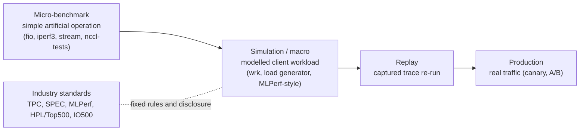

# 1.25 Benchmarking correctly

| | |
|---|---|
| Level | Advanced |
| Priority tier | 0 |
| Lab venue | Any Linux VM; a GPU VM and (ideally) a second node for the GPU, NCCL and network parts |
| Part | Part 1: Linux, from the command line to the kernel and performance |
| Status | Drafted, labs **untested** |

## Why this matters for AI infrastructure

An AI platform engineer is constantly asked to produce or judge numbers: "is this new node healthy?", "did the driver upgrade slow training?", "which instance type should we buy?", "does this vendor's 400 Gb/s fabric really deliver?", "what tokens/s can one H100 serve at a 200 ms TTFT?", "what will 1,024 GPUs cost per run?". Each answer is a benchmark. Done well, benchmarks catch bad hardware before a customer job runs on it, validate a cluster acceptance test, size capacity, justify a purchase, and gate regressions in CI. Done badly, they cost millions: the wrong instance family, a cluster accepted with a flaky link, a "regression" that was only thermal throttling, or a vendor claim you repeat in a design review that does not survive contact with your workload.

Typical failures:

- A storage benchmark reports 40 GB/s per node because it measured the page cache, not the NVMe devices.
- An `all_reduce` test shows 90% of line rate between two nodes on one switch and everyone assumes the 1,024-GPU job will too.
- A single run on a freshly booted, cold GPU is compared with a heat-soaked run an hour later and called a regression.
- An inference benchmark uses a closed-loop client at a fixed concurrency, hides queueing, and reports a latency your users never see.
- A marketing benchmark with a single, optimal prompt length is used as capacity planning input.
- A benchmark's own client is single-threaded and caps at 700 requests/s; the server is idle.

This chapter teaches how to benchmark correctly: what a benchmark is for, the failure modes and fallacies, micro versus macro versus replay versus industry benchmarks, methodologies (active benchmarking, sanity checks, ramping load, statistical analysis, the checklist), the questions to ask about any number you did not generate, and then the **AI-infrastructure benchmark toolkit** (CPU, memory, storage, network, GPU, NCCL, training, inference) with the specific traps for each.

## Prerequisites and outcomes

You should know the methodology chapter (1.23), the observability chapter (1.24), and the CPU, memory, disk and network basics from earlier chapters. Details of GPU, NCCL and fabric benchmarking are developed further in Parts 7 to 10.

After this chapter you can:

- State the legitimate reasons for benchmarking and the properties of a good benchmark; explain "casual benchmarking" (you benchmark A, measure B, conclude C).
- Recognise and avoid the 16 classic failures (casual, blind faith, numbers without analysis, complex tools, wrong thing, ignoring environment/errors/variance/perturbations, changing multiple factors, benchmark paradox, benchmarking the competition, friendly fire, misleading benchmarks, benchmark specials, cheating).
- Choose between micro-benchmarks, simulations (macro), replay and industry-standard benchmarks and explain the risks of each; design a micro-benchmark matrix (sunny-day and rainy-day).
- Apply active benchmarking with observability tools, profile the benchmark and the target, apply USE, characterise the workload, build a custom load generator, ramp load, run a sanity check (bandwidth arithmetic), and do statistical analysis.
- Use the six-question checklist (why not double? did it break limits? did it error? does it reproduce? does it matter? did it even happen?) and the longer vendor-result questions.
- Run correct CPU, memory, storage (`fio`, parallel filesystems), network (`iperf3`, RDMA perftest), GPU (`nvbandwidth`, DCGM diagnostics, burn-in), NCCL (`nccl-tests`), training and inference benchmarks, controlling clocks, warm-up, steady state, thermals, caches, NUMA and variance.
- Write a reproducible benchmark report with environment metadata, raw data, distributions and stated limits.

## 1. Why benchmark, and what makes a good benchmark

**Reasons** (each implies a different standard of rigour):

| Reason | Example in AI infrastructure |
|---|---|
| System design / purchase | Compare GPU servers, NICs, parallel filesystems by *performance per cost* (price/performance; performance/price is easier to read because bigger is better) |
| Proof of concept | Run your real model on a vendor cluster before committing |
| Tuning | Find which BIOS/OS/NCCL settings are worth pursuing |
| Development / non-regression | Gate driver, kernel, library, or framework upgrades on performance in CI |
| Capacity planning | Establish tokens/s per GPU at an SLO; fabric limits |
| Troubleshooting | Confirm a link or GPU still achieves its known maximum |
| Acceptance / burn-in | Prove each new node meets spec before it enters the pool |
| Marketing ("benchmarketing") | Maximum numbers: treat others' as upper bounds only |

Cloud and rented GPUs make benchmarking cheap to run (a large environment can be created, tested and destroyed), which is a reason to do more of it, not less; they also add hidden variance (different hosts, neighbours, silicon lottery, thermal state), so you need multiple instances and distributions rather than one lucky or unlucky run.

**A good benchmark is** repeatable (so comparisons are valid), observable (so you can analyse it), portable (across systems and releases), easily presented, realistic (reflecting what users experience), and runnable (quick enough that developers use it); for purchases add price (five-year cost). **Effective benchmarking is also about analysis**: you must understand what is tested, what limits the result, what perturbations exist, and what conclusions follow. This requires analysing the system *while* the benchmark runs; do not hand juniors a tool and call experts afterwards to explain the numbers. A famous 1981 example reads like modern active benchmarking: transmit 4 MB between two machines, note that one machine is CPU-saturated and the other 30% idle, then break down where kernel time goes (Ethernet 20%, IP 10%, TCP 30%, checksumming 25%, syscalls 15%). Today a flame graph gives that breakdown in seconds.

## 2. The failures (and the cures)

| # | Failure | What goes wrong | Cure |
|---|---|---|---|
| 1 | **Casual benchmarking** | "You benchmark A, but actually measure B, and conclude you've measured C." Disk tools that test the filesystem and page cache; GPU tools that test the launch rate | Verify what is measured with tracing and metrics (section 4) |
| 2 | **Blind faith** | Popular, open-source, vendor-recommended tools are assumed valid (argumentum ad populum). Many popular benchmarks are flawed | Study the benchmark; read its source; validate it with a known workload |
| 3 | **Numbers without analysis** | A bare number with no limiter identified. "If you've spent less than a week studying a benchmark result, it's probably wrong" | Always state the limit encountered and the analysis performed; if no time, list unchecked assumptions |
| 4 | **Complex tools** | Hard to analyse; benchmarking the benchmark (single-threaded client, interpreter overhead) | Prefer short, readable tools (C for micro-benchmarks; the same language as the client for client simulation) |
| 5 | **Testing the wrong thing** | Disk benchmark for a workload that runs from cache; optimising for a vendor's standard test that does not resemble yours; a stale benchmark | Workload characterisation (1.23); ask the audience to agree |
| 6 | **Ignoring the environment** | Default test server versus tuned production; different firmware, drivers, power profile, clocks | Match or document the environment; record versions |
| 7 | **Ignoring errors** | The tool reports a result but most operations failed (everything blocked by a firewall; latency = client timeout) | Check error counts and status codes |
| 8 | **Ignoring variance** | Steady average workload hides bursts (periodic write-back, checkpoint bursts) | Include bursts, distributions; Markov models for correlated ops |
| 9 | **Ignoring perturbations** | Backups, monitoring agents, interrupts, noisy neighbours, thermal drift, cron jobs | Run long enough (never under 1 s; minutes typical), repeat, check standard deviation, collect distributions |
| 10 | **Changing multiple factors** | Two hosts compared over different networks, instances on different hosts | Change one thing; test several instances and use the median/distribution |
| 11 | **Benchmark paradox** | Customers want a product to win all benchmarks: three 50% wins in a row is 12.5% | Understand how conclusions are made |
| 12 | **Benchmarking the competition** | Untuned competitor numbers; tuned yours | Spend equal effort tuning both, with expert help |
| 13 | **Friendly fire** | Mis-configured or undersold own product; not driven to its limit | Ask "what is the bottleneck?"; share results with engineers before publishing |
| 14 | **Misleading benchmarks** | Technically true but omitting cost, config, scale, caveats ("2x faster") | Read the fine print; use vendor results as upper bounds |
| 15 | **Benchmark specials** | Product engineered to score on a known benchmark but not for customers (TPC prohibits them) | Prefer your workload; check for special configuration and pricing |
| 16 | **Cheating** | Fake numbers (rare) | Reproduce key results |

## 3. Benchmark types



- **Micro-benchmarking** tests one operation: a syscall, a filesystem I/O type, a CPU loop, a network transfer, a GPU kernel or collective. Advantages: simple, repeatable, quick to run on many systems and quick to root-cause. Disadvantage: the numbers must be *mapped* to the real workload (only one or two of its dimensions may matter). Typical tools by resource: CPU (`sysbench`, `stress-ng`), memory (`lmbench`, STREAM), filesystem (`fio`), disk (`hdparm`, `dd` with direct I/O, `fio`), network (`iperf3`), GPU (`nvbandwidth`, kernels), collectives (`nccl-tests`).
- **Simulation (macro-benchmarking)** applies a model of client behaviour (request mixes derived from workload characterisation). Examples: HTTP load tools (`wrk`, `hey`, `siege`), database benchmark suites, MLPerf scenarios, LLM serving load generators. Can be **stateless** (independent requests drawn from a distribution) or **stateful** (sequences with dependencies; Markov models). Risks: ignoring variance, drift of real usage over time, resistance to updating a benchmark that has published history.
- **Replay** re-issues a captured trace. It sounds ideal, but captured clients do not respond to the new system's changed latency, and the level of replay matters: replaying *disk* I/O from an old system on a new system with 16x the cache measures the wrong thing, and could lose a sale. Replay at the level where the new system's behaviour is not baked in (application requests), and still analyse.
- **Industry-standard benchmarks** (TPC for databases; SPEC CPU/cloud/storage; for AI: MLPerf Training, Inference, Storage, HPC; for HPC: HPL/Top500, HPCG, IO500; STREAM): collections of well-defined micro and macro tests with rules, disclosure and sometimes audits and pricing. They save time when one resembles your workload; metrics are custom (TPS, FLOPS, samples/s, time-to-train) and comparable only with themselves. MIPS and FLOPS are simple but depend on instruction mix.

### Designing a micro-benchmark matrix

Think in dimensions. For a filesystem or storage test: access pattern (sequential/random), I/O size, direction, working-set size (much smaller than RAM tests the cache and software path; much larger tests the device), thread/queue depth, and sync mode. Example set: sequential 512 B reads (maximum IOPS), sequential 1 MiB reads (maximum read throughput), sequential 1 MiB writes (write throughput), random 512 B reads (effect of randomness), random 512 B writes (rewrite effect), each across small/large working set and 1/many threads. This matrix grows fast; use statistical design (one factor at a time from a known maximum configuration) to reduce it (chapter 1.23, factor analysis). Include **sunny-day** tests (peak, ideal) **and cloudy/rainy-day** tests (contention, failures, bursts, degraded components, mixed loads), because production lives in the latter.

## 4. Methodology

| Method | What | Notes |
|---|---|---|
| **Passive benchmarking** | Run the tool with various options, make slides, hand over (fire and forget) | Anti-method: results may be buggy, limited by the tool or by an unrelated component (congested network, single thread), mis-configured, perturbed, or irrelevant |
| **Active benchmarking** | Analyse the system with observability tools *while the benchmark runs*, to confirm what is tested and what limits it | The core method |
| **CPU profiling** | Profile benchmark and target (flame graphs) | Quick discoveries (e.g., 62% of samples in an I/O throttling function revealed an active resource control) |
| **USE method** | Find which resource is at 100%, or realise you are not driving the system to its limit | See 1.23 |
| **Workload characterisation** | Compare benchmark to production workload | Relevance |
| **Custom benchmarks** | Write your own short load generator when needed | Keep it simple; check the compiler did not elide the work; disassemble if needed; verify with external tools |
| **Ramping load** | Add load stepwise, plot throughput and latency until a limit | Reveals scalability profile; the result is the highest load with *acceptable* latency, not the highest throughput |
| **Sanity check** | Does any number exceed a physical limit? | E.g. 50,000 NFS IOPS of 8 KiB over 1 GbE needs 400,000 KB/s (3.2 Gbit/s) > 1 Gbit/s, so the client cache was measured |
| **Statistical analysis** | Collect large datasets, variances, distributions, error margins; analyse after the fact | Used when access to the system is scarce and expensive; collect everything (copy `/proc` counters before/after, `sar`, DCGM, `nsys`) |

### Active benchmarking: a worked example

A well-known disk benchmark claims in its man page to "test hard drive performance"; its first test is "sequential output, per character", scoring about 739 KB/s. Sanity check: if that were I/O per character, the system performed 739,000 I/Os per second, impossible for one drive. While the test ran: `iostat -sxz 1` showed *no disk I/O*; `bpftrace -e 'tracepoint:block:* { @[probe] = count(); }'` showed *no* block requests issued or completed (only dirtied buffers); `cachestat 1` showed hits and "dirties" in the page cache; `kprobe:vfs_*` counted about 1.18 million `vfs_write` calls; a histogram of the third argument of `vfs_write` showed almost all writes were **1 byte**. Conclusion: the first test measures 1-byte *buffered filesystem writes*, not the drive. The flag that should force synchronous writes (`-b`) did not call `fsync` after each write when checked with `strace` (whose overhead means the benchmark result under `strace` must be discarded), and direct I/O failed on that system. The tool is not unusually bad; this kind of finding is common, which is exactly why blind faith fails. The lesson is the method: sanity check → look for the resource you think is being exercised → trace the layer above → measure the actual operation attributes.

### Ramping load and acceptable latency

Add clients/threads/QPS in increments, hold each level long enough to be steady, plot throughput and latency percentiles versus load, and mark the **knee**. Report the highest load whose latency is acceptable to a customer: pushing from 990,000 IOPS at 5 ms to 1,000,000+ IOPS at 50 ms is not an achievement, and the right number to publish is 990,000. Verify with the USE method that some resource really reached its limit (otherwise you are measuring the generator). Always record **latency distributions**, not just means.

### The checklist

1. **Why not double?** What is the limiter? (Often it is not the thing you intended to test.)
2. **Did it break limits?** Sanity check against known maxima.
3. **Did it error?** Errors are cheap or expensive differently from normal operations and skew results.
4. **Does it reproduce?** Repeat; look at variation; test other instances.
5. **Does it matter?** Is the workload relevant to production?
6. **Did it even happen?** Was the intended operation actually performed (not blocked, cached, optimised away)?

### Questions to ask about a result you did not generate

General: Does it relate to my workload? What was the system configuration and cost? One system or a cluster? What did the benchmark clients look like? Duration and number of results? Average or peak (what is the average)? Percentiles and variance? What was the limiting factor? Success/failure ratio? Operation attributes and how they were chosen? Variance or average workload? Was it confirmed with other tools? Error margin? Reproducible?

CPU/memory: processors (overclocked? cooled specially?), DIMM count and socket attachment, disabled CPUs, system-wide utilisation (lightly loaded chips turbo higher), cores versus hyperthreads, memory type/size, BIOS settings. Storage: device types/counts/protocol/RAID, cache policy (write-back or write-through), filesystem and tuning, working-set size and how much cached where, number of files. Network: interfaces, topology, protocols and socket options, tunables. For GPUs (add): model and SKU, power limit and clock settings, interconnect topology (NVLink domain, PCIe generation), driver/CUDA/library versions, precision and sparsity assumptions, batch size, sequence length, whether numbers are per GPU or aggregate, whether data loading is included, whether warm-up and steady state were respected, and the cost.

## 5. A reproducible benchmarking procedure

Before any specific tool, fix the procedure. Most "bad" AI benchmarks are procedure failures.

1. **Question and success criterion.** "Does node X deliver at least 95% of the median of the fleet on a reference step?" "Can this fabric sustain at least 90% of line rate for 1 GiB all-reduce across 16 nodes?" Without a criterion the result cannot pass or fail.
2. **Record the environment** automatically: hardware (CPU model, microcode, BIOS version and settings, DIMMs, GPU model/SKU/VBIOS, NIC model/firmware, PCIe link width/speed, topology), OS (kernel, boot parameters, sysctls, governor, THP), drivers and libraries (NVIDIA driver, CUDA, cuDNN, NCCL, MOFED/DOCA, PyTorch/framework, container image digest), cluster settings (scheduler, cgroup limits, CPU/memory/GPU binding), clocks and power limits, and software versions of the benchmark tool. Keep a script that dumps all of it next to the results.
3. **Control the controllable.** Isolate the node (drain it); stop interfering services; fix GPU clocks and persistence mode when comparing hardware (`nvidia-smi -pm 1`, `-lgc` to lock graphics clocks, `-pl` for power limits; flag: policies and permitted ranges vary by SKU); set CPU governor to performance; pin processes with the topology in mind (NUMA, GPU-NIC affinity); fix random seeds and datasets; use the same container image digest.
4. **Warm up, then measure steady state.** Discard the first iterations (CUDA context creation, cuDNN autotune, JIT compilation, cold caches, memory allocation, NCCL channel setup, power ramp). Measure after clocks and temperatures stabilise; for thermal comparisons run long enough to **heat-soak** (minutes to an hour) and record clocks/temperature/power over time.
5. **Run long enough, and repeat.** Single runs are anecdotes. Use at least 5 to 10 repetitions where feasible; report median and spread (min/max, standard deviation or coefficient of variation, percentiles). Randomise the order of A/B runs to avoid drift bias (thermal state, time of day, neighbours). Test several instances/nodes (the "silicon lottery" and host differences are real).
6. **Observe while running (active benchmarking).** Collect `dmon`/DCGM, `sar`, `mpstat`, `iostat`, `perf`/flame graph snapshots, network counters, and PSI during the run; verify the limiter. Do not measure with heavy tracing on (overhead); trace in separate runs.
7. **Sanity-check and cross-check** against theoretical limits (line rate, HBM bandwidth, PCIe), against vendor numbers (as an upper bound), and against a second tool.
8. **Report** the number *with* its limiter, variance, environment, and caveats; keep raw data and scripts under version control so the run can be repeated.

A minimal result record (one row per run): date, node/ID, tool and version, command line, configuration hash, duration, warm-up discarded, primary metric, p50/p90/p99 (if latency), error count, limiter, notes, link to raw logs and monitoring dashboard.

## 6. The AI-infrastructure benchmark toolkit

For every tool the pattern is the same: *what does it claim to measure, what does it actually measure, what limits it, what must be controlled.*

### 6.1 CPU

| Tool | Use | Traps |
|---|---|---|
| `sysbench cpu --threads=N run` | Simple integer prime workload; scaling with threads | Tiny, cache-resident, compiler-dependent; says little about real code |
| `stress-ng --cpu N --cpu-method matrixprod --metrics` | Load generator; many methods | A *load generator*, not a performance reference; check what method does |
| `perf stat` (IPC) | Efficiency of real code | PMCs may be unavailable in VMs |
| Linpack/HPL (CPU), SPEC CPU | HPC-grade compute | Heavy tuning; SPEC is licensed |
| `lscpu`, `turbostat` while running | Actual frequency, power, throttling | Benchmarks on lightly loaded chips turbo higher: record frequency |

Control: governor, turbo/boost state, SMT on/off, NUMA placement (`numactl`), isolcpus, and thermal state. Always compare per-thread results (single-thread represents latency-sensitive launch code) and fully loaded results.

### 6.2 Memory

STREAM (`stream`, with `OMP_NUM_THREADS`, array size at least 4x the largest cache, `-O3`, thread binding) for sustainable bandwidth per socket; `mlc` (Intel Memory Latency Checker) for loaded latency and cross-socket bandwidth; `lmbench`; NUMA-aware runs with `numactl --cpunodebind=N --membind=M` to measure local versus remote. Traps: array too small (cache), no thread pinning (migration), page faults on first touch (initialise in the same threads), THP effects, and mistaking theoretical peak for achievable (about 70 to 90% of peak is typical for STREAM).

### 6.3 Storage and filesystems (`fio`)

`fio` is the standard micro-benchmark for block devices and filesystems. The failure modes: caches, queue depth, I/O engine, test file size, and mixing devices with filesystems.

```bash
# Raw NVMe sequential read throughput (destructive for writes; use a scratch device; read tests are safe)
sudo fio --name=seqread --filename=/dev/nvme1n1 --rw=read --bs=1M --iodepth=32 --numjobs=4 \
  --ioengine=io_uring --direct=1 --time_based --runtime=60 --group_reporting --ramp_time=10
# Random 4 KiB read IOPS and latency percentiles
sudo fio --name=randread --filename=/dev/nvme1n1 --rw=randread --bs=4k --iodepth=64 --numjobs=8 \
  --ioengine=io_uring --direct=1 --time_based --runtime=60 --group_reporting --lat_percentiles=1 --percentile_list=50:90:99:99.9
# Filesystem test: working set >> RAM, direct I/O to bypass page cache, one file per job
fio --name=fs --directory=/scratch/fio --size=64G --rw=randrw --rwmixread=70 --bs=16k --iodepth=32 \
  --numjobs=8 --ioengine=io_uring --direct=1 --time_based --runtime=120 --group_reporting
# Checkpoint-like large sequential writes with fsync at the end
fio --name=ckpt --directory=/scratch/fio --size=32G --rw=write --bs=4M --numjobs=4 --ioengine=psync --end_fsync=1 --group_reporting
```

Rules: (1) `--direct=1` unless you are *deliberately* measuring the page cache; (2) working-set size vs RAM: a 1 GiB file on a 512 GiB host measures memory; (3) vary `iodepth` and `numjobs` (an NVMe needs queue depth to reach its IOPS; a single synchronous thread measures latency, not capacity); (4) steady state: SSDs show fresh-out-of-box bursts, then garbage-collection steady state; precondition by filling the drive, and use `--ramp_time` and long runs; (5) report latency percentiles, not just IOPS or MB/s (`clat` and `lat` differ; understand which); (6) disable CPU power saving, pin to the NVMe's NUMA node, and check that `fio`'s own CPU is not the limiter (`--cpus_allowed`, multiple jobs); (7) RAID/LVM/filesystem stack changes everything: benchmark each layer; (8) `iostat` `%util` is a poor NVMe metric; use IOPS/throughput and `await`/`aqu-sz`; (9) drive thermal throttling shows up as a mid-run drop; log with `--write_bw_log`/`--write_lat_log`.

For **GPU data paths** also test GPUDirect Storage (`gdsio`) and host-memory staging; for **dataloader** performance test the real pipeline (decode, augmentation, shuffling), because storage benchmarks ignore CPU decode cost.

**Parallel/distributed filesystems** (Lustre, GPFS, BeeGFS, WekaFS, VAST, NFS): use `IOR` (bandwidth, with `-F` file-per-process or shared file, `-t` transfer size, `-b` block size, `-C` task reordering to defeat client cache, `-e` fsync, `-w/-r`), `mdtest` (metadata: create/stat/remove rates), and the IO500 suite as a reference; run with the same number of nodes and processes per node as the real jobs; and compare "easy" (large sequential, per-process files) versus "hard" (small unaligned shared-file) patterns. Metadata-heavy workloads (millions of small files) are the usual surprise. Client cache effects: `IOR -C` or drop caches between write and read phases; check that read-after-write across different nodes is not served from the writer's cache.

### 6.4 Network (TCP and RDMA)

```bash
# TCP throughput, 4 parallel streams, 30 s, with interval stats and server on node B (iperf3 -s)
iperf3 -c nodeB -P 4 -t 30 -i 5 --json > iperf.json
iperf3 -c nodeB -u -b 0 -l 1400 -t 30                  # UDP (loss/jitter reporting)
# RDMA: perftest suite (needs rdma-core, matching device and GID/RoCE settings)
ib_write_bw -d mlx5_0 -F --report_gbits -a            # on server;  client: ib_write_bw -d mlx5_0 -F --report_gbits -a nodeB
ib_write_lat -d mlx5_0 -F                             # half-roundtrip latency (small messages)
ib_send_bw, ib_read_bw, ib_atomic_bw                  # other verbs
qperf nodeB tcp_bw tcp_lat rc_rdma_write_bw          # quick TCP/RDMA checks
```

Traps: a single TCP stream rarely fills 100 Gb/s+ links (use `-P`, tune buffers, pin to cores local to the NIC); `iperf3` is single-threaded per process (use multiple processes); MTU mismatches (jumbo frames: 9000 on Ethernet fabrics, 4096 IB MTU); RoCE needs lossless configuration (PFC/ECN) validated; `perftest` selects a device and port (`-d`, `-i`) and GID index (`-x`) correctly; NUMA locality between NIC, CPU and memory; the "out of the box" PCIe link may be x8 or Gen3 (check `lspci -vv`); the reported "line rate" vs "goodput" (headers); averaged vs steady. Cross-check NIC counters (`ethtool -S`, `perfquery`) for errors and drops during the run, and test **all node pairs / all links** for acceptance (a single bad cable or transceiver is the most common cluster defect). Use tools like `ib_write_bw` in a loop over the fabric, `ibdiagnet`, or vendor fabric validators (flag: tools vary by vendor).

### 6.5 GPU

| Test | Tool | What it shows |
|---|---|---|
| Health and quick diagnostics | `dcgmi diag -r 1` (quick), `-r 2` (medium), `-r 3` (long: includes stress), `-r 4` (extended); flag: levels and plugins vary by DCGM version | Memory test, PCIe and NVLink bandwidth, SM stress, targeted stress/power, thermal behaviour, ECC; first-line acceptance |
| Host-device and device-device bandwidth | `nvbandwidth` (newer), `bandwidthTest` from CUDA samples, `p2pBandwidthLatencyTest` | PCIe link health and generation, NVLink peer bandwidth, NUMA effects (pinned vs pageable memory: pageable can be 2x to 3x slower) |
| Compute throughput | `gpu-burn`, `cublas`/`cutlass` profilers, `dcgmproftester`, HPL (GPU), vendor GEMM benchmarks | Sustained TFLOPS per precision, power and thermal throttling |
| Memory bandwidth | STREAM-like CUDA kernels, `nvbandwidth` D2D | HBM bandwidth versus spec (achievable is below peak) |
| Clocks, power, thermals during load | `nvidia-smi dmon`, `nvidia-smi -q -d PERFORMANCE,CLOCK,POWER,TEMPERATURE` (look at "Clocks Throttle Reasons") | Why a GPU is slow: power cap, thermal slowdown, sync boost, hardware slowdown |
| Realistic kernels and training steps | Framework microbenchmarks (`torch.utils.benchmark`), model step timing with proper synchronization | Closer to user value; see section 6.7 |

GPU-specific traps:

- **Asynchrony.** CUDA kernels launch asynchronously; timing with wall-clock around the launch measures the launch, not the kernel. Use CUDA events or `torch.cuda.synchronize()` before and after, and `torch.utils.benchmark.Timer`.
- **Warm-up.** First iterations include context creation, kernel module loading, cuBLAS/cuDNN heuristics/autotune, memory allocator growth, JIT. Exclude them (several to dozens of iterations).
- **Clocks and thermals.** Boost clocks vary with temperature and power; hot GPUs run slower. Lock clocks for hardware comparisons, or report clocks, and run long enough to heat-soak. A "regression" after a driver upgrade measured on a cold card versus a hot card is not a regression.
- **Precision and sparsity.** TF32/BF16/FP16/FP8/FP4 peak numbers differ by large factors; vendor "peak" often assumes sparsity or low precision. State precision, matrix sizes, and whether tensor cores were used.
- **Problem size.** Small matrices are launch-bound; sizes must be large enough to saturate SMs but representative (use your model's shapes).
- **Data transfer inclusion.** Report whether host-device copies and data loading are included.
- **ECC, MIG, MPS, shared GPUs.** These change results; record them.
- **Multi-tenant noise.** Another job on the same node's NIC/CPU/memory bandwidth can perturb results; use exclusive nodes.

### 6.6 Collectives: nccl-tests

`nccl-tests` measures collective communication (all-reduce, all-gather, reduce-scatter, broadcast, all-to-all, send/recv) across GPUs.

```bash
# Single node, 8 GPUs, sweep message sizes from 8 B to 8 GiB, doubling
./build/all_reduce_perf -b 8 -e 8G -f 2 -g 8
# Multi-node under Slurm: 2 nodes x 8 GPUs (one process per GPU)
srun -N2 --ntasks-per-node=8 --gpus-per-node=8 ./build/all_reduce_perf -b 8 -e 8G -f 2 -g 1
# With MPI instead
mpirun -np 16 --map-by ppr:8:node ./build/all_reduce_perf -b 8 -e 8G -f 2 -g 1
# Useful environment: NCCL_DEBUG=INFO shows the chosen transport/topology; NCCL_ALGO, NCCL_PROTO, NCCL_IB_HCA, NCCL_SOCKET_IFNAME,
#   NCCL_NET_GDR_LEVEL, NCCL_P2P_LEVEL, NCCL_TOPO_DUMP_FILE for debugging
```

Output columns: size, count, type, redop, time (µs), **algbw** (algorithm bandwidth = size/time), **busbw** (bus bandwidth = algbw × a factor depending on the collective, designed to be comparable to the hardware peak; for all-reduce the factor is 2(n−1)/n), error count (`#wrong` must be 0), and out-of-place/in-place variants. Interpret `busbw` against the hardware limit: NVLink (intra-node), InfiniBand/Ethernet line rate (inter-node, per NIC, note GPU-per-NIC ratio), and per-size regime (latency-bound for small messages, bandwidth-bound for large). Check: the knee (size where busbw saturates), the steady plateau, variation between runs, whether `NCCL_DEBUG=INFO` reports the intended network (not a TCP socket fallback), GPUDirect RDMA use (`NET/IB : GPU Direct RDMA Enabled`), the number of channels, and whether the result scales: **test 1 node, 2 nodes, 4, 8…** and note where efficiency drops (the leaf/spine boundary). `#wrong` non-zero or hangs indicate hardware or configuration faults. Use `-c 1` for data validation, `-w` warm-up iterations, `-n` iteration count, `-d` datatype. Also test all-to-all (used by MoE) and all-gather/reduce-scatter (used by FSDP/ZeRO).

### 6.7 Training benchmarks

Measure what users care about: **throughput (tokens/s or samples/s per GPU and total), step time breakdown, MFU, scaling efficiency, time-to-train to target quality (MLPerf style), and cost per unit of work.** Rules:

- Use the **real model, parallelism and data pipeline** (or a close proxy such as the MLPerf reference or NeMo/Megatron benchmark recipes); synthetic data hides input-pipeline limits, real data includes them: report both.
- Synchronise properly and discard warm-up steps; use enough steps (hundreds) for stable statistics; log per-step time to see jitter and stragglers.
- Control batch size, sequence length, precision, activation checkpointing, optimizer, parallelism strategy (DP/TP/PP/CP/EP), gradient accumulation, and overlap settings; changing any is a different benchmark.
- Compare **same global batch** for strong scaling, or scale batch for weak scaling and state it; compute MFU with a clearly stated FLOPs-per-token formula and hardware peak (dense, matching precision).
- Include checkpoint cost (periodic stall) in end-to-end runs, and failure/restart behaviour in long runs (goodput).
- Record cluster conditions (fabric load from other jobs; storage contention).
- For acceptance, run a **standard reference workload** on each node (single-node step time within a few percent of fleet median) and on each switch group (multi-node scaling efficiency above a threshold).

### 6.8 Inference benchmarks (LLM serving)

- **Metrics**: time to first token (TTFT), time per output token / inter-token latency (TPOT/ITL), end-to-end latency, throughput (output tokens/s per GPU and per dollar), requests/s, queue time, KV-cache utilisation, batch occupancy, and **goodput under SLO** (the maximum rate where p95/p99 TTFT and TPOT meet targets).
- **Workload realism**: prompt-length and output-length distributions (not a single length), prefix sharing/cache hit rates, concurrency pattern, streaming versus non-streaming, sampling parameters, quantisation, speculative decoding, tensor-parallel degree.
- **Open-loop versus closed-loop load.** A closed-loop client with N workers waits for each response before sending the next: when the server slows down, the client sends *fewer* requests, which hides queueing (this under-reports latency: the *coordinated omission* problem). An open-loop generator sends requests on a schedule (Poisson arrivals at a target rate) regardless of responses, exposing queue growth; use it for latency/SLO testing. Closed-loop is fine for peak throughput with fixed concurrency when you also report latency.
- **Ramp the load** (rate sweep) and plot latency percentiles versus request rate and tokens/s; the operating point is the knee that meets the SLO (queueing theory: do not run at 95% utilisation if you need low tail latency; chapter 1.23). 
- **Tools** (flag: verify current names and flags): `genai-perf` (NVIDIA), the serving projects' own benchmark scripts (for example vLLM's `benchmark_serving`, TensorRT-LLM / Triton perf tooling), `wrk`/`hey` for simple HTTP, `locust`/`k6` for scripted workloads; `llmperf`-style harnesses. Pin the client to its own hosts (the load generator must not share the server GPUs or saturate its own CPU), check the client is not the bottleneck, and capture server metrics (GPU utilisation, batch sizes, KV cache) alongside.
- **Warm-up and steady state**: exclude model load, CUDA graph capture, and the initial fill; run for minutes; include a long tail test for memory growth and fragmentation.

### 6.9 Cluster acceptance and burn-in

A typical sequence for a new GPU cluster: inventory/firmware audit (static tuning checks), per-node DCGM diagnostics (`-r 3`/`-r 4`), GPU burn for hours with temperature/power logging, memory tests (host `memtester`/vendor tools), per-node disk and NIC checks, per-link RDMA bandwidth/latency tests across the fabric, `nccl-tests` at 1, 2, 4, … nodes and across switch tiers, storage tests at scale (IOR/mdtest), an end-to-end reference training run, and a soak with failure injection. Automate; store results per serial number; define pass/fail thresholds from the vendor spec and the fleet median; track outliers over time. Re-run a short version after maintenance and as periodic health checks (many sites run lightweight checks as Slurm prolog/epilog or node-health scripts).

### 6.10 Industry benchmarks to know

| Benchmark | Domain | Notes |
|---|---|---|
| **MLPerf Training / Inference / Storage / HPC** (MLCommons) | AI | Fixed models, datasets, quality targets, rules and disclosure; results per submitter; time-to-train (training), latency/throughput scenarios (inference) |
| **HPL / Top500, HPL-MxP, HPCG, Green500** | HPC | Dense linear algebra, mixed-precision, memory-bound, efficiency |
| **IO500** | HPC storage | Bandwidth and metadata, easy and hard patterns |
| **STREAM, SPEC CPU, SPEC Cloud** | CPU/memory/cloud | Licensed (SPEC) or free (STREAM) |
| **TPC family** | Databases | TPC-C, TPC-H, TPC-DS, TPCx-HS etc. |

Industry results are vendor-tuned and often use the best configuration, special pricing or hardware; use them as **upper bounds** and as a vocabulary, and run your own.

## 7. Statistics, sanity checks and reporting

### Sanity-check arithmetic you should do instantly

| Claim | Arithmetic | Verdict |
|---|---|---|
| 50,000 NFS IOPS of 8 KiB over one 1 GbE link | 50,000 × 8 KiB = 400,000 KB/s ≈ 3.2 Gbit/s > 1 Gbit/s | Impossible: client cache measured |
| "350 MB/s" single-direction over 1 GbE | 350 × 8 = 2.8 Gbit/s | Bogus; about 119 MB/s is the real ceiling |
| 400 Gb/s NIC delivers "55 GB/s" per direction | 400 Gb/s = 50 GB/s raw, minus headers | Above line rate; check units (Gbit vs GByte, bidirectional sum) |
| PCIe Gen4 x16 host-to-device "40 GB/s" | Gen4 x16 theoretical ≈ 31.5 GB/s per direction (about 26 to 28 GB/s achievable) | Exceeds the link: check topology/units |
| All-reduce bus bandwidth of 900 GB/s across two nodes with one 400 Gb/s NIC each | Inter-node limit ≈ 50 GB/s per NIC | Impossible between nodes (this would be intra-node NVLink) |
| 80 GB/s per GPU HBM "achieved" on a GPU with 3 TB/s HBM | 2.7% of peak | Probably a launch-bound or tiny test; or measured wrong |
| 1M tokens/s on one GPU for a 70B model | Memory-bound decode: each token reads the weights (70 GB at FP8); at 3 TB/s that is ≈ 40 token-batches/s: batching must provide ≈ 25,000 sequences | Implausible without a stated batch size and a smaller model |

Do the arithmetic with units (bits versus bytes, GiB versus GB, per direction versus bidirectional, per GPU versus aggregate, with or without protocol overhead). If any number exceeds a physical limit, find out why before using it.

### Statistics for benchmark data

- Report **median and spread**, not a single run; keep every raw sample. For latency, report **percentiles and the full distribution** (histogram), never only the mean. Look for **bimodal** distributions (cache hits and misses; two code paths; fast and slow ranks) where the mean describes nothing.
- **Confidence**: for comparing A and B, the difference should exceed the run-to-run variation; use enough repetitions to estimate it (bootstrap confidence intervals or a t-test when appropriate; for many metrics, non-parametric methods such as Mann-Whitney are safer). A 3% difference with 5% noise is not a result.
- **Outliers** matter for tails (a slow disk I/O of 1,000 ms among 1 ms ones); do not discard them silently; find the cause.
- **Order effects and drift**: interleave A/B runs; include a cold start; log temperature and clocks.
- **Multiple instances**: in the cloud or across a fleet, sample several nodes; summarise the distribution of node results (median, p5, p95).
- **Regression gates**: compare against a rolling baseline with a threshold justified by observed variance (for example, "fail if the median of 5 runs is below baseline median minus 3 × MAD"); avoid gating on single runs.
- **Don't over-analyse tiny datasets**; collect more data instead.

### Writing the report

A good report answers: what was the question; what was measured (and how it was verified); on which systems (full environment); what the results are (tables of median and spread, graphs of scalability/latency); what limited the result (evidence: profiles, counters, screenshots); what was **not** tested or assumed (the to-do list from the "numbers without analysis" failure); how to reproduce (commands, versions, data); and what decision follows. Include the vendor-style disclosure (configuration, cost) so that someone else can judge relevance.

## 8. Worked examples

**A. Storage "40 GB/s" per node.** An engineer runs `fio --rw=read --bs=1M --size=2G --numjobs=8` on a node with 1 TiB RAM and reports 40 GB/s from "the NVMe array". Active benchmarking: `iostat -x 1` shows near-zero device reads; `cachestat` shows ~100% hit ratio; `free` shows the files in page cache. The test measured memory. Redo with `--direct=1`, files larger than RAM (or `drop_caches` for read tests), long run, ramp `iodepth`/`numjobs`: the array delivers 24 GB/s sequential and 3.4 M random 4 KiB IOPS at p99 220 µs; `nvme smart-log` shows no errors; one device reaches 85 °C and throttles after 4 minutes (visible in `--write_bw_log`).

**B. All-reduce across two nodes.** `all_reduce_perf` reports 22 GB/s busbw at 1 GiB across 2 × 8 GPUs with one 400 Gb/s NIC per GPU; expected ≈ 45 GB/s per NIC-limited plateau. Active analysis: `NCCL_DEBUG=INFO` shows `NET/Socket` instead of `NET/IB`: fallback to TCP because the IB HCA name was wrong (`NCCL_IB_HCA`); after fixing, busbw rises to 46 GB/s. `ibstat` shows all ports at 400 Gb/s; port counters show no errors. A second test pair shows 31 GB/s: one cable shows symbol errors and the link retrained at a lower speed. Lesson: "why not double?" and the sanity check found a config error and a bad link.

**C. "Driver 560 is 6% slower".** A canary node on the new driver trains 6% slower than a fleet node. Checks: the canary's GPUs run at 1,410 MHz versus 1,740 MHz; throttle reasons show "SW thermal slowdown": the canary sits in a hot rack position with a failing fan. Move the job to a node with normal thermals: no regression. Lock clocks and compare within the same chassis for a fair test; add thermal logging to the benchmark harness.

**D. Inference capacity.** A closed-loop benchmark at concurrency 256 shows 4,200 output tokens/s/GPU and p99 TTFT of 1.1 s, "fine". Production p99 TTFT is 6 s at 60% of that load. The benchmark used one prompt length (256 tokens) and zero prefix sharing, whereas production prompts average 3,000 tokens with a long tail, and arrivals are bursty. Re-run open-loop with production's measured length distributions and Poisson arrivals: the SLO-compliant throughput is 1,350 tokens/s/GPU. Capacity planning used the right number this time.

**E. Single-threaded generator.** A load test of the metadata service plateaus at 700 req/s whatever the server size. `top` shows the generator at 100% of one core: the benchmark was limiting itself. Parallelising the generator across hosts revealed the real limit (3,500 req/s) and a CPU regression of 50% per request in the new build.

## 9. Hands-on lab: benchmark carefully

First, run the self-checking Python lab (`code/part01/benchmarking_correctly_lab.py`) locally. It verifies the 6-question benchmarking checklist, bandwidth sanity-check arithmetic (`50,000` NFS IOPS x `8 KiB` = `3.28 Gbit/s` > `1 GbE`), `nccl-tests` AllReduce `algbw` to `busbw = algbw * 2(n-1)/n` conversion, the benchmark paradox (`0.5^3 = 12.5%`), and `median - 3 * MAD` non-regression gating.

```bash
python3 code/part01/benchmarking_correctly_lab.py
```

Next, on a disposable Linux VM with an attached scratch disk (and a GPU VM / 2-node pair for steps 7 to 13; all interactive VM commands below are `untested here`), work through these steps:

1. **Environment capture script**: write `env_dump.sh` that records `uname -a`, `lscpu`, `numactl -H`, `lspci -vv` link status, `sysctl -a`, `cat /proc/cmdline`, governors, `nvidia-smi -q`, `ethtool -i`, package versions; run it before every benchmark.
2. **Page cache trap**: create a 2 GiB file; run `fio` sequential read without `--direct=1`; then with `--direct=1`; then with a file larger than RAM (or after `echo 3 > /proc/sys/vm/drop_caches`); compare results with `iostat`/`cachestat`/`biolatency`.
3. **fio matrix**: run the five-test matrix (seq 512 B read, seq 1 MiB read/write, random 512 B read/write) with small and large working sets, 1 and many jobs; plot throughput and latency percentiles; identify the saturation point and the limiter (device, CPU, queue depth).
4. **Steady state**: on an SSD, write the whole device once, then run random writes for 30 minutes; plot the performance curve; observe the fresh-out-of-box burst and steady state.
5. **Benchmark the benchmark**: run `fio` with one job on a fast device and show the tool is CPU-bound (`top`, `perf`); fix by adding jobs.
6. **STREAM and NUMA**: build STREAM; run with pinning, with `numactl --membind` remote, and with THP on/off; relate to chapter 1.17.
7. **Network**: `iperf3` with 1 stream versus 8; then `tc qdisc add dev ... netem delay 10ms loss 0.1%`; observe the TCP effect; if RDMA hardware exists, `ib_write_bw` and `ib_write_lat`; verify with NIC counters; run the 400 Gb/s arithmetic sanity check by hand.
8. **GPU basics**: measure H2D bandwidth for pageable versus pinned memory with `nvbandwidth`/`bandwidthTest`; compare with the PCIe link speed from `lspci -vv`.
9. **Timing correctness**: in PyTorch, time a large matmul (a) naively without synchronisation, (b) with `torch.cuda.synchronize()`, (c) with CUDA events, (d) including warm-up; show the first-call overhead and the differences; compute achieved TFLOPS and compare with peak for the dtype.
10. **Thermals and clocks**: run a sustained GEMM loop for 20 minutes while logging `nvidia-smi --query-gpu=timestamp,clocks.sm,clocks.mem,temperature.gpu,power.draw,clocks_throttle_reasons.active --format=csv -l 5`; plot clocks versus time; repeat with locked clocks (`nvidia-smi -lgc`) if permitted.
11. **DCGM**: run `dcgmi diag -r 2` and, with permission, `-r 3`; record the results and compare nodes.
12. **nccl-tests**: build nccl-tests; run all-reduce on 1, 2, 4, 8 GPUs and, if available, 2 nodes; sweep sizes; plot algbw/busbw; check `NCCL_DEBUG=INFO` for transports; deliberately break something (wrong `NCCL_IB_HCA`, force `NCCL_IB_DISABLE=1`) and observe the effect; add the "why not double?" explanation.
13. **Inference ramp** (if a serving stack is available): run a closed-loop test at fixed concurrency and an open-loop rate sweep with realistic prompt-length distributions; plot p50/p95/p99 TTFT and TPOT versus rate; find the SLO knee; explain the difference between the two methods.
14. **Statistics**: run each of two configurations 10 times, interleaved; compute median, MAD, and a bootstrap confidence interval for the difference; decide if it is real.
15. **Report**: write a one-page benchmark report using the template in section 7 for one of the above.

## 10. Common mistakes

- Treating a benchmark number as a fact instead of a hypothesis to verify.
- Measuring caches, buffers or the client instead of the target; ignoring `--direct` and working-set size.
- One run, one node, one time of day; cold versus hot comparisons.
- Quoting peak or vendor numbers without precision, sparsity, batch size, scale and cost context.
- No warm-up; no synchronisation in GPU timing; mixing aggregate and per-GPU numbers.
- Closed-loop load generators for latency claims; single prompt length for LLM serving.
- Comparing across different clocks, firmware, drivers or thermal states without recording them.
- Ignoring errors (`#wrong`, HTTP 5xx, timeouts) in the output.
- Not checking whether the generator or the network between client and server is the limiter.
- Optimising for the benchmark (a "special") instead of the workload.

## 11. Interview angles

- "How do you know a benchmark number is trustworthy?" (active benchmarking, sanity check, six-question checklist.)
- "Walk through benchmarking an NVMe scratch array for dataset reads." (direct I/O, working set, queue depth, steady state, latency percentiles, thermal.)
- "How do you validate a new 64-node GPU cluster before handing it to users?" (acceptance sequence, per-node, per-link, nccl-tests at scale, reference training.)
- "Why can an `all_reduce` test look fine but the training job still scales poorly?" (message sizes, overlap, topology, stragglers, data loading, scaling beyond a switch tier.)
- "A vendor claims 3x speed-up; what do you ask?" (the benchmark questions.)
- "How would you benchmark an LLM serving stack and choose capacity?" (open-loop, length distributions, SLO knee, queueing.)
- "What is coordinated omission?"
- "How do you detect a regression in CI given noisy GPUs?"

## Exercises

1. **Casual Benchmarking, the 16 Failures, and Active Benchmarking (Bonnie++ Case Study):** (a) Define *casual benchmarking*, *blind faith*, *benchmark specials*, and the *benchmark paradox* (`compute_benchmark_paradox_win_prob(0.5, 3)` in `code/part01/benchmarking_correctly.py`); (b) walk through how Gregg used `iostat`, `bpftrace` on `tracepoint:block:*` and `kprobe:vfs_write`, and `cachestat` to prove that Bonnie++'s `739 KB/s` "sequential per-character disk output" test never touched the disk.
2. **The Six-Question Checklist and Instant Bandwidth Sanity-Check Arithmetic:** (a) State the six checklist questions (`SIX_CHECKLIST_QUESTIONS`); (b) evaluate `check_iops_link_sanity()` for a claim of `50,000` NFS `8 KiB` IOPS over a `1 GbE` link, and evaluate whether `"350 MB/s"` over `1 GbE`, `"55 GB/s"` unidirectional over `400 Gb/s` Ethernet, or `"40 GB/s"` unidirectional over PCIe Gen4 x16 are physically possible.
3. **Storage Benchmarking with `fio` and Parallel Filesystem (`IOR` / `mdtest`) Rules:** Explain why `fio --rw=read --bs=1M --size=2G --numjobs=8` on a `1 TiB` RAM host reported `40 GB/s`, and write the corrected `fio` flags (`--direct=1`, `--size=64G`, `--iodepth=32`, `--ramp_time=10`, `--lat_percentiles=1`) to measure true NVMe sequential and random 4 KiB performance. How does `IOR -C` defeat client page-cache hits on multi-node parallel filesystems?
4. **GPU Benchmarking Traps: Asynchrony, Warm-Up, Clock Locking, and Thermal Drift:** Why did Canary Node C in Worked Example C appear `6%` slower after a driver upgrade (`1,410 MHz` vs `1,740 MHz`), and what four controls (`torch.cuda.synchronize()` / CUDA events, warm-up discard, `nvidia-smi -lgc` clock locking, and explicit dtype/sparsity reporting) are required for valid GPU micro-benchmarks?
5. **`nccl-tests` `algbw` vs. `busbw` and Diagnosing Fabric Fallbacks:** (a) Using `compute_nccl_allreduce_busbw()`, compute `algbw` (`GB/s`), the scaling factor `2(n - 1)/n`, and `busbw` (`GB/s`) when `all_reduce_perf` completes a `1 GB` (`1,000,000,000`-byte) AllReduce in `10 ms` (`0.010 s`) across `n = 8` GPUs; (b) in Worked Example B, why did 2-node `all_reduce_perf` plateau at `22 GB/s` instead of `46 GB/s`, and how did `NCCL_DEBUG=INFO` and `ibstat`/`perfquery` pinpoint both the TCP fallback and the degraded cable?
6. **LLM Inference Open-Loop vs. Closed-Loop Benchmarking and Statistical Regression Gating:** (a) Contrast closed-loop fixed-concurrency benchmarking with open-loop Poisson-arrival benchmarking (*coordinated omission*), and explain why Worked Example D's capacity dropped from `4,200` to `1,350` tokens/s/GPU under realistic `3,000`-token prompt distributions; (b) use `evaluate_median_mad_regression_gate()` to evaluate candidate runs `[98.8, 99.2, 100.1, 99.0, 99.4]` and `[92.0, 91.5, 93.0, 92.2, 91.8]` against baseline `[100.0, 101.0, 99.0, 100.5, 99.5]`.

## Checkpoint questions (20)

<details>
<summary>1. What are the eight legitimate reasons to benchmark, and what six qualities define a good benchmark?</summary>
The eight reasons are: system design/purchase (`performance/price`), proof of concept, tuning, development non-regression testing, capacity planning, troubleshooting, cluster acceptance/burn-in, and marketing upper bounds. A good benchmark is **repeatable**, **observable**, **portable**, **easily presented**, **realistic**, and **runnable**.
</details>

<details>
<summary>2. What is \"casual benchmarking\", and why does Gregg warn against \"numbers without analysis\"?</summary>
**Casual benchmarking** means "you benchmark A, actually measure B, and conclude you measured C" (for example, running a disk tool, measuring the RAM page cache, and concluding the NVMe array is fast). A benchmark number without an identified bottleneck/limiter and active observability validation is almost always misleading; if you lack time for full analysis, you must list every unverified assumption alongside the number.
</details>

<details>
<summary>3. Explain \"benchmarking the benchmark\", \"friendly fire\", \"benchmark specials\", and the \"benchmark paradox\".</summary>
**Benchmarking the benchmark** occurs when the load generator itself (e.g., a single-threaded client saturating 1 CPU core at `700 req/s`) caps the result while the target server is idle. **Friendly fire** is publishing an under-configured result for your own system because you did not check what limited it. **Benchmark specials** are features engineered solely to inflate a known benchmark without helping real workloads. The **benchmark paradox** notes that if a product has a 50% chance of winning one benchmark, its probability of winning three independent benchmarks in a row is `0.5^3 = 12.5%`.
</details>

<details>
<summary>4. Compare Micro-benchmarks, Macro-benchmarks (Simulations), Trace Replay, and Industry-Standard Benchmarks.</summary>
**Micro-benchmarks** (`fio`, `iperf3`, `STREAM`, `nccl-tests`) test a single isolated operation—fast to run and root-cause, but must be mapped carefully to real workloads. **Simulations / macro-benchmarks** (`wrk`, `genai-perf`, MLPerf scenarios) model realistic client mixes. **Replay** re-runs captured traces, which fails if replayed at the wrong layer (e.g., replaying old disk I/O onto a host with 16x more RAM cache) or if client pacing ignores new server latency. **Industry standards** (`MLPerf`, `Top500/HPL`, `IO500`, `TPC`, `SPEC`) enforce strict disclosure rules and provide comparable upper bounds.
</details>

<details>
<summary>5. What is Active Benchmarking, and how did it expose the Bonnie++ `739 KB/s` \"per-character disk\" result?</summary>
**Active benchmarking** means running observability tools (`iostat`, `mpstat`, `perf`, `bpftrace`, `dmon`) **while the benchmark is running** to confirm what is actually being exercised and what limits it. During Bonnie++'s `739 KB/s` test, `iostat` and `tracepoint:block:*` showed zero disk requests, while `cachestat` and `kprobe:vfs_write` (`1.18 million` 1-byte writes) proved the test was measuring 1-byte C library / VFS buffered writes into the page cache.
</details>

<details>
<summary>6. How does Ramping Load work, and why is `990,000 IOPS at 5 ms` the right capacity number rather than `1,000,000+ IOPS at 50 ms`?</summary>
Ramping load steps concurrency or arrival rate upward, holding each step at steady state to plot both throughput and latency percentiles (`p50`, `p99`) against load. Past the saturation knee, pushing throughput by another `1%` (`990k` -> `1,000k` IOPS) causes queueing latency to explode `10x` (`5 ms` -> `50 ms`); the true usable capacity is the highest throughput that still meets your latency SLO.
</details>

<details>
<summary>7. State the Six-Question Benchmarking Checklist.</summary>
(1) **Why not double?** (What resource or limit prevented the score from being 2x higher?)
(2) **Did it break limits?** (Does bandwidth arithmetic violate wire/bus speed?)
(3) **Did it error?** (Were failed/timed-out requests counted as fast successes?)
(4) **Does it reproduce?** (What is the spread across repeats and across other nodes?)
(5) **Does it matter?** (Does the tested operation reflect production?)
(6) **Did it even happen?** (Was the work cached, blocked, or optimized away by the compiler?)
</details>

<details>
<summary>8. Perform the sanity-check arithmetic for `50,000` NFS IOPS of `8 KiB` over `1 GbE`, and for `55 GB/s` unidirectional on a `400 Gb/s` NIC.</summary>
`50,000 IOPS * 8 KiB = 400,000 KiB/s ≈ 409.6 MB/s = 3.28 Gbit/s`, which is more than `3x` the physical `1.0 Gbit/s` (`~119 MB/s`) link ceiling—proving the reads came from the client's local RAM cache. A `400 Gb/s` NIC has a raw unidirectional wire rate of `400 / 8 = 50 GB/s` before headers, so `"55 GB/s"` per direction is physically impossible (likely a bidirectional sum or a GiB/GB unit error).
</details>

<details>
<summary>9. List the six rules for running an honest `fio` storage benchmark on NVMe SSDs.</summary>
(1) Pass `--direct=1` (`O_DIRECT`) to bypass the host RAM page cache; (2) size the test working set larger than host RAM (`--size=64G`) when testing through a filesystem; (3) test both `iodepth=1` (unloaded latency) and high `iodepth` x `numjobs` (peak parallel IOPS/bandwidth); (4) precondition the SSD past its fresh-out-of-box SLC burst into garbage-collection steady state (`--ramp_time`); (5) report `p50`/`p90`/`p99`/`p99.9` completion latencies (`--lat_percentiles=1`); and (6) log bandwidth over time (`--write_bw_log`) to catch thermal throttling (e.g., at `85 °C`).
</details>

<details>
<summary>10. How do you benchmark a parallel filesystem (Lustre, BeeGFS, Weka, GPFS) at cluster scale using `IOR` and `mdtest`?</summary>
Use **`IOR`** with MPI across multiple nodes to test sequential and random bulk read/write bandwidth (using `-F` file-per-process vs single shared file, `-e` fsync, and **`-C` reorderTasks** so rank `N+1` reads back data written by rank `N` on a *different* node, defeating local client page-cache hits). Pair it with **`mdtest`** (and the **IO500** suite) to benchmark metadata creation, `stat()`, and deletion rates across millions of small files.
</details>

<details>
<summary>11. What are the common pitfalls when benchmarking `100–400 Gb/s` TCP (`iperf3`) and RDMA (`perftest` `ib_write_bw` / `ib_write_lat`)?</summary>
`iperf3` is single-threaded per process, so a single stream rarely fills a `100–400 Gb/s` link; use multiple parallel streams (`-P 4..8`) or multiple pinned processes, verify jumbo MTU (`9000` Ethernet / `4096` IB), and bind to the NIC's local NUMA node. For `ib_write_bw` / `ib_write_lat`, specify the exact RDMA device (`-d mlx5_0`), GID index (`-x` for RoCEv2), and `--report_gbits`, check `lspci -vv` for PCIe link width/speed, and verify zero symbol/CRC errors or PFC pause storms in `ethtool -S` / `perfquery`.
</details>

<details>
<summary>12. Why does timing a CUDA kernel or PyTorch op with `time.time()` without synchronization produce bogus microsecond results, and what is the right method?</summary>
CUDA kernel launches are **asynchronous**—the CPU queues the command to the GPU stream and returns in a few microseconds before the GPU finishes executing the kernel. Always synchronize before starting and before stopping a wall-clock timer (`torch.cuda.synchronize()`), or measure elapsed time directly on the GPU stream using `torch.cuda.Event(enable_timing=True)` / `torch.utils.benchmark.Timer` after discarding warm-up iterations.
</details>

<details>
<summary>13. Why must GPU benchmarks control warm-up, clock locking (`nvidia-smi -lgc`), and thermal state (heat-soaking)?</summary>
Early iterations pay one-time costs (CUDA context creation, JIT compilation, `cuBLAS`/`cuDNN` autotuning, caching allocator `cudaMalloc` calls). Furthermore, GPU boost clocks drop automatically as die/HBM temperature rises or power hits TDP (`clocks_throttle_reasons.active`): comparing a cold GPU (`1,740 MHz`) against a heat-soaked GPU (`1,410 MHz`) creates a fake `6%–15%` "regression". Lock clocks (`nvidia-smi -pm 1` and `nvidia-smi -lgc`) or heat-soak both runs and log clocks/temperatures continuously.
</details>

<details>
<summary>14. In `nccl-tests` (`all_reduce_perf`), what is the difference between `algbw` and `busbw`, and what is the AllReduce conversion formula?</summary>
**`algbw`** (*algorithm bandwidth*) is simply `data_size_bytes / time_sec`. **`busbw`** (*bus bandwidth*) scales `algbw` by the theoretical communication volume factor of the collective so you can compare the result directly against the physical hardware link bandwidth (`NVLink` or `InfiniBand`/`RoCE` line rate). For an AllReduce across `n` ranks, `busbw = algbw * 2(n - 1) / n` (so for `n = 8`, `busbw = 1.75 * algbw`).
</details>

<details>
<summary>15. During a 2-node `all_reduce_perf` run on `400 Gb/s` NICs, `busbw` is only `22 GB/s` (or `31 GB/s`) instead of `~46 GB/s`. What do you check?</summary>
Run with `NCCL_DEBUG=INFO` and check the `NET/` initialization line: if it says `NET/Socket` instead of `NET/IB ... GPU Direct RDMA Enabled`, NCCL fell back to kernel TCP sockets (fix `NCCL_IB_HCA`, `nvidia_peermem`, or ACS settings). If `NET/IB` is active but one node pair gets `31 GB/s`, check `ibstat`, `perfquery`, and `lspci -vv` on each rank to find the degraded link speed, PCIe width downtrain, or high symbol-error cable.
</details>

<details>
<summary>16. What is the difference between Closed-Loop and Open-Loop load generation in LLM inference benchmarking, and what is Coordinated Omission?</summary>
In a **closed-loop** benchmark, a fixed number of client workers wait for each response before sending the next request—when the server stalls or queues, the clients automatically slow down their sending rate, hiding queueing delay (**coordinated omission**). An **open-loop** benchmark (`genai-perf`, `benchmark_serving` with `--request-rate`) dispatches requests on an independent arrival schedule (e.g., Poisson) regardless of server stalls, accurately measuring queue growth and `p99` `TTFT`/`TPOT`.
</details>

<details>
<summary>17. Why is benchmarking an LLM inference server with a single fixed prompt length (`256` tokens) dangerous for capacity planning?</summary>
Prefill compute scales quadratically (or linearly with long-context attention) with prompt length, and KV-cache memory occupancy scales with `prompt_len + output_len` times concurrency. A fixed 256-token prompt hides prefill head-of-line blocking, KV-cache preemption/eviction, and batch-scheduler stalls that occur under production prompt-length distributions (e.g., mean `3,000` tokens with a long tail).
</details>

<details>
<summary>18. Outline the 9-stage cluster acceptance and burn-in test sequence for a newly delivered 64-node GPU cluster.</summary>
(1) Static hardware/firmware/BIOS/PCIe-link/MTU audit (`env_dump.sh`), (2) per-node `dcgmi diag -r 3` / `-r 4`, (3) multi-hour GPU + CPU thermal/power burn-in (`gpu-burn` + `stress-ng`) logging throttle reasons and ECC/Xid errors, (4) host DRAM test, (5) local NVMe `fio` check, (6) all-pairs/all-links RDMA `ib_write_bw` and `ib_write_lat` sweep, (7) `nccl-tests` (`all_reduce_perf`, `alltoall_perf`) at `1, 2, 4, 8, ..., 64` nodes across leaf/spine tiers, (8) parallel storage `IOR` and `mdtest` at full node count, and (9) an end-to-end reference training job with failure/checkpoint recovery.
</details>

<details>
<summary>19. How do you design a non-regression performance gate in CI so noisy hardware variance does not cause constant false alarms?</summary>
Fix clocks, seeds, and datasets; discard warm-up steps; run `5` to `10` interleaved repetitions of baseline and candidate on the same isolated node; and gate on a robust non-parametric statistic such as **`candidate_median >= baseline_median - 3 * MAD`** (Median Absolute Deviation) or a bootstrap confidence interval rather than a single run.
</details>

<details>
<summary>20. What eight items must be included in every reproducible benchmark report?</summary>
(1) The exact question and pass/fail criterion, (2) what was measured and how active benchmarking verified it, (3) full hardware/OS/driver/library environment metadata (`env_dump.sh`), (4) tables of median and spread (`MAD`/SD, `p50`/`p90`/`p99`) plus scalability/latency curves, (5) the identified limiting resource with counter/profile evidence, (6) explicit list of untested assumptions and caveats, (7) exact scripts/commands/image digests to reproduce, and (8) the engineering or purchasing decision that follows.
</details>

## Sources and review notes

- **Sources read in full:**
  - `systems-performance-2nd-edition` — Brendan Gregg, *Systems Performance: Enterprise and the Cloud*, 2nd ed., **Chapter 12: Benchmarking** (sections 12.1–12.6: reasons for benchmarking, effective benchmarking, the 1981 4 MB TCP/IP breakdown example, the 16 benchmarking failures, micro/simulation/replay/industry-standard benchmark types TPC/SPEC, passive vs active benchmarking, CPU profiling 62% throttling example, USE method, workload characterization, custom benchmarks, ramping load 990,000 IOPS knee, sanity check `50,000` NFS IOPS x `8 KiB` = `3.2 Gbit/s` > `1 GbE`, the Bonnie++ `739 KB/s` `1.18M` 1-byte `vfs_write` case study, the 6-question benchmarking checklist, and the vendor benchmark evaluation questions).
- **Run here:** `python3 code/part01/benchmarking_correctly_lab.py` (15 passed, 0 failed).
- **Explicitly labelled inferences:** The AI-infrastructure benchmark toolkit (`fio` NVMe/checkpoint recipes, `IOR`/`mdtest`/`IO500`, `iperf3` and RDMA `perftest` `ib_write_bw`/`ib_write_lat`, `dcgmi diag`, `nvbandwidth`, `nccl-tests` `algbw`/`busbw` `2(n-1)/n` math, LLM open-loop vs closed-loop `genai-perf` / `benchmark_serving` coordinated omission analysis, and the 9-stage cluster acceptance sequence) translates Gregg's benchmarking methodology to Part 6, Part 8, Part 9, and Part 10 GPU cluster operations (no `nvidia-devops` file is directly mapped to `1.25`; cross-referenced with Chapters 1.13, 1.17, 1.23, 1.24, and 1.28, plus original study items 15, 21, 22, 23, 24, 25, 26, 27, 28, and 29).
- **Not verified on live hardware:** All interactive VM, storage (`fio`, `IOR`, `mdtest`), network (`iperf3`, `ib_write_bw`, `qperf`), GPU (`dcgmi`, `nvbandwidth`, `all_reduce_perf`), and serving benchmark commands are marked (untested here) and must be executed on disposable or drained test nodes.
