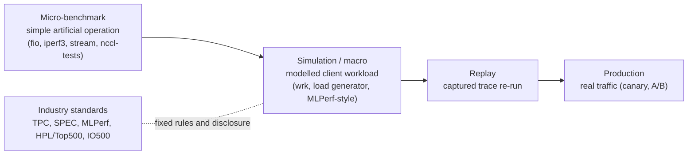

# 1.25 Benchmarking correctly

| | |
|---|---|
| Level | Advanced |
| Priority tier | 0 |
| Lab venue | Any Linux VM; a GPU VM and (ideally) a second node for the GPU, NCCL and network parts |
| Part | Part 1: Linux, from the command line to the kernel and performance |
| Status | Drafted, labs **untested** |

## Why this matters for AI infrastructure

An AI platform engineer is asked for numbers almost every week. Is this new node healthy? Did the driver upgrade slow training? Which instance type should we buy? Does this vendor's 400 Gb/s fabric really deliver? What tokens/s can one H100 serve at a 200 ms TTFT? What will 1,024 GPUs cost per run? Each answer is a benchmark.

Done well, benchmarks catch bad hardware before a customer job runs on it. They validate a cluster acceptance test, size capacity, justify a purchase, and gate regressions in CI. Done badly, they cost millions. You might buy the wrong instance family, accept a cluster with a flaky link, or chase a "regression" that was only thermal throttling. A vendor claim you repeat in a design review may also fail to survive contact with your workload.

Typical failures look like these:

- A storage benchmark reports 40 GB/s per node because it measured the page cache, not the NVMe devices.
- An `all_reduce` test shows 90% of line rate between two nodes on one switch, and everyone assumes the 1,024-GPU job will do the same.
- A single run on a freshly booted, cold GPU is compared with a heat-soaked run an hour later, and the gap is called a regression.
- An inference benchmark uses a closed-loop client at a fixed concurrency. It hides queueing and reports a latency your users never see.
- A marketing benchmark with a single, optimal prompt length becomes the input to capacity planning.
- A benchmark's own client is single-threaded and caps at 700 requests/s, while the server sits idle.

This chapter teaches how to benchmark correctly. It covers what a benchmark is for, the failure modes and fallacies, and the difference between micro, macro, replay and industry benchmarks. Next come the methodologies: active benchmarking, sanity checks, ramping load, statistical analysis and the checklist. You will also learn the questions to ask about any number you did not generate. Last, the **AI-infrastructure benchmark toolkit** walks through CPU, memory, storage, network, GPU, NCCL, training and inference, with the specific traps for each.

Until you have checked a number, treat it as a claim, not as a fact.

## Prerequisites and outcomes

Before you read on, make sure you know the methodology chapter (1.23), the observability chapter (1.24), and the CPU, memory, disk and network basics from earlier chapters. Details of GPU, NCCL and fabric benchmarking come later, in Parts 7 to 10.

When you finish this chapter, you can:

- State the legitimate reasons for benchmarking and the properties of a good benchmark. Explain "casual benchmarking", where you benchmark A, measure B and conclude C.
- Recognise and avoid the 16 classic failures in section 2. Some come from carelessness, such as casual benchmarking, blind faith, numbers without analysis, and ignoring errors. Others come from the setup, such as testing the wrong thing, ignoring the environment, and changing several factors at once. The rest are about the people involved, such as benchmarking the competition, misleading benchmarks, benchmark specials, and cheating.
- Choose between micro-benchmarks, simulations (macro), replay and industry-standard benchmarks, and explain the risks of each. Design a micro-benchmark matrix with sunny-day and rainy-day cases.
- Apply active benchmarking, which means watching the system with observability tools while the test runs. Profile both the benchmark and the target, apply the USE method, and characterise the workload. Ramp the load, check the result with bandwidth arithmetic, and analyse the numbers statistically.
- Use the six-question checklist (why not double? did it break limits? did it error? does it reproduce? does it matter? did it even happen?) and the longer vendor-result questions.
- Run correct benchmarks for CPU, memory, storage, network, GPU, NCCL, training and inference. Section 6 names the tools for each, and each tool has its own traps. Along the way you will control clocks, warm-up, steady state, thermals, caches, NUMA and variance.
- Write a reproducible benchmark report with environment metadata, raw data, distributions and stated limits.

## 1. Why benchmark, and what makes a good benchmark

You can run a benchmark for many reasons, and each reason sets a different bar for rigour. A purchase decision needs more care than a quick tuning experiment. The table lists the eight reasons, with an AI-infrastructure example for each.

| Reason | Example in AI infrastructure |
|---|---|
| System design / purchase | Compare GPU servers, NICs, parallel filesystems by *performance per cost* (price/performance; performance/price is easier to read because bigger is better) |
| Proof of concept | Run your real model on a vendor cluster before committing |
| Tuning | Find which BIOS/OS/NCCL settings are worth pursuing |
| Development / non-regression | Gate driver, kernel, library, or framework upgrades on performance in CI |
| Capacity planning | Establish tokens/s per GPU at an SLO; fabric limits |
| Troubleshooting | Confirm a link or GPU still achieves its known maximum |
| Acceptance / burn-in | Prove each new node meets spec before it enters the pool |
| Marketing ("benchmarketing") | Maximum numbers: treat others' as upper bounds only |

Notice the last row. Vendor numbers are maximums, so treat them as upper bounds only.

Cloud and rented GPUs make benchmarking cheap to run. A large environment can be created, tested and destroyed in a short time, and that is a reason to benchmark more, not less. The same cloud also adds hidden variance. Hosts differ, neighbours change, the silicon varies from one chip to the next, and thermal state shifts. So you need multiple instances and distributions, not one lucky or unlucky run.

A good benchmark is repeatable, so comparisons are valid. It is observable, so you can analyse it. It is portable across systems and releases, and it is easy to present. It is realistic, which means it reflects what users experience. It is also runnable, quick enough that developers actually use it. For purchases, add the five-year cost.

Effective benchmarking is also about analysis. You must understand what is tested, what limits the result, which perturbations exist, and what conclusions follow. That requires analysing the system *while* the benchmark runs. Do not hand a tool to juniors and call the experts afterwards to explain the numbers.

A famous example from 1981 already shows the active method. The test sent 4 MB between two machines. One machine was CPU-saturated, while the other sat 30% idle. The analysis then broke down where the kernel time went: Ethernet 20%, IP 10%, TCP 30%, checksumming 25%, and syscalls 15%. Today a flame graph gives the same kind of breakdown in seconds.

Before you trust a number, decide which reason you ran the test for. That reason sets how much rigour the result needs.

## 2. The failures (and the cures)

Most bad benchmark results come from one of sixteen familiar failures. The table names each failure, says what goes wrong, and gives the cure. Read it before you trust a number, because a result from any of these failures can end up in a purchase decision.

| # | Failure | What goes wrong | Cure |
|---|---|---|---|
| 1 | **Casual benchmarking** | "You benchmark A, but actually measure B, and conclude you've measured C." Disk tools that test the filesystem and page cache; GPU tools that test the launch rate | Verify what is measured with tracing and metrics (section 4) |
| 2 | **Blind faith** | Popular, open-source, vendor-recommended tools are assumed valid (argumentum ad populum). Many popular benchmarks are flawed | Study the benchmark; read its source; validate it with a known workload |
| 3 | **Numbers without analysis** | A bare number with no limiter identified. "If you've spent less than a week studying a benchmark result, it's probably wrong" | Always state the limit encountered and the analysis performed; if no time, list unchecked assumptions |
| 4 | **Complex tools** | Hard to analyse; benchmarking the benchmark (single-threaded client, interpreter overhead) | Prefer short, readable tools (C for micro-benchmarks; the same language as the client for client simulation) |
| 5 | **Testing the wrong thing** | Disk benchmark for a workload that runs from cache; optimising for a vendor's standard test that does not resemble yours; a stale benchmark | Workload characterisation (1.23); ask the audience to agree |
| 6 | **Ignoring the environment** | Default test server versus tuned production; different firmware, drivers, power profile, clocks | Match or document the environment; record versions |
| 7 | **Ignoring errors** | The tool reports a result but most operations failed (everything blocked by a firewall; latency = client timeout) | Check error counts and status codes |
| 8 | **Ignoring variance** | Steady average workload hides bursts (periodic write-back, checkpoint bursts) | Include bursts, distributions; Markov models for correlated ops |
| 9 | **Ignoring perturbations** | Backups, monitoring agents, interrupts, noisy neighbours, thermal drift, cron jobs | Run long enough (never under 1 s; minutes typical), repeat, check standard deviation, collect distributions |
| 10 | **Changing multiple factors** | Two hosts compared over different networks, instances on different hosts | Change one thing; test several instances and use the median/distribution |
| 11 | **Benchmark paradox** | Customers want a product to win all benchmarks: three 50% wins in a row is 12.5% | Understand how conclusions are made |
| 12 | **Benchmarking the competition** | Untuned competitor numbers; tuned yours | Spend equal effort tuning both, with expert help |
| 13 | **Friendly fire** | Mis-configured or undersold own product; not driven to its limit | Ask "what is the bottleneck?"; share results with engineers before publishing |
| 14 | **Misleading benchmarks** | Technically true but omitting cost, config, scale, caveats ("2x faster") | Read the fine print; use vendor results as upper bounds |
| 15 | **Benchmark specials** | Product engineered to score on a known benchmark but not for customers (TPC prohibits them) | Prefer your workload; check for special configuration and pricing |
| 16 | **Cheating** | Fake numbers (rare) | Reproduce key results |

Notice how many cures ask you to check something before you believe the number: the limiter, the errors, the variance, or the environment.

## 3. Benchmark types

Benchmarks sit on a spectrum, from one isolated operation to live traffic. The diagram shows that spectrum, with the industry standards alongside the simulation step.



Read the diagram from left to right. It runs from the simplest test to real traffic.

- **Micro-benchmarking** tests one operation, such as a syscall, one type of filesystem I/O, a CPU loop, a network transfer, a GPU kernel or a collective. It is simple, repeatable, quick to run on many systems, and quick to root-cause. The catch is that you must map its numbers to your real workload, because only one or two of its dimensions may matter. CPU tests use `sysbench` and `stress-ng`. Memory tests use `lmbench` and STREAM. Filesystem tests use `fio`. Disk tests use `hdparm`, `dd` with direct I/O, and `fio`. Network tests use `iperf3`. GPU tests use `nvbandwidth` and kernels. Collective tests use `nccl-tests`.
- **Simulation (macro-benchmarking)** applies a model of client behaviour, with request mixes derived from workload characterisation. Examples are HTTP load tools (`wrk`, `hey`, `siege`), database benchmark suites, MLPerf scenarios, and LLM serving load generators. A simulation can be stateless, with independent requests drawn from a distribution. Or it can be stateful, with sequences that depend on each other, as in Markov models. The risks are real. Variance gets ignored, real usage drifts over time, and people resist updating a benchmark that already has published history.
- **Replay** re-issues a captured trace. It sounds ideal, but captured clients do not respond to the new system's changed latency. The level of replay matters too. Replaying *disk* I/O from an old system on a new system with 16x the cache measures the wrong thing, and it could lose a sale. Replay at the level where the new system's behaviour is not baked in, such as application requests, and still analyse the results.
- **Industry-standard benchmarks** are collections of well-defined micro and macro tests, with rules, disclosure, and sometimes audits and pricing. TPC covers databases. SPEC covers CPU, cloud and storage. For AI, MLPerf covers Training, Inference, Storage and HPC. For HPC, HPL/Top500, HPCG and IO500 apply, and STREAM covers memory. They save time when one resembles your workload. Their metrics are custom, such as TPS, FLOPS, samples/s or time-to-train, and they compare only with themselves. MIPS and FLOPS are simple, but they depend on the instruction mix.

### Designing a micro-benchmark matrix

Think in dimensions. For a filesystem or storage test, the dimensions are access pattern (sequential or random), I/O size, direction, working-set size, thread or queue depth, and sync mode. A working set much smaller than RAM tests the cache and the software path. A much larger one tests the device. An example set covers sequential 512 B reads for maximum IOPS, sequential 1 MiB reads for maximum read throughput, sequential 1 MiB writes for write throughput, random 512 B reads for the effect of randomness, and random 512 B writes for the rewrite effect. Run each one at a small and a large working set, with one thread and with many.

The matrix grows fast, so use statistical design to cut it down. Change one factor at a time from a known maximum configuration (see chapter 1.23, factor analysis). Include sunny-day tests for peak, ideal conditions. Include cloudy/rainy-day tests as well, with contention, failures, bursts, degraded components and mixed loads, because production lives in the latter.

For each new micro-benchmark, decide first which dimensions matter for your workload, and test those before the rest.

## 4. Methodology

Methods differ in how much you learn from them. Passive benchmarking runs a tool and hands over the slides. Active benchmarking watches the system while the test runs. The table lists the methods, and it helps you choose one for each situation.

| Method | What | Notes |
|---|---|---|
| **Passive benchmarking** | Run the tool with various options, make slides, hand over (fire and forget) | Anti-method: results may be buggy, limited by the tool or by an unrelated component (congested network, single thread), mis-configured, perturbed, or irrelevant |
| **Active benchmarking** | Analyse the system with observability tools *while the benchmark runs*, to confirm what is tested and what limits it | The core method |
| **CPU profiling** | Profile benchmark and target (flame graphs) | Quick discoveries (e.g., 62% of samples in an I/O throttling function revealed an active resource control) |
| **USE method** | Find which resource is at 100%, or realise you are not driving the system to its limit | See 1.23 |
| **Workload characterisation** | Compare benchmark to production workload | Relevance |
| **Custom benchmarks** | Write your own short load generator when needed | Keep it simple; check the compiler did not elide the work; disassemble if needed; verify with external tools |
| **Ramping load** | Add load stepwise, plot throughput and latency until a limit | Reveals scalability profile; the result is the highest load with *acceptable* latency, not the highest throughput |
| **Sanity check** | Does any number exceed a physical limit? | E.g. 50,000 NFS IOPS of 8 KiB over 1 GbE needs 400,000 KB/s (3.2 Gbit/s) > 1 Gbit/s, so the client cache was measured |
| **Statistical analysis** | Collect large datasets, variances, distributions, error margins; analyse after the fact | Used when access to the system is scarce and expensive; collect everything (copy `/proc` counters before/after, `sar`, DCGM, `nsys`) |

Passive benchmarking is the anti-method. Its results may be buggy, limited by the tool or by an unrelated component such as a congested network or a single thread, mis-configured, perturbed, or irrelevant.

### Active benchmarking: a worked example

Here is the story of a well-known disk benchmark. Its man page says it will "test hard drive performance". Its first test, "sequential output, per character", scores about 739 KB/s. Before you believe that number, run a sanity check. If the test really did I/O one character at a time at that rate, the system would perform 739,000 I/Os per second. One drive cannot do that.

Now watch the system while the test runs. `iostat -sxz 1` shows *no disk I/O*. `bpftrace -e 'tracepoint:block:* { @[probe] = count(); }'` shows *no* block requests issued or completed, only dirtied buffers. `cachestat 1` shows hits and "dirties" in the page cache. `kprobe:vfs_*` counts about 1.18 million `vfs_write` calls. A histogram of the third argument to `vfs_write` shows that almost every write was **1 byte**.

The conclusion is that the first test measures 1-byte *buffered filesystem writes*, not the drive. The flag that should force synchronous writes (`-b`) did not call `fsync` after each write when checked with `strace`. Note that `strace` adds overhead, so its benchmark result under `strace` must be discarded. Direct I/O also failed on that system. The tool is not unusually bad. This kind of finding is common, which is exactly why blind faith fails. The lesson is the method. Run a sanity check, look for the resource you think is being exercised, trace the layer above it, and then measure the actual operation attributes.

### Ramping load and acceptable latency

Add clients, threads or QPS in increments, and hold each level long enough to be steady. Plot throughput and latency percentiles against load, and mark the **knee**. Report the highest load whose latency is acceptable to a customer. Going from 990,000 IOPS at 5 ms to 1,000,000+ IOPS at 50 ms is not an achievement. The right number to publish is 990,000. Then verify with the USE method that some resource really reached its limit, or you are measuring the generator. Always record **latency distributions**, not just means.

### The checklist

Put every result through six questions before you accept it. Each one catches a different way a result can mislead you.

1. **Why not double?** What is the limiter? Often it is not the thing you intended to test.
2. **Did it break limits?** Check the result against known maxima.
3. **Did it error?** Errors can be cheap or expensive in different ways from normal operations, and they skew results.
4. **Does it reproduce?** Repeat the run, look at the variation, and test other instances.
5. **Does it matter?** Is the workload relevant to production?
6. **Did it even happen?** Was the intended operation actually performed, rather than blocked, cached or optimised away?

### Questions to ask about a result you did not generate

When a result came from someone else, ask questions before you rely on it. Start with the general ones. Does it relate to my workload? What was the system configuration and cost? Was it one system or a cluster? What did the benchmark clients look like? How long did it run, and how many results came out? Was the number an average or a peak, and what is the average? What were the percentiles and the variance? What was the limiting factor? What was the success and failure ratio? Which operation attributes were used, and how were they chosen? Is it measuring variance or an average workload? Was it confirmed with other tools? What is the error margin? Can it be reproduced?

Then check the component details. For CPU and memory, ask whether the processors were overclocked or cooled specially. Ask about DIMM count and socket attachment, disabled CPUs, and system-wide utilisation, since lightly loaded chips turbo higher. Also ask about cores versus hyperthreads, memory type and size, and BIOS settings. For storage, ask about device types, counts, protocol and RAID, and the cache policy (write-back or write-through). Ask about the filesystem and its tuning, the working-set size and how much of it is cached where, and the number of files. For network, ask about interfaces, topology, protocols, socket options and tunables. For GPUs, add the model and SKU, power limit and clock settings, and interconnect topology (NVLink domain, PCIe generation). Ask about driver, CUDA and library versions, precision and sparsity assumptions, batch size and sequence length. Check whether the numbers are per GPU or aggregate, whether data loading is included, whether warm-up and steady state were respected, and what the cost was.

A number you cannot answer these questions about is a hypothesis, not a result.

## 5. A reproducible benchmarking procedure

Before you pick a tool, fix the procedure. Most bad AI benchmarks fail at the procedure, not at the tool.

1. **Question and success criterion.** Write down the question and what counts as a pass. For example, does node X deliver at least 95% of the fleet median on a reference step? Or can this fabric sustain at least 90% of line rate for a 1 GiB all-reduce across 16 nodes? Without a criterion, the result can never pass or fail.
2. **Record the environment** automatically. Capture the hardware: CPU model, microcode, BIOS version and settings, DIMMs, GPU model, SKU and VBIOS, NIC model and firmware, PCIe link width and speed, and topology. Capture the OS: kernel, boot parameters, sysctls, governor, and THP. Capture drivers and libraries: the NVIDIA driver, CUDA, cuDNN, NCCL, MOFED/DOCA, PyTorch or the framework, and the container image digest. Also capture the cluster settings, such as scheduler, cgroup limits, and CPU, memory and GPU binding. Finally, capture clocks, power limits, and the software versions of the benchmark tool. Keep a script that dumps all of it next to your results.
3. **Control the controllable.** Drain the node so no other work runs on it, and stop any services that interfere. When you compare hardware, fix the GPU clocks and persistence mode. Use `nvidia-smi -pm 1` for persistence mode, `-lgc` to lock graphics clocks, and `-pl` for power limits. The policies and permitted ranges vary by SKU, so the allowed values depend on the card. Set the CPU governor to performance. Pin processes with the topology in mind, covering NUMA and GPU-NIC affinity. Fix random seeds and datasets, and use the same container image digest every time.
4. **Warm up, then measure steady state.** The first iterations include one-time costs: CUDA context creation, cuDNN autotune, JIT compilation, cold caches, memory allocation, NCCL channel setup, and the power ramp. Discard them. Measure only after clocks and temperatures stabilise. For thermal comparisons, run long enough to **heat-soak**, which takes minutes to an hour, and record clocks, temperature and power over time.
5. **Run long enough, and repeat.** A single run is an anecdote. Use at least 5 to 10 repetitions where you can. Report the median and the spread: min and max, standard deviation or coefficient of variation, and percentiles. Randomise the order of A/B runs, so that drift from thermal state, time of day or neighbours does not favour one side. Test several instances or nodes too, since the "silicon lottery" and host differences are real.
6. **Observe while running.** This is active benchmarking. Collect `dmon` or DCGM output, `sar`, `mpstat`, `iostat`, `perf` or flame graph snapshots, network counters, and PSI during the run. Use them to verify the limiter. Heavy tracing adds overhead, so run the tracing in separate runs and keep the measured runs clean.
7. **Sanity-check and cross-check.** Compare each number with its theoretical limit, such as line rate, HBM bandwidth or PCIe. Treat vendor numbers as an upper bound. Then check the result against a second tool.
8. **Report** the number together with its limiter, variance, environment and caveats. Keep the raw data and scripts under version control, so that you or someone else can repeat the run.

A minimal result record holds one row per run. The row contains the date, node or ID, tool and version, command line, configuration hash, and duration. It also records whether warm-up was discarded, the primary metric, p50, p90 and p99 if latency matters, the error count, the limiter, notes, and links to the raw logs and the monitoring dashboard. Fill in one row for every run, so that you can check the record later.

## 6. The AI-infrastructure benchmark toolkit

Every tool in this toolkit gets the same four questions. What does it claim to measure? What does it actually measure? What limits it? What must you control? The sections below follow that pattern.

### 6.1 CPU

CPU tests look simple, but a tool can easily measure something other than the CPU you care about. The table lists the common tools, what each one is for, and its trap.

| Tool | Use | Traps |
|---|---|---|
| `sysbench cpu --threads=N run` | Simple integer prime workload; scaling with threads | Tiny, cache-resident, compiler-dependent; says little about real code |
| `stress-ng --cpu N --cpu-method matrixprod --metrics` | Load generator; many methods | A *load generator*, not a performance reference; check what method does |
| `perf stat` (IPC) | Efficiency of real code | PMCs may be unavailable in VMs |
| Linpack/HPL (CPU), SPEC CPU | HPC-grade compute | Heavy tuning; SPEC is licensed |
| `lscpu`, `turbostat` while running | Actual frequency, power, throttling | Benchmarks on lightly loaded chips turbo higher: record frequency |

Control the governor, the turbo or boost state, SMT on or off, NUMA placement (`numactl`), `isolcpus`, and the thermal state. Always compare per-thread results, which represent latency-sensitive launch code, and fully loaded results.

### 6.2 Memory

Use STREAM to measure sustainable bandwidth per socket. Set `OMP_NUM_THREADS`, make the array at least 4x the largest cache, build with `-O3`, and bind the threads. Use `mlc`, the Intel Memory Latency Checker, for loaded latency and cross-socket bandwidth. `lmbench` is another option. To compare local with remote memory, run NUMA-aware tests with `numactl --cpunodebind=N --membind=M`.

Several traps catch people here. An array that is too small measures the cache. Without thread pinning, threads migrate. Page faults on first touch cost time, so initialise the memory in the same threads that use it. THP effects change the results too. Finally, do not mistake the theoretical peak for what you can achieve. About 70 to 90% of peak is typical for STREAM.

### 6.3 Storage and filesystems (`fio`)

`fio` is the standard micro-benchmark for block devices and filesystems. Its common failures come from five places: caches, queue depth, the I/O engine, the test file size, and mixing devices with filesystems.

Each of these four commands aims at a different part of the storage path, so read the comment above each one first.

```bash
# Raw NVMe sequential read throughput (destructive for writes; use a scratch device; read tests are safe)
sudo fio --name=seqread --filename=/dev/nvme1n1 --rw=read --bs=1M --iodepth=32 --numjobs=4 \
  --ioengine=io_uring --direct=1 --time_based --runtime=60 --group_reporting --ramp_time=10
# Random 4 KiB read IOPS and latency percentiles
sudo fio --name=randread --filename=/dev/nvme1n1 --rw=randread --bs=4k --iodepth=64 --numjobs=8 \
  --ioengine=io_uring --direct=1 --time_based --runtime=60 --group_reporting --lat_percentiles=1 --percentile_list=50:90:99:99.9
# Filesystem test: working set >> RAM, direct I/O to bypass page cache, one file per job
fio --name=fs --directory=/scratch/fio --size=64G --rw=randrw --rwmixread=70 --bs=16k --iodepth=32 \
  --numjobs=8 --ioengine=io_uring --direct=1 --time_based --runtime=120 --group_reporting
# Checkpoint-like large sequential writes with fsync at the end
fio --name=ckpt --directory=/scratch/fio --size=32G --rw=write --bs=4M --numjobs=4 --ioengine=psync --end_fsync=1 --group_reporting
```

The raw-device commands write to a device, so run them only on a scratch device. The read tests are safe.

Follow nine rules when you run `fio`. Use `--direct=1` unless you are *deliberately* measuring the page cache. Compare the working-set size with RAM, because a 1 GiB file on a 512 GiB host measures memory. Vary `iodepth` and `numjobs`. An NVMe needs queue depth to reach its IOPS, and a single synchronous thread measures latency, not capacity.

Reach steady state next. SSDs show fresh-out-of-box bursts before they settle into garbage-collection steady state. Precondition the drive by filling it, and use `--ramp_time` and long runs. Report latency percentiles, not just IOPS or MB/s. Know that `clat` and `lat` differ, and understand which one you are reporting. Disable CPU power saving, pin the job to the NVMe's NUMA node, and check that `fio`'s own CPU is not the limiter, using `--cpus_allowed` and multiple jobs.

Rule 7 covers the stack. A RAID, LVM or filesystem layer changes everything, so benchmark each layer. Rule 8 covers `iostat` `%util`, which is a poor NVMe metric, so use IOPS and throughput with `await` and `aqu-sz`. Rule 9 covers thermal throttling, which shows up as a mid-run drop, so log with `--write_bw_log` or `--write_lat_log`.

GPU data paths need their own tests. Run GPUDirect Storage (`gdsio`) and host-memory staging. For dataloader performance, test the real pipeline, including decode, augmentation and shuffling. Storage benchmarks ignore CPU decode cost, so they will not show it.

Parallel and distributed filesystems, such as Lustre, GPFS, BeeGFS, WekaFS, VAST and NFS, need a different set of tools. Use `IOR` for bandwidth. Set the file layout with `-F` (file-per-process or shared file). Set `-t` for the transfer size and `-b` for the block size. Add `-C` for task reordering, which defeats the client cache, and `-e` for fsync. Use `-w` and `-r` for the write and read phases. Use `mdtest` for metadata rates, covering create, stat and remove. Use the IO500 suite as a reference. Run with the same number of nodes and processes per node as your real jobs.

Then compare the "easy" pattern, which is large sequential I/O with per-process files, with the "hard" pattern, which is small unaligned I/O to a shared file. Metadata-heavy workloads, with millions of small files, are the usual surprise. For client cache, use `IOR -C` or drop caches between the write and read phases. Check that a read-after-write across different nodes is not served from the writer's cache.

### 6.4 Network (TCP and RDMA)

Network tests need to cover both the TCP path and the RDMA path. The commands below handle each one. Start the server on the other node before you run the client, as the comments show.

```bash
# TCP throughput, 4 parallel streams, 30 s, with interval stats and server on node B (iperf3 -s)
iperf3 -c nodeB -P 4 -t 30 -i 5 --json > iperf.json
iperf3 -c nodeB -u -b 0 -l 1400 -t 30                  # UDP (loss/jitter reporting)
# RDMA: perftest suite (needs rdma-core, matching device and GID/RoCE settings)
ib_write_bw -d mlx5_0 -F --report_gbits -a            # on server;  client: ib_write_bw -d mlx5_0 -F --report_gbits -a nodeB
ib_write_lat -d mlx5_0 -F                             # half-roundtrip latency (small messages)
ib_send_bw, ib_read_bw, ib_atomic_bw                  # other verbs
qperf nodeB tcp_bw tcp_lat rc_rdma_write_bw          # quick TCP/RDMA checks
```

Several traps catch people here. For example, a single TCP stream rarely fills a link of 100 Gb/s or more, so use `-P`, tune the buffers, and pin the streams to cores local to the NIC. `iperf3` is single-threaded per process, so run multiple processes. Watch for MTU mismatches. Jumbo frames are 9000 on Ethernet fabrics, and the IB MTU is 4096. RoCE needs a lossless configuration with PFC and ECN, and you must validate it. `perftest` selects a device and port with `-d` and `-i`, and a GID index with `-x`. Keep NUMA locality between the NIC, the CPU and memory in mind.

An out-of-the-box PCIe link may be x8 or Gen3, so check `lspci -vv`. The reported line rate is not the same as goodput, because headers take a share. Be careful to compare averaged numbers with steady ones.

Check NIC counters, such as `ethtool -S` and `perfquery`, for errors and drops during the run. Test all node pairs and all links for acceptance. A single bad cable or transceiver is the most common cluster defect. To do this, run tools like `ib_write_bw` in a loop over the fabric. `ibdiagnet` and vendor fabric validators are other options, and the tools vary by vendor.

### 6.5 GPU

The GPU table covers six kinds of test. Each row names the tool and what it shows, so match the test to the question you are asking.

| Test | Tool | What it shows |
|---|---|---|
| Health and quick diagnostics | `dcgmi diag -r 1` (quick), `-r 2` (medium), `-r 3` (long: includes stress), `-r 4` (extended); flag: levels and plugins vary by DCGM version | Memory test, PCIe and NVLink bandwidth, SM stress, targeted stress/power, thermal behaviour, ECC; first-line acceptance |
| Host-device and device-device bandwidth | `nvbandwidth` (newer), `bandwidthTest` from CUDA samples, `p2pBandwidthLatencyTest` | PCIe link health and generation, NVLink peer bandwidth, NUMA effects (pinned vs pageable memory: pageable can be 2x to 3x slower) |
| Compute throughput | `gpu-burn`, `cublas`/`cutlass` profilers, `dcgmproftester`, HPL (GPU), vendor GEMM benchmarks | Sustained TFLOPS per precision, power and thermal throttling |
| Memory bandwidth | STREAM-like CUDA kernels, `nvbandwidth` D2D | HBM bandwidth versus spec (achievable is below peak) |
| Clocks, power, thermals during load | `nvidia-smi dmon`, `nvidia-smi -q -d PERFORMANCE,CLOCK,POWER,TEMPERATURE` (look at "Clocks Throttle Reasons") | Why a GPU is slow: power cap, thermal slowdown, sync boost, hardware slowdown |
| Realistic kernels and training steps | Framework microbenchmarks (`torch.utils.benchmark`), model step timing with proper synchronization | Closer to user value; see section 6.7 |

The GPU has its own traps, and each one can make a result look better or worse than it is.

- **Asynchrony.** CUDA kernels launch asynchronously. If you time the launch with a wall clock, you measure the launch, not the kernel. Time with CUDA events, or call `torch.cuda.synchronize()` before and after, or use `torch.utils.benchmark.Timer`.
- **Warm-up.** The first iterations include context creation, kernel module loading, cuBLAS and cuDNN heuristics and autotune, memory allocator growth, and JIT compilation. Exclude them. Several to dozens of iterations is typical.
- **Clocks and thermals.** Boost clocks move with temperature and power, and a hot GPU runs slower. For hardware comparisons, lock the clocks or report them, and run long enough to heat-soak. A "regression" after a driver upgrade that compares a cold card with a hot one is not a regression.
- **Precision and sparsity.** Peak numbers for TF32, BF16, FP16, FP8 and FP4 differ by large factors. Vendor peaks often assume sparsity or low precision. State the precision, the matrix sizes, and whether tensor cores were used.
- **Problem size.** Small matrices are launch-bound, so they do not show the GPU's speed. Make the sizes large enough to saturate the SMs, but keep them representative by using your model's shapes.
- **Data transfer inclusion.** State whether host-device copies and data loading are included in the time.
- **ECC, MIG, MPS, shared GPUs.** These all change results, so record each setting.
- **Multi-tenant noise.** Another job on the same node can share the NIC, the CPU and the memory bandwidth, and it can perturb your results. Use exclusive nodes.

### 6.6 Collectives: nccl-tests

`nccl-tests` measures collective communication across GPUs, covering all-reduce, all-gather, reduce-scatter, broadcast, all-to-all, and send/recv. Start with one node, then add nodes. The commands below show the single-node run, the Slurm run, and the MPI run.

```bash
# Single node, 8 GPUs, sweep message sizes from 8 B to 8 GiB, doubling
./build/all_reduce_perf -b 8 -e 8G -f 2 -g 8
# Multi-node under Slurm: 2 nodes x 8 GPUs (one process per GPU)
srun -N2 --ntasks-per-node=8 --gpus-per-node=8 ./build/all_reduce_perf -b 8 -e 8G -f 2 -g 1
# With MPI instead
mpirun -np 16 --map-by ppr:8:node ./build/all_reduce_perf -b 8 -e 8G -f 2 -g 1
# Useful environment: NCCL_DEBUG=INFO shows the chosen transport/topology; NCCL_ALGO, NCCL_PROTO, NCCL_IB_HCA, NCCL_SOCKET_IFNAME,
#   NCCL_NET_GDR_LEVEL, NCCL_P2P_LEVEL, NCCL_TOPO_DUMP_FILE for debugging
```

The output has these columns: size, count, type, redop, time (µs), `algbw`, `busbw`, the error count, and the out-of-place and in-place variants. `algbw` is the algorithm bandwidth, which is the size divided by the time. `busbw` is the bus bandwidth. It multiplies `algbw` by a factor that depends on the collective, so the result can be compared with the hardware peak. For all-reduce, the factor is 2(n−1)/n. The error count appears as `#wrong`, and it must be 0.

Interpret `busbw` against the hardware limit. Inside a node, the limit is NVLink. Between nodes, the limit is the InfiniBand or Ethernet line rate, per NIC, so note the GPU-per-NIC ratio. Small messages are latency-bound, and large ones are bandwidth-bound. Look for the knee, which is the size where `busbw` saturates, and for the steady plateau. Check how much the results vary between runs. Confirm that `NCCL_DEBUG=INFO` reports the network you intended, not a TCP socket fallback. Confirm that GPUDirect RDMA is in use, which shows as `NET/IB : GPU Direct RDMA Enabled`. Also check the number of channels.

Then test whether the result scales. Run 1 node, 2 nodes, 4 nodes, 8 nodes, and so on, and note where efficiency drops. That is often the leaf/spine boundary. A non-zero `#wrong` or a hang points to hardware or configuration faults. Use `-c 1` for data validation, `-w` for warm-up iterations, `-n` for the iteration count, and `-d` for the datatype. Also test all-to-all, which MoE models use, and all-gather and reduce-scatter, which FSDP and ZeRO use.

### 6.7 Training benchmarks

Training benchmarks should measure what users care about. That means throughput in tokens/s or samples/s, per GPU and in total. It also means the step time breakdown, MFU, scaling efficiency, time-to-train to a target quality in the MLPerf style, and cost per unit of work. Follow these rules.

- Use the real model, parallelism and data pipeline, or a close proxy such as the MLPerf reference or the NeMo or Megatron benchmark recipes. Synthetic data hides input-pipeline limits, and real data includes them, so report both.
- Synchronise properly and discard warm-up steps. Use enough steps, hundreds for example, to get stable statistics. Log per-step time to see jitter and stragglers.
- Control batch size, sequence length, precision, activation checkpointing, optimizer, parallelism strategy (DP/TP/PP/CP/EP), gradient accumulation, and overlap settings. Changing any one of them makes a different benchmark.
- For strong scaling, compare the same global batch. For weak scaling, scale the batch and state that you did. Compute MFU with a clearly stated FLOPs-per-token formula and the hardware peak, dense and matching the precision.
- Include the checkpoint cost, which is the periodic stall, in end-to-end runs. For long runs, include failure and restart behaviour, measured as goodput.
- Record cluster conditions, such as fabric load from other jobs and storage contention.
- For acceptance, run a standard reference workload on each node. The single-node step time should land within a few percent of the fleet median. On each switch group, check that multi-node scaling efficiency is above a threshold.

### 6.8 Inference benchmarks (LLM serving)

- **Metrics.** Track time to first token (TTFT), time per output token and inter-token latency (TPOT/ITL), end-to-end latency, throughput in output tokens/s per GPU and per dollar, requests/s, queue time, KV-cache utilisation, and batch occupancy. The key number is goodput under SLO. It is the maximum rate at which p95/p99 TTFT and TPOT still meet the targets.
- **Workload realism.** Use prompt-length and output-length distributions, not a single length. Include prefix sharing and cache hit rates, the concurrency pattern, streaming versus non-streaming, sampling parameters, quantisation, speculative decoding, and the tensor-parallel degree.
- **Open-loop versus closed-loop load.** A closed-loop client with N workers waits for each response before it sends the next request. When the server slows down, the client sends fewer requests, and that hides queueing. This under-reports latency, and it is the coordinated omission problem. An open-loop generator sends requests on a schedule, such as Poisson arrivals at a target rate, whatever the responses look like. That exposes queue growth, so use it for latency and SLO tests. Closed-loop is fine for peak throughput at a fixed concurrency, as long as you also report latency.
- **Ramp the load.** Sweep the rate, and plot latency percentiles against request rate and tokens/s. The operating point is the knee that meets the SLO. Queueing theory explains why. Do not run at 95% utilisation if you need low tail latency (chapter 1.23).
- **Tools.** Check the current names and flags first, since these tools change. `genai-perf` comes from NVIDIA and is being phased out in favour of AIPerf. Serving projects ship their own scripts, such as vLLM's `benchmark_serving`, or the TensorRT-LLM and Triton perf tooling. For simple HTTP, use `wrk` or `hey`. For scripted workloads, use `locust` or `k6`. `llmperf`-style harnesses also exist. Pin the client to its own hosts, so the load generator does not share the server GPUs or saturate its own CPU. Check that the client is not the bottleneck, and capture server metrics such as GPU utilisation, batch sizes and KV cache alongside the client results.
- **Warm-up and steady state.** Exclude model load, CUDA graph capture, and the initial fill. Run for minutes, and include a long tail test for memory growth and fragmentation.

### 6.9 Cluster acceptance and burn-in

A typical sequence for a new GPU cluster starts with an inventory and firmware audit, which covers static tuning checks. Next come per-node DCGM diagnostics at `-r 3` or `-r 4`, and GPU burn for hours with temperature and power logging. Then run memory tests with host `memtester` or vendor tools, and per-node disk and NIC checks. After that, run per-link RDMA bandwidth and latency tests across the fabric, and `nccl-tests` at 1, 2, 4 and more nodes, across switch tiers. Storage tests at scale come next, with `IOR` and `mdtest`. The sequence ends with an end-to-end reference training run and a soak with failure injection.

Automate the whole sequence. Store results per serial number. Define pass and fail thresholds from the vendor spec and the fleet median, and track outliers over time. Re-run a short version after maintenance and as periodic health checks. Many sites run lightweight checks as Slurm prolog or epilog scripts, or as node-health scripts.

### 6.10 Industry benchmarks to know

| Benchmark | Domain | Notes |
|---|---|---|
| **MLPerf Training / Inference / Storage / HPC** (MLCommons) | AI | Fixed models, datasets, quality targets, rules and disclosure; results per submitter; time-to-train (training), latency/throughput scenarios (inference) |
| **HPL / Top500, HPL-MxP, HPCG, Green500** | HPC | Dense linear algebra, mixed-precision, memory-bound, efficiency |
| **IO500** | HPC storage | Bandwidth and metadata, easy and hard patterns |
| **STREAM, SPEC CPU, SPEC Cloud** | CPU/memory/cloud | Licensed (SPEC) or free (STREAM) |
| **TPC family** | Databases | TPC-C, TPC-H, TPC-DS, TPCx-HS etc. |

Industry results are vendor-tuned. They often use the best configuration, special pricing or special hardware. Use them as **upper bounds** and as a shared vocabulary, and run your own tests.

## 7. Statistics, sanity checks and reporting

### Sanity-check arithmetic you should do instantly

Before you repeat a number, run these checks in your head. Each row shows the arithmetic and the verdict.

| Claim | Arithmetic | Verdict |
|---|---|---|
| 50,000 NFS IOPS of 8 KiB over one 1 GbE link | 50,000 × 8 KiB = 400,000 KB/s ≈ 3.2 Gbit/s > 1 Gbit/s | Impossible: client cache measured |
| "350 MB/s" single-direction over 1 GbE | 350 × 8 = 2.8 Gbit/s | Bogus; about 119 MB/s is the real ceiling |
| 400 Gb/s NIC delivers "55 GB/s" per direction | 400 Gb/s = 50 GB/s raw, minus headers | Above line rate; check units (Gbit vs GByte, bidirectional sum) |
| PCIe Gen4 x16 host-to-device "40 GB/s" | Gen4 x16 theoretical ≈ 31.5 GB/s per direction (about 26 to 28 GB/s achievable) | Exceeds the link: check topology/units |
| All-reduce bus bandwidth of 900 GB/s across two nodes with one 400 Gb/s NIC each | Inter-node limit ≈ 50 GB/s per NIC | Impossible between nodes (this would be intra-node NVLink) |
| 80 GB/s per GPU HBM "achieved" on a GPU with 3 TB/s HBM | 2.7% of peak | Probably a launch-bound or tiny test; or measured wrong |
| 1M tokens/s on one GPU for a 70B model | Memory-bound decode: each token reads the weights (70 GB at FP8); at 3 TB/s that is ≈ 40 token-batches/s: batching must provide ≈ 25,000 sequences | Implausible without a stated batch size and a smaller model |

Always do the arithmetic with units. Check bits against bytes, GiB against GB, one direction against both directions, and per GPU against the aggregate. Also check whether protocol overhead is included. If a number exceeds a physical limit, find out why before you use it.

### Statistics for benchmark data

- Report the median and the spread, not a single run. Keep every raw sample. For latency, report percentiles and the full histogram, never only the mean. Look for bimodal distributions, such as cache hits and misses, two code paths, or fast and slow ranks. In those cases, the mean describes nothing.
- Confidence matters when you compare A and B. The difference should exceed the run-to-run variation, so use enough repetitions to estimate that variation. Bootstrap confidence intervals or a t-test can help when they fit. For many metrics, non-parametric methods such as Mann-Whitney are safer. A 3% difference with 5% noise is not a result.
- Outliers matter for tails. A slow disk I/O of 1,000 ms among 1 ms ones is one example. Do not discard outliers silently. Find the cause.
- Order effects and drift are real. Interleave A/B runs, include a cold start, and log temperature and clocks.
- When you run in the cloud or across a fleet, sample several nodes. Summarise the distribution of node results with the median, p5 and p95.
- For regression gates, compare against a rolling baseline. Set the threshold from the observed variance. For example, fail if the median of 5 runs is below baseline median minus 3 × MAD. Avoid gating on single runs.
- Do not over-analyse tiny datasets. Collect more data instead.

### Writing the report

A good report answers the questions below. What was the question? What was measured, and how was it verified? On which systems, with what full environment? What were the results, shown as tables of median and spread and graphs of scalability and latency? What limited the result, with evidence from profiles, counters or screenshots? What was not tested or assumed? That list is the to-do list from the "numbers without analysis" failure. How can someone reproduce it, with commands, versions and data? Include the vendor-style disclosure, such as the configuration and cost, so that someone else can judge relevance.

End every report with the decision it supports, so the reader knows what the numbers are for.

## 8. Worked examples

**A. Storage "40 GB/s" per node.** Picture an engineer who runs `fio --rw=read --bs=1M --size=2G --numjobs=8` on a node with 1 TiB RAM. The tool reports 40 GB/s from "the NVMe array". Before you believe that, look at what the node is doing. `iostat -x 1` shows near-zero device reads. `cachestat` shows a hit ratio of about 100%, and `free` shows the files sitting in page cache. The test measured memory, not the drives. When you see a number like this, check the cache before you check the drives. The cache is the first suspect, because it sits between the test and the hardware.

Run it again with `--direct=1`, on files larger than RAM (or with `drop_caches` for read tests), over a long run. Ramp `iodepth` and `numjobs` as well. Now the array delivers 24 GB/s sequential and 3.4 M random 4 KiB IOPS at p99 220 µs. `nvme smart-log` shows no errors. One device reaches 85 °C and throttles after 4 minutes, which you can see in `--write_bw_log`.

**B. All-reduce across two nodes.** `all_reduce_perf` reports 22 GB/s busbw at 1 GiB across 2 × 8 GPUs, with one 400 Gb/s NIC per GPU. The NIC-limited plateau should be about 45 GB/s per NIC, so 22 GB/s is well below it. Start the analysis with `NCCL_DEBUG=INFO`. It shows `NET/Socket` instead of `NET/IB`, which means NCCL fell back to TCP because the IB HCA name was wrong (`NCCL_IB_HCA`). After you fix the name, busbw rises to 46 GB/s. `ibstat` shows all ports at 400 Gb/s, and the port counters show no errors. A second test pair reaches only 31 GB/s. One cable shows symbol errors, and the link retrained at a lower speed. Asking "why not double?" and running the sanity check found both a config error and a bad link.

**C. "Driver 560 is 6% slower".** A canary node on the new driver trains 6% slower than a fleet node. The canary's GPUs run at 1,410 MHz, against 1,740 MHz on the fleet node. The throttle reasons show "SW thermal slowdown". The canary sits in a hot rack position with a failing fan. Move the job to a node with normal thermals, and the regression disappears. If you want a fair test, lock the clocks and compare within the same chassis. Add thermal logging to the benchmark harness so that you can see this kind of drift as it happens.

**D. Inference capacity.** A closed-loop benchmark at concurrency 256 shows 4,200 output tokens/s/GPU and a p99 TTFT of 1.1 s, which looked fine. Production p99 TTFT is 6 s at 60% of that load. The benchmark used one prompt length, 256 tokens, with zero prefix sharing. Production prompts average 3,000 tokens, which is about 12 times longer. Arrivals in production are bursty too, and a fixed-rate benchmark does not reproduce that. Re-run the test open-loop, using production's measured length distributions and Poisson arrivals. The SLO-compliant throughput is 1,350 tokens/s/GPU, about a third of the original 4,200. This time, capacity planning used the right number.

**E. Single-threaded generator.** A load test of the metadata service plateaus at 700 req/s, whatever the server size. When you look at `top`, the generator sits at 100% of one core. The benchmark was limiting itself. Parallelising the generator across hosts revealed the real limit, 3,500 req/s. It also exposed a CPU regression of 50% per request in the new build. The lesson is that a generator can hide the real limit just as a cache can.

In each case, ask what limited the number before you accept it, the way these cases did. A number with no stated limiter is only a guess.

## 9. Hands-on lab: benchmark carefully

Start with the self-checking Python lab. It runs on your own machine and checks four calculations from this chapter. The first is the bandwidth sanity check, where 50,000 NFS IOPS of 8 KiB each need 3.28 Gbit/s, more than a 1 GbE link can carry. The second is the `nccl-tests` conversion from `algbw` to `busbw`, which is `algbw * 2(n-1)/n`. The third is the benchmark paradox, where three 50 percent wins in a row happen only 12.5 percent of the time. The fourth is the non-regression gate based on `median - 3 * MAD`. The lab also checks the six-question checklist. Run it like this.

```bash
python3 code/part01/benchmarking_correctly_lab.py
```

The steps after that need a disposable Linux VM with an attached scratch disk. Steps 7 to 13 also need a GPU VM or a pair of nodes. Every interactive VM command below is `untested here`, so run them only on machines you can afford to rebuild.

1. Write `env_dump.sh` to record the environment. It should capture `uname -a`, `lscpu`, `numactl -H`, the `lspci -vv` link status, `sysctl -a`, `cat /proc/cmdline`, the governors, `nvidia-smi -q`, `ethtool -i`, and the package versions. Run it before every benchmark.
2. Create a 2 GiB file and run a `fio` sequential read without `--direct=1`. Then run it with `--direct=1`. Then run it on a file larger than RAM, or after `echo 3 > /proc/sys/vm/drop_caches`. Compare the three results with `iostat`, `cachestat` and `biolatency`, and note how the page cache changes each one.
3. Run the five-test `fio` matrix: sequential 512 B read, sequential 1 MiB read and write, and random 512 B read and write. Use small and large working sets, with one job and with many. Plot throughput and latency percentiles. Identify the saturation point and the limiter, which may be the device, the CPU or the queue depth.
4. Test steady state on an SSD. Write the whole device once, then run random writes for 30 minutes. Plot the performance curve, and watch for the fresh-out-of-box burst and the steady state that follows it.
5. Benchmark the benchmark. Run `fio` with one job on a fast device, and show that the tool is CPU-bound using `top` and `perf`. Then fix it by adding jobs.
6. Build STREAM and test NUMA. Run it with pinning, with `numactl --membind` pointing at remote memory, and with THP on and off. Relate the results to chapter 1.17.
7. Test the network. Run `iperf3` with 1 stream, then with 8. Add `tc qdisc add dev ... netem delay 10ms loss 0.1%` and observe the TCP effect. If you have RDMA hardware, run `ib_write_bw` and `ib_write_lat`. Verify the results with the NIC counters, and do the 400 Gb/s arithmetic sanity check by hand.
8. Measure the GPU basics. Measure H2D bandwidth for pageable and pinned memory with `nvbandwidth` or `bandwidthTest`. Compare the result with the PCIe link speed from `lspci -vv`.
9. Check timing correctness in PyTorch. Time a large matmul four ways: (a) naively, without synchronisation, (b) with `torch.cuda.synchronize()`, (c) with CUDA events, and (d) including warm-up. Show the first-call overhead and the differences between the methods. Then compute the achieved TFLOPS and compare it with the peak for the dtype.
10. Watch thermals and clocks. Run a sustained GEMM loop for 20 minutes while logging `nvidia-smi --query-gpu=timestamp,clocks.sm,clocks.mem,temperature.gpu,power.draw,clocks_throttle_reasons.active --format=csv -l 5`. Plot clocks against time. Then repeat the run with locked clocks using `nvidia-smi -lgc`, if your policy permits it.
11. Run DCGM diagnostics. Run `dcgmi diag -r 2`, and with permission, `-r 3`. Record the results, and compare the nodes.
12. Build `nccl-tests` and run all-reduce on 1, 2, 4 and 8 GPUs. If you have them, run 2 nodes as well. Sweep the sizes, and plot `algbw` and `busbw`. Check the transports with `NCCL_DEBUG=INFO`. Then break something on purpose, such as a wrong `NCCL_IB_HCA` or forcing `NCCL_IB_DISABLE=1`, and observe the effect. Write up your own "why not double?" explanation.
13. If a serving stack is available, test inference. Run a closed-loop test at fixed concurrency, and an open-loop rate sweep with realistic prompt-length distributions. Plot p50, p95 and p99 TTFT and TPOT against the rate. Find the SLO knee, and explain the difference between the two methods.
14. Test the statistics. Run each of two configurations 10 times, interleaved. Compute the median, the MAD, and a bootstrap confidence interval for the difference. Then decide whether the difference is real.
15. Write a one-page benchmark report, using the template in section 7, for one of the experiments above.

If time is short, do steps 1 and 2 first. They show whether your environment record and your first `fio` numbers can be trusted.

## 10. Common mistakes

Watch for these mistakes in your own work and in the results you review.

- Treating a benchmark number as a fact instead of a hypothesis to verify.
- Measuring caches, buffers or the client instead of the target. This happens when you ignore `--direct` and the working-set size.
- Basing conclusions on one run, one node or one time of day, or comparing cold and hot runs.
- Quoting peak or vendor numbers without precision, sparsity, batch size, scale and cost context.
- Skipping warm-up, skipping synchronisation in GPU timing, or mixing aggregate and per-GPU numbers.
- Using closed-loop load generators for latency claims, or a single prompt length for LLM serving.
- Comparing across different clocks, firmware, drivers or thermal states without recording them.
- Ignoring errors such as `#wrong`, HTTP 5xx, or timeouts in the output.
- Forgetting to check whether the generator or the network between client and server is the limiter.
- Optimising for the benchmark (a "special") instead of the workload.

Check your own run against each item before you share the result.

## 11. Interview angles

These are the questions to be ready for when benchmarking comes up in an interview. Each one draws on a different part of this chapter.

- "How do you know a benchmark number is trustworthy?" Think about active benchmarking, the sanity check, and the six-question checklist.
- "Walk through benchmarking an NVMe scratch array for dataset reads." Think about direct I/O, working set, queue depth, steady state, latency percentiles, and thermals.
- "How do you validate a new 64-node GPU cluster before handing it to users?" Think about the acceptance sequence, per-node and per-link tests, `nccl-tests` at scale, and a reference training run.
- "Why can an `all_reduce` test look fine but the training job still scales poorly?" Think about message sizes, overlap, topology, stragglers, data loading, and scaling beyond a switch tier.
- "A vendor claims 3x speed-up; what do you ask?" Use the benchmark questions from section 4.
- "How would you benchmark an LLM serving stack and choose capacity?" Think about open-loop load, length distributions, the SLO knee, and queueing.
- "What is coordinated omission?"
- "How do you detect a regression in CI given noisy GPUs?"

The answers come from the checklist, the sanity-check arithmetic and the acceptance sequence, so review those sections first.

## Exercises

Work through these exercises once you have read the chapter. They reuse the worked examples in section 8 and the code in `code/part01/benchmarking_correctly.py`, so keep both open. Each exercise has one situation and a short question.

1. A well-known disk tool reports 739 KB/s for its "sequential per-character output" test. Explain why that number cannot come from a real disk, using the arithmetic in section 4. Then say which of `iostat`, `bpftrace`, and `cachestat` showed that the test never touched the disk.
2. Define casual benchmarking, blind faith, benchmark specials, and the benchmark paradox. For the paradox, call `compute_benchmark_paradox_win_prob(0.5, 3)` and read the result.
3. State the six checklist questions. They live in `SIX_CHECKLIST_QUESTIONS`.
4. A vendor claims 50,000 NFS IOPS of 8 KiB each over a 1 GbE link. Run `check_iops_link_sanity()` on the claim. What does it tell you?
5. Decide whether each claim is physically possible. The first is 350 MB/s over 1 GbE. The second is 55 GB/s in one direction over 400 Gb/s Ethernet. The third is 40 GB/s in one direction over PCIe Gen4 x16.
6. A `fio` run with `--rw=read --bs=1M --size=2G --numjobs=8` on a host with 1 TiB of RAM reports 40 GB/s. Why? Use Worked Example A to explain.
7. Write corrected `fio` flags for true NVMe performance. Include `--direct=1`, `--size=64G`, `--iodepth=32`, `--ramp_time=10`, and `--lat_percentiles=1`. Then explain how `IOR -C` stops client page-cache hits on a multi-node parallel filesystem.
8. In Worked Example C, a canary node looks 6 percent slower after a driver upgrade, at 1,410 MHz against 1,740 MHz. Explain why. Then name the four controls that a valid GPU micro-benchmark needs: synchronization or CUDA events, a discarded warm-up, locked clocks, and a stated dtype and sparsity.
9. A 1 GB AllReduce finishes in 10 ms across 8 GPUs. Use `compute_nccl_allreduce_busbw()` to find `algbw`, the scaling factor `2(n - 1)/n`, and `busbw`. Check your answer against the formula in section 6.6.
10. In Worked Example B, the two-node run plateaus at 22 GB/s instead of 46 GB/s. Explain how `NCCL_DEBUG=INFO`, `ibstat`, and `perfquery` found the TCP fallback and the degraded cable.
11. Contrast a closed-loop benchmark at fixed concurrency with an open-loop benchmark with Poisson arrivals, and explain coordinated omission. Then explain why capacity in Worked Example D fell from 4,200 to 1,350 tokens per second per GPU once the prompts averaged 3,000 tokens.
12. Use `evaluate_median_mad_regression_gate()` with the baseline `[100.0, 101.0, 99.0, 100.5, 99.5]`. Which of the candidates `[98.8, 99.2, 100.1, 99.0, 99.4]` and `[92.0, 91.5, 93.0, 92.2, 91.8]` passes, and which fails?

---

## Checkpoint questions (20)

<details>
<summary>1. What are the eight legitimate reasons to benchmark, and what six qualities define a good benchmark?</summary>

The eight reasons are system design or purchase (`performance/price`), proof of concept, tuning, development non-regression testing, capacity planning, troubleshooting, cluster acceptance and burn-in, and marketing upper bounds. A good benchmark is **repeatable**, **observable**, **portable**, **easily presented**, **realistic**, and **runnable**.
</details>

<details>
<summary>2. What is "casual benchmarking", and why does Gregg warn against "numbers without analysis"?</summary>

**Casual benchmarking** means you benchmark A, actually measure B, and then conclude you measured C. For example, you might run a disk tool, measure the RAM page cache, and conclude the NVMe array is fast. Gregg warns against numbers without analysis because a number with no identified bottleneck, and no active observability check, is almost always misleading. If you do not have time for a full analysis, list every unverified assumption next to the number.
</details>

<details>
<summary>3. Explain "benchmarking the benchmark", "friendly fire", "benchmark specials", and the "benchmark paradox".</summary>

**Benchmarking the benchmark** happens when the load generator itself caps the result. A single-threaded client that saturates 1 CPU core at `700 req/s` limits the test, while the target server sits idle. **Friendly fire** means publishing an under-configured result for your own system, because you did not check what limited it. **Benchmark specials** are features engineered only to inflate a known benchmark, with no help for real workloads. The **benchmark paradox** says that a product with a 50% chance of winning one benchmark has a chance of only `0.5^3 = 12.5%` of winning three independent benchmarks in a row.
</details>

<details>
<summary>4. Compare Micro-benchmarks, Macro-benchmarks (Simulations), Trace Replay, and Industry-Standard Benchmarks.</summary>

**Micro-benchmarks** such as `fio`, `iperf3`, STREAM and `nccl-tests` test one isolated operation. They are fast to run and quick to root-cause, but you must map them carefully onto real workloads. **Simulations**, or macro-benchmarks, such as `wrk`, `genai-perf` and MLPerf scenarios, model realistic client mixes. **Replay** re-runs captured traces. It fails when you replay at the wrong layer, such as replaying old disk I/O onto a host with 16x more RAM cache, or when client pacing ignores new server latency. **Industry standards**, such as MLPerf, Top500/HPL, IO500, TPC and SPEC, enforce strict disclosure rules and provide comparable upper bounds.
</details>

<details>
<summary>5. What is Active Benchmarking, and how did it expose the Bonnie++ `739 KB/s` "per-character disk" result?</summary>

**Active benchmarking** means running observability tools, such as `iostat`, `mpstat`, `perf`, `bpftrace` and `dmon`, while the benchmark runs. That confirms what is actually exercised and what limits it. In the Bonnie++ case, the `739 KB/s` result looked like a fast disk test. But `iostat` and `tracepoint:block:*` showed zero disk requests. `cachestat` and `kprobe:vfs_write` showed `1.18 million` writes of 1 byte each. The test was measuring 1-byte C library and VFS buffered writes into the page cache.
</details>

<details>
<summary>6. How does Ramping Load work, and why is `990,000 IOPS at 5 ms` the right capacity number rather than `1,000,000+ IOPS at 50 ms`?</summary>

Ramping load steps the concurrency or arrival rate upward and holds each step until it is steady. You then plot throughput and latency percentiles (`p50`, `p99`) against load. Past the saturation knee, a 1% push in throughput, from `990k` to `1,000k` IOPS, can make queueing latency jump tenfold, from `5 ms` to `50 ms`. The usable capacity is therefore the highest throughput that still meets your latency SLO.
</details>

<details>
<summary>7. State the Six-Question Benchmarking Checklist.</summary>

(1) **Why not double?** What resource or limit kept the score from being twice as high? (2) **Did it break limits?** Does the bandwidth arithmetic violate a wire or bus speed? (3) **Did it error?** Were failed or timed-out requests counted as fast successes? (4) **Does it reproduce?** What is the spread across repeats and across other nodes? (5) **Does it matter?** Does the tested operation reflect production? (6) **Did it even happen?** Was the work cached, blocked, or optimized away by the compiler?
</details>

<details>
<summary>8. Perform the sanity-check arithmetic for `50,000` NFS IOPS of `8 KiB` over `1 GbE`, and for `55 GB/s` unidirectional on a `400 Gb/s` NIC.</summary>

`50,000 IOPS * 8 KiB = 400,000 KiB/s ≈ 409.6 MB/s = 3.28 Gbit/s`. That is more than `3x` the `1.0 Gbit/s` physical link ceiling (`~119 MB/s`), so the reads came from the client's local RAM cache. A `400 Gb/s` NIC has a raw unidirectional wire rate of `400 / 8 = 50 GB/s` before headers. A claim of `55 GB/s` per direction is therefore physically impossible. It is probably a bidirectional sum or a GiB/GB unit error.
</details>

<details>
<summary>9. List the six rules for running an honest `fio` storage benchmark on NVMe SSDs.</summary>

The six rules are: (1) pass `--direct=1` (`O_DIRECT`) to bypass the host RAM page cache; (2) size the working set larger than host RAM, such as `--size=64G`, when you test through a filesystem; (3) test both `iodepth=1`, for unloaded latency, and a high `iodepth` x `numjobs`, for peak parallel IOPS and bandwidth; (4) precondition the SSD past its fresh-out-of-box SLC burst into garbage-collection steady state, using `--ramp_time`; (5) report `p50`, `p90`, `p99` and `p99.9` completion latencies with `--lat_percentiles=1`; and (6) log bandwidth over time with `--write_bw_log` to catch thermal throttling, for example at `85 °C`.
</details>

<details>
<summary>10. How do you benchmark a parallel filesystem (Lustre, BeeGFS, Weka, GPFS) at cluster scale using `IOR` and `mdtest`?</summary>

Use **`IOR`** with MPI across multiple nodes to test sequential and random bulk read and write bandwidth. Set the file layout with `-F`, which chooses file-per-process or a single shared file, and add `-e` for fsync. Use **`-C` reorderTasks** so that rank N+1 reads back data that rank N wrote on a *different* node. That defeats local client page-cache hits. Pair the run with **`mdtest`** and the **IO500** suite to measure create, stat and delete rates across millions of small files.
</details>

<details>
<summary>11. What are the common pitfalls when benchmarking `100–400 Gb/s` TCP (`iperf3`) and RDMA (`perftest` `ib_write_bw` / `ib_write_lat`)?</summary>

`iperf3` runs single-threaded per process, so one stream rarely fills a `100–400 Gb/s` link. Use several parallel streams, such as `-P 4..8`, or several pinned processes. Verify the jumbo MTU, which is `9000` on Ethernet and `4096` on IB, and bind the processes to the NIC's local NUMA node. For `ib_write_bw` and `ib_write_lat`, name the exact RDMA device with `-d mlx5_0`, set the GID index with `-x` for RoCEv2, and use `--report_gbits`. Check `lspci -vv` for the PCIe link width and speed. Then verify zero symbol or CRC errors, and no PFC pause storms, in `ethtool -S` or `perfquery`.
</details>

<details>
<summary>12. Why does timing a CUDA kernel or PyTorch op with `time.time()` without synchronization produce bogus microsecond results, and what is the right method?</summary>

CUDA kernel launches are **asynchronous**. The CPU queues the command to the GPU stream and returns in a few microseconds, before the GPU has finished the kernel. So a wall-clock reading around the launch is bogus. Synchronise before you start the timer and before you stop it, with `torch.cuda.synchronize()`. Or measure the elapsed time on the GPU stream with `torch.cuda.Event(enable_timing=True)` or `torch.utils.benchmark.Timer`, after you discard the warm-up iterations.
</details>

<details>
<summary>13. Why must GPU benchmarks control warm-up, clock locking (`nvidia-smi -lgc`), and thermal state (heat-soaking)?</summary>

Early iterations pay one-time costs, such as CUDA context creation, JIT compilation, `cuBLAS` and `cuDNN` autotuning, and caching allocator `cudaMalloc` calls. GPU boost clocks also drop as the die or HBM temperature rises, or when power reaches TDP, and that shows up in `clocks_throttle_reasons.active`. Comparing a cold GPU at `1,740 MHz` with a heat-soaked one at `1,410 MHz` creates a fake `6%–15%` regression. Lock the clocks with `nvidia-smi -pm 1` and `nvidia-smi -lgc`, or heat-soak both runs and log clocks and temperatures throughout.
</details>

<details>
<summary>14. In `nccl-tests` (`all_reduce_perf`), what is the difference between `algbw` and `busbw`, and what is the AllReduce conversion formula?</summary>

**`algbw`** (*algorithm bandwidth*) is the data size in bytes divided by the time in seconds. **`busbw`** (*bus bandwidth*) multiplies `algbw` by the collective's communication volume factor. That lets you compare the result directly with the physical link bandwidth, whether NVLink or the InfiniBand or RoCE line rate. For an AllReduce across `n` ranks, `busbw = algbw * 2(n - 1) / n`. For `n = 8`, that means `busbw = 1.75 * algbw`.
</details>

<details>
<summary>15. During a 2-node `all_reduce_perf` run on `400 Gb/s` NICs, `busbw` is only `22 GB/s` (or `31 GB/s`) instead of `~46 GB/s`. What do you check?</summary>

Check the `NET/` line that appears with `NCCL_DEBUG=INFO`. If it says `NET/Socket` rather than `NET/IB ... GPU Direct RDMA Enabled`, NCCL fell back to kernel TCP sockets. Then fix `NCCL_IB_HCA`, `nvidia_peermem`, or the ACS settings. If `NET/IB` is active but one node pair gets `31 GB/s`, check `ibstat`, `perfquery`, and `lspci -vv` on each rank. Look for a degraded link speed, a PCIe width downtrain, or a cable with high symbol errors.
</details>

<details>
<summary>16. What is the difference between Closed-Loop and Open-Loop load generation in LLM inference benchmarking, and what is Coordinated Omission?</summary>

In a **closed-loop** benchmark, a fixed number of client workers each wait for a response before they send the next request. When the server stalls or queues, the clients slow their sending rate, which hides the queueing delay. This is **coordinated omission**. An **open-loop** benchmark, such as `genai-perf` or `benchmark_serving` with `--request-rate`, sends requests on an independent arrival schedule, such as Poisson, whatever the server does. It shows queue growth and the real `p99` TTFT and TPOT.
</details>

<details>
<summary>17. Why is benchmarking an LLM inference server with a single fixed prompt length (`256` tokens) dangerous for capacity planning?</summary>

Prefill compute scales quadratically with prompt length, or linearly with long-context attention. KV-cache memory occupancy scales with `prompt_len + output_len` times the concurrency. A fixed 256-token prompt hides prefill head-of-line blocking, KV-cache preemption and eviction, and batch-scheduler stalls. Those stalls show up under production prompt-length distributions, for example a mean of `3,000` tokens with a long tail.
</details>

<details>
<summary>18. Outline the 9-stage cluster acceptance and burn-in test sequence for a newly delivered 64-node GPU cluster.</summary>

The nine stages are: (1) a static hardware, firmware, BIOS, PCIe link and MTU audit with `env_dump.sh`; (2) per-node `dcgmi diag -r 3` or `-r 4`; (3) multi-hour GPU and CPU thermal and power burn-in with `gpu-burn` and `stress-ng`, logging throttle reasons and ECC and Xid errors; (4) a host DRAM test; (5) a local NVMe `fio` check; (6) an all-pairs and all-links RDMA sweep with `ib_write_bw` and `ib_write_lat`; (7) `nccl-tests`, using `all_reduce_perf` and `alltoall_perf`, at `1, 2, 4, 8, ..., 64` nodes across leaf and spine tiers; (8) parallel storage tests with `IOR` and `mdtest` at full node count; and (9) an end-to-end reference training job with failure and checkpoint recovery.
</details>

<details>
<summary>19. How do you design a non-regression performance gate in CI so noisy hardware variance does not cause constant false alarms?</summary>

Fix the clocks, seeds and datasets, and discard warm-up steps. Run `5` to `10` interleaved repetitions of the baseline and the candidate on the same isolated node. Then gate on a robust, non-parametric statistic, such as `candidate_median >= baseline_median - 3 * MAD`, where MAD is the Median Absolute Deviation. A bootstrap confidence interval also works. Do not gate on a single run.
</details>

<details>
<summary>20. What eight items must be included in every reproducible benchmark report?</summary>

Every reproducible report needs these eight items. (1) The exact question and pass/fail criterion. (2) What was measured, and how active benchmarking verified it. (3) Full hardware, OS, driver and library environment metadata, captured with `env_dump.sh`. (4) Tables of median and spread, using `MAD` or SD and `p50`, `p90` and `p99`, plus scalability and latency curves. (5) The identified limiting resource, with counter or profile evidence. (6) An explicit list of untested assumptions and caveats. (7) The exact scripts, commands and image digests needed to reproduce the run. (8) The engineering or purchasing decision that follows.
</details>

## Sources and review notes

- **Sources read in full:**
  - `systems-performance-2nd-edition` — Brendan Gregg, *Systems Performance: Enterprise and the Cloud*, 2nd ed., **Chapter 12: Benchmarking** (sections 12.1–12.6: reasons for benchmarking, effective benchmarking, the 1981 4 MB TCP/IP breakdown example, the 16 benchmarking failures, micro/simulation/replay/industry-standard benchmark types TPC/SPEC, passive vs active benchmarking, CPU profiling 62% throttling example, USE method, workload characterization, custom benchmarks, ramping load 990,000 IOPS knee, sanity check `50,000` NFS IOPS x `8 KiB` = `3.2 Gbit/s` > `1 GbE`, the Bonnie++ `739 KB/s` `1.18M` 1-byte `vfs_write` case study, the 6-question benchmarking checklist, and the vendor benchmark evaluation questions).
- **Run here:** `python3 code/part01/benchmarking_correctly_lab.py` (15 passed, 0 failed).
- **Explicitly labelled inferences:** The AI-infrastructure benchmark toolkit (`fio` NVMe/checkpoint recipes, `IOR`/`mdtest`/`IO500`, `iperf3` and RDMA `perftest` `ib_write_bw`/`ib_write_lat`, `dcgmi diag`, `nvbandwidth`, `nccl-tests` `algbw`/`busbw` `2(n-1)/n` math, LLM open-loop vs closed-loop `genai-perf` / `benchmark_serving` coordinated omission analysis, and the 9-stage cluster acceptance sequence) translates Gregg's benchmarking methodology to Part 6, Part 8, Part 9, and Part 10 GPU cluster operations (no `nvidia-devops` file is directly mapped to `1.25`; cross-referenced with Chapters 1.13, 1.17, 1.23, 1.24, and 1.28, plus original study items 15, 21, 22, 23, 24, 25, 26, 27, 28, and 29).
- **Not verified on live hardware:** All interactive VM, storage (`fio`, `IOR`, `mdtest`), network (`iperf3`, `ib_write_bw`, `qperf`), GPU (`dcgmi`, `nvbandwidth`, `all_reduce_perf`), and serving benchmark commands are marked (untested here) and must be executed on disposable or drained test nodes.

corrected 2026-11-11: GenAI-Perf is being phased out and NVIDIA points new benchmarking to AIPerf (`aiperf profile`); source GenAI-Perf README (triton-inference-server/perf_analyzer) and AIPerf README (ai-dynamo/aiperf), read 2026-11-11.
