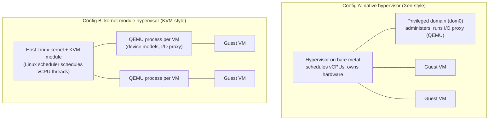
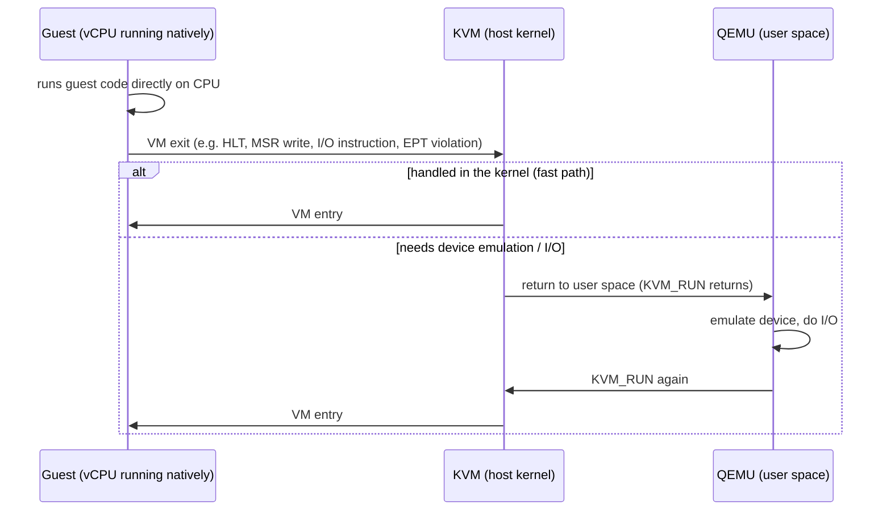
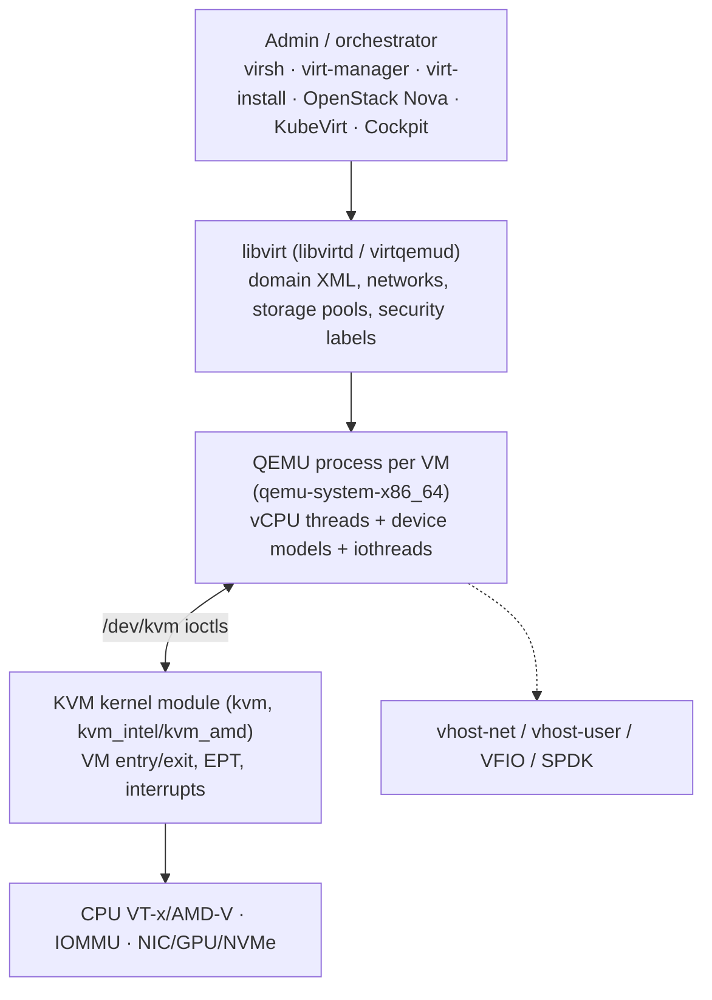

# 1.26 KVM, QEMU and libvirt basics

| | |
|---|---|
| Level | Intermediate |
| Priority tier | 0 |
| Lab venue | A Linux host with hardware virtualisation or nested virtualisation (a GCP VM with nested virtualisation enabled, or any bare-metal Linux box); GPU passthrough needs a bare-metal GPU host |
| Part | Part 1: Linux, from the command line to the kernel and performance |
| Status | Drafted, labs **untested** |

## Why this matters for AI infrastructure

Almost every GPU you rent is attached to a virtual machine, and many on-premises AI platforms run VMs too: Kubernetes nodes on a hypervisor, GPU passthrough VMs for tenant isolation, KubeVirt to run VMs inside Kubernetes, Kata Containers for stronger pod isolation, development and test clusters on KVM, image-build farms, CI for drivers and kernels. The people who design, debug and cost these systems need to know what a hypervisor does to CPU, memory, I/O and GPUs: why a VM can be as fast as bare metal for compute and still slow for networking; why vCPU pinning and huge pages matter; why `%steal` appears; why a GPU needs an IOMMU to be passed through; why some features (NVLink fabric management, MIG, P2P) behave differently in guests.

You may never *operate* a hypervisor (cloud providers do), but you will be asked to explain, size and troubleshoot virtualised GPU environments, and to run VMs yourself to test cluster software, images and kernels. KVM + QEMU + libvirt is the standard open-source stack and the one that most large clouds (including Google Compute Engine) use.

This chapter covers the machinery (VT-x/AMD-V, VM exits, EPT/NPT, IOMMU, virtio, vhost, VFIO, SR-IOV), the software stack (KVM kernel module, QEMU, libvirt, `virsh`, `virt-install`, cloud-init), storage and network configuration, performance tuning and observation from host and guest, GPU passthrough and sharing, security, and a hands-on lab. Cloud architecture (instance families, multitenancy, capacity, orchestration, comparisons) is chapter 1.27; containers and namespaces are chapters 1.19 and 1.20.

## Prerequisites and outcomes

You should know processes, memory and NUMA (1.17), CPU scheduling and cgroups (1.18), namespaces and containers (1.19), kernel modules (1.22), performance methods (1.23), and tracing (1.24).

After this chapter you can:

- Explain system virtual machines, emulators versus hardware-assisted virtualisation, hypervisor types and the two practical configurations (native hypervisor and kernel-module hypervisor).
- Explain CPU virtualisation (privilege rings, trap-and-emulate, binary translation, paravirtualisation, VT-x/AMD-V, VM entry/exit), memory virtualisation (two-dimensional page walks, EPT/NPT, shadow page tables), and I/O virtualisation (emulation, virtio, vhost, passthrough, SR-IOV, IOMMU).
- Describe how KVM, QEMU and libvirt fit together; create, inspect, modify and destroy VMs with `virt-install`, `virsh` and domain XML; use cloud-init images and storage pools; configure NAT, bridged and macvtap networking.
- Choose disk formats and cache modes; configure virtio-blk/scsi/net, multiqueue and vhost.
- Tune a VM for performance: CPU model, pinning, NUMA, huge pages, iothreads, halt polling; and reason about overhead sources (VM exits, EPT violations, double caching, ballooning, steal).
- Observe VM behaviour from host and guest (`top`, `pidstat -t`, `perf kvm stat`, `kvm:kvm_exit`, `kvmexits.bt`, `%steal`, guest tools).
- Explain GPU passthrough with VFIO (IOMMU groups, driver binding, kernel parameters, BAR sizing, NUMA alignment), vGPU/MIG-backed VMs and the limits for NVLink/NVSwitch systems; list the security features (sVirt, seccomp, SELinux/AppArmor, confidential computing).
- Troubleshoot common problems: no KVM, nested virt off, networking, disk full from qcow2, stolen time, passthrough failures.

## 1. Virtual machines in one page

A **system virtual machine** emulates a whole computer (CPU, memory, interrupt controller, timers, disks, NICs) so that an unmodified operating system with its own kernel runs inside. The program that creates and runs it is the **hypervisor**, also called the **virtual machine monitor (VMM)**. The OS inside is the **guest**; whatever runs the hypervisor is the **host**. (A *process* virtual machine such as the JVM is a different thing.)

Two ways to build one:

- **Emulator**: software interprets every guest instruction (QEMU in TCG mode, old game-console emulators). Flexible (a different CPU architecture can be emulated) but slow.
- **Hardware-assisted virtualisation**: guest instructions run directly on the physical CPU; the hypervisor only intervenes when the guest does something privileged or touches virtual devices. Near-native CPU performance. This is what KVM does and what clouds use.

### Hypervisor types and configurations

The classical **Type 1** (bare-metal/native: runs directly on hardware, e.g. Xen, VMware ESXi, Hyper-V) versus **Type 2** (runs inside a host OS, e.g. VirtualBox, early QEMU) is blurred by kernel modules. Gregg's practical split:



In **KVM**, each VM is an ordinary Linux process (`qemu-system-x86_64`); each virtual CPU is an ordinary thread of that process (named `CPU 0/KVM`, `CPU 1/KVM`); the host's own scheduler, memory manager, cgroups, NUMA policy, `perf` and `tracepoints` all apply. That is KVM's strength: everything you know about Linux processes (chapters 1.8, 1.17, 1.18) applies to VMs. Amazon's **Nitro** goes further: KVM-derived with hardware offload of network, storage and management, so there is no QEMU I/O proxy on the data path and performance is near bare metal.

### Why VMs, and why not

Uses: testing and disposable environments, application compatibility (other OS), servers and cloud services, strong multi-tenant isolation (separate kernels), snapshots/migration, running legacy workloads. Drawbacks (which motivate containers, chapter 1.19): installation/configuration effort (automate with Ansible, images, cloud-init), slow boot, full OS to patch and secure in each VM, dependency conflicts at the OS level, cost of one VM per service, extra memory (guest kernel, QEMU, double caching).

## 2. How the hardware helps

### CPU virtualisation

Classic x86 had privilege rings (0 = kernel, 3 = user). A guest kernel expects ring 0, but only the hypervisor may use it. Early solutions:

1. **Trap-and-emulate**: run the guest in user mode; privileged instructions fault, the hypervisor traps and emulates them. x86 had instructions that behaved differently without trapping, so it was not directly possible.
2. **Binary translation** (VMware, 1998): rewrite problematic guest kernel code on the fly; run the VMM in ring 0 and the guest kernel in ring 1. Works, with overhead.
3. **Paravirtualisation (PV)**: the guest kernel is modified to call the hypervisor directly via **hypercalls** instead of executing privileged operations (Xen). Efficient, but needs guest support.
4. **Hardware assist (Intel VT-x, AMD-V/SVM, 2005 to 2006)**: a new CPU mode for the hypervisor ("VMX root") and one for the guest ("non-root") in which the guest kernel runs at ring 0 unprivileged for the host. A control structure (**VMCS** on Intel, **VMCB** on AMD) describes guest state and which events cause exits. When the guest does something the hypervisor wants to intercept (certain instructions like `CPUID`, `HLT`, I/O port access, MSR access, interrupts, EPT faults) the CPU performs a **VM exit**, saves guest state, and runs the hypervisor; after handling it, **VM entry** resumes the guest.



**VM exits are the overhead of virtualisation**: the time spent outside the guest handling exits, and the rate of exits. Exits handled entirely in the kernel are cheap; exits that must return to QEMU in user space cost much more (context switches). Common exit reasons: `HLT` (idle vCPU), `MSR_WRITE` (e.g., timer programming), `EXTERNAL_INTERRUPT`, `PENDING_INTERRUPT`, `IO_INSTRUCTION`/`MMIO` (device access), `EPT_VIOLATION`/`EPT_MISCONFIG` (memory), `CPUID`, `PREEMPTION_TIMER`. Reduce exits with paravirtual devices (virtio), posted interrupts and APIC virtualisation (APICv/AVIC), hardware-assisted timers, halt polling, and passthrough.

KVM exposes its API as `/dev/kvm` and ioctls (`KVM_CREATE_VM`, `KVM_CREATE_VCPU`, `KVM_SET_USER_MEMORY_REGION`, `KVM_RUN`): a user-space VMM such as QEMU, Firecracker, Cloud Hypervisor or crosvm opens it, defines guest memory (a region of its own address space), then runs each vCPU thread in a `KVM_RUN` loop that returns to user space only when it must emulate something. Check the host: `lscpu | grep -i virtualization`, `grep -E 'vmx|svm' /proc/cpuinfo`, `ls -l /dev/kvm`, `lsmod | grep kvm` (`kvm_intel` or `kvm_amd`), `kvm-ok` (Ubuntu `cpu-checker`), `virt-host-validate`. If virtualisation is disabled in firmware, enable VT-x/AMD-V (and VT-d/AMD-Vi) in BIOS.

### Memory virtualisation

A guest has three address types: guest virtual, guest physical, host physical. Translation needs two stages: guest virtual → guest physical (guest page tables) → host physical (hypervisor).

- **Shadow page tables** (older): the hypervisor intercepts guest page-table changes and maintains combined guest-virtual→host-physical tables, loaded into CR3. Many exits.
- **Nested paging: EPT (Intel) / NPT (AMD)**: hardware walks both sets of tables (a **two-dimensional page walk**), caching results in the TLB. Fewer exits but a TLB miss costs more memory references (up to 24 for 4-level paging in both dimensions). Hence **huge pages** (2 MiB/1 GiB) in the guest *and* host matter a great deal: they shorten both walks and improve TLB reach (chapter 1.17).
- Guest memory is just host process memory (anonymous or hugetlbfs-backed). It can be swapped by the host, shared (KSM, same-page merging), overcommitted, ballooned (`virtio-balloon` returns pages to the host), NUMA-bound, or locked (required for device passthrough, since DMA targets fixed physical pages).
- **Double caching**: host page cache plus guest page cache for the same disk data; avoid with `cache=none`/direct I/O for virtual disks.

### I/O virtualisation and the IOMMU

Ways to give a guest a device:

| Method | How | Performance | Flexibility |
|---|---|---|---|
| **Full emulation** | QEMU emulates real hardware (e1000 NIC, IDE/AHCI disk) | Slow: many exits per I/O | Works with any guest OS |
| **Paravirtual (virtio)** | Guest uses a `virtio` driver; shared-memory rings (virtqueues) between guest and host; fewer exits | Good (near line rate with tuning) | Needs virtio drivers (in Linux; Windows needs drivers) |
| **vhost / vhost-user** | The virtio back end runs in the host kernel (`vhost-net`) or in a separate user-space process (`vhost-user`, DPDK/SPDK/OVS-DPDK), bypassing QEMU on the data path | Better throughput/lower CPU | More plumbing |
| **PCI passthrough (VFIO)** | A whole physical PCIe device is assigned to one guest; guest driver talks to hardware; the **IOMMU** translates and isolates DMA | Native (GPU, NIC, NVMe) | Device exclusive to one VM; complicates migration |
| **SR-IOV** | A physical function (PF) exposes virtual functions (VFs); each VF is passed through to a guest | Near-native, shareable | Needs device and driver support; VF count limits; live migration hard |
| **mediated devices / vGPU / MIG** | A vendor driver multiplexes a device into slices | Near-native with QoS | Vendor licence/driver |

The **IOMMU** (Intel VT-d, AMD-Vi, Arm SMMU) does for device DMA what the MMU does for CPU accesses: it translates device-visible addresses and restricts each device to the memory the hypervisor allows, which is what makes passthrough *safe* (a malicious guest driver cannot DMA into host memory). Linux exposes it through **VFIO** (`/dev/vfio/*`), grouping devices that cannot be isolated from each other into **IOMMU groups**. Interrupts are virtualised too (posted interrupts, APICv/AVIC) to avoid exits per interrupt.

**Terms to recognise**: `virtio-blk`, `virtio-scsi`, `virtio-net`, `virtio-balloon`, `virtio-fs`, `virtio-vsock`, `vhost-net`, `vfio-pci`, `OVMF` (UEFI firmware for guests), `q35` (modern chipset with PCIe) versus `i440fx` (legacy), `QMP` (QEMU Machine Protocol), `qemu-guest-agent`, `qcow2`, `cloud-init`.

## 3. The stack: KVM, QEMU, libvirt



- **KVM** (Kernel-based Virtual Machine): the Linux kernel modules (`kvm`, `kvm_intel` or `kvm_amd`) that turn Linux into a hypervisor for hardware-assisted guests. Developed by Qumranet (acquired by Red Hat in 2008); used by Google Compute Engine and many private clouds.
- **QEMU** (Quick Emulator): the user-space program that creates the machine: it allocates guest RAM, runs one thread per vCPU (calling `KVM_RUN`), emulates devices (chipset, PCI bus, disk and network controllers, VGA/serial, USB), loads firmware (SeaBIOS or OVMF/UEFI), implements virtio back ends, handles migration, snapshots and the monitor (HMP/QMP). It can also act as a pure emulator (TCG) for other architectures, or as `qemu-img`/`qemu-nbd` tools for disk images. Machine types: `q35` (PCIe, modern) and legacy `i440fx` (and `microvm`, `virt` on Arm).
- **libvirt**: a management API and daemon that gives a uniform interface (domain XML, `virsh`) over KVM/QEMU (and Xen, LXC, VirtualBox, etc.), manages storage pools, virtual networks, security labelling (SELinux sVirt, AppArmor), cgroup placement, lifecycle (start/stop/save/restore), snapshots and migration. Systemd integration: VMs appear under `machine.slice` with cgroups, so CPU/memory/I/O limits (chapter 1.18) apply directly.

### Command-line QEMU (to see what libvirt generates)

```bash
qemu-img create -f qcow2 disk.qcow2 40G
qemu-system-x86_64 -enable-kvm -machine q35,accel=kvm -cpu host -smp 4 -m 8G \
  -drive file=disk.qcow2,if=virtio,cache=none,discard=unmap,aio=native \
  -netdev user,id=n0,hostfwd=tcp::2222-:22 -device virtio-net-pci,netdev=n0 \
  -cdrom ubuntu.iso -boot d -display none -serial mon:stdio
# libvirt shows the real command: ps -ww -o args -C qemu-system-x86_64 ; or: virsh domxml-to-native qemu-argv --domain vm1
```

### Installing and checking (Ubuntu/Debian)

```bash
sudo apt install qemu-kvm libvirt-daemon-system libvirt-clients virtinst bridge-utils cloud-image-utils libguestfs-tools ovmf cpu-checker
sudo usermod -aG libvirt,kvm $USER            # re-login
kvm-ok ; virt-host-validate                   # checks KVM, IOMMU, cgroups, etc.
systemctl status libvirtd                     # or virtqemud on newer split-daemon setups
virsh uri ; virsh -c qemu:///system list --all   # system instance (root-owned VMs) vs qemu:///session (per-user)
```

### Creating a VM with a cloud image and cloud-init

Cloud images are small preinstalled disk images configured at first boot by **cloud-init** (user data and meta data from a seed ISO or datasource).

```bash
mkdir -p ~/vms && cd ~/vms
wget https://cloud-images.ubuntu.com/jammy/current/jammy-server-cloudimg-amd64.img        # check current URL/checksum first
qemu-img create -f qcow2 -F qcow2 -b jammy-server-cloudimg-amd64.img vm1.qcow2 40G         # thin copy-on-write overlay on the base image
cat > user-data <<'EOF'
#cloud-config
hostname: vm1
users:
  - name: ubuntu
    sudo: ALL=(ALL) NOPASSWD:ALL
    ssh_authorized_keys: [ "ssh-ed25519 AAAA... you@laptop" ]
package_update: true
packages: [qemu-guest-agent]
runcmd: [ systemctl enable --now qemu-guest-agent ]
EOF
echo "instance-id: vm1" > meta-data
cloud-localds seed.iso user-data meta-data
sudo virt-install --name vm1 --memory 8192 --vcpus 4 --cpu host-passthrough \
  --disk path=$PWD/vm1.qcow2,bus=virtio,cache=none,discard=unmap --disk path=$PWD/seed.iso,device=cdrom \
  --os-variant ubuntu22.04 --network network=default,model=virtio --graphics none --import --noautoconsole
virsh list ; virsh domifaddr vm1 ; ssh ubuntu@<ip>
```

Day-to-day `virsh`:

```bash
virsh list --all ; virsh start|shutdown|reboot|destroy|suspend|resume vm1     # destroy = power off (not delete)
virsh autostart vm1 ; virsh dominfo vm1 ; virsh domstats vm1 ; virsh vcpuinfo vm1 ; virsh domblklist vm1 ; virsh domiflist vm1
virsh console vm1 ; virsh dumpxml vm1 ; virsh edit vm1                          # libvirt's domain XML is the source of truth
virsh setvcpus vm1 8 --config --maximum ; virsh setmem vm1 16G --config         # persistent changes (take effect after restart)
virsh snapshot-create-as vm1 s1 --disk-only --atomic ; virsh snapshot-list vm1 ; virsh blockcommit ...   # external snapshots
virsh undefine vm1 --nvram --remove-all-storage                                 # delete VM and disks (careful)
virsh qemu-agent-command vm1 '{"execute":"guest-info"}' ; virsh domfsfreeze vm1   # with qemu-guest-agent
virsh migrate --live --persistent vm1 qemu+ssh://dest/system                    # needs shared storage or --copy-storage-all
virsh net-list --all ; virsh net-dumpxml default ; virsh pool-list --all ; virsh vol-list default
```

### Domain XML: the parts that matter

```xml
<domain type='kvm'>
  <name>vm1</name>
  <memory unit='GiB'>16</memory>
  <memoryBacking><hugepages/><locked/></memoryBacking>          <!-- huge pages + locked memory -->
  <vcpu placement='static'>8</vcpu>
  <iothreads>2</iothreads>
  <cputune>
    <vcpupin vcpu='0' cpuset='2'/> <vcpupin vcpu='1' cpuset='3'/>   <!-- pin vCPUs to host CPUs on the right NUMA node -->
    <emulatorpin cpuset='0-1'/> <iothreadpin iothread='1' cpuset='0'/>
  </cputune>
  <numatune><memory mode='strict' nodeset='0'/></numatune>
  <cpu mode='host-passthrough' check='none'>                     <!-- expose the host CPU model; use for performance, breaks live migration between different CPUs -->
    <topology sockets='1' cores='4' threads='2'/>
    <numa><cell id='0' cpus='0-7' memory='16' unit='GiB'/></numa>
  </cpu>
  <os><type arch='x86_64' machine='q35'>hvm</type><loader readonly='yes' type='pflash'>/usr/share/OVMF/OVMF_CODE.fd</loader></os>
  <devices>
    <disk type='file' device='disk'>
      <driver name='qemu' type='qcow2' cache='none' io='native' discard='unmap' iothread='1'/>
      <source file='/var/lib/libvirt/images/vm1.qcow2'/><target dev='vda' bus='virtio'/>
    </disk>
    <interface type='network'><source network='default'/><model type='virtio'/><driver name='vhost' queues='4'/></interface>
    <hostdev mode='subsystem' type='pci' managed='yes'><source><address domain='0x0000' bus='0x3b' slot='0x00' function='0x0'/></source></hostdev>   <!-- PCI passthrough -->
    <memballoon model='none'/>
  </devices>
</domain>
```

## 4. Storage

| Choice | Notes |
|---|---|
| **Format** | `raw`: simplest/fastest, no features beyond what the backing store gives (LVM volume, zvol, NVMe partition, or file). `qcow2`: thin provisioning, backing files (linked clones), snapshots, compression, encryption; some overhead and metadata caching; set `lazy_refcounts`, larger `cluster_size`, preallocation (`preallocation=metadata`/`falloc`) for performance. Over-committed qcow2 files can **fill the host filesystem** and pause guests |
| **Backing** | File on a filesystem; LVM logical volume or raw block device (low overhead); Ceph RBD / iSCSI / NVMe-oF / NFS (network); local NVMe passthrough |
| **Bus/controller** | `virtio-blk` (simple, fast), `virtio-scsi` (many disks, discard, hotplug, SCSI features), `nvme` emulation, passthrough NVMe (best, exclusive); avoid `ide`/`sata` emulation except for compatibility |
| **Cache mode** | `none` (O_DIRECT, bypass host page cache, recommended with virtio and when the guest caches), `writethrough`, `writeback` (fast but data loss risk on host crash without flush), `unsafe` (testing only), `directsync` |
| **AIO** | `io=native` (with `cache=none`) or `io=io_uring`; `threads` otherwise |
| **IOThreads** | Dedicated threads for disk I/O so QEMU's main loop and vCPU threads are not blocked |
| **Discard/TRIM** | `discard=unmap` plus `fstrim` in the guest returns space to thin images |
| **Snapshots** | Internal (in qcow2) versus external (overlay files); long chains hurt performance, commit/flatten regularly; they are not backups |

Tools: `qemu-img info|create|convert|resize|check|commit|rebase`, `qemu-nbd`, `guestfish`/`virt-customize`/`virt-sysprep` (libguestfs: inspect/modify images, remove machine-specific state), `virt-resize`, `losetup`. For AI scratch data prefer passthrough NVMe or a raw LVM volume with `cache=none`, and measure with `fio` inside the guest and on the host (chapter 1.25).

## 5. Networking

| Mode | How | Use |
|---|---|---|
| **User-mode (SLIRP)** | QEMU user networking with NAT and port forwarding | Quick tests, rootless; slow |
| **libvirt NAT network (`default`)** | `virbr0` bridge + dnsmasq (DHCP/DNS) + iptables/nftables NAT; guests get 192.168.122.0/24 | Dev/test; guests not reachable from outside without forwarding |
| **Linux bridge** | Guests' tap devices attach to a host bridge (`br0`) enslaving the physical NIC; guests are on the physical L2 network | Servers that must be reachable; the NIC itself must not hold the IP |
| **macvtap** | Virtual interface directly on a physical NIC (modes: bridge, vepa, private, passthru) | Simple, but host-to-guest traffic over the same NIC may not work in some modes |
| **Open vSwitch** | Programmable virtual switch (VLANs, tunnels, flows, DPDK) | Cloud-scale networking, SDN |
| **SR-IOV VF / NIC passthrough** | Pass a VF or PF into the guest | Near-native throughput/latency (including RDMA) |
| **vhost-user + DPDK** | User-space data plane | High packet rates |

NIC model `virtio-net` with `vhost` (in-kernel back end) and `queues=N` (multiqueue; set `ethtool -L` in the guest) is the standard fast path; check offloads (`ethtool -k`), MTU consistency across guest, tap, bridge and physical network (jumbo frames must be end to end), and the host's `net.bridge.bridge-nf-call-*` settings. libvirt commands: `virsh net-define|net-start|net-autostart`, `virsh attach-interface`. Namespaces and veth (1.19) are the container analogue; a Linux bridge plus tap is the VM analogue.

## 6. Performance: what costs what, and how to tune

**Sources of overhead** (from Gregg's analysis): CPU: guest exits (rate and time), interrupt and timer virtualisation; memory: two-level page walks, additional kernel and QEMU memory per VM, double caching; I/O: historically the largest (every device access an exit), mitigated by virtio, vhost, SR-IOV/passthrough and hardware offload (Nitro); contention: stolen time and cache pollution from other tenants, CPU interrupts from neighbours' I/O. CPU-bound user-space code runs at essentially native speed; what suffers is exit-heavy workloads (lots of small I/O, timers, privileged operations), memory-intensive workloads with poor TLB behaviour, and anything bounded by unfaithful emulation.

**Checklist for a performance VM** (tune the host, then libvirt):

1. **Host**: BIOS (VT-x, VT-d, performance power profile, SMT policy, NUMA on), `intel_iommu=on iommu=pt` (or `amd_iommu=on`), governor `performance`, C-states limited, THP policy decided, `isolcpus`/`nohz_full`/`irqaffinity` for dedicated CPUs, NUMA topology known (`lscpu`, `numactl -H`, `virsh nodeinfo`, `virsh capabilities`).
2. **CPU**: `host-passthrough` CPU model (exposes features like AVX-512/AMX); correct topology (`sockets/cores/threads`); **pin vCPUs** to dedicated host CPUs (`vcpupin`) on one NUMA node, pin emulator and iothreads to separate CPUs (`emulatorpin`, `iothreadpin`); do not oversubscribe vCPUs on pinned VMs; expose SMT siblings consistently; consider `kvm halt_poll_ns` and `<cpu><feature policy='require' name='invtsc'/>` or `kvm-clock` timing considerations; disable ballooning and KSM for latency-sensitive guests.
3. **Memory**: **huge pages** (`<hugepages/>`, preallocate with `vm.nr_hugepages` or `hugepagesz=1G hugepages=N`), `<locked/>` for passthrough, `numatune strict` to the same node as the CPUs and devices, guest NUMA topology matching for large VMs.
4. **Disk**: virtio-scsi/blk with iothreads, `cache=none`, raw or preallocated qcow2, or passthrough NVMe.
5. **Network**: `virtio-net` + `vhost` + multiqueue, correct MTU, RSS/IRQ affinity in the guest and on the host, or SR-IOV.
6. **Guest**: virtio drivers, `qemu-guest-agent`, current kernel, `tuned-adm profile virtual-guest`/`throughput-performance`, THP/huge pages inside, clocksource `kvm-clock` or `tsc`, NUMA-aware application placement.

For GPU workloads, treat the VM like a bare-metal node in its tuning (chapter 1.28) and verify that the topology the guest sees (`nvidia-smi topo -m`, `lscpu`, `numactl -H`) matches the physical one; wrong topology exposure (all GPUs on one virtual PCIe root, NIC on a different node from the GPU) silently breaks NCCL/GPUDirect performance.

## 7. Observing VMs

**From the host** (KVM): every VM is a process, so `top`/`ps`/`pidstat` see it. `pidstat -tp <qemu-pid> 1` shows per-thread usage: threads named `CPU n/KVM` are vCPUs; `%guest` is time spent running guest code; `%system`/`%usr` in vCPU threads is host/QEMU work (exits, emulation). Map a QEMU PID to a VM name from the command line (`ps -wwfp PID`, the `-name` argument) or `virsh list` with `virsh dumpxml | grep pid`/`/run/libvirt/qemu/*.pid`. Per-VM usage: `virsh domstats`, `virt-top`, `systemd-cgtop` (VMs live under `machine.slice`), cgroup files (`cpu.stat` throttling if you set limits).

**VM exits** are the virtualisation overhead metric:

```bash
sudo perf kvm stat record -a -- sleep 10 ; sudo perf kvm stat report            # exit reasons with counts and time; or: perf kvm stat live
sudo perf stat -e 'kvm:kvm_exit' -a -- sleep 5                                  # exit rate
sudo bpftrace -l 't:kvm:*' ; sudo bpftrace -lv t:kvm:kvm_exit                   # fields: exit_reason, guest_rip, ...
# exit-reason histogram by duration: use a kvm_exit -> kvm_entry bpftrace script (e.g. kvmexits.bt) or perf script on kvm tracepoints
```

Interpretation (from Gregg's example): a mostly-idle guest shows mainly `HLT` exits whose long durations dominate "time" but cost nothing (the vCPU is idle); `MSR_WRITE` (timer programming) and `EXTERNAL_INTERRUPT` are frequent but cheap; many `IO_INSTRUCTION`/`MMIO` exits mean heavy emulated device I/O; `EPT_VIOLATION` histograms show memory faulting; high exit *rates* with large exit *time* means the VM is paying heavily. Exits that return to user space (QEMU) cost more than exits handled in the kernel. For deeper views, kprobes on KVM exit handlers (`handle_halt`, etc.), and sampling the guest CR3 register to see whether one guest process or many are running.

**From inside the guest**: it has its own kernel, so everything works (BPF, perf software events, flame graphs) but physical resources are virtual: `lscpu` shows vCPUs (check topology), `mpstat -P ALL` shows only vCPUs, `vmstat`'s `st` column and `mpstat`'s `%steal` show CPU time the hypervisor gave to others or throttled: sustained steal means noisy neighbours, CPU over-commit or limits; `iostat`/`biosnoop` show virtual device latency (a limit or contention appears as latency outliers; characterise I/O size/pattern to see whether outliers correlate with size, queueing behind flushes, or are random—the latter suggests physical contention); PMCs may be unavailable; `dmesg | grep -i balloon` reveals ballooning; check the clocksource and `kvm-clock`. Strategy: the host operator checks physical-resource USE, per-VM resource-control limits (are VMs at their caps?), and exit statistics; guests analyse their virtual resources, inferring contention from latency; deep root cause usually needs access to both sides.

## 8. GPUs and other devices in VMs

### PCI passthrough with VFIO

Passing a GPU to a guest gives native performance for compute because the guest's NVIDIA driver talks directly to the device, with the IOMMU isolating DMA. Requirements and steps (Linux/KVM):

1. **Firmware/BIOS**: enable VT-d/AMD-Vi (IOMMU); on some boards enable SR-IOV, Above-4G decoding, and Resizable BAR options needed for large GPUs.
2. **Kernel parameters**: `intel_iommu=on` (or `amd_iommu=on`) and typically `iommu=pt`; for stricter isolation omit `pt` on the guest-only devices; check `dmesg | grep -i -e DMAR -e IOMMU`, `ls /sys/kernel/iommu_groups/`.
3. **IOMMU groups**: devices that share a group must be passed together (ACS capability of switches/root ports determines grouping); list with `for g in /sys/kernel/iommu_groups/*; do echo "IOMMU Group ${g##*/}:"; for d in $g/devices/*; do lspci -nns ${d##*/}; done; done`. A GPU that shares a group with unrelated devices cannot be cleanly assigned (the ACS override patch exists but weakens isolation: avoid in multi-tenant clouds).
4. **Bind to `vfio-pci`** instead of the host driver: `echo 10de 2330 > /sys/bus/pci/drivers/vfio-pci/new_id` or kernel parameter `vfio-pci.ids=10de:2330` (also load early, blacklist `nouveau`/`nvidia` for those devices), or libvirt `managed='yes'` which detaches the device from its host driver and binds it to `vfio-pci` at VM start. Verify: `lspci -nnk -s <bdf>` shows `Kernel driver in use: vfio-pci`.
5. **Guest definition**: `<hostdev>` entries (libvirt) or `-device vfio-pci,host=3b:00.0`; use `q35` + OVMF; give the VM enough **locked huge-page memory** (device DMA needs pinned memory; the entire guest RAM is typically locked); align vCPUs, memory and the passed devices on the same NUMA node; expose a CPU model and topology that the NVIDIA driver and NCCL understand.
6. **In the guest**: install the NVIDIA driver (the same kernel module story as chapter 1.22), CUDA, DCGM; `nvidia-smi` should see the device. Bridge to multi-GPU: pass **all GPUs of a PCIe switch domain** and their NICs together (for GPUDirect RDMA the NIC and GPU must share an upstream PCIe switch/root complex in the guest topology, with ATS/ACS settings that permit peer-to-peer; flag: verify vendor guidance).

Practical gotchas: the GPU's `Reset` ability (some GPUs/functions cannot be reset cleanly between guests: FLR support, `vendor-reset`); audio and USB functions of consumer GPUs in the same group; huge BARs requiring 64-bit MMIO windows in the guest firmware (`OVMF` configuration: `-fw_cfg name=opt/ovmf/X-PciMmio64Mb,string=262144`); consumer-GPU driver restrictions in VMs; error 43/`NVRM: GPU has fallen off the bus` after guest crash (host needs a reset or reboot); hotplug not supported for many GPUs; live migration with passthrough is generally unsupported (some vendors implement it for specific devices).

### NVLink/NVSwitch systems

HGX/DGX-class servers link GPUs through NVLink and NVSwitch managed by the **Fabric Manager**. In a virtualised environment there are modes: passing *all* GPUs and the NVSwitches to a single "service VM" or to one tenant VM (which runs Fabric Manager), or the host running Fabric Manager in a **shared NVSwitch multitenancy** (partitioned) mode so that partitions of GPUs are assigned to different VMs with isolated NVLink fabrics. The details (modes, supported platforms, driver and Fabric Manager versions) are vendor-specific and change by generation: flag, verify with NVIDIA's "Fabric Manager User Guide" and the cloud provider's documentation. MIG-partitioned GPUs can be assigned per MIG instance in some virtualisation setups; vGPU (NVIDIA virtual GPU software with mediated devices) time-slices or partitions GPUs with a licence server (check the licensing and supported hypervisors). P2P and GPUDirect between VMs are restricted; NCCL inside a tenant VM works on whatever NVLink/PCIe topology is exposed.

### Other devices

NICs: SR-IOV VFs for Ethernet/IB (with RDMA) are the standard path to give guests near-native networking (`echo N > /sys/class/net/<pf>/device/sriov_numvfs`, then pass the VFs). NVMe: whole-device passthrough or SPDK vhost-user. `virtio-fs` shares host directories with low overhead; 9p is slower.

## 9. Security and isolation

- **Hardware boundary**: each VM has its own kernel and address space; the attack surface is the hypervisor/VMM and virtual devices (QEMU has had many device-emulation CVEs): minimise devices, avoid unused emulated hardware, keep QEMU and the kernel patched, and use microVM monitors (Firecracker, Cloud Hypervisor) for untrusted workloads.
- **Confinement of the QEMU process** (libvirt does this by default): per-VM unprivileged user (`libvirt-qemu`/`qemu`), SELinux **sVirt** labels (each VM and its disks get unique MCS categories) or AppArmor profiles, seccomp sandbox for QEMU (`-sandbox on`), cgroups (devices, CPU, memory), namespaces.
- **IOMMU** protects against malicious DMA; keep it on (remember `iommu=pt` trade-offs).
- **Side channels** (Spectre/Meltdown/L1TF/MDS): mitigations (`mitigations=`, core scheduling, disabling SMT on shared hosts) cost performance and are a cloud-provider decision; dedicated hosts avoid sharing.
- **Confidential computing**: AMD SEV/SEV-ES/SEV-SNP and Intel TDX encrypt guest memory against the host; NVIDIA H100 and later support confidential GPU modes together with a confidential VM (flag: check current support matrices and the performance cost).
- **Management plane**: libvirt over TLS/SSH only; protect `/var/lib/libvirt`, image stores, and cloud-init user data (secrets in user data are readable by the guest).

## 10. Nested virtualisation and the lab venue

To practise KVM on a cloud VM you need **nested virtualisation**: the cloud VM (L1) must expose VMX/SVM to its guests (L2). On Google Cloud, create the instance with nested virtualisation enabled (for example `gcloud compute instances create ... --enable-nested-virtualization` on supported Intel CPU platforms with an image that has VMX enabled; flag: confirm the current flags, CPU platform and OS-policy requirements); check inside with `grep -c vmx /proc/cpuinfo`. Performance is lower than on bare metal (each L2 exit traverses L1 and L0), and GPU passthrough cannot be tested nested. For realistic GPU passthrough work use a bare-metal GPU instance or an on-premises machine.

## 11. Troubleshooting

| Symptom | Cause | Check / fix |
|---|---|---|
| `KVM is not available` / `/dev/kvm` missing | Virtualisation disabled in BIOS, nested virt not enabled, modules not loaded, in a VM without VMX | `lscpu`, `kvm-ok`, `modprobe kvm_intel`, platform settings |
| VM boots slowly or is sluggish | Emulation (no KVM), swap, CPU over-commit, qcow2 on a busy disk | `virsh dumpxml` `type='kvm'`; `pidstat -t`; `vmstat`; `iostat` |
| Guest shows `%steal` | Over-subscribed host or CPU quota | Host `top`, VM pinning; resource limits |
| Guest has no network | Wrong network, bridge or firewall, DHCP, MTU, cloud-init network config | `virsh domiflist`, `brctl show`/`bridge link`, `nft list ruleset`, `tcpdump -i virbr0` |
| `virsh` permission denied | Not in `libvirt` group; wrong URI | `virsh -c qemu:///system` |
| Disk image grows until host full | Thin qcow2 without discard; snapshots | `qemu-img info`; `fstrim`; monitor pool free space; preallocate |
| Cannot start VM with passthrough | Device bound to host driver, IOMMU group not isolated, memory not lockable, ACS | `lspci -nnk`, `dmesg`, `ulimit -l` for qemu, `/sys/kernel/iommu_groups` |
| Guest GPU driver "fallen off the bus" | Reset failure after previous guest, power/BAR issues | Reboot host, check FLR; firmware/OVMF MMIO window |
| Live migration fails | CPU model mismatch, passthrough devices, storage not shared, different QEMU versions | Use a baseline CPU model; compatible machine types |
| Time drifts in the guest | Clocksource, no guest agent, suspend/resume | `chronyd`, `kvm-clock`, `qemu-guest-agent`, `virsh domtime` |

## 12. Hands-on lab: build, tune, and observe a VM

First, run the self-checking Python lab (`code/part01/kvm_qemu_libvirt_lab.py`) locally. It verifies 2D nested paging (`EPT`/`NPT`) page-walk memory reads (`24` reads for 4-level x 4-level vs `8` with `1 GiB` huge pages), KVM VM-exit classification (`HLT` idle vs in-kernel `MSR_WRITE` vs user-space QEMU `IO_INSTRUCTION`/`MMIO`), IOMMU group sibling and host-conflict validation for VFIO passthrough, and GPU VM libvirt domain auditing.

```bash
python3 code/part01/kvm_qemu_libvirt_lab.py
```

Next, on a disposable Linux host with KVM enabled (nested virtualization acceptable for steps 1–10; bare-metal GPU host required for Step 11; all interactive VM commands below are `untested here`), work through these steps:

1. **Preflight**: `lscpu | grep -i virt`, `grep -E -c 'vmx|svm' /proc/cpuinfo`, `kvm-ok`, `virt-host-validate`, `ls /dev/kvm`. Record CPU model, NUMA nodes, hugepage settings, IOMMU status.
2. **Install** the stack; start libvirtd; inspect `virsh net-list --all` and the `virbr0` bridge (`ip addr`, `nft list ruleset | grep -i masq`).
3. **QEMU by hand**: boot a tiny Linux image with the command in section 3, once with `-enable-kvm` and once with `-accel tcg`; compare boot time and `sysbench cpu`.
4. **libvirt VM from a cloud image** (section 3): create the qcow2 overlay, seed ISO and `virt-install`; log in via SSH; install `qemu-guest-agent`; look at `virsh dumpxml` and the actual QEMU command line (`ps -ww`).
5. **Observe**: in the host run `pidstat -tp <qemu pid> 1` while running `stress-ng --cpu 2` in the guest; map vCPU threads; run `perf kvm stat report`, `perf stat -e kvm:kvm_exit`, and count exits at idle versus under I/O (`fio` in the guest); note `HLT` and `MSR_WRITE` dominance at idle.
6. **CPU tuning**: pin vCPUs and the emulator thread; compare a latency-sensitive benchmark (cyclictest-like loop or `sysbench`) pinned versus unpinned while the host is loaded; observe `%steal` in the guest.
7. **Memory tuning**: allocate huge pages on the host and enable `<memoryBacking><hugepages/>`; compare a memory-bound benchmark (STREAM, random access) with and without; check `/proc/meminfo` `HugePages_*` on the host.
8. **Disk and network**: compare `cache=none` versus `writeback`, `virtio-blk` versus emulated `sata` with `fio`; compare `virtio-net` with and without `vhost` and multiqueue using `iperf3` from another host; check offloads with `ethtool -k`.
9. **Snapshots and images**: create an external snapshot, make changes, revert; use `qemu-img info --backing-chain`; resize a disk and grow the filesystem in the guest; use `virt-sysprep` to generalise an image.
10. **Live migration** (two hosts with shared storage or `--copy-storage-all`): migrate a running VM while pinging it; measure downtime.
11. **Passthrough (bare-metal GPU host only)**: enable IOMMU parameters, inspect IOMMU groups, bind a GPU to `vfio-pci`, define a `<hostdev>`, boot an Ubuntu guest with OVMF and locked huge pages, install the NVIDIA driver in the guest, run `nvidia-smi`, a CUDA sample and an `nccl-tests` all-reduce; compare host-side bare-metal results (chapter 1.25 method) and `nvidia-smi topo -m` inside the guest.
12. **Clean up**: `virsh destroy`, `virsh undefine --remove-all-storage --nvram`; delete overlays; restore host driver bindings.

## 13. Common mistakes

- Running without KVM acceleration and concluding "VMs are slow".
- `host-model`/emulated CPU or unpinned vCPUs for latency-sensitive or GPU workloads; ignoring NUMA.
- Using emulated devices (IDE, e1000) instead of virtio; `cache=writeback` on important data without understanding flushes.
- Thin qcow2 images without monitoring free space; long snapshot chains.
- Over-committing vCPUs and memory on production GPU hosts; ballooning with pinned or passthrough guests.
- Passing a GPU without its NIC/switch domain and then expecting GPUDirect RDMA.
- Assuming guest topology equals host topology; not validating with `nvidia-smi topo -m`.
- Treating nested virtualisation results as representative of bare metal.
- Disabling the IOMMU or using ACS override on multi-tenant hosts.
- Forgetting that cloud-init user data can contain secrets visible to the guest.

## 14. Interview angles

- "Explain how a hypervisor virtualises the CPU, memory and I/O, and where the overhead comes from."
- "What is a VM exit? How do you measure virtualisation overhead on KVM?"
- "KVM versus QEMU versus libvirt: who does what?"
- "How does GPU passthrough work? What is an IOMMU group? Why lock memory?"
- "Why might NCCL performance drop inside a VM, and how would you check?" (topology, NIC/GPU PCIe locality, ACS/ATS, NUMA, CPU pinning, huge pages.)
- "VFIO versus SR-IOV versus virtio versus vGPU/MIG: when each?"
- "How do you give a VM near-bare-metal performance?"
- "What does `%steal` mean, and what do you do about it?"
- "Containers versus VMs versus microVMs for multi-tenant GPU clouds."

## Exercises

1. **Emulators vs. Hardware-Assisted Virtualization, Config A vs. Config B, and VM Exits:** (a) Contrast software emulation (`QEMU` TCG) with hardware-assisted virtualization (`KVM` + `VT-x`/`AMD-V`), and contrast Gregg's Config A (native hypervisor + `dom0`) with Config B (kernel-module hypervisor `KVM` where each VM is a `qemu-system-x86_64` process and each vCPU is a `CPU n/KVM` thread); (b) using `classify_kvm_exit_reason()` in `code/part01/kvm_qemu_libvirt.py`, classify `HLT`, `MSR_WRITE`, and `IO_INSTRUCTION` by whether they represent idle sleep or active overhead and whether they are handled in the host kernel or user-space QEMU.
2. **Nested Paging (`EPT`/`NPT`), 2D Page Walks, and Huge Pages:** Explain the three address spaces in a VM (Guest Virtual, Guest Physical, Host Physical) and why hardware nested paging (`EPT`/`NPT`) replaced shadow page tables. Using `compute_2d_page_walk_max_reads()`, calculate the worst-case number of memory reads on a TLB miss for 4-level guest + 4-level host page tables (`24` reads) versus when both guest and host use `1 GiB` huge pages (`8` reads).
3. **The I/O Virtualization Spectrum (`virtio`, `vhost`, `SR-IOV`, `VFIO`) and the `IOMMU`:** Compare full device emulation, `virtio` (`virtqueues`), `vhost-net` / `vhost-user`, `SR-IOV` (`PF`/`VF`s), and `VFIO` PCIe passthrough across performance and sharing flexibility, and explain why passthrough is unsafe without an **IOMMU** (`VT-d`/`AMD-Vi`).
4. **VM Storage (`raw` vs. `qcow2`, `cache=none`) and Networking (`virbr0` NAT vs. Bridge vs. SR-IOV):** (a) Why should `virtio-blk`/`virtio-scsi` disks use `cache='none'` (`O_DIRECT`) and dedicated `iothreads`, and how does a thin `qcow2` copy-on-write backing file (`qemu-img create -f qcow2 -F qcow2 -b base.img vm1.qcow2`) work? (b) Contrast QEMU user-mode (`SLIRP`), libvirt `default` NAT (`virbr0` `192.168.122.0/24`), a host L2 bridge (`br0`), and `SR-IOV` VFs.
5. **Observing VMs from Host and Guest (`pidstat -tp`, `perf kvm stat`, and `%steal`):** (a) On a KVM host, how do you interpret `%guest`, `%system`, and `%usr` in `pidstat -tp <qemu-pid> 1`, and why does `perf kvm stat report` show high total time in `HLT` exits on an idle guest? (b) Inside the guest, what does sustained `%steal` (`st` in `vmstat`/`mpstat`) indicate, and how do you diagnose whether virtual disk latency outliers come from guest I/O patterns or host noisy neighbors?
6. **VFIO GPU Passthrough, IOMMU Groups, OVMF 64-Bit BARs, and Guest Topology:** (a) Evaluate `validate_iommu_group_passthrough()` when a GPU (`0000:3b:00.0`) shares an IOMMU group with its audio function (`0000:3b:00.1`) or with a host-critical device; (b) audit an untuned VM (`qemu64`, `i440fx`, `cache='writeback'`, no hugepages/locked memory/pinning) using `audit_gpu_vm_domain_config()`, and explain why `OVMF` `X-PciMmio64Mb=262144` and accurate guest PCIe/NUMA topology (`nvidia-smi topo -m`) are critical for multi-GPU NCCL and GPUDirect RDMA in VMs.

## Checkpoint questions (20)

<details>
<summary>1. What is the difference between a system VM and a process VM, and between a pure emulator and hardware-assisted virtualization?</summary>
A **system VM** (`KVM`/`QEMU`) emulates a complete hardware machine running its own guest operating system kernel; a **process VM** (`JVM`, Python interpreter) runs a single user-space program. A pure **emulator** (`QEMU` TCG) translates every guest CPU instruction in software, whereas **hardware-assisted virtualization** (`VT-x`/`AMD-V`) executes guest instructions directly on the physical CPU and traps into the hypervisor only on privileged operations.
</details>

<details>
<summary>2. Contrast Gregg's Config A (native hypervisor) and Config B (kernel-module hypervisor) architectures.</summary>
In **Config A** (`Xen`), the hypervisor boots directly on bare metal and schedules physical CPUs, while a privileged management VM (`dom0`) runs management tools and I/O proxies. In **Config B** (`KVM`), the Linux host kernel itself becomes the hypervisor via `kvm.ko` (`kvm_intel.ko` / `kvm_amd.ko`): each VM is a regular Linux `qemu-system-x86_64` process, and each vCPU is a standard Linux thread (`CPU n/KVM`) scheduled by the Linux scheduler and controlled by host `cgroups` and `numactl`.
</details>

<details>
<summary>3. Trace the four historical approaches to x86 CPU virtualization: trap-and-emulate, binary translation, paravirtualization, and `VT-x` / `AMD-V`.</summary>
(1) Classic **trap-and-emulate** failed on early x86 because 17 sensitive instructions behaved differently outside ring 0 without trapping; (2) **Binary translation** (VMware, 1998) rewrote sensitive guest kernel instructions dynamically at runtime; (3) **Paravirtualization** (Xen PV) modified the guest kernel source code to invoke hypervisor **hypercalls** directly; and (4) **Hardware assist** (`Intel VT-x` / `AMD-V`, 2005–2006) added VMX root and non-root modes plus a hardware control structure (`VMCS` / `VMCB`) so unmodified guest kernels run in non-root ring 0 and trigger a hardware **VM exit** only on configured events.
</details>

<details>
<summary>4. What is a VM exit, what are the most common exit reasons, and why do some exits cost much more than others?</summary>
A **VM exit** occurs when the physical CPU leaves guest non-root mode and transfers control to the hypervisor to handle an intercepted event (`HLT`, `MSR_WRITE`, `EXTERNAL_INTERRUPT`, `IO_INSTRUCTION`/`MMIO`, `EPT_VIOLATION`, `CPUID`). Exits handled entirely inside the host kernel (`kvm.ko` fast path, such as `MSR_WRITE` or APIC timers) take microseconds or less; exits that must return from the `KVM_RUN` `ioctl` to user-space `QEMU` to emulate legacy device registers (`IO_INSTRUCTION`/`MMIO`) pay two extra context switches and cost far more.
</details>

<details>
<summary>5. How do KVM, QEMU, and `libvirt` divide responsibilities when running a virtual machine?</summary>
**KVM** (`/dev/kvm`, `kvm.ko` + `kvm_intel.ko`/`kvm_amd.ko`) is the kernel module that manages hardware CPU virtualization (`VMCS`, VM entry/exit, nested EPT page tables, and virtual interrupts). **QEMU** (`qemu-system-x86_64`) is the user-space process that allocates guest RAM, spawns one pthread per vCPU (calling `ioctl(KVM_RUN)`), emulates virtual devices/chipsets (`q35`, `OVMF`), and implements `virtio` back ends and live migration. **`libvirt`** (`libvirtd`/`virtqemud`, `virsh`, domain XML) is the management daemon that configures QEMU processes, storage pools, networks, `machine.slice` cgroups, and SELinux `sVirt` confinement.
</details>

<details>
<summary>6. Explain Nested Paging (`EPT` / `NPT`), why a TLB miss can require up to `24` memory reads, and why huge pages matter twice in VMs.</summary>
With hardware nested paging (**Intel EPT** / **AMD NPT**), the guest manages Guest Virtual -> Guest Physical (`GVA -> GPA`) page tables while the hypervisor manages Guest Physical -> Host Physical (`GPA -> HPA`) EPT tables. On a TLB miss, the CPU MMU must translate the guest page-table pointers at every level through the 4-level EPT tree (`4 * (4 + 1) + 4 = 24` memory accesses vs `4` on bare metal). Enabling `2 MiB` or `1 GiB` **huge pages** in both the host (`<hugepages/>`) and the guest collapses both dimensions of the page walk and expands TLB reach.
</details>

<details>
<summary>7. Compare `virtio`, `vhost-net` / `vhost-user`, `SR-IOV`, and `VFIO` PCIe passthrough.</summary>
**`virtio`** is a paravirtual driver standard where the guest and host exchange I/O descriptors over shared-memory ring buffers (`virtqueues`) instead of emulating hardware registers. **`vhost-net`** moves the `virtio` back end into a host kernel thread (`vhost-user` moves it to a user-space DPDK/SPDK process), bypassing the QEMU process on the data path. **`SR-IOV`** partitions one physical PCIe device (`PF`) in hardware into multiple Virtual Functions (`VF`s) passed directly to different VMs. **`VFIO`** assigns an entire physical PCIe device exclusively to one VM.
</details>

<details>
<summary>8. What does the hardware `IOMMU` (`Intel VT-d` / `AMD-Vi`) do, and what is an `IOMMU group`?</summary>
The **IOMMU** translates Guest Physical Addresses (`GPA`) to Host Physical Addresses (`HPA`) for device **DMA** transfers and blocks devices from reading or writing host memory outside their assigned VM's pages. An **IOMMU group** (`/sys/kernel/iommu_groups/*`) is the smallest set of PCIe devices that the hardware can isolate from all other devices (determined by PCIe bridge Access Control Services, `ACS`); all devices in an IOMMU group must be passed through to a guest together as a unit.
</details>

<details>
<summary>9. Compare `raw` and `qcow2` disk formats, and explain why `cache='none'` is recommended for `virtio` disks.</summary>
`raw` is a flat byte-for-byte image or block device with zero format overhead. `qcow2` supports thin provisioning, copy-on-write backing chains (`-b base.img` for fast cloud-image clones), snapshots, and compression at a small metadata cost (mitigated by `preallocation=metadata`/`falloc`). Setting `cache='none'` opens the image on the host with `O_DIRECT`, preventing **double caching** (caching the same file blocks in both the host page cache and the guest page cache).
</details>

<details>
<summary>10. How do `cloud-init` and a `qcow2` backing file let you provision a new KVM VM in seconds?</summary>
Instead of running an OS installer ISO, you create a thin copy-on-write overlay (`qemu-img create -f qcow2 -F qcow2 -b ubuntu-cloudimg.img vm1.qcow2 40G`) in milliseconds and attach a tiny `cloud-localds` `seed.iso` containing `user-data` (hostname, SSH keys, packages) and `meta-data`; on first boot, `cloud-init` inside the guest configures the instance automatically.
</details>

<details>
<summary>11. Contrast libvirt's `default` NAT network (`virbr0`), a host L2 Linux bridge (`br0`), `macvtap`, and `SR-IOV`.</summary>
`default` NAT attaches guest `tap` devices to `virbr0` (`192.168.122.0/24`) with `dnsmasq` and `iptables`/`nftables` masquerading (outbound access works; inbound requires port forwarding). A **host L2 bridge** (`br0`) enslaves the physical NIC so guests sit directly on the LAN subnet. **`macvtap`** attaches virtual MAC interfaces directly to the physical NIC. **`SR-IOV`** passes a hardware NIC Virtual Function directly into the guest via `VFIO`, bypassing the host software network stack completely (and supporting RDMA).
</details>

<details>
<summary>12. List the six key libvirt domain XML tuning settings for a high-performance compute or GPU VM.</summary>
(1) `<cpu mode='host-passthrough'>` (exposing native CPU instructions like AVX-512/AMX and topology), (2) `<vcpupin>`, `<emulatorpin>`, and `<iothreadpin>` pinning vCPUs 1:1 to physical cores on the target NUMA node, (3) `<memoryBacking><hugepages/><locked/></memoryBacking>`, (4) `<numatune><memory mode='strict' nodeset='0'/></numatune>`, (5) `virtio-blk`/`virtio-scsi` disks with `cache='none' io='native' iothread='1'` (or NVMe passthrough), and (6) `virtio-net` with `<driver name='vhost' queues='N'/>` (or SR-IOV/VFIO NIC passthrough).
</details>

<details>
<summary>13. How do you observe a KVM guest's CPU usage and VM exits from the host using `pidstat` and `perf kvm`?</summary>
Run `pidstat -tp <qemu-pid> 1` to inspect each `CPU n/KVM` thread: `%guest` is the percentage of time spent executing inside the guest, while `%system` and `%usr` show host kernel and QEMU overhead. Run `sudo perf kvm stat report` (after `perf kvm stat record -a -- sleep 10`) or `bpftrace` on `t:kvm:kvm_exit` and `t:kvm:kvm_entry` to break down exit counts and time by reason (`HLT`, `MSR_WRITE`, `IO_INSTRUCTION`, `EPT_VIOLATION`).
</details>

<details>
<summary>14. Why do `HLT` exits often dominate total exit time in `perf kvm stat report` on an idle or lightly loaded VM?</summary>
When a guest vCPU has no runnable threads, the guest kernel executes the `HLT` instruction to sleep until the next interrupt. KVM intercepts `HLT` and puts the vCPU thread to sleep in the host until an interrupt arrives; the elapsed sleep duration between `kvm_exit (HLT)` and `kvm_entry` is idle waiting time, not CPU overhead.
</details>

<details>
<summary>15. Inside a VM, what does `%steal` (`st` in `vmstat` / `mpstat`) measure, and what causes it to rise?</summary>
`%steal` measures the percentage of time a virtual CPU had runnable tasks ready to execute, but the host hypervisor scheduled another VM/process on the physical core or throttled the VM's cgroup (`cpu.max`). Sustained `%steal` proves host CPU over-commitment, noisy neighbors, or cgroup quota throttling.
</details>

<details>
<summary>16. Walk through the six steps required to pass a physical GPU (`0000:3b:00.0`) through to a KVM guest via `VFIO`.</summary>
(1) Enable `VT-d` / `AMD-Vi`, Above-4G Decoding, and Resizable BAR in BIOS; (2) boot the host with `intel_iommu=on iommu=pt` (or `amd_iommu=on`); (3) verify `/sys/kernel/iommu_groups/*` to ensure the GPU's IOMMU group is isolated from host devices; (4) bind all PCI functions in that group to `vfio-pci` (`vfio-pci.ids=10de:2330` or libvirt `managed='yes'`) and blacklist `nouveau`/`nvidia` on the host; (5) configure the guest with machine `q35`, `OVMF` UEFI firmware (`X-PciMmio64Mb=262144`), `<hugepages/><locked/>` memory, NUMA-aligned `<vcpupin>`, and `<hostdev>`; and (6) install the NVIDIA driver inside the guest.
</details>

<details>
<summary>17. Why must a VM with VFIO passthrough devices have its guest memory locked (`<locked/>` and sufficient `RLIMIT_MEMLOCK`)?</summary>
Passed-through PCIe devices (GPUs, RDMA NICs, NVMe drives) perform DMA directly to Host Physical Addresses programmed into the hardware IOMMU. If the host kernel swapped or migrated a guest physical page, DMA would corrupt memory or fault in the IOMMU; therefore `VFIO` pins (`mlock`s) all guest RAM in host physical memory for the life of the VM.
</details>

<details>
<summary>18. Why can multi-GPU `NCCL` or `GPUDirect RDMA` perform poorly inside a VM even when every GPU and NIC is passed through via `VFIO`?</summary>
If the VM's domain XML exposes a flat or inaccurate virtual PCIe/NUMA topology (for example, placing all passed-through GPUs and NICs on a single synthetic PCIe root complex or wrong virtual NUMA nodes, or omitting PCIe ACS/ATS peer-to-peer hints), the guest's `nvidia-smi topo -m` and `NCCL` cannot detect which NIC shares a physical PCIe switch (`PIX`) with which GPU, disabling GPUDirect RDMA or routing traffic across sockets.
</details>

<details>
<summary>19. How does `nvidia-fabricmanager` work on virtualized NVSwitch servers (HGX/DGX)?</summary>
On NVSwitch systems, the NVLink fabric must be configured by `nvidia-fabricmanager`. Either all 8 GPUs and the NVSwitch devices are passed through together to a single full-node tenant VM (which runs `nvidia-fabricmanager` itself), or the hypervisor/service VM runs `nvidia-fabricmanager` in **shared NVSwitch multitenancy** mode to partition GPUs into isolated NVLink domains per tenant VM.
</details>

<details>
<summary>20. How does `libvirt` confine QEMU processes on the host (`sVirt`), and what do AMD `SEV-SNP` / Intel `TDX` and NVIDIA Confidential Computing add?</summary>
`libvirt` runs each QEMU process as an unprivileged user inside a dedicated `machine.slice` cgroup with `seccomp` filtering and SELinux **`sVirt`** (assigning a unique MCS label `s0:cX,cY` to each QEMU process and its disk images so a compromised QEMU process cannot read another VM's disks). **Confidential Computing** (`AMD SEV-SNP`, `Intel TDX`, plus `NVIDIA H100/B200 Confidential GPU` modes) encrypts VM memory and PCIe/GPU bounces in hardware so even a compromised host kernel or hypervisor cannot read tenant weights or data.
</details>

## Sources and review notes

- **Sources read in full:**
  - `how-linux-works-3rd-edition` — Brian Ward, *How Linux Works*, 3rd ed., **Chapter 17: Virtualization** (section 17.1 virtual machines, hypervisors, hardware in a VM, CPU modes, uses, and drawbacks; container sections are covered in Chapters 1.19 and 1.20).
  - `systems-performance-2nd-edition` — Brendan Gregg, *Systems Performance: Enterprise and the Cloud*, 2nd ed., **Chapter 11: Cloud Computing** (section 11.2 hardware virtualization: Config A native hypervisor Xen vs Config B kernel-module hypervisor KVM, binary translation 1998, paravirtualization hypercalls, hardware assist `VT-x`/`AMD-V`, VM entry/exit, shadow page tables vs `EPT`/`NPT` 2D page walks, I/O emulation vs `virtio` vs `vhost` vs `VFIO` vs `SR-IOV`, AWS Nitro, and observability with `xentop`, `pidstat -tp`, `perf kvm stat`, `kvmexits.bt`, and guest `%steal`; cloud instance/capacity/multitenancy sections are covered in Chapter 1.27).
- **Run here:** `python3 code/part01/kvm_qemu_libvirt_lab.py` (16 passed, 0 failed).
- **Explicitly labelled inferences:** The `virt-install` + `cloud-init` workflow, high-performance libvirt domain XML (`q35`, `OVMF` `X-PciMmio64Mb=262144`, `host-passthrough`, `vcpupin`, `<hugepages/><locked/>`), `kvm:kvm_exit/kvm_entry` tracepoints, and the 6-step `VFIO` GPU passthrough and NVSwitch Fabric Manager notes connect KVM/QEMU internals to Part 5 (`KubeVirt`/`Kata`) and Part 7 GPU virtualization (no `nvidia-devops` file is directly mapped to `1.26`; `SP` sections 11.1 and 11.3 to 11.6 are covered in Chapter 1.27; cross-referenced with Chapters 1.8, 1.17, 1.18, 1.19, 1.20, 1.22, 1.23, 1.24, 1.25, 1.27, and 1.28, plus original study items 21, 23, 25, 27, 28, 29, and 30).
- **Not verified on live hardware:** All interactive VM, `qemu-system-x86_64`, `qemu-img`, `virt-install`, `virsh`, `perf kvm`, and `vfio-pci` commands are marked (untested here) and must be executed on a disposable test host.
