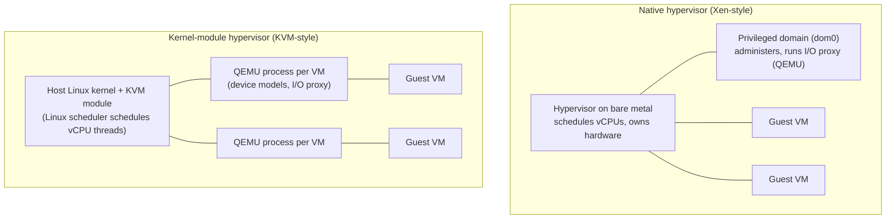
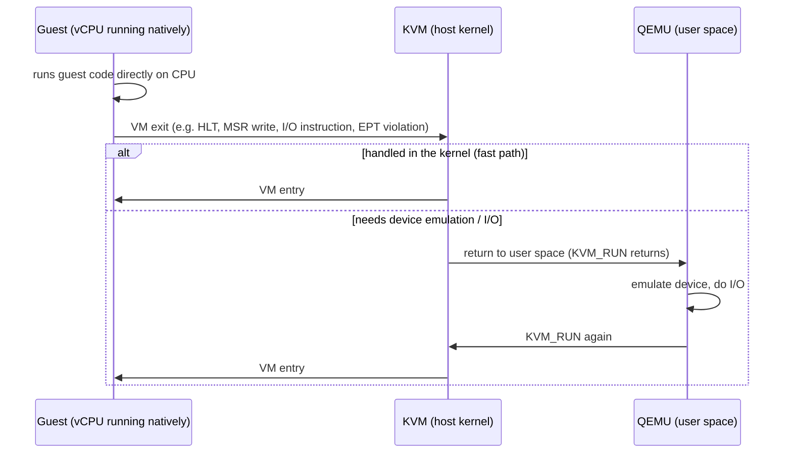
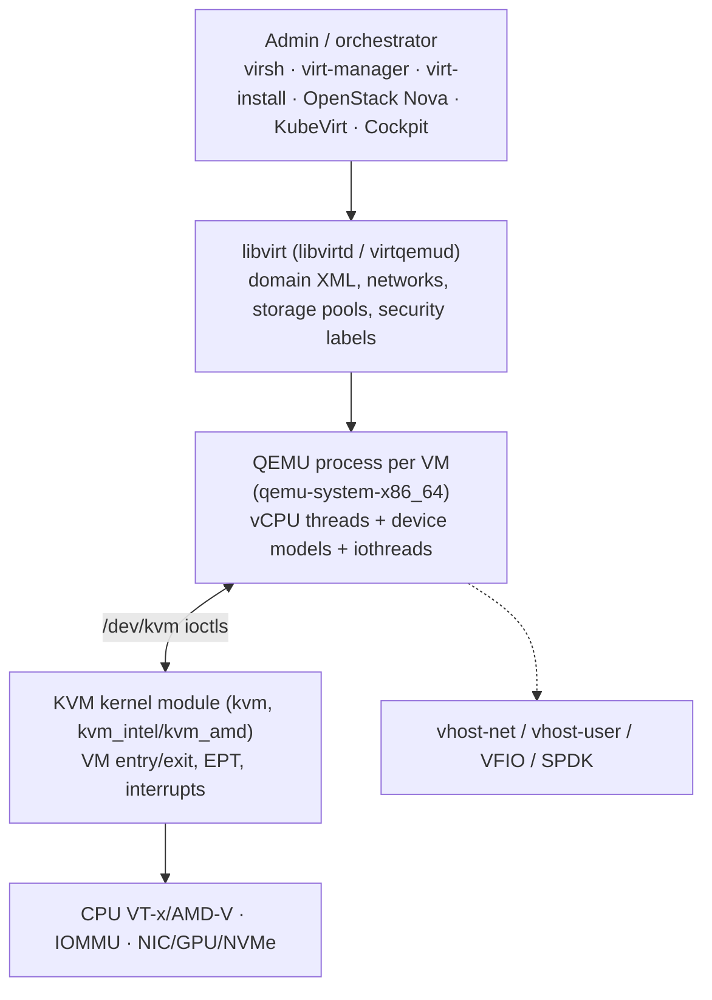

# 1.26 KVM, QEMU and libvirt basics

| | |
|---|---|
| Level | Intermediate |
| Priority tier | 0 |
| Lab venue | A Linux host with hardware virtualisation or nested virtualisation (a GCP VM with nested virtualisation enabled, or any bare-metal Linux box); GPU passthrough needs a bare-metal GPU host |
| Part | Part 1: Linux, from the command line to the kernel and performance |
| Status | Drafted, labs **untested** |

## Why this matters for AI infrastructure

Almost every GPU you rent is attached to a virtual machine, and many on-premises AI platforms run VMs too. Picture where you will meet them. Kubernetes nodes sit on a hypervisor. GPU passthrough VMs give a tenant its own device. KubeVirt runs VMs inside Kubernetes, and Kata Containers give pods stronger isolation. Development and test clusters run on KVM, and so do image-build farms and CI for drivers and kernels.

The people who design, debug and cost these systems need to know what a hypervisor does to CPU, memory, I/O and GPUs. A VM can be as fast as bare metal for compute and still be slow for networking. Why? That is what this chapter explains, along with why vCPU pinning and huge pages matter, why `%steal` appears, why a GPU needs an IOMMU before it can be passed through, and why features such as NVLink fabric management, MIG and P2P behave differently in guests.

You may never operate a hypervisor yourself, because cloud providers do that for you. You will still be asked to explain, size and troubleshoot virtualised GPU environments. You will also run VMs yourself, to test cluster software, images and kernels. KVM, QEMU and libvirt form the standard open-source stack, and most large clouds use it, Google Compute Engine among them.

This chapter is built around one goal: giving a virtual machine a GPU safely. To get there, it covers the machinery first: VT-x and AMD-V, VM exits, EPT and NPT, IOMMU, virtio, vhost, VFIO and SR-IOV. Then it covers the software stack: the KVM kernel module, QEMU, libvirt, `virsh`, `virt-install` and cloud-init. After that come storage and network configuration, performance tuning and observation from both host and guest, GPU passthrough and sharing, security, and a hands-on lab. Cloud architecture, including instance families, multitenancy, capacity, orchestration and comparisons, is in chapter 1.27. Containers and namespaces are in chapters 1.19 and 1.20.

## Prerequisites and outcomes

Before you start, you should be comfortable with processes, memory and NUMA (1.17), CPU scheduling and cgroups (1.18), namespaces and containers (1.19), kernel modules (1.22), performance methods (1.23), and tracing (1.24).

When you finish this chapter, you should be able to do the following.

- Explain system virtual machines, the difference between emulators and hardware-assisted virtualisation, and the two practical hypervisor configurations: the native hypervisor and the kernel-module hypervisor.
- Explain CPU virtualisation, including privilege rings, trap-and-emulate, binary translation, paravirtualisation, VT-x and AMD-V, and VM entry and exit. Explain memory virtualisation, including two-dimensional page walks, EPT and NPT, and shadow page tables. Explain I/O virtualisation, including emulation, virtio, vhost, passthrough, SR-IOV and the IOMMU.
- Describe how KVM, QEMU and libvirt fit together. Create, inspect, modify and destroy VMs with `virt-install`, `virsh` and domain XML. Use cloud-init images and storage pools, and configure NAT, bridged and macvtap networking.
- Choose disk formats and cache modes, and configure virtio-blk, virtio-scsi and virtio-net, with multiqueue and vhost.
- Tune a VM for performance by choosing the CPU model, pinning, NUMA placement, huge pages, iothreads and halt polling. Reason about the overhead sources: VM exits, EPT violations, double caching, ballooning and steal.
- Observe a VM from the host and from the guest, using `top`, `pidstat -t`, `perf kvm stat`, `kvm:kvm_exit`, `kvmexits.bt`, `%steal` and the guest tools.
- Explain GPU passthrough with VFIO, covering IOMMU groups, driver binding, kernel parameters, BAR sizing and NUMA alignment. Explain vGPU and MIG-backed VMs, and the limits for NVLink and NVSwitch systems. List the security features, including sVirt, seccomp, SELinux or AppArmor, and confidential computing.
- Troubleshoot the common failures: no KVM, nested virtualisation switched off, networking faults, a disk that fills up from a qcow2 image, stolen time, and passthrough failures.

## 1. Virtual machines in one page

Suppose you want a second operating system, with its own kernel, running on a machine you already have. A **system virtual machine** gives you one. It emulates a whole computer, including the CPU, memory, interrupt controller, timers, disks and network cards, so that an unmodified operating system can run inside it.

The program that creates and runs the machine is the **hypervisor**, also called the **virtual machine monitor**, or **VMM**. The operating system inside is the **guest**, and the machine that runs the hypervisor is the **host**. A *process* virtual machine, such as the JVM, is a different thing.

There are two ways to build a system VM. An emulator interprets every guest instruction in software. QEMU in TCG mode works this way, and so do old game-console emulators. That approach is flexible, because a different CPU architecture can be emulated, but it is slow.

Hardware-assisted virtualisation takes the other route. Guest instructions run directly on the physical CPU, and the hypervisor steps in only when the guest does something privileged or touches a virtual device. CPU performance is then close to native. KVM works this way, and clouds use it. Think of the first route as reading a translation aloud, and the second as speaking the language yourself.

### Hypervisor types and configurations

The classical **Type 1** hypervisor runs directly on the hardware. People also call that bare metal or native, and Xen, VMware ESXi and Hyper-V are examples. A **Type 2** hypervisor runs inside a host operating system, as VirtualBox and early QEMU do. Kernel modules have blurred that line, so a more practical split is by where the hypervisor lives. Either a small native hypervisor sits on bare metal with a privileged management VM beside the guests, or the host Linux kernel itself acts as the hypervisor through a module. The diagram shows both.



In KVM, each VM is an ordinary Linux process, `qemu-system-x86_64`. Each virtual CPU is an ordinary thread of that process, named `CPU 0/KVM`, `CPU 1/KVM` and so on. The host's own scheduler, memory manager, cgroups, NUMA policy, `perf` and tracepoints all apply to it. That is KVM's strength, and it is why chapters 1.8, 1.17 and 1.18 carry over so neatly. What you already know about Linux processes applies to VMs too.

Amazon's Nitro goes further. It is KVM-derived, with network, storage and management work offloaded to hardware. There is no QEMU I/O proxy on the data path, so performance is near bare metal.

### Why VMs, and why not

VMs earn their place in several situations. They suit testing and disposable environments. They suit applications that need another operating system, and servers and cloud services. They give strong multi-tenant isolation with separate kernels, plus snapshots and migration. Legacy workloads live in them too.

They also have drawbacks, and those drawbacks are what motivate containers in chapter 1.19. Each VM needs installation and configuration work, which you can automate with Ansible, images and cloud-init. Each VM boots slowly and carries a full operating system that you must patch and secure. Dependency conflicts can still appear at the OS level, and one VM per service becomes expensive. Each VM also needs extra memory for its guest kernel, for QEMU and for double caching.

For any single service, decide whether a separate kernel is worth the extra memory and boot time, or whether a container will do.

### Software emulators and hardware help

A virtual machine can be built entirely in software, and people usually call that an emulator. That route is flexible, and it can run old computer and game systems such as the Commodore 64 and Atari 2600. It is also slow. Hardware-assisted virtualization uses the real CPU as much as it can, which gives much better performance. This chapter focuses on that second kind, because it is what a Linux user normally meets.

### Drawbacks of virtual machines

Virtual machines are convenient, but a few problems show up in daily work. Installing and configuring a system takes time, even with a tool such as Ansible. A VM also boots slowly, because it is still a full Linux system with systemd and sshd. You must patch and secure every one of those systems.

Application conflicts are another risk. Some programs have unusual dependencies that clash with the software on a production machine. A library update inside the VM can also break something that worked before. The common advice is one application service per system, but that can be wasteful and costly, especially when cloud providers charge per instance.

These problems are no different from the ones you meet on real hardware, and in a small operation they are not necessarily impediments. However, once you start running more services, they become more noticeable and cost more time and money. That is when containers become worth considering.

## 2. How the hardware helps

You boot a VM and expect it to feel like the host. Sometimes it does, and sometimes the same code crawls. The difference usually comes down to how much the hardware helps, and where it cannot. That help arrives in three places: the CPU, memory, and the devices.

### CPU virtualisation

Classic x86 CPUs had privilege rings, numbered 0 for the kernel and 3 for user programs. A guest kernel expects to run in ring 0, but only the hypervisor is allowed to use ring 0. The guest therefore believes it owns the machine while the host keeps the real keys. Four approaches grew out of that conflict, and you should know them in order.

1. **Trap-and-emulate.** Run the guest in user mode. Privileged instructions then fault, and the hypervisor traps them and emulates the result. The catch is that x86 had instructions that behaved differently without trapping at all, so this approach was not directly possible.
2. **Binary translation.** VMware used this from 1998. The hypervisor rewrites problematic guest kernel code on the fly, runs the VMM in ring 0 and runs the guest kernel in ring 1. It works, but it carries overhead.
3. **Paravirtualisation (PV).** The guest kernel is changed to call the hypervisor directly through **hypercalls**, instead of running privileged operations itself. Xen does this. It is efficient, but the guest must support it.
4. **Hardware assist.** Intel VT-x and AMD-V, introduced between 2005 and 2006, add a CPU mode for the hypervisor, called VMX root, and a mode for the guest, called non-root. The guest kernel runs in ring 0, but that ring 0 is unprivileged from the host's point of view. A control structure, the **VMCS** on Intel and the **VMCB** on AMD, describes the guest state and which events cause exits. Some guest actions are intercepted on purpose. Executing `CPUID` or `HLT` is one, and so are port or MSR access, receiving an interrupt, and raising an EPT fault. On those, the CPU performs a **VM exit**: it saves the guest state and runs the hypervisor. After the hypervisor handles the event, a **VM entry** resumes the guest.



**VM exits are where virtualisation costs time.** Two things matter: how long the CPU spends outside the guest handling exits, and how often exits happen. An exit that the kernel handles on its own is cheap. An exit that must go back to QEMU in user space costs much more, because of the context switches.

The common exit reasons are `HLT`, which an idle vCPU produces, `MSR_WRITE` for timer programming, `EXTERNAL_INTERRUPT`, `PENDING_INTERRUPT`, `IO_INSTRUCTION` or `MMIO` for device access, `EPT_VIOLATION` or `EPT_MISCONFIG` for memory, `CPUID`, and `PREEMPTION_TIMER`. You can reduce exits with paravirtual devices such as virtio, posted interrupts, APIC virtualisation with APICv or AVIC, hardware-assisted timers, halt polling and passthrough.

KVM exposes its API through `/dev/kvm` and a set of ioctls, including `KVM_CREATE_VM`, `KVM_CREATE_VCPU`, `KVM_SET_USER_MEMORY_REGION` and `KVM_RUN`. A user-space VMM opens that device. QEMU is one example, and Firecracker, Cloud Hypervisor and crosvm are others. The VMM defines guest memory as a region of its own address space. It then runs each vCPU thread in a `KVM_RUN` loop, which returns to user space only when the VMM must emulate something.

Run these checks on the host first. `lscpu | grep -i virtualization` and `grep -E 'vmx|svm' /proc/cpuinfo` show whether the CPU supports hardware virtualisation. `ls -l /dev/kvm` and `lsmod | grep kvm` should show the device and the `kvm_intel` or `kvm_amd` module. On Ubuntu, `kvm-ok` comes from the `cpu-checker` package, and `virt-host-validate` runs a broader set of checks. If the output says virtualisation is disabled in firmware, turn on VT-x or AMD-V in the BIOS, along with VT-d or AMD-Vi.

### Memory virtualisation

A guest has three kinds of address: guest virtual, guest physical and host physical. Picture a letter with two forwarding addresses written on the envelope. A memory access needs two translation stages in the same way. The guest page tables map guest virtual addresses to guest physical ones, and the hypervisor maps guest physical addresses to host physical ones.

- **Shadow page tables** are the older approach. The hypervisor intercepts every change the guest makes to its page tables, and it keeps combined guest-virtual to host-physical tables, which load into CR3. That approach produces many exits.
- **Nested paging** uses EPT on Intel and NPT on AMD. The hardware walks both sets of tables, which is called a **two-dimensional page walk**, and it caches the results in the TLB. This means fewer exits. A TLB miss, however, costs more memory references: up to 24 for 4-level paging in both dimensions. That is why **huge pages** matter so much. Using 2 MiB or 1 GiB pages in the guest *and* the host shortens both walks and improves TLB reach, as chapter 1.17 explains.
- Guest memory is simply host process memory, either anonymous or backed by hugetlbfs. That gives the host several controls. It can swap guest memory, share pages through KSM (same-page merging), overcommit it, balloon it with `virtio-balloon`, which returns pages to the host, bind it to a NUMA node, or lock it. Locking is required for device passthrough, because DMA targets fixed physical pages.
- **Double caching** happens when the host page cache and the guest page cache both hold the same disk data. You avoid it with `cache=none`, which uses direct I/O for virtual disks.

Here is the arithmetic behind the huge-page advice. With 4-level paging in both dimensions, the worst case is 24 memory reads for one TLB miss. With 1 GiB huge pages in both guest and host, the lab counts 8 reads. The gap is the reason to plan huge pages before you size a memory-heavy guest.

### I/O virtualisation and the IOMMU

Here is a scene you will meet. A test VM boots fine, then crawls the moment it touches the network, until a colleague says two words: use virtio. A Windows guest hits a related wall from the other side, because its virtio drivers have to be installed rather than arriving with the operating system. Between full emulation and handing the guest the real device sits a spectrum of choices. The table compares them. Read it from left to right: the faster methods usually need more from the driver or the hardware, and passthrough ties a device to a single VM.

| Method | How | Performance | Flexibility |
|---|---|---|---|
| **Full emulation** | QEMU emulates real hardware (e1000 NIC, IDE/AHCI disk) | Slow: many exits per I/O | Works with any guest OS |
| **Paravirtual (virtio)** | Guest uses a `virtio` driver; shared-memory rings (virtqueues) between guest and host; fewer exits | Good (near line rate with tuning) | Needs virtio drivers (in Linux; Windows needs drivers) |
| **vhost / vhost-user** | The virtio back end runs in the host kernel (`vhost-net`) or in a separate user-space process (`vhost-user`, DPDK/SPDK/OVS-DPDK), bypassing QEMU on the data path | Better throughput/lower CPU | More plumbing |
| **PCI passthrough (VFIO)** | A whole physical PCIe device is assigned to one guest; guest driver talks to hardware; the **IOMMU** translates and isolates DMA | Native (GPU, NIC, NVMe) | Device exclusive to one VM; complicates migration |
| **SR-IOV** | A physical function (PF) exposes virtual functions (VFs); each VF is passed through to a guest | Near-native, shareable | Needs device and driver support; VF count limits; live migration hard |
| **mediated devices / vGPU / MIG** | A vendor driver multiplexes a device into slices | Near-native with QoS | Vendor licence/driver |

The IOMMU, which is Intel VT-d, AMD-Vi or Arm SMMU depending on the hardware, does for device DMA what the MMU does for CPU accesses. Think of it as a bouncer standing at the memory door. It translates the addresses a device sees, and it limits each device to the memory the hypervisor allows. That limit is what makes passthrough safe, because a malicious guest driver cannot DMA into host memory. Linux exposes this through VFIO, under `/dev/vfio/*`.

Devices that cannot be isolated from each other are grouped into **IOMMU groups**. Interrupts are virtualised too, using posted interrupts and APICv or AVIC, so that each interrupt does not cause an exit.

When you read VM configurations, you will see names such as `virtio-blk`, `virtio-scsi`, `virtio-net`, `virtio-balloon`, `virtio-fs`, `virtio-vsock`, `vhost-net`, `vfio-pci` and `qemu-guest-agent`. Some are plain English once you know the shape. OVMF is the UEFI firmware for guests. `q35` is the modern chipset with PCIe, and `i440fx` is the legacy one. `QMP` is the QEMU Machine Protocol. You will also see `qcow2` and `cloud-init` in almost every VM setup.

Keep the IOMMU in mind whenever you plan a GPU or a NIC for a guest, because passthrough without it is not safe.

## 3. The stack: KVM, QEMU, libvirt

Picture your first `virsh` session. You type `virsh list --all` and wonder who actually decides what a VM is, and which of the three names in this chapter is doing the work. Three layers are answering at once.

Read the diagram from the top down. Admins and orchestrators sit at the top. libvirt holds the configuration in the middle. QEMU runs each machine, and the KVM kernel module does the hardware work underneath.



The three names are easy to tangle, so keep one picture. KVM is the kernel side. QEMU is the process that builds and runs a machine. libvirt is the manager you talk to.

**KVM** (Kernel-based Virtual Machine) is the set of Linux kernel modules, `kvm` plus `kvm_intel` or `kvm_amd`, that turn Linux into a hypervisor for hardware-assisted guests. Qumranet developed it, and Red Hat acquired Qumranet in 2008. Google Compute Engine and many private clouds use KVM today.

**QEMU** (Quick Emulator) is the user-space program that creates the machine. It allocates guest RAM, runs one thread per vCPU that calls `KVM_RUN`, and emulates devices such as the chipset, the PCI bus, disk and network controllers, VGA, serial ports and USB. It loads firmware, either SeaBIOS or OVMF for UEFI.

It implements the virtio back ends and handles migration, snapshots and the monitor, which speaks HMP or QMP. QEMU can also run as a pure emulator (TCG) for other architectures, and its `qemu-img` and `qemu-nbd` tools handle disk images. The machine types include `q35`, which is modern and uses PCIe, and the legacy `i440fx`. There are also `microvm`, and `virt` on Arm.

**libvirt** is a management API and daemon. It gives you one interface, made of domain XML and `virsh`, over KVM and QEMU, and also over Xen, LXC, VirtualBox and others. It manages storage pools, virtual networks, security labels (SELinux sVirt or AppArmor), cgroup placement, the lifecycle (start, stop, save and restore), snapshots and migration. Under systemd, VMs appear under `machine.slice` with their own cgroups. The CPU, memory and I/O limits from chapter 1.18 therefore apply directly.

### Command-line QEMU (to see what libvirt generates)

Before you rely on libvirt, it helps to see the raw QEMU command it builds for you. The block below creates a disk and starts a VM with KVM acceleration.

```bash
qemu-img create -f qcow2 disk.qcow2 40G
qemu-system-x86_64 -enable-kvm -machine q35,accel=kvm -cpu host -smp 4 -m 8G \
  -drive file=disk.qcow2,if=virtio,cache=none,discard=unmap,aio=native \
  -netdev user,id=n0,hostfwd=tcp::2222-:22 -device virtio-net-pci,netdev=n0 \
  -cdrom ubuntu.iso -boot d -display none -serial mon:stdio
# libvirt shows the real command: ps -ww -o args -C qemu-system-x86_64 ; or: virsh domxml-to-native qemu-argv --domain vm1
```

The last comment line shows how to see the command libvirt actually runs.

### Installing and checking (Ubuntu/Debian)

On Ubuntu or Debian, install the packages, add your user to the `libvirt` and `kvm` groups, and then check the host.

```bash
sudo apt install qemu-kvm libvirt-daemon-system libvirt-clients virtinst bridge-utils cloud-image-utils libguestfs-tools ovmf cpu-checker
sudo usermod -aG libvirt,kvm $USER            # re-login
kvm-ok ; virt-host-validate                   # checks KVM, IOMMU, cgroups, etc.
systemctl status libvirtd                     # or virtqemud on newer split-daemon setups
virsh uri ; virsh -c qemu:///system list --all   # system instance (root-owned VMs) vs qemu:///session (per-user)
```

Log out and back in after the group change, or the new group will not apply. The `virsh uri` line tells you which instance you are talking to. `qemu:///system` holds the root-owned VMs, and `qemu:///session` holds the per-user ones. Check that line whenever a VM you expect to see seems to have vanished.

### Creating a VM with a cloud image and cloud-init

Cloud images are small, preinstalled disk images, and they change how you think about installation. You do not run an installer with them. Instead, cloud-init configures the instance at first boot, using user data and meta data from a seed ISO or another datasource. The commands below build a VM this way.

```bash
mkdir -p ~/vms && cd ~/vms
wget https://cloud-images.ubuntu.com/jammy/current/jammy-server-cloudimg-amd64.img        # check current URL/checksum first
qemu-img create -f qcow2 -F qcow2 -b jammy-server-cloudimg-amd64.img vm1.qcow2 40G         # thin copy-on-write overlay on the base image
cat > user-data <<'EOF'
#cloud-config
hostname: vm1
users:
  - name: ubuntu
    sudo: ALL=(ALL) NOPASSWD:ALL
    ssh_authorized_keys: [ "ssh-ed25519 AAAA... you@laptop" ]
package_update: true
packages: [qemu-guest-agent]
runcmd: [ systemctl enable --now qemu-guest-agent ]
EOF
echo "instance-id: vm1" > meta-data
cloud-localds seed.iso user-data meta-data
sudo virt-install --name vm1 --memory 8192 --vcpus 4 --cpu host-passthrough \
  --disk path=$PWD/vm1.qcow2,bus=virtio,cache=none,discard=unmap --disk path=$PWD/seed.iso,device=cdrom \
  --os-variant ubuntu22.04 --network network=default,model=virtio --graphics none --import --noautoconsole
virsh list ; virsh domifaddr vm1 ; ssh ubuntu@<ip>
```

The overlay is a thin copy-on-write file that sits on top of the base image, so you can make a new VM in seconds. Once the VM is up, `virsh domifaddr` tells you its address for the SSH login.

### Day-to-day virsh

Most of your daily work is a handful of `virsh` commands. Once you know them, a VM stops feeling like a black box. The block below groups them by task.

```bash
virsh list --all ; virsh start|shutdown|reboot|destroy|suspend|resume vm1     # destroy = power off (not delete)
virsh autostart vm1 ; virsh dominfo vm1 ; virsh domstats vm1 ; virsh vcpuinfo vm1 ; virsh domblklist vm1 ; virsh domiflist vm1
virsh console vm1 ; virsh dumpxml vm1 ; virsh edit vm1                          # libvirt's domain XML is the source of truth
virsh setvcpus vm1 8 --config --maximum ; virsh setmem vm1 16G --config         # persistent changes (take effect after restart)
virsh snapshot-create-as vm1 s1 --disk-only --atomic ; virsh snapshot-list vm1 ; virsh blockcommit ...   # external snapshots
virsh undefine vm1 --nvram --remove-all-storage                                 # delete VM and disks (careful)
virsh qemu-agent-command vm1 '{"execute":"guest-info"}' ; virsh domfsfreeze vm1   # with qemu-guest-agent
virsh migrate --live --persistent vm1 qemu+ssh://dest/system                    # needs shared storage or --copy-storage-all
virsh net-list --all ; virsh net-dumpxml default ; virsh pool-list --all ; virsh vol-list default
```

Pay attention to the comments. `destroy` powers a VM off without deleting it. The `--config` changes to `setvcpus` and `setmem` are saved to the definition, so they take effect after a restart. The `undefine` command with `--remove-all-storage` deletes the VM and its disks, so use it carefully.

### Domain XML: the parts that matter

The domain XML is the source of truth for a VM. The fragment below shows the settings that matter for performance. Each comment explains what its setting does.

```xml
<domain type='kvm'>
  <name>vm1</name>
  <memory unit='GiB'>16</memory>
  <memoryBacking><hugepages/><locked/></memoryBacking>          <!-- huge pages + locked memory -->
  <vcpu placement='static'>8</vcpu>
  <iothreads>2</iothreads>
  <cputune>
    <vcpupin vcpu='0' cpuset='2'/> <vcpupin vcpu='1' cpuset='3'/>   <!-- pin vCPUs to host CPUs on the right NUMA node -->
    <emulatorpin cpuset='0-1'/> <iothreadpin iothread='1' cpuset='0'/>
  </cputune>
  <numatune><memory mode='strict' nodeset='0'/></numatune>
  <cpu mode='host-passthrough' check='none'>                     <!-- expose the host CPU model; use for performance, breaks live migration between different CPUs -->
    <topology sockets='1' cores='4' threads='2'/>
    <numa><cell id='0' cpus='0-7' memory='16' unit='GiB'/></numa>
  </cpu>
  <os><type arch='x86_64' machine='q35'>hvm</type><loader readonly='yes' type='pflash'>/usr/share/OVMF/OVMF_CODE.fd</loader></os>
  <devices>
    <disk type='file' device='disk'>
      <driver name='qemu' type='qcow2' cache='none' io='native' discard='unmap' iothread='1'/>
      <source file='/var/lib/libvirt/images/vm1.qcow2'/><target dev='vda' bus='virtio'/>
    </disk>
    <interface type='network'><source network='default'/><model type='virtio'/><driver name='vhost' queues='4'/></interface>
    <hostdev mode='subsystem' type='pci' managed='yes'><source><address domain='0x0000' bus='0x3b' slot='0x00' function='0x0'/></source></hostdev>   <!-- PCI passthrough -->
    <memballoon model='none'/>
  </devices>
</domain>
```

Pinning, huge pages and locked memory are the settings to look at first for a performance guest. Locked memory is also required for device passthrough.

Use libvirt and `virsh` for every change, so the domain XML stays the single record of what the VM is.

## 4. Storage

Storage decides how fast a guest's disk is, and how much of the host's disk the guest quietly uses. A thin image that grows until the host filesystem is full can end an afternoon badly. The table lists the options you will meet.

| Choice | Notes |
|---|---|
| **Format** | `raw`: simplest/fastest, no features beyond what the backing store gives (LVM volume, zvol, NVMe partition, or file). `qcow2`: thin provisioning, backing files (linked clones), snapshots, compression, encryption; some overhead and metadata caching; set `lazy_refcounts`, larger `cluster_size`, preallocation (`preallocation=metadata`/`falloc`) for performance. Over-committed qcow2 files can **fill the host filesystem** and pause guests |
| **Backing** | File on a filesystem; LVM logical volume or raw block device (low overhead); Ceph RBD / iSCSI / NVMe-oF / NFS (network); local NVMe passthrough |
| **Bus/controller** | `virtio-blk` (simple, fast), `virtio-scsi` (many disks, discard, hotplug, SCSI features), `nvme` emulation, passthrough NVMe (best, exclusive); avoid `ide`/`sata` emulation except for compatibility |
| **Cache mode** | `none` (O_DIRECT, bypass host page cache, recommended with virtio and when the guest caches), `writethrough`, `writeback` (fast but data loss risk on host crash without flush), `unsafe` (testing only), `directsync` |
| **AIO** | `io=native` (with `cache=none`) or `io=io_uring`; `threads` otherwise |
| **IOThreads** | Dedicated threads for disk I/O so QEMU's main loop and vCPU threads are not blocked |
| **Discard/TRIM** | `discard=unmap` plus `fstrim` in the guest returns space to thin images |
| **Snapshots** | Internal (in qcow2) versus external (overlay files); long chains hurt performance, commit/flatten regularly; they are not backups |

Most rows involve a trade-off, such as speed against data safety. The cache mode is the row you should read most carefully, because `writeback` is fast but risks data loss after a host crash without a flush.

Several tools work on these images. `qemu-img info|create|convert|resize|check|commit|rebase` handles the format work, and `qemu-nbd` is the companion tool. `guestfish`, `virt-customize` and `virt-sysprep` come from libguestfs. They inspect and modify images, and they can remove machine-specific state. `virt-resize` and `losetup` round out the set. For AI scratch data, passthrough NVMe or a raw LVM volume with `cache=none` is the choice to prefer. Measure both options with `fio` inside the guest and on the host, as chapter 1.25 describes.

Measure passthrough NVMe against a raw LVM volume before you commit to either one for scratch space.

## 5. Networking

Networking decides who can reach a VM, and how fast its packets move. Get the mode wrong and the guest is perfectly healthy but unreachable. The table lists the common modes.

| Mode | How | Use |
|---|---|---|
| **User-mode (SLIRP)** | QEMU user networking with NAT and port forwarding | Quick tests, rootless; slow |
| **libvirt NAT network (`default`)** | `virbr0` bridge + dnsmasq (DHCP/DNS) + iptables/nftables NAT; guests get 192.168.122.0/24 | Dev/test; guests not reachable from outside without forwarding |
| **Linux bridge** | Guests' tap devices attach to a host bridge (`br0`) enslaving the physical NIC; guests are on the physical L2 network | Servers that must be reachable; the NIC itself must not hold the IP |
| **macvtap** | Virtual interface directly on a physical NIC (modes: bridge, vepa, private, passthru) | Simple, but host-to-guest traffic over the same NIC may not work in some modes |
| **Open vSwitch** | Programmable virtual switch (VLANs, tunnels, flows, DPDK) | Cloud-scale networking, SDN |
| **SR-IOV VF / NIC passthrough** | Pass a VF or PF into the guest | Near-native throughput/latency (including RDMA) |
| **vhost-user + DPDK** | User-space data plane | High packet rates |

Choose the mode by asking who needs to reach the guest. You want the NAT network for dev and test work, because guests are not reachable from outside without forwarding. A Linux bridge puts the guest on the physical network, so the host's NIC carries no IP address of its own. The table lays those choices out side by side.

The standard fast path is `virtio-net` with `vhost`, which is the in-kernel back end, and `queues=N` for multiqueue. Set the queues with `ethtool -L` in the guest. Then check the offloads with `ethtool -k`.

The MTU must match across the guest, the tap device, the bridge and the physical network, because jumbo frames work only when they are enabled end to end. Also check the host's `net.bridge.bridge-nf-call-*` settings. libvirt has its own commands, `virsh net-define|net-start|net-autostart` and `virsh attach-interface`. Namespaces and veth pairs from chapter 1.19 are the container version of this setup. A Linux bridge plus a tap device is the VM version.

You should decide the network mode first, because it determines whether anyone outside the host can reach the guest.

## 6. Performance: what costs what, and how to tune

Here is the question every VM tuning session starts with: where does the time go? Overhead comes from three areas. CPU overhead comes from guest exits, both how often they happen and how long they take, and from interrupt and timer virtualisation. Memory overhead comes from two-level page walks, from the extra kernel and QEMU memory each VM needs, and from double caching.

I/O overhead has historically been the largest. Every device access caused an exit. Virtio, vhost, SR-IOV or passthrough, and hardware offload such as Nitro reduce that cost. Contention adds more, through stolen time, cache pollution from other tenants, and interrupts caused by neighbours' I/O.

CPU-bound user-space code runs at close to native speed. The workloads that suffer are the exit-heavy ones, such as lots of small I/O, timers and privileged operations. Memory-heavy work with poor TLB behaviour suffers too, and so does anything limited by unfaithful emulation.

Tune the host first, then libvirt. The checklist below follows that order, and you can work through it one item at a time.

1. **Host.** Set the BIOS to enable VT-x, VT-d, a performance power profile, a deliberate SMT policy and NUMA. Boot with `intel_iommu=on iommu=pt`, or with `amd_iommu=on`. Use the `performance` governor, limit C-states, and decide your THP policy. For dedicated CPUs, use `isolcpus`, `nohz_full` and `irqaffinity`. Know the NUMA topology with `lscpu`, `numactl -H`, `virsh nodeinfo` and `virsh capabilities`.
2. **CPU.** Use the `host-passthrough` CPU model, which exposes features such as AVX-512 and AMX. Set a correct topology with `sockets/cores/threads`. Pin vCPUs to dedicated host CPUs with `vcpupin`, all on one NUMA node. Pin the emulator and iothreads to separate CPUs with `emulatorpin` and `iothreadpin`. Do not oversubscribe vCPUs on pinned VMs, and expose SMT siblings consistently. Look at `kvm halt_poll_ns`, and at timing, through `<cpu><feature policy='require' name='invtsc'/>` or `kvm-clock`. Disable ballooning and KSM for latency-sensitive guests.
3. **Memory.** Use huge pages (`<hugepages/>`), preallocated with `vm.nr_hugepages` or `hugepagesz=1G hugepages=N`. Use `<locked/>` for passthrough. Set `numatune` to `strict`, on the same node as the CPUs and devices. For large VMs, match the guest NUMA topology to the host.
4. **Disk.** Use virtio-scsi or virtio-blk with iothreads and `cache=none`. Choose a raw image, a preallocated qcow2 image, or passthrough NVMe.
5. **Network.** Use `virtio-net` with `vhost` and multiqueue, and a correct MTU. Match RSS and IRQ affinity in the guest and on the host. Or use SR-IOV.
6. **Guest.** Install virtio drivers, `qemu-guest-agent` and a current kernel. Apply `tuned-adm profile virtual-guest` or `throughput-performance`. Set THP and huge pages inside the guest, use `kvm-clock` or `tsc` as the clocksource, and place NUMA-aware applications deliberately.

For GPU workloads, tune the VM as you would a bare-metal node, as chapter 1.28 describes. Then check that the guest sees the same topology as the physical machine, using `nvidia-smi topo -m`, `lscpu` and `numactl -H`. A wrong topology silently breaks NCCL and GPUDirect performance. Examples are all GPUs on one virtual PCIe root, or a NIC on a different NUMA node from its GPU.

Start with the host, because the guest settings depend on what the host exposes. If you tune the guest first, you will chase settings that the host then overrides.

## 7. Observing VMs

When a guest feels slow, you have two places to stand: the host and the guest. Start with the host, because every VM is visible there as a process.

**From the host**, every VM is a process, so `top`, `ps` and `pidstat` can all see it. Run `pidstat -tp <qemu-pid> 1` to get per-thread usage. Threads named `CPU n/KVM` are vCPUs. `%guest` is the time spent running guest code. `%system` and `%usr` inside a vCPU thread are host or QEMU work, such as exits and emulation.

To map a QEMU PID to a VM name, read the `-name` argument with `ps -wwfp PID`, or use `virsh list` together with `virsh dumpxml | grep pid` or the `/run/libvirt/qemu/*.pid` files. For per-VM usage, use `virsh domstats`, `virt-top` and `systemd-cgtop`, since VMs live under `machine.slice`. Cgroup files help too. For example, `cpu.stat` shows throttling if you set limits.

**VM exits** are the best single measure of virtualisation overhead. The commands below record them and count them.

```bash
sudo perf kvm stat record -a -- sleep 10 ; sudo perf kvm stat report            # exit reasons with counts and time; or: perf kvm stat live
sudo perf stat -e 'kvm:kvm_exit' -a -- sleep 5                                  # exit rate
sudo bpftrace -l 't:kvm:*' ; sudo bpftrace -lv t:kvm:kvm_exit                   # fields: exit_reason, guest_rip, ...
# exit-reason histogram by duration: use a kvm_exit -> kvm_entry bpftrace script (e.g. kvmexits.bt) or perf script on kvm tracepoints
```

Here is how to read the results. A mostly idle guest shows mainly `HLT` exits. Their durations look large, but they cost nothing, because the vCPU is idle. `MSR_WRITE` exits for timer programming, and `EXTERNAL_INTERRUPT` exits, are frequent but cheap. Many `IO_INSTRUCTION` or `MMIO` exits mean heavy emulated device I/O. A histogram of `EPT_VIOLATION` exits shows memory faulting.

When the exit rate is high and the exit time is large, the VM is paying a heavy price. Exits that return to user space in QEMU cost more than exits the kernel handles on its own. For deeper views, attach kprobes to KVM exit handlers, such as `handle_halt`. You can also sample the guest CR3 register to see whether one guest process or many are running.

**From inside the guest**, everything works as usual, including BPF, perf software events and flame graphs. The resources are virtual, though. `lscpu` shows vCPUs, so check the topology there. `mpstat -P ALL` shows only vCPUs.

The `st` column in `vmstat`, and the `%steal` column in `mpstat`, show CPU time that the hypervisor gave to other tasks or throttled. Sustained steal means noisy neighbours, CPU overcommit or limits.

`iostat` and `biosnoop` show virtual device latency. A limit or contention appears as latency outliers. Characterise the I/O size and pattern to see whether the outliers match the size, queue behind flushes, or show no pattern. Random outliers suggest physical contention. Hardware performance counters (PMCs) may be unavailable. Run `dmesg | grep -i balloon` to reveal ballooning, and check the clocksource and `kvm-clock`.

The host operator checks physical-resource USE, per-VM resource-control limits and exit statistics. Guests analyse their virtual resources and infer contention from latency. A deep root cause usually needs access to both sides. Start on whichever side you control, and use the exit counts to decide whether the host or the guest is the problem.

## 8. GPUs and other devices in VMs

This is the part most people came for. A GPU passed through properly performs like bare metal. A GPU passed through carelessly boots, then fails in a way that blames the wrong component. Work through the sections in order: get the device into the guest first, then check the fabric, the peer-to-peer paths and the remaining devices.

### PCI passthrough with VFIO

Passing a GPU to a guest gives native compute performance. The guest's NVIDIA driver talks directly to the device, and the IOMMU isolates its DMA. These are the requirements and steps on Linux with KVM, in order.

1. **Firmware.** Enable VT-d or AMD-Vi, which is the IOMMU, in the BIOS. On some boards you also need SR-IOV, Above-4G decoding and Resizable BAR, which large GPUs use.
2. **Kernel parameters.** Add `intel_iommu=on` or `amd_iommu=on`, and usually `iommu=pt`. For stricter isolation, omit `pt` on the devices that only guests use. Check the result with `dmesg | grep -i -e DMAR -e IOMMU` and `ls /sys/kernel/iommu_groups/`.
3. **IOMMU groups.** Devices that share a group must be passed through together, and the ACS capability of switches and root ports decides the grouping. List the groups with `for g in /sys/kernel/iommu_groups/*; do echo "IOMMU Group ${g##*/}:"; for d in $g/devices/*; do lspci -nns ${d##*/}; done; done`. A GPU that shares a group with unrelated devices cannot be assigned cleanly. An ACS override patch exists, but it weakens isolation, so avoid it in multi-tenant clouds.
4. **Bind to vfio-pci.** Give the device to `vfio-pci` instead of the host driver. You can use `echo 10de 2330 > /sys/bus/pci/drivers/vfio-pci/new_id`, or the kernel parameter `vfio-pci.ids=10de:2330`. Load the module early, and blacklist `nouveau` and `nvidia` for those devices. Or let libvirt do it. With `managed='yes'`, libvirt detaches the device from its host driver and binds it to `vfio-pci` when the VM starts. To verify, run `lspci -nnk -s <bdf>`, which should show `Kernel driver in use: vfio-pci`.
5. **Guest definition.** Add `<hostdev>` entries in libvirt, or `-device vfio-pci,host=3b:00.0` on the QEMU command line. Use `q35` with OVMF. Give the VM enough locked huge-page memory, because device DMA needs pinned memory, and the whole guest RAM is typically locked. Align the vCPUs, the memory and the passed devices on the same NUMA node. Expose a CPU model and topology that the NVIDIA driver and NCCL understand.
6. **In the guest.** Install the NVIDIA driver, which follows the same kernel module story as chapter 1.22, along with CUDA and DCGM. `nvidia-smi` should see the device. For multi-GPU work, pass all the GPUs of a PCIe switch domain together with their NICs. For GPUDirect RDMA, the NIC and the GPU must share an upstream PCIe switch or root complex in the guest topology. The ATS and ACS settings must also permit peer-to-peer. Check the vendor guidance for the flags involved.

Watch for these practical problems. Some GPUs and functions cannot be reset cleanly between guests, which depends on FLR support, and `vendor-reset` may help.

The audio and USB functions of consumer GPUs often share the same group. Huge BARs need 64-bit MMIO windows in the guest firmware, which you configure in OVMF with `-fw_cfg name=opt/ovmf/X-PciMmio64Mb,string=262144`. Consumer GPU drivers may restrict use inside VMs. After a guest crash you may see error 43 or `NVRM: GPU has fallen off the bus`, and the host then needs a reset or a reboot. Many GPUs do not support hotplug. Live migration with passthrough is generally unsupported, though some vendors support it for specific devices.

### KubeVirt: the same passthrough, driven from Kubernetes

KubeVirt runs each VM inside an ordinary Kubernetes pod. A helper process in the pod starts libvirt and QEMU, so everything above still applies: the VM is a QEMU process, its vCPUs are threads, and the GPU reaches it through VFIO. What changes is who does the bookkeeping. Instead of writing `<hostdev>` XML by hand, you request a GPU as a named device resource in the VM's spec, and the scheduler places the VM on a node that has one. The node must already have the IOMMU enabled and the GPU bound to `vfio-pci`, as in the steps above. NVIDIA's GPU Operator can automate that binding on nodes labelled for VM workloads, but the exact labels and settings change between releases, so follow its current documentation.

The same failure modes follow you into Kubernetes. A GPU in a shared IOMMU group still cannot be assigned cleanly, a node with the wrong kernel parameters schedules the VM and then fails to start it, and a flat PCIe topology in the guest still hurts NCCL. Part 11 covers this in depth: chapter 11.21 for PCIe, the IOMMU and VFIO, and chapter 11.27 for KubeVirt, Kata and GPU passthrough.

### NVLink/NVSwitch systems

HGX and DGX-class servers link their GPUs with NVLink and NVSwitch. The Fabric Manager configures that fabric. In a virtualised setup you have a few modes. You can pass all the GPUs and the NVSwitches to one service VM, or to one tenant VM that runs Fabric Manager. Or the host can run Fabric Manager in shared NVSwitch multitenancy mode, which partitions the GPUs so that each VM gets an isolated NVLink fabric.

The details depend on the vendor and the GPU generation, so verify them against NVIDIA's Fabric Manager User Guide and your cloud provider's documentation. MIG-partitioned GPUs can be assigned per MIG instance in some setups. vGPU, NVIDIA's virtual GPU software with mediated devices, time-slices or partitions a GPU, and it needs a licence server. Check the licensing and the supported hypervisors. P2P and GPUDirect between VMs are restricted. NCCL inside a tenant VM works on whatever NVLink or PCIe topology the VM is given.

### Other devices

NICs can use SR-IOV VFs for Ethernet or InfiniBand, with RDMA. That is the standard path to near-native networking in a guest. Create the VFs with `echo N > /sys/class/net/<pf>/device/sriov_numvfs`, and then pass the VFs through. For NVMe, use whole-device passthrough or SPDK vhost-user. `virtio-fs` shares host directories with low overhead, while 9p is slower.

If you plan GPUDirect RDMA, plan the NIC and the GPU as a pair from the start, because the topology decides whether it works.

## 9. Security and isolation

Security is where a VM's neat boundary either holds or quietly leaks. Nothing below is exotic. Each item is one layer you either keep intact or leave open.

- **Hardware boundary.** Each VM has its own kernel and address space. The attack surface is the hypervisor (the VMM) and the virtual devices, and QEMU has had many device-emulation CVEs. Minimise the devices, avoid unused emulated hardware, and keep QEMU and the kernel patched. For untrusted workloads, use a microVM monitor such as Firecracker or Cloud Hypervisor.
- **Confining the QEMU process.** libvirt does this by default. Each VM runs as an unprivileged user, such as `libvirt-qemu` or `qemu`. SELinux sVirt labels or AppArmor profiles apply, and a seccomp sandbox (`-sandbox on`) filters system calls. Cgroups limit devices, CPU and memory, and namespaces add further separation. sVirt gives each VM and its disks unique MCS categories.
- **The IOMMU** protects against malicious DMA. Keep it on, and remember the trade-offs of `iommu=pt`.
- **Side channels** such as Spectre, Meltdown, L1TF and MDS have mitigations, including `mitigations=`, core scheduling and disabling SMT on shared hosts. These cost performance, and the choice belongs to the cloud provider. Dedicated hosts avoid sharing altogether.
- **Confidential computing.** AMD SEV, SEV-ES and SEV-SNP, and Intel TDX, encrypt guest memory against the host. NVIDIA H100 and later GPUs support confidential GPU modes together with a confidential VM. Check the current support matrices and the performance cost before you rely on them.
- **The management plane.** Run libvirt only over TLS or SSH. Protect `/var/lib/libvirt`, the image stores and cloud-init user data. Secrets in user data are readable by the guest.

Decide which workloads may share a host before you choose how much isolation to rely on.

## 10. Nested virtualisation and the lab venue

Suppose the only machine you can practise on is a cloud VM. Practising KVM there needs **nested virtualisation**. The cloud VM, called L1, must expose VMX or SVM to its own guests, which are called L2.

On Google Cloud, create the instance with nested virtualisation enabled. For example, `gcloud compute instances create ... --enable-nested-virtualization` works on supported Intel CPU platforms, with an image that has VMX enabled. Confirm the current flags, the CPU platform and the OS policy requirements, because they change. Inside the VM, check with `grep -c vmx /proc/cpuinfo`.

Nested performance is lower than on bare metal, because each exit from L2 passes through both L1 and L0. GPU passthrough cannot be tested in a nested setup. For realistic passthrough work, use a bare-metal GPU instance or an on-premises machine.

If you need GPU passthrough results, plan for a bare-metal machine from the start.

## 11. Troubleshooting

When a VM misbehaves, start from the symptom in the table. Each row names a likely cause and the command that confirms it.

| Symptom | Cause | Check / fix |
|---|---|---|
| `KVM is not available` / `/dev/kvm` missing | Virtualisation disabled in BIOS, nested virt not enabled, modules not loaded, in a VM without VMX | `lscpu`, `kvm-ok`, `modprobe kvm_intel`, platform settings |
| VM boots slowly or is sluggish | Emulation (no KVM), swap, CPU over-commit, qcow2 on a busy disk | `virsh dumpxml` `type='kvm'`; `pidstat -t`; `vmstat`; `iostat` |
| Guest shows `%steal` | Over-subscribed host or CPU quota | Host `top`, VM pinning; resource limits |
| Guest has no network | Wrong network, bridge or firewall, DHCP, MTU, cloud-init network config | `virsh domiflist`, `brctl show`/`bridge link`, `nft list ruleset`, `tcpdump -i virbr0` |
| `virsh` permission denied | Not in `libvirt` group; wrong URI | `virsh -c qemu:///system` |
| Disk image grows until host full | Thin qcow2 without discard; snapshots | `qemu-img info`; `fstrim`; monitor pool free space; preallocate |
| Cannot start VM with passthrough | Device bound to host driver, IOMMU group not isolated, memory not lockable, ACS | `lspci -nnk`, `dmesg`, `ulimit -l` for qemu, `/sys/kernel/iommu_groups` |
| Guest GPU driver "fallen off the bus" | Reset failure after previous guest, power/BAR issues | Reboot host, check FLR; firmware/OVMF MMIO window |
| Live migration fails | CPU model mismatch, passthrough devices, storage not shared, different QEMU versions | Use a baseline CPU model; compatible machine types |
| Time drifts in the guest | Clocksource, no guest agent, suspend/resume | `chronyd`, `kvm-clock`, `qemu-guest-agent`, `virsh domtime` |

Most of these rows come down to one of three things: KVM is not available, a resource is shared more heavily than you planned, or the VM is not connected the way you configured it. When you see a symptom, find its row before you change anything. Start with the first row when a VM will not start at all, because nothing else works until KVM is available.

## 12. Hands-on lab: build, tune, and observe a VM

Start with the self-checking Python lab, which runs on your own machine. It verifies the 2D nested paging page-walk memory reads for EPT or NPT. The count is 24 reads for 4-level by 4-level paging, against 8 with 1 GiB huge pages. It classifies KVM VM exits, separating idle `HLT` exits, in-kernel `MSR_WRITE` exits and user-space QEMU `IO_INSTRUCTION` or `MMIO` exits. It also validates IOMMU group siblings and host conflicts for VFIO passthrough, and it audits GPU VM libvirt domains.

```bash
python3 code/part01/kvm_qemu_libvirt_lab.py
```

Next, use a disposable Linux host with KVM enabled. Nested virtualisation is fine for steps 1–10. Step 11 needs a bare-metal GPU host. The commands below were not run on live hardware, so treat the results as something to confirm on your own machine.

1. Start with a preflight check. Run `lscpu | grep -i virt`, `grep -E -c 'vmx|svm' /proc/cpuinfo`, `kvm-ok`, `virt-host-validate` and `ls /dev/kvm`. Record the CPU model, the NUMA nodes, the hugepage settings and the IOMMU status.
2. Install the stack and start libvirtd. Then inspect `virsh net-list --all` and the `virbr0` bridge, using `ip addr` and `nft list ruleset | grep -i masq`.
3. Boot a tiny Linux image with the command from section 3. Run it once with `-enable-kvm` and once with `-accel tcg`. Compare the boot times and the `sysbench cpu` results.
4. Build a libvirt VM from a cloud image, following section 3. Create the qcow2 overlay and the seed ISO, then run `virt-install`. Log in over SSH and install `qemu-guest-agent`. Look at `virsh dumpxml` and at the QEMU command line that is actually running, using `ps -ww`.
5. Observe the VM. On the host, run `pidstat -tp <qemu pid> 1` while you run `stress-ng --cpu 2` in the guest, and map the vCPU threads. Run `perf kvm stat report` and `perf stat -e kvm:kvm_exit`. Count the exits at idle, then again under I/O, using `fio` in the guest. Note whether `HLT` and `MSR_WRITE` dominate at idle.
6. Tune the CPU. Pin the vCPUs and the emulator thread. Then compare a latency-sensitive benchmark, such as a cyclictest-like loop or `sysbench`, pinned and unpinned while the host is loaded. Watch `%steal` in the guest during the run.
7. Tune the memory. Allocate huge pages on the host and enable `<memoryBacking><hugepages/>`. Compare a memory-bound benchmark, such as STREAM or random access, with and without huge pages. Check `HugePages_*` in `/proc/meminfo` on the host.
8. Compare the disk and network options. Use `fio` to compare `cache=none` with `writeback`, and `virtio-blk` with emulated `sata`. Use `iperf3` from another host to compare `virtio-net` with and without `vhost` and multiqueue. Check the offloads with `ethtool -k`.
9. Practise snapshots and images. Create an external snapshot, make some changes, and revert. Use `qemu-img info --backing-chain` to see the chain. Resize a disk, then grow the filesystem in the guest. Finally, run `virt-sysprep` to generalise an image.
10. Try live migration between two hosts, using shared storage or `--copy-storage-all`. Migrate a running VM while you ping it, and measure the downtime.
11. Test passthrough on a bare-metal GPU host only. Enable the IOMMU parameters and inspect the IOMMU groups. Bind a GPU to `vfio-pci` and define a `<hostdev>`. Boot an Ubuntu guest with OVMF and locked huge pages. Install the NVIDIA driver in the guest, then run `nvidia-smi`, a CUDA sample and an `nccl-tests` all-reduce. Compare the results with bare-metal numbers from the method in chapter 1.25, and run `nvidia-smi topo -m` inside the guest.
12. Clean up. Run `virsh destroy`, then `virsh undefine --remove-all-storage --nvram`. Delete the overlays and restore the host driver bindings.

## 13. Common mistakes

Most of these mistakes come from treating a VM as if it were bare metal. Watch for them as you plan and tune, and check your own setup against this list before you ship it.

- Running without KVM acceleration, then concluding that VMs are slow.
- Using `host-model` or an emulated CPU, or leaving vCPUs unpinned, for latency-sensitive or GPU workloads, and ignoring NUMA.
- Using emulated devices such as IDE or e1000 instead of virtio, or setting `cache=writeback` on important data without understanding flushes.
- Running thin qcow2 images without watching free space, or keeping long snapshot chains.
- Overcommitting vCPUs and memory on production GPU hosts, or ballooning guests that use pinning or passthrough.
- Passing a GPU without its NIC or switch domain, then expecting GPUDirect RDMA to work.
- Assuming the guest topology equals the host topology, and not checking it with `nvidia-smi topo -m`.
- Treating nested virtualisation results as representative of bare metal.
- Disabling the IOMMU, or using an ACS override, on multi-tenant hosts.
- Forgetting that cloud-init user data can contain secrets that the guest can see.

## 14. Interview angles

Each question below tests one idea from this chapter.

- "Explain how a hypervisor virtualises the CPU, memory and I/O, and where the overhead comes from."
- "What is a VM exit? How do you measure virtualisation overhead on KVM?"
- "KVM versus QEMU versus libvirt: who does what?"
- "How does GPU passthrough work? What is an IOMMU group? Why lock memory?"
- "Why might NCCL performance drop inside a VM, and how would you check?" Look at the topology, NIC and GPU PCIe locality, ACS and ATS, NUMA, CPU pinning and huge pages.
- "VFIO versus SR-IOV versus virtio versus vGPU/MIG: when each?"
- "How do you give a VM near-bare-metal performance?"
- "What does `%steal` mean, and what do you do about it?"
- "Containers versus VMs versus microVMs for multi-tenant GPU clouds."

## Exercises

1. Compare emulation with hardware-assisted virtualisation, and the native hypervisor with the kernel-module hypervisor. (a) Contrast software emulation (QEMU TCG) with hardware-assisted virtualisation (KVM plus VT-x or AMD-V). Then contrast the native hypervisor plus dom0 with the kernel-module hypervisor (KVM, where each VM is a `qemu-system-x86_64` process and each vCPU is a `CPU n/KVM` thread). (b) Use `classify_kvm_exit_reason()` in `code/part01/kvm_qemu_libvirt.py` to classify `HLT`, `MSR_WRITE` and `IO_INSTRUCTION`. For each one, decide whether it represents idle sleep or active overhead, and whether the host kernel or user-space QEMU handles it.
2. Work through nested paging, 2D page walks and huge pages. Explain the three address spaces in a VM (Guest Virtual, Guest Physical and Host Physical), and explain why hardware nested paging (EPT or NPT) replaced shadow page tables. Then use `compute_2d_page_walk_max_reads()` to calculate the worst-case number of memory reads on a TLB miss. Compare 4-level guest and 4-level host page tables, which give 24 reads, with the case where both guest and host use 1 GiB huge pages, which gives 8 reads.
3. Compare the I/O virtualisation spectrum and the IOMMU. Compare full device emulation, virtio (virtqueues), vhost-net or vhost-user, SR-IOV (PFs and VFs) and VFIO PCIe passthrough, looking at performance and sharing flexibility. Then explain why passthrough is unsafe without an IOMMU (VT-d or AMD-Vi).
4. Work through VM storage and networking. (a) Explain why virtio-blk and virtio-scsi disks should use `cache='none'` (`O_DIRECT`, set as `cache=none`) and dedicated iothreads. Then explain how a thin qcow2 copy-on-write backing file works, using `qemu-img create -f qcow2 -F qcow2 -b base.img vm1.qcow2`. (b) Contrast QEMU user-mode networking (SLIRP), the libvirt `default` NAT network (`virbr0` `192.168.122.0/24`), a host L2 bridge (`br0`) and SR-IOV VFs.
5. Observe a VM from the host and from the guest. (a) On a KVM host, how do you read `%guest`, `%system` and `%usr` in `pidstat -tp <qemu-pid> 1`? Why does `perf kvm stat report` show high total time in `HLT` exits on an idle guest? (b) Inside the guest, what does sustained `%steal` (`st` in `vmstat` or `mpstat`) tell you? How would you tell whether virtual disk latency outliers come from guest I/O patterns or from host noisy neighbours?
6. Check GPU passthrough and guest topology. (a) Evaluate `validate_iommu_group_passthrough()` when a GPU (`0000:3b:00.0`) shares an IOMMU group with its audio function (`0000:3b:00.1`), or with a host-critical device. (b) Audit an untuned VM that uses `qemu64`, `i440fx` and `cache='writeback'`, and has no huge pages, locked memory or pinning, using `audit_gpu_vm_domain_config()`. Then explain why OVMF `X-PciMmio64Mb=262144` and an accurate guest PCIe and NUMA topology (`nvidia-smi topo -m`) are critical for multi-GPU NCCL and GPUDirect RDMA in VMs.

## Checkpoint questions (20)

<details>
<summary>1. What is the difference between a system VM and a process VM, and between a pure emulator and hardware-assisted virtualization?</summary>

A system VM, such as one built with KVM and QEMU, emulates a complete hardware machine that runs its own guest operating system kernel. A process VM, such as the JVM or a Python interpreter, runs a single user-space program. A pure emulator, QEMU TCG, translates every guest CPU instruction in software. Hardware-assisted virtualization, using VT-x or AMD-V, runs guest instructions directly on the physical CPU, and it traps into the hypervisor only for privileged operations.
</details>

<details>
<summary>2. Contrast the native hypervisor and kernel-module hypervisor architectures.</summary>

In the native design, a hypervisor such as Xen boots directly on bare metal and schedules the physical CPUs. A privileged management VM, called dom0, runs the management tools and the I/O proxies. In the kernel-module design, the Linux host kernel itself becomes the hypervisor through the `kvm.ko` module, with `kvm_intel.ko` or `kvm_amd.ko`. Each VM is a regular `qemu-system-x86_64` process, and each vCPU is a standard Linux thread named `CPU n/KVM`. For example, a vCPU competes for CPU time like any other Linux thread. The Linux scheduler runs those threads, and host cgroups and `numactl` control them.
</details>

<details>
<summary>3. Trace the four historical approaches to x86 CPU virtualization: trap-and-emulate, binary translation, paravirtualization, and `VT-x` / `AMD-V`.</summary>

The first approach, trap-and-emulate, failed on early x86, because 17 sensitive instructions behaved differently outside ring 0 without trapping. Binary translation, which VMware used from 1998, rewrote the sensitive guest kernel instructions on the fly at runtime. Paravirtualization, as in Xen PV, changed the guest kernel source so that it calls the hypervisor through hypercalls. Hardware assist, which Intel VT-x and AMD-V brought in between 2005 and 2006, added VMX root and non-root modes and a control structure, the VMCS or VMCB. Unmodified guest kernels now run in non-root ring 0, and a hardware VM exit happens only on configured events.
</details>

<details>
<summary>4. What is a VM exit, what are the most common exit reasons, and why do some exits cost much more than others?</summary>

A VM exit happens when the physical CPU leaves non-root guest mode and hands control to the hypervisor, to handle an intercepted event. Common events include `HLT`, `MSR_WRITE`, `EXTERNAL_INTERRUPT`, `IO_INSTRUCTION` or `MMIO`, `EPT_VIOLATION` and `CPUID`. Exits that the host kernel handles entirely, on the `kvm.ko` fast path, take microseconds or less. Examples are `MSR_WRITE` and APIC timers. An exit that must return from the `KVM_RUN` ioctl to user-space QEMU, to emulate legacy device registers such as `IO_INSTRUCTION` or `MMIO`, pays two extra context switches, so it costs far more.
</details>

<details>
<summary>5. How do KVM, QEMU, and `libvirt` divide responsibilities when running a virtual machine?</summary>

KVM is the kernel module that manages hardware CPU virtualization. It handles the VMCS, VM entry and exit, nested EPT page tables and virtual interrupts. It is exposed as `/dev/kvm`, and it is built from `kvm.ko` with `kvm_intel.ko` or `kvm_amd.ko`. QEMU is the user-space process, `qemu-system-x86_64`. It allocates guest RAM, starts one pthread per vCPU that calls `ioctl(KVM_RUN)`, emulates virtual devices and chipsets such as `q35` and OVMF, and implements the virtio back ends and live migration. libvirt is the management daemon, `libvirtd` or `virtqemud`, which you drive with `virsh` and domain XML. It configures the QEMU processes, storage pools, networks, `machine.slice` cgroups and SELinux sVirt confinement.
</details>

<details>
<summary>6. Explain Nested Paging (`EPT` / `NPT`), why a TLB miss can require up to `24` memory reads, and why huge pages matter twice in VMs.</summary>

With hardware nested paging, which is Intel EPT or AMD NPT, the guest manages its own guest-virtual to guest-physical page tables. The hypervisor manages the guest-physical to host-physical EPT tables. On a TLB miss, the MMU must translate the guest page-table pointers at every level through the 4-level EPT tree. That works out to `4 * (4 + 1) + 4 = 24` memory accesses, compared with 4 on bare metal. Using 2 MiB or 1 GiB huge pages in both host and guest shortens both dimensions of the page walk and widens TLB reach. The host side is set with `<hugepages/>`.
</details>

<details>
<summary>7. Compare `virtio`, `vhost-net` / `vhost-user`, `SR-IOV`, and VFIO PCIe passthrough.</summary>

virtio is a paravirtual driver standard. The guest and host exchange I/O descriptors over shared-memory ring buffers, called virtqueues, instead of emulating hardware registers. vhost-net moves the virtio back end into a host kernel thread. vhost-user moves it into a user-space DPDK or SPDK process, which bypasses QEMU on the data path. SR-IOV partitions one physical PCIe device, the PF, in hardware into several Virtual Functions, or VFs, and each VF can go to a different VM. VFIO assigns an entire physical PCIe device exclusively to one VM.
</details>

<details>
<summary>8. What does the hardware IOMMU (`Intel VT-d` / `AMD-Vi`) do, and what is an `IOMMU group`?</summary>

The IOMMU, which is Intel VT-d or AMD-Vi, translates Guest Physical Addresses (`GPA`) to Host Physical Addresses (`HPA`) for device DMA. It also blocks devices from reading or writing host memory outside their VM's pages. An IOMMU group is the smallest set of PCIe devices that the hardware can isolate from the rest. The grouping depends on PCIe bridge Access Control Services, or ACS. All devices in an IOMMU group must be passed to a guest together, as one unit. The groups appear under `/sys/kernel/iommu_groups/*`.
</details>

<details>
<summary>9. Compare `raw` and `qcow2` disk formats, and explain why `cache='none'` is recommended for `virtio` disks.</summary>

A `raw` image is a flat, byte-for-byte image or block device with zero format overhead. A `qcow2` image supports thin provisioning, copy-on-write backing chains, which `-b base.img` creates for fast cloud-image clones, along with snapshots and compression. It costs a little metadata, which `preallocation=metadata` or `falloc` can reduce. Setting `cache='none'` opens the image on the host with `O_DIRECT`. That prevents double caching, where the same file blocks sit in both the host page cache and the guest page cache. When you choose a format, remember that `raw` is the simplest option.
</details>

<details>
<summary>10. How do `cloud-init` and a `qcow2` backing file let you provision a new KVM VM in seconds?</summary>

Instead of running an installer, you create a thin copy-on-write overlay with `qemu-img create -f qcow2 -F qcow2 -b ubuntu-cloudimg.img vm1.qcow2 40G`. That takes milliseconds. Then you attach a tiny `cloud-localds` `seed.iso` that holds `user-data` and `meta-data`. The `user-data` file carries the hostname, SSH keys and packages. On first boot, cloud-init inside the guest configures the instance automatically.
</details>

<details>
<summary>11. Contrast libvirt's `default` NAT network (`virbr0`), a host L2 Linux bridge (`br0`), `macvtap`, and `SR-IOV`.</summary>

libvirt's `default` NAT network attaches guest tap devices to `virbr0`, which uses `192.168.122.0/24`. It relies on dnsmasq and iptables or nftables masquerading. Outbound access works, but inbound access needs port forwarding. A host L2 bridge, `br0`, enslaves the physical NIC, so guests sit directly on the LAN subnet. macvtap attaches virtual MAC interfaces directly to the physical NIC. SR-IOV passes a hardware NIC Virtual Function into the guest through VFIO. That bypasses the host software network stack, and it supports RDMA.
</details>

<details>
<summary>12. List the six key libvirt domain XML tuning settings for a high-performance compute or GPU VM.</summary>

There are six settings, and if you tune a GPU guest you should start with them. First, `<cpu mode='host-passthrough'>` exposes the native CPU instructions, such as AVX-512 and AMX, along with the topology. Second, `<vcpupin>`, `<emulatorpin>` and `<iothreadpin>` pin vCPUs one to one onto physical cores on the target NUMA node. Third, `<memoryBacking><hugepages/><locked/></memoryBacking>` sets huge pages and locked memory. Fourth, `<numatune><memory mode='strict' nodeset='0'/></numatune>` restricts memory to a single node. Fifth, virtio-blk or virtio-scsi disks use `cache='none' io='native' iothread='1'`, or NVMe passthrough. Sixth, virtio-net uses `<driver name='vhost' queues='N'/>`, or SR-IOV or VFIO NIC passthrough.
</details>

<details>
<summary>13. How do you observe a KVM guest's CPU usage and VM exits from the host using `pidstat` and `perf kvm`?</summary>

Run `pidstat -tp <qemu-pid> 1` to see each `CPU n/KVM` thread. `%guest` is the share of time spent running guest code, while `%system` and `%usr` show host kernel and QEMU overhead. Run `sudo perf kvm stat report`, after `perf kvm stat record -a -- sleep 10`, to break down exit counts and time by reason, such as `HLT`, `MSR_WRITE`, `IO_INSTRUCTION` or `EPT_VIOLATION`. You can also use `bpftrace` on `t:kvm:kvm_exit` and `t:kvm:kvm_entry`.
</details>

<details>
<summary>14. Why do `HLT` exits often dominate total exit time in `perf kvm stat report` on an idle or lightly loaded VM?</summary>

When a guest vCPU has nothing to run, the guest kernel executes `HLT` to sleep until the next interrupt. KVM intercepts `HLT` and puts the vCPU thread to sleep on the host until an interrupt arrives. The elapsed time between `kvm_exit (HLT)` and `kvm_entry` is idle waiting, not CPU overhead. That is why `HLT` looks large in the totals even though it costs very little. You should not read a large `HLT` figure as a fault.
</details>

<details>
<summary>15. Inside a VM, what does `%steal` (`st` in `vmstat` / `mpstat`) measure, and what causes it to rise?</summary>

If you see sustained steal, look at the host before you blame the guest. `%steal` measures the share of time a virtual CPU had runnable tasks ready to run, but the host hypervisor ran another VM or process on the physical core, or throttled the VM's cgroup (`cpu.max`). Sustained steal points to host CPU overcommitment, noisy neighbours or cgroup quota throttling.
</details>

<details>
<summary>16. Walk through the six steps required to pass a physical GPU (`0000:3b:00.0`) through to a KVM guest via VFIO.</summary>

First, enable VT-d or AMD-Vi, Above-4G Decoding and Resizable BAR in the BIOS. Second, boot the host with `intel_iommu=on iommu=pt`, or with `amd_iommu=on`. Third, check `/sys/kernel/iommu_groups/*` to confirm that the GPU's IOMMU group is isolated from host devices. Fourth, bind every PCI function in that group to `vfio-pci`, using `vfio-pci.ids=10de:2330` or libvirt `managed='yes'`, and blacklist `nouveau` and `nvidia` on the host. Fifth, configure the guest with `q35`, OVMF firmware with `X-PciMmio64Mb=262144`, `<hugepages/><locked/>` memory, NUMA-aligned `<vcpupin>` and a `<hostdev>` entry. Sixth, install the NVIDIA driver inside the guest.
</details>

<details>
<summary>17. Why must a VM with VFIO passthrough devices have its guest memory locked (`<locked/>` and sufficient `RLIMIT_MEMLOCK`)?</summary>

Passed-through PCIe devices, such as GPUs, RDMA NICs and NVMe drives, DMA directly to host physical addresses that the hardware IOMMU is programmed with. If the host swapped out or moved a guest physical page, that DMA would corrupt memory or fault in the IOMMU. So VFIO pins, or `mlock`s, all guest RAM in host physical memory for the life of the VM. That is why the VM needs `<locked/>` and a high enough `RLIMIT_MEMLOCK`. If you are debugging a passthrough failure, check the locked memory first.
</details>

<details>
<summary>18. Why can multi-GPU `NCCL` or `GPUDirect RDMA` perform poorly inside a VM even when every GPU and NIC is passed through via VFIO?</summary>

If the domain XML shows a flat or inaccurate virtual PCIe or NUMA topology, the guest cannot tell which NIC shares a physical PCIe switch (`PIX`) with which GPU. For example, all the GPUs and NICs may sit on one synthetic PCIe root complex, or on the wrong virtual NUMA nodes. Missing ACS or ATS peer-to-peer hints cause the same problem. Then the guest's `nvidia-smi topo -m` and `NCCL` cannot see that relationship. That disables GPUDirect RDMA or routes traffic across sockets, even though VFIO passed every device through correctly.
</details>

<details>
<summary>19. How does `nvidia-fabricmanager` work on virtualized NVSwitch servers (HGX/DGX)?</summary>

On NVSwitch systems, `nvidia-fabricmanager` must configure the NVLink fabric. You can pass all 8 GPUs and the NVSwitch devices together to one full-node tenant VM, which runs `nvidia-fabricmanager` itself. Alternatively, the hypervisor or a service VM runs `nvidia-fabricmanager` in shared NVSwitch multitenancy mode. That partitions the GPUs into isolated NVLink domains, one for each tenant VM.
</details>

<details>
<summary>20. How does `libvirt` confine QEMU processes on the host (`sVirt`), and what do AMD `SEV-SNP` / Intel `TDX` and NVIDIA Confidential Computing add?</summary>

libvirt runs each QEMU process as an unprivileged user, inside its own `machine.slice` cgroup, with seccomp filtering. SELinux sVirt gives each QEMU process and its disk images a unique MCS label, such as `s0:cX,cY`, so a compromised QEMU process cannot read another VM's disks. Confidential computing adds a further layer. AMD SEV-SNP, Intel TDX and NVIDIA's H100 and B200 confidential GPU modes encrypt VM memory and the PCIe and GPU bounces in hardware. Even a compromised host kernel or hypervisor then cannot read tenant weights or data.
</details>

## Sources and review notes

- **Sources read in full:**
  - `how-linux-works-3rd-edition` — Brian Ward, *How Linux Works*, 3rd ed., **Chapter 17: Virtualization** (section 17.1 virtual machines, hypervisors, hardware in a VM, CPU modes, uses, and drawbacks; container sections are covered in Chapters 1.19 and 1.20).
  - `systems-performance-2nd-edition` — Brendan Gregg, *Systems Performance: Enterprise and the Cloud*, 2nd ed., **Chapter 11: Cloud Computing** (section 11.2 hardware virtualization: native hypervisor Xen vs kernel-module hypervisor KVM, binary translation 1998, paravirtualization hypercalls, hardware assist `VT-x`/`AMD-V`, VM entry/exit, shadow page tables vs `EPT`/`NPT` 2D page walks, I/O emulation vs `virtio` vs `vhost` vs VFIO vs `SR-IOV`, AWS Nitro, and observability with `xentop`, `pidstat -tp`, `perf kvm stat`, `kvmexits.bt`, and guest `%steal`; cloud instance/capacity/multitenancy sections are covered in Chapter 1.27).
- **Run here:** `python3 code/part01/kvm_qemu_libvirt_lab.py` (16 passed, 0 failed).
- **Labelled inferences:** The `virt-install` and cloud-init workflow, the high-performance libvirt domain XML (`q35`, OVMF `X-PciMmio64Mb=262144`, `host-passthrough`, `vcpupin`, `<hugepages/><locked/>`), the `kvm:kvm_exit/kvm_entry` tracepoints, and the 6-step VFIO GPU passthrough and NVSwitch Fabric Manager notes are explicitly marked as inferences. They connect KVM and QEMU internals to Part 11 (VFIO, SR-IOV, KubeVirt and Kata). No nvidia-devops file maps directly to chapter 1.26. The Systems Performance sections 11.1 and 11.3 to 11.6 are covered in chapter 1.27. The chapter is cross-referenced with chapters 1.8, 1.17, 1.18, 1.19, 1.20, 1.22, 1.23, 1.24, 1.25, 1.27 and 1.28, plus original study items 21, 23, 25, 27, 28, 29 and 30.
- **Not verified on live hardware:** All interactive VM, `qemu-system-x86_64`, `qemu-img`, `virt-install`, `virsh`, `perf kvm` and `vfio-pci` commands were not run on live hardware and must be run on a disposable test host before you rely on them.

If you want the original context for any claim, read the source named at the top of this section before you repeat it.
