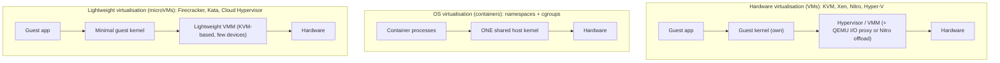

# 1.27 Cloud computing and virtualization internals for Linux engineers

| | |
|---|---|
| Level | Intermediate |
| Priority tier | 0 |
| Lab venue | GCP (a small Compute Engine VM; a GPU VM and a GKE cluster optional) |
| Part | Part 1: Linux, from the command line to the kernel and performance |
| Status | Drafted, labs **untested** |

## Why this matters for AI infrastructure

Picture a GPU job that runs well on your own cluster but crawls once it moves to a cloud node. You cannot see the hypervisor. You cannot change the host. You have a login, a bill, and a job that used to finish before lunch. This is the kind of problem the handbook prepares you for, because it sits where bare-metal GPU clusters meet cloud economics.

Your team will ask you to compare GPU instance types. It will ask you to decide between virtual machines and bare metal. You will need to explain why a cloud node behaves differently from an on-premises one, and you will diagnose performance in environments where you do not control the hypervisor. You will also size and cost a training run, and design for neoclouds, such as CoreWeave and Nebius and others, and for hyperscalers alike.

Cloud computing changes the performance problem in three ways. **Capacity is elastic but not unlimited**, because GPU quota and availability are scarce. **Resources are shared** through multitenancy, noisy neighbours and resource controls. **Observability is partial**, so you see a slice of the machine, not the whole machine.

This chapter covers the cloud model and the three ways to virtualise a machine. Those are hardware virtualisation, OS virtualisation and lightweight virtualisation. It also covers their overheads and resource controls, and how to observe each one from the host and from inside the guest. The chapter answers a question you will meet often: how do you diagnose a container or VM when you cannot see everything? It then adds the AI-specific layer, which includes GPU instance families, placement and fabric, storage tiers, quotas and reservations, GKE/Kubernetes for GPUs, and cost and benchmarking in the cloud.

When a cloud job runs slowly, ask first which of these three limits is in play.

## Prerequisites and outcomes

Before you start, you should know containers and namespaces, which chapter 1.19 covers. You should also know cgroups from chapter 1.18, VMs and KVM from chapter 1.26, the observability tools from chapter 1.24, and the method and benchmarking chapters, 1.23 and 1.25. Kubernetes details come later, in Part 5.

By the end, the cloud vocabulary should feel like your own. That means IaaS, instance, tenant, multitenancy, public/private/hybrid cloud, region/zone, instance type/family, ephemeral and persistent storage, file, block and object storage, and orchestration. You should also be able to explain horizontal scalability, dynamic sizing and capacity planning in the cloud, and to name the risks of auto scaling, which are cost, attack and regressions.

You should be able to compare three approaches. Hardware virtualisation means KVM or Nitro. OS virtualisation means containers. Lightweight virtualisation means microVMs. You will compare them on CPU, memory, I/O, resource control, observability, security and fit. You should also explain where the overhead comes from in each one, and how noisy neighbours affect it. Resource controls such as shares, bandwidth quotas, cpusets, memory limits, I/O limits and network qdiscs are part of that picture.

Finally, you should be able to observe containers from the host and from the guest. From the host, the tools include container tools, cgroup statistics, `nsenter`, PID mapping through `NSpid`, `/proc/PID/root` and BPF with namespace data. From the guest, you need to know which tools lie. You will also observe VMs from the host and the guest, using `%steal`, exit statistics and virtual device latency. You will describe GPU cloud offerings, and choose a virtualisation or orchestration approach for a given AI workload and tenant model.

## 1. The cloud model

A colleague says the instance in the second zone is slow. To follow that conversation, and to see where the problem could be, you need the cloud vocabulary first. This section introduces it, and then explains why organisations moved to the cloud in the first place.

**Cloud computing** delivers computing resources as a service. The units range from a fraction of a server to many servers. You provision and release them through an API, in seconds to minutes. The table below defines the terms you will meet in almost every cloud discussion.

| Term | Meaning |
|---|---|
| **Instance** (server instance, cloud instance, VM) | A unit of compute rented from the provider |
| **Guest / tenant** | The consumer of an instance; many tenants share one **host** (multitenancy) |
| **IaaS** | Infrastructure as a service: virtual machines (hardware instances) and networking/storage; you manage the OS up |
| **OS instances** | Containers as the unit (CaaS, managed Kubernetes, serverless containers) |
| **FaaS / SaaS** | Functions as a service ("serverless") and software as a service |
| **Public / private / hybrid cloud** | Operated by a provider for many customers / by your company for internal use / spanning both |
| **Region / zone** | Geographic area / isolated failure domain within it; latency, price and capacity differ |
| **Hypervisor / VMM** | Software that creates and runs hardware-virtualised VMs |
| **Orchestrator** | Software that schedules workloads on a pool of machines (Kubernetes, Slurm, Nomad) |

A tenant is the consumer of an instance, and many tenants can share one host. Providers added virtualisation in stages: hardware VMs first, with EC2 in 2006, then OS-virtualised containers from 2017, then lightweight microVMs such as Firecracker in 2019. Clouds also sell their own services, such as autoscaling, load balancers and managed databases. Those are provider-specific, so check the vendor documentation for them.

The service models differ in how much you still run yourself. With software as a service you use a finished application and manage nothing below it. With platform as a service you deploy your own application onto a runtime the provider manages. With infrastructure as a service you rent virtual machines, networks and storage, and you manage the operating system and everything above it. GPU work almost always sits at the infrastructure level, or on managed Kubernetes built on it. Clouds are also public, private, hybrid or shared by a community of organisations, which changes who owns the hardware but not the performance questions in this chapter.

A kitchen makes the three models easy to hold apart. SaaS is dinner in a restaurant. PaaS is a rented kitchen where you cook your own dish. IaaS is an empty kitchen with the utilities connected, where you bring everything else.

### Why organisations move to the cloud, and what it costs them

Without the cloud, a team that needs capacity must buy servers, find room for them and wait for delivery. In the cloud, capacity arrives in minutes through an API and is billed by use. The provider absorbs hardware failures and can serve many customers from one pool.

The price is three new problems. The host is untrusted, so encrypt data with keys the provider does not hold, and remember that data lives in a real country under its rules. Replication across data centres is usually automatic, but replicated data is not a promise of availability, so ask for the details. Transmission is slow when you move large data across the wide area, which is why data gravity matters in section 4.

### Instance types

Think of a menu rather than a catalogue of single machines. Providers offer **families**, such as balanced general purpose, compute optimised, memory optimised, storage optimised and accelerated computing. Each family comes in several **sizes** and **generations**. Price and performance stay fairly consistent across sizes, so you pick the size that fits. Some providers also offer **custom machine types**, where you choose the vCPU count and memory.

Because an instance can be redeployed on a different type in minutes, **instance type becomes a tunable parameter**. That is a large change from buying hardware that you live with for years.

This change brings three practical duties. First, benchmark candidate types with your own workload. Second, record the CPU platform, because the same family may land on different silicon generations. Third, understand what the numbers mean. A vCPU is usually one hardware thread. Memory per vCPU is a ratio you should know. Network and disk performance are tied to size, and limits such as egress bandwidth and IOPS scale with size.

**Accelerated families for AI** change often, so verify the names before you plan. In broad terms, hyperscalers attach NVIDIA GPUs to A-series, P-series or ND-series shapes with their own high-speed networking, and neoclouds offer bare-metal-like HGX and DGX nodes on InfiniBand fabrics.

Ask the same key questions about each candidate. What GPU model is it, and how many GPUs per instance? Does it have NVLink or NVSwitch inside the instance? What host CPU and RAM does it have, and what NUMA layout? Does it have local NVMe?

Then ask what network each instance gets, with its multiple 200 to 400 Gb/s NICs and its RDMA or GPUDirect technology, such as InfiniBand, RoCE, EFA or TCPX/TCPXO-style offloads. Ask whether it is a VM or bare metal. Ask about placement and cluster size limits, such as compact placement groups, topology-aware scheduling and the maximum number of nodes in a fabric. Finally, ask about quota and capacity terms, including reservations, on-demand availability and spot or preemptible behaviour.

### Scalable architecture

Enterprise systems historically scaled **vertically**, meaning larger machines. That path ends at physical size, cache coherency, power and cooling. Cloud systems scale **horizontally** instead. They run many small instances in parallel at each layer, such as load balancers, web servers, application servers and databases.

You add them one at a time, or as vertical partitions called cells or "pods" of a full stack. Databases that need a single primary are split into **shards**, or replaced by distributed or cloud-native databases. Fine-grained instance sizes let you match capacity to load, rather than buying for the peak.

For AI, the same idea appears as scaling **out** with data parallelism, and scaling **up** within an NVLink domain. The system boundary, whether a cell, a rail or an NVLink island, is where scaling efficiency changes. Chapter 1.23 covers scalability in more detail.

### Capacity planning in the cloud

On-premises capacity planning is critical, because purchases are slow and long-lived. In the cloud, instances are cheap to create and destroy, so capacity follows demand. That sounds like freedom, and it is, up to a point.

**Dynamic sizing and auto scaling** let groups scale up and down on metrics such as CPU, queue length or custom metrics. You pay for what you use. Netflix-style daily capacity patterns add and remove tens of thousands of instances. The risks are over-provisioning, slow scale-down and thrashing. A DoS attack or a performance regression looks like load, and it triggers an expensive scale-out. Long batch jobs and data migration make scale-down slow. Monitor that increases make sense, and cap the maximums. In Kubernetes, the equivalents are the Horizontal Pod Autoscaler for pods, Cluster Autoscaler or Karpenter for nodes, and KEDA for event-driven scaling.

**Scalability testing** means renting a large environment briefly and measuring its scalability profile. That is a benchmarking activity, covered in chapter 1.25. **Bursting** lets some container platforms give tenants idle CPU temporarily at no extra cost. That is useful, but it hides the true need, as explained below.

**GPUs are the exception to elastic capacity.** Quotas, regional availability, minimum reservation terms and capacity blocks mean that planning ahead is still essential. Long-term commitments, such as committed-use discounts and reserved capacity, trade flexibility for price.

### Cloud storage

An instance needs storage for its OS, its software and its scratch space. **Ephemeral (instance) storage** is volatile, and it is destroyed with the instance. Local SSD or NVMe on the host is fast, but in many providers it is lost on stop or failure. Some options are tied to specific shapes.

**Persistent storage** is a separate service over the network. It is shared infrastructure with other tenants. The table compares the three persistent storage types.

| Type | Examples | Performance profile |
|---|---|---|
| File store | NFS (Filestore, EFS), parallel filesystems (Lustre managed offerings, partner services) | Throughput scales with capacity/tier; metadata-limited |
| Block store | Persistent disks, EBS, Azure managed disks (iSCSI/NVMe-oF behind the scenes) | IOPS and throughput caps per volume and per instance size; latency higher than local NVMe; provisioned-IOPS tiers available |
| Object store | Cloud Storage/GCS, S3, Blob Storage | High aggregate throughput, high per-request latency, HTTP API; data egress costs |

Network storage shares its network with everyone else, so its performance is less predictable than local disk. Caches and provisioned performance help. For AI, keep datasets in object storage, and stage them to local NVMe or a parallel filesystem. Write checkpoints to fast storage first, then copy them asynchronously. Avoid reading millions of small objects directly. Region co-location, egress fees and per-instance throughput limits matter as much as raw speed.

### Multitenancy

Unix always shared resources among users. Cloud shares them among *entire operating systems*. Each guest is isolated and cannot observe the others, because that would be an information leak. Yet the guests share physical CPUs, caches, memory bandwidth, disks, NICs and fabrics. That is the origin of **noisy neighbours**. Another tenant's dump, backup or deliberate micro-benchmark can saturate a shared resource, and your job pays for it.

If the cloud is an apartment building, the provider is the landlord and your instance is a flat. Your neighbour's late party is not your fault, and you cannot rewire the shared plumbing tonight. The walls carry sound, and the water pressure drops when everyone showers at once.

The mitigations come in two groups. **Resource controls** give performance isolation, with per-tenant limits and priorities for CPU, memory, disk I/O and network. The provider's placement policy also helps. As a tenant, you can choose dedicated hosts or bare metal. You can also choose larger instance sizes that own whole sockets. Monitoring such as `%steal` and latency outliers shows you when a neighbour is hurting you. The observability you get depends on the virtualisation type, as section 6 explains.

### Why a cloud GPU node behaves differently

A GPU node in the cloud is not the same machine as one in your own rack, even when the GPU model matches. Four differences explain most surprises.

1. **Noisy neighbours.** Other tenants share the host's CPU caches, memory bandwidth, NIC and sometimes the fabric. You see it as `%steal` and as latency outliers, and you cannot fix it from inside the guest.
2. **Virtual topology and NUMA exposure.** The guest sees the NUMA layout, PCIe tree and NIC-to-GPU affinity that the provider chose to present. A flat or inaccurate view stops NCCL from picking the best paths. Check it with `lscpu`, `numactl -H` and `nvidia-smi topo -m`, and compare with the provider's documented layout.
3. **Passthrough and SR-IOV.** GPUs are usually passed through whole, and fast NICs are usually SR-IOV virtual functions. That keeps the data path near native. It also means the provider sets bandwidth caps, MTU and counters, and you may see fewer NIC controls than on bare metal.
4. **Nested virtualisation.** If you run a hypervisor, Kata or KubeVirt inside a cloud VM, each guest operation passes through two layers of exits. Many providers disable it on GPU instance types or restrict it. Check support before you design around it, and expect extra overhead where it is allowed.

If a workload is slower in the cloud than on premises, check these four before you blame the software.

### Orchestration (Kubernetes)

Every major provider offers managed Kubernetes, such as GKE, EKS and AKS, and many organisations build private clouds on it. The scheduler places Pods using resource requests and limits, node labels, taints and affinity. Quality of placement matters for GPUs, NUMA and network topology. Container networking, the CNI choice and the number of Services also change performance, and chapter 1.18 covers CPU limits and throttling. Parts 5 and 11 cover Kubernetes and GPU scheduling in depth.

## 2. Three ways to virtualise

Two jobs feel slow this week, and they have nothing in common except the symptom. One runs in a VM. The other runs in a container. Before you compare them, you need to see how many kernels stand between each program and the hardware. The diagram shows the three stacks side by side.



The top stack has a full VM with its own kernel. The middle stack has no guest kernel at all, because every container shares the host kernel. The bottom stack keeps a guest kernel, but a minimal one behind a small hypervisor. Count the kernels, and you can predict most of the differences that follow.

### Hardware virtualisation (cloud view)

A hypervisor runs each VM with its own kernel, as chapter 1.26 explains. In the cloud, check five things first when a VM is slow. CPU runs near native speed for user code, with overhead from guest exits on privileged operations, timers and interrupts. Memory mapping costs an extra translation step, and every guest carries its own kernel, page tables and possibly a duplicate copy of cached data. I/O has historically been the largest overhead, because every device access was proxied. Paravirtual drivers, SR-IOV or passthrough, and hardware offload reduce it. Contention, the fifth item, is stolen CPU time, cache pollution and interrupts from neighbours you cannot see.

The clouds differ in how they built their hypervisors. Xen used a privileged dom0 as the I/O proxy, as EC2 originally did. Google Compute Engine uses KVM with QEMU and vhost. Nitro is KVM-derived, with dedicated hardware for network, storage, interrupts and timers, so there is no QEMU on the data path and performance is near bare metal. Azure runs on Hyper-V.

Resource controls are coarser than for containers. The vCPU count is a fixed allocation, and finer quotas come from the host scheduler, such as cgroup bandwidth and `cpuset` under KVM. The hypervisor cannot see a guest's internal thread priorities, so a low-priority log-rotation job in one VM competes equally with a critical server in another. Memory is fixed at configuration, and ballooning can reclaim it from running guests, so check `dmesg | grep -i balloon` when memory behaves oddly. Many clouds enforce disk and network quotas outside the VM, so limits appear as latency or throughput caps rather than local errors.

### OS virtualisation (containers)

Containers are processes with namespaces and cgroups, and they run on a shared kernel, as chapter 1.19 describes. They have clear advantages over VMs. A container starts in milliseconds and needs no extra kernel memory. All containers share one unified filesystem cache, and overlay can share cached lower-layer files between them. Resources can be shared finely, with shares and bandwidth. CPUs are real CPUs, and host operators can see every guest process.

The disadvantages are just as real. At multitenant scale, containers contend for kernel resources such as locks, dentry caches, buffers and queues. A tenant cannot trace the kernel, so guest observability is limited. A kernel panic or kernel bug affects every container on the host. You cannot load custom kernel modules or run a different kernel version, and isolation is weaker than with a VM.

**Overhead.** A container pays no CPU overhead for running in a namespace or cgroup, because every process already runs in one. Degradation comes from contention instead. Memory mapping and size cost nothing extra, and overlay filesystems can share the page cache between containers. I/O is different. Overlayfs, bridge or NAT networking and iptables add a cost to each I/O. That cost is negligible at modest rates, under a few thousand IOPS, but it shows at high rates. A kernel stack for a container write shows `ovl_write_iter` before the real filesystem.

The orchestrator adds cost too. With thousands of Kubernetes services, `kube-proxy` iptables rule processing costs CPU. Replacing it with eBPF avoids that cost. Multitenant contention comes from shared CPU caches, which are sometimes flushed on context switch. It also comes from the TLB, interrupts and kernel locks and queues. One real case was a slowly deteriorating `lstat` latency, caused by another container's effect on the dentry cache. Another was a bottleneck from increased `posix_fadvise` rates, after a team moved from single-tenant VMs to containers.

**Resource controls for containers.** The summary table below lists them, and chapter 1.18 has the v1 and v2 details.

| Resource | Priority (relative) | Limit (ceiling) |
|---|---|---|
| CPU | CFS shares / `cpu.weight` | `cpuset` (whole CPUs), CFS bandwidth `cpu.max` (fractional CPUs) |
| Memory capacity | Soft limit / `memory.low` | `memory.max` (OOM at limit), `memory.high` |
| Swap | | `memory.swap.max` |
| Filesystem capacity | | Filesystem quotas (XFS project quotas, ext4 project quota, btrfs/ZFS quotas), ephemeral-storage limits in Kubernetes |
| Disk I/O | `io.weight` (blkio weights, BFQ) | `io.max` (BPS/IOPS throttles) |
| Network I/O | `net_prio` priorities | qdiscs (token bucket, `fq`), BPF programs, Kubernetes bandwidth annotations |
| Processes | | `pids.max` |
| GPUs | | Device plugin allocation (whole GPU), MIG slices, MPS thread percentage, time-slicing |

Notice that CPU has two different controls. One sets priority, and the other sets a ceiling. You need both to predict how a container behaves when its neighbours are busy.

**CPU shares versus bandwidth, as capacity planners see it.** Shares guarantee a minimum in proportion to weight. They also let containers burst into idle CPU. Take 100 shares split among containers. If only A and B are busy, and A has 10 shares while B has 30, then A gets 25% and B gets 75% of the CPUs. If all containers are busy, A gets 10%.

The trap is easy to fall into. A container tested on an idle host appears to run at 100% CPU. Later, when neighbours move in, it drops to its 10% minimum. Users then see a ten-fold slowdown. That slowdown is the system working as designed, but it feels like a bait and switch. The fixes are bandwidth caps, which bound the performance range to something like 10% to 20%. You can also notify tenants when they are bursting, and monitor that bursting. Bandwidth is expressed as a number of CPUs, so 2.5 means two and a half CPUs. That number maps to quota and period in microseconds.

Section 6 covers container observability in detail.

### Lightweight virtualisation (microVMs)

Lightweight virtualisation combines the isolation of VMs with the start time and density of containers. A minimal, KVM-based hypervisor with few emulated devices boots a dedicated minimal guest kernel. Kata Containers runs a micro VM per pod and plugs into Kubernetes through a runtime class. Firecracker, from AWS and open source, pairs KVM with a small VMM instead of QEMU. It boots in around 100 ms with a few MiB of overhead per VM, and it powers Lambda and Fargate-style services. gVisor is different: it is a user-space kernel that intercepts syscalls, so it is closer to a container, with less hardware isolation and extra cost on syscall-heavy loads. Cloud Hypervisor, crosvm and QEMU's microvm machine type are other minimal VMMs.

Overhead looks like KVM with a smaller footprint. Clear Containers, the ancestor of Kata, arrived in 2015, became Kata Containers in 2017, and used about 48 to 50 MB per container. Firecracker uses under 5 MB. Resource controls come from host cgroups and qdiscs, because the VMM is a host process. From the host, a microVM looks like one process. From the guest, observability is full, because the guest has its own kernel.

MicroVMs suit multi-tenant platforms that run untrusted code, such as notebooks, inference sandboxes and CI. Container escape risk is unacceptable there, and VM boot time is too slow. For GPUs the story is harder, because passthrough to microVMs needs vendor support. Most GPU clouds still use full VMs or bare metal for GPU tenants.

Two further models hide the server entirely. With serverless functions you submit code and see only application timestamps and provider metrics. Unikernels compile an application and a minimal kernel into one image for a hypervisor, so there are no `/proc` tools to use. Before you choose a virtualisation type, check which layers your analysis tools can reach.

## 3. Comparing the three (performance attributes)

Suppose you have a latency-sensitive service and three places to run it. Which option gives you the performance you need, and which one lets you see what is wrong when it slows down? The table below compares the three on the attributes that answer those questions.

| Attribute | Hardware VM (KVM) | Containers | MicroVM (Firecracker) |
|---|---|---|---|
| CPU performance | High (CPU support) | High | High |
| CPU allocation | Fixed vCPUs | Flexible (shares + bandwidth) | Fixed vCPUs |
| I/O throughput | High (with SR-IOV/offload) | High (no intrinsic overhead) | High (with SR-IOV) |
| I/O latency | Low (SR-IOV, no QEMU) | Low | Low (with SR-IOV) |
| Memory access overhead | Some (EPT/NPT) | None | Some |
| Memory loss | Some (extra kernels, page tables) | None | Some (small) |
| Memory allocation | Fixed, possible double caching | Flexible (unused memory serves file cache) | Fixed, possible double caching |
| Resource controls | Most (kernel + hypervisor) | Many (depends on kernel) | Most |
| Observability from the host | Medium (resource usage, hypervisor stats; not guest internals) | **High** (everything) | Medium |
| Observability from the guest | **High** (full kernel and virtual devices) | Medium (user mode, kernel counters, restricted tracing; host-wide metrics leak in) | **High** |
| Observability favours | End users | Host operators | End users |
| Hypervisor complexity | Highest | Medium (OS) | High (lightweight hypervisor) |
| Different OS guests | Yes | Usually no | Yes |
| Security isolation | Strong | Weaker (shared kernel) | Strong |
| Start time | Seconds | Milliseconds | About 100 ms |

Tables like this one go out of date. Use this one to learn *what to compare* as new technologies appear, not as a fixed scorecard. The more important lesson is that micro-benchmark differences between hypervisors are often smaller than the gains from **being able to observe and fix the workload**.

That is the trade-off to weigh. Cloud operators get the best visibility from containers. End users get it from VMs, because they have kernel access for all tracing tools. Containers with kernel access give everyone full visibility. That holds only when the customer also runs the container host, because there is no isolation between containers in that case. If you need to trace the kernel as a tenant, choose a VM or microVM over a container.

## 4. AI-cloud specifics

### VM, bare metal or container for GPUs?

Your team has a GPU workload and must choose where it will run. Five options are common, and each one trades control for convenience. The table sets out the pros, the cons and the typical use of each.

| Option | Pros | Cons | Typical use |
|---|---|---|---|
| **GPU VM with passthrough (hyperscaler standard)** | Provisioning API, snapshots, tenant isolation, near-native GPU performance | Hypervisor overhead on I/O unless offloaded; `5-15%` overall HPC performance drop vs bare metal depending on provider; topology exposure matters; limited access to firmware/BIOS; live migration restrictions | General training/inference, burst capacity |
| **Bare-metal instances / neocloud nodes** | Full topology and NIC/GPU control, host tuning (chapter 1.28), no hypervisor, InfiniBand | Longer provisioning, less elasticity, you own more of the stack (OS, drivers, health) | Large training clusters |
| **Containers on VMs or bare metal** | Fast start, reproducibility, scheduling via Kubernetes/Slurm | Shared kernel; operators need the toolkit/runtime; visibility limits | Almost all AI workloads, on top of one of the above |
| **MIG / vGPU slices** | Multiple small tenants on one GPU | No NCCL across MIG instances; flexibility limits; licence for vGPU | Inference, notebooks, small experiments |
| **MicroVMs/Kata** | Strong isolation for untrusted workloads | GPU support complexity | Sandboxed code execution |

Read the cons column with the same care as the pros, because each con is a limit you will live with. A provider can offer specialised HPC virtual machines with nearly transparent access to high-speed interconnects and accelerators. Even so, overall performance typically shows a `5-15%` performance drop compared to bare-metal hardware. The size of the drop depends on the provider.

### Networking and placement

Large training depends on the **fabric**. Providers offer high-speed options, such as GPUDirect-style offloads over Ethernet on some hyperscalers, Elastic Fabric Adapter on AWS, and InfiniBand on Azure ND and on neoclouds. These let NCCL bypass the kernel network stack.

Check several things for each provider. Confirm the NCCL plug-in or runtime you need. Then study the **placement policy**. Compact or cluster placement makes nodes share a switch tier. Low-latency networks restrict how many instances can connect. All nodes must sit in the same performance subnet, capacity reservation or domain. Otherwise overall performance can drop several-fold.

The remaining checks are the maximum job size within one fabric and the MTU. Jumbo frames run inside a VPC, and the default is often 1460 to 1500 on some clouds. Also check bandwidth caps per instance and per flow. Single TCP flows are often limited to a small fraction of the instance bandwidth, so use multiple streams or connections. Validate with the benchmarks in chapter 1.25 (`iperf3 -P`, `nccl-tests`) before you rely on advertised numbers.

### Quotas, reservations and spot

GPU capacity is gated in three ways. **Quota** is set per project, region and GPU type. **Availability** can run out in a stockout. **Commitment models** include on-demand, reservations or capacity blocks, committed-use discounts, and spot or preemptible capacity. Spot capacity comes with eviction notices of seconds.

Design for preemption. Use checkpointing, elastic training such as torchrun with restarts, and job schedulers that requeue. Automate retries across zones.

Cost modelling starts with the price per GPU-hour, times the number of GPUs, times the time. Add storage, egress and traffic charges. Add the charges for powered-off nodes and attached volumes, plus network and IP costs. Include the engineering time that failures consume. Compare *goodput* from chapter 1.23, not nominal peak. Then check whether an on-premises cluster is cheaper over the full lifecycle.

When you bring up a cloud Slurm cluster by hand, automate the first infrastructure provisioning with Terraform. Install the software with Ansible or custom golden images, or with cluster managers such as BCM. Test the automation on cheap instances first.

### Storage and data gravity

Place compute where the data is. Avoid cross-region reads, and stage datasets to local NVMe or a parallel filesystem. Write checkpoints to object storage with parallel multipart uploads. Watch per-instance throughput caps and request-rate limits, and use prefix sharding for object stores. Local SSD on GPU instances is ephemeral, so treat it as a cache.

A plain cloud NFS volume is rarely sufficient for coupled HPC or AI checkpointing. Providers often do not publish realistic shared-storage numbers for your I/O pattern. Rent cheap instances attached to the target cloud file system and run a simulated checkpoint benchmark before you commit. Suppose your application writes temporary or checkpoint data every `5 minutes`, with a size roughly equal to compute-node memory. Simulate that exact periodic burst pattern, and measure how long each save and reload takes.

### Observability in the cloud

In the cloud you usually get four things. Cloud monitoring shows GPU metrics, through the provider agent or DCGM. It also shows cloud API metrics such as power consumption, network counters and node health, where they are exposed. You also get logs and a serial console. Hypervisor-level health events report maintenance, host errors and live migration notices. GCE exposes a metadata-server maintenance event for this. You do not get access to the host.

Use the cloud API to automate replacing failed instances, powering subsets of nodes on or off, and filing health tickets. The API may report power use, network counters and node health. Where it is silent, collect those numbers on the nodes themselves.

Know the **metadata server**. It holds instance attributes, scheduling and preemption notices, and service-account tokens. On GCP its address is `http://metadata.google.internal/computeMetadata/v1/`, and requests must send the header `Metadata-Flavor: Google`. Other clouds have similar IMDS endpoints, which are their instance metadata services. Treat tokens as secrets, and restrict pod access to them in Kubernetes.

Before you commit a GPU workload to a cloud, test the network and storage with your own pattern, not the advertised numbers.

## 5. Resource controls under the USE method

Your dashboards show the physical machine, but the limit that slows your container is a software setting. Traditional tools are blind to software-imposed limits. In cloud environments, those limits are often the first thing you hit. To find them, extend the USE table from chapter 1.23 with **limits**.

| Resource | Utilisation (against the limit) | Saturation | Errors |
|---|---|---|---|
| CPU quota (container) | `cpu.stat usage_usec` vs `cpu.max` | `nr_throttled`, `throttled_usec` (v2) or `throttled_time` (v1); PSI `cpu` | none; latency spikes |
| CPU shares | no direct statistic | non-voluntary context switches rising, runnable but waiting while host has idle CPU or neighbours busy | |
| cpuset | per-CPU utilisation (`mpstat -P`) of the allowed CPUs | run queue on those CPUs | |
| Memory limit | `memory.current` vs `memory.max` | `memory.events` (`high`, `max`), reclaim, swap, PSI `memory` | `oom_kill` count, container exit 137 |
| Disk I/O limit | `io.stat` rates vs `io.max` | throttled time/`io.pressure`, latency growth | |
| Network limit | rate vs shaping (qdisc stats `tc -s qdisc`) | drops/backlog in the qdisc, latency growth | |
| PIDs | `pids.current` vs `pids.max` | fork failures | `Resource temporarily unavailable` |
| VM vCPUs | guest CPU utilisation | `%steal`, run queue | |
| VM disk/network quota | guest-visible throughput | latency outliers, throttling | cloud API/metadata may report throttling |

Each row pairs a limit with the signals that show it is binding. Utilisation is measured against the limit, not against the physical resource. That difference is what makes the table useful in a shared cloud.

Interpreting CPU throttling for a container takes five facts. First, is **throttled time** increasing? That means the quota is binding. Second, are **involuntary context switches** increasing for its processes? That means others are preempting it through shares or contention. Third, does the **host have idle CPUs**? Fourth, if cpusets are used, is **the cpuset CPUs 100% busy**? Fifth, are **all other tenants idle**?

Then apply the decision rule. If throttled time is increasing, a bandwidth cap is binding. If nothing is throttled, but involuntary switches rise while the host has idle CPU, only cpuset or shares effects can explain it. When other tenants are busy and no CPU is idle, those switches mean you are at your share. If every tenant is idle and you are still limited, a cap or cpuset is the limit. Build this decision into your monitoring, so engineers do not have to work it out during an incident.

## 6. Observing containers and VMs

### From the host: containers

A user reports that a container is slow, and you have to look at it from the host. The host cannot see a container directly, because a container is not a kernel object. There is no container in the kernel, only namespaces and cgroups. The container ID is created by user-space software, such as Docker, containerd or CRI-O. You have four ways to get per-container statistics.

1. **Container tools** give the quickest view. `docker stats` shows CPU percentage, memory against the limit, net and block I/O, and PIDs. `kubectl top nodes|pods` needs metrics-server. `crictl stats`, cAdvisor, Kubernetes dashboards, cloud monitoring agents and Cilium Hubble for network flows also show per-container data.
2. **Cgroup statistics** live under `/sys/fs/cgroup/...`. The key files are `cpu.stat`, which holds usage and throttling, and `cpuacct.usage` on v1 or `usage_usec` on v2. You will also read per-CPU usage on v1, `memory.current`, `memory.stat`, `memory.events`, `io.stat`, `pids.current` and the PSI files. Read them with `systemd-cgtop`, `htop` or `cat`. To map a cgroup path to a container, the container's ID must appear in the path, as in `docker-<id>.scope` or `kubepods-...pod<uid>.slice/cri-containerd-<id>.scope`.
3. **Namespace mapping** lets you run host tools inside the container's view. The PID shown in the container differs from the host PID. `grep NSpid /proc/<hostpid>/status` shows both. For example, `NSpid: 4915 753` means host PID 4915 is container PID 753. To go the other way, scan with `awk '$1=="NSpid:" && $3==753 {print $2}' /proc/*/status`. Expect several matches, because 753 can exist in many PID namespaces. Verify the match by comparing the `/proc/PID/ns/pid` inode numbers from both sides.

The container's filesystem is reachable from the host at `/proc/<hostpid>/root/`. That lets `perf` find symbol files in the container's `/tmp`, although modern `perf` handles namespaces itself. `nsenter -t <hostpid> -m -p top` runs `top` in the container's mount and PID namespaces. The `-n` flag enters the network namespace, so `ss`, `ip`, `tcpdump` and `ping` act as the container. For the namespace background, see chapter 1.19.

4. **BPF tracing with namespace data** lets tracers break events down by container. They use the UTS nodename, which is typically the container or pod name. In bpftrace, `$task = (struct task_struct *)curtask; $nodename = $task->nsproxy->uts_ns->name.nodename; @count[$nodename] = count();` works when the event runs in the task's context, such as a syscall. It does not work for asynchronous completion interrupts. Other options are the cgroup ID, through the `cgroup` built-in with `cgroupid()`, or the PID namespace inode. Tools such as Inspektor Gadget do this for Kubernetes.

Before you conclude anything about physical resources, check the limits in section 5.

### From the guest: containers

Do not trust container-view system tools. Because `/proc` and `/sys` statistics are not namespaced, the answers you get inside a container depend on the tool. The table shows what each one reveals.

| Tool | Shows |
|---|---|
| `top` | summary line: mixed (some host, some container); process table: container processes only |
| `ps`, `pidstat` | container processes only |
| `uptime`, `mpstat`, `vmstat`, `free`, `iostat` | **host** values (all CPUs, host memory, host disks including other tenants' activity) |
| `sar -n DEV,TCP` | container's network interfaces and TCP statistics (network namespace) |
| `tcpdump` | container interfaces only |
| `perf`, BPF tools | usually blocked, or if enabled can see other tenants |
| `dmesg` | usually fails |

An idle container can therefore show a busy CPU and a busy disk, because of other tenants' activity. This confuses users who are new to OS virtualisation. Container-specific data lives in cgroup files. Those files are readable inside the container through `/sys/fs/cgroup`, and they show the container's own cgroup, because the container has a cgroup namespace. For example, `blkio.throttle.io_serviced` or `io.stat` can prove whether the container issues disk I/O at all.

Tools become container-aware only gradually. Two design philosophies explain the confusion. If the container is an **isolated server**, as in public cloud, tools should show only the container's activity. If it is a **packaging solution** on your own cluster, host-wide statistics help you identify noisy neighbours. Ideally, an operator setting would choose between them.

**Tracing from containers** (`perf`, Ftrace, BPF) is blocked by permissions, such as `perf_event_open`, `bpf` and `ptrace`, and by filesystem access. To allow it, the kernel must filter events to the container, which is not yet generally available. Otherwise a host-provided API or side-car must do the work. The practical consequence is that tenants of containers cannot do kernel-level analysis. Operators must do it, or tenants need VMs or privileged debug containers on nodes they control.

### From the host and guest: VMs

Section 7 of chapter 1.26 covers this topic. The host sees one process per VM, which is `qemu-system-*` with its vCPU threads. It sees per-VM resource statistics and exit statistics, from `perf kvm stat` and `kvm:kvm_exit`. It sees nothing inside the VM. With passthrough or SR-IOV, device I/O is invisible to the host, so you must infer it through performance monitoring counters (PMCs) or guest-side data.

The guest sees only virtual devices, but it can run all kernel tracing tools. It should use `%steal`, latency outliers and I/O pattern analysis to infer physical contention. For Xen-like hypervisors, `xentop`, `xentrace` and `xenoprof` are the tools. On Nitro, hypervisor observability belongs to the provider.

### Strategy

1. Operators check physical resources with USE first. Then they check each tenant's **resource-control limits**: are tenants at their caps? If so, tell them or fix the limits. Next, check the hypervisor and exit statistics. Only then, with access, log in to the guest.
2. Guests use the guest's tools on virtual resources. They check limits with `cpu.stat`, `memory.events` and steal. They analyse I/O patterns for contention, looking at size, queueing behind flushes, or random outliers that point to physical contention. If the provider offers redacted physical usage, ask for it.
3. Prefer **cross-checks** and a **known workload** to verify both the platform and the tool (chapter 1.25).
4. When limits are in play, remember that cloud limits are hit "long before physical limits". Start with the limits before you blame the hardware.

## 7. Failure modes

Here is where the chapter pays off on a bad afternoon. Each row is a symptom someone will report to you, the cause behind it, and the first thing to check. Find your symptom, then work the check column before you touch anything.

| Symptom | Cause | Check / fix |
|---|---|---|
| A container looks fast in tests, slow in production | Burst vs share minimum; neighbours present | Test under contention; `cpu.stat`, `nr_throttled`; set bandwidth/limits; request what you need |
| Tail latency despite low average CPU | CFS quota throttling | `throttled_usec`; raise limits; fewer threads |
| `nproc`/`free`/`top` inside container show host values | Non-namespaced `/proc` | Read cgroup limits; use limit-aware runtimes |
| GPU VM slower than the same GPU on bare metal | Topology exposure, no huge pages/pinning, I/O offload absent, noisy host | `nvidia-smi topo -m`, `lscpu`, `numactl`; compare with `nccl-tests`; ask for sole-tenant/bare metal |
| NCCL falls back to TCP in the cloud | Missing plug-in/driver, security group/MTU/placement, wrong interface | `NCCL_DEBUG=INFO`, provider doc for NCCL network plug-in, placement policy |
| Throughput per TCP flow far below instance bandwidth | Per-flow cap | Parallel streams; multiple connections |
| Autoscaler scales out but latency stays bad | Bottleneck elsewhere (database, storage), cold start, metric mismatch | Identify the bottleneck; scale the right tier |
| Spot GPU job lost | Preemption | Checkpoint frequently; requeue automation; diversify zones |
| Unexpected bill | Egress, idle GPUs, forgotten disks and IPs, autoscaling storms | Budgets, labels, TTL automation, idle GPU alerts |
| Cannot trace in a container | Seccomp/capabilities/permissions | Trace from the host; use a debug node/ephemeral container with caps |

## 8. Hands-on lab: look at a cloud VM from inside

Start with the self-checking Python lab. It runs on your own machine, needs no cloud account, and checks the reasoning before you spend a cent. Run it locally first, with `python3 code/part01/cloud_virt_internals_lab.py`. It checks the five-fact container CPU throttling decision rule. It confirms the CPU shares drop from `100%` to `10%`, a `10x` slowdown, once a burst meets contention. It checks the `/proc/PID/status` `NSpid` mapping from host PID `4915` to container PID `753`. Last, it checks the goodput-adjusted cost of cloud GPU training.

```bash
python3 code/part01/cloud_virt_internals_lab.py
```

Then, on a small disposable GCP Compute Engine VM, work through the steps below. A GPU VM and a GKE cluster are optional. The commands below were not run on live hardware.

1. Start by identifying the platform. Run `sudo dmidecode -s system-product-name`, which should read "Google Compute Engine" on Compute Engine. Then run `systemd-detect-virt`, `lscpu`, `lspci`, `ls /sys/class/net` and `cat /sys/class/dmi/id/product_name`. The `lscpu` output shows the hypervisor vendor and flags, and `lspci` shows the virtio and NVMe devices.
2. Query the metadata server with `curl -s -H 'Metadata-Flavor: Google' http://metadata.google.internal/computeMetadata/v1/instance/?recursive=true | jq .`. The output covers the machine type, zone, scheduling, network interfaces and service accounts. Also poll `.../instance/maintenance-event` and `.../instance/preempted`, the second one on spot VMs. Treat tokens as secrets.
3. Establish the CPU truth. Record the `lscpu` model and the flags in `/proc/cpuinfo`. Run `sysbench cpu`, `mpstat -P ALL 1 60` and `vmstat 1 60`, and look for `%steal` in the output. Repeat the runs at different times, then run them on a second instance of the same type and compare.
4. Measure disk and network. Use `fio` with `--direct=1` to measure persistent-disk and local-SSD IOPS, throughput and latency. Compare the results with the documented limits for the machine size. Measure `iperf3` between two VMs in the same zone with 1 and 8 streams. Check the MTU with `ip link`, and note the single-flow limits.
5. Compare instance types. Run the same micro-benchmark and a small PyTorch step on two machine types. Then compute the cost per unit of work, including storage and egress.
6. Work with containers. Run Docker or containerd on the VM, and create a container with `--cpus 0.5 --memory 256m`. From inside the container, run `nproc`, `free`, `top`, `mpstat` and `cat /sys/fs/cgroup/cpu.max`. From the host, find the container's cgroup and its PID mapping (`NSpid`). Then use `nsenter -t PID -n ss -tnp` and `systemd-cgtop`. Generate load, and read the `cpu.stat` throttling.
7. Walk through the throttling decision flow. Reproduce the five statistics for a throttled container: `throttled_usec`, `nonvoluntary_ctxt_switches` in `/proc/PID/status`, host idle CPUs, cpuset load and idle neighbours. Then walk the flow in section 5.
8. Try nested virtualisation or a microVM, which is optional. Enable nested virtualisation on a VM, and run a Firecracker or Cloud Hypervisor microVM. Follow the project's quick-start. Compare the boot time and footprint with a QEMU VM and with a container.
9. Explore GKE, which is also optional. Create a small cluster, and optionally a GPU node pool where your quota allows. Install the GPU device plugin following its documentation. Run `kubectl top`, deploy a pod with requests and limits, and inspect its cgroup on the node. Schedule a GPU pod and run `nvidia-smi`. Note the scheduling labels and placement options.
10. Sketch the cost. Compute the cost per hour, and the cost per million tokens or per epoch, for two options: on-demand versus spot, and VM versus bare metal. Include storage and egress, use the provider calculators, and record your assumptions.
11. Clean up. Delete all instances, disks, IPs and clusters, then verify your billing.

## 9. Common mistakes

Picture the week a new team takes its first GPU workload to the cloud. The first benchmark looks wonderful, the first bill does not, and nobody can say which choice caused which surprise. The mistakes below are the usual causes.

Some mistakes come from assuming the cloud behaves like your own hardware. Do not treat the cloud as infinite, because GPUs are constrained by quota and capacity. Do not treat it as uniform either, because silicon and neighbours vary. Benchmarking one instance once is another trap, and so is ignoring `%steal` and time-of-day effects.

Container mistakes are common too. Reading in-container `top`, `free` or `iostat` as if they showed the container is one. Setting CPU limits equal to requests on latency-sensitive services, without understanding throttling, is another. Those services burst into idle CPU in tests, and then surprise you in production.

Instance and placement choices cause expensive surprises. Choosing instances by price per vCPU, instead of price per unit of work, is one. Ignoring the network and storage limits per instance is another. When you scale a training job beyond one node, ignoring placement and fabric is a third.

Cost and reliability mistakes come last. Depending on spot GPUs without checkpoint and restart automation risks losing work. Leaving resources running, such as disks, IPs and idle GPUs, and ignoring egress, adds cost. Assuming a VM's topology equals bare metal's is a mistake, and so is assuming MIG or vGPU slices can run NCCL across them. Finally, putting secrets in instance metadata or user data without access controls exposes them.

## 10. Interview angles

These are the questions to rehearse, and each one maps back to a section above.

- Compare VMs, containers and microVMs on performance, isolation and observability.
- What are the sources of virtualisation overhead in 2025, and which ones disappear with Nitro-style offload?
- How do you debug a slow container when `top` shows a busy host? Answer with cgroup stats, the throttling flow, nsenter and host tracing.
- Explain CPU shares versus quotas in Kubernetes and the throttling problem.
- What is a noisy neighbour and how do you detect and mitigate it?
- How would you choose between GPU VMs and bare metal for a 512-GPU training run?
- How do you design for spot/preemptible GPU capacity?
- How would you cost-compare two cloud GPU options for inference?
- Why can't NCCL run across MIG instances, and when is MIG a good idea?

## Exercises

These exercises ask you to apply the chapter's decision rules to numbers. Work each one by hand first, then check it with the functions named in the prompt.

1. Start with the three virtualisation models: `KVM`/`Nitro` VMs, OS containers, and `Firecracker`/`Kata` microVMs. Compare hardware VMs, OS containers and lightweight microVMs across startup time, per-instance memory overhead (`48–50 MB` for Clear Containers and `< 5 MB` for Firecracker), security isolation boundary, host-operator observability and guest-tenant observability.
2. Work through CPU shares versus bandwidth quotas, and the 10x "bait-and-switch" burst trap. Suppose a host has `100` total CPU shares, and Container A is assigned `10` shares with no bandwidth quota cap (`cpu.max`). Use `compute_shares_burst_vs_contended_drop()` in `code/part01/cloud_virt_internals.py` to calculate Container A's CPU percentage in three cases. First, it is tested alone on an idle host. Second, it competes with one busy sibling holding `30` shares. Third, it competes while all `90` remaining shares on the host are busy. How do you bound this performance swing?
3. Apply the five-fact container CPU throttling decision flow. Use `diagnose_container_cpu_limit_cause()` to find the limiting mechanism in three cases. In the first, `throttled_usec` is rising while the host has idle CPUs. In the second, `throttled_usec` is 0, the container's `cpuset` cores are 100% busy, and other host CPUs are idle. In the third, `throttled_usec` is 0, `nonvoluntary_ctxt_switches` is rising rapidly, and neighbor containers are busy on all CPUs.
4. Observe containers from the host and from the guest, using `NSpid`, `/proc/PID/root` and the question of which tools lie. First, on a container host, `/proc/4915/status` shows `NSpid: 4915 753`. Work out the host PID and the container PID with `parse_proc_status_nspid()`. Then explain how to reach the container's filesystem from the host for symbol resolution, and how `bpftrace` groups syscall counts by container. Second, inside a container, classify what `ps`, `pidstat`, `top`, `uptime`, `mpstat`, `vmstat`, `free`, `iostat`, `sar -n DEV,TCP` and `tcpdump` actually display.
5. Think through the AI and HPC cloud realities: the `5–15%` VM overhead, placement domains, and 5-minute checkpoint testing. First, explain why cloud HPC and GPU VMs typically show a `5–15%` performance drop compared to bare metal. Explain also why multi-node GPU jobs must be scheduled inside a single compact placement group or performance subnet. Second, describe how to pre-test a cloud shared filesystem on cheap instances. The method uses a `5-minute` periodic checkpoint simulation before you commit to a GPU cluster.
6. Model cloud GPU cost and goodput. A distributed training job needs `640` useful GPU-hours of forward progress on `64` GPUs, priced at `$3.00` per GPU-hour, plus `$200` in storage and egress. Use `compute_cloud_gpu_effective_cost()` to work out the paid GPU-hours, the wall-clock duration and the total USD cost, first when cluster goodput is `80%` (`0.80`), and then when it is `100%` (`1.00`). Finally, list three engineering requirements for running on Spot or preemptible GPUs.

## Checkpoint questions (20)

<details>
<summary>1. Define tenant, multitenancy, IaaS, CaaS, FaaS, and SaaS, and explain why instance type is \"a tunable parameter\" in the cloud.</summary>

A **tenant** is a guest that consumes a shared physical host, and that sharing is called **multitenancy**. **IaaS** rents hardware-virtualized VMs, plus storage and network. **CaaS** rents container instances, **FaaS** runs serverless functions on demand, and **SaaS** delivers complete applications. Instances can be redeployed onto a different machine family or size in minutes through an API. That is why choosing and changing the **instance type** is a main lever for performance tuning.
</details>

<details>
<summary>2. Compare Vertical Scaling and Horizontal Scaling, and explain how stateful databases and distributed AI training map to both.</summary>

**Vertical scaling** moves to a larger single machine, and its size is bounded by the socket or NVLink domain. **Horizontal scaling** adds many instances in parallel, across cells or pods, or it adds database **shards**. In AI training, tensor parallelism (`TP`) scales vertically inside one node's NVLink or NVSwitch domain. Data and pipeline parallelism (`DP`, `FSDP` and `PP`) scale horizontally across nodes, over InfiniBand, RoCE or EFA.
</details>

<details>
<summary>3. What are the benefits and risks of cloud auto-scaling, and why are GPUs an exception to \"elastic infinite capacity\"?</summary>

Auto-scaling matches the instance count to daily load, which saves cost. The risk is **over-provisioning**. A performance regression or a DoS attack can look like legitimate load, and it then triggers an expensive scale-out. Slow scale-downs can cause thrashing. GPUs break the idea of elastic capacity, because regional stockouts, strict project quotas and topology-contiguous placement requirements limit them. You therefore need capacity reservations or committed blocks.
</details>

<details>
<summary>4. Contrast Ephemeral instance storage with Persistent cloud storage across File, Block, and Object tiers.</summary>

**Ephemeral storage** is NVMe SSD attached directly to the host. It offers the highest IOPS and the lowest latency, which suits dataset caching and checkpoint staging. The catch is that it is wiped when the instance stops or fails. **Persistent storage** is network-attached and shared across tenants. **Block** storage, such as `EBS` or Persistent Disk, has per-volume and per-instance IOPS and MB/s caps. **File** storage, such as `Filestore`, `EFS` or managed `Lustre`, scales bandwidth with capacity, and it is often metadata-limited. **Object** storage, such as `S3` or `GCS`, gives massive parallel throughput at high per-request latency, and cross-region reads add egress charges.
</details>

<details>
<summary>5. What is a noisy neighbour in a multitenant cloud, and how do providers and tenants mitigate it?</summary>

A **noisy neighbour** is another tenant on the same physical host or fabric. Its heavy use of CPU, LLC cache, memory bandwidth, disk or network slows your latency or throughput. Providers mitigate this with cgroup or hypervisor quotas, `cpuset` pinning, Intel CAT LLC partitioning and hardware I/O offloads. Tenants can choose full-socket or bare-metal instance sizes and use compact placement groups. They can also monitor `%steal` and latency outliers.
</details>

<details>
<summary>6. How does AWS Nitro change the hardware virtualization overhead model compared to classic Xen or un-offloaded QEMU?</summary>

In classic Xen (`dom0`) or software-emulated QEMU, every virtual disk or network packet crosses a software I/O proxy. That costs VM exits and host CPU cycles. **Nitro** moves virtual networking (`ENA`/`EFA`), storage (`NVMe` EBS), interrupts and timers onto dedicated custom ASIC cards, which use `SR-IOV` passthrough. It runs a stripped-down KVM hypervisor with no QEMU I/O proxy on the data path. The result is near-bare-metal performance.
</details>

<details>
<summary>7. Why can a hypervisor not respect guest-internal process priorities (`nice`), and what is memory ballooning?</summary>

To the host hypervisor, a guest vCPU is an opaque thread. The hypervisor cannot see whether the guest kernel is running a `nice +19` background log compressor or a `nice -10` latency-critical server inside that vCPU. **Memory ballooning**, through `virtio-balloon`, inflates a driver inside the guest when the host is under memory pressure. The guest's physical pages then return to the host. That can trigger guest paging or OOM kills, and you can look for it with `dmesg | grep -i balloon`.
</details>

<details>
<summary>8. Where do I/O and orchestrator overheads appear in OS virtualization (containers)?</summary>

Namespaces and cgroups add no CPU instruction overhead. Container I/O can still pay extra kernel path cost, though. **OverlayFS** adds the `ovl_write_iter` path, and metadata `lstat` calls can contend on the dentry cache across tenants. **Bridge and NAT networking**, with `veth` and `iptables`, adds cost too. In a Kubernetes cluster with thousands of Services, `kube-proxy` evaluates iptables rules in sequence. That adds packet latency, unless you replace it with IPVS or eBPF (`Cilium`).
</details>

<details>
<summary>9. Explain the \"bait-and-switch\" capacity planning hazard of CPU shares (`cpu.weight`) versus CPU bandwidth quotas (`cpu.max`).</summary>

CPU shares (`cpu.weight`) guarantee a relative minimum under contention. They also let a container **burst** into 100% of idle host CPUs. Suppose a container has `10` of `100` shares. On an empty host it runs at `100%` CPU during a benchmark. In production, once neighbour containers move in, it drops `10x`, to `10%` CPU. A bandwidth quota (`cpu.max`) bounds the burst ceiling, so performance stays predictable.
</details>

<details>
<summary>10. Compare `Firecracker`, `Kata Containers`, and `gVisor`.</summary>

**`Firecracker`** is a minimal Rust KVM VMM. It has under `5 MB` of memory overhead and boots in about `100 ms`. It exposes only `virtio-net`, `virtio-blk` and serial devices, and it is built for serverless and Fargate workloads. **`Kata Containers`** runs each Kubernetes Pod or container inside a lightweight KVM virtual machine. That VM can be `QEMU microvm`, `Cloud Hypervisor` or `Firecracker`, selected through a CRI runtime class. **`gVisor`**, through `runsc`, is a user-space application kernel written in Go. It intercepts guest system calls without a full guest Linux kernel, and its overhead is higher on syscall-heavy workloads.
</details>

<details>
<summary>11. Why do OS containers favour host-operator observability while hardware VMs favour end-user observability?</summary>

On a **container** host, every container shares the host kernel. The host operator therefore sees every container process, symbol and kernel stack directly, using tools such as `top`, `perf` and `bpftrace`. The container tenant is blocked from kernel tracing, because `perf` and `bpf` are denied, and it sees misleading host-wide `/proc` counters. In a **hardware VM**, the picture reverses. The host operator sees only an opaque `qemu` process. The guest tenant owns a full kernel, so it can run `perf`, Ftrace and eBPF inside the VM.
</details>

<details>
<summary>12. State the five-fact decision flow for diagnosing whether a container is CPU-throttled by a quota, a `cpuset`, or CPU shares.</summary>

Check five facts. First, is `throttled_usec` or `nr_throttled` in `cpu.stat` increasing? If so, the **CFS bandwidth quota cap** is binding. Second, are `nonvoluntary_ctxt_switches` in `/proc/PID/status` increasing? Third, does the host have idle CPUs? Fourth, are the container's `cpuset` CPUs 100% busy? If they are, while the host has other idle CPUs, the **`cpuset` limit** is binding. Fifth, are other tenants busy? If there is no quota throttling, no idle host CPUs, and rising involuntary switches, the cause is **CPU shares contention**.
</details>

<details>
<summary>13. How do you map a container PID to a host PID using `/proc`, and how do you access the container's files from the host?</summary>

Use `grep NSpid /proc/<hostpid>/status`. A line such as `NSpid: 4915 753` means host PID `4915` is PID `753` inside its container PID namespace. You can verify the pairing by comparing the `/proc/PID/ns/pid` inode numbers. From the host, the container's root filesystem is directly accessible at **`/proc/<hostpid>/root/`**.
</details>

<details>
<summary>14. How can a host `bpftrace` script attribute kernel events to individual containers?</summary>

For synchronous events that run in process context, such as system calls, read the container's UTS nodename from `curtask`. The script is `$task = (struct task_struct *)curtask; $nodename = $task->nsproxy->uts_ns->name.nodename; @count[$nodename] = count();`. You can also key the map by `cgroup`, using `cgroupid()`.
</details>

<details>
<summary>15. Inside a container, which standard Linux performance tools show container-only data and which leak host-wide data?</summary>

**Container-only** tools include `ps`, `pidstat`, the process list in `top`, `sar -n DEV,TCP` and `tcpdump`. They show only container data, because the `pid` and `net` namespaces isolate `/proc/<pid>` and `/proc/net`. **Host-wide** tools mislead inside a container. These are `uptime` (load average), `free`, `vmstat`, `mpstat`, `iostat` and the summary header of `top`. They do so because `/proc/loadavg`, `/proc/meminfo`, `/proc/stat` and `/proc/diskstats` are not namespaced.
</details>

<details>
<summary>16. What performance penalty is typical for cloud HPC VMs versus bare metal, and why is placement critical for multi-node GPU jobs?</summary>

Even on specialised HPC or GPU cloud instances, virtualisation and shared fabric effects typically cause a **`5–15%` performance drop** compared to bare metal. Multi-node jobs that use MPI or NCCL must be placed inside one **compact placement group, performance subnet or capacity domain**. If nodes span distant availability zones or spine tiers, collective latency jumps. Job throughput can then drop several-fold.
</details>

<details>
<summary>17. How should you evaluate a cloud provider's shared filesystem for AI/HPC checkpointing before migrating a cluster?</summary>

Do not rely on peak bandwidth numbers from marketing. Rent a set of cheap compute instances attached to the target cloud filesystem. Then run a benchmark that simulates your job's exact periodic burst. For example, dump a checkpoint equal to compute-node RAM size every **`5 minutes`**, and read it back. That shows the real save and reload stall times under contention.
</details>

<details>
<summary>18. Why can `NCCL` not communicate directly across `MIG` slices on the same GPU, and when should you choose `MIG` versus full-GPU passthrough?</summary>

NVIDIA **MIG** (*Multi-Instance GPU*) splits a GPU's SMs, L2 cache and HBM into hardware-isolated instances. The split also disables peer-to-peer (`P2P`) and NVLink transfers between MIG slices, which is why NCCL cannot communicate directly across them. Use **MIG** for small single-instance inference models, notebooks or CI jobs that fit inside `1g`, `2g`, `3g` or `4g` slices. Use **full-GPU passthrough**, or bare metal, for multi-GPU distributed training and large-model tensor parallelism.
</details>

<details>
<summary>19. How do you query a cloud VM's instance metadata and preemption/maintenance notices from inside Linux?</summary>

Query the link-local **Instance Metadata Server (IMDS)**. On GCP, for example, run `curl -s -H 'Metadata-Flavor: Google' http://metadata.google.internal/computeMetadata/v1/instance/?recursive=true`. Poll `.../maintenance-event` and `.../preempted` as well. A background agent on Spot or preemptible GPU nodes watches this endpoint. It triggers an emergency checkpoint and a clean drain seconds before eviction.
</details>

<details>
<summary>20. What hidden cost items must be included when comparing cloud GPU instances against an on-premises GPU cluster?</summary>

Beyond the raw `$/GPU-hour`, include four hidden costs. First, **goodput loss**: paid GPU-hours wasted on node failures, restarts, spot preemptions and checkpoint stalls. Second, **network egress and cross-zone transfer charges**. Third, **persistent block, file and object storage charges**, including charges for volumes attached to powered-off VMs and for static IPs. Fourth, **idle reservation waste** between jobs.
</details>

## Sources and review notes

- **Sources read in full:**
  - `systems-performance-2nd-edition` — Brendan Gregg, *Systems Performance: Enterprise and the Cloud*, 2nd ed., **Chapter 11: Cloud Computing** (sections 11.1–11.6: instance types, scalable architecture, capacity planning, storage, multitenancy, Kubernetes orchestration; hardware virtualization implementation, overhead, resource controls, observability; OS virtualization implementation, overhead `ovl_write_iter`/`lstat`/`posix_fadvise`, resource controls CPU shares vs bandwidth quotas, observability `docker stats`/cgroup stats/`NSpid: 4915 753` mapping/`/proc/PID/root`/BPF `uts_ns->name.nodename`, the 5-fact CPU throttling decision rule, and the in-container tool visibility matrix; lightweight virtualization Clear Containers `48–50 MB` / Kata / Firecracker `< 5 MB`, `~100 ms` boot / gVisor; FaaS/SaaS/Unikernels; and the 3-way comparison table).
  - `how-linux-works-3rd-edition` — Brian Ward, *How Linux Works*, 3rd ed., **Chapter 17: Virtualization** (hypervisors, hardware in a VM, drawbacks of VMs, and containers).
  - `supercomputers-for-linux-sysadmins-managing-modern-hpc-clusters-and-supercomputers-from-software-to` — Sergey Zhumatiy, *Supercomputers for Linux SysAdmins*, **Chapter 17: Clouds** (`5–15%` cloud HPC VM performance drop range compared to bare metal, single performance subnet / capacity reservation / domain requirement for low-latency fabrics, simulating checkpoint writes of compute-node memory size every `5 minutes` on cheap instances to test cloud file systems, Terraform/Ansible/custom image/BCM deployment automation, and cloud API metrics and hidden cost checks).
- **Review note (2026-11):** generic cloud-textbook material (database families, detailed service and deployment models, front end and back end) was cut, and a section on why a cloud GPU node behaves differently was added. The nested-virtualisation and virtual-topology points are general behaviour and should be confirmed per provider.
- **Run here:** `python3 code/part01/cloud_virt_internals_lab.py` (14 passed, 0 failed).
- **Explicitly labelled inferences:** The AI-cloud GPU family comparison (GCP A2/A3, AWS P4d/P5 EFA, Azure ND InfiniBand, neocloud bare metal), GCP metadata-server preemption polling, Firecracker/Kata overhead figures from 2016 to 2020 sources, and goodput-adjusted cloud training cost formula connect cloud virtualization internals to Part 5, Part 7, and Part 11 AI cloud architecture (no `nvidia-devops` file is directly mapped to `1.27`; cross-referenced with Chapters 1.18, 1.19, 1.23, 1.24, 1.25, 1.26, and 1.28, plus original study items 21, 22, 23, 24, 26, 28, and 29).
- **Not verified on live hardware:** All interactive cloud VM, `dmidecode`, metadata `curl`, `sysbench`, `fio`, `iperf3`, Docker cgroup, Firecracker, and GKE commands were not run on live hardware and must be executed on a disposable cloud instance.
