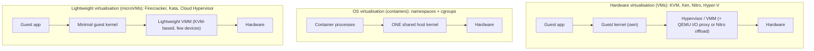

# 1.27 Cloud computing and virtualization internals for Linux engineers

| | |
|---|---|
| Level | Intermediate |
| Priority tier | 0 |
| Lab venue | GCP (a small Compute Engine VM; a GPU VM and a GKE cluster optional) |
| Part | Part 1: Linux, from the command line to the kernel and performance |
| Status | Drafted, labs **untested** |

## Why this matters for AI infrastructure

The role this handbook prepares you for sits where bare-metal GPU clusters meet cloud economics. You will be asked to compare GPU instance types, decide between virtual machines and bare metal, explain why a cloud node behaves differently from an on-premises one, diagnose performance in environments where you do not control the hypervisor, size and cost a training run, and design for neoclouds (CoreWeave, Nebius and others) and hyperscalers alike. Cloud computing changes the performance problem in three ways: **capacity is elastic but not unlimited** (GPU quota and availability are scarce), **resources are shared** (multitenancy, noisy neighbours, resource controls) and **observability is partial** (you see a slice, not the machine).

This chapter explains the cloud model, the three virtualisation technologies used to build it (hardware virtualisation, OS virtualisation and lightweight virtualisation), their overheads and resource controls, and how to observe each from the host and from inside the guest. It is the reference for "how do I diagnose a container or VM when I cannot see everything?", and it adds the AI-specific cloud layer: GPU instance families, placement and fabric, storage tiers, quotas and reservations, GKE/Kubernetes for GPUs, cost and benchmarking in the cloud.

## Prerequisites and outcomes

You should know containers and namespaces (1.19), cgroups (1.18), VMs and KVM (1.26), the observability tools (1.24) and the method and benchmarking chapters (1.23, 1.25). Kubernetes details come in Part 5.

After this chapter you can:

- Use the vocabulary: IaaS, instance, tenant, multitenancy, public/private/hybrid cloud, region/zone, instance type/family, ephemeral and persistent storage, file/block/object storage, orchestration.
- Explain horizontal scalability, dynamic sizing and capacity planning in the cloud, and the risks of auto scaling (cost, attack, regressions).
- Compare hardware virtualisation (KVM/Nitro), OS virtualisation (containers) and lightweight virtualisation (microVMs) on CPU, memory, I/O, resource control, observability, security and fit.
- Explain the overhead sources and noisy-neighbour effects in each, and how resource controls (shares, bandwidth quotas, cpusets, memory limits, I/O limits, network qdiscs) work.
- Observe containers from the host (container tools, cgroup statistics, `nsenter`, PID mapping through `NSpid`, `/proc/PID/root`, BPF with namespace data) and from the guest (and know which tools lie), using the CPU-throttling decision flow.
- Observe VMs from host and guest (`%steal`, exit statistics, virtual device latency).
- Describe GPU cloud offerings and the factors that matter for AI: instance shapes, interconnect (NVLink, NIC and fabric offerings), placement, bare metal versus VM, quota and reservation, storage and data-egress costs, and how to benchmark and cost them.
- Choose a virtualisation/orchestration approach for a given AI workload and tenant model.

## 1. The cloud model

**Cloud computing** delivers computing resources as a service, in units from a fraction of a server to many servers, provisioned and released through an API in seconds to minutes. Vocabulary:

| Term | Meaning |
|---|---|
| **Instance** (server instance, cloud instance, VM) | A unit of compute rented from the provider |
| **Guest / tenant** | The consumer of an instance; many tenants share one **host** (multitenancy) |
| **IaaS** | Infrastructure as a service: virtual machines (hardware instances) and networking/storage; you manage the OS up |
| **OS instances** | Containers as the unit (CaaS, managed Kubernetes, serverless containers) |
| **FaaS / SaaS** | Functions as a service ("serverless") and software as a service |
| **Public / private / hybrid cloud** | Operated by a provider for many customers / by your company for internal use / spanning both |
| **Region / zone** | Geographic area / isolated failure domain within it; latency, price and capacity differ |
| **Hypervisor / VMM** | Software that creates and runs hardware-virtualised VMs |
| **Orchestrator** | Software that schedules workloads on a pool of machines (Kubernetes, Slurm, Nomad) |

Cloud providers offer virtualisation in the order they matured: hardware VMs first (EC2 in 2006), then OS-virtualised containers (managed container services, 2017 onwards), then lightweight microVMs (Firecracker, 2019). Clouds also provide their own services and APIs (autoscaling, load balancers, managed databases); these are provider-specific and covered by vendor documentation.

### Instance types

Providers offer **families** (balanced general purpose, compute optimised, memory optimised, storage optimised, accelerated computing) in several **sizes** and **generations**, with fairly consistent price/performance across sizes so you pick the size that fits. Some providers also offer **custom machine types** (choose vCPU and memory). Because instances can be redeployed on a different type in minutes, **instance type becomes a tunable parameter**, which is a large change from buying hardware that you live with for years. Practical consequences: (1) benchmark candidate types with your workload; (2) record the CPU platform, because the same family may land on different silicon generations; (3) understand vCPU = hardware thread (usually), memory per vCPU ratios, network and disk performance tied to size, and limits that scale with size (egress bandwidth, IOPS).

**Accelerated families for AI** (names change often; verify): on Google Cloud, A-series machine types (A2/A3 and later) with attached NVIDIA GPUs (A100, H100, newer), G-series with L4 or similar, and N1/other families with attachable T4/V100; on AWS, P-series (P4d, P5) and G-series, with EFA networking; on Azure, ND-series (ND A100/H100 v4/v5, with InfiniBand); on neoclouds, bare-metal-like HGX/DGX nodes with InfiniBand fabrics. Key questions for each: GPU model and count per instance, NVLink/NVSwitch inside the instance, host CPU and RAM (NUMA layout), local NVMe, **network per instance** (for example multiple 200 to 400 Gb/s NICs and which RDMA/GPUDirect technology: InfiniBand, RoCE, EFA, TCPX/TCPXO-style offloads), whether the instance is a VM or bare metal, **placement** and **cluster size limits** (compact placement groups, topology-aware scheduling, maximum nodes in a fabric), and **quota and capacity** (reservations, on-demand availability, spot/preemptible behaviour).

### Scalable architecture

Enterprise systems historically scaled **vertically** (larger machines: limited by physical size, cache coherency, power, cooling). Cloud systems scale **horizontally**: many small instances in parallel at each layer (load balancers, web servers, application servers, databases), added individually or as vertical partitions (cells or "pods" of a full stack). Databases that need a single primary are split into **shards**, or replaced by distributed/cloud-native databases. Fine-grained instance sizes allow close matching of capacity to load rather than buying for the peak. For AI the analogue is scaling **out** with data parallelism and scaling **up** within an NVLink domain; the system boundary (cell, rail, NVLink island) is where scaling efficiency changes (chapter 1.23 scalability).

### Capacity planning in the cloud

On-premises capacity planning is critical because purchases are slow and long-lived. In the cloud, instances are cheap to create and destroy, so capacity follows demand:

- **Dynamic sizing / auto scaling**: groups scale up and down on metrics (CPU, queue length, custom metrics). Benefits: pay for what you use; Netflix-style daily capacity patterns add and remove tens of thousands of instances. Risks: **over-provisioning** (a DoS attack or a performance regression looks like load and triggers an expensive scale-out), slow scale-down (long batch jobs, data migration), thrashing. Monitor that increases make sense and cap maximums. Kubernetes equivalents: Horizontal Pod Autoscaler (pods), Cluster Autoscaler/Karpenter (nodes), KEDA (event-driven).
- **Scalability testing**: rent a large environment briefly and measure the scalability profile (a benchmarking activity, chapter 1.25).
- **Bursting**: some container platforms let tenants use idle CPU temporarily at no extra cost; useful, but it hides true needs (below).
- **Scarce resources**: GPUs are the exception to "elastic": quotas, regional availability, minimum reservation terms and capacity blocks mean planning ahead is again essential. Long-term commitments (committed-use discounts, reserved capacity) trade flexibility for price.

### Cloud storage

An instance needs storage for the OS, software and scratch. **Ephemeral (instance) storage** is volatile and destroyed with the instance (local SSD/NVMe on the host: fast, but lost on stop/failure in many providers; some are tied to specific shapes). **Persistent** storage is a separate service over the network, shared infrastructure with other tenants:

| Type | Examples | Performance profile |
|---|---|---|
| File store | NFS (Filestore, EFS), parallel filesystems (Lustre managed offerings, partner services) | Throughput scales with capacity/tier; metadata-limited |
| Block store | Persistent disks, EBS, Azure managed disks (iSCSI/NVMe-oF behind the scenes) | IOPS and throughput caps per volume and per instance size; latency higher than local NVMe; provisioned-IOPS tiers available |
| Object store | Cloud Storage/GCS, S3, Blob Storage | High aggregate throughput, high per-request latency, HTTP API; data egress costs |

Because network storage and its network are shared, performance is less predictable than local disk; caches and provisioned performance help. For AI: datasets in object storage, staged to local NVMe or a parallel filesystem; checkpoints written to fast storage then copied asynchronously; avoid reading millions of small objects directly. Region co-location, egress fees and throughput limits per instance matter as much as raw speed.

### Multitenancy

Unix always shared resources among users; cloud shares them among *entire operating systems*. Each guest is isolated and cannot observe others (that would be an information leak), yet they share physical CPUs, caches, memory bandwidth, disks, NICs and fabrics. Hence **noisy neighbours**: another tenant's dump, backup or deliberate micro-benchmark saturates a shared resource. Mitigations are **resource controls** (performance isolation: per-tenant limits and priorities for CPU, memory, disk I/O, network) and the provider's placement policy; for tenants, mitigations are dedicated hosts/bare metal, larger instance sizes that own whole sockets, and monitoring (`%steal`, latency outliers). The observability you get depends on the virtualisation type (section 6).

### Orchestration (Kubernetes)

Many organisations build private clouds on Kubernetes, and every major provider offers managed Kubernetes (GKE, EKS, AKS). The model: containers are deployed as **Pods** (co-located containers sharing a network namespace and often IPC/volumes); a **Service** gives a stable virtual IP and DNS name to a changing set of Pods; **Nodes** (machines) join a cluster through the API server; the scheduler places Pods using CPU/memory requests and limits, node labels, taints/tolerations and affinity; the Horizontal Pod Autoscaler scales replicas. Performance issues unique to Kubernetes: scheduling quality (placement relative to GPUs, NUMA, network topology), **container networking** (the CNI: Calico uses iptables/netfilter or eBPF, Cilium uses BPF and can replace kube-proxy; the number of Services affects kube-proxy rules), CPU limits and throttling (chapter 1.18), disk I/O contention (no I/O limit by default in older versions), and observability gaps. Part 5 and Part 7 cover Kubernetes and GPU scheduling in depth.

## 2. Three ways to virtualise

### Hardware virtualisation (recap and cloud view)

A hypervisor creates VMs with their own kernels (chapter 1.26). In the cloud, the main performance topics are: **CPU** (near-native for user code; overhead from guest exits for privileged operations, timers, interrupts; fixed vCPU allocation), **memory mapping** (EPT/NPT two-dimensional walks; shadow paging otherwise), **memory size** (a kernel per guest, QEMU per VM, double caching), **I/O** (historically the largest overhead: every device access proxied; mitigated by paravirtual drivers, SR-IOV/passthrough and, in Nitro, hardware offload with no QEMU on the data path), and **contention** (stolen CPU time, cache pollution, interrupts from other tenants' I/O). Cloud generations: Xen with a privileged dom0 and I/O proxy (EC2 originally), KVM with QEMU/vhost (Google Compute Engine), Nitro (KVM-derived with dedicated hardware for network, storage, interrupts and timers: near bare-metal performance), Hyper-V (Azure).

**Resource controls for VMs.** CPU: number of vCPUs (coarse), plus fine-grained quotas from the hypervisor scheduler (Xen: borrowed virtual time, SEDF, credit scheduler with weights and caps) or from the host OS for KVM (cgroup CPU bandwidth, `cpuset`, `taskset`). A limitation: a guest's internal thread priorities are invisible to the hypervisor, so a low-priority log-rotation job in one VM can compete equally with a critical server in another. With Xen's I/O proxy, work done in dom0 for a guest could escape accounting (hence isolated driver domains and debt-collecting schedulers). Cache: Intel CAT can partition the last-level cache between guests (preventing pollution but possibly hurting performance). Memory: a fixed size set at configuration, plus **ballooning** to reclaim memory from running guests (check `dmesg | grep -i balloon` in a guest if memory behaves oddly). Storage capacity: virtual volumes sized by the host. Device I/O: network throttling by host qdiscs/cgroups or external devices; many clouds enforce disk and network quotas in systems outside the VM (so limits appear as latency or throughput caps, not as local errors).

### OS virtualisation (containers)

Containers are processes with namespaces and cgroups on a shared kernel (chapter 1.19). Performance advantages over VMs: millisecond start, no extra kernel memory, a unified filesystem cache (and sharing of cached lower-layer files through overlay), fine-grained resource sharing (shares + bandwidth), CPUs are real CPUs, and host operators see all guest processes. Disadvantages: contention for kernel resources (locks, dentry caches, buffers, queues) at multitenant scale; **guest observability is limited** (kernel cannot be traced by the tenant); any kernel panic or kernel bug affects all; no custom kernel modules or different kernel versions; weaker isolation.

**Overhead.** CPU: none for running in a namespace or cgroup (every process already runs in some); degradation comes from contention. Memory mapping and size: native; overlay filesystems can share the page cache between containers. I/O: extra layers (overlayfs, bridge/NAT networking, iptables) add per-I/O cost, negligible for modest rates (e.g., under a few thousand IOPS) but visible at high rates; a kernel stack of a container write shows `ovl_write_iter` before the real filesystem. Orchestrator overhead: with thousands of Kubernetes services `kube-proxy` iptables rule processing costs CPU; replacing it with eBPF avoids that. Multitenant contention: shared CPU caches (and sometimes L1 flushes on context switch), TLB, interrupts, kernel locks/queues; real-world examples include slowly deteriorating `lstat` latency caused by another container's effect on the dentry cache, and a bottleneck from increased `posix_fadvise` rates after moving from single-tenant VMs to containers.

**Resource controls for containers** (summary table; v1/v2 details in chapter 1.18):

| Resource | Priority (relative) | Limit (ceiling) |
|---|---|---|
| CPU | CFS shares / `cpu.weight` | `cpuset` (whole CPUs), CFS bandwidth `cpu.max` (fractional CPUs) |
| Memory capacity | Soft limit / `memory.low` | `memory.max` (OOM at limit), `memory.high` |
| Swap | | `memory.swap.max` |
| Filesystem capacity | | Filesystem quotas (XFS project quotas, ext4 project quota, btrfs/ZFS quotas), ephemeral-storage limits in Kubernetes |
| Disk I/O | `io.weight` (blkio weights, BFQ) | `io.max` (BPS/IOPS throttles) |
| Network I/O | `net_prio` priorities | qdiscs (token bucket, `fq`), BPF programs, Kubernetes bandwidth annotations |
| Processes | | `pids.max` |
| GPUs | | Device plugin allocation (whole GPU), MIG slices, MPS thread percentage, time-slicing |

**CPU shares versus bandwidth, as capacity planners see it.** Shares guarantee a *minimum* proportional to weight and let containers burst into idle CPU. Consider 100 shares split among containers: A (10 shares) and B (30 shares) both busy get 25% and 75% of the CPUs; if all containers are busy, A gets 10%. The trap: a container tested on an idle host appears to run at 100% CPU, and later, when neighbours move in, drops to its 10% minimum: users experience a ten-fold "slowdown" that is the system working as designed ("bait and switch" feeling). Mitigations: **bandwidth caps** (so the performance range is bounded, for example 10% to 20%), notifying tenants when they are bursting, and monitoring that reports bursting. Bandwidth is expressed as a number of CPUs (2.5 means two and a half CPUs) mapped to quota/period in microseconds.

**Container observability** is covered in detail in section 6.

### Lightweight virtualisation (microVMs)

Lightweight hardware virtualisation combines the isolation of VMs with the start time and density of containers: a **minimal hypervisor** (few emulated devices, KVM-based, written for server use) boots a **dedicated minimal guest kernel**. Examples:

- **Intel Clear Containers → Kata Containers** (2015, 2017; "the speed of containers, the security of VMs": a micro VM per pod/container, integrates with Kubernetes through a runtime class).
- **Firecracker** (AWS, 2019, open source): KVM plus a lightweight VMM instead of QEMU (tens of thousands of lines versus over a million), around 100 ms boot, a few MiB of memory overhead per VM; powers Lambda/Fargate-style services.
- **Google gVisor**: a user-space kernel in Go that intercepts syscalls; closer to containers in characteristics (less hardware isolation, extra overhead on syscall-heavy loads).
- **Cloud Hypervisor, crosvm, QEMU microvm machine type**: other minimal VMMs.

Overheads are like KVM with a smaller footprint (Clear Containers about 48 to 50 MB per container; Firecracker under 5 MB); resource controls come from the host OS (cgroups, qdiscs) because the VMM is a host process; observability from the host is like VMs (the guest appears as one process), from the guest it is full (the guest has its own kernel, so BPF tools work). Lightweight virtualisation is particularly attractive for **multi-tenant platforms running untrusted code** (notebooks, inference sandboxes, CI) where container escape risk is unacceptable but VM boot time is too slow. For GPUs the story is more complicated (passthrough to microVMs, vendor support), and most GPU clouds still use full VMs or bare metal for GPU tenants.

### Other types

- **FaaS (serverless functions)**: you submit a function; startup time and cold starts matter; no server to log in to, so performance analysis is based on application timestamps and the provider's metrics.
- **SaaS**: high-level software; only the provider can analyse performance; clients use client-side timing.
- **Unikernels**: an application compiled with minimal kernel pieces into one binary that boots directly on a hypervisor; small and fast, but without an OS there are no `/proc` tools; some implementations can run as ordinary processes for analysis, or hypervisors can profile them.

## 3. Comparing the three (performance attributes)

| Attribute | Hardware VM (KVM) | Containers | MicroVM (Firecracker) |
|---|---|---|---|
| CPU performance | High (CPU support) | High | High |
| CPU allocation | Fixed vCPUs | Flexible (shares + bandwidth) | Fixed vCPUs |
| I/O throughput | High (with SR-IOV/offload) | High (no intrinsic overhead) | High (with SR-IOV) |
| I/O latency | Low (SR-IOV, no QEMU) | Low | Low (with SR-IOV) |
| Memory access overhead | Some (EPT/NPT) | None | Some |
| Memory loss | Some (extra kernels, page tables) | None | Some (small) |
| Memory allocation | Fixed, possible double caching | Flexible (unused memory serves file cache) | Fixed, possible double caching |
| Resource controls | Most (kernel + hypervisor) | Many (depends on kernel) | Most |
| Observability from the host | Medium (resource usage, hypervisor stats; not guest internals) | **High** (everything) | Medium |
| Observability from the guest | **High** (full kernel and virtual devices) | Medium (user mode, kernel counters, restricted tracing; host-wide metrics leak in) | **High** |
| Observability favours | End users | Host operators | End users |
| Hypervisor complexity | Highest | Medium (OS) | High (lightweight hypervisor) |
| Different OS guests | Yes | Usually no | Yes |
| Security isolation | Strong | Weaker (shared kernel) | Strong |
| Start time | Seconds | Milliseconds | About 100 ms |

Tables of this kind age; use them to know *what to compare* as new technologies appear. The more important point from this chapter: micro-benchmark differences between hypervisors are often smaller than the gains from **being able to observe and fix the workload**. For cloud operators, containers give the best visibility; for end users, VMs (kernel access for all tracing tools). Containers with kernel access give everyone full visibility but only when the customer also runs the container host, since there is no isolation between containers then.

## 4. AI-cloud specifics

### VM, bare metal or container for GPUs?

| Option | Pros | Cons | Typical use |
|---|---|---|---|
| **GPU VM with passthrough (hyperscaler standard)** | Provisioning API, snapshots, tenant isolation, near-native GPU performance | Hypervisor overhead on I/O unless offloaded; `5-15%` overall HPC performance drop vs bare metal depending on provider; topology exposure matters; limited access to firmware/BIOS; live migration restrictions | General training/inference, burst capacity |
| **Bare-metal instances / neocloud nodes** | Full topology and NIC/GPU control, host tuning (chapter 1.28), no hypervisor, InfiniBand | Longer provisioning, less elasticity, you own more of the stack (OS, drivers, health) | Large training clusters |
| **Containers on VMs or bare metal** | Fast start, reproducibility, scheduling via Kubernetes/Slurm | Shared kernel; operators need the toolkit/runtime; visibility limits | Almost all AI workloads, on top of one of the above |
| **MIG / vGPU slices** | Multiple small tenants on one GPU | No NCCL across MIG instances; flexibility limits; licence for vGPU | Inference, notebooks, small experiments |
| **MicroVMs/Kata** | Strong isolation for untrusted workloads | GPU support complexity | Sandboxed code execution |

As noted in *Supercomputers for Linux SysAdmins* (chapter 17), even when a cloud provider offers specialized HPC virtual machines with nearly transparent access to high-speed interconnects and accelerators, overall performance typically shows a `5-15%` performance drop compared to bare-metal hardware, depending on the provider.

### Networking and placement

Large training depends on the **fabric**: provider-specific high-speed offerings (GPUDirect-style offloads over Ethernet on some hyperscalers, Elastic Fabric Adapter on AWS, InfiniBand on Azure ND and on neoclouds) that let NCCL bypass the kernel network stack. Things to verify per provider: the NCCL plug-in or runtime required, the **placement policy** (compact/cluster placement so that nodes share a switch tier; as the SCL book emphasizes, low-latency networks restrict how many instances can be connected, and all nodes must sit in the same performance subnet, capacity reservation, or domain or overall performance can drop several-fold), the maximum job size within one fabric, MTU (jumbo frames inside a VPC; the default is often 1460 to 1500 on some clouds), and bandwidth caps per instance and per flow (single TCP flows are often limited to a small fraction of the instance bandwidth, so use multiple streams/connections). Validate with the benchmarks in chapter 1.25 (`iperf3 -P`, `nccl-tests`) before relying on advertised numbers.

### Quotas, reservations and spot

GPU capacity is gated by **quota** (per project, region and GPU type), by **availability** (stockouts), and by **commitment models** (on-demand, reservations/capacity blocks, committed-use discounts, spot/preemptible with eviction notices of seconds). Design for preemption (checkpointing, elastic training such as torchrun with restarts, job schedulers that requeue), and automate retries across zones. Cost modelling: $ per GPU-hour × GPUs × time, plus storage, egress/traffic charges, charges for powered-off nodes and attached volumes, network/IP, and the engineering time of failures; compare *goodput* (chapter 1.23), not nominal peak, and check whether building an on-premises cluster is cheaper over the full lifecycle. When bringing up a cloud Slurm cluster manually, automate initial infrastructure provisioning with Terraform, software installation with Ansible or custom golden images (or cluster managers such as BCM), and test the automation on cheap instances first.

### Storage and data gravity

Place compute where the data is; avoid cross-region reads; stage datasets to local NVMe or a parallel filesystem; use object storage for checkpoints with parallel multipart uploads; watch per-instance throughput caps and request-rate limits (prefix sharding for object stores). Local SSD on GPU instances is ephemeral: treat as cache. Because a plain cloud NFS volume is rarely sufficient for coupled HPC or AI checkpointing and providers often do not publish realistic shared-storage numbers for your I/O pattern, the SCL book recommends renting cheap instances attached to the target cloud file system and running a simulated checkpoint benchmark before committing: for example, if your application writes temporary or checkpoint data every `5 minutes` with a size roughly equal to compute-node memory, simulate that exact periodic burst pattern and measure how long each save and reload takes.

### Observability in the cloud

You will usually have: cloud monitoring (GPU metrics through the provider agent or DCGM, plus cloud API metrics such as power consumption, network counters, and node health where exposed), logs, serial console, hypervisor-level health events (maintenance, host errors, live migration notices; GCE exposes a metadata-server maintenance event), and no access to the host. Use the cloud API to automate replacing failed instances, powering subsets of nodes on or off, and filing health tickets, and collect direct in-guest metrics where the provider API is silent. Know the **metadata server** (`http://metadata.google.internal/computeMetadata/v1/` with header `Metadata-Flavor: Google` on GCP; similar IMDS endpoints on other clouds) for instance attributes, scheduling/preemption notices and service-account tokens (treat tokens as secrets; restrict pod access in Kubernetes).

## 5. Resource controls under the USE method

Traditional tools show physical resources and are blind to software-imposed limits, which are hit first in cloud environments. Extend the USE table (chapter 1.23) with **limits**:

| Resource | Utilisation (against the limit) | Saturation | Errors |
|---|---|---|---|
| CPU quota (container) | `cpu.stat usage_usec` vs `cpu.max` | `nr_throttled`, `throttled_usec` (v2) or `throttled_time` (v1); PSI `cpu` | none; latency spikes |
| CPU shares | no direct statistic | non-voluntary context switches rising, runnable but waiting while host has idle CPU or neighbours busy | |
| cpuset | per-CPU utilisation (`mpstat -P`) of the allowed CPUs | run queue on those CPUs | |
| Memory limit | `memory.current` vs `memory.max` | `memory.events` (`high`, `max`), reclaim, swap, PSI `memory` | `oom_kill` count, container exit 137 |
| Disk I/O limit | `io.stat` rates vs `io.max` | throttled time/`io.pressure`, latency growth | |
| Network limit | rate vs shaping (qdisc stats `tc -s qdisc`) | drops/backlog in the qdisc, latency growth | |
| PIDs | `pids.current` vs `pids.max` | fork failures | `Resource temporarily unavailable` |
| VM vCPUs | guest CPU utilisation | `%steal`, run queue | |
| VM disk/network quota | guest-visible throughput | latency outliers, throttling | cloud API/metadata may report throttling |

Interpreting CPU throttling for a container: use five facts: **throttled time** is increasing (quota); **involuntary context switches** are increasing for its processes (preempted by others: shares/contention); the **host has idle CPUs**; if cpusets are used, whether **the cpuset CPUs are 100% busy**; and whether **all other tenants are idle**. Decision rule: throttled time increasing means a bandwidth cap is binding; no throttling but involuntary switches with idle host CPU can only be cpuset or shares effects (with other tenants busy and no idle CPU, you are at your share); if all tenants are idle and you are still limited, a cap or cpuset is the limit. Build this decision into monitoring so engineers do not have to derive it in an incident.

## 6. Observing containers and VMs

### From the host: containers

There is no container in the kernel, only namespaces and cgroups; the container ID is created by user-space software (Docker, containerd, CRI-O). Ways to get per-container statistics:

1. **Container tools**: `docker stats` (CPU %, memory vs limit, net and block I/O, PIDs), `kubectl top nodes|pods` (needs metrics-server), `crictl stats`, cAdvisor, Kubernetes dashboards, cloud monitoring agents, Cilium Hubble for network flows.
2. **Cgroup statistics** (`/sys/fs/cgroup/...`): `cpu.stat` (usage, throttling), `cpuacct.usage` (v1) / `usage_usec` (v2), per-CPU usage (v1), `memory.current`, `memory.stat`, `memory.events`, `io.stat`, `pids.current`; PSI files; read with `systemd-cgtop`, `htop`, `cat`. Mapping a cgroup path to a container requires the container's ID in the path (`docker-<id>.scope`, `kubepods-...pod<uid>.slice/cri-containerd-<id>.scope`).
3. **Namespace mapping** to run host tools "inside" the container's view: the PID shown in the container differs from the host PID. `grep NSpid /proc/<hostpid>/status` shows both (`NSpid: 4915 753` means host 4915 = container 753). To go the other way, scan `awk '$1=="NSpid:" && $3==753 {print $2}' /proc/*/status` (there may be several matches, since 753 may exist in many PID namespaces), then verify by comparing `/proc/PID/ns/pid` inode numbers from the two sides. The container's filesystem is reachable from the host at `/proc/<hostpid>/root/` (so `perf` can find symbol files in the container's `/tmp`; modern `perf` handles namespaces itself). `nsenter -t <hostpid> -m -p top` runs `top` in the container's mount and PID namespaces; `-n` enters the network namespace so `ss`, `ip`, `tcpdump`, `ping` act as the container (chapter 1.19).
4. **BPF tracing with namespace data**: tracers can break events down by container using the UTS nodename (typically the container/pod name): in bpftrace, `$task = (struct task_struct *)curtask; $nodename = $task->nsproxy->uts_ns->name.nodename; @count[$nodename] = count();` works when the event runs in the task's context (syscalls), not for asynchronous completion interrupts. Other options: cgroup ID (`cgroup` built-in with `cgroupid()`), PID namespace inode. Tools such as Inspektor Gadget do this for Kubernetes.

Apart from statistics, **check the limits** (section 5) before concluding anything about physical resources.

### From the guest: containers

Do not trust container-view system tools. Because `/proc` and `/sys` statistics are not namespaced, inside a container:

| Tool | Shows |
|---|---|
| `top` | summary line: mixed (some host, some container); process table: container processes only |
| `ps`, `pidstat` | container processes only |
| `uptime`, `mpstat`, `vmstat`, `free`, `iostat` | **host** values (all CPUs, host memory, host disks including other tenants' activity) |
| `sar -n DEV,TCP` | container's network interfaces and TCP statistics (network namespace) |
| `tcpdump` | container interfaces only |
| `perf`, BPF tools | usually blocked, or if enabled can see other tenants |
| `dmesg` | usually fails |

An idle container can therefore show a busy CPU and busy disk (other tenants' activity), confusing for users new to OS virtualization. Container-specific data live in cgroup files (readable inside via `/sys/fs/cgroup`, which show *the container's* cgroup with a cgroup namespace), for example `blkio.throttle.io_serviced` / `io.stat` to prove whether the container issues disk I/O at all. Tools become container-aware gradually. Two design philosophies explain the confusion: if the container is an **isolated server** (public cloud), tools should show only the container's activity; if it is a **packaging solution** on your own cluster, seeing host-wide statistics helps identify noisy neighbours. Ideally an operator setting would choose.

**Tracing from containers** (`perf`, Ftrace, BPF) is blocked by permissions (`perf_event_open`, `bpf`, `ptrace`) and filesystem access; to allow it you need the kernel to filter events to the container (not yet generally available) or a host-provided API/side-car. Practical consequence: tenants of containers cannot do kernel-level analysis, so operators must, or tenants need VMs/privileged debug containers on nodes they control.

### From the host and guest: VMs

Section 7 of chapter 1.26 covers it: the host sees one process per VM (`qemu-system-*`, vCPU threads), per-VM resource statistics, exit statistics (`perf kvm stat`, `kvm:kvm_exit`), and nothing inside; with passthrough/SR-IOV, device I/O is invisible to the host and must be inferred through PMCs or guest-side data. The guest sees virtual devices only, can run all kernel tracing tools, and should use `%steal`, latency outliers, and I/O pattern analysis to infer physical contention. For Xen-like hypervisors, `xentop`, `xentrace` and `xenoprof` are the tools; on Nitro, hypervisor observability is the provider's.

### Strategy

1. Operators: check physical resources with USE; check per-tenant **resource-control limits** (are tenants at their caps? tell them or fix limits); check hypervisor/exit statistics; then, with access, log in to the guest.
2. Guests: use the guest's tools on virtual resources; check limits (`cpu.stat`, `memory.events`, steal); analyse I/O patterns for contention (size, queueing behind flushes, or random outliers pointing to physical contention); ask the provider for redacted physical usage if available.
3. Prefer **cross-checks** and a **known workload** to verify both the platform and the tool (chapter 1.25).
4. When limits are in play, remember that cloud limits are hit "long before physical limits".

## 7. Failure modes

| Symptom | Cause | Check / fix |
|---|---|---|
| A container looks fast in tests, slow in production | Burst vs share minimum; neighbours present | Test under contention; `cpu.stat`, `nr_throttled`; set bandwidth/limits; request what you need |
| Tail latency despite low average CPU | CFS quota throttling | `throttled_usec`; raise limits; fewer threads |
| `nproc`/`free`/`top` inside container show host values | Non-namespaced `/proc` | Read cgroup limits; use limit-aware runtimes |
| GPU VM slower than the same GPU on bare metal | Topology exposure, no huge pages/pinning, I/O offload absent, noisy host | `nvidia-smi topo -m`, `lscpu`, `numactl`; compare with `nccl-tests`; ask for sole-tenant/bare metal |
| NCCL falls back to TCP in the cloud | Missing plug-in/driver, security group/MTU/placement, wrong interface | `NCCL_DEBUG=INFO`, provider doc for NCCL network plug-in, placement policy |
| Throughput per TCP flow far below instance bandwidth | Per-flow cap | Parallel streams; multiple connections |
| Autoscaler scales out but latency stays bad | Bottleneck elsewhere (database, storage), cold start, metric mismatch | Identify the bottleneck; scale the right tier |
| Spot GPU job lost | Preemption | Checkpoint frequently; requeue automation; diversify zones |
| Unexpected bill | Egress, idle GPUs, forgotten disks and IPs, autoscaling storms | Budgets, labels, TTL automation, idle GPU alerts |
| Cannot trace in a container | Seccomp/capabilities/permissions | Trace from the host; use a debug node/ephemeral container with caps |

## 8. Lab: look at a cloud VM from inside (untested)

Use a small Compute Engine VM (Ubuntu), and optionally a GPU VM and a GKE cluster. Costs apply; delete resources afterwards.

1. **Identify the platform**: `sudo dmidecode -s system-product-name` (on Compute Engine: "Google Compute Engine"), `systemd-detect-virt`, `lscpu` (Hypervisor vendor, flags), `lspci` (virtio and NVMe devices), `ls /sys/class/net`, `cat /sys/class/dmi/id/product_name`.
2. **Metadata server**: `curl -s -H 'Metadata-Flavor: Google' http://metadata.google.internal/computeMetadata/v1/instance/?recursive=true | jq .` (machine type, zone, scheduling, network interfaces, service accounts); poll `.../instance/maintenance-event` and `.../instance/preempted` (on spot VMs). Treat tokens as secrets.
3. **CPU truth**: record `lscpu` model and `/proc/cpuinfo` flags; run `sysbench cpu`, `mpstat -P ALL 1 60` and `vmstat 1 60` looking for `%steal`; repeat at different times and on a second instance of the same type; compare.
4. **Disk and network**: measure persistent-disk and local-SSD IOPS/throughput/latency with `fio` (`--direct=1`) and compare with documented limits for the machine size; measure `iperf3` between two VMs in the same zone with 1 and 8 streams; check MTU (`ip link`), and note single-flow limits.
5. **Instance-type comparison**: run the same micro-benchmark and a small PyTorch step on two machine types; compute cost per unit of work, including storage/egress.
6. **Containers**: run Docker/containerd on the VM; create a container with `--cpus 0.5 --memory 256m`; from inside run `nproc`, `free`, `top`, `mpstat`, `cat /sys/fs/cgroup/cpu.max`; from the host find the container's cgroup, PID mapping (`NSpid`), `nsenter -t PID -n ss -tnp`, and `systemd-cgtop`; generate load and read `cpu.stat` throttling.
7. **Throttling decision flow**: reproduce the five statistics for a throttled container (`throttled_usec`, `nonvoluntary_ctxt_switches` in `/proc/PID/status`, host idle, cpuset load, neighbours idle) and walk the flow in section 5.
8. **Nested virtualisation / microVM** (optional): enable nested virtualisation on a VM and run a Firecracker or Cloud Hypervisor microVM (follow the project's quick-start); compare boot time and footprint with a QEMU VM and a container.
9. **GKE (optional)**: create a small cluster (and optionally a GPU node pool where quota allows); install the GPU device plugin per documentation; run `kubectl top`, deploy a pod with requests/limits, inspect its cgroup on the node; schedule a GPU pod and run `nvidia-smi`; note the scheduling labels and placement options.
10. **Cost sketch**: compute the cost per hour and per million tokens/epoch for two options (on-demand versus spot, VM versus bare metal), including storage and egress, using provider calculators (record assumptions).
11. **Clean up** all instances, disks, IPs, clusters; verify billing.

Mark the lab tested only after executing it and recording the outputs.

## 9. Common mistakes

- Treating the cloud as infinite (GPUs are quota- and capacity-constrained) and as uniform (silicon and neighbours vary).
- Benchmarking one instance once; ignoring `%steal` and time-of-day effects.
- Using in-container `top`/`free`/`iostat` as if they showed the container.
- Setting CPU limits equal to requests on latency-sensitive services without understanding throttling; bursting into idle CPU in tests and being surprised in production.
- Choosing instances by price per vCPU instead of price per unit of work and by ignoring network and storage limits per instance.
- Ignoring placement and fabric when scaling a training job beyond one node.
- Depending on spot GPUs without checkpoint/restart automation.
- Leaving resources running (disks, IPs, idle GPUs) and ignoring egress.
- Assuming a VM's topology equals bare metal's; assuming MIG/vGPU slices can run NCCL across them.
- Putting secrets in instance metadata or user data without access controls.

## 10. Interview angles

- "Compare VMs, containers and microVMs on performance, isolation and observability."
- "What are the sources of virtualisation overhead in 2025 (and which are gone with Nitro-style offload)?"
- "How do you debug a slow container when `top` shows a busy host?" (cgroup stats, throttling flow, nsenter, host tracing.)
- "Explain CPU shares versus quotas in Kubernetes and the throttling problem."
- "What is a noisy neighbour and how do you detect and mitigate it?"
- "How would you choose between GPU VMs and bare metal for a 512-GPU training run?"
- "How do you design for spot/preemptible GPU capacity?"
- "How would you cost-compare two cloud GPU options for inference?"
- "Why can't NCCL run across MIG instances, and when is MIG a good idea?"

## 11. Checkpoint questions (30)

1. Define tenant and multitenancy. **A:** A guest of a shared host; multiple guests sharing the physical resources.
2. IaaS versus FaaS versus SaaS? **A:** Virtual infrastructure you manage / functions run on demand / ready-made software.
3. Why is instance type "a tunable parameter" in the cloud? **A:** It can be changed quickly by redeploying, unlike purchased hardware.
4. Horizontal versus vertical scaling? **A:** Many instances in parallel versus a bigger single machine.
5. Why shard a database? **A:** To split data and load across multiple primaries when one instance cannot handle it.
6. What risks does auto scaling bring? **A:** Over-provisioning from attacks or regressions, slow scale-down, cost surprises.
7. Ephemeral versus persistent storage? **A:** Lost with the instance versus independent network service.
8. Why are network storage performance and latency less predictable? **A:** Shared network and devices with other tenants.
9. What is a noisy neighbour? **A:** A tenant whose heavy usage degrades others sharing a resource.
10. What are the three virtualisation types? **A:** Hardware virtualisation, OS virtualisation, lightweight hardware virtualisation.
11. Where do hardware virtualisation overheads arise? **A:** Guest exits, memory mapping, extra memory per guest, I/O proxying, contention.
12. What does Nitro do differently? **A:** Offloads network, storage, interrupts and timers to hardware; no QEMU I/O proxy.
13. What limitation do hypervisor CPU controls have regarding guest priorities? **A:** Hypervisors cannot see or respect guest-internal thread priorities.
14. What is ballooning? **A:** A guest module that consumes guest memory so the hypervisor can reclaim it.
15. Why are containers cheap in memory and CPU overhead? **A:** One kernel; namespaces and cgroups cost nothing for running; shared caches.
16. List container resource controls. **A:** CPU shares/quota/cpusets, memory limits, I/O weights/throttles, network qdiscs, pids.
17. Explain CPU shares versus bandwidth. **A:** Shares: relative minimum with bursting; bandwidth: absolute quota ceiling.
18. Why is bursting a capacity-planning hazard? **A:** Tests on idle hosts look fast; later contention drops tenants to their minimum.
19. What is a microVM and why use one? **A:** A lightweight KVM-based VM with minimal devices/kernel for fast boot and strong isolation.
20. Firecracker versus gVisor? **A:** Firecracker is a hardware-virtualised minimal VMM; gVisor is a user-space kernel intercepting syscalls.
21. Which virtualisation favours operator observability and which favours end users? **A:** Containers favour operators; VMs and microVMs favour end users.
22. Why does `mpstat` in a container show host CPUs? **A:** `/proc/stat` is not namespaced.
23. How do you map a container PID to a host PID? **A:** `/proc/PID/status` `NSpid`, matching `/proc/PID/ns/pid` inode.
24. How can you run `perf` against a container's symbols? **A:** Use `/proc/PID/root`, `perf` namespace support, or enter mount namespace with `nsenter`.
25. How do you detect CPU throttling of a cgroup? **A:** `cpu.stat` `nr_throttled`/`throttled_usec`.
26. Why is the UTS nodename useful for BPF? **A:** It usually identifies the container, readable from the task struct in syscall context.
27. What does `%steal` indicate in a guest? **A:** CPU time taken by the hypervisor for others or throttling.
28. What performance drop range does the SCL book note for cloud HPC VMs versus bare metal, and how should you pre-test a cloud file system before committing? **A:** A `5-15%` performance drop depending on the provider; rent cheap instances attached to the target file system and simulate your application's periodic checkpoint pattern (for example saving data equal to compute-node memory every `5 minutes`) to measure save and reload times.
29. Why can't NCCL be used across MIG instances? **A:** MIG instances are isolated slices without peer-to-peer/NVLink between them; communication goes via host/network.
30. Name three considerations when planning cloud GPU capacity. **A:** Quota/availability, reservation/spot model, placement/fabric limits (plus storage, egress, cost).

## 12. Sources and review notes

**Written in original words.** Principal sources:

- Brendan Gregg, *Systems Performance*, 2nd ed., chapter 11 (Cloud Computing): background (instance types, scalable architecture, capacity planning, storage, multitenancy, orchestration), hardware virtualisation (implementation, overhead, resource controls, observability), OS virtualisation (implementation, overhead, resource controls, observability: container tools, cgroup statistics, namespace mapping, BPF tracing, resource controls, traditional tools in a container), lightweight virtualisation, other types, comparisons. Numbers such as boot times, per-VM memory overheads and kernel-trace examples come from the book's test environments.
- Brian Ward, *How Linux Works*, 3rd ed., chapter 17 (virtualization): hypervisors, hardware in a VM, drawbacks of VMs (used in 1.26 as well), and the container material (covered in 1.19).
- Sergey Zhumatiy, *Supercomputers for Linux SysAdmins* (`supercomputers-for-linux-sysadmins-managing-modern-hpc-clusters-and-supercomputers-from-software-to`), chapter `17. Clouds` (read in full): `5-15%` cloud HPC VM performance drop range compared to bare metal, single performance subnet / capacity reservation / domain requirement for low-latency fabrics, simulating checkpoint writes of compute-node memory size every `5 minutes` on cheap instances to test cloud file systems, Terraform/Ansible/custom image/BCM deployment automation, and cloud API metrics and hidden cost checks (traffic and powered-off nodes).
- The AI-cloud section (instance families, placement and fabric, quotas, spot, storage and cost) is the author's synthesis of provider documentation as of writing; the project's `nvidia-devops` files contain no content mapped here. **Provider specifics change quickly and must be verified against current documentation** (instance names, GPU counts, network offerings, MTU, quotas, nested virtualisation flags, metadata endpoints).

**Flagged for verification before publishing:**

- GCP/AWS/Azure instance family names and capabilities; fabric technologies and NCCL plug-ins per provider; maximum cluster sizes and placement features.
- Kubernetes autoscaling components and GPU time-slicing/MIG behaviour per version.
- Overhead numbers for Firecracker/Clear Containers/Kata are from 2016 to 2020 sources.
- All labs are **untested**.
