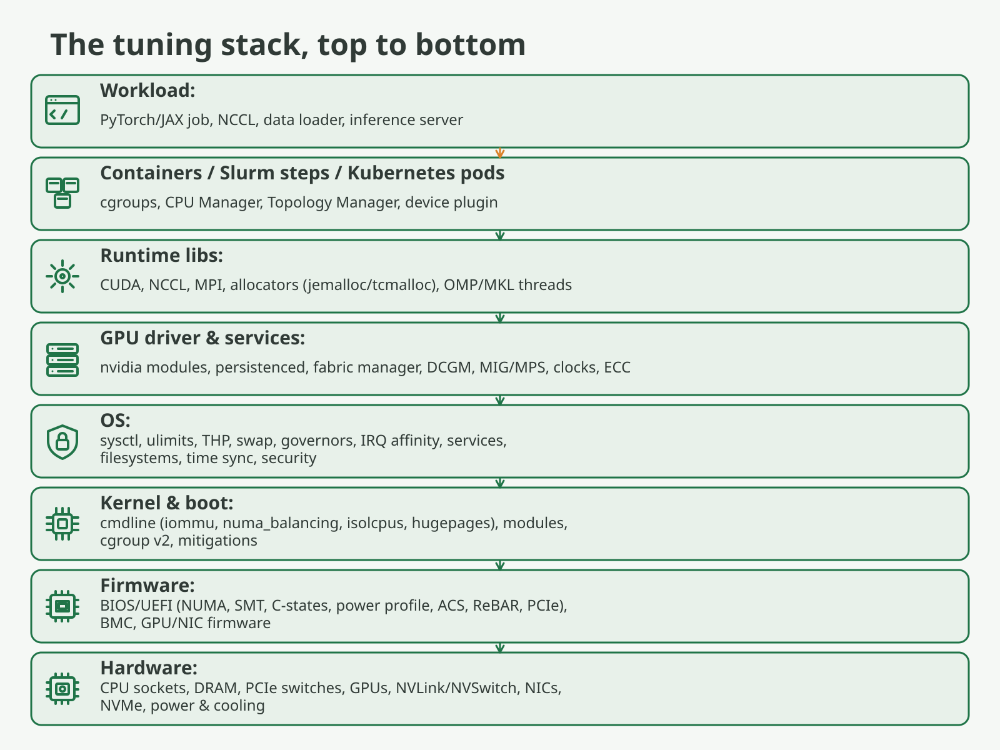
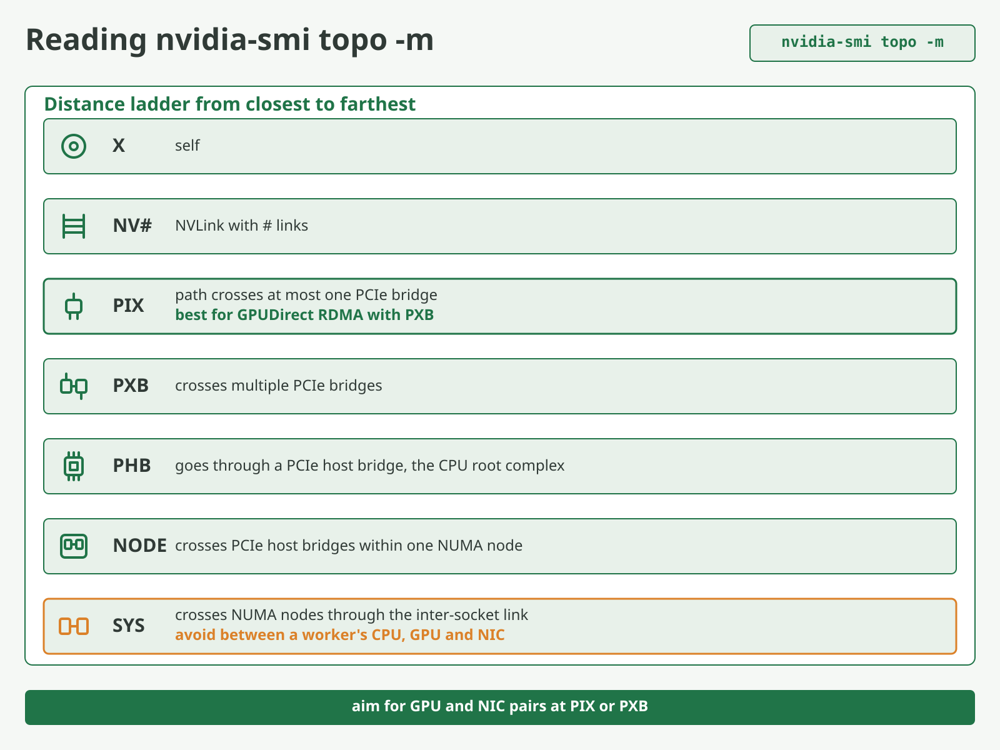
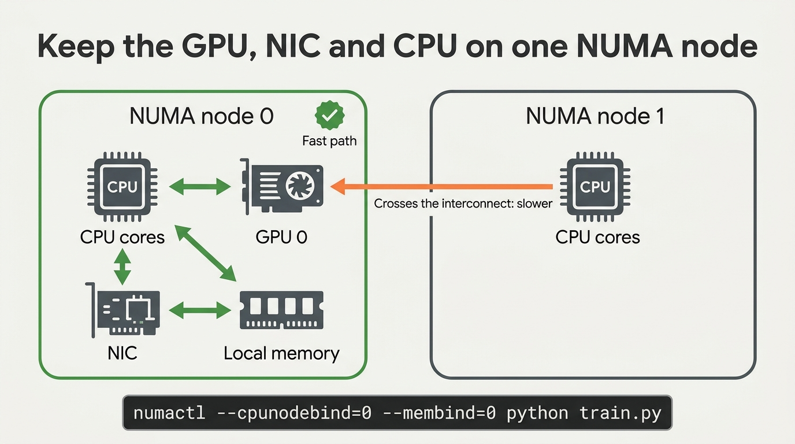
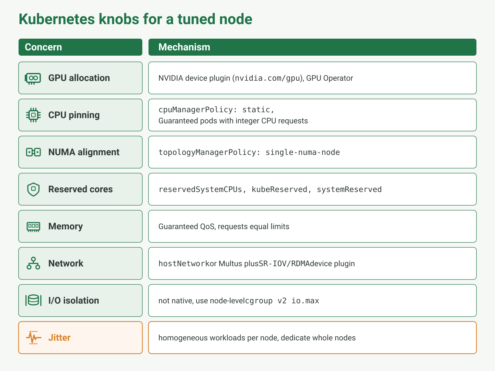
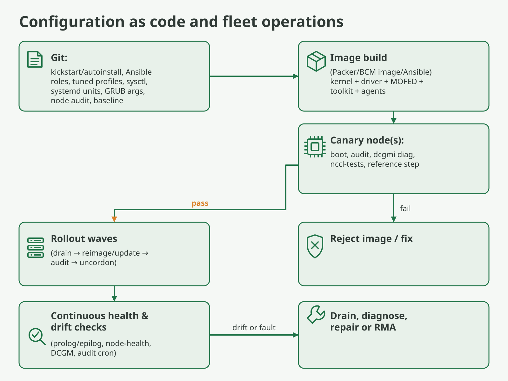
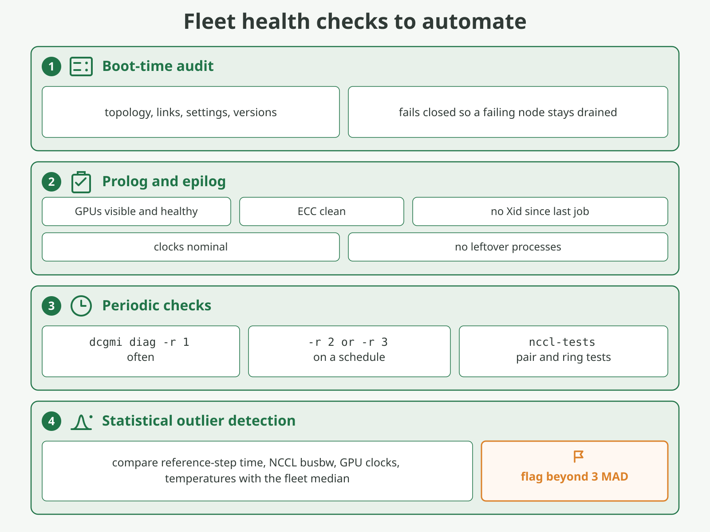
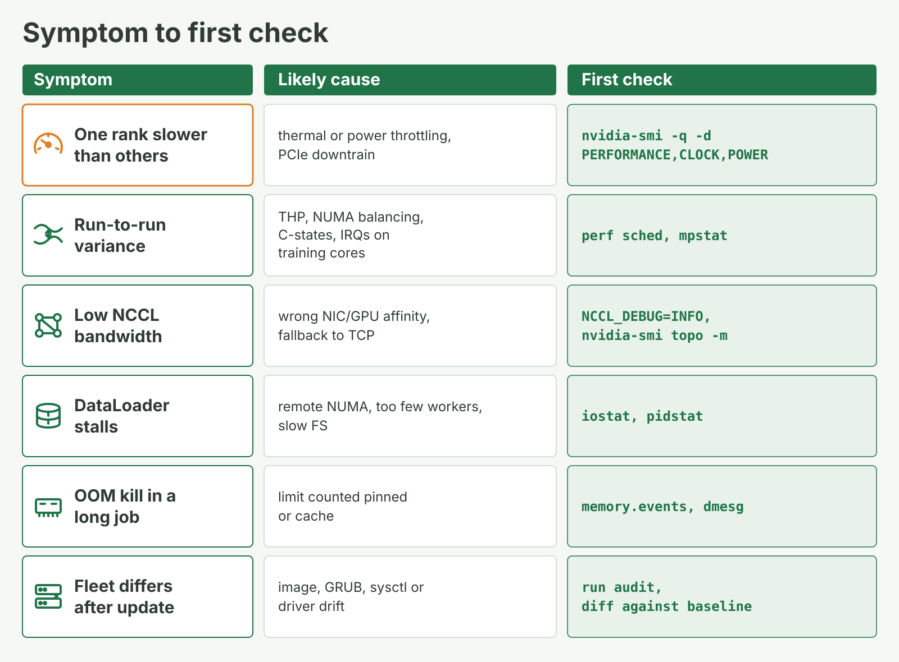

# 1.28 Putting it together: tuning a Linux node for GPU and HPC work

| | |
|---|---|
| Level | Advanced |
| Priority tier | 0 |
| Lab venue | A GPU VM (GCP) or a bare-metal GPU node; the audit and baseline parts run on any Linux host |
| Part | Part 1: Linux, from the command line to the kernel and performance |
| Status | Drafted, labs **untested** |

## Why this matters for AI infrastructure

Picture a training run that was fast last week and crawls today. The code has not changed, so the on-call engineer has to stop reading logs and start looking at the machine itself. This chapter is about the work that keeps such a machine fast. It is about making a Linux server with GPUs deliver the hardware's full capability, proving that it does, and keeping it that way across a fleet.

This is the capstone of Part 1, so every earlier chapter contributes a piece of the answer. Processes came first, then memory and NUMA, then scheduling and cgroups, namespaces, security, kernel modules and ``sysctl``. Later chapters added methods, tracing, benchmarking and virtualisation. Here those pieces come together in one practical task, the kind you will meet again and again in your career. **Take a Linux server with GPUs, make it deliver the hardware's capability predictably, prove it, and keep it that way across a fleet.**

The cost logic behind that task is blunt. A single DGX/HGX-class node costs hundreds of thousands of dollars and consumes kilowatts of power. In a synchronous distributed training job, the slowest rank sets the speed of every other rank. So one node with a throttled GPU, a mispinned data loader, a degraded PCIe link, a too-low `vm.max_map_count`, or a NIC on the wrong NUMA node costs the whole job. Tuning is not about heroics on one machine. It is about making all nodes identical, within a tolerance you can measure, and finding the ones that are not.

Here are some situations you are likely to meet:

- NCCL all-reduce bandwidth varies 20% between runs. After weeks of debugging, the cause turns out to be `numa_balancing` migrating pinned-memory pages, IOMMU translation in the DMA path, and a C-state wake-up in one data-loader thread.
- Throughput drops 6% after an OS image update, because THP, the CPU governor and a kernel parameter all reverted.
- A new rack of nodes passes `nvidia-smi` but fails `dcgmi diag -r 3`. Three GPUs run on a PCIe x8 link, and one runs on Gen3.
- A container job is OOM-killed three days into training, because a memory limit counted pinned buffers and page cache.
- Half the fleet trains 8% slower, because GRUB parameters were applied by hand on only some nodes.

This chapter gives you a layered node tuning playbook. It begins at BIOS and firmware, then moves through boot parameters, the kernel, OS services, memory, CPU and IRQs, storage, network, and the GPU driver and runtime, and ends with containers and schedulers. Alongside the playbook you get a verification suite that runs in minutes, the configuration-as-code pattern that keeps a fleet consistent, and a retold performance case study. The case study shows how the methodology of chapters 1.23 to 1.25 resolves a real mystery. The chapter also has a lab in which you build your own node audit.

## Prerequisites and outcomes

You should have read the Part 1 chapters first, because this one leans on all of them. The most important are memory and NUMA (1.17), CPU and cgroups (1.18), namespaces (1.19), security (1.21), kernel modules and ``sysctl`` (1.22), the method and tool chapters (1.23 to 1.25), and virtualisation (1.26 and 1.27). Details of Slurm, Kubernetes, NCCL and the fabric come in later parts. Here they appear only as the consumers of a well-tuned node.

When you finish this chapter, you should be able to do the following.

- Describe the hardware topology of a GPU server: sockets, NUMA nodes, PCIe switches, GPUs, NICs, NVMe, and NVLink/NVSwitch. Read it with `lscpu`, `numactl -H`, `lstopo`, `lspci -tv` and `nvidia-smi topo -m`.
- Apply a tuning stack and justify each choice. The stack covers BIOS and firmware settings; kernel parameters (`iommu`, `numa_balancing`, THP, C-states, isolation); ``sysctl`` and `ulimit` settings; the CPU governor and IRQ affinity; memory (huge pages, pinned memory, swap, dirty ratios); storage; network; GPU driver settings (persistence mode, clocks, ECC, MIG/MPS); the container runtime; Kubernetes (CPU Manager, Topology Manager, device plugin, GPU Operator); and Slurm (cgroup, binding, GRES).
- Bind processes, threads, memory, NICs and GPUs consistently to the right NUMA domains, in scripts, launchers and frameworks. PyTorch `DataLoader` workers are included.
- Decide which tuning knobs have contested or workload-dependent values, and settle them with A/B measurement rather than folklore.
- Build a node audit script, record a golden baseline, and detect drift. Express the configuration as code, using kickstart, autoinstall, cloud-init, golden images, Ansible, tuned and systemd, and roll it out safely with canaries.
- Retell and apply a methodology-driven investigation of an unexplained performance difference, the "unexplained win" case.
- Troubleshoot the classic node problems: PCIe downtraining, wrong NUMA binding, thermal and power throttling, fabric fallback, driver and module mismatch, memory limits, noisy neighbours, and drift.

## 1. The tuning stack, top to bottom

A procurement team orders two identical GPU nodes, and the invoices agree down to the part numbers. Months later one of them trains slower than the other, and nobody can say why. The answer usually hides in a layer of the machine that was never set on purpose. It helps to picture a GPU node as a stack of layers, with your workload at the top and the physical hardware at the bottom. The diagram shows each layer and what lives in it.



*Figure 1.28.1. The tuning stack, top to bottom.*

The order matters for two practical reasons. First, lower layers cannot be fixed from above. An OS cannot repair a PCIe link that negotiated at x8, and it cannot undo a BIOS that hides NUMA. Second, each layer must be verified before the next one is tuned, or you will tune around a fault. So build and verify bottom-up, and diagnose symptoms top-down.

### Guiding principles

1. Measure, then tune, then measure again. Take a baseline first (chapter 1.23), change one thing at a time, and keep a rollback ready.
2. Keep things local. Keep the chain of storage, CPU memory, CPU thread, GPU and NIC inside one NUMA domain and under one PCIe switch wherever possible. Cross-domain hops add latency and use up interconnect bandwidth. Remote DRAM access can be roughly 1.5 to 2x slower than local. For example, one measured system showed about 80 ns for local access and about 140 ns for remote.
3. Prefer determinism over peak speed. Remove the sources of jitter: frequency scaling, deep C-states, THP compaction, NUMA balancing, swap, background daemons, IRQ migration and power-capping surprises. In synchronous training, the tail across ranks is the metric that matters.
4. Keep the fleet uniform. Identical firmware, kernel, driver and settings matter. Variation is a defect, and the audit is how you find it.
5. Prefer no tuning to unexplained tuning. Every setting needs a recorded reason, a source and a test. Folklore from another hardware generation is "someone else's medicine cabinet".
6. Security is not optional. Keep MAC enabled, keep keys signed with Secure Boot, and apply least privilege (chapter 1.21). Document every exception.
7. Grace-class superchips put the CPU and GPU on one package, joined by a coherent link. That reduces locality problems but does not remove them. Linux still models CPU DRAM and GPU memory as separate pools. So keep threads on the local CPU, and configure huge pages and pinning.

### Tune continuously and reduce bottlenecks across the stack

System tuning is not a one-time job, and it never really finishes. Workloads change, a new model arrives, and the CPU affinity or batch size that was best last quarter may not be best now. So monitor the key metrics on a regular schedule. Adjust CPU affinities, batch sizes and prefetch settings as the workload evolves, because small gains add up into a large improvement over time.

The goal is for every layer to work in harmony, from the OS and CPU up to the GPU driver and runtime. A slow memory allocation on the CPU can starve a GPU just as surely as a slow driver start. Find the bottleneck, fix it, and then look for the next one. Each fix removes some friction from data transfer and some waiting, so the hardware gets closer to its full potential.

## 2. Know the machine: topology first



*Figure 1.28.2. Each topology code is a statement about distance, and SYS between a worker's CPU, GPU and NIC should be avoided.*

Here is a question worth thirty seconds of looking: which CPU cores can reach GPU 3's memory directly? The answer is not written on the GPU. It belongs to the layout of the machine, and guessing it wrong costs you performance for the life of the node. That layout is the topology, meaning the map of where the CPU cores, memory, PCIe switches, GPUs, NICs and NVMe drives sit, and which of them are close to each other. Record that map before you tune anything, because a wrong assumption at this step invalidates everything that follows.

```bash
lscpu | egrep 'Model name|Socket|Core|Thread|NUMA|L3'          # sockets, cores per socket, SMT, NUMA nodes, cache
lscpu -e=CPU,NODE,SOCKET,CORE,L1d:L1i:L2:L3,ONLINE,MAXMHZ        # per logical CPU
numactl -H                                                       # NUMA nodes: CPUs, memory sizes, distances
lstopo --of ascii   # (hwloc) or: lstopo topo.svg                # full tree: packages, caches, PCIe, GPUs, NICs, NVMe
lspci -tv | less ; lspci -vv -s <BDF> | egrep 'LnkCap|LnkSta'    # PCIe tree and each link's capability versus status (speed/width)
nvidia-smi topo -m                                               # GPU-GPU (NV#/PIX/PXB/PHB/NODE/SYS), GPU-NIC, CPU & NUMA affinity
nvidia-smi --query-gpu=index,pci.bus_id,pcie.link.gen.current,pcie.link.gen.max,pcie.link.width.current,pcie.link.width.max --format=csv
cat /sys/bus/pci/devices/<BDF>/numa_node ; cat /sys/class/net/<ifname>/device/numa_node
ibstat ; ibv_devinfo ; rdma link ; ethtool <if> | egrep 'Speed|Duplex'
dmidecode -t memory | egrep 'Size|Speed|Locator' | head -40       # populated DIMM channels (missing DIMMs = lost bandwidth)
```

Read the output of `nvidia-smi topo -m` with the connection codes in mind, because each code is a short statement about distance. `X` means self. `NV#` means NVLink with # links. `PIX` means the path crosses at most one PCIe bridge. `PXB` means it crosses multiple PCIe bridges. `PHB` means the path goes through a PCIe host bridge, the CPU root complex. `NODE` means the path crosses PCIe host bridges within one NUMA node. `SYS` means the path crosses NUMA nodes, through the inter-socket link.

Aim for GPU and NIC pairs at `PIX` or `PXB`, which is the best path for GPUDirect RDMA. Avoid `SYS` between a worker's CPU, GPU and NIC. Then record the whole matrix in the node's baseline.

Write these facts down for every node. Note the GPU-to-NUMA map, the NIC-to-NUMA map, the NVMe-to-NUMA map, and the CPU list for each NUMA node, including the SMT siblings. Check the PCIe link speed and width of each device. Every GPU should run at its maximum generation and x16, and every NIC at its maximum. Confirm that all memory channels are populated, because missing DIMMs cost bandwidth. Confirm that all NVLink links are up. Keep this map with the baseline, since every later step depends on it.

### Superchips such as Grace Blackwell

A superchip is a single package that holds both the CPU and the GPU. The Grace-based designs, such as GH200 and GB200, join the two with NVLink-C2C. That link gives coherent access between CPU and GPU memory at up to about 900 GB/s, and coherence removes many of the copy steps you would otherwise need.

Linux still treats the CPU DRAM and the GPU HBM as two separate memory pools. So you still bind CPU threads to the local CPU NUMA node and keep the data near the CPU that feeds the GPU. The coherent link lowers the software overhead, but it does not remove the need for locality. Huge pages, prefetching and pinned memory still matter on these systems.

## 3. Firmware and BIOS

A node can boot cleanly, pass every GPU check, and still be throttled by a firmware option that was never set. Firmware sits below the operating system, and it decides what the operating system is even allowed to see. A BIOS that hides NUMA, or leaves deep C-states switched on, costs you performance that no amount of kernel tuning can win back. Firmware settings are chosen once per hardware generation, through vendor tooling, Redfish or BCM (Part 1b), and the audit then checks them on every node. Always follow the server vendor's reference profile for your model. The table below gives the concept behind each setting.

| Setting | Typical for GPU training nodes | Why / caution |
|---|---|---|
| Power/performance profile | Maximum performance / "HPC" profile | Disable aggressive CPU power saving; consistent clocks |
| C-states / package C-states | Limit deep states (C0/C1) | Wake-up latency causes jitter and GPU bubbles; costs idle power |
| SMT / hyper-threading | Vendor/workload-dependent (often on; some sites off or use one thread per core) | Test; affects per-thread performance and core counts for pinning |
| NUMA exposure | NUMA enabled; sub-NUMA clustering/NPS per vendor guidance; do **not** interleave sockets (no "node interleaving") | The OS and tools need real topology |
| IOMMU / VT-d / AMD-Vi | Enabled if virtualisation/SR-IOV/security needed; combine with `iommu=pt` | See section 4 |
| PCIe: ACS, ATS, Above-4G decoding, Resizable BAR, link speed | Per vendor guidance for GPUDirect RDMA and P2P: ACS often needs to be disabled on PCIe switches between GPU and NIC for P2P without hairpinning through the root complex; large BARs on | Verify with `nvidia-smi topo -m` and `ib_write_bw --use_cuda`; security trade-off (ACS isolates devices) |
| Memory | All channels populated, ECC on, appropriate memory mode, patrol scrub per vendor | Bandwidth and reliability |
| Turbo/boost | On unless deterministic benchmarking is required | Record the setting |
| SR-IOV | On if used | |
| Secure Boot | On if policy requires (then module signing pipeline, 1.22) | |
| Firmware versions | Pinned, identical across fleet: BIOS, BMC, NIC (ConnectX), GPU VBIOS, NVSwitch, PSU, CPLD, drives | Mixed versions cause "identical node" differences |
| Boot mode | UEFI; network boot (PXE/HTTP Boot) enabled in the right order | Chapter 1.14 |
| Serial console / BMC SOL | On | Debugging and remote management |

Two rows deserve a second look. The PCIe row carries a security trade-off, because ACS is the feature that isolates devices from each other. The firmware row warns that mixed versions cause "identical node" differences, so pin every version and keep them identical across the fleet. Read the table once with the vendor's guide open beside you, and let the audit enforce it forever after.

## 4. Kernel boot parameters

The kernel command line is one of the quietest places a fleet can drift. Someone edits it by hand on the node in front of them, the node reboots, and the change never reaches the image that built it. So change boot parameters only through the distribution's supported mechanism. On RHEL-family BLS systems, use `grubby`. On Ubuntu, edit `/etc/default/grub` and run `update-grub`. For image builds, use your image tooling. Then verify the result with `cat /proc/cmdline`, and keep the parameters under version control.

```text
# Example baseline for a bare-metal HGX-class node (adapt; flags are workload and platform dependent)
console=tty0 console=ttyS0,115200n8
iommu=pt                    # IOMMU on, identity mapping for host-owned devices (lower DMA translation overhead); omit if you need strict isolation
numa_balancing=disable      # stop automatic NUMA page migration when you pin explicitly
transparent_hugepage=madvise   # or never/always: decided by measurement (below)
processor.max_cstate=1 intel_idle.max_cstate=1    # Intel; AMD: BIOS C-state control is more reliable
cpufreq.default_governor=performance
intel_pstate=passive        # or per vendor guidance
hugepagesz=1G hugepages=<N> default_hugepagesz=2M   # only if applications use explicit huge pages (DPDK, some inference stacks)
isolcpus=managed_irq,domain,<list> nohz_full=<list> rcu_nocbs=<list> irqaffinity=<housekeeping>   # only for jitter-critical designs
systemd.unified_cgroup_hierarchy=1     # cgroup v2
audit=1 crashkernel=<size>             # per distribution default
pcie_aspm=off                          # only on vendor advice (links dropping)
mitigations=...                        # leave default unless risk-accepted and measured
module_blacklist=nouveau               # also blacklist in modprobe.d + rebuild initramfs
```

Several of these items are genuinely contested, and experienced engineers disagree about them. Settle each one with an A/B test on your own workload, as chapter 1.25 describes.

- `iommu=pt`: With a default translation-enabled IOMMU, every device DMA needs IOMMU and IOTLB handling. Passthrough mode keeps the IOMMU available for VFIO and SR-IOV, but it uses identity mapping for host devices. Reports of better stability and bandwidth for RDMA and GPUDirect are common. Some GPUDirect configurations have their own IOMMU and ACS requirements. Do not use this setting where DMA isolation of untrusted devices is required.
- `numa_balancing=disable`: Automatic NUMA balancing unmaps pages to detect remote access, and then migrates them. With explicit pinning, through `numactl`, Slurm or Kubernetes binding, it only adds page faults and migration jitter. For unpinned workloads, it may help.
- THP: `always` can cause compaction stalls (khugepaged and direct compaction). `never` loses TLB efficiency for large-memory processes. `madvise` lets applications that ask for huge pages benefit, and some allocators do ask. Training throughput often gains a few percent with huge pages, while latency-sensitive inference prefers deterministic behaviour. Check `/proc/vmstat` for the `thp_*` counters and `compact_stall`.
- C-states: Lower deep sleep means lower wake latency, but more idle power. For GPU nodes, you typically accept the extra power.
- `mitigations`: This is a security decision. Measure before you relax it, and keep the mitigations on multi-tenant hosts.
- Isolation (`isolcpus`, `nohz_full`): This is worth the effort for real-time or jitter-critical designs and for dedicated communication cores. For ordinary training, pinning plus cgroup cpusets, with housekeeping cores left free, is usually enough.

Choose each value by measurement, not by copying it from another machine. A setting that helped a neighbour's cluster tells you only that it did not hurt theirs.

## 5. Sysctl, limits and services

A node can pass every boot-parameter check and still kill a long job, because a service limit was never raised. Below the boot parameters sits the rest of the OS layer: kernel settings, resource limits and services. These are the files people copy from a blog post and then forget for three years. Every line in them needs a reason and a test. Chapter 1.22 has the full table.

```ini
# /etc/sysctl.d/90-gpu-node.conf   (every line needs a reason and a test; see chapter 1.22 for the full table)
vm.swappiness = 1                      # or 0 with swap off; cgroup memory.swap.max for jobs
vm.max_map_count = 1048576             # dataloader/mmap heavy jobs
vm.dirty_background_bytes = 1073741824 # prefer bytes forms on 1-2 TB RAM nodes
vm.dirty_bytes = 8589934592
vm.zone_reclaim_mode = 0
kernel.numa_balancing = 0
kernel.pid_max = 4194304
fs.file-max = 2097152
fs.inotify.max_user_watches = 524288
net.core.rmem_max = 134217728          # TCP paths only; RDMA unaffected
net.core.wmem_max = 134217728
net.ipv4.tcp_rmem = 4096 262144 134217728
net.ipv4.tcp_wmem = 4096 262144 134217728
net.core.netdev_max_backlog = 250000
net.ipv4.conf.all.rp_filter = 2        # loose, multi-homed fabric nodes
kernel.yama.ptrace_scope = 1
kernel.core_pattern = /var/crash/core.%e.%p.%t
```

```ini
# /etc/security/limits.d/90-hpc.conf (login sessions) and systemd unit/manager defaults (services, Slurm, containers)
*  soft  memlock  unlimited
*  hard  memlock  unlimited
*  soft  nofile   1048576
*  hard  nofile   1048576
*  soft  stack    unlimited
# systemd: DefaultLimitMEMLOCK=infinity DefaultLimitNOFILE=1048576   (and LimitMEMLOCK/LimitNOFILE in slurmd.service and containerd.service)
```

Check limits where the job actually runs, not where you happen to be typing. Run `ulimit -a` inside `srun`, inside a pod, or in a systemd service, and you will see what the job gets. Login-session limits do not apply to services or containers, so a value that looks correct in your shell can still be missing from the job.

Services need the same care and the same written reason. Enable and order `nvidia-persistenced`. Enable `nvidia-fabricmanager` as well, and make it start before GPU workloads on NVSwitch systems. Run `dcgm` or `nv-hostengine` with an exporter. Keep `chronyd` running for tight time sync in logs and some protocols. Use `irqbalance` only with a ban mask, or disable it and pin IRQs by hand. Enable `tuned` with a profile, along with `rasdaemon`, `node_exporter`, `sshd`, `slurmd` or `kubelet`, and `containerd`.

Disable what you do not need, and write down why. Examples are a display manager that grabs the GPU, `cups`, `avahi`, mDNS, and unneeded timers such as `apt-daily` on managed images. Decide deliberately about `systemd-oomd`, since it can fight job limits. Then run `swapoff`, or limit swap. Mask services that run periodic `nvidia-smi` calls unless you need them, because those calls contend on driver locks.

A systemd drop-in file lets you order `slurmd` after the GPU services. The block below is illustrative.

```ini
# /etc/systemd/system/slurmd.service.d/gpu-order.conf (illustrative ordering)
[Unit]
After=nvidia-persistenced.service nvidia-fabricmanager.service
Requires=nvidia-persistenced.service
```

Treat the `sysctl` file and the limits file as code. Each change should come with the test that proves it helped, and a note that says what would make you remove it.

## 6. Memory: pinning, huge pages, allocation policy

Memory problems are quiet, which is what makes them expensive. A job still runs, but slower than it should, or it dies days later when a limit is finally reached. Nobody sees the cause at the moment it happens. The settings below prevent both kinds of failure.

- Local allocation. By default, a process allocates memory from the NUMA node of the CPU it runs on. Memory allocated before pinning, or by threads that have since migrated, may be remote. Bind at launch with `numactl --cpunodebind=N --membind=N`, or with the Slurm or Kubernetes equivalents.
- Policy inheritance is not always reliable. A `numactl` policy is inherited by `fork`ed children, but not necessarily by `spawn`ed or `exec`ed workers. It is not guaranteed either for threads that some Python frameworks create, or for processes started by container runtimes. Re-assert the binding in every worker, as section 7 shows, and verify it with `numastat -p PID`, `/proc/PID/numa_maps` and `taskset -cp`.
- Pinned memory, also called page-locked memory, is memory the operating system promises not to move or swap. Allocations such as `cudaHostAlloc`, or PyTorch's `pin_memory=True` paired with `non_blocking=True` on host-to-device copies, allow true asynchronous DMA. They reach `2x–3x` higher host-to-device PCIe throughput than pageable memory. You can measure the gap yourself with `bandwidthTest --memory=pinned` and `bandwidthTest --memory=pageable`. Pinned memory is a limited resource. Raise `RLIMIT_MEMLOCK` with `ulimit -l`. Pinned memory also counts against cgroup memory limits, and it cannot be swapped.
- Huge pages. Use the THP policy from section 4, or explicit huge pages for pinned buffers and RDMA registrations. The gain is typically a few percent, from fewer page faults and TLB misses, and it depends on the workload.
- Allocators. For data-pipeline processes that allocate heavily, tune `jemalloc` with `MALLOC_CONF="narenas:8,background_thread:true,dirty_decay_ms:10000,muzzy_decay_ms:10000"`, or tune `tcmalloc` with larger thread caches. This keeps freed memory from being returned to the system and faulted in again and again. Measure the result.
- Swap. Avoid it. A page that has been swapped out and then sits behind a GPU copy costs orders of magnitude more time. If swap exists for safety, set low swappiness and per-job `memory.swap.max=0`.
- Page cache and checkpoints. Large checkpoint writes fill the page cache, and then they stall. Use `dirty_*_bytes`, `O_DIRECT` or `io_uring`, and `posix_fadvise(DONTNEED)` after writes. Async or distributed checkpointing helps too. Or write to fast local NVMe, then copy the result later.
- Memory limits in containers. You have two choices for training containers. Leave the memory unlimited and monitor it, or set the limit well above the expected peak. That peak includes pinned buffers, page cache and framework overhead. A generous limit avoids OOM kills days into a run. `Guaranteed` QoS requires requests equal to limits for CPU and memory.
- Grace-class. CPU LPDDR and GPU HBM stay as separate pools in Linux. Bind CPU threads locally, and configure huge pages. Coherent access removes some copy overhead, but it does not remove the need for locality.

Pick a memory policy for each job, and measure before you keep it.

### The OOM killer and memory limits

A memory limit protects the host, but it can also end your job. Without limits, one greedy container can take too much host memory. The host then starts to swap, and the Linux OOM killer may step in. The OOM killer is the kernel's emergency procedure for freeing memory, and it picks its victims with heuristics. It may choose your large training job, even when another process caused the pressure.

For this reason, many teams leave memory limits off training and inference containers. The job can then use all the memory it needs. If you do set a limit, put it above the peak you expect, and leave headroom. Watch usage with monitoring and alerts. A limit that is too tight can kill a job three days into a long run, and the log will not tell you why.

## 7. CPU placement and interrupts

Here is the failure this section prevents. A data loader runs on a CPU socket that sits far from the GPU it feeds, so every batch crosses the interconnect before it can reach the card. The GPU waits, the step time wobbles, and nothing in the profiler says "wrong NUMA node". The fix is placement. Each training process should run on the CPUs of the NUMA node that holds its GPU, and the simplest pattern is one process per GPU, bound to that GPU's NUMA domain. The launcher below reads the GPU's NUMA node from sysfs, which is more robust against odd `nvidia-smi topo` text formats. Then it binds the process with `numactl`.



*Figure 1.28.3. Work placed on the GPU's own NUMA node avoids the slower trip across the interconnect.*

```bash
#!/usr/bin/env bash
# launch_bound.sh <gpu_index> -- <command...>     (illustrative; test on your platform)
set -euo pipefail
gpu="$1"; shift; [[ "${1:-}" == "--" ]] && shift
busid=$(nvidia-smi --query-gpu=pci.bus_id --format=csv,noheader -i "$gpu")   # e.g. 00000000:3B:00.0
bdf=${busid,,}; bdf=${bdf:4}                                                  # -> 0000:3b:00.0
node=$(cat /sys/bus/pci/devices/$bdf/numa_node); [[ $node -lt 0 ]] && node=0
echo "GPU $gpu ($bdf) -> NUMA node $node" >&2
export CUDA_VISIBLE_DEVICES="$gpu"
exec numactl --cpunodebind="$node" --membind="$node" "$@"
```

The scheduler can do this for you, which is often the better choice. Slurm offers `--gpus-per-task`, `--gpu-bind=closest` and `--cpu-bind=cores`, with `gres.conf` set to `AutoDetect=nvml` or to explicit `Cores=`. Kubernetes offers the CPU Manager with `static`, the Topology Manager, and the device plugin described in section 9. When the scheduler does not handle it, set the affinity inside the framework, for the process and its workers:

```python
# in each training process (before creating DataLoader workers); worker_init_fn re-applies it
import os, psutil, ctypes
def numa_cpus(node):   # parse /sys/devices/system/node/node<N>/cpulist
    cpus = []
    for part in open(f"/sys/devices/system/node/node{node}/cpulist").read().strip().split(","):
        a, _, b = part.partition("-"); cpus += range(int(a), int(b or a) + 1)
    return cpus
def bind(node):
    psutil.Process().cpu_affinity(numa_cpus(node))
    libnuma = ctypes.CDLL("libnuma.so.1"); libnuma.numa_run_on_node(node); libnuma.numa_set_preferred(node)
# DataLoader(..., num_workers=N, persistent_workers=True, pin_memory=True, worker_init_fn=lambda wid: bind(node))
# do not call CUDA APIs inside worker_init_fn; pass the node by closure/env var
```

The `worker_init_fn` in that block re-applies the binding inside each DataLoader worker. Do not call CUDA APIs there. Pass the node number by closure or environment variable instead.

The book's full `get_gpu_numa_node(device)` helper finds a GPU's NUMA node through an explicit fallback chain. It tries three tiers, in order.

1. NVML (`pynvml`, preferred). Normalize the GPU's PCI bus ID, taken from `torch.cuda.get_device_properties(device).pci_bus_id`, to an 8-hex-digit domain (`nvmlDeviceGetHandleByPciBusId_v2`). Then query `nvmlDeviceGetNUMANodeId(handle)` directly, if the driver exposes it. If it does not, read the GPU's CPU-affinity bitmask with `nvmlDeviceGetCpuAffinity(handle, elems)`, and map those CPUs against `/sys/devices/system/node/node*/cpulist`. The majority NUMA node wins.
2. sysfs fallback. Read `/sys/bus/pci/devices/<bdf>/numa_node`. If the value is negative, return `0`.
3. CLI or process fallback. In shell scripts, parse `nvidia-smi topo -m -i $GPU | awk '/NUMA Affinity/ {print $NF}'`. Otherwise, fall back to the preferred node that `numactl --show` reports.

The `numa_run_on_node` call restricts CPU placement. The `numa_set_preferred` call biases allocations. Stricter memory binding uses `set_mempolicy` or `numa_bind`. Check that libnuma is available on your distribution, and check its version and soname too.

Set `OMP_NUM_THREADS`, `MKL_NUM_THREADS`, `OMP_PROC_BIND` and `OMP_PLACES`, so that each rank's thread pool matches the cores you gave it. Oversubscription is a common silent loss. Removing cross-NUMA traffic and migrations gains several percent. The bigger benefit is lower jitter from run to run.

SMT is the next choice. For per-core predictability, some sites give each rank one hardware thread per core, pinned to one sibling. Others disable SMT in the BIOS. Test both before you choose.

Set the governor with `cpupower frequency-set -g performance`, or use a tuned profile such as `throughput-performance`, `accelerator-performance` or `latency-performance`. Profile names differ by distribution. Check the real clocks with `turbostat`, and confirm there is no thermal or power-cap throttling in `dmesg` or the BMC.

GPU, NIC and NVMe interrupts should be served on cores in the same NUMA node as the device, and away from the cores that do the training work. You can also spread them across the cores local to the device.

```bash
grep -E 'mlx5|nvme|nvidia' /proc/interrupts | head                          # which IRQs, per-CPU counts
cat /proc/irq/<N>/smp_affinity_list ; echo <cpus> > /proc/irq/<N>/smp_affinity_list
set_irq_affinity.sh <ifname>   # vendor scripts distribute NIC IRQs on local cores (mlnx_affinity / set_irq_affinity_bynode.sh)
ethtool -l <if> ; ethtool -L <if> combined <n>                               # queues
systemctl disable --now irqbalance   # or configure IRQBALANCE_BANNED_CPUS
mpstat -P ALL 1 | egrep ' (soft|irq)'                                        # a CPU stuck at high %soft/%irq is an IRQ hot spot
```

Reserve housekeeping cores for kernel threads, `kubelet`, `containerd`, monitoring agents and IRQs. Use systemd `CPUAffinity=`, `kubelet --reserved-cpus`, Slurm `CoreSpecCount`, or `isolcpus` to do it. Verify every binding with the tools from section 6 before you trust a throughput number.

### Keeping the CPU ahead of the GPU

The CPU does host-side work that the GPU cannot do for itself. It loads each batch from disk, tokenizes and transforms the data, dispatches GPU kernels, and coordinates threads and processes. If that work is slow, or the OS schedules it badly, the GPU sits idle. Keep the cores that feed the GPU free of unrelated work. Set the CPU affinity so the right cores handle the right data, and move background daemons and OS tasks onto their own cores.

### Scheduler priority and core isolation

Linux uses the Completely Fair Scheduler by default, and it works well for most jobs. A very latency-sensitive thread that feeds the GPU can get a real-time priority, using FIFO or round-robin scheduling. That thread then runs without being preempted by normal threads. Use this with care, because real-time threads can starve other processes.

If the thread already has a dedicated core, you often do not need a real-time priority. Core isolation is another tool. `cset`, the `isolcpus` and `nohz_full` kernel parameters, or a cgroup `cpuset` can leave cores free for your work. Then the scheduler leaves those cores to your job.

### Finding a GPU's NUMA node in Python

The helper below finds a GPU's NUMA node. It tries NVML first, then sysfs, and then the process's current preferred node. Call it once at startup, before the process binds itself to CPUs. The code keeps each fallback step in this order.

```python
import glob, os, re, subprocess
import psutil
import torch
try:
    import pynvml as nvml  # pip install nvidia-ml-py3
    _HAS_NVML = True
except Exception:
    _HAS_NVML = False

def parse_physical_cpu_list(phys_str: str):
    """Parse '0-3,8-11' -> [0,1,2,3,8,9,10,11]."""
    cpus = []
    if not phys_str:
        return cpus
    for part in phys_str.split(','):
        part = part.strip()
        if not part:
            continue
        if '-' in part:
            start, end = map(int, part.split('-'))
            cpus.extend(range(start, end + 1))
        else:
            cpus.append(int(part))
    return cpus

def get_numa_cpus_and_memory():
    """Return (current_cpu_mask, preferred_node) from numactl --show."""
    out = subprocess.run(["numactl", "--show"],
                         capture_output=True, text=True).stdout
    phys = re.search(r"physcpubind:\s*([\d,\-\s]+)", out).group(1)
    cpus = parse_physical_cpu_list(phys)
    node = int(re.search(r"preferred node:\s*(-?\d+)", out).group(1))
    return cpus, node

def get_gpu_numa_node(device: int) -> int:
    """NVML first, then sysfs, then the current preferred node."""
    if _HAS_NVML:
        try:
            nvml.nvmlInit()
            props = torch.cuda.get_device_properties(device)
            pci = props.pci_bus_id  # '0000:03:00.0' or '00000000:03:00.0'
            domain, bus, devfn = pci.split(':')
            pci8 = f"{domain.rjust(8, '0')}:{bus}:{devfn}"
            try:
                handle = nvml.nvmlDeviceGetHandleByPciBusId_v2(pci8)
            except AttributeError:
                handle = nvml.nvmlDeviceGetHandleByPciBusId(pci8)
            # Direct NUMA ID, if the driver exposes it
            try:
                numa_id = nvml.nvmlDeviceGetNUMANodeId(handle)
                if isinstance(numa_id, int) and numa_id >= 0:
                    return numa_id
            except Exception:
                pass
            # Otherwise, derive it from the GPU's CPU affinity mask
            cpu_count = psutil.cpu_count(logical=True)
            elems = (cpu_count + 63) // 64
            mask = nvml.nvmlDeviceGetCpuAffinity(handle, elems)
            cpus = []
            for i, m in enumerate(mask):
                m = int(m)
                for b in range(64):
                    if m & (1 << b):
                        cpu_id = i * 64 + b
                        if cpu_id < cpu_count:
                            cpus.append(cpu_id)
            # Build a CPU-to-NUMA map from sysfs and choose the majority node
            cpu2node = {}
            for node_path in sorted(glob.glob("/sys/devices/system/node/node*")):
                node_id = int(os.path.basename(node_path).replace("node", ""))
                with open(os.path.join(node_path, "cpulist"), "r") as f:
                    for c in parse_physical_cpu_list(f.read().strip()):
                        cpu2node[c] = node_id
            counts = {}
            for c in cpus:
                n = cpu2node.get(c)
                if n is not None:
                    counts[n] = counts.get(n, 0) + 1
            if counts:
                return max(counts.items(), key=lambda kv: kv[1])[0]
        except Exception:
            pass
    # sysfs fallback
    try:
        pci = torch.cuda.get_device_properties(device).pci_bus_id
        with open(f"/sys/bus/pci/devices/{pci}/numa_node", "r") as f:
            val = int(f.read().strip())
        return val if val >= 0 else 0
    except Exception:
        pass
    # last resort: the current preferred node
    _, node = get_numa_cpus_and_memory()
    return node if node >= 0 else 0
```

The NVML path is the most direct answer. If the driver exposes the NUMA node, the helper uses it. If not, it reads the GPU's CPU affinity mask and maps those CPUs to NUMA nodes, and the node that holds most of them wins. The sysfs file is the next fallback. The `numactl --show` output is the final resort.

## 8. Storage, network and the GPU driver

Three very different things can all present as "the GPU is slow": slow local disks, a slow fabric, or a driver that nobody configured. This section covers local and network storage, the host side of the network, and the GPU driver and runtime. Each one has settings you must choose on purpose, so the reasons matter as much as the values.

### Local storage and filesystems

- Start with the disk layout. A typical layout puts the OS on a mirrored pair (RAID1) of small NVMe or SATA devices. Use the remaining NVMe drives as scratch, either striped (md RAID0 or an LVM stripe) or individually. Do not use parity RAID for scratch. Scratch holds the dataset cache, the container layers (`/var/lib/containerd` and the enroot cache) and checkpoint staging. Use the mount options `noatime` and `nodev,nosuid`, as your policy allows. Modern kernels default to `relatime`. Use XFS or ext4, aligned to the stripe, and enable `fstrim.timer`. Put container storage on its own partition, so that it cannot fill the root filesystem (chapters 1.12 and 1.13).
- Tune only after you have measured. Adjust queue depth, the scheduler (`none` for NVMe), `read_ahead_kb` and `nr_requests`. Also check the NUMA locality of each NVMe drive to the workers that read it, and watch for thermal throttling under sustained load. Use the fio recipes from chapter 1.25 for the measurements.
- Never mirror or parity the scratch unless durability requires it. Durability for checkpoints comes from copying them to shared or object storage.
- Network filesystems such as Lustre, GPFS, NFS and WekaFS need their mount options and client settings tuned as well. These include readahead, RPCs in flight, `nconnect` for NFS, client cache sizes and stripe counts. Metadata-heavy access patterns need attention too. Avoid many small files by packing datasets into shards. Validate the result with IOR and mdtest at job scale.
- Keep container image layers and writable layers on fast NVMe. Keep large mutable data on bind-mounted volumes, not in the overlay writable layer (chapter 1.19).

### Network (host side)

- Start with the interfaces. A GPU node usually has three networks. The management network runs at 1/10 GbE, and the BMC sits on a separate out-of-band path. The storage or front-end Ethernet carries storage and control traffic. The compute fabric, InfiniBand or RoCE, often has one NIC per GPU. Check each link's speed and width, and its firmware, with `mlxlink`, `mlxfwmanager` or `flint`, and with `ibstat`. Set the MTU end to end: jumbo frames on Ethernet and RoCE, and an IB MTU of 4096. For RoCE, configure PFC and ECN, with the lossless classes validated on both the NICs and the switches. For InfiniBand, check Subnet Manager health.
- On the software side, pin the MOFED and DOCA versions together with the kernel and driver, as one release train (chapter 1.22). Make sure `nvidia_peermem` is loaded for GPUDirect RDMA, and use `rdma-core`. Verify the path with `ib_write_bw --use_cuda`. Set the NCCL environment with `NCCL_IB_HCA`, `NCCL_SOCKET_IFNAME`, `NCCL_NET_GDR_LEVEL`, and `NCCL_TOPO_FILE` when topology detection is incomplete in VMs.
- TCP still carries storage, the control plane and parameter services. Apply the buffer and congestion settings from chapter 1.22. Keep the RSS and RPS queues local to the NIC's NUMA node, and set the IRQ affinity to match. Check offloads with `ethtool -k`, ring sizes with `ethtool -g`, and the pause and flow-control policy.
- The firewall needs its own decision. As chapter 1.21 explained, IB traffic bypasses the host firewall, so protect it with fabric partitions. Where you firewall Ethernet fabric interfaces, allow RoCE v2 on UDP 4791.
- For time, point chrony at a local source. Use PTP where you need tracing correlation.

Multinode training depends on the network as much as on the GPUs. Use an RDMA-enabled fabric, such as InfiniBand or Ethernet with RoCE, for traffic between nodes. Then tune the host side as well. TCP buffers, MTU and interrupt affinity all affect throughput during distributed training and inference. Check them with the fabric tools before you trust a benchmark.

### GPU driver and runtime settings

The table below lists the GPU driver and runtime settings. Each row asks you to make a choice and record it.

| Setting | How | Guidance |
|---|---|---|
| **Persistence mode** | `nvidia-persistenced` service (`systemctl enable nvidia-persistenced`, preferred) or `nvidia-smi -pm 1` | Keep the driver initialised; saves `1–2 seconds` of cold driver initialization latency per job; negligible idle power cost; enable on all nodes |
| **Driver stays loaded** | Do not unload modules between jobs | Reload only for upgrades/troubleshooting |
| **Application clocks / locked clocks** | `nvidia-smi -lgc min,max` (lock GPU core clocks), `-rgc`, `nvidia-smi -ac <mem_clock>,<graphics_clock>` (application clocks for memory and graphics); `-lmc` for memory | For benchmarking determinism so thermal throttling in later runs does not skew results; in production leave GPU Boost on unless variance is a problem (then lock to a validated value); record the policy |
| **Power limit** | `nvidia-smi -pl W` | A slightly lower limit below TDP can reduce thermal throttling with minimal loss; or enforce rack power budgets; note the permitted range per SKU |
| **ECC** | `nvidia-smi -e 1` (needs reset) | Keep enabled on data-centre GPUs; disabling saves little and removes protection |
| **Compute mode** | `nvidia-smi -c DEFAULT` / `EXCLUSIVE_PROCESS` | Default for typical jobs; exclusive process for MPS or strict isolation |
| **MIG** | `nvidia-smi -mig 1` (reset needed), create GPU instances/compute instances; GPU Operator MIG Manager in Kubernetes | Only for multi-tenant small jobs/inference; no cross-GPU MIG P2P, CUDA IPC across GPU instances, or NCCL across MIG instances; plan partitions up front |
| **MPS** | `nvidia-cuda-mps-control -d`, `CUDA_MPS_ACTIVE_THREAD_PERCENTAGE` | Overlap kernels from several processes on one GPU (inference packing); no memory isolation; same-user considerations |
| **Kubernetes time-slicing** | Device plugin config | Coarse sharing without overlap |
| **Fabric Manager** | `nvidia-fabricmanager.service` (versions must match driver) | Mandatory on NVSwitch systems; verify `nvidia-smi nvlink -s` |
| **Retired pages / row remapping, Xid** | `nvidia-smi -q -d PAGE_RETIREMENT,ROW_REMAPPER`, `journalctl -k \| grep Xid` | Health checks; replace GPUs per vendor RMA thresholds |
| **GPUDirect Storage / RDMA** | `nvidia-fs`, `nvidia_peermem`, supported filesystems/NICs | Enable where supported; validate with `gdscheck`, `ib_write_bw --use_cuda` |
| **Memory oversubscription** | CUDA managed memory / UVM page migration (Hopper/Blackwell Page Migration Engine, PME) | Safety net, not a performance feature; avoid for training |
| **Framework allocator** | `PYTORCH_ALLOC_CONF=expandable_segments:True,max_split_size_mb:128` (formerly `PYTORCH_CUDA_ALLOC_CONF`), `TF_FORCE_GPU_ALLOW_GROWTH=true` for TensorFlow on-demand VRAM growth instead of pre-allocating all GPU memory, `torch.cuda.empty_cache()` sparingly | Fragmentation vs reuse; diagnose with `torch.cuda.memory_stats()` and `torch.cuda.memory_summary()` |
| **CUDA / driver compatibility** | Host driver at least as new as the CUDA runtime in the container requires (`R580` or newer for CUDA 13.x; `R525` or newer for CUDA 12.x; `cuda-compat` forward compatibility across minor/major updates; PTX + CUBIN fatbinaries across hardware generations) | Check NVIDIA's compatibility tables; containers carry the CUDA runtime (`libcudart.so`), hosts inject the driver libraries (`libcuda.so`, `libnvidia-ml.so`) |

Read the table one row at a time, and record the choice you make for each row. Boot order matters as much as the values. Load the modules, start `nvidia-persistenced`, start `nvidia-fabricmanager`, set the clocks, power and MIG policies, start DCGM, and run the health check. Only then start `slurmd` or `kubelet`, or mark the node schedulable. A node that fails any step stays **drained**.

### ECC, clocks and power: change them only with a reason

Most GPU knobs trade peace of mind for speed. Start with the defaults. Change one only when a measurement shows why you need it.

GPU Boost adjusts the core clock within power and thermal limits. For everyday training and inference, leave auto-boost on, unless you see large run-to-run variance and throttling. Locking clocks matters mostly for benchmarks. Later runs can throttle from the heat of earlier runs and give misleading numbers. Use `nvidia-smi -lgc` to lock the core clock, and `-ac` to lock the memory clock.

Some teams underclock on purpose to reduce heat on very long jobs. A better option is a power limit set slightly below the TDP, the maximum heat in watts that the GPU can generate under sustained load. Set it with `nvidia-smi -pl`. GPU Boost then adjusts clocks below the thermal throttle point. That can cut peak heat with minimal performance cost. Data center cooling usually makes this unnecessary.

ECC, error-correcting code, protects GPU memory. A single-bit error, such as one caused by a cosmic ray, is corrected on the fly. A double-bit error is detected and reported to the calling code. Data center GPUs such as Hopper and Blackwell ship with ECC on. Turning it off frees a little memory and may save a few percent of speed. It also removes the protection, so a memory error could crash a job or silently corrupt it.

Keep ECC on for any serious AI workload. The only case for turning it off is a research setting where you accept the risk to fit a model into tight memory. Changing the ECC mode needs a GPU reset, and that usually restarts the jobs on that GPU. So do not switch it often.

### GPU memory: watch it before it runs out

Unlike CPU RAM, a GPU has no swap by default. If you ask for more memory than is free, you get an out-of-memory error, and the process usually crashes. Frameworks handle this differently. TensorFlow can grab all GPU memory at startup, which hurts when several jobs share a GPU. Setting `TF_FORCE_GPU_ALLOW_GROWTH=true` makes it grow on demand, the way PyTorch does. Neither framework can allocate more memory than the GPU physically has.

PyTorch allocates GPU memory only as needed. Its caching allocator keeps freed blocks for reuse instead of returning them to the OS. Watch the usage with `nvidia-smi` or the NVML APIs during training and inference. When you get close to the limit, reduce the batch size, use activation checkpointing for training, or reduce precision.

If you hit an OOM, first check for fragmentation or excessive caching. `torch.cuda.memory_stats()` and `torch.cuda.memory_summary()` show allocated memory versus reserved memory. `torch.cuda.empty_cache()` can release cached blocks, but most of the time the job really needs that much memory. Unified memory is a safety net that pages data between CPU and GPU. It keeps a job alive, but that job runs slower.

## 9. Containers, Slurm and Kubernetes as consumers of the tuned node

You can tune a node perfectly and then lose all of it one layer higher up. A container runtime that injects the wrong libraries, or a scheduler that ignores the binding you set, will quietly undo your work. A tuned node is only useful if the software on top keeps its settings. This section covers the container runtime, Kubernetes and Slurm.

### Container runtime

- Use the NVIDIA Container Toolkit, with CDI preferred. It injects the host driver libraries (`libcuda.so`, `libnvidia-ml.so`) and the device nodes (`/dev/nvidia0`, `/dev/nvidiactl`, `/dev/nvidia-uvm`, `/dev/nvidia-modeset`) into the container. The CUDA runtime (`libcudart.so`) comes from the image. With a properly configured container environment, performance stays within `< 2%` of bare-metal host execution. Red Hat's `MLPerf Inference v5.0` submission on OpenShift and Kubernetes matched bare-metal efficiency and latency (chapter 1.19).
- For NCCL over InfiniBand, use host networking (`--network=host` or `hostNetwork: true`), or an RDMA device plugin or SR-IOV CNI. An overlay network adds latency and NAT. If you are forced to use one, control the ports and interfaces with `NCCL_SOCKET_IFNAME` and the ephemeral port range.
- Set `--ipc=host` or a large `--shm-size` for DataLoader and NCCL shared memory, and add `--ulimit memlock=-1`. Do not bake the driver into images, and pin image digests.
- Keep data off the overlay writable layer. Use bind mounts to NVMe or parallel filesystem paths instead.
- Run cgroup v2 with the systemd driver (chapter 1.18). Then verify that the runtime enforces the GPU device cgroup entries.

### Kubernetes



*Figure 1.28.4. Kubernetes expresses the same tuning ideas through its own knobs, and dedicating whole nodes removes jitter.*

Kubernetes expresses the same ideas through its own knobs, and the names are different. The table below lists each concern and its mechanism.

| Concern | Mechanism |
|---|---|
| GPU allocation | NVIDIA device plugin (`nvidia.com/gpu`), GPU Operator (driver, toolkit, device plugin, DCGM exporter, GFD node labels, MIG manager) |
| CPU pinning | `kubelet` `cpuManagerPolicy: static`: `Guaranteed` pods with integer CPU requests get exclusive cores |
| NUMA alignment | `topologyManagerPolicy: single-numa-node` (strict) or `restricted`/`best-effort`; `memoryManagerPolicy: Static` for guaranteed memory pinning; device plugin must report topology hints |
| Reserved cores | `reservedSystemCPUs` / `kubeReserved` / `systemReserved` for daemons |
| Memory | `Guaranteed` QoS (requests = limits) for training pods; consider generous or no memory limits; hugepages resources |
| Network | hostNetwork or Multus + SR-IOV/RDMA device plugin; NCCL env via pod spec |
| I/O isolation | Not native in Kubernetes: use node-level cgroup v2 `io.max`/dedicated devices |
| Scheduling | Node labels/taints for GPU types and fabric domains, gang scheduling (Kueue, Volcano, KAI), topology-aware plugins |
| Jitter | Run homogeneous workloads per node; dedicate whole nodes (request all CPUs and GPUs) for performance-critical jobs |

The Jitter row is the one to remember. Run similar workloads on each node, and dedicate whole nodes to performance-critical jobs by requesting all of their CPUs and GPUs.

### Slurm

Slurm needs settings in three configuration files, plus flags at job launch. In `slurm.conf`, set `ProctrackType=proctrack/cgroup`, `TaskPlugin=task/cgroup,task/affinity`, `SelectType=select/cons_tres` and `GresTypes=gpu`. Use `CoreSpecCount` or `CpuSpecList` to reserve cores for housekeeping. In `cgroup.conf`, set `ConstrainCores=yes`, `ConstrainRAMSpace=yes` and `ConstrainDevices=yes`. In `gres.conf`, use `AutoDetect=nvml`, or write the device explicitly, for example `Name=gpu File=/dev/nvidia0 Cores=0-31`.

When you write a job script, use `--gpus-per-node`, `--ntasks-per-node`, `--cpus-per-task`, `--gpu-bind=closest`, `--cpu-bind=cores`, `--mem-bind=local` and `--exclusive` as the job needs them. Make sure memlock stays unlimited, either with `PropagateResourceLimitsExcept=MEMLOCK` or by setting it in the `slurmd` service. Also keep `UnkillableStepTimeout` in the configuration.

Prolog and epilog scripts, along with node health scripts, clean up the state a job leaves behind. They kill leftover processes, apply your `drop_caches` policy, reset GPUs after failures, and verify clocks. Part 6 covers the Slurm series.

## 10. Configuration as code and fleet operations

A fleet stays uniform only when every node is built the same way, and that is a pipeline problem rather than a discipline problem. Hand-built consistency lasts until the first busy week. The pipeline below takes a change from Git through a canary to the whole fleet, in waves.



*Figure 1.28.5. Configuration as code and fleet operations.*

Notice that a failed canary rejects the image, while drift or a fault sends the node back for diagnosis.

### Provisioning pipeline

- Start with bare-metal provisioning. Nodes can boot over PXE or HTTP, using DHCP options, TFTP or HTTP, and UEFI. Kickstart handles RHEL-family systems, and Autoinstall with cloud-init handles Ubuntu. You can also stream or `dd` a golden image (`.qcow2`, `.raw`, `.squashfs`), or use BCM-managed images (Part 1b). The storage layout is mirrored OS disks and unmirrored scratch. Set hostnames, SSH keys and host keys uniquely for each node. Regenerate the host keys and `machine-id` on first boot.
- Then decide what belongs in a golden image and what belongs in runtime configuration. Put the heavy, version-sensitive components in the image: the kernel, the GPU driver modules, MOFED and the toolkit. Build them once in CI against the pinned kernel, so that no node compiles DKMS modules (chapter 1.22). Apply per-node and site parameters at boot, with cloud-init, Ansible or BCM.
- The Ansible role is where most of this becomes repeatable. A skeleton role has tasks for each part of the node. It sets GRUB args with `grubby`, or with `lineinfile` plus `update-grub`, and a handler rebuilds and reboots. It sets `sysctl` through `ansible.posix.sysctl` with a `sysctl_file`. It also sets limits, services and their ordering, the tuned profile, persistence and the fabric manager, IRQ scripts, node-exporter and DCGM, and the audit script. A final `assert` task runs the audit and fails the play if the audit fails. Run the role with `--check --diff` in CI, and apply it with `serial:` so it rolls through the fleet. Never reboot the whole fleet in one batch.
- Then watch for idempotence and drift. Run the role again on a schedule in check mode, and report any differences. Alert on any change in `/proc/cmdline`, `sysctl -a`, module versions, firmware versions or PCIe link status. Keep the audit result for each node in a database or metrics system.
- Then handle updates. The kernel, driver, MOFED and firmware move together. Hold their packages with `apt-mark hold` or `dnf versionlock`. Roll out the canary first, then the waves, and keep the previous image bootable for rollback.

### Fleet health checks (what to automate)



*Figure 1.28.6. Stragglers are the expensive failure, so compare each node against the fleet median.*

1. Boot-time audit (section 11). It checks topology, links, settings and versions. It fails closed, so a failing node stays drained.
2. Prolog and epilog. The prolog verifies that GPUs are visible and healthy, ECC is clean, there has been no Xid since the last job, clocks are nominal, no leftover processes exist, memory is free and scratch space is available. The epilog resets that state.
3. Periodic checks. Run the quick `dcgmi diag -r 1` often, and run `-r 2` or `-r 3` on a schedule or after an incident. Run `nccl-tests` pair and ring tests across the fabric on a schedule. Also watch the IB and Ethernet error counters, PCIe AER and corrected-error rates, EDAC, SMART and NVMe health, temperatures and fans from the BMC, and power.
4. Statistical outlier detection. Compare each node's reference-step time, NCCL busbw, GPU clocks and temperatures with the fleet median. Flag outliers beyond 3 MAD (median absolute deviation) for investigation. Stragglers are the expensive failure.

## 11. The node audit and baseline (verification suite)

Before a node joins the pool, someone has to say yes to it, and that yes should come from a script rather than a feeling. The audit is also the part of this chapter you will come back to most often, so keep it small. Write one short script that prints PASS or FAIL for each check, and exits non-zero when any check fails. Adapt the expected values to your platform, including the GPU count, link speeds, kernel version string, cmdline tokens and `sysctl` values. Here is an illustrative skeleton (**untested**; adapt it):

```bash
#!/usr/bin/env bash
# node_audit.sh - quick GPU node audit. Usage: node_audit.sh [expected_gpus] ; exit code = number of failures
exp_gpus=${1:-8}; fail=0
chk() { local name="$1"; shift; if "$@" >/dev/null 2>&1; then echo "PASS  $name"; else echo "FAIL  $name"; fail=$((fail+1)); fi; }
val() { local name="$1" want="$2" got="$3"; if [[ "$got" == "$want" ]]; then echo "PASS  $name ($got)"; else echo "FAIL  $name (got '$got', want '$want')"; fail=$((fail+1)); fi; }

echo "== identity =="; uname -r; hostnamectl --static; cat /etc/os-release | head -2
echo "== kernel cmdline =="; for t in iommu=pt numa_balancing=disable; do chk "cmdline has $t" grep -qw "$t" /proc/cmdline; done
echo "== sysctl =="; val swappiness 1 "$(sysctl -n vm.swappiness)"; val max_map_count 1048576 "$(sysctl -n vm.max_map_count)"
val numa_balancing 0 "$(sysctl -n kernel.numa_balancing)"
echo "== memory =="; val THP "madvise" "$(sed 's/.*\[\(.*\)\].*/\1/' /sys/kernel/mm/transparent_hugepage/enabled)"
swapon --show --noheadings | wc -l | { read n; [[ $n -eq 0 ]] && echo "PASS  no swap" || echo "WARN  swap devices: $n"; }
echo "== limits =="; val memlock unlimited "$(ulimit -l)"; 
echo "== cpu =="; val governor performance "$(cat /sys/devices/system/cpu/cpu0/cpufreq/scaling_governor 2>/dev/null)"
echo "== gpus =="; n=$(nvidia-smi -L | wc -l); val gpu_count "$exp_gpus" "$n"
val persistence Enabled "$(nvidia-smi --query-gpu=persistence_mode --format=csv,noheader | sort -u | tr '\n' ' ' | sed 's/ $//')"
nvidia-smi --query-gpu=index,pcie.link.gen.current,pcie.link.gen.max,pcie.link.width.current,pcie.link.width.max,ecc.errors.uncorrected.volatile.total,clocks_throttle_reasons.active --format=csv,noheader |
while IFS=, read -r i gc gm wc wm ecc thr; do
  [[ "${gc// /}" == "${gm// /}" && "${wc// /}" == "${wm// /}" ]] && echo "PASS  GPU$i PCIe gen${gc// /} x${wc// /}" || echo "FAIL  GPU$i PCIe gen${gc// /}/${gm// /} x${wc// /}/${wm// /}"
  [[ "${ecc// /}" =~ ^(0|\[N/A\])$ ]] || echo "FAIL  GPU$i uncorrected ECC: $ecc"
done
chk "fabric manager active (NVSwitch systems)" systemctl is-active --quiet nvidia-fabricmanager
chk "no recent Xid errors" bash -c '! journalctl -k --since "-1 day" | grep -q "NVRM: Xid"'
echo "== network =="; command -v ibstat >/dev/null && ibstat | egrep 'State|Rate' | sort | uniq -c
echo "== modules =="; for m in nvidia nvidia_uvm nvidia_peermem; do chk "module $m" lsmod | grep -q "^$m"; done
echo "failures: $fail"; exit $fail
```

The `ulimit -l` line reports the limit of the audit's own shell, not the limit of services. Check limits in the real environments, as section 5 explains.

Collect the baseline once for each node generation or image, and store it with the image version. The commands below do that.

```bash
mkdir -p baseline/$(hostname); cd baseline/$(hostname)
{ uname -a; cat /proc/cmdline; lscpu; numactl -H; lspci -vv; nvidia-smi -q; nvidia-smi topo -m; ibstat; ibv_devinfo; ethtool -i <if>; sysctl -a; \
  systemctl list-unit-files --state=enabled; dmidecode; lsmod; modinfo nvidia | egrep 'version|license|vermagic'; } > env.txt 2>&1
dcgmi diag -r 2 > dcgm_r2.txt 2>&1 ; ./nccl-tests/build/all_reduce_perf -b 8 -e 8G -f 2 -g 8 > nccl_single.txt
```

Later, compare new nodes and later snapshots against this baseline, using `diff` or structured checks. Also compare them against the fleet distribution.

## 12. A case study: the unexplained 3 to 4x win

Sometimes a system gets faster for reasons nobody can explain, and that is exactly when you need a method rather than a hunch. The last few chapters gave you one, so here it is applied to a real mystery, retold from Gregg's *Systems Performance*, chapter 16. The case is a service that moved platforms and suddenly ran several times faster, and nobody on the team trusted the number. The platform is a cloud rather than a GPU node, but the technique is the one you will use on nodes.

Every investigation starts with the problem statement. A microservice that computes recommendations was moved from VM instances to a new container platform. One of its two components took 3 to 4 seconds per request on the VMs, and 1 second on the containers. A 3 to 4x gain "sounded too good to be true". The question was whether the gain was permanent, or an artefact of the test.

The team had two initial hypotheses. One was better CPU cache use, because the component now ran alone. The other was bursting into idle CPU on the container platform.

The strategy was a fair comparison. A load balancer split traffic between the two environments at the same time, so the analyst logged in to both hosts at once and ran identical commands. That compared the same time of day, with the same traffic mix. Access to the container *host*, not just the container, allowed any tool. The method was the 60-second checklist, then the USE method, then drill-down.

Start with `uptime`. The load average was 85 on the VM, which had 48 CPUs, and 18 on the container host, which had 64 CPUs. The VM's load was about twice its CPU count. Next, `mpstat` showed the VM at about 2% idle, with about 98% user plus system time, and about 8% system time. The container host was about 78% idle. Each core has two hardware threads here, and going above 50% utilisation implies hyper-thread contention, so the VM's per-thread speed was degraded. The `vmstat` run queues matched the load averages, so the load was CPU-based. `iostat` and `sar` showed little disk and network activity.

The arithmetic gives the size of the CPU problem. The VM spent about 77% of its time waiting for a CPU, which is 85 / 48 − 1. Removing that wait would explain about a 4x difference. But why was the load so different?

The static configuration check gave a partial answer. `/proc/cpuinfo` showed different processor generations. The VM had a 2.5 GHz base clock and a 33 MB last-level cache. The container host had 2.3 GHz and a 45 MB LLC. Cache size can matter a great deal, depending on the workload, so the analyst moved on to the hardware counters.

The counters told a sharper story. A PMC tool for the cloud, reading architectural counters, showed an IPC of about 0.57 on the VM and about 1.52 on the container. That is a ratio of 2.6x. The last-level-cache hit ratio was about 30% on the VM and about 90% on the container. Low IPC with a poor LLC hit ratio means the CPU is stalling on main memory. The VM's poor hit ratio had three contributing causes: its smaller LLC, the full workload running on it (with more instruction text and data) instead of one subcomponent, and heavy context switching.

Software events measured the rate of those switches. `perf stat -e cs -a -I 1000` showed about 2 million context switches per second on the VM. The container's process had about 1,000 per second.

Tracing showed the distribution. With BCC `cpudist`, threads on the VM typically ran for less than 10 µs on CPU before they left. The involuntary switches were confirmed by `nonvoluntary_ctxt_switches` and by `sched_switch` stacks. On the container, threads ran for 2 to 4 ms each time. Short slices prevent caches from warming up, so the VM's threads never got the chance.

The conclusion has three parts. First, there were no neighbours on the container host. The one container had all the caches and no contention. That condition will not last in production, once other tenants arrive. Second, the LLC size and workload differed. The VM's IPC was 2.6x lower, driven by a 30% versus 90% LLC hit ratio, with a smaller cache, a bigger workload, many context switches and hyper-thread contention. Third, the VM was driven to saturation, with a load of 85 on 48 CPUs. That caused 2 million context switches per second and run-queue latency of about 4x.

The lessons carry over to GPU nodes. State the problem first. Compare two systems at the same time. Use the checklist and the USE method to find the resource. Check the static configuration, such as the CPU model, cache sizes and SMT. Use PMCs for efficiency, looking at IPC and cache misses. Use software events for rates, and tracing for distributions such as on-CPU time and run-queue latency. Finally, state what will not persist, such as the advantage of running without neighbours. The result of this method is several quantified contributing factors, not a single cause.

## 13. Troubleshooting map



*Figure 1.28.7. Match the symptom to the row and run its first checks before exploring other causes.*

When a node misbehaves, you rarely get to choose the question. The symptom chooses it for you. Match the symptom to the likely causes in the table, then run the first checks in the same row.

| Symptom | Likely causes | First checks |
|---|---|---|
| One rank slower than others | Thermal/power throttling, PCIe downtrain, different GPU clocks, ECC retired pages, noisy NUMA | `nvidia-smi -q -d PERFORMANCE,CLOCK,POWER`, `lspci -vv`, throttle reasons, `dcgmi diag`, per-rank step time |
| Run-to-run variance | THP/NUMA balancing/C-states, IRQs on training cores, background daemons, other tenants | `perf sched`, `mpstat`, `vmstat` thp counters, `top -H`, PSI |
| Low NCCL bandwidth | Wrong NIC/GPU affinity, fallback to TCP, GDR disabled, ACS enabled, MTU, one bad link | `NCCL_DEBUG=INFO`, `nvidia-smi topo -m`, `ib_write_bw --use_cuda`, port counters |
| H2D copies slow | Pageable memory, remote NUMA, PCIe x8/Gen3 | Pinned memory, `numastat`, link status, `nvbandwidth` |
| DataLoader stalls | Remote NUMA, too few workers, slow FS, small files, GIL, CPU quota | `iostat`, `perf`/flame graph, `pidstat`, cgroup `cpu.stat` |
| `mmap`/`ENOMEM` with free RAM | `vm.max_map_count`, `ulimit -l`, cgroup limit | `sysctl`, limits in the job environment |
| OOM kill in a long job | Memory limit counted pinned/cache; leak; QoS BestEffort/Burstable | `memory.events`, `dmesg`, QoS, limits above peak |
| Node fine after boot, degrades later | Thermal, memory fragmentation/THP, clocks, errors accumulating, leaked pinned memory | Time series of clocks/temp, `/proc/buddyinfo`, `/proc/vmstat`, error counters |
| Fleet differs after update | Image/GRUB/`sysctl`/driver drift | Run audit, diff against baseline |
| Fabric Manager/NVLink issues | Version mismatch, service not started before jobs | `nvidia-smi nvlink -s`, `systemctl status nvidia-fabricmanager`, logs |
| Secure Boot module failure | Unsigned module after kernel update | `dmesg`, signing pipeline (1.22) |

Start with the first checks in the row that matches what you see. Only then move on to the other causes in that row.

## 14. Hands-on lab: tune, audit, and prove

Begin with the self-checking Python lab, and run it on your own machine. It verifies the `sysfs` `cpulist` range parsing (`0-3,8,12-14`). It checks the three-tier `get_gpu_numa_node` fallback chain (`NVML` -> `sysfs` -> `nvidia-smi topo -m`), and the 14-check `node_audit.sh` verification suite. It also covers the straggler math for synchronous distributed training, and the quantitative findings of Gregg's Chapter 16 case study (*The Unexplained Win*).

```bash
python3 code/part01/tune_gpu_node_lab.py
```

Next, move to a disposable GPU VM or bare-metal GPU node. The interactive node commands below were not run on live hardware, so treat the steps as a plan to validate. Work through them in order.

1. Build a topology report. Run the commands from section 2, and draw the topology by hand or from `lstopo` output. Fill in a table with the GPU, its PCI BDF, its NUMA node and its NIC. Add the PCIe links (current and max), and the DIMM population.
2. Capture the baseline before you tune anything. Save the baseline bundle from section 11. Run `dcgmi diag -r 2`, `nvbandwidth` or `bandwidthTest` (both pinned and pageable), and a single-node `all_reduce_perf`. Then run a reference training step: a fixed small model, a fixed seed, 200 steps, discarding the first 20. Record the step-time distribution, and the GPU clocks and temperature over time.
3. Apply the tuning in stages, one setting at a time, with A/B measurement and a rollback for each. Work through these in order: (a) governor performance; (b) `numa_balancing` off; (c) THP `never`, `madvise` and `always`, compared; (d) the `sysctl` set; (e) persistence mode; (f) a NUMA-bound launcher compared with an unbound one; (g) DataLoader worker affinity; (h) IRQ affinity for the NIC; (i) `iommu=pt`, on bare metal only, which needs a reboot. Record the effect of each setting on step time, on variance (CoV) and on NCCL busbw. Use at least 5 interleaved runs per setting, and the statistics from chapter 1.25. Keep a table of settings and their observed effects, and remove any setting that shows no effect.
4. Break the node on purpose, and then detect the fault. Pin the process to the wrong NUMA node. Set `ulimit -l` low, and watch a pinned allocation fail. Set `vm.max_map_count` low, and trigger `mmap` failures. Drop the PCIe link speed if you can, or use a different slot. Limit the GPU clocks with `-lgc`, and watch the straggler effect on multi-GPU runs. Use the audit and the tools to detect each fault.
5. Write the audit script from section 11 for your platform. Run it on a healthy configuration and on a broken one. Then extend it with two checks of your own.
6. Encode the tuned settings as an Ansible role. The role covers GRUB args, `sysctl`, limits, services, tuned, persistence, and the audit install and assert. Run it in check mode first, then apply it, reboot, and audit again. Show idempotence: the second run should report no change.
7. Run the reference step in a container with the NVIDIA runtime, and compare it with the bare host. Try `--network=host`, `--ipc=host`, `--shm-size`, `--ulimit memlock=-1`, and CPU pinning with `--cpuset-cpus` and `--cpuset-mems`.
8. On Slurm (optional), run the same job with and without `--gpu-bind=closest --cpu-bind=cores`. On Kubernetes, compare a `Guaranteed` pod, with CPU Manager static and Topology Manager `single-numa-node`, against a Burstable pod. Check `cpuset.cpus` and `numa_maps` of the processes.
9. On a copy of the node, change one `sysctl` and one GRUB argument. Run the audit and the diff, and confirm that they catch the change. Then add that check to a cron job or systemd timer that exports a metric.
10. Run the case-study exercise. Using the method of section 12, investigate a deliberate difference between two nodes, for example one node with a CPU hog or with a different THP setting. Write a problem statement. Collect the 60-second checklist from both nodes at the same time, then run USE, a static config diff, `perf stat` for IPC and `cs` rates, and `runqlat` and `cpudist`. Finish with a conclusion that quantifies each contributing factor.

## 15. Common mistakes

- Tuning before you verify the topology and links, or copying settings from another hardware generation.
- Binding the main process but not its DataLoader workers or children, or assuming that `numactl` policy is inherited everywhere.
- Setting sysctls but leaving values only in `limits.conf`, which services and containers ignore.
- Disabling security controls instead of fixing labels or device access.
- Letting DKMS or unattended upgrades change the kernel, or running mixed driver, MOFED and Fabric Manager versions.
- Fixing one hero node by hand and not encoding the change in the image.
- Using `GPU-Util` as the success metric, tuning without A/B statistics, or ignoring variance.
- Leaving `irqbalance` at its default on pinned designs, or not isolating housekeeping cores.
- Placing performance-critical jobs on shared nodes that mix training and inference.
- Not draining nodes that fail the audit, and letting stragglers into jobs.

## 16. Interview angles

- "You inherit 200 GPU nodes with inconsistent throughput. What do you do?" Cover the audit, the baseline, outlier detection, config-as-code and canary rollouts.
- "Walk me through tuning a new HGX server for multi-node training, bottom to top."
- "Which settings do you consider contested, and how would you decide them?" Think about THP, SMT, `iommu=pt`, C-states and mitigations, and use A/B tests with variance.
- "How do you make PyTorch data loading NUMA-aware?" Cover the GPU-to-NUMA mapping, process and worker affinity, pinned memory and persistent workers.
- "What does Topology Manager do, and what are its limits?"
- "A GPU is slow on one node only. What do you check?" Look at throttle reasons, the PCIe link, ECC, clocks, NUMA, thermal behaviour and neighbours.
- "How would you validate a fabric and a node before putting them in service?" Walk through the acceptance sequence from chapter 1.25.
- "Explain the unexplained 3 to 4x win, and say what methodology it demonstrates."

## Exercises

1. Build the stack bottom-up, and do the straggler math. (a) Explain why you build and verify a GPU node bottom-up (Hardware -> Firmware/BIOS -> Kernel/GRUB -> OS -> Driver -> Runtime -> Containers/Schedulers), but diagnose symptoms top-down. (b) Use `compute_synchronous_job_step_time()` in `code/part01/tune_gpu_node.py`. Work out the effective step time and the cluster slowdown percentage when 63 ranks complete a step in `100.0 ms`, and 1 straggler rank on a degraded node takes `125.0 ms`.

2. Work through the BIOS/UEFI settings and the contested kernel boot parameters. State the purpose and trade-off of each of the following on an HGX GPU node. (a) The BIOS Maximum Performance profile, the C-state limits (`processor.max_cstate=1 intel_idle.max_cstate=1`), Above-4G Decoding and Resizable BAR, and disabling PCIe ACS on GPU-NIC switches. (b) The kernel boot parameters `iommu=pt`, `numa_balancing=disable` and `transparent_hugepage=madvise`.

3. Trace the three-tier `get_gpu_numa_node` fallback chain and DataLoader worker binding, both from chapter 3 of *AI Systems Performance Engineering*. (a) Trace `resolve_gpu_numa_node()` through its three tiers (`1_nvml` -> `2_sysfs` -> `3_cli_topo`), and explain how the `sysfs` `numa_node = -1` value is handled. (b) Trace `parse_sysfs_cpulist("0-3,8,12-14")`. Then explain why PyTorch `DataLoader` needs `worker_init_fn` to re-apply the CPU and NUMA affinity inside each worker process. Explain why it also needs `pin_memory=True` (compare `bandwidthTest --memory=pinned` with `pageable`) and `persistent_workers=True`.

4. Work through GPU driver daemons, clock locking, allocators and scheduler integration. (a) State the required boot startup order, from kernel module load to `slurmd` or `kubelet` readiness. Explain how `jemalloc` (`MALLOC_CONF="narenas:8,background_thread:true,dirty_decay_ms:10000"`) and `PYTORCH_ALLOC_CONF=expandable_segments:True,max_split_size_mb:128` help with host and GPU memory allocation. (b) State the Kubernetes settings (`Guaranteed` QoS, `cpuManagerPolicy: static`, `topologyManagerPolicy: single-numa-node`) and the Slurm settings (`--gpu-bind=closest`, `--cpu-bind=cores`, `--mem-bind=local`) that enforce NUMA-aligned placement of GPU, CPU and memory.

5. Audit a node and plan a fleet rollout. Evaluate `evaluate_node_audit()` on a healthy 8-GPU node and on a drifted node. List the 14 checks that `node_audit.sh` performs. Then explain how golden images, Ansible check-mode drift detection and `3 * MAD` statistical outlier gates keep a 1,000-node fleet uniform.

6. Walk through Gregg's chapter 16 case study, *The Unexplained 3 to 4x Win*. Explain how Gregg investigated why a recommendation service took `3 to 4 seconds` on a `48`-CPU VM but `1 second` on a `64`-CPU container host. Cite the exact numbers from `uptime` (`85` versus `18`), `/proc/cpuinfo` (`33 MB` versus `45 MB` LLC), `pmcarch` (`IPC 0.57` versus `1.52`, `LLC% 30%` versus `90%`), `perf stat -e cs` (`2,000,000` versus `1,000` cs/s), and `cpudist` (`< 10 µs` versus `2 to 4 ms` on-CPU slices). Then explain which part of the win was an artefact that would disappear once neighbour tenants arrived.

## Checkpoint questions (20)

<details>
<summary>1. Why does a single slow node degrade an entire 1,024-GPU synchronous training job, and why must tuning focus on fleet uniformity rather than hero-node peak numbers?</summary>

In synchronous distributed training, each step waits at collective communication barriers, such as `AllReduce`, `AllGather` and `ReduceScatter`, until the **slowest rank** arrives. One node that is 20% slower therefore slows all 1,024 GPUs by 20%. That is why fleet engineering aims to make every node identical within a tight, audited tolerance, and to drain outliers automatically.
</details>

<details>
<summary>2. Why do you build and verify a GPU server bottom-up (Hardware -> Firmware -> Kernel -> OS -> Driver -> Workload), but diagnose symptoms top-down?</summary>

Software in a higher layer cannot repair a lower one. No `sysctl` or PyTorch flag can fix a GPU PCIe link negotiated at `x8` Gen3, or a missing DIMM channel. So provisioning and verification have to check from the hardware upward. When you investigate a live slowdown, start at the workload metric, such as `tokens/s` or the step-time breakdown. That way you only drill into the resources that sit on the critical path.
</details>

<details>
<summary>3. How do you read `nvidia-smi topo -m`, and which GPU-to-NIC topology code is required for full-speed GPUDirect RDMA?</summary>

The topology legend runs from fastest to slowest: `NV#` (`#` NVLink lanes), `PIX` (at most one PCIe switch), `PXB` (multiple PCIe switches), `PHB` (crossing a PCIe Host Bridge within one NUMA node), `NODE` (crossing NUMA nodes within a socket), and `SYS` (crossing the inter-socket UPI or xGMI link). For full-speed GPUDirect RDMA, each GPU and its paired RDMA NIC should sit at **`PIX`**, sharing the same PCIe switch, on the same NUMA node.
</details>

<details>
<summary>4. List seven critical BIOS/UEFI settings for bare-metal GPU training servers.</summary>

The seven settings are: (1) the Maximum Performance or HPC power profile; (2) C-states restricted to `C0` and `C1`, to remove wake-up jitter from the cores; (3) NUMA enabled, with node interleaving disabled; (4) Above-4G Decoding and Resizable BAR (`ReBAR`) enabled, for large GPU memory apertures; (5) the IOMMU (`VT-d` or `AMD-Vi`) enabled, paired with `iommu=pt` on bare metal; (6) PCIe ACS disabled on the GPU-NIC switch ports, following the vendor's GPUDirect RDMA guidance for P2P; and (7) identical, pinned firmware for the BIOS, BMC, GPU VBIOS, NVSwitch and ConnectX NIC across all nodes.
</details>

<details>
<summary>5. Explain the rationale and trade-offs of the kernel boot parameters `iommu=pt`, `numa_balancing=disable`, and `transparent_hugepage=madvise`.</summary>

`iommu=pt` keeps the IOMMU active for SR-IOV and VFIO. It sets up a 1:1 identity mapping for host-owned DMA devices, which avoids IOTLB translation overhead on high-rate RDMA, NVMe and GPU DMA. `numa_balancing=disable` stops the kernel from periodically unmapping pages and migrating them across sockets, which matters once ranks and workers are explicitly pinned. `transparent_hugepage=madvise` prevents synchronous compaction latency spikes, while still allowing opt-in `2 MiB` huge pages.
</details>

<details>
<summary>6. How do you verify that `memlock unlimited` (`ulimit -l`) and `nofile 1048576` (`ulimit -n`) are actually active inside your training job?</summary>

Running `ulimit -a` in an interactive root SSH shell only tests PAM's `/etc/security/limits.d/*.conf`. Services such as `slurmd`, `containerd` and `kubelet` ignore PAM `limits.d`. So you must also set `DefaultLimitMEMLOCK=infinity` and `DefaultLimitNOFILE=1048576` in `/etc/systemd/system.conf.d/`, along with the container runtime `ulimit` settings. Then verify with `srun ... bash -c 'ulimit -l -n'` or `kubectl exec ... -- sh -c 'ulimit -l -n'`, run inside the actual job container.
</details>

<details>
<summary>7. Trace the 3-tier fallback chain used by `get_gpu_numa_node(device)` in chapter 3 of *AI Systems Performance Engineering* to find a GPU's home NUMA node.</summary>

The chain has three steps. (1) NVML (`pynvml`, the primary method): normalize the GPU's PCI bus ID to an 8-digit domain (`nvmlDeviceGetHandleByPciBusId_v2`), then query `nvmlDeviceGetNUMANodeId(handle)` directly. Or read `nvmlDeviceGetCpuAffinity(handle)` and match the CPU bitmask against `/sys/devices/system/node/node*/cpulist`. (2) sysfs fallback: read `/sys/bus/pci/devices/<bdf>/numa_node`, and treat `-1` as `0`. (3) CLI or process fallback: parse `nvidia-smi topo -m -i $GPU`, or use `numactl --show`.
</details>

<details>
<summary>8. Why is launching a training script under `numactl` sometimes not enough for PyTorch `DataLoader` workers, and how do you fix it?</summary>

When `DataLoader` spawns worker processes, especially with the `spawn` or `forkserver` start method, or when native thread pools start up, the CPU affinity or memory policy can be reset. Pass a **`worker_init_fn`** to `DataLoader` that binds each worker's CPU affinity, with `psutil.Process().cpu_affinity(...)` or `os.sched_setaffinity`, and binds the `libnuma` policy to the GPU's NUMA node. Use `persistent_workers=True` so the workers survive across epochs, and set `pin_memory=True` with `non_blocking=True`.
</details>

<details>
<summary>9. How much faster are host-to-device PCIe transfers from pinned memory compared to pageable memory, and what tool measures both directly?</summary>

Pinned transfers, from `cudaMallocHost` or `pin_memory=True`, run **`2x` to `3x` faster** than pageable transfers in both directions. Pageable memory must first be copied by the CPU into an internal driver staging buffer. Pinned memory also allows true asynchronous overlap with GPU compute. Measure both directly on the host with `bandwidthTest --memory=pinned` and `bandwidthTest --memory=pageable`, or with `nvbandwidth`.
</details>

<details>
<summary>10. How should NIC, NVMe, and GPU hardware interrupts (`IRQs`) and housekeeping daemons be placed on a GPU server?</summary>

Stop `irqbalance` from moving interrupts onto training cores. Either disable `irqbalance` and run `set_irq_affinity_bynode.sh`, or write `/proc/irq/<N>/smp_affinity_list` directly, so that each NIC's and NVMe's IRQs land on cores in its own NUMA node. Or set `IRQBALANCE_BANNED_CPUS`. Confine host housekeeping daemons, such as `kubelet`, `containerd`, `slurmd` and exporters, to reserved housekeeping cores. Use `systemd` `CPUAffinity=`, `kubelet --reserved-cpus`, or Slurm `CoreSpecCount` to do that.
</details>

<details>
<summary>11. How should local NVMe drives be configured on a GPU compute node?</summary>

Use a small mirrored pair (RAID1) for the OS root filesystem. Stripe the remaining fast NVMe drives with `mdadm` RAID0 or an LVM stripe, and never use parity RAID 5 or 6. Format them with XFS or ext4, mounted with `noatime`, run `fstrim.timer`, and set the I/O scheduler to `none`. The result is high-bandwidth, ephemeral scratch for dataset caching, container `/var/lib/containerd` storage, and local checkpoint staging before an asynchronous upload to shared or object storage.
</details>

<details>
<summary>12. State the required boot-time startup order for GPU services before a node accepts Slurm or Kubernetes jobs.</summary>

(1) Load the kernel modules (`nvidia`, `nvidia_uvm`, `nvidia_peermem`, `nvidia-fs`, `mlx5_core` and `mlx5_ib`). (2) Start `nvidia-persistenced.service`. (3) Start `nvidia-fabricmanager.service` on NVSwitch systems. (4) Apply the clock, power and MIG policies. (5) Start `dcgm` or `nv-hostengine`. (6) Run the boot-time `node_audit.sh` health gate. (7) Only if `node_audit.sh` passes with `exit 0`, start `slurmd.service` or `kubelet.service`. Otherwise, keep the node drained.
</details>

<details>
<summary>13. How do `nvidia-smi -lgc`, `nvidia-smi -ac`, `PYTORCH_ALLOC_CONF`, `TF_FORCE_GPU_ALLOW_GROWTH=true`, and `jemalloc` tune runtime behavior?</summary>

`nvidia-smi -lgc` and `-ac <mem>,<gfx>` lock the GPU clocks, which makes benchmarks deterministic. `PYTORCH_ALLOC_CONF=expandable_segments:True,max_split_size_mb:128` reduces PyTorch VRAM fragmentation. `TF_FORCE_GPU_ALLOW_GROWTH=true` stops TensorFlow from grabbing 100% of VRAM at startup. On the host CPU side, preloading `jemalloc` with `MALLOC_CONF="narenas:8,background_thread:true,dirty_decay_ms:10000,muzzy_decay_ms:10000"` prevents arena bloat and page-fault churn in multi-threaded data loaders.
</details>

<details>
<summary>14. What is the CPU/GPU performance overhead of running AI workloads in containers with the NVIDIA Container Toolkit versus bare metal?</summary>

Containers share the host kernel, and they reach `/dev/nvidia*` and `/dev/infiniband/*` directly, using the host-injected `libcuda.so.1`. So the runtime overhead is **`< 2%`** compared with bare metal. Red Hat's `MLPerf Inference v5.0` submission on OpenShift and Kubernetes matched bare-metal throughput and latency. It paired host networking or SR-IOV, `--ipc=host` or a large `--shm-size`, and `--ulimit memlock=-1`.
</details>

<details>
<summary>15. Which Kubernetes `kubelet` policies and Pod QoS settings are required to get exclusive, NUMA-aligned CPUs, memory, and GPUs?</summary>

Run the Pod in the **`Guaranteed` QoS class**, where `requests` equal `limits` for both CPU and memory, with an integer CPU request. The `kubelet` must be configured with **`cpuManagerPolicy: static`**, **`topologyManagerPolicy: single-numa-node`** (or `restricted`), **`memoryManagerPolicy: Static`**, and `--reserved-cpus` for system daemons.
</details>

<details>
<summary>16. Which Slurm configuration settings and `srun` flags enforce NUMA-local CPU, memory, and GPU binding?</summary>

In `slurm.conf` and `cgroup.conf`, set `ProctrackType=proctrack/cgroup`, `TaskPlugin=task/cgroup,task/affinity`, `SelectType=select/cons_tres`, `ConstrainCores=yes`, `ConstrainRAMSpace=yes` and `ConstrainDevices=yes`. In `gres.conf`, set `AutoDetect=nvml`. At job launch, use `srun` with `--gpus-per-node=8`, `--ntasks-per-node=8`, `--gpu-bind=closest`, `--cpu-bind=cores` and `--mem-bind=local`.
</details>

<details>
<summary>17. What belongs inside a baked Golden Image versus boot-time configuration management, and why?</summary>

Bake the heavy, kernel-coupled parts into the golden image once, in CI: the pinned Linux kernel, the precompiled NVIDIA driver `.ko` modules, the MOFED or DOCA RDMA stack, the NVIDIA Container Toolkit, and the crisis/observability tools. Doing this in CI avoids DKMS compile storms on the nodes and avoids drift. Apply the per-node identity at boot, such as the hostname, IP address, regenerated SSH host keys and `/etc/machine-id`, along with site configs, through cloud-init, Ansible or BCM.
</details>

<details>
<summary>18. What 14 items does `node_audit.sh` check before allowing a GPU node into the scheduling pool?</summary>

`node_audit.sh` runs these 14 checks: (1) `iommu=pt` in `/proc/cmdline`; (2) `numa_balancing=disable` in `/proc/cmdline`; (3) `vm.swappiness == 1`; (4) `vm.max_map_count == 1048576`; (5) `kernel.numa_balancing == 0`; (6) THP mode `madvise`; (7) zero active swap devices; (8) `ulimit -l == unlimited`; (9) CPU `scaling_governor == performance`; (10) the expected GPU count is present (`8`); (11) GPU persistence mode is `Enabled`; (12) every GPU's PCIe link gen and width equal its maximum, with `0` uncorrected ECC errors; (13) `nvidia-fabricmanager` is active; and (14) there are zero `NVRM: Xid` errors in `journalctl -k` over the last 24 hours.
</details>

<details>
<summary>19. In Gregg's Chapter 16 Case Study (*The Unexplained 3 to 4x Win*), what three quantified factors explained why the container ran `3 to 4x` faster than the VM?</summary>

(1) **No neighbours on the container host.** The container host was `78%` idle, with a load of `18` on `64` CPUs. The VM was saturated, at `2%` idle and a load of `85` on `48` CPUs, which means `85/48 - 1 = 77%` of its time was spent waiting for a CPU. That explains the `~4x` delay. (2) **A larger LLC and a smaller working set.** The container host had a `45 MB` LLC against `33 MB` on the VM, and it ran only one subcomponent. It reached a **`90%` versus `30%` LLC hit ratio** and an **`1.52` versus `0.57` IPC (`2.6x`)**. (3) **Context-switch thrashing on the VM.** The overloaded VM suffered **`2,000,000` context switches per second**, with `< 10 µs` on-CPU bursts (from `cpudist`). The container had `1,000` cs/s and `2–4 ms` bursts.
</details>

<details>
<summary>20. Why was it critical in the Chapter 16 Case Study to warn management that part of the `3 to 4x` container speedup would not last?</summary>

A large part of the container's advantage came from running **alone on an empty 64-CPU host**, with full access to the `45 MB` L3 cache and no run-queue wait. Once production tenants, who are neighbours on the same host, move onto the container host, LLC contention and CPU scheduling wait will return.
</details>

## Sources and review notes

- **Sources read in full:**
  - `ai-systems-performance-engineering` — Chris Fregly, *AI Systems Performance Engineering*, **Chapter 3: OS, Docker, and Kubernetes Tuning for GPU-Based Environments** (NUMA awareness and CPU pinning, `get_gpu_numa_node` fallback chain `NVML` → `sysfs` `/sys/bus/pci/devices/<bdf>/numa_node` → `nvidia-smi topo -m` / `numactl --show`, NUMA-friendly memory and pinning `bandwidthTest --memory=pinned` vs `bandwidthTest --memory=pageable` showing `2x–3x` higher H2D throughput, huge pages, scheduler and interrupt affinity, swapping, filesystem caching, CPU frequency and C-states, host allocator tuning `jemalloc` and `tcmalloc`, GPU driver and runtime settings `nvidia-persistenced` / `nvidia-smi -pm 1` saving `1–2 seconds` initialization latency, MPS, MIG, `nvidia-smi -lgc` and `nvidia-smi -ac <mem_clock>,<graphics_clock>`, ECC, `TF_FORCE_GPU_ALLOW_GROWTH=true` and `PYTORCH_ALLOC_CONF`, container runtime overhead `< 2%` vs bare metal and Red Hat OpenShift/Kubernetes `MLPerf Inference v5.0`, CUDA compatibility `R580` for CUDA 13.x and `R525` for CUDA 12.x, `cuda-compat`, and Kubernetes CPU/Topology/Memory Managers).
  - `systems-performance-2nd-edition` — Brendan Gregg, *Systems Performance: Enterprise and the Cloud*, 2nd ed., **Chapter 16: Case Study** (*An Unexplained Win*: comparative analysis of `48`-CPU VM at load `85`, IPC `0.57`, `30%` LLC hit ratio, `2M` cs/s, `< 10 µs` slices vs `64`-CPU container host at load `18`, IPC `1.52`, `90%` LLC hit ratio, `1,000` cs/s, `2–4 ms` slices).
  - `supercomputers-for-linux-sysadmins-managing-modern-hpc-clusters-and-supercomputers-from-software-to` — Sergey Zhumatiy, *Supercomputers for Linux SysAdmins* (Slurm/HPC node practices and housekeeping-core guidance).
  - `nvidia-devops/volume-10/03-os-provisioning-and-linux-security-hardening.md` — migrated the kernel and GRUB parameters, `sysctl`, PXE/Kickstart and golden-image provisioning, DKMS vs prebuilt modules, and Ansible role patterns (cross-referenced with Chapters 1.12, 1.13, 1.14, 1.17, 1.18, 1.19, 1.21, 1.22, 1.23, 1.24, 1.25, 1.26, and 1.27, plus original study items 21–30).
- **Run here:** `python3 code/part01/tune_gpu_node_lab.py` (15 passed, 0 failed).
- **Explicitly labelled inferences:** The `node_audit.sh` 14-check script, `launch_bound.sh` wrapper, and provisioning-to-canary pipeline diagram synthesize Part 1's Linux foundations into a production GPU cluster runbook (plus original study items 22, 23, 25, 26, 27, and 29).
- **Not verified on live hardware:** All interactive VM and bare-metal GPU commands (`lscpu`, `numactl`, `lstopo`, `lspci`, `nvidia-smi`, `ibstat`, `dmidecode`, `cpupower`, `ethtool`, `dcgmi`, `all_reduce_perf`, `node_audit.sh`) are marked and must be validated on a canary node before fleet rollout.
