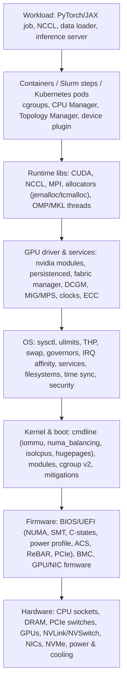
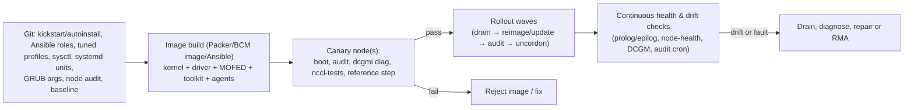

# 1.28 Putting it together: tuning a Linux node for GPU and HPC work

| | |
|---|---|
| Level | Advanced |
| Priority tier | 0 |
| Lab venue | A GPU VM (GCP) or a bare-metal GPU node; the audit and baseline parts run on any Linux host |
| Part | Part 1: Linux, from the command line to the kernel and performance |
| Status | Drafted, labs **untested** |

## Why this matters for AI infrastructure

This is the capstone of Part 1. Everything so far (processes, memory and NUMA, scheduling and cgroups, namespaces, security, kernel modules and sysctl, methods, tracing, benchmarking, virtualisation) comes together in one practical task that you will do again and again in this career: **take a Linux server with GPUs, make it deliver the hardware's capability predictably, prove it, and keep it that way across a fleet.**

The cost logic is blunt. A single DGX/HGX-class node costs hundreds of thousands of dollars and consumes kilowatts. In a synchronous distributed training job, **the slowest rank sets the speed of every other rank**. One node with a throttled GPU, a mispinned data loader, a degraded PCIe link, a too-low `vm.max_map_count`, or a NIC on the wrong NUMA node costs the whole job. Tuning is not about heroics on one machine: it is about **making all nodes identical, within a tolerance you can measure**, and finding the ones that are not.

Typical real situations:

- NCCL all-reduce bandwidth varies 20% between runs; after weeks of debugging, the cause is `numa_balancing` migrating pinned-memory pages, IOMMU translation in the DMA path, and a C-state wake-up in one data-loader thread.
- Throughput drops 6% after an OS image update because THP, the CPU governor and a kernel parameter reverted.
- A new rack of nodes passes `nvidia-smi` but fails `dcgmi diag -r 3` because three GPUs run on a PCIe x8 link and one on Gen3.
- A container job is OOM-killed three days into training because a memory limit counted pinned buffers and page cache.
- Half the fleet trains 8% slower: GRUB parameters were applied by hand on only some nodes.

This chapter gives a layered **node tuning playbook** (BIOS, firmware, boot parameters, kernel, OS services, memory, CPU and IRQs, storage, network, GPU driver and runtime, containers and schedulers), a **verification suite** you can run in minutes, the **configuration-as-code** pattern that keeps a fleet consistent, a **retold performance case study** that shows how the methodology of chapters 1.23 to 1.25 resolves a real mystery, and a lab to build your own node audit.

## Prerequisites and outcomes

You should have read the Part 1 chapters, especially memory and NUMA (1.17), CPU and cgroups (1.18), namespaces (1.19), security (1.21), kernel modules and sysctl (1.22), the method and tool chapters (1.23 to 1.25), and virtualisation (1.26, 1.27). Slurm, Kubernetes, NCCL and fabric details are developed in later parts; here they appear as the consumers of a well-tuned node.

After this chapter you can:

- Describe the hardware topology of a GPU server (sockets, NUMA nodes, PCIe switches, GPUs, NICs, NVMe, NVLink/NVSwitch) and read it with `lscpu`, `numactl -H`, `lstopo`, `lspci -tv`, `nvidia-smi topo -m`.
- Apply and justify a tuning stack: BIOS and firmware settings; kernel parameters (`iommu`, `numa_balancing`, THP, C-states, isolation); sysctl and ulimits; CPU governor and IRQ affinity; memory (huge pages, pinned memory, swap, dirty ratios); storage; network; GPU driver settings (persistence mode, clocks, ECC, MIG/MPS); container runtime; Kubernetes (CPU Manager, Topology Manager, device plugin, GPU Operator) and Slurm (cgroup, binding, GRES).
- Bind processes, threads, memory, NICs and GPUs consistently to the right NUMA domains in scripts, launchers and frameworks (PyTorch `DataLoader` workers included).
- Decide which tuning knobs have contested or workload-dependent values and how to settle them by A/B measurement (not folklore).
- Build a node audit script, record a golden baseline, and detect drift; express the configuration as code (kickstart/autoinstall/cloud-init, golden images, Ansible, tuned, systemd) and roll out safely with canaries.
- Retell and apply a methodology-driven investigation of an unexplained performance difference (the "unexplained win" case).
- Troubleshoot the classic node problems: PCIe downtraining, wrong NUMA binding, thermal and power throttling, fabric fallback, driver/module mismatch, memory limits, noisy neighbours, drift.

## 1. The tuning stack, top to bottom



The order matters for two reasons: (1) **lower layers cannot be fixed from above** (an OS cannot repair a PCIe link negotiated at x8 or a BIOS that hides NUMA); (2) **each layer must be verified before the next is tuned**, otherwise you will tune around a fault. Work bottom-up when building and verifying, top-down when diagnosing a symptom.

### Guiding principles

1. **Measure, then tune, then measure.** Baseline first (chapter 1.23); change one thing at a time; keep a rollback.
2. **Locality**: keep the chain *storage → CPU memory → CPU thread → GPU → NIC* inside one NUMA domain and under one PCIe switch wherever possible. Cross-domain hops add latency and consume interconnect bandwidth (remote DRAM access can be roughly 1.5 to 2x slower than local: for example about 80 ns local versus about 140 ns remote in one measured system).
3. **Determinism over peak**: eliminate jitter sources (frequency scaling, deep C-states, THP compaction, NUMA balancing, swap, background daemons, IRQ migration, power-capping surprises). In synchronous training the tail across ranks is the metric.
4. **Uniformity across the fleet**: identical firmware, kernel, driver, settings. Variation is a defect, found by audit.
5. **Prefer no tuning to unexplained tuning**: every setting has a recorded reason, source, and test. Folklore from another hardware generation is "someone else's medicine cabinet".
6. **Security is not optional**: keep MAC enabled, keys signed (Secure Boot), least privilege (chapter 1.21); document every exception.
7. **Grace-class superchips** (CPU and GPU on one package with a coherent link) reduce but do not remove locality issues: Linux still models CPU DRAM and GPU memory as separate pools; keep threads on the local CPU, configure huge pages and pinning.

## 2. Know the machine: topology first

Before any tuning, record the topology. Wrong assumptions here invalidate everything after.

```bash
lscpu | egrep 'Model name|Socket|Core|Thread|NUMA|L3'          # sockets, cores per socket, SMT, NUMA nodes, cache
lscpu -e=CPU,NODE,SOCKET,CORE,L1d:L1i:L2:L3,ONLINE,MAXMHZ        # per logical CPU
numactl -H                                                       # NUMA nodes: CPUs, memory sizes, distances
lstopo --of ascii   # (hwloc) or: lstopo topo.svg                # full tree: packages, caches, PCIe, GPUs, NICs, NVMe
lspci -tv | less ; lspci -vv -s <BDF> | egrep 'LnkCap|LnkSta'    # PCIe tree and each link's capability versus status (speed/width)
nvidia-smi topo -m                                               # GPU-GPU (NV#/PIX/PXB/PHB/NODE/SYS), GPU-NIC, CPU & NUMA affinity
nvidia-smi --query-gpu=index,pci.bus_id,pcie.link.gen.current,pcie.link.gen.max,pcie.link.width.current,pcie.link.width.max --format=csv
cat /sys/bus/pci/devices/<BDF>/numa_node ; cat /sys/class/net/<ifname>/device/numa_node
ibstat ; ibv_devinfo ; rdma link ; ethtool <if> | egrep 'Speed|Duplex'
dmidecode -t memory | egrep 'Size|Speed|Locator' | head -40       # populated DIMM channels (missing DIMMs = lost bandwidth)
```

How to read `nvidia-smi topo -m`: connection codes between devices: `X` self; `NV#` NVLink with # links; `PIX` at most one PCIe bridge; `PXB` multiple PCIe bridges; `PHB` through a PCIe host bridge (CPU root complex); `NODE` across PCIe host bridges within a NUMA node; `SYS` across NUMA nodes (via the inter-socket link). Aim for GPU–NIC pairs at `PIX`/`PXB` for GPUDirect RDMA (the best path), and avoid `SYS` between a worker's CPU/GPU/NIC. Record the matrix in the node's baseline.

Facts to extract and keep: GPU→NUMA node map; NIC→NUMA node map; NVMe→NUMA node map; CPU lists per NUMA node (and their SMT siblings); PCIe link speed/width per device (all GPUs should be at the maximum generation and x16, NICs at their maximum); DIMM population (all memory channels populated); expected NVLink topology (all links up).

## 3. Firmware and BIOS

Set once per hardware generation (via vendor tooling, Redfish, BCM; Part 1b), verified on every node by the audit. Always follow the server vendor's reference profile for the model; the following are the concepts.

| Setting | Typical for GPU training nodes | Why / caution |
|---|---|---|
| Power/performance profile | Maximum performance / "HPC" profile | Disable aggressive CPU power saving; consistent clocks |
| C-states / package C-states | Limit deep states (C0/C1) | Wake-up latency causes jitter and GPU bubbles; costs idle power |
| SMT / hyper-threading | Vendor/workload-dependent (often on; some sites off or use one thread per core) | Test; affects per-thread performance and core counts for pinning |
| NUMA exposure | NUMA enabled; sub-NUMA clustering/NPS per vendor guidance; do **not** interleave sockets (no "node interleaving") | The OS and tools need real topology |
| IOMMU / VT-d / AMD-Vi | Enabled if virtualisation/SR-IOV/security needed; combine with `iommu=pt` | See section 4 |
| PCIe: ACS, ATS, Above-4G decoding, Resizable BAR, link speed | Per vendor guidance for GPUDirect RDMA and P2P: ACS often needs to be disabled on PCIe switches between GPU and NIC for P2P without hairpinning through the root complex; large BARs on | Verify with `nvidia-smi topo -m` and `ib_write_bw --use_cuda`; security trade-off (ACS isolates devices) |
| Memory | All channels populated, ECC on, appropriate memory mode, patrol scrub per vendor | Bandwidth and reliability |
| Turbo/boost | On unless deterministic benchmarking is required | Record the setting |
| SR-IOV | On if used | |
| Secure Boot | On if policy requires (then module signing pipeline, 1.22) | |
| Firmware versions | Pinned, identical across fleet: BIOS, BMC, NIC (ConnectX), GPU VBIOS, NVSwitch, PSU, CPLD, drives | Mixed versions cause "identical node" differences |
| Boot mode | UEFI; network boot (PXE/HTTP Boot) enabled in the right order | Chapter 1.14 |
| Serial console / BMC SOL | On | Debugging and remote management |

## 4. Kernel boot parameters

Edit through the distribution's supported mechanism (`grubby` on RHEL-family BLS systems, `/etc/default/grub` plus `update-grub` on Ubuntu, or image build tooling), verify with `cat /proc/cmdline`, and keep them under version control.

```text
# Example baseline for a bare-metal HGX-class node (adapt; flags are workload and platform dependent)
console=tty0 console=ttyS0,115200n8
iommu=pt                    # IOMMU on, identity mapping for host-owned devices (lower DMA translation overhead); omit if you need strict isolation
numa_balancing=disable      # stop automatic NUMA page migration when you pin explicitly
transparent_hugepage=madvise   # or never/always: decided by measurement (below)
processor.max_cstate=1 intel_idle.max_cstate=1    # Intel; AMD: BIOS C-state control is more reliable
cpufreq.default_governor=performance
intel_pstate=passive        # or per vendor guidance
hugepagesz=1G hugepages=<N> default_hugepagesz=2M   # only if applications use explicit huge pages (DPDK, some inference stacks)
isolcpus=managed_irq,domain,<list> nohz_full=<list> rcu_nocbs=<list> irqaffinity=<housekeeping>   # only for jitter-critical designs
systemd.unified_cgroup_hierarchy=1     # cgroup v2
audit=1 crashkernel=<size>             # per distribution default
pcie_aspm=off                          # only on vendor advice (links dropping)
mitigations=...                        # leave default unless risk-accepted and measured
module_blacklist=nouveau               # also blacklist in modprobe.d + rebuild initramfs
```

Reasoning for contested items (settle with an A/B test on your workload, chapter 1.25):

- **`iommu=pt`**: with a default translation-enabled IOMMU every device DMA needs IOMMU/IOTLB handling; passthrough mode keeps the IOMMU available (for VFIO/SR-IOV) but uses identity mapping for host devices. Reports of stability and bandwidth improvement for RDMA/GPUDirect are common; some GPUDirect configurations have their own IOMMU/ACS requirements. Not appropriate where DMA isolation of untrusted devices is required.
- **`numa_balancing=disable`**: Automatic NUMA balancing unmaps pages to detect remote access and migrates them. With explicit pinning (`numactl`, Slurm/Kubernetes binding) it only adds page faults and migration jitter; for unpinned workloads it may help.
- **THP**: `always` can cause compaction stalls (khugepaged, direct compaction); `never` loses TLB efficiency for large-memory processes; `madvise` lets applications that ask (some allocators) benefit. Training throughput often gains a few percent with huge pages; latency-sensitive inference prefers deterministic behaviour. Check `/proc/vmstat` `thp_*`, `compact_stall`.
- **C-states**: lower deep sleep means lower wake latency but more idle power. Typically accept the power for GPU nodes.
- **`mitigations`**: security decision; measure before relaxing; multi-tenant hosts keep them.
- **Isolation** (`isolcpus`, `nohz_full`): worthwhile for real-time or jitter-critical designs and dedicated communication cores; for ordinary training, pinning plus cgroup cpusets and leaving housekeeping cores free is usually enough.

## 5. Sysctl, limits and services

```ini
# /etc/sysctl.d/90-gpu-node.conf   (every line needs a reason and a test; see chapter 1.22 for the full table)
vm.swappiness = 1                      # or 0 with swap off; cgroup memory.swap.max for jobs
vm.max_map_count = 1048576             # dataloader/mmap heavy jobs
vm.dirty_background_bytes = 1073741824 # prefer bytes forms on 1-2 TB RAM nodes
vm.dirty_bytes = 8589934592
vm.zone_reclaim_mode = 0
kernel.numa_balancing = 0
kernel.pid_max = 4194304
fs.file-max = 2097152
fs.inotify.max_user_watches = 524288
net.core.rmem_max = 134217728          # TCP paths only; RDMA unaffected
net.core.wmem_max = 134217728
net.ipv4.tcp_rmem = 4096 262144 134217728
net.ipv4.tcp_wmem = 4096 262144 134217728
net.core.netdev_max_backlog = 250000
net.ipv4.conf.all.rp_filter = 2        # loose, multi-homed fabric nodes
kernel.yama.ptrace_scope = 1
kernel.core_pattern = /var/crash/core.%e.%p.%t
```

```ini
# /etc/security/limits.d/90-hpc.conf (login sessions) and systemd unit/manager defaults (services, Slurm, containers)
*  soft  memlock  unlimited
*  hard  memlock  unlimited
*  soft  nofile   1048576
*  hard  nofile   1048576
*  soft  stack    unlimited
# systemd: DefaultLimitMEMLOCK=infinity DefaultLimitNOFILE=1048576   (and LimitMEMLOCK/LimitNOFILE in slurmd.service and containerd.service)
```

Verify limits where the job actually runs (`ulimit -a` inside `srun`, inside a pod, in a systemd service): login-session limits do not apply to services or containers.

**Services to enable/disable** (concept): enable and order `nvidia-persistenced`, `nvidia-fabricmanager` (NVSwitch systems: starts *before* GPU workloads), `dcgm`/`nv-hostengine` plus an exporter, `chronyd` (tight time sync for logs and some protocols), `irqbalance` (only with a ban mask, or disabled with manual IRQ pinning), `tuned` (a profile), `rasdaemon`, `node_exporter`, `sshd`, `slurmd`/`kubelet`, `containerd`; disable what you do not need (a display manager that grabs the GPU, `cups`, `avahi`, mDNS, unneeded timers like `apt-daily` on managed images, `systemd-oomd` if it fights job limits: decide deliberately), and `swapoff` or limit swap. Mask services that run periodic `nvidia-smi` calls unless needed (they contend on driver locks).

```ini
# /etc/systemd/system/slurmd.service.d/gpu-order.conf (illustrative ordering)
[Unit]
After=nvidia-persistenced.service nvidia-fabricmanager.service
Requires=nvidia-persistenced.service
```

## 6. Memory: pinning, huge pages, allocation policy

- **Local allocation**: by default a process allocates from the NUMA node of the CPU it runs on. Memory allocated before pinning, or by migrated threads, may be remote. Bind with `numactl --cpunodebind=N --membind=N` (or the Slurm/Kubernetes equivalents) at launch.
- **Policy inheritance is not always reliable**: `numactl` policy is inherited by `fork`ed children, but not necessarily by `spawn`ed/`exec`ed workers, threads created by some Python frameworks, or processes started by container runtimes. **Re-assert binding explicitly in every worker** (section 7) and verify with `numastat -p PID` / `/proc/PID/numa_maps` and `taskset -cp`.
- **Pinned (page-locked) memory** (`cudaHostAlloc`, PyTorch `pin_memory=True`) allows true asynchronous DMA and is often 2 to 3x faster for host-to-device copies than pageable memory; it is a limited resource: raise `RLIMIT_MEMLOCK`, and remember pinned memory counts against cgroup memory limits and cannot be swapped.
- **Huge pages**: use THP policy per section 4, or explicit huge pages for pinned buffers and RDMA registrations; typical gains of a few percent via fewer page faults and TLB misses (workload dependent).
- **Allocators**: tune `jemalloc` (`MALLOC_CONF="narenas:8,background_thread:true,dirty_decay_ms:10000,muzzy_decay_ms:10000"`) or `tcmalloc` (larger thread caches) for data-pipeline processes that allocate heavily; this keeps freed memory from being returned and re-faulted constantly. Measure.
- **Swap**: avoid. A swapped host page behind a GPU copy costs orders of magnitude. If swap exists for safety, set low swappiness and per-job `memory.swap.max=0`.
- **Page cache and checkpoints**: large checkpoint writes fill page cache and stall; use `dirty_*_bytes`, `O_DIRECT`/`io_uring`, `posix_fadvise(DONTNEED)` after writes, async/distributed checkpointing, or write to fast local NVMe then copy.
- **Memory limits in containers**: either leave training containers' memory unlimited with monitoring, or set the limit well above expected peak (including pinned buffers, page cache, and framework overhead) to avoid OOM kills days into a run; `Guaranteed` QoS requires requests = limits for CPU and memory.
- **Grace-class**: CPU LPDDR and GPU HBM remain separate pools in Linux; bind CPU threads locally and configure huge pages; coherent access removes some copy overheads but not locality needs.

## 7. CPU placement and interrupts

**One process per GPU, bound to the GPU's NUMA domain.** A launcher computes each GPU's NUMA node from sysfs (robust against odd `nvidia-smi topo` text formats) and binds the process:

```bash
#!/usr/bin/env bash
# launch_bound.sh <gpu_index> -- <command...>     (illustrative; test on your platform)
set -euo pipefail
gpu="$1"; shift; [[ "${1:-}" == "--" ]] && shift
busid=$(nvidia-smi --query-gpu=pci.bus_id --format=csv,noheader -i "$gpu")   # e.g. 00000000:3B:00.0
bdf=${busid,,}; bdf=${bdf:4}                                                  # -> 0000:3b:00.0
node=$(cat /sys/bus/pci/devices/$bdf/numa_node); [[ $node -lt 0 ]] && node=0
echo "GPU $gpu ($bdf) -> NUMA node $node" >&2
export CUDA_VISIBLE_DEVICES="$gpu"
exec numactl --cpunodebind="$node" --membind="$node" "$@"
```

Better, let the scheduler do it: Slurm with `--gpus-per-task`, `--gpu-bind=closest`, `--cpu-bind=cores` (and `gres.conf` with `AutoDetect=nvml` or explicit `Cores=`), Kubernetes with CPU Manager (`static`) plus Topology Manager plus the device plugin (section 9). For frameworks, set affinity inside the process and workers:

```python
# in each training process (before creating DataLoader workers); worker_init_fn re-applies it
import os, psutil, ctypes
def numa_cpus(node):   # parse /sys/devices/system/node/node<N>/cpulist
    cpus = []
    for part in open(f"/sys/devices/system/node/node{node}/cpulist").read().strip().split(","):
        a, _, b = part.partition("-"); cpus += range(int(a), int(b or a) + 1)
    return cpus
def bind(node):
    psutil.Process().cpu_affinity(numa_cpus(node))
    libnuma = ctypes.CDLL("libnuma.so.1"); libnuma.numa_run_on_node(node); libnuma.numa_set_preferred(node)
# DataLoader(..., num_workers=N, persistent_workers=True, pin_memory=True, worker_init_fn=lambda wid: bind(node))
# do not call CUDA APIs inside worker_init_fn; pass the node by closure/env var
```

(`numa_run_on_node` restricts CPU placement; `numa_set_preferred` biases allocations; stricter memory binding uses `set_mempolicy`/`numa_bind`; check libnuma availability, version and soname on your distribution.) Set `OMP_NUM_THREADS`, `MKL_NUM_THREADS`, `OMP_PROC_BIND`, `OMP_PLACES` so thread pools match the cores you gave each rank; oversubscription is a common silent loss. Gains reported from eliminating cross-NUMA traffic and migrations are in the range of several percent and, more importantly, lower run-to-run jitter.

**SMT**: for per-core predictability some sites use one hardware thread per core for ranks (pin to one sibling) or disable SMT in BIOS; test.

**Governor and power**: `cpupower frequency-set -g performance` (or a tuned profile such as `throughput-performance`, `accelerator-performance` or `latency-performance`; flag: profile names differ by distribution); verify actual clocks with `turbostat`; confirm no thermal or power-cap throttling in `dmesg`/BMC.

**IRQs**: GPU, NIC and NVMe interrupts should be serviced on cores of the same NUMA node as the device and away from the cores doing the training work, or spread across the device-local cores:

```bash
grep -E 'mlx5|nvme|nvidia' /proc/interrupts | head                          # which IRQs, per-CPU counts
cat /proc/irq/<N>/smp_affinity_list ; echo <cpus> > /proc/irq/<N>/smp_affinity_list
set_irq_affinity.sh <ifname>   # vendor scripts distribute NIC IRQs on local cores (mlnx_affinity / set_irq_affinity_bynode.sh)
ethtool -l <if> ; ethtool -L <if> combined <n>                               # queues
systemctl disable --now irqbalance   # or configure IRQBALANCE_BANNED_CPUS
mpstat -P ALL 1 | egrep ' (soft|irq)'                                        # a CPU stuck at high %soft/%irq is an IRQ hot spot
```

Reserve housekeeping cores (kernel threads, kubelet, containerd, monitoring agents, IRQs) via `systemd` `CPUAffinity=`, `kubelet --reserved-cpus`, Slurm `CoreSpecCount`, or `isolcpus`.

## 8. Storage, network and the GPU driver

### Local storage and filesystems

- **Layout** (typical): OS on a mirrored pair (RAID1) of small NVMe/SATA devices; **scratch** on the remaining NVMe drives as a stripe (md RAID0/LVM stripe) or individually, **not** parity RAID, for dataset cache, container layers (`/var/lib/containerd`, enroot cache) and checkpoint staging; mount options `noatime` (modern kernels default `relatime`), `nodev,nosuid` as policy allows; XFS or ext4 with alignment to the stripe; `fstrim.timer`; separate partition for containers' storage to protect the root (chapter 1.12/1.13).
- **Tune only after measuring** (chapter 1.25 fio recipes): queue depth, scheduler (`none` for NVMe), `read_ahead_kb`, `nr_requests`, NUMA locality of the NVMe to the workers that read it, thermal throttling of drives under sustained load.
- **Never mirror/parity the scratch** unless durability requires it; durability for checkpoints comes from copying to shared/object storage.
- **Network filesystems**: mount options and client tuning for Lustre/GPFS/NFS/WekaFS (readahead, RPCs in flight, `nconnect` for NFS, client cache sizes, stripe counts), metadata-heavy access patterns, and avoiding many small files (pack datasets into shards). Validate with IOR/mdtest at job scale.
- **Container storage**: keep image layers and writable layers on fast NVMe, large mutable data on bind-mounted volumes, not in the overlay writable layer (chapter 1.19).

### Network (host side)

- **Interfaces**: management (1/10 GbE; BMC out-of-band separate), storage/front-end Ethernet, and the compute fabric (InfiniBand or RoCE, often one NIC per GPU). Check link speed/width and firmware (`mlxlink`, `mlxfwmanager`/`flint`, `ibstat`), MTU end to end (jumbo on Ethernet/RoCE; IB MTU 4096), PFC/ECN configuration for RoCE (lossless classes validated on NIC and switches), and Subnet Manager health for IB.
- **Software**: MOFED/DOCA versions pinned with the kernel and driver as one release train (chapter 1.22); `nvidia_peermem` loaded for GPUDirect RDMA; `rdma-core`; verify with `ib_write_bw --use_cuda`; NCCL environment (`NCCL_IB_HCA`, `NCCL_SOCKET_IFNAME`, `NCCL_NET_GDR_LEVEL`, `NCCL_TOPO_FILE` when topology detection is incomplete in VMs).
- **TCP paths** (storage, control plane, parameter services): buffers and congestion control as in chapter 1.22; RSS/RPS queues local to the NIC's NUMA node; IRQ affinity; offloads (`ethtool -k`), ring sizes (`ethtool -g`); pause/flow control policy.
- **Firewall and security**: as discussed in chapter 1.21: IB bypasses the host firewall; protect with fabric partitions; allow RoCE v2 (UDP 4791) where firewalling Ethernet fabric interfaces.
- **Time**: chrony to a local source; PTP where needed for tracing correlation.

### GPU driver and runtime settings

| Setting | How | Guidance |
|---|---|---|
| **Persistence mode** | `nvidia-persistenced` service (preferred) or `nvidia-smi -pm 1` | Keep the driver initialised; avoids seconds of startup per job; negligible idle power cost; enable on all nodes |
| **Driver stays loaded** | Do not unload modules between jobs | Reload only for upgrades/troubleshooting |
| **Application clocks / locked clocks** | `nvidia-smi -lgc min,max`, `-rgc`; `-lmc` for memory | For benchmarking determinism; in production leave Boost on unless variance is a problem (then lock to a validated value); record the policy |
| **Power limit** | `nvidia-smi -pl W` | A slightly lower limit can reduce thermal throttling with minimal loss; or enforce rack power budgets; note the permitted range per SKU |
| **ECC** | `nvidia-smi -e 1` (needs reset) | Keep enabled on data-centre GPUs; disabling saves little and removes protection |
| **Compute mode** | `nvidia-smi -c DEFAULT` / `EXCLUSIVE_PROCESS` | Default for typical jobs; exclusive process for MPS or strict isolation |
| **MIG** | `nvidia-smi -mig 1` (reset needed), create GPU instances/compute instances; GPU Operator MIG Manager in Kubernetes | Only for multi-tenant small jobs/inference; no NCCL across MIG instances; plan partitions up front |
| **MPS** | `nvidia-cuda-mps-control -d`, `CUDA_MPS_ACTIVE_THREAD_PERCENTAGE` | Overlap kernels from several processes on one GPU (inference packing); no memory isolation; same-user considerations |
| **Kubernetes time-slicing** | Device plugin config | Coarse sharing without overlap |
| **Fabric Manager** | `nvidia-fabricmanager.service` (versions must match driver) | Mandatory on NVSwitch systems; verify `nvidia-smi nvlink -s` |
| **Retired pages / row remapping, Xid** | `nvidia-smi -q -d PAGE_RETIREMENT,ROW_REMAPPER`, `journalctl -k \| grep Xid` | Health checks; replace GPUs per vendor RMA thresholds |
| **GPUDirect Storage / RDMA** | `nvidia-fs`, `nvidia_peermem`, supported filesystems/NICs | Enable where supported; validate with `gdscheck`, `ib_write_bw --use_cuda` |
| **Memory oversubscription** | CUDA managed memory / UVM page migration | Safety net, not a performance feature; avoid for training |
| **Framework allocator** | `PYTORCH_ALLOC_CONF` (e.g. `expandable_segments`), `torch.cuda.empty_cache()` sparingly | Fragmentation vs reuse; diagnose with `memory_summary()` |
| **CUDA / driver compatibility** | Host driver at least as new as the CUDA runtime in the container requires | Check NVIDIA's compatibility tables (CUDA 12.x and 13.x need different minimum driver branches); containers carry the CUDA runtime, hosts the driver |

Order of operations at boot (important): load modules → `nvidia-persistenced` → `nvidia-fabricmanager` → set clocks/power/MIG → start DCGM → run the health check → only then start `slurmd`/`kubelet` (or mark the node schedulable). A node that fails any step stays **drained**.

## 9. Containers, Slurm and Kubernetes as consumers of the tuned node

### Container runtime

- NVIDIA Container Toolkit (CDI preferred): the host driver libraries and device nodes are injected into containers; the CUDA runtime comes from the image. Performance with a correctly configured runtime is essentially bare-metal (a few percent at most; chapter 1.19).
- Use **host networking** (`--network=host`, `hostNetwork: true`) or an RDMA device plugin/SR-IOV CNI for NCCL over InfiniBand; with an overlay network you add latency and NAT; if forced, control ports and interfaces (`NCCL_SOCKET_IFNAME`, ephemeral port range).
- `--ipc=host` or a large `--shm-size` for DataLoader/NCCL shared memory; `--ulimit memlock=-1`; do not bake the driver into images; pin image digests.
- Avoid the overlay writable layer for data; use bind mounts of NVMe/parallel FS paths.
- cgroup v2 with the systemd driver (chapter 1.18); verify that the runtime enforces the GPU device cgroup entries.

### Kubernetes

| Concern | Mechanism |
|---|---|
| GPU allocation | NVIDIA device plugin (`nvidia.com/gpu`), GPU Operator (driver, toolkit, device plugin, DCGM exporter, GFD node labels, MIG manager) |
| CPU pinning | kubelet `cpuManagerPolicy: static`: `Guaranteed` pods with integer CPU requests get exclusive cores |
| NUMA alignment | `topologyManagerPolicy: single-numa-node` (strict) or `restricted`/`best-effort`; `memoryManagerPolicy: Static` for guaranteed memory pinning; device plugin must report topology hints |
| Reserved cores | `reservedSystemCPUs` / `kubeReserved` / `systemReserved` for daemons |
| Memory | `Guaranteed` QoS (requests = limits) for training pods; consider generous or no memory limits; hugepages resources |
| Network | hostNetwork or Multus + SR-IOV/RDMA device plugin; NCCL env via pod spec |
| I/O isolation | Not native in Kubernetes: use node-level cgroup v2 `io.max`/dedicated devices |
| Scheduling | Node labels/taints for GPU types and fabric domains, gang scheduling (Kueue, Volcano, KAI), topology-aware plugins |
| Jitter | Run homogeneous workloads per node; dedicate whole nodes (request all CPUs and GPUs) for performance-critical jobs |

### Slurm

`slurm.conf`: `ProctrackType=proctrack/cgroup`, `TaskPlugin=task/cgroup,task/affinity`, `SelectType=select/cons_tres`, `GresTypes=gpu`, `CoreSpecCount` or `CpuSpecList` for housekeeping; `cgroup.conf`: `ConstrainCores=yes`, `ConstrainRAMSpace=yes`, `ConstrainDevices=yes`; `gres.conf`: `AutoDetect=nvml` (or `Name=gpu File=/dev/nvidia0 Cores=0-31`); job options: `--gpus-per-node`, `--gpu-bind=closest`, `--cpu-bind=cores`, `--ntasks-per-node`, `--cpus-per-task`, `--mem-bind=local`, `--exclusive`; `PropagateResourceLimitsExcept=MEMLOCK` or ensure memlock unlimited in the slurmd service; `UnkillableStepTimeout`; prolog/epilog and node health scripts to clean state (kill leftovers, `drop_caches` policy, reset GPUs after failures, verify clocks). Part 6 covers the Slurm series.

## 10. Configuration as code and fleet operations

### Provisioning pipeline



- **Bare-metal provisioning**: PXE/HTTP boot (DHCP options, TFTP or HTTP, UEFI) with Kickstart (RHEL family) or Autoinstall/cloud-init (Ubuntu), or streaming/`dd` of a golden image (`.qcow2/.raw/.squashfs`), or BCM-managed images (Part 1b). Storage layout: mirrored OS disks, unmirrored scratch; set hostnames, SSH keys and host keys uniquely per node (regenerate host keys and `machine-id` on first boot).
- **Golden images versus runtime configuration**: put heavy, version-sensitive components (kernel, GPU driver modules, MOFED, toolkit) in the image, built once in CI against the pinned kernel (no DKMS compile on nodes: chapter 1.22); apply per-node/site parameters at boot via cloud-init/Ansible pull/BCM.
- **Ansible role** (skeleton): tasks for GRUB args (`grubby`/`lineinfile`+`update-grub`, handler to rebuild and reboot), sysctl (`ansible.posix.sysctl` with a `sysctl_file`), limits, services and ordering, tuned profile, persistence/fabric manager, IRQ scripts, node-exporter/DCGM, audit script install, and a final `assert` task that runs the audit and fails the play if it fails. Use `--check --diff` in CI; run with `serial:` for rolling application; never reboot a whole fleet in one batch.
- **Idempotence and drift**: re-run the role periodically in check mode and report differences; alert on any change in `/proc/cmdline`, `sysctl -a`, module versions, firmware versions, PCIe link status; keep the audit result per node in a database or metrics system.
- **Updates**: kernel, driver, MOFED, firmware move together; hold packages (`apt-mark hold`, `dnf versionlock`); canary then waves; keep the previous image bootable for rollback.

### Fleet health checks (what to automate)

1. **Boot-time audit** (section 11): topology, links, settings, versions; fail closed (node stays drained).
2. **Prolog/epilog**: verify GPUs visible and healthy, ECC clean, no Xid since last job, clocks nominal, no leftover processes, memory free, scratch space; epilog resets state.
3. **Periodic**: `dcgmi diag -r 1` (quick) often; `-r 2/3` on schedule or after incidents; `nccl-tests` pair/ring tests across the fabric on a schedule; IB/Ethernet error counters; PCIe AER and corrected-error rates; EDAC; SMART/NVMe; temperatures and fans (BMC); power.
4. **Statistical outlier detection**: compare each node's reference-step time, NCCL busbw, GPU clocks and temperatures with the fleet median; flag > 3 MAD outliers for investigation (stragglers are the expensive failure).

## 11. The node audit and baseline (verification suite)

A short script that prints PASS/FAIL per check and exits non-zero on failure. Extend it with your platform's values (expected GPU count, link speeds, kernel version string, cmdline tokens, sysctls). Illustrative skeleton (**untested**; adapt):

```bash
#!/usr/bin/env bash
# node_audit.sh - quick GPU node audit. Usage: node_audit.sh [expected_gpus] ; exit code = number of failures
exp_gpus=${1:-8}; fail=0
chk() { local name="$1"; shift; if "$@" >/dev/null 2>&1; then echo "PASS  $name"; else echo "FAIL  $name"; fail=$((fail+1)); fi; }
val() { local name="$1" want="$2" got="$3"; if [[ "$got" == "$want" ]]; then echo "PASS  $name ($got)"; else echo "FAIL  $name (got '$got', want '$want')"; fail=$((fail+1)); fi; }

echo "== identity =="; uname -r; hostnamectl --static; cat /etc/os-release | head -2
echo "== kernel cmdline =="; for t in iommu=pt numa_balancing=disable; do chk "cmdline has $t" grep -qw "$t" /proc/cmdline; done
echo "== sysctl =="; val swappiness 1 "$(sysctl -n vm.swappiness)"; val max_map_count 1048576 "$(sysctl -n vm.max_map_count)"
val numa_balancing 0 "$(sysctl -n kernel.numa_balancing)"
echo "== memory =="; val THP "madvise" "$(sed 's/.*\[\(.*\)\].*/\1/' /sys/kernel/mm/transparent_hugepage/enabled)"
swapon --show --noheadings | wc -l | { read n; [[ $n -eq 0 ]] && echo "PASS  no swap" || echo "WARN  swap devices: $n"; }
echo "== limits =="; val memlock unlimited "$(ulimit -l)"; 
echo "== cpu =="; val governor performance "$(cat /sys/devices/system/cpu/cpu0/cpufreq/scaling_governor 2>/dev/null)"
echo "== gpus =="; n=$(nvidia-smi -L | wc -l); val gpu_count "$exp_gpus" "$n"
val persistence Enabled "$(nvidia-smi --query-gpu=persistence_mode --format=csv,noheader | sort -u | tr '\n' ' ' | sed 's/ $//')"
nvidia-smi --query-gpu=index,pcie.link.gen.current,pcie.link.gen.max,pcie.link.width.current,pcie.link.width.max,ecc.errors.uncorrected.volatile.total,clocks_throttle_reasons.active --format=csv,noheader |
while IFS=, read -r i gc gm wc wm ecc thr; do
  [[ "${gc// /}" == "${gm// /}" && "${wc// /}" == "${wm// /}" ]] && echo "PASS  GPU$i PCIe gen${gc// /} x${wc// /}" || echo "FAIL  GPU$i PCIe gen${gc// /}/${gm// /} x${wc// /}/${wm// /}"
  [[ "${ecc// /}" =~ ^(0|\[N/A\])$ ]] || echo "FAIL  GPU$i uncorrected ECC: $ecc"
done
chk "fabric manager active (NVSwitch systems)" systemctl is-active --quiet nvidia-fabricmanager
chk "no recent Xid errors" bash -c '! journalctl -k --since "-1 day" | grep -q "NVRM: Xid"'
echo "== network =="; command -v ibstat >/dev/null && ibstat | egrep 'State|Rate' | sort | uniq -c
echo "== modules =="; for m in nvidia nvidia_uvm nvidia_peermem; do chk "module $m" lsmod | grep -q "^$m"; done
echo "failures: $fail"; exit $fail
```

(The `ulimit -l` line reports the limit of the audit's own shell, not of services: check limits in the real environments, section 5.) Collect the **baseline** once per node generation/image and store it with the image version:

```bash
mkdir -p baseline/$(hostname); cd baseline/$(hostname)
{ uname -a; cat /proc/cmdline; lscpu; numactl -H; lspci -vv; nvidia-smi -q; nvidia-smi topo -m; ibstat; ibv_devinfo; ethtool -i <if>; sysctl -a; \
  systemctl list-unit-files --state=enabled; dmidecode; lsmod; modinfo nvidia | egrep 'version|license|vermagic'; } > env.txt 2>&1
dcgmi diag -r 2 > dcgm_r2.txt 2>&1 ; ./nccl-tests/build/all_reduce_perf -b 8 -e 8G -f 2 -g 8 > nccl_single.txt
```

Then **compare** new nodes and later snapshots to the baseline (`diff`, or structured checks) and to the fleet distribution.

## 12. A case study: the unexplained 3 to 4x win

(Retold from Gregg's *Systems Performance*, chapter 16, to show the method on a real mystery; the platform is a cloud, the technique is the one you will use on nodes.)

**Problem statement.** A microservice that computes recommendations was moved from VM instances to a new container platform. One of its two components took 3 to 4 seconds per request on VMs and 1 second on containers. A 3 to 4x gain "sounded too good to be true". Question: is this permanent, or an artefact?

**Initial hypotheses.** Better CPU cache use because the component now ran alone; bursting into idle CPU on the container platform.

**Strategy.** Because a load balancer let traffic be split between both environments simultaneously, the analyst logged in to both hosts at the same time and ran identical commands, a comparative analysis at the same time of day with the same traffic mix. Access to the container *host* (not just the container) allowed any tool. Method: the 60-second checklist, the USE method, then drill-down.

**Statistics.** `uptime`: load average 85 on the VM (48 CPUs) versus 18 on the container host (64 CPUs): the VM's load was about twice its CPU count. `mpstat`: VM idle about 2%, user+system about 98%, system time about 8%; container host idle about 78%. With two hardware threads per core, going above 50% utilisation implies **hyper-thread contention**, so the VM's per-thread speed was degraded. `vmstat` run queues matched the load averages (CPU-based); `iostat`/`sar` showed little disk and network. Estimated: waiting for CPU about 77% of the time (85/48 − 1), removing it would explain about 4x. But why was load so different?

**Configuration (static check).** `/proc/cpuinfo`: different processor generations: base clock 2.5 GHz with a 33 MB last-level cache on the VM versus 2.3 GHz with a 45 MB LLC on the container host. Depending on the workload, cache size can matter a lot, so the analyst moved to hardware counters.

**PMCs.** A PMC tool for the cloud (architectural counters) showed IPC about 0.57 on the VM versus about 1.52 on the container (2.6x), and last-level-cache hit ratios of about 30% versus about 90%. Low IPC with a poor LLC hit ratio means stalls on main memory. Contributing causes of the VM's poor LLC hit ratio: the smaller LLC; the VM running the full workload (more instruction text and data) versus a subcomponent; and heavy context switching.

**Software events.** `perf stat -e cs -a -I 1000`: about 2 million context switches per second on the VM versus about 1,000 per second for the container's process.

**Tracing.** BCC `cpudist`: on the VM threads typically ran less than 10 µs on-CPU before leaving (involuntary switches, confirmed by `nonvoluntary_ctxt_switches` and `sched_switch` stacks), whereas on the container threads ran 2 to 4 ms. Short slices prevent caches from warming.

**Conclusion.** The gain was explained by: (1) **no neighbours** on the container host (the one container had all the caches and no contention: a condition that will not last in production when other tenants arrive); (2) **LLC size and workload differences**: IPC 2.6x lower on the VM, driven by a 30% versus 90% LLC hit ratio (smaller cache, bigger workload, many context switches), with hyper-thread contention; (3) **CPU load difference**: the VM was driven to saturation (load 85 on 48 CPUs), causing 2 million context switches per second and run-queue latency of about 4x.

**Lessons you can reuse on GPU nodes:** problem statement first; compare two systems at the same time; use the checklist and USE to find the resource; check static configuration (CPU model, cache sizes, SMT); use PMCs for efficiency (IPC, cache misses); use software events for rates; use tracing for the distribution (on-CPU time, run-queue latency); and state what will *not* persist (the neighbour-free advantage). The expected result of this method is several quantified contributing factors, not a single cause.

## 13. Troubleshooting map

| Symptom | Likely causes | First checks |
|---|---|---|
| One rank slower than others | Thermal/power throttling, PCIe downtrain, different GPU clocks, ECC retired pages, noisy NUMA | `nvidia-smi -q -d PERFORMANCE,CLOCK,POWER`, `lspci -vv`, throttle reasons, `dcgmi diag`, per-rank step time |
| Run-to-run variance | THP/NUMA balancing/C-states, IRQs on training cores, background daemons, other tenants | `perf sched`, `mpstat`, `vmstat` thp counters, `top -H`, PSI |
| Low NCCL bandwidth | Wrong NIC/GPU affinity, fallback to TCP, GDR disabled, ACS enabled, MTU, one bad link | `NCCL_DEBUG=INFO`, `nvidia-smi topo -m`, `ib_write_bw --use_cuda`, port counters |
| H2D copies slow | Pageable memory, remote NUMA, PCIe x8/Gen3 | Pinned memory, `numastat`, link status, `nvbandwidth` |
| DataLoader stalls | Remote NUMA, too few workers, slow FS, small files, GIL, CPU quota | `iostat`, `perf`/flame graph, `pidstat`, cgroup `cpu.stat` |
| `mmap`/`ENOMEM` with free RAM | `vm.max_map_count`, `ulimit -l`, cgroup limit | sysctl, limits in the job environment |
| OOM kill in a long job | Memory limit counted pinned/cache; leak; QoS BestEffort/Burstable | `memory.events`, `dmesg`, QoS, limits above peak |
| Node fine after boot, degrades later | Thermal, memory fragmentation/THP, clocks, errors accumulating, leaked pinned memory | Time series of clocks/temp, `/proc/buddyinfo`, `/proc/vmstat`, error counters |
| Fleet differs after update | Image/GRUB/sysctl/driver drift | Run audit, diff against baseline |
| Fabric Manager/NVLink issues | Version mismatch, service not started before jobs | `nvidia-smi nvlink -s`, `systemctl status nvidia-fabricmanager`, logs |
| Secure Boot module failure | Unsigned module after kernel update | `dmesg`, signing pipeline (1.22) |

## 14. Lab: tune, audit and prove (untested)

Use a GPU VM (or bare metal). If virtualised, topology may be flattened; note it.

1. **Topology report**: run the commands of section 2; draw the topology (hand diagram or `lstopo` output); fill a table: GPU → PCI BDF → NUMA node → NIC; PCIe links (current/max); DIMM population.
2. **Baseline**: capture the baseline bundle (section 11) before any tuning; run `dcgmi diag -r 2`, `nvbandwidth` or `bandwidthTest` (pinned and pageable), a single-node `all_reduce_perf`, and a reference training step (a fixed small model, fixed seed, 200 steps, discard 20); record step time distribution, GPU clocks and temperature over time.
3. **Apply tuning in stages, one at a time, with A/B measurement and rollback**: (a) governor performance; (b) `numa_balancing` off; (c) THP `never` / `madvise` / `always` (compare); (d) sysctl set; (e) persistence mode; (f) NUMA-bound launcher versus unbound; (g) DataLoader worker affinity; (h) IRQ affinity for NIC; (i) `iommu=pt` (bare metal; needs reboot). Record each effect on step time, variance (CoV) and NCCL busbw, using at least 5 interleaved runs per setting and the statistics of chapter 1.25. Keep a table of settings with the observed effect; remove settings that show no effect.
4. **Break it on purpose**: pin the process to the wrong NUMA node; set `ulimit -l` low and observe pinned allocation failure; set `vm.max_map_count` low and trigger `mmap` failures; drop PCIe link speed (if possible) or use a different slot; limit GPU clocks (`-lgc`) and see the straggler effect on multi-GPU runs. Use the audit and tools to detect each.
5. **Write the audit script** (section 11) for your platform; run it on a healthy and on a broken configuration; extend it with two checks of your own.
6. **Ansible role**: encode the tuned settings as an Ansible role (GRUB args, sysctl, limits, services, tuned, persistence, audit install and assert); run in check mode, then apply, reboot, re-audit; demonstrate idempotence (second run reports no change).
7. **Containers**: run the reference step in a container with the NVIDIA runtime: compare with bare host; try `--network=host`, `--ipc=host`, `--shm-size`, `--ulimit memlock=-1`, CPU pinning with `--cpuset-cpus`/`--cpuset-mems`.
8. **Schedulers**: (optional) on Slurm, run the same job with and without `--gpu-bind=closest --cpu-bind=cores`; on Kubernetes, compare a `Guaranteed` pod with CPU Manager static and Topology Manager `single-numa-node` against a Burstable pod; check `cpuset.cpus` and `numa_maps` of the processes.
9. **Drift detection**: change one sysctl and one GRUB argument on a copy; run the audit/diff to catch it; add the check to a cron/systemd timer that exports a metric.
10. **Case-study exercise**: using the method of section 12, investigate a deliberately created difference between two nodes (for example one with a CPU hog or a different THP setting): write a problem statement, collect the 60-second checklist from both at the same time, USE, static config diff, `perf stat` IPC and `cs` rates, `runqlat`/`cpudist`, and write the conclusion with quantified contributions.

Mark the lab tested only after executing it and recording the outputs.

## 15. Common mistakes

- Tuning before verifying topology and links; copying settings from another hardware generation.
- Binding processes but not DataLoader workers or children; assuming `numactl` inheritance.
- Setting sysctls but leaving `limits.conf`-only values that services/containers ignore.
- Disabling security controls instead of fixing labels or device access.
- Letting DKMS or unattended upgrades change kernels; mixed driver, MOFED and Fabric Manager versions.
- Fixing one "hero" node and not encoding the change in the image.
- Using `GPU-Util` as the success metric; tuning without A/B statistics; ignoring variance.
- Leaving `irqbalance` default on pinned designs; not isolating housekeeping.
- Placing performance-critical jobs on shared nodes with mixed training and inference.
- Not draining nodes that fail audit; letting stragglers into jobs.

## 16. Interview angles

- "You inherit 200 GPU nodes with inconsistent throughput. What do you do?" (audit, baseline, outlier detection, config-as-code, canary rollouts.)
- "Walk me through tuning a new HGX server for multi-node training, bottom to top."
- "Which settings do you consider contested and how would you decide them?" (THP, SMT, `iommu=pt`, C-states, mitigations; A/B with variance.)
- "How do you make PyTorch data loading NUMA-aware?" (GPU→NUMA mapping, process and worker affinity, pinned memory, persistent workers.)
- "What does Topology Manager do and what are its limits?"
- "A GPU is slow on one node only. What do you check?" (throttle reasons, PCIe link, ECC, clocks, NUMA, thermal, neighbours.)
- "How would you validate a fabric and a node before putting them in service?" (acceptance sequence from chapter 1.25.)
- "Explain the unexplained 3 to 4x win and what methodology it demonstrates."

## 17. Checkpoint questions (30)

1. Why does one slow node slow a whole training job? **A:** Synchronous collectives wait for the slowest rank.
2. Why record topology first? **A:** All affinity and tuning decisions depend on it; faults in links/NUMA invalidate later tuning.
3. What do PIX, PXB, PHB, NODE, SYS mean in `nvidia-smi topo -m`? **A:** One PCIe bridge, multiple bridges, via host bridge, across host bridges within a NUMA node, across NUMA nodes.
4. Why check PCIe link current versus max? **A:** Downtrained links (Gen/width) silently cut bandwidth.
5. Name key BIOS settings for GPU nodes. **A:** Performance power profile, limited C-states, NUMA exposure, IOMMU, ACS/ATS/ReBAR/Above-4G, all DIMM channels, pinned firmware.
6. What does `iommu=pt` do? **A:** Keeps the IOMMU available but uses identity mapping for host devices, reducing DMA translation overhead.
7. When might you keep NUMA balancing on? **A:** For unpinned workloads where automatic migration helps; disable with explicit pinning.
8. THP: which values and how to decide? **A:** always/madvise/never; A/B test on throughput and latency; watch compaction stalls.
9. Why do systemd services ignore `limits.conf`? **A:** PAM limits apply to login sessions; services use unit/manager limits.
10. Why is `memlock` important? **A:** Pinned buffers and RDMA registrations need locked memory.
11. Why is `numactl` inheritance unreliable for Python workers? **A:** Spawned/exec'd processes and runtime-managed workers may not inherit; re-assert in each worker.
12. How do you find a GPU's NUMA node robustly? **A:** From its PCI BDF's `numa_node` in sysfs (or NVML).
13. What are persistence mode's benefits? **A:** Keeps the driver initialised; removes startup latency; stable state.
14. When lock GPU clocks? **A:** For benchmarking determinism or if variance is harmful; otherwise leave boost.
15. Why keep ECC on? **A:** Protects against silent corruption; disabling gains little.
16. What does Fabric Manager do and when must it start? **A:** Configures NVLink/NVSwitch fabric; must be running before GPU jobs on NVSwitch systems.
17. MIG vs MPS vs time-slicing? **A:** Hardware partition with isolation vs concurrent kernels without memory isolation vs coarse time sharing.
18. Why host networking for NCCL in containers? **A:** Avoid overlay/NAT overhead and access IB/RDMA directly.
19. What does the Kubernetes CPU Manager static policy require? **A:** Guaranteed QoS pods with integer CPU requests.
20. What does Topology Manager do? **A:** Aligns CPU, memory, and device allocations to NUMA nodes using hints.
21. How does Slurm bind GPUs and CPUs? **A:** `gres.conf` with Cores/AutoDetect, `--gpu-bind=closest`, `--cpu-bind=cores`, task/cgroup/affinity plugins.
22. Why avoid DKMS in fleets? **A:** Non-determinism, boot storms, nodes without drivers; use prebuilt images.
23. What belongs in a golden image versus runtime config? **A:** Kernel/driver/MOFED/toolkit in the image; per-node identity and site parameters at boot.
24. What should a node audit check? **A:** Versions, cmdline, sysctls, limits, services, GPU count/links/ECC/clocks, NIC state, modules, recent errors.
25. How do you detect drift? **A:** Periodic audit/diff against baseline; alerts on cmdline/sysctl/module/firmware changes.
26. What is the canary approach? **A:** Validate on a few nodes with diagnostics and benchmarks before waves.
27. How are stragglers detected statistically? **A:** Compare each node's reference metrics with fleet median using robust measures (MAD).
28. What did the "unexplained win" teach about neighbours? **A:** The gain depended on having no neighbours; it would vanish with tenants.
29. Which tools in the case study found IPC and LLC hit ratio? **A:** PMC tools (`perf stat`/pmcarch).
30. What is the top-down diagnosing order versus bottom-up building order? **A:** Diagnose from symptom downward; build/verify from hardware upward.

## 18. Sources and review notes

**Written in original words.** Principal sources:

- Chris Fregly, *AI Systems Performance Engineering*, chapter 3 (OS, Docker and Kubernetes tuning for GPU environments): NUMA awareness and CPU pinning, NUMA-friendly memory and pinning, huge pages, scheduler and interrupt affinity, swapping, filesystem caching, CPU frequency and C-states, host allocator tuning, GPU driver and runtime settings (persistence, MPS, MIG, clocks, ECC, memory oversubscription), container runtime and CUDA compatibility, Kubernetes topology awareness, scheduling, networking, jitter, resource guarantees, memory isolation, I/O isolation. The NUMA-binding Python example is rewritten in a smaller form here.
- Brendan Gregg, *Systems Performance*, 2nd ed., chapter 16 (Case Study: an unexplained win), retold and adapted in section 12.
- The project's own `nvidia-devops` notes, Volume 10 chapter 3 (kernel and GRUB parameters, sysctl, provisioning with PXE/Kickstart, golden images, DKMS vs prebuilt modules, hardening exceptions for AI nodes, Ansible examples), migrated and rewritten across chapters 1.14, 1.21, 1.22 and this one; its production-hardening contents are in chapter 1.21.
- *Supercomputers for Linux SysAdmins* (Slurm/HPC node practices) informed the Slurm and housekeeping-core guidance; the Slurm series later in the book covers it fully.
- All script and configuration examples are **illustrative and untested**.

**Flagged for verification before publishing:**

- Vendor BIOS names/values; ACS/ATS guidance for GPUDirect RDMA; tuned profile names; kernel parameter availability on your kernel.
- Kubernetes manager policies and feature gates per version; Slurm option names per version.
- NVIDIA driver, CUDA compatibility tables, Fabric Manager modes; NVML calls.
- Quoted performance gains (for example "5% to 10%", "2 to 3x" for pinned memory, latency numbers for NUMA) are indicative; measure on your hardware.
- All labs are **untested**.
