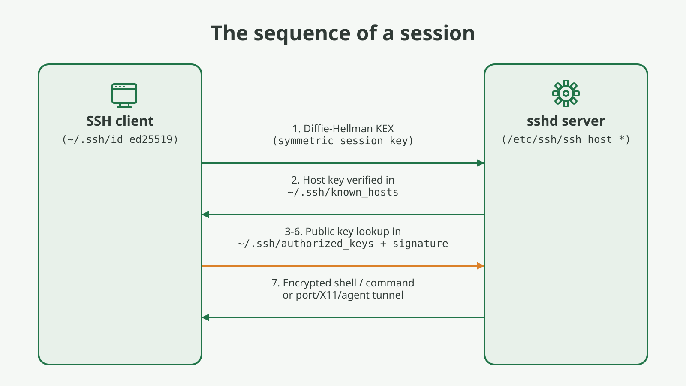

# 1.29 Remote administration reference: SSH server and client options, host-based authentication, parallel shells, screen and tmux, IPMI and console managers

**Level:** intermediate · **Tier 0 (foundations)** · **Lab venue:** two or three small Ubuntu VMs on GCP · **Status:** drafted, labs untested

Chapter 1.5 teaches you to *work* remotely: log in, copy files, keep a session alive. This chapter is the **reference and depth companion** you come back to on the day you configure a cluster for real. It covers every important SSH option on both sides of the connection, and it shows how the protocol proves identity before it lets anyone in. It also shows how to run one command on hundreds of nodes without flooding your network, and how to reach a machine whose operating system is dead. Read chapter 1.5 first.

## Why this matters for AI infrastructure

Picture a GPU cluster with hundreds to thousands of nodes and only a handful of people to run it. A driver check, a mount repair, a process hunt: the same small job has to happen on every machine, and it has to happen quickly. Now picture the machines that need you most. They are exactly the ones that have stopped answering SSH.

It is 2 a.m. when that happens. One node is unreachable, your key is refused, and the only thing still answering is the small controller on the motherboard. Three skills get you through a night like that. You configure SSH precisely, deciding who may log in, from where and with what. You fan commands out in parallel without overloading the head node or the network. And you reach a console through the baseboard management controller when the OS is gone.

The same techniques sit behind every deployment tool in this book, including Ansible, Slurm launch, BCM and Kubernetes node access. Learn them once here, and you will recognise them everywhere else.

## Prerequisites and outcomes

You need chapters 1.1 to 1.6 behind you. Chapter 1.5 matters most, because it covers SSH keys, `~/.ssh/config`, tunnels, rsync and tmux. Chapter 1.6 covers identity and permissions. When you finish this chapter, you should be able to:

- explain in detail how SSH authenticates the server and the user and encrypts the session, and what must be saved when you reinstall a server;
- generate and deploy keys of the right type and size, and automate first-time host key acceptance responsibly;
- read, set and combine the main `ssh` command-line options, `ssh_config` options and Host blocks, and the main `sshd_config` options and Match blocks;
- configure host-based authentication for a trusted cluster network, and know its risks;
- run commands and copy files on many nodes with `pdsh`/`pdcp` and ClusterShell (`clush`, `cluset`), including integration with Slurm;
- use `screen` and `tmux` fluently (sessions, windows, panes, copy mode, configuration);
- configure and use IPMI with `ipmitool` (network setup, power control, sensors, serial-over-LAN, users and channels), and understand conman, powerman and iKVM;
- diagnose the failures that appear when many nodes are managed at once.

## 1. First: make out-of-band access possible before you need it

SSH is the everyday way into a node. It needs three things to be true at once: a working operating system, a working network, and a running `sshd`. When any one of them is broken, you need another door into the machine. That door has to be opened in advance, because the moment you need it is the moment you cannot configure it.

The other door is the management controller, usually shortened to **BMC**, for baseboard management controller. It is a small computer on the motherboard that stays awake when the main system does not. You reach it through **IPMI** or **KVM-over-IP**. Newer interfaces such as Redfish and DCMI are covered in Part 7.

One catch trips up nearly every new cluster. These interfaces are usually **disabled for network access by default**. Only local access works until someone configures the network side.

Before the cluster goes into service:

- Enable IPMI network access. You can do that in the BIOS or firmware setup, if it offers the option. Otherwise, boot each node and use `ipmitool` locally, as section 10 shows.
- Make sure the vendor has enabled the management network, and that the controllers get addresses by **DHCP**. Keep a list of the controllers' MAC addresses. Otherwise, you must set up every node by hand, which on a large cluster can take weeks.
- iKVM, which gives you a remote keyboard, video and mouse, normally also needs pre-configuration. On many servers it shares the same controller as IPMI.
- **Change the default passwords** immediately.

Do this work before the first outage, not during one. The controller helps you only if you configured it beforehand, and a cluster bring-up is far cheaper than a rescue at 2 a.m.

## 2. How SSH works, in detail

Suppose your laptop connects to a server for the first time. The server hands over a key, and your client has to decide whether to trust it. Everything else about the login depends on that one decision, so it pays to know the whole sequence.

**SSH** was designed in 1995 by the Finnish computer scientist Tatu Ylönen. He wanted an open, secure protocol for remote access and file transfer, and it replaced `telnet` and `rsh`, which sent everything unencrypted. Today the dominant implementation of both client and server is **OpenSSH**, developed by the OpenBSD project, although alternatives exist. The server listens on TCP **port 22** by default. This book uses SSH for the protocol and `ssh` for the client command.

### Two kinds of cryptography

**Symmetric encryption** uses one shared secret key to both encrypt and decrypt. It is fast and cheap, so it carries the bulk of the data. The catch is that both parties must somehow already hold the same key. Getting that key to the other side safely is the hard part, and it is the part public-key cryptography solves.

**Asymmetric (public-key) encryption** uses a *pair* of keys. What one key encrypts, only the other can decrypt. In practice, neither key can be derived from the other. Some algorithms let the private key recompute the public key, but not the reverse. OpenSSH stores the public key inside the private key file. You publish the **public key** freely and keep the **private key** secret. Two parties can then establish trust without sending a secret. You prove you hold the private key by signing something the other side can verify. And anyone can send you a message that only you can read.

SSH uses both kinds, each for the job it does best. Public-key cryptography handles identity and key exchange. Symmetric encryption protects the session itself. During a long connection, the symmetric key is replaced periodically. That limits how much data an eavesdropper could collect for an attack.

### Servers have identities too

Every SSH server owns a **host key** pair. On the first connection, the client receives the server's public host key and shows you its **fingerprint**. A fingerprint is a short digest of the key, so two people can compare it by eye. If you already know the right fingerprint, you can compare the two and refuse a mismatch. If you accept, the client saves the pairing of server address and host key in **`~/.ssh/known_hosts`**. On later connections, a *different* host key makes `ssh` refuse to continue. That defeats **man-in-the-middle** attacks, in which an attacker stands in for the server to read and relay your traffic.

When you install the server package, host keys are generated automatically. If you reinstall an SSH server, or reimage a node, **save and restore its host keys** in `/etc/ssh/ssh_host_*`. Otherwise every user will see the "host key changed" alarm. On a cluster, bake the host keys into the node image, or manage them centrally.

### The sequence of a session



*Figure 1.29.1. The sequence of a session.*

The login runs in seven steps.

1. The client connects, and the two sides set up an **encrypted channel**. They agree on a symmetric key with a key-exchange algorithm from the Diffie-Hellman family. From here on, everything is encrypted.
2. The client authenticates the **server**. It checks the server's host key against `known_hosts`, or asks you to confirm the fingerprint the first time. The server proves it owns the matching private key.
3. The client names the **user** it wants to log in as.
4. The client offers its key pairs one at a time. Each attempt starts by sending the **public** half.
5. The server looks the public key up in that user's **`~/.ssh/authorized_keys`**. If the key is not there, the client tries its next key.
6. If the key is there, the server sends a challenge that only the matching private key can answer. The client answers, and the private key stays on the client.
7. On success, the server starts the requested command or an interactive shell.

Servers typically also accept passwords, and sometimes Kerberos, when key authentication is unavailable. The data is still encrypted, but that fact does not save you. **Do not allow password authentication for ordinary users.** Passwords can be guessed by brute force, and encryption does not help if the attacker simply tries the right password. A private key is practically impossible to guess. The realistic risk is theft of the key *file*, which is why private keys should always be protected with a **passphrase**. For the same reason, "secure" versions of `telnet` and `ftp` over TLS that still use passwords are not considered secure.

Turn off password logins for ordinary users, and protect every private key with a passphrase.

## 3. Keys in practice

Your key pair decides how strong your login is, so make the choices on purpose rather than by habit. The first command below creates the modern default key type. The second creates an RSA key, for servers that still need compatibility.

```bash
ssh-keygen -t ed25519 -C "alice@laptop"        # modern default
ssh-keygen -t rsa -b 4096                       # RSA, if you need compatibility
```

Three choices matter, and each one has its own flag.

- **Type, set with `-t`.** Use `ed25519`, which is preferred. The other choices are `rsa`, `ecdsa`, and the security-key variants `ed25519-sk` and `ecdsa-sk`. The security-key variants keep the private key on a FIDO hardware token. Newer types appear over time, so use whatever your servers accept.
- **Length, set with `-b`.** Length matters only for RSA and ECDSA. Current OpenSSH defaults RSA to 3072 bits, so use 3072 or more. Elliptic-curve keys support only fixed sizes. ECDSA takes 256, 384 or 521 bits, and Ed25519 has one size. More bits make a key stronger, and also slower.
- **Location and passphrase.** Accept the default location, `~/.ssh/id_ed25519`. The public key sits beside it, with `.pub` added to the name. Then choose a passphrase.

To let `foo` log in to `server`, copy your public key to that account. `ssh-copy-id` is the easiest route. If you prefer to do it by hand, run these steps on the server:

```bash
ssh-copy-id -i ~/.ssh/id_ed25519.pub foo@server          # easiest
# or by hand, on the server:
cat id_ed25519.pub >> ~foo/.ssh/authorized_keys         # APPEND (do not replace the file)
chmod 700 ~foo/.ssh ; chmod 600 ~foo/.ssh/authorized_keys ; chown -R foo: ~foo/.ssh
```

The directory and the file must belong to `foo`, and nobody else may be able to write to them. Otherwise `sshd` ignores them, often without saying a word, and you spend an hour wondering why a correct key does nothing. This check is controlled by `StrictModes`.

A public key that arrives in the multi-line **RFC 4716** format needs conversion before you can use it. That format wraps a single key across several lines, and `authorized_keys` expects one line per key. Some Windows tools produce it. Convert the key to the single-line OpenSSH format before you use it: `ssh-keygen -i -f rfc-key.pub >> ~foo/.ssh/authorized_keys`. Check the exact flags in `man ssh-keygen`, because the direction of conversion is easy to get wrong.

**Passwordless login.** The secure way is a key plus an agent, which chapter 1.5 covers. You type the passphrase once. Some clusters take a shortcut for node-to-node access: a key with an **empty passphrase**. That shortcut has a sharp edge, because anyone who copies that file becomes you. If the home directory sits on a shared filesystem, a single `authorized_keys` entry serves every node. Where possible, restrict such keys with a forced command or a source address, as section 7 explains.

**Accepting host keys for the first time on many nodes.** Interactive confirmation is fine for one machine and impossible for hundreds. So administrators run a loop that accepts the keys in advance:

```bash
for h in $(cat nodes.txt); do ssh -o StrictHostKeyChecking=no "$h" true; done
```

The remote command `true` does nothing and exits instantly. The loop therefore only records host keys, and it prints errors for unreachable nodes. Be honest about what this does. `StrictHostKeyChecking=no` *trusts whatever answers*, so the very first acceptance is exactly where a man-in-the-middle could hide. On a trusted, isolated management network, that is an accepted trade-off. Elsewhere, collect keys with `ssh-keyscan` and verify them against a trusted list, or distribute known host keys from the image.

**Escape sequences.** Here is the trick that saves you when a session freezes. `ssh` intercepts a special key sequence at the **start of a line**, so you press Enter, then `~`, then a command character. `~.` ends the session immediately, which is the way out of a frozen connection. `~Z` suspends the `ssh` process into the background, and `fg` resumes it. `~~` sends a literal `~`, and `~?` lists the rest. Be careful inside a serial-over-LAN session, described in section 9, which uses the same `~.` to exit.

Protect every private key with a passphrase, and restrict shared automation keys wherever you can.

### Host key files and `known_hosts`

OpenSSH keeps several host key sets. Each set has a public key, with a `.pub` extension, and a private key with no extension. Never let anyone see a private key, even on your own system. If someone obtains it, you are at risk from intruders. The table lists the SSH version 2 key files that use RSA and DSA.

| Filename | Key type |
|---|---|
| `ssh_host_rsa_key` | Private RSA key |
| `ssh_host_rsa_key.pub` | Public RSA key |
| `ssh_host_dsa_key` | Private DSA key |
| `ssh_host_dsa_key.pub` | Public DSA key |

Creating a key is a numerical computation that produces both halves of the pair at once. Your installer normally creates the host keys for you. You still need to know how to make them yourself if you plan to use a tool such as `ssh-agent` that handles authentication without a password. Use the `ssh-keygen` program that ships with OpenSSH:

```bash
# ssh-keygen -t rsa -N '' -f /etc/ssh/ssh_host_rsa_key
# ssh-keygen -t dsa -N '' -f /etc/ssh/ssh_host_dsa_key
```

The SSH server and clients also keep a file called `ssh_known_hosts`, which stores the public keys of other hosts. If you rely on authentication based on a remote client's identity, the server's `ssh_known_hosts` must contain the public host keys of every trusted client. This matters when you replace a machine. Copy the old host key files to the new machine, and users will not see key mismatches when they connect.

## 4. The SSH client: options and configuration

You can spend a week retyping the same long `ssh` command, or you can learn a handful of `ssh` options and write the command down once. The table below lists them all, so use it as a lookup when you need one.

### Command-line options

| Option | Meaning |
|---|---|
| `-A` / `-a` | forward / do not forward the authentication agent |
| `-i path` | use this private key |
| `-l user` | log in as this user (or write `user@host`) |
| `-p port` | connect to this port (if not 22) |
| `-L [bind:]port:host:hostport` | **local forward**: connections to `port` on your machine are carried to `host:hostport` as seen from the server |
| `-R [bind:]port:host:hostport` | **remote forward**: connections to `port` on the server are carried to `host:hostport` as seen from your machine |
| `-N` | do not run a remote command (for tunnels) |
| `-o option` | set any configuration option for this connection (`-o ConnectTimeout=5`) |
| `-q` | quiet: suppress informational messages (good in scripts) |
| `-t` | force a pseudo-terminal; needed by remote commands that expect one, such as `sudo` asking for a password, or `top` |
| `-v` (repeat) | verbose debugging output; `-vvv` or `-vvvv` is usually enough to diagnose a login problem |
| `-X` / `-Y` | forward the X11 graphics connection (untrusted / trusted variants) |
| `-M` | control master for connection sharing (see below) |

The `-v` flag stacks, which is what makes it useful. One `-v` tells you very little, and `-vvv` or `-vvvv` is usually enough to diagnose a login problem.

### Configuration files

The system-wide client file is `/etc/ssh/ssh_config`. Your own settings go in **`~/.ssh/config`**, and those take precedence. The `~/.ssh` directory also holds your keys. It contains `authorized_keys`, which lists the public keys allowed to log in as you. It also contains `known_hosts`, which records the host keys of machines you have connected to.

You can set these options globally or for one host:

| Option | Meaning |
|---|---|
| `ConnectTimeout` | give up connecting after this many seconds |
| `EscapeChar` | change the escape character from `~` |
| `ForwardAgent` | forward the agent |
| `ForwardX11` | forward X11 |
| `IdentityFile` | path of the private key to use |
| `PasswordAuthentication` | allow password authentication |
| `SendEnv` | environment variables to send to the server (it must accept them) |
| `StrictHostKeyChecking` | `yes` (refuse unknown hosts), `ask` (prompt), `no` (add silently) |
| `ControlMaster auto`, `ControlPath ~/.ssh/cm-%r@%h:%p`, `ControlPersist 10m` | reuse one connection for many sessions |

A **`Host`** line starts a block, which is simply a group of settings that applies only to matching names. `?` and `*` are wildcards, and a lone `*` matches everything. Inside a block, the most useful options are `HostName`, which gives the real address, `User`, `Port`, `IdentityFile`, `ForwardAgent` and `ForwardX11`. The name after `Host` is just an alias, so it need not be a real hostname:

```
Host home
    HostName home.my.provider.com
    User foo
    Port 2222
    IdentityFile ~/.ssh/home_key
```

With that block in place, `ssh home` replaces `ssh -p 2222 -i ~/.ssh/home_key foo@home.my.provider.com`. As chapter 1.5 noted, the first matching value wins, so put specific blocks above general ones.

Give each machine you visit often its own `Host` block, and keep the general blocks below the specific ones.

## 5. Forwarding: environment, ports, X11 and agent

Suppose the only thing you can reach from your laptop is port 22 on one bastion. Forwarding is the trick that makes that single open port enough, because it sends extra traffic through the single encrypted SSH connection. The server opens no extra connections for it. Being able to reach port 22 is enough.

- **Environment variables.** With `SendEnv LANG LC_*` on the client and `AcceptEnv LANG LC_*` on the server, settings such as the locale follow you into the remote session. Both sides must agree. Some variables could subvert the system, such as `LD_PRELOAD`, so the server refuses them unless it explicitly allows it. That allowance is `PermitUserEnvironment`, which also reads `~/.ssh/environment`. Use it with great care.
- **Port forwarding.** Think of it as a small, flexible proxy for one connection. Suppose an internal web server at `192.168.0.10` is reachable only from the server's network. Run `ssh -L 8080:192.168.0.10:80 your.server.address`, then browse to `http://localhost:8080`. The web server sees the connection as coming from the SSH server. The reverse direction, `-R`, publishes a port on the server that leads back to a host reachable from your machine. The server can disable both directions with `AllowTcpForwarding no`.
- **X11 forwarding.** X11 forwarding lets a graphical program on the remote machine display on your local X server. Section 6 of chapter 1.30 explains X. It needs the `xauth` program on both ends. If you use `sudo` remotely, you must pass the `XAUTHORITY` variable through.
- **Agent forwarding.** Agent forwarding exposes your local agent to the remote machine, so the remote side can sign challenges for onward connections. It never exposes the keys themselves. But anyone with root on that machine can use your agent while you are connected. Chapter 1.5 covers this in more depth.

Before you enable agent forwarding to a shared host, remember that root there can use your agent while you are connected.

## 6. The SSH server: `sshd_config`

A wrong line in the server configuration can lock you out of the machine you are editing. Everyone who has run a cluster for a while has a version of that story: one hardening change, one reload, and then the admin's own key is refused at the next login.

The server is configured in **`/etc/ssh/sshd_config`**, and current distributions also read drop-ins in `sshd_config.d/`. A drop-in is a small extra file with the same syntax, so a vendor package or an automation role can add settings without rewriting the main file. After you edit the file, validate it with `sshd -t`, then reload it with `systemctl reload sshd`. A reload does not affect existing sessions. That helps, because a mistake need not lock you out of the session you are already using. Still, keep a second session open.

| Option | Meaning |
|---|---|
| `Port` | port to listen on (default 22; several lines allowed) |
| `ListenAddress` | addresses and ports to bind (default all) |
| `PermitRootLogin` | `yes`, `prohibit-password` (formerly `without-password`: keys only), `forced-commands-only` (only keys with a forced command) or `no`. Prefer `no`, or `prohibit-password` where root access is unavoidable. |
| `PasswordAuthentication` | allow passwords (set `no` in production) |
| `PubkeyAuthentication` | allow public-key login |
| `PermitEmptyPasswords` | allow accounts with empty passwords (keep `no`) |
| `AllowUsers`, `DenyUsers`, `AllowGroups`, `DenyGroups` | restrict who may log in. `AllowUsers` accepts `user@host` or an address mask (`alice@10.0.0.0/8`) to limit the source; group names only, not numbers. They are evaluated in the order DenyUsers, AllowUsers, DenyGroups, AllowGroups (check `sshd_config(5)` for your version); a simple allow-list is the clearest policy, and `AllowGroups admins` is handy during maintenance. |
| `AllowTcpForwarding`, `AllowAgentForwarding`, `X11Forwarding` | enable or disable forwarding features |
| `AcceptEnv`, `PermitUserEnvironment` | which client environment variables are accepted, and whether `~/.ssh/environment` is honoured |
| `ForceCommand` | whatever the client asks, run only this command; use `internal-sftp` to give SFTP-only access |
| `Banner` | a file shown before authentication (legal notice) |
| `PrintMotd` | show `/etc/motd` after login |
| `LogLevel` | `QUIET`, `FATAL`, `ERROR`, `INFO` (default), `VERBOSE`, `DEBUG`, `DEBUG1` to `DEBUG3`; raise it when diagnosing login problems |
| `StrictModes` | check ownership and permissions of the user's home and `.ssh` files |
| `UseDNS` | resolve client names (can slow logins when DNS is broken; usually `no`) |
| `XauthLocation` | path of `xauth` if not standard |

`PermitRootLogin` gives you four choices, and the table recommends `no` first. You may still meet an old option called `UseLogin` in a legacy file. It told OpenSSH to use the system `login` program. That breaks X forwarding, and modern OpenSSH has removed it.

### `Match` blocks: conditional configuration

A `Match` line starts a block. The options inside it apply only when the condition is true:

```
Match User admin,superuser,lab*
    PasswordAuthentication yes
    AllowTcpForwarding yes

Match Address 10.20.30.0/24
    PermitRootLogin prohibit-password

Match Group sftponly
    ForceCommand internal-sftp
    AllowTcpForwarding no
    X11Forwarding no
```

A condition can test `User`, `Group`, `Host`, `Address`, `LocalAddress` and `LocalPort`. Each takes a comma-separated list. `?` and `*` work in names, and addresses can use masks such as `1.2.3.4/8`. A block ends at the next `Match`, or at the end of the file. Only a subset of options is allowed inside a block. That subset includes `AcceptEnv`, `AllowAgentForwarding`, `AllowGroups`, `AllowTcpForwarding`, `AllowUsers`, `Banner`, `DenyGroups`, `DenyUsers`, `ForceCommand`, `PasswordAuthentication`, `PermitEmptyPasswords`, `PermitRootLogin`, `PubkeyAuthentication` and `X11Forwarding`, plus a few others.

Use `Match` when service accounts, administrators or an internal network need rules that differ from everyone else's.

## 7. Restricting a key, and host-based authentication

### Restrict what a key may do

Give your monitoring system a narrow capability instead of a shell. A key that can read one status page is worth far less to an attacker than a key that can do anything. In `authorized_keys`, options placed before the key limit what that key can do:

```
from="10.0.0.0/8",command="/usr/local/bin/status-only",no-port-forwarding,no-pty ssh-ed25519 AAAA... monitor@mgmt
```

This key works only from the management subnet, and it can run only one command. A monitoring system or a web-server front end gets exactly that narrow capability, and nothing more. A "queue status" web page on a separate server can call the cluster safely the same way.

### Host-based authentication

Distributing user keys to hundreds of nodes is painful, unless the keys live on a shared filesystem or in the node image. Host-based authentication is the shortcut some cluster teams take instead. **Host-based authentication** is a much *less secure* but efficient alternative for a trusted cluster network. The server accepts a login if the *client host* is trusted, its host key matches a saved one, and the user is allowed. You set it up in four steps.

```
# 1. Server: /etc/ssh/sshd_config
Match Address 10.20.30.0/24 User admin
    HostbasedAuthentication yes
```

2. On the server, you list the trusted client hosts in `/etc/shosts.equiv`. Put one address on each line, with no netmasks. Only root should be able to read or write the file.
3. On the server, record every client's host key with `ssh-keyscan CLIENT_ADDRESS >> /etc/ssh/ssh_known_hosts`.
4. On each client, run `ssh-keyscan SERVER_ADDRESS >> /etc/ssh/ssh_known_hosts`, then enable the method in `/etc/ssh/ssh_config`:

```
Host server.my.cluster
    HostbasedAuthentication yes
    EnableSSHKeysign yes
```

The last line turns on `EnableSSHKeysign`, which enables the helper program `ssh-keysign`. Modern OpenSSH needs that helper for this method. Details vary between OpenSSH versions, so check the manual pages. Weigh the risk honestly. Anyone who compromises one trusted host can reach all the others, as any user that host is allowed to become. Restrict the method with `Match`, so that it applies only to the management network and to specific accounts.

Use host-based authentication only on a network you control, and only for the accounts that need it.

## 8. Running commands on many nodes

Suppose you need the uptime of every node on a list. A simple loop works for a few machines, and many administrators begin there:

```bash
for h in $(cat nodes.txt); do ssh -o ConnectTimeout=3 "$h" 'uptime' ; done
```

The loop has predictable problems, and every one of them gets worse with scale. The output of different nodes is interleaved, so it is hard to tell which line came from which machine. **One hanging `ssh` hangs the whole script.** Ctrl-c can leave stray errors from the hung connections. And running several hundred `ssh` processes at once puts real load on the machine you run it from. Dedicated tools solve all of these.

### `pdsh` and `pdcp`

`pdsh` runs any command on a list of nodes in parallel. It labels each line with the node name, and it limits how many connections run at once.

```bash
pdsh -w node-[01-10] 'w | grep load'        # quote the node list (the shell may expand brackets)
pdsh -w node-[01-64] -x node-13 uptime       # exclude a node
pdsh -g gpu nvidia-smi -L | dshbak -c        # a named group; dshbak -c folds identical output
```

The table lists the main options, so you can skim it now and come back to it when a job needs one.

| Option | Meaning |
|---|---|
| `-a` | all machines in the machines file (`/etc/pdsh/machines`, one node per line, or the file named in the `WCOLL` environment variable) |
| `-w LIST` | these nodes: comma-separated, ranges like `node-[10-20]`; `-` reads the list from standard input |
| `-x LIST` | exclude these nodes |
| `-g GROUPS` | these groups; each group is a file of node names in `/etc/dsh/group/` or `~/.dsh/group/` (note: `dsh`, not `pdsh`), named after the file |
| `-N` | do not prefix lines with the node name |
| `-f N` | fan-out: at most N parallel connections |
| `-u SEC` | per-command timeout |
| `-l USER` | run as this user |
| `-b` | batch mode: one Ctrl-C terminates (by default the first Ctrl-C prints status and the second terminates) |

Because the string runs in a shell on the remote node, you can pass pipelines. `PDSH_SSH_ARGS_APPEND` adds options to the underlying `ssh`, for example `-t` for commands that insist on a terminal. `pdsh` also supports transports other than ssh. The companion **`pdcp`** copies files in parallel, and it needs `pdsh` on the nodes too.

### ClusterShell: `clush`, `cluset`

ClusterShell is a Python package that does the same job and more. You can install it with `pip install --user ClusterShell`, or with your distribution's package. The basic form is `clush -w node-[01-10] uname -a`. Everything after the options is the remote command. Quote it when it contains pipes, as in `clush -w ... 'ps aux | grep foo'`.

| Option | Meaning |
|---|---|
| `-w NODES`, `-x NODES` | select, exclude nodes |
| `-g GROUP`, `-X GROUP` | select, exclude a group |
| `--hostfile=FILE` | a file of target hosts |
| `-b`, `-B` | **gather** nodes with identical output (and with stderr for `-B`): the quickest way to spot the odd node out |
| `--diff` | show differences between the gathered outputs |
| `--outdir=DIR`, `--errdir=DIR` | save each node's stdout and stderr to separate files |
| `-f N` | fan-out, at most N concurrent commands |
| `-t SEC`, `-u SEC` | connection and command timeouts |
| `-l USER`, `-o OPTIONS` | run as a user; pass options to `ssh` (a jump host, a different port) |
| `-q`, `-v`, `-d`, `-N`, `-P` | quiet, verbose, debug, no labels, show progress |
| `-c`/`--copy`, `--dest PATH`, `--rcopy` | copy local files to nodes (same path by default; `--dest` changes it), or fetch from nodes |

`-b` gathers nodes with identical output, and `-B` also gathers stderr. Gathering is the quickest way to spot the odd node out.

Group support is more flexible than in `pdsh`, and groups can be tied to external sources. The most useful source is **Slurm integration**. Rename `/etc/clustershell/groups.conf.d/slurm.conf.example` to `slurm.conf`. The exact path depends on how ClusterShell was installed. After that, you can target nodes by scheduler state:

```bash
clush -w @sp:main uptime      # all nodes in partition "main"
clush -w @st:idle  'lsmod | grep nvidia'   # all idle nodes
```

Node lists from external groups are cached. The source gives 60 minutes by default, and one minute for Slurm. Verify those values on your version. Until the cache refreshes, a list can be briefly out of date.

The companion **`cluset`** manipulates node lists. `cluset -e 'node-[01-03,11-13]'` expands a list. `echo node-01 node-02 node-03 | cluset -f` folds one, and `cluset -c` counts the nodes. It also has union and intersection operations. For very large clusters, ClusterShell offers a **tree mode** and other execution modes.

### Cautions for any parallel fan-out

Each node gets its own SSH connection, so set up keys and host keys first. Limit the fan-out. A thousand simultaneous `scp` runs of the same file can cripple the head node's network.

Rehearse destructive commands on one node, then on a few, and only then on all. Output arrives in unpredictable order, so use the labelling and gathering features. When the operation must be repeatable and idempotent, meaning you can run it twice and get the same result, use Ansible instead (Part 4).

## 9. `screen` and `tmux` in detail

Here is the scene these tools exist for. You start a long `rsync` on a compute node before lunch, then close the laptop and walk away. Your connection drops while you are gone. The copy keeps running, because it lives inside a session that outlived the shell.

Both `screen` and `tmux` give you several terminals inside one connection. They also keep your session alive when the connection drops. After a reconnect, you attach again and carry on. The programs inside never noticed the disconnect.

### GNU `screen`

The options below control how you create, list and reattach sessions.

| Option | Meaning |
|---|---|
| `-S name` | create a session with this name |
| `-list` | list sessions and their states |
| `-r`, `-R`, `-RR` | reattach; `-R` creates the session if absent; `-RR` means "attach here, whatever it takes" |
| `-x` | join the latest session in shared mode (you and another user can both see and type) |
| `-d`, `-D` | detach the session from wherever it is attached (`-D` also works if it was not attached) |

`screen -xRR` or `screen -DRR` is a common start-or-attach idiom: it attaches if the session is there, and creates it if it is not. Inside a session, every command starts with a **hotkey**, which is a prefix you press before the key that does the work. The default is `Ctrl-a`, and you can change it in `~/.screenrc`. You then press one more key.

| Key | Action |
|---|---|
| `c` / `k` | create / kill a window |
| `n` / `p` / `0`..`9` | next, previous, or numbered window |
| `"` | list windows |
| `d` | detach |
| `a` | send a literal Ctrl-a to the program |
| `Esc` | copy (scroll) mode: move with the cursor, space to start and end a selection, `>` to save it to a file |
| `h` / `H` | write the window's current history to a file / start logging it |
| `t` | show time, host and load average |
| `Ctrl-x` | lock the screen (careful if you use passwordless login) |
| `F` | fit the window to the current terminal size (after reattaching from another computer) |
| `\|` / `S` | split the display vertically / horizontally; `Tab` moves between regions; `Q` closes all but the current region; `X` closes this region |
| `:` | command mode (for example `resize +20%`) |
| `?` | show key bindings |

Some lines are useful in `~/.screenrc`. `defscrollback 1000` sets the scrollback used in copy mode. `defmousetrack on` turns on mouse support. `termcapinfo xterm* ti@:te@` resets terminal settings, so scrollback works in xterm. A `hardstatus alwayslastline` format string gives you a status bar.

**Avoid status-line commands that run external programs.** If one hangs, you lose access to your windows.

### `tmux`

`tmux` does the same job, and it is more flexible. Its most valuable feature is starting a new window directly with a command, instead of opening a window and then typing the command into it. The default hotkey is `Ctrl-b`, and you can reconfigure it in `~/.tmux.conf`. To imitate `screen -xRR`, use `tmux new -A -s 0`. That attaches if the session exists, and creates it otherwise.

| Key (after the prefix) | Action |
|---|---|
| `c`, `d`, `x`, `n`, `p`, `0`..`9` | create, detach, kill pane or window (with confirmation), next, previous, numbered window (as in screen) |
| `l` | last used window |
| `,` | rename the window |
| `'` | prompt for a window index; `w` shows a chooser of all windows |
| `%` / `"` | split the window left/right and top/bottom |
| arrow keys | move between panes; `Ctrl`+arrow resizes by one cell, `Alt`+arrow by five |
| `z` | zoom the current pane to full window (again to restore) |
| `[` | **copy mode** for scrolling back; arrow keys and PgUp/PgDn move, Ctrl-c leaves; copy and paste with `]` (key bindings depend on the `mode-keys` setting) |

Add `set -g mouse on` to `~/.tmux.conf` to select text, resize panes and switch windows with the mouse. Keep the status line free of long-running commands. Run `tmux list-keys` for the full set.

Learn the start-or-attach command for whichever tool you use. That one command gets you back into a session after every dropped connection.

## 10. IPMI: managing the machine behind the machine

Suppose a node stops answering SSH, and nobody can reach its operating system. That is the 2 a.m. case from the start of this chapter, and the hardware may still be reachable. IPMI is the standard way to reach it.

**IPMI (Intelligent Platform Management Interface)** is an open standard for remote server management. Inside the server sits a **management controller**, also called MC or BMC. It is a small, independent computer. It monitors the main system through sensors on internal buses, and it can control the power. It often emulates a serial port, so you get a console.

You configure the controller for network access, which gives you information and control even when the main system is hung or powered off. Redfish, covered in Part 7, is the modern replacement. IPMI remains the most widespread.

For Linux, the common clients are **`ipmitool`** and OpenIPMI. Install `ipmitool` on every node and management host.

### Reaching the local controller

Load the kernel modules that talk to the controller, if they are not already loaded:

```bash
sudo modprobe ipmi_devintf ; sudo modprobe ipmi_si ; sudo modprobe ipmi_msghandler
sudo ipmitool lan print           # local controller: current network settings
```

Typical output shows the IP address source, which is either static or DHCP. It also shows the address, the mask, the MAC address, the default gateway, the VLAN settings and the authentication types. To set network parameters, you usually use channel 1:

```bash
sudo ipmitool lan set 1 ipsrc static
sudo ipmitool lan set 1 ipaddr 10.0.1.2
sudo ipmitool lan set 1 netmask 255.255.255.0
sudo ipmitool lan set 1 defgw ipaddr 10.0.1.1
```

### Remote commands

```bash
ipmitool -I lanplus -H 10.0.1.2 -U admin -f /root/.ipmipass power status
```

`-I lan` selects IPMI 1.5, and `-I lanplus` selects IPMI 2.0 and later. The two are not compatible, so you must state the protocol.

Never put the password on the command line, where `ps` and shell history can expose it. Use **`-f passfile`**, a file readable only by you. Or use **`-E`**, which takes the password from the `IPMI_PASSWORD` environment variable. The main command classes are below, each with its subcommands.

| Class | Purpose |
|---|---|
| `lan` | network configuration (`print`, `set`) |
| `power` | power control: `on`, `off`, `cycle`, `reset` (like pressing reset), `status` |
| `mc` | controller management (`info`, `reset cold`) |
| `sensor`, `sdr` | list sensors and their values (`ipmitool sensor get NAME`); `sdr list all` |
| `sol` | serial-over-LAN console |
| `user`, `channel` | controller user accounts and channel access |
| `session`, `shell` | session information, an interactive prompt |
| `chassis` | chassis power and boot device (`chassis bootdev pxe`) |
| `sel` | the system event log (`sel list`) |

**Power cycling.** `power cycle` is *not always reliable* on every controller. A more dependable sequence is an explicit `power off`, a pause of a few seconds, and then `power on`.

### Serial-over-LAN console

With IPMI 2.0, `sol` connects you to a virtual or real serial port. If the node runs a `getty` on that port, such as `mgetty /dev/ttyS0` or a systemd `serial-getty` service on the right device, you get a login prompt even when the network is down. A getty is the small program that watches a terminal and prints that prompt. You can also send kernel messages to the serial console, which helps you catch a crash.

Run `ipmitool ... sol activate` to connect. Leave with `~.`. Inside an SSH session, use `~~.` instead, so the outer SSH does not interpret it.

Sensors give temperatures, fan speeds and voltages. They are often the first clue to a hardware failure.

### Creating an administrative user and enabling access

The sequence below is typical. Names and numbers vary, and **the exact options and the order depend on the controller model**. Treat it as a template, and read your vendor's documentation:

```bash
ipmitool user set name 3 adminuser         # give user slot 3 a name
ipmitool user set password 3 'S3cret...'   # set its password
ipmitool user priv 3 4 1                   # slot 3, privilege level 4 (administrator), channel 1
ipmitool lan set 1 access on               # allow access on channel 1
ipmitool lan set 1 auth ADMIN MD5          # authentication type for the admin level
ipmitool channel setaccess 1 3 privilege=4 # channel 1, user 3, administrator
ipmitool sol payload enable 1 3            # allow SOL for channel 1, user 3
ipmitool sol set enabled true              # enable SOL
```

The settings partly duplicate each other. On some controllers, the user settings alone are enough. Running all of them is still a safe habit. Then test from another host: `ipmitool -I lan -U admin -f pass -H 10.0.1.2 sdr list all`. Use `-I lanplus` for IPMI 2.0.

### IPMI security

The IPMI network is **not secure by itself**. IPMI 2.0's authentication has well-known weaknesses. For example, a remote attacker can retrieve a password hash for a valid user name and attack it offline. Controllers also run complex firmware.

The best practice is to put all controllers on a **dedicated physical management network**. If that is not possible, use at least a **dedicated VLAN** that only management nodes can reach, not user-facing ones. Ask your supplier to configure the VLAN automatically if possible, because setting it per node by hand is painful.

Then come the habits. Use strong, unique passwords. Disable IPMI-over-LAN where Redfish with proper authentication is available. Keep the firmware updated. And never expose a BMC to the internet.

### Console managers: `conman`, `powerman`

Raw `ipmitool sol` is awkward when you must watch consoles on many servers. One console is easy. Fifty consoles are a job for a manager. **`conman`** is a console manager. It keeps the connection to each local or remote console open and logged. You can attach at any moment and review what happened before you arrived. It can also automate some operations. xCAT includes a similar tool, `rcons`.

`conman` does not do power control. For that, use **`powerman`**, which supports IPMI and a wide range of remotely controllable power distribution units. These tools greatly improve efficiency in remote debugging at scale.

### iKVM (KVM over IP)

A **KVM** switch lets one keyboard, monitor and mouse control several machines. **iKVM** does the same over the network. It captures the video output and emulates the keyboard and mouse.

There is **no single standard**, so features and interfaces differ by vendor. Many implementations use a browser with Java, an older plug-in, or HTML5. The capability is either built into the server's controller, which is preferred because it also gives power management, or provided by an external device that you cable to each server.

Because there is no standard protocol, you generally cannot automate iKVM. For example, you cannot use it to change a BIOS setting on every node. It still complements SSH and IPMI in a unique way. It shows you **what is on the screen of a hung node**, including BIOS menus and boot errors.

## How it fails

Each failure below has a telltale sign, a cause and a fix. Learn the signs here, while the cluster is quiet, so you recognise the pattern when it appears for real.

### 1. A fan-out command hangs forever on one node

Your `pdsh` run, or your loop, never finishes. The cause is one node whose network or `sshd` is stuck, with no timeouts set. The fix is `-u`, the command timeout, together with `-t` or `ConnectTimeout` for the connection. Set a sensible fan-out, add `ServerAliveInterval`, and then investigate the stuck node through its BMC.

### 2. Mass parallel operations flatten the head node

Picture hundreds of simultaneous `scp` or `rsync` runs, all reading from one source. Its network or CPU gets saturated. The cause is unlimited concurrency. The fixes are a fan-out limit (`-f`), staggered starts with a short sleep between launches, a tree distribution in which nodes copy to other nodes (ClusterShell tree mode), or a shared filesystem or image instead of copying.

### 3. Host-key chaos after a reinstall

You see "host key changed" on many nodes, or scripts fail on prompts. The cause is that node images regenerate host keys on each boot or reinstall. Persist the host keys in the image, or inject per-node keys. Pre-populate `/etc/ssh/ssh_known_hosts`, after you verify the keys. You can also consider SSH certificates.

### 4. `sshd` change locks you out

After a restart, nobody can log in. The causes are a syntax error, a wrong `AllowUsers`, `PermitRootLogin no` set before another admin path existed, or wrong key permissions. To prevent this, run `sshd -t` before reloading. Keep a second session open. Test a new session before you close the old one. And know your out-of-band path, the BMC console, for recovery.

### 5. IPMI works from the node but not remotely

Local `ipmitool` works, but remote attempts time out or fail authentication. The causes include LAN access not enabled on the channel, the wrong `-I lan` or `-I lanplus`, a wrong user privilege or channel number, a controller on a different VLAN or subnet, firewalls, or a stale session. To diagnose it, run `ipmitool lan print`, then check `user list` and `channel info`. Ping the controller from the management host, and try both protocols. The fix is the access commands in section 10, plus matching VLANs and routes.

### 6. `tmux` or `screen` status line freezes your session

The multiplexer stops responding. The cause is a status-bar command that calls out to a slow or hung service. Keep the status line free of external commands, or make those commands time-limited.

### 7. A trusted-host configuration is abused

One compromised node gives access everywhere. The cause is host-based authentication, or shared passphrase-less keys across the cluster. Restrict access with `Match` to the management network and to specific accounts. Use forced commands, monitor logins centrally, and prefer user keys with agents or SSH certificates where the risk warrants.

Set up timeouts and a second session before you change anything on the cluster, not after the first failure.

## Hands-on lab: SSH, parallel shells, multiplexers, and IPMI

Start on your own machine. Run the self-checking Python lab, `code/part01/remote_admin_ref_lab.py`. It checks four things, each of them easy to get wrong in practice. It verifies the `sshd_config` access evaluation order (`DenyUsers` -> `AllowUsers` -> `DenyGroups` -> `AllowGroups`). It checks `pdsh` and ClusterShell node-range expansion (`node-[01-03,11-12]`). It checks the nested SSH and SOL escape sequences (`~.` vs `~~.`). And it checks the `ipmitool` `-I lanplus` and `-f` security rules.

```bash
python3 code/part01/remote_admin_ref_lab.py
```

Next, use two or three disposable GCP VMs. Every interactive VM command below has not been run on live hardware, so run them on machines you can rebuild. Work through these steps.

**Part A: protocol and keys.**
1. Run `ssh -vvv vm2 true` and read the output. Find the key-exchange step, the host-key check, the authentication methods the server offers, and the key it accepted. Then run `ssh -Q kex`, `ssh -Q key` and `ssh -Q cipher` to list the algorithms your client supports.
2. Generate keys of several types and sizes. Compare the times and file sizes, and use `ssh-keygen -lf` to print the fingerprints. Install one key and log in with it.
3. Show the append rule for `authorized_keys`. Add a second key, and confirm that both still work.

**Part B: server options.**
4. Work in a **copy** of `sshd_config`, never first on the machine you use. Set `PasswordAuthentication no`, `PermitRootLogin no`, `AllowGroups sshusers`, a `Banner`, and a `Match User lab1` block with `ForceCommand internal-sftp`. Validate the copy with `sshd -t -f copyfile`. On a throwaway VM, apply the file with a second session open. Then test three things: a key login, a denied user, and the SFTP-only user.
5. Add `from="your.ip",command="/bin/date"` in front of a key. Show that the key can run only `date`, and only from that address.
6. Compare `AllowUsers alice@10.0.0.0/8` from inside and outside that network, if you can.

**Part C: forwarding.**
7. Start a web server on vm2, bound to localhost. Reach it from your laptop with `-L`. Then reach a service on your laptop from vm2 with `-R`. Observe with `ss -ltnp` which side listens.
8. Forward an environment variable. Set `SendEnv MYVAR` in the client config and `AcceptEnv MYVAR` on the server, and show it in the remote session. Then remove one side and see it disappear.

**Part D: parallel shells.**
9. Install `pdsh` and `clustershell`. Create a machines file and two groups. Run `pdsh -w` with a range, an exclusion, and `-f 1` versus `-f 10` on a command that sleeps. Time them. Use `dshbak -c` to fold the output. Do the same with `clush -b` and `clush --diff`, after you make one node's `/etc/motd` different.
10. Use `clush -c file --dest /tmp/` to copy a file, then `clush --rcopy` to fetch one. Practise `cluset -e`, `-f` and `-c`.
11. Show why a plain loop is fragile. Add a VM that is down, and observe the hang without `ConnectTimeout`. Then apply the fix.

**Part E: screen and tmux.**
12. Create sessions in both tools. Split the window and detach. Reattach from another SSH connection using the shared mode, `screen -x` or `tmux attach`. Scroll back in copy mode, and save a window history to a file. Write a small `~/.screenrc` and `~/.tmux.conf`, and verify the settings.

**Part F: IPMI concepts (hardware or a simulator).**
13. If you have a bare-metal server with a BMC, run `ipmitool lan print`, `sensor`, `sdr` and `chassis status` locally. Otherwise, use the cloud serial console and the `ipmi_sim` simulator from OpenIPMI to practise the syntax. Write out the full user, channel and SOL setup, but do not run it on production. Explain each line.
14. Explain, for your platform, which of these you would use if SSH stopped answering: a serial console, iKVM, IPMI SOL or Redfish. For each one, say what must be configured beforehand.

## Exercises

1. Trace the 7 steps of an SSH public-key session, from the TCP connection on port `22` to the start of the shell. Explain how asymmetric and symmetric cryptography combine. This exercise draws on Supercomputers for Linux SysAdmins, chapter 10. Then answer two questions you can check against the chapter. Why must `/etc/ssh/ssh_host_*` be preserved when you reimage a node? Why must `~/.ssh/authorized_keys` (`0600`) be appended to with `>>`, and which command converts a multi-line RFC `4716` public key to OpenSSH format?
2. Use `evaluate_sshd_access_rules()` in `code/part01/remote_admin_ref.py` to decide two cases. First, can user `bob`, who is in group `admins`, log in when `DenyUsers bob` and `AllowGroups admins` are both set? Second, can `charlie`, who is in `admins`, log in when `AllowUsers alice` and `AllowGroups admins` are both set? Then write two things. Write an `sshd_config` `Match Group sftponly` block for SFTP-only users. Write an `authorized_keys` prefix that restricts a monitoring key to `10.0.0.0/8` and `/usr/local/bin/status-only`.
3. List the four configuration steps that enable host-based authentication inside a cluster management subnet. They are the `Match Address ... HostbasedAuthentication yes` block in `/etc/ssh/sshd_config`, `/etc/shosts.equiv`, `ssh-keyscan` into `/etc/ssh/ssh_known_hosts`, and `EnableSSHKeysign yes` in `/etc/ssh/ssh_config`. Then state the security risk if one trusted host is compromised.
4. Give three reasons a sequential loop, `for h in $(cat nodes.txt); do ssh "$h" ...; done`, fails at cluster scale. Then expand `node-[01-03,11-12]` with `expand_nodeset_expression()`. Write the `pdsh` and `clush` commands that run `nvidia-smi -L` across `node-[01-64]`, excluding `node-13`, with a concurrency limit of `32`, a timeout of `10 s`, and folded identical output (`dshbak -c` or `clush -b --diff`). Finally, write the `clush` syntax for the Slurm partition `@sp:main` and the state `@st:idle`.
5. State the start-or-attach command and the default prefix hotkey for `screen` (`screen -xRR`, `Ctrl-a`) and for `tmux` (`tmux new -A -s 0`, `Ctrl-b`). Explain why external commands in a multiplexer status bar are dangerous. Then use `compute_ssh_nested_escape()` to explain what `<Enter>~.` and `<Enter>~~.` do when you are connected to an IPMI Serial-over-LAN console (`sol activate`) from inside an SSH session to a bastion host.
6. Explain why BMC or IPMI network access, DHCP MAC tables and non-default passwords must be configured before a cluster enters service. Then audit `ipmitool -I lan -P secret ...` against `ipmitool -I lanplus -f /root/.ipmipass ...` using `audit_ipmitool_command()`. Explain why `power off`, a pause, and then `power on` is more reliable than `power cycle`. Finally, contrast `ipmitool sol`, `conman`, `powerman` and iKVM.

## Checkpoint questions (20)

<details>
<summary>1. Why must out-of-band management (BMC/IPMI/iKVM/Redfish) be configured and tested before a cluster goes into production?</summary>

Out-of-band network access on server BMCs is often disabled, or left at unconfigured factory defaults. Suppose a node's kernel panics, hangs in BIOS/GRUB, or loses its OS network. You cannot run `ipmitool lan set` locally to turn on BMC networking. So DHCP, the MAC-to-node tables, SOL and non-default passwords must be pre-configured during initial rack bring-up.
</details>

<details>
<summary>2. Why does SSH use both asymmetric (public-key) and symmetric cryptography?</summary>

Public-key cryptography lets the two sides authenticate the server's host key and the user's identity. It also negotiates a shared session key over an untrusted network, through Diffie-Hellman key exchange, without ever sending a secret. Symmetric encryption is orders of magnitude faster, so it encrypts the actual session traffic. It also re-keys periodically during long connections.
</details>

<details>
<summary>3. What is an SSH host key, where does the client store it, and what happens if you reimage a node without restoring `/etc/ssh/ssh_host_*`?</summary>

Each SSH server has a host key pair in `/etc/ssh/ssh_host_*`. On the first login, the client saves the server's public key in `~/.ssh/known_hosts`. Suppose you reimage a node. It generates a brand-new host key at the same IP or hostname. Every client and automation script then refuses to connect, with a `REMOTE HOST IDENTIFICATION HAS CHANGED` warning that looks like a man-in-the-middle attack.
</details>

<details>
<summary>4. Walk through the seven steps of an SSH public-key login, and state whether the user's private key ever leaves the client machine.</summary>

The login runs in seven steps. First, the client and server agree on an encrypted symmetric channel. Second, the client checks the server's host key against `known_hosts`. Third, the client sends the username. Fourth, the client sends the **public** half of a candidate key pair. Fifth, the server checks whether that public key is listed in `~/.ssh/authorized_keys`. Sixth, if it is listed, the server sends a challenge, and the client signs it with its **private** key. Seventh, when the signature is valid, the server starts the shell or command. The private key never leaves the client machine.
</details>

<details>
<summary>5. Why must you append (`>>`) rather than overwrite (`>`) `~/.ssh/authorized_keys`, what permissions does `StrictModes` require, and how do you convert an RFC 4716 key?</summary>

`authorized_keys` holds one public key per line for every key or person allowed into that account. Overwriting it with `>` locks out the existing keys. With `StrictModes yes`, which is the default, the user's home directory must not be writable by others. `~/.ssh` must be mode `0700`, and `~/.ssh/authorized_keys` must be mode `0600` and owned by the user. To convert an RFC 4716 key, run `ssh-keygen -i -f rfc-key.pub >> ~/.ssh/authorized_keys`.
</details>

<details>
<summary>6. What are the risks of `StrictHostKeyChecking=no` and empty-passphrase keys, and how do you mitigate both on a cluster?</summary>

`StrictHostKeyChecking=no` trusts any host key on first contact, which leaves you open to a man-in-the-middle attack on an untrusted network. Use it only once, on an isolated management VLAN, as in `for h in $(cat nodes.txt); do ssh -o StrictHostKeyChecking=no "$h" true; done`. Or pre-distribute verified keys in `/etc/ssh/ssh_known_hosts`. An empty-passphrase private key gives instant access to anyone who steals it. Prefer `ssh-agent` with a passphrase, or restrict automation keys in `authorized_keys` with `from="..."` and `command="..."`.
</details>

<details>
<summary>7. What do the SSH escape sequences `<Enter>~.`, `<Enter>~Z`, `<Enter>~~`, and `<Enter>~~.` do?</summary>

Typed right after a newline (`<Enter>`), `~.` ends a hung SSH connection on your side. `~Z` suspends the `ssh` client into the background, and `fg` resumes it. `~~` sends one literal `~`. `~~.` sends `~.` through the outer SSH session, which ends an **inner** SSH or IPMI Serial-over-LAN (`sol`) session. Your outer SSH connection stays open.
</details>

<details>
<summary>8. Explain local port forwarding (`ssh -L 8080:192.168.0.10:80 bastion`), remote port forwarding (`-R`), and connection multiplexing (`ControlMaster`).  </summary>

`-L 8080:192.168.0.10:80 bastion` binds port `8080` on your laptop. It tunnels connections through `bastion` to `192.168.0.10:80` on the internal network. `-R` works in reverse. It binds a port on the remote server and tunnels back to your client side. `ControlMaster auto` with `ControlPath` and `ControlPersist 10m` lets later `ssh`, `scp` and `rsync` sessions reuse one already-authenticated TCP connection.
</details>

<details>
<summary>9. In `/etc/ssh/sshd_config`, in what exact order are `AllowUsers`, `DenyUsers`, `AllowGroups`, and `DenyGroups` evaluated, and what does `PermitRootLogin prohibit-password` mean?</summary>

OpenSSH evaluates them in this strict order: **`DenyUsers` -> `AllowUsers` -> `DenyGroups` -> `AllowGroups`**. If `AllowUsers` is set, any user who does not match it is denied, even when their group appears in `AllowGroups`. `PermitRootLogin prohibit-password`, formerly called `without-password`, forbids password-based root login. It still allows root to log in with a public key.
</details>

<details>
<summary>10. How do `Match` blocks in `sshd_config` and key options in `authorized_keys` let you lock down service and SFTP accounts?</summary>

A `Match Group sftponly` block with `ForceCommand internal-sftp`, `AllowTcpForwarding no` and `X11Forwarding no` confines those users to SFTP. In `~/.ssh/authorized_keys`, a prefix such as `from="10.0.0.0/8",command="/usr/local/bin/status-only",no-port-forwarding,no-pty` ensures that the key can run only that one script, and only from the `10.0.0.0/8` subnet.
</details>

<details>
<summary>11. How does SSH Host-Based Authentication work across a cluster, and what is its main security trade-off?</summary>

The server sets `HostbasedAuthentication yes` in a `Match Address` block for the cluster subnet. It lists trusted client hostnames or IPs in `/etc/shosts.equiv`, which must be `0600` and root-only. It stores every client's public host key in `/etc/ssh/ssh_known_hosts`, using `ssh-keyscan`. Each client sets `HostbasedAuthentication yes` and `EnableSSHKeysign yes` in `/etc/ssh/ssh_config`. The method avoids managing per-user keys across nodes. Its main trade-off is that root on one trusted host grants access to every other host.
</details>

<details>
<summary>12. Why is a shell `for` loop (`for h in ...; do ssh "$h" cmd; done`) unsuitable for managing 500 cluster nodes?</summary>

A sequential `for` loop runs one node at a time, which takes minutes. It stalls completely if one node is hung and you did not set `ConnectTimeout`. If you background it with `&`, it spawns 500 simultaneous `ssh` processes. Their output lines interleave without labels, and the head node gets overwhelmed.
</details>

<details>
<summary>13. Compare `pdsh` and ClusterShell (`clush` / `cluset`) for parallel command execution and output folding.</summary>

Both run commands in parallel across node ranges (`-w node-[01-64] -x node-13`) or groups (`-g gpu`). Both cap concurrency (`-f 32`) and enforce timeouts (`-u 10`). To fold identical output so outliers stand out, pipe `pdsh` into **`dshbak -c`**. Or pass **`-b`**, and **`--diff`**, directly to **`clush`**. `cluset` expands (`-e`), folds (`-f`), and counts (`-c`) node expressions.
</details>

<details>
<summary>14. How does ClusterShell integrate with Slurm to target nodes by partition or state?</summary>

After you enable `/etc/clustershell/groups.conf.d/slurm.conf`, `clush` can query Slurm dynamically. Use `@sp:<partition>`, as in `clush -w @sp:main uptime`, to target a partition. Use `@st:<state>`, as in `clush -w @st:idle 'lsmod | grep nvidia'` or `@st:drain`, to target a state.
</details>

<details>
<summary>15. Compare GNU `screen` and `tmux` across hotkeys, idempotent reattach commands, splitting panes, and scrollback copy mode.</summary>

`screen` uses the prefix **`Ctrl-a`**. It attaches or creates with `screen -xRR` or `-DRR`, splits with `|` and `S`, and enters scrollback copy mode with `Ctrl-a Esc`. `tmux` uses the prefix **`Ctrl-b`**. It attaches or creates with `tmux new -A -s 0`, splits left-right with `%` and top-bottom with `"`, zooms a pane with `z`, and enters copy mode with `Ctrl-b [`. In both, never put a slow external command in the status bar, or a hung status script will freeze your terminal windows.
</details>

<details>
<summary>16. What kernel modules are required to talk to a server's local BMC via `ipmitool`, and how do you configure the BMC's IP address from Linux?</summary>

Load `ipmi_devintf`, `ipmi_si` and `ipmi_msghandler`. Inspect the controller with `sudo ipmitool lan print`. Set its address on channel `1` with `sudo ipmitool lan set 1 ipsrc static`, `ipaddr 10.0.1.2`, `netmask 255.255.255.0` and `defgw ipaddr 10.0.1.1`. Or set `ipsrc dhcp` if the controller should take its address from DHCP.
</details>

<details>
<summary>17. When running `ipmitool` remotely over the network, what is the difference between `-I lan` and `-I lanplus`, and why must you never use `-P <password>`?</summary>

`-I lan` selects legacy IPMI 1.5. **`-I lanplus`** selects IPMI 2.0, which modern BMCs and Serial-over-LAN (`sol`) require. Never pass `-P <password>` on the command line. It shows the password in plain text to every user on the system through `ps aux`, and it saves the password in `~/.bash_history`. Use **`-f /path/to/passfile`**, a file set to `0600`, or **`-E`**, which reads the `IPMI_PASSWORD` environment variable.
</details>

<details>
<summary>18. Why is `ipmitool power off` followed by a pause and `ipmitool power on` preferred over `ipmitool power cycle`?</summary>

On some BMC firmware, `power cycle` fails to fully discharge the board rails, or it hangs when the server is in a wedged state. An explicit `power off`, a wait of a few seconds (checked with `power status`), and then `power on` is deterministic across vendors.
</details>

<details>
<summary>19. What are the security weaknesses of IPMI 2.0, and what four controls protect the BMC network?</summary>

IPMI 2.0's `RMCP+` authentication (`RAKP`) lets a remote attacker request the salted password hash for any valid username and crack it offline. BMC firmware also has a history of critical vulnerabilities. Four controls protect the BMC network. First, place all BMCs on a **physically separate management network or isolated VLAN** that compute and user networks cannot reach. Second, change all default passwords to strong, unique secrets. Third, disable IPMI-over-LAN where authenticated HTTPS **Redfish** is supported. Fourth, keep BMC firmware updated.
</details>

<details>
<summary>20. How do `conman`, `powerman`, and `iKVM` complement `ipmitool` on a large cluster?</summary>

**`conman`** keeps persistent, timestamp-logged Serial-over-LAN (SOL) connections to every node. So you can read kernel panic output that appeared before you attached. **`powerman`** gives unified power control across both IPMI BMCs and rack PDUs. **`iKVM`**, which is HTML5 KVM over IP, captures the actual video framebuffer and emulates a USB keyboard and mouse. You can then see and use graphical BIOS or UEFI setup menus, and pre-OS boot errors that never reach a serial port.
</details>

## Sources and review notes

- **Sources read in full:**
  - `how-linux-works-3rd-edition` — Brian Ward, *How Linux Works*, 3rd ed., **Chapter 10: Network Applications and Services** (SSH host key files, `ssh-keygen`, and `ssh_known_hosts`).
  - `supercomputers-for-linux-sysadmins-managing-modern-hpc-clusters-and-supercomputers-from-software-to` — Sergey Zhumatiy, *Supercomputers for Linux SysAdmins*, **Chapter 10: Remote Management** (preparing out-of-band BMC/IPMI/iKVM access in advance, 1995 Tatu Ylönen SSH history, symmetric vs asymmetric cryptography, host keys and `~/.ssh/known_hosts` MITM protection, the 7-step SSH session sequence, `ssh-keygen` `-t ed25519`/`rsa`/`ecdsa` and RFC `4716` `ssh-keygen -i -f`, `authorized_keys` append rule, `StrictHostKeyChecking=no` first-login loop, `~.`/`~Z`/`~~` escape sequences, `ssh` CLI and `ssh_config` `Host` blocks, environment/port/X11/agent forwarding, `sshd_config` options and `Match` blocks, `from=`/`command=` key restrictions, host-based authentication `/etc/shosts.equiv` and `EnableSSHKeysign`, `pdsh`/`pdcp` and `dshbak -c`, ClusterShell `clush`/`cluset` and Slurm `@sp:main`/`@st:idle` groups, `screen` and `tmux`, IPMI `ipmitool` local/remote `lan`/`lanplus`/`power`/`sol`/`user`/`channel`, `conman`, `powerman`, and `iKVM`) and **Chapter 7: UNIX and Linux – the Basics** (cluster commands loop; cross-referenced with Chapters 1.5, 1.6, 1.21, 1.30, 4.3, 6.24, 6.25, and Part 7).
- **Run here:** `python3 code/part01/remote_admin_ref_lab.py` (15 passed, 0 failed).
- **Explicitly labelled inferences:** The 7-step SSH session Mermaid diagram, `DenyUsers -> AllowUsers -> DenyGroups -> AllowGroups` evaluation model, and nested `~~.` SOL escape rule synthesize OpenSSH and IPMI manual pages with Zhumatiy's cluster operations guide.
- **Not verified on live hardware:** All interactive VM and BMC commands (`ssh`, `sshd`, `ssh-keygen`, `ssh-keyscan`, `pdsh`, `clush`, `cluset`, `screen`, `tmux`, `ipmitool`) are marked and must be executed on disposable test VMs or non-production lab nodes.
