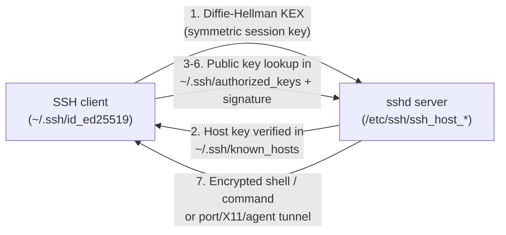

# 1.29 Remote administration reference: SSH server and client options, host-based authentication, parallel shells, screen and tmux, IPMI and console managers

**Level:** intermediate · **Tier 0 (foundations)** · **Lab venue:** two or three small Ubuntu VMs on GCP · **Status:** drafted, labs untested

Chapter 1.5 teaches you to *work* remotely. This chapter is the **reference and depth companion**: every important SSH option on both sides, how the protocol actually proves identity, how to run one command on hundreds of nodes without drowning your network, and how to reach a machine whose operating system is dead. Read chapter 1.5 first; come back here when you configure a cluster.

## Why this matters for AI infrastructure

A GPU cluster has hundreds to thousands of nodes and a handful of people. The same operation (a driver check, a mount repair, a process hunt) has to happen everywhere, quickly, and the machines that most need attention are exactly the ones that are not answering SSH. So three skills carry the day: configuring SSH precisely (who may log in, from where, with what), fanning commands out in parallel without hurting the head node or the network, and getting a console through the baseboard management controller when the OS is gone. These are also the techniques behind every deployment tool in this book (Ansible, Slurm launch, BCM, Kubernetes node access).

## Prerequisites and outcomes

You need chapters 1.1 to 1.6, especially 1.5 (SSH keys, `~/.ssh/config`, tunnels, rsync, tmux) and 1.6 (identity and permissions). After this chapter you will be able to:

- explain in detail how SSH authenticates the server and the user and encrypts the session, and what must be saved when you reinstall a server;
- generate and deploy keys of the right type and size, and automate first-time host key acceptance responsibly;
- read, set and combine the main `ssh` command-line options, `ssh_config` options and `Host` blocks, and the main `sshd_config` options and `Match` blocks;
- configure host-based authentication for a trusted cluster network, and know its risks;
- run commands and copy files on many nodes with `pdsh`/`pdcp` and ClusterShell (`clush`, `cluset`), including integration with Slurm;
- use `screen` and `tmux` fluently (sessions, windows, panes, copy mode, configuration);
- configure and use IPMI with `ipmitool` (network setup, power control, sensors, serial-over-LAN, users and channels), and understand conman, powerman and iKVM;
- diagnose the failures that appear when many nodes are managed at once.

## 1. First: make out-of-band access possible before you need it

SSH is the everyday route into a node, but it needs a working operating system, network and `sshd`. When any of those is broken you need another door, and **that door must be opened in advance**. The management controller (BMC) accessible through **IPMI** or **KVM-over-IP**, and newer interfaces such as **Redfish** and DCMI (Part 7), are usually **disabled for network access by default**: only local access works until someone configures it.

Before the cluster goes into service:

- Enable IPMI network access, either in the BIOS or firmware setup (if it offers it) or by booting each node and using `ipmitool` locally (section 9).
- Make sure the management network is enabled by the vendor and that the controllers get addresses by **DHCP**, and keep a list of the controllers' MAC addresses. Otherwise you must set up every node by hand, which on a large cluster can take weeks.
- iKVM (remote keyboard, video, mouse) normally also needs pre-configuration, and on many servers it shares the same controller as IPMI.
- **Change the default passwords** immediately.

## 2. How SSH works, in detail

**SSH** was designed in 1995 by the Finnish computer scientist Tatu Ylönen as an open, secure protocol for remote access and file transfer, replacing `telnet` and `rsh`, which sent everything unencrypted. Today the dominant implementation of both client and server is **OpenSSH**, developed by the OpenBSD project; alternatives exist. The server listens on TCP **port 22** by default. (This book writes SSH for the protocol and `ssh` for the client command.)

### Two kinds of cryptography

- **Symmetric encryption** uses one shared secret key to both encrypt and decrypt. It is fast and cheap, so it carries the bulk of the data, but both parties must somehow already hold the same key.
- **Asymmetric (public-key) encryption** uses a *pair* of keys: what one encrypts, only the other can decrypt, and neither can be derived from the other in practice (in some algorithms the private key can be used to recompute the public key, but not the reverse; OpenSSH stores the public key inside the private key file). You publish the **public key** freely and keep the **private key** secret. Two parties can then establish trust without ever sending a secret: you can prove you hold the private key by signing something the other side can verify, and anyone can send you a message only you can read.

SSH uses both: public-key cryptography for identity and key exchange, symmetric encryption for the session itself, with the symmetric key replaced periodically during a long connection (to limit how much data an eavesdropper could collect for an attack).

### Servers have identities too

Every SSH server owns a **host key** pair. On the first connection, the client receives the server's public host key and shows you its **fingerprint**; if you know the right fingerprint beforehand you can compare and refuse a mismatch. If you accept, the client saves the pairing of server address and host key in **`~/.ssh/known_hosts`**. On later connections, a *different* host key makes `ssh` refuse to continue, which defeats **man-in-the-middle** attacks (an attacker standing in for the server to read and relay your traffic).

When you install the server package, host keys are generated automatically. **If you reinstall an SSH server (or reimage a node), save and restore its host keys** (`/etc/ssh/ssh_host_*`), or every user will see the "host key changed" alarm. On a cluster, bake the host keys into the node image or manage them centrally.

### The sequence of a session



1. The client connects and the two sides establish an **encrypted channel** with a shared symmetric key, using a key-exchange algorithm (Diffie-Hellman family); from here everything is encrypted.
2. The client authenticates the **server**: it checks the server's host key against `known_hosts` (or asks you to confirm the fingerprint the first time), and the server proves it owns the corresponding private key.
3. The client names the **user** it wants to log in as.
4. The client offers its key pairs one at a time, each attempt starting by sending the **public** half.
5. The server looks the public key up in that user's **`~/.ssh/authorized_keys`**. If it is not there, the client tries its next key.
6. If it is there, the server sends a challenge only the matching private key can answer; the client answers (using the private key, which stays on the client).
7. On success the server starts the requested command or an interactive shell.

If key authentication is unavailable, servers typically also support **password** (and sometimes Kerberos) authentication; the data is still encrypted. **Do not allow password authentication for ordinary users.** Passwords can be guessed by brute force, and no amount of encryption helps if the attacker simply tries the right password. A private key, by contrast, is practically impossible to guess; the realistic risk is theft of the key *file*, and that is why private keys should always be protected with a **passphrase**. (For the same reason, "secure" versions of `telnet` and `ftp` over TLS that still use passwords are not considered secure.)

## 3. Keys in practice

```bash
ssh-keygen -t ed25519 -C "alice@laptop"        # modern default
ssh-keygen -t rsa -b 4096                       # RSA, if you need compatibility
```

Choices and defaults:

- **Type (`-t`).** `ed25519` (preferred), `rsa`, `ecdsa`, and the security-key variants `ed25519-sk` and `ecdsa-sk` (the private key lives on a FIDO hardware token). Newer types appear over time; use what your servers accept.
- **Length (`-b`).** Only meaningful for RSA and ECDSA. RSA defaults to 3072 bits in current OpenSSH (use 3072 or more); elliptic-curve keys support only fixed sizes (256, 384, 521 for ECDSA, and Ed25519 has one size). More bits is stronger and slower.
- **Location and passphrase.** Accept the default location (`~/.ssh/id_ed25519`, with the public key in the same name plus `.pub`). Choose a passphrase.

To enable login to the account `foo` on `server`:

```bash
ssh-copy-id -i ~/.ssh/id_ed25519.pub foo@server          # easiest
# or by hand, on the server:
cat id_ed25519.pub >> ~foo/.ssh/authorized_keys         # APPEND (do not replace the file)
chmod 700 ~foo/.ssh ; chmod 600 ~foo/.ssh/authorized_keys ; chown -R foo: ~foo/.ssh
```

The directory and the file must belong to `foo` and be writable by no one else, or `sshd` ignores them (`StrictModes`). A public key sent to you in the multi-line **RFC 4716** format (some Windows tools produce it) must be converted to the single-line OpenSSH format: `ssh-keygen -i -f rfc-key.pub >> ~foo/.ssh/authorized_keys` (check the exact flags in `man ssh-keygen`, because the direction of conversion is easy to get wrong).

**Passwordless login.** The secure way is a key plus an agent (chapter 1.5): you type the passphrase once. The shortcut some clusters use is a key with an **empty passphrase** for node-to-node access: anyone who copies that file becomes you. If the user's home directory is on a shared filesystem, one `authorized_keys` entry serves every node. Restrict such keys (a forced command, a source address; section 7) where possible.

**Accepting host keys for the first time on many nodes.** Interactive confirmation for hundreds of hosts is impractical, so administrators run a loop that accepts the keys in advance:

```bash
for h in $(cat nodes.txt); do ssh -o StrictHostKeyChecking=no "$h" true; done
```

The remote command `true` does nothing and exits instantly, so the loop only records host keys (and prints errors for unreachable nodes). Understand what you are doing: `StrictHostKeyChecking=no` *trusts whatever answers*, so the very first acceptance is exactly where a man-in-the-middle could hide. On a trusted, isolated management network that is an accepted trade-off; elsewhere, collect keys with `ssh-keyscan` and verify them against a trusted list, or distribute known host keys from the image.

**Escape sequences.** `ssh` intercepts a special key sequence at the **start of a line**: Enter, then `~`, then a command character. `~.` terminates the session immediately (the way out of a frozen connection), `~Z` suspends the ssh process into the background (resume with `fg`), `~~` sends a literal `~`, and `~?` lists the rest. Be careful when you are inside a serial-over-LAN session (section 9) that uses the same `~.` to exit.

## 4. The SSH client: options and configuration

### Command-line options

| Option | Meaning |
|---|---|
| `-A` / `-a` | forward / do not forward the authentication agent |
| `-i path` | use this private key |
| `-l user` | log in as this user (or write `user@host`) |
| `-p port` | connect to this port (if not 22) |
| `-L [bind:]port:host:hostport` | **local forward**: connections to `port` on your machine are carried to `host:hostport` as seen from the server |
| `-R [bind:]port:host:hostport` | **remote forward**: connections to `port` on the server are carried to `host:hostport` as seen from your machine |
| `-N` | do not run a remote command (for tunnels) |
| `-o option` | set any configuration option for this connection (`-o ConnectTimeout=5`) |
| `-q` | quiet: suppress informational messages (good in scripts) |
| `-t` | force a pseudo-terminal; needed by remote commands that expect one, such as `sudo` asking for a password, or `top` |
| `-v` (repeat) | verbose debugging output; `-vvv` or `-vvvv` is usually enough to diagnose a login problem |
| `-X` / `-Y` | forward the X11 graphics connection (untrusted / trusted variants) |
| `-M` | control master for connection sharing (see below) |

### Configuration files

The system-wide client file is `/etc/ssh/ssh_config`. Per-user settings go in **`~/.ssh/config`**, which takes precedence. Inside `~/.ssh` you will also find your keys, `authorized_keys` (all the public keys allowed to log in as you), and `known_hosts` (the host keys of machines you have connected to).

Options you can set globally (or per host):

| Option | Meaning |
|---|---|
| `ConnectTimeout` | give up connecting after this many seconds |
| `EscapeChar` | change the escape character from `~` |
| `ForwardAgent` | forward the agent |
| `ForwardX11` | forward X11 |
| `IdentityFile` | path of the private key to use |
| `PasswordAuthentication` | allow password authentication |
| `SendEnv` | environment variables to send to the server (it must accept them) |
| `StrictHostKeyChecking` | `yes` (refuse unknown hosts), `ask` (prompt), `no` (add silently) |
| `ControlMaster auto`, `ControlPath ~/.ssh/cm-%r@%h:%p`, `ControlPersist 10m` | reuse one connection for many sessions |

A **`Host`** line starts a block that applies only to matching names; `?` and `*` are wildcards, and a lone `*` matches everything. Inside a block, `HostName` (the real address), `User`, `Port`, `IdentityFile`, `ForwardAgent` and `ForwardX11` are the most useful. The name after `Host` is just an alias; it need not be a real hostname:

```
Host home
    HostName home.my.provider.com
    User foo
    Port 2222
    IdentityFile ~/.ssh/home_key
```

Now `ssh home` replaces `ssh -p 2222 -i ~/.ssh/home_key foo@home.my.provider.com`. (As chapter 1.5 noted, the first matching value wins, so put specific blocks above general ones.)

## 5. Forwarding: environment, ports, X11 and agent

All forwarding travels through the **single encrypted SSH connection**, with no extra connections to the server; being able to reach port 22 is enough.

- **Environment variables.** With `SendEnv LANG LC_*` on the client and `AcceptEnv LANG LC_*` on the server (both must agree), settings such as the locale follow you into the remote session. Variables that could subvert the system (such as `LD_PRELOAD`) are refused unless the server explicitly allows it (`PermitUserEnvironment`, which also reads `~/.ssh/environment`; use with great care).
- **Port forwarding** (a small, flexible proxy for one connection). Example: an internal web server at `192.168.0.10` is reachable only from the server's network; run `ssh -L 8080:192.168.0.10:80 your.server.address` and browse to `http://localhost:8080`. The web server sees the connection as coming from the SSH server. The reverse direction (`-R`) publishes a port on the server that leads back to a host reachable from your machine. Both can be disabled by the server (`AllowTcpForwarding no`).
- **X11 forwarding** lets a graphical program on the remote machine display on your local X server (section 6 of chapter 1.30 explains X). It needs the `xauth` program on both ends, and if you use `sudo` remotely you must pass the `XAUTHORITY` variable through.
- **Agent forwarding** exposes your local agent to the remote machine so that it can sign challenges for onward connections; it never exposes the keys themselves, but anyone with root there can use your agent while you are connected (chapter 1.5).

## 6. The SSH server: `sshd_config`

The server is configured in **`/etc/ssh/sshd_config`** (and drop-ins in `sshd_config.d/` on current distributions). After editing, **validate** with `sshd -t` and then reload (`systemctl reload sshd`); existing sessions are not affected, which is helpful, because a mistake need not lock you out of the session you are using, but you should still keep a second session open.

| Option | Meaning |
|---|---|
| `Port` | port to listen on (default 22; several lines allowed) |
| `ListenAddress` | addresses and ports to bind (default all) |
| `PermitRootLogin` | `yes`, `prohibit-password` (formerly `without-password`: keys only), `forced-commands-only` (only keys with a forced command) or `no`. Prefer `no`, or `prohibit-password` where root access is unavoidable. |
| `PasswordAuthentication` | allow passwords (set `no` in production) |
| `PubkeyAuthentication` | allow public-key login |
| `PermitEmptyPasswords` | allow accounts with empty passwords (keep `no`) |
| `AllowUsers`, `DenyUsers`, `AllowGroups`, `DenyGroups` | restrict who may log in. `AllowUsers` accepts `user@host` or an address mask (`alice@10.0.0.0/8`) to limit the source; group names only, not numbers. They are evaluated in the order DenyUsers, AllowUsers, DenyGroups, AllowGroups (check `sshd_config(5)` for your version); a simple allow-list is the clearest policy, and `AllowGroups admins` is handy during maintenance. |
| `AllowTcpForwarding`, `AllowAgentForwarding`, `X11Forwarding` | enable or disable forwarding features |
| `AcceptEnv`, `PermitUserEnvironment` | which client environment variables are accepted, and whether `~/.ssh/environment` is honoured |
| `ForceCommand` | whatever the client asks, run only this command; use `internal-sftp` to give SFTP-only access |
| `Banner` | a file shown before authentication (legal notice) |
| `PrintMotd` | show `/etc/motd` after login |
| `LogLevel` | `QUIET`, `FATAL`, `ERROR`, `INFO` (default), `VERBOSE`, `DEBUG`, `DEBUG1` to `DEBUG3`; raise it when diagnosing login problems |
| `StrictModes` | check ownership and permissions of the user's home and `.ssh` files |
| `UseDNS` | resolve client names (can slow logins when DNS is broken; usually `no`) |
| `XauthLocation` | path of `xauth` if not standard |

Historical option: `UseLogin` (use the system `login` program) breaks X forwarding and has been removed from modern OpenSSH.

### `Match` blocks: conditional configuration

A `Match` line starts a block whose options apply only when the condition is true:

```
Match User admin,superuser,lab*
    PasswordAuthentication yes
    AllowTcpForwarding yes

Match Address 10.20.30.0/24
    PermitRootLogin prohibit-password

Match Group sftponly
    ForceCommand internal-sftp
    AllowTcpForwarding no
    X11Forwarding no
```

Criteria: `User`, `Group`, `Host` (remote host name), `Address` (remote IP; masks allowed), `LocalAddress`, `LocalPort`, each followed by a comma-separated list; `?` and `*` work in names and addresses can use masks (`1.2.3.4/8`). The block ends at the next `Match` or the end of the file, and only a subset of options is allowed inside (including `AcceptEnv`, `AllowAgentForwarding`, `AllowGroups`, `AllowTcpForwarding`, `AllowUsers`, `Banner`, `DenyGroups`, `DenyUsers`, `ForceCommand`, `PasswordAuthentication`, `PermitEmptyPasswords`, `PermitRootLogin`, `PubkeyAuthentication`, `X11Forwarding` and a few others). Use `Match` to give service accounts, administrators or an internal network different rules than the general population.

## 7. Restricting a key, and host-based authentication

### Restrict what a key may do

In `authorized_keys`, options can precede the key to limit it:

```
from="10.0.0.0/8",command="/usr/local/bin/status-only",no-port-forwarding,no-pty ssh-ed25519 AAAA... monitor@mgmt
```

This key works only from the management subnet and can run only one command, which is how you give a monitoring system or a web-server front end a narrow capability instead of a shell (and how a "queue status" web page on a separate server can call the cluster safely).

### Host-based authentication

Distributing user keys to hundreds of nodes is painful unless keys live on a shared filesystem or in the node image. **Host-based authentication** is a much *less secure* but efficient alternative for a trusted cluster network: the server accepts a login if the *client host* is trusted, its host key matches a saved one, and the user is allowed. Steps:

```
# 1. Server: /etc/ssh/sshd_config
Match Address 10.20.30.0/24 User admin
    HostbasedAuthentication yes
```

2. On the server, list the trusted client hosts in `/etc/shosts.equiv`, one address per line (no netmasks), readable and writable only by root.
3. On the server, record every client's host key: `ssh-keyscan CLIENT_ADDRESS >> /etc/ssh/ssh_known_hosts`.
4. On each client, run `ssh-keyscan SERVER_ADDRESS >> /etc/ssh/ssh_known_hosts` and enable it in `/etc/ssh/ssh_config`:

```
Host server.my.cluster
    HostbasedAuthentication yes
    EnableSSHKeysign yes
```

The last line enables the helper program (`ssh-keysign`) that modern OpenSSH needs for this method. Details vary between OpenSSH versions, so check the manual pages. Weigh the risk honestly: anyone who compromises one trusted host can reach all the others as any user it allows, so restrict it by `Match` to the management network and specific accounts.

## 8. Running commands on many nodes

A simple loop works for a few machines, and many administrators begin there:

```bash
for h in $(cat nodes.txt); do ssh -o ConnectTimeout=3 "$h" 'uptime' ; done
```

but it has predictable problems: the output of different nodes is interleaved and hard to attribute; **one hanging `ssh` hangs the whole script** (and Ctrl-C can leave stray errors from the hung connections); and running several hundred `ssh` processes at once puts real load on the machine you run it from. Dedicated tools solve all of these.

### `pdsh` and `pdcp`

`pdsh` runs any command on a list of nodes in parallel, labels each line with the node name, and limits concurrency.

```bash
pdsh -w node-[01-10] 'w | grep load'        # quote the node list (the shell may expand brackets)
pdsh -w node-[01-64] -x node-13 uptime       # exclude a node
pdsh -g gpu nvidia-smi -L | dshbak -c        # a named group; dshbak -c folds identical output
```

| Option | Meaning |
|---|---|
| `-a` | all machines in the machines file (`/etc/pdsh/machines`, one node per line, or the file named in the `WCOLL` environment variable) |
| `-w LIST` | these nodes: comma-separated, ranges like `node-[10-20]`; `-` reads the list from standard input |
| `-x LIST` | exclude these nodes |
| `-g GROUPS` | these groups; each group is a file of node names in `/etc/dsh/group/` or `~/.dsh/group/` (note: `dsh`, not `pdsh`), named after the file |
| `-N` | do not prefix lines with the node name |
| `-f N` | fan-out: at most N parallel connections |
| `-u SEC` | per-command timeout |
| `-l USER` | run as this user |
| `-b` | batch mode: one Ctrl-C terminates (by default the first Ctrl-C prints status and the second terminates) |

Because the string runs in a shell on the remote node, you can pass pipelines. `PDSH_SSH_ARGS_APPEND` adds options to the underlying `ssh` (for example `-t` for commands that insist on a terminal). `pdsh` supports other transports than ssh. The companion **`pdcp`** copies files in parallel (it needs `pdsh` on the nodes too).

### ClusterShell: `clush`, `cluset`

ClusterShell is a Python package (`pip install --user ClusterShell`, or the distribution package) that does the same and more. Basic form: `clush -w node-[01-10] uname -a`; everything after the options is the remote command (quote it if it contains pipes, `clush -w ... 'ps aux | grep foo'`).

| Option | Meaning |
|---|---|
| `-w NODES`, `-x NODES` | select, exclude nodes |
| `-g GROUP`, `-X GROUP` | select, exclude a group |
| `--hostfile=FILE` | a file of target hosts |
| `-b`, `-B` | **gather** nodes with identical output (and with stderr for `-B`): the quickest way to spot the odd node out |
| `--diff` | show differences between the gathered outputs |
| `--outdir=DIR`, `--errdir=DIR` | save each node's stdout and stderr to separate files |
| `-f N` | fan-out, at most N concurrent commands |
| `-t SEC`, `-u SEC` | connection and command timeouts |
| `-l USER`, `-o OPTIONS` | run as a user; pass options to `ssh` (a jump host, a different port) |
| `-q`, `-v`, `-d`, `-N`, `-P` | quiet, verbose, debug, no labels, show progress |
| `-c`/`--copy`, `--dest PATH`, `--rcopy` | copy local files to nodes (same path by default; `--dest` changes it), or fetch from nodes |

Group support is more flexible than in `pdsh` and can be tied to external sources. The most useful is **Slurm integration**: rename `/etc/clustershell/groups.conf.d/slurm.conf.example` to `slurm.conf` (the exact path depends on how it was installed) and you can target nodes by scheduler state:

```bash
clush -w @sp:main uptime      # all nodes in partition "main"
clush -w @st:idle  'lsmod | grep nvidia'   # all idle nodes
```

Node lists obtained from external groups are cached (60 minutes by default, one minute for Slurm, per the book; verify on your version), so a list can be briefly out of date. The companion **`cluset`** manipulates node lists: `cluset -e 'node-[01-03,11-13]'` expands, `echo node-01 node-02 node-03 | cluset -f` folds, `cluset -c` counts, and there are union and intersection operations. For very large clusters ClusterShell also has a **tree mode** and other execution modes.

### Cautions for any parallel fan-out

Each node gets its own SSH connection, so set up keys and host keys first; limit the fan-out; a thousand simultaneous `scp` of the same file can cripple the head node's network; rehearse destructive commands on one node, then a few, then all; and remember that output arrives in unpredictable order, so use the labelling and gathering features. When the operation must be repeatable and idempotent, use Ansible instead (Part 4).

## 9. `screen` and `tmux` in detail

Both give you many terminals inside one connection and keep your session alive if the connection drops: after a reconnect you attach and carry on, and programs inside never noticed.

### GNU `screen`

| Option | Meaning |
|---|---|
| `-S name` | create a session with this name |
| `-list` | list sessions and their states |
| `-r`, `-R`, `-RR` | reattach; `-R` creates the session if absent; `-RR` means "attach here, whatever it takes" |
| `-x` | join the latest session in shared mode (you and another user can both see and type) |
| `-d`, `-D` | detach the session from wherever it is attached (`-D` also works if it was not attached) |

`screen -xRR` or `screen -DRR` is a common start-or-attach idiom. Inside, commands are a **hotkey** (`Ctrl-a` by default; configurable in `~/.screenrc`) followed by a key:

| Key | Action |
|---|---|
| `c` / `k` | create / kill a window |
| `n` / `p` / `0`..`9` | next, previous, or numbered window |
| `"` | list windows |
| `d` | detach |
| `a` | send a literal Ctrl-a to the program |
| `Esc` | copy (scroll) mode: move with the cursor, space to start and end a selection, `>` to save it to a file |
| `h` / `H` | write the window's current history to a file / start logging it |
| `t` | show time, host and load average |
| `Ctrl-x` | lock the screen (careful if you use passwordless login) |
| `F` | fit the window to the current terminal size (after reattaching from another computer) |
| `\|` / `S` | split the display vertically / horizontally; `Tab` moves between regions; `Q` closes all but the current region; `X` closes this region |
| `:` | command mode (for example `resize +20%`) |
| `?` | show key bindings |

Useful lines for `~/.screenrc`: `defscrollback 1000` (scrollback in copy mode), `defmousetrack on` (mouse support), `termcapinfo xterm* ti@:te@` (reset terminal settings so scrollback works in xterm), and a `hardstatus alwayslastline` format string for a status bar. **Avoid status-line commands that run external programs:** if one hangs, you lose access to your windows.

### `tmux`

`tmux` is similar but more flexible; its most valuable feature is starting a new window directly with a command. The default hotkey is `Ctrl-b` (reconfigure in `~/.tmux.conf`). To imitate `screen -xRR` use `tmux new -A -s 0` (attach if it exists, else create).

| Key (after the prefix) | Action |
|---|---|
| `c`, `d`, `x`, `n`, `p`, `0`..`9` | create, detach, kill pane or window (with confirmation), next, previous, numbered window (as in screen) |
| `l` | last used window |
| `,` | rename the window |
| `'` | prompt for a window index; `w` shows a chooser of all windows |
| `%` / `"` | split the window left/right and top/bottom |
| arrow keys | move between panes; `Ctrl`+arrow resizes by one cell, `Alt`+arrow by five |
| `z` | zoom the current pane to full window (again to restore) |
| `[` | **copy mode** for scrolling back; arrow keys and PgUp/PgDn move, Ctrl-c leaves; copy and paste with `]` (key bindings depend on the `mode-keys` setting) |

Add `set -g mouse on` to `~/.tmux.conf` to select text, resize panes and switch windows with the mouse, and keep the status line free of long-running commands. Run `tmux list-keys` for the full set.

## 10. IPMI: managing the machine behind the machine

**IPMI (Intelligent Platform Management Interface)** is an open standard for remote server management. The server contains a **management controller (MC or BMC)**: a small independent computer that monitors the main system through sensors on internal buses, can control its power, and often emulates a serial port so that you get a console. It is configured for network access, which gives you information and control even if the main system is hung or powered off. Redfish (Part 7) is the modern replacement; IPMI remains the most widespread.

For Linux, the common clients are **`ipmitool`** and OpenIPMI. Install `ipmitool` on every node and management host.

### Reaching the local controller

Load the kernel modules that talk to it (if not already loaded):

```bash
sudo modprobe ipmi_devintf ; sudo modprobe ipmi_si ; sudo modprobe ipmi_msghandler
sudo ipmitool lan print           # local controller: current network settings
```

Typical output shows the IP address source (static or DHCP), address, mask, MAC address, default gateway, VLAN settings and authentication types. To set network parameters (channel is usually 1):

```bash
sudo ipmitool lan set 1 ipsrc static
sudo ipmitool lan set 1 ipaddr 10.0.1.2
sudo ipmitool lan set 1 netmask 255.255.255.0
sudo ipmitool lan set 1 defgw ipaddr 10.0.1.1
```

### Remote commands

```bash
ipmitool -I lanplus -H 10.0.1.2 -U admin -f /root/.ipmipass power status
```

`-I lan` selects IPMI 1.5 and `-I lanplus` IPMI 2.0 and later; they are not compatible, so you must state the protocol. **Do not put the password on the command line** where `ps` and shell history expose it: use **`-f passfile`** (a file readable only by you) or **`-E`** (take it from the `IPMI_PASSWORD` environment variable). The main command classes, each with subcommands:

| Class | Purpose |
|---|---|
| `lan` | network configuration (`print`, `set`) |
| `power` | power control: `on`, `off`, `cycle`, `reset` (like pressing reset), `status` |
| `mc` | controller management (`info`, `reset cold`) |
| `sensor`, `sdr` | list sensors and their values (`ipmitool sensor get NAME`); `sdr list all` |
| `sol` | serial-over-LAN console |
| `user`, `channel` | controller user accounts and channel access |
| `session`, `shell` | session information, an interactive prompt |
| `chassis` | chassis power and boot device (`chassis bootdev pxe`) |
| `sel` | the system event log (`sel list`) |

**Power cycling:** `power cycle` is *not always reliable* on every controller; a more dependable sequence is an explicit `power off`, a pause of a few seconds, then `power on`.

### Serial-over-LAN console

With IPMI 2.0, `sol` connects you to a virtual or real serial port, so if the node runs a `getty` on that port (for example `mgetty /dev/ttyS0`, or a systemd `serial-getty` service on the right device) you get a login prompt even when the network is down; kernel messages can also be sent to the serial console to catch a crash. `ipmitool ... sol activate` connects; leave with `~.` (in the middle of an SSH session use `~~.` so the outer SSH does not interpret it). Sensors give temperatures, fan speeds and voltages, which is often the first clue to a hardware failure.

### Creating an administrative user and enabling access

The sequence below is typical; names and numbers vary, and **the exact options and the order depend on the controller model**, so treat it as a template and read your vendor's documentation:

```bash
ipmitool user set name 3 adminuser         # give user slot 3 a name
ipmitool user set password 3 'S3cret...'   # set its password
ipmitool user priv 3 4 1                   # slot 3, privilege level 4 (administrator), channel 1
ipmitool lan set 1 access on               # allow access on channel 1
ipmitool lan set 1 auth ADMIN MD5          # authentication type for the admin level
ipmitool channel setaccess 1 3 privilege=4 # channel 1, user 3, administrator
ipmitool sol payload enable 1 3            # allow SOL for channel 1, user 3
ipmitool sol set enabled true              # enable SOL
```

The settings partly duplicate each other, and on some controllers the user settings alone suffice; running all of them is a safe habit. Then test from another host: `ipmitool -I lan -U admin -f pass -H 10.0.1.2 sdr list all` (use `-I lanplus` for IPMI 2.0).

### IPMI security

The IPMI network is **not secure by itself**: IPMI 2.0's authentication has well-known weaknesses (for example, a remote attacker can retrieve a password hash for a valid user name and attack it offline), and controllers run complex firmware. Best practice: put all controllers on a **dedicated physical management network**, or at least a **dedicated VLAN** reachable only from management nodes (not user-facing ones) and ask your supplier to configure the VLAN automatically if possible, because setting it per node by hand is painful; use strong unique passwords; disable IPMI-over-LAN where Redfish with proper authentication is available; keep firmware updated; and never expose a BMC to the internet.

### Console managers: `conman`, `powerman`

Raw `ipmitool sol` is awkward when you must watch consoles on many servers. **conman** is a console manager that keeps the connection to each (local or remote) console open and logged, so you can attach at any moment and review what happened before; it can also automate some operations. xCAT includes a similar tool (`rcons`). conman does not do power control; for that use **powerman**, which supports IPMI and a wide range of remotely controllable power distribution units. These tools greatly improve efficiency in remote debugging at scale.

### iKVM (KVM over IP)

A **KVM** switch lets one keyboard, monitor and mouse control several machines; **iKVM** does the same over the network by capturing the video output and emulating keyboard and mouse. There is **no single standard**, so features and interfaces differ by vendor; many implementations use a browser with Java, an older plug-in, or HTML5, and the capability is either built into the server's controller (preferred: it also gives power management) or provided by an external device you cable to each server. Because there is no standard protocol you generally cannot automate iKVM (for example to change a BIOS setting on every node), but it complements SSH and IPMI uniquely: it shows you **what is on the screen of a hung node**, including BIOS menus and boot errors.

## How it fails

### 1. A fan-out command hangs forever on one node
**Symptom:** `pdsh` or a loop never finishes. **Cause:** one node's network or `sshd` is stuck, and no timeouts are set. **Fix:** `-u` (command timeout) and `-t`/`ConnectTimeout`, a sane fan-out, `ServerAliveInterval`; investigate the stuck node via its BMC.

### 2. Mass parallel operations flatten the head node
**Symptom:** hundreds of simultaneous `scp`/`rsync` from one source saturate its network or CPU. **Cause:** unlimited concurrency. **Fix:** a fan-out limit (`-f`), staggered starts (a short sleep between launches), a tree distribution (nodes copy to other nodes, ClusterShell tree mode), or a shared filesystem or image instead of copying.

### 3. Host-key chaos after a reinstall
**Symptom:** "host key changed" on many nodes, or scripts failing on prompts. **Cause:** node images regenerate host keys on each boot or reinstall. **Fix:** persist host keys in the image or inject per-node keys, pre-populate `/etc/ssh/ssh_known_hosts` (verified), consider SSH certificates.

### 4. `sshd` change locks you out
**Symptom:** after a restart nobody can log in. **Cause:** a syntax error, a wrong `AllowUsers`, `PermitRootLogin no` before another admin path existed, or key permissions. **Prevention:** `sshd -t` before reloading, keep a second session open, test a new session before closing the old, and know your out-of-band path (BMC console) for recovery.

### 5. IPMI works from the node but not remotely
**Symptom:** local `ipmitool` works, remote attempts time out or fail authentication. **Cause:** LAN access not enabled on the channel, wrong `-I lan`/`lanplus`, wrong user privilege or channel number, controller on a different VLAN or subnet, firewalls, or a stale session. **Diagnose:** `ipmitool lan print`, `user list`, `channel info`, ping the controller from the management host, try both protocols. **Fix:** the access commands in section 10, matching VLANs and routes.

### 6. `tmux` or `screen` status line freezes your session
**Symptom:** the multiplexer becomes unresponsive. **Cause:** a status-bar command that calls out to a slow or hung service. **Fix:** keep the status line free of external commands, or make them time-limited.

### 7. A trusted-host configuration is abused
**Symptom:** one compromised node gives access everywhere. **Cause:** host-based authentication or shared passphrase-less keys across the cluster. **Fix:** restrict with `Match` to the management network and specific accounts, use forced commands, monitor logins centrally, and prefer user keys with agents or SSH certificates where the risk warrants.

## Hands-on lab: SSH, parallel shells, multiplexers, and IPMI

First, run the self-checking Python lab (`code/part01/remote_admin_ref_lab.py`) locally. It verifies `sshd_config` access evaluation order (`DenyUsers` -> `AllowUsers` -> `DenyGroups` -> `AllowGroups`), `pdsh`/ClusterShell node-range expansion (`node-[01-03,11-12]`), nested SSH/SOL escape sequences (`~.` vs `~~.`), and `ipmitool` `-I lanplus` / `-f` security checks.

```bash
python3 code/part01/remote_admin_ref_lab.py
```

Next, on two or three disposable GCP VMs (all interactive VM commands below are `untested here`), work through these steps:

**Part A: protocol and keys.**
1. Run `ssh -vvv vm2 true` and read the output: identify the key-exchange step, the host-key check, the authentication methods offered by the server, and which key was accepted. Run `ssh -Q kex`, `ssh -Q key`, `ssh -Q cipher` to list algorithms your client supports.
2. Generate keys of several types and sizes; compare the times and file sizes; use `ssh-keygen -lf` for fingerprints. Install one and log in.
3. Show the "authorized_keys" append rule: add a second key and confirm both still work.

**Part B: server options.**
4. In a **copy** of `sshd_config` (never first on the machine you use), set `PasswordAuthentication no`, `PermitRootLogin no`, `AllowGroups sshusers`, a `Banner`, and a `Match User lab1` block with `ForceCommand internal-sftp`. Validate with `sshd -t -f copyfile`. Apply on a throwaway VM with a second session open and test: a key login, a denied user, the SFTP-only user.
5. Add `from="your.ip",command="/bin/date"` in front of a key and show that it can only run `date` and only from that address.
6. Compare `AllowUsers alice@10.0.0.0/8` from inside and outside that network if you can.

**Part C: forwarding.**
7. Start a web server on vm2 bound to localhost; reach it from your laptop with `-L`. Reach a service on your laptop from vm2 with `-R`. Observe with `ss -ltnp` which side listens.
8. Forward an environment variable: set `SendEnv MYVAR` in the client config and `AcceptEnv MYVAR` on the server, and show it in the remote session; remove one side and see it disappear.

**Part D: parallel shells.**
9. Install `pdsh` and `clustershell`. Create a machines file and two groups. Run `pdsh -w` with a range, an exclusion, and `-f 1` versus `-f 10` on a command that sleeps; time them. Use `dshbak -c` to fold output. Do the same with `clush -b` and `clush --diff` after making one node's `/etc/motd` different.
10. Use `clush -c file --dest /tmp/` to copy, then `clush --rcopy` to fetch. Practise `cluset -e`, `-f`, `-c`.
11. Show why a plain loop is fragile: add a VM that is down and observe the hang without `ConnectTimeout`, and the fix.

**Part E: screen and tmux.**
12. Create sessions in both; split the window; detach; reattach from another SSH connection with the shared mode (`screen -x`, `tmux attach`); scroll back in copy mode; save a window history to a file. Write a small `~/.screenrc` and `~/.tmux.conf` and verify the settings.

**Part F: IPMI concepts (hardware or a simulator).**
13. If you have a bare-metal server with a BMC, run `ipmitool lan print`, `sensor`, `sdr`, `chassis status` locally. Otherwise use the cloud serial console and the `ipmi_sim` simulator from OpenIPMI to practise syntax. Write out (do not run on production) the full user, channel and SOL setup and explain each line.
14. Explain, for your platform, which of these you would use if SSH stopped answering: serial console, iKVM, IPMI SOL, Redfish, and what each needs configured beforehand.

## Exercises

1. **The 7-Step SSH Session Sequence, Host Keys, and RFC 4716 Conversion (`SCL` Chapter 10):** (a) Trace the 7 steps of an SSH public-key session from TCP connection on port `22` to shell start, explaining how asymmetric and symmetric cryptography are combined; (b) why must `/etc/ssh/ssh_host_*` be preserved when reimaging a node, why must `~/.ssh/authorized_keys` (`0600`) be appended to (`>>`), and what command converts a multi-line RFC `4716` public key to OpenSSH format?
2. **`sshd_config` Access Evaluation Order, `Match` Blocks, and Key Restrictions:** (a) Using `evaluate_sshd_access_rules()` in `code/part01/remote_admin_ref.py`, determine whether user `bob` (in group `admins`) can log in when `DenyUsers bob` and `AllowGroups admins` are both set, or whether `charlie` (in `admins`) can log in when `AllowUsers alice` and `AllowGroups admins` are both set; (b) write an `sshd_config` `Match Group sftponly` block for SFTP-only users and an `authorized_keys` prefix restricting a monitoring key to `10.0.0.0/8` and `/usr/local/bin/status-only`.
3. **Host-Based Authentication vs. SSH Keys:** List the four configuration steps (`/etc/ssh/sshd_config` `Match Address ... HostbasedAuthentication yes`, `/etc/shosts.equiv`, `ssh-keyscan` into `/etc/ssh/ssh_known_hosts`, and `/etc/ssh/ssh_config` `EnableSSHKeysign yes`) to enable host-based authentication inside a cluster management subnet, and state the security risk if one trusted host is compromised.
4. **Parallel Fan-Out with `pdsh` and ClusterShell (`clush`, `cluset`):** (a) Give three reasons a sequential `for h in $(cat nodes.txt); do ssh "$h" ...; done` loop fails at cluster scale; (b) expand `node-[01-03,11-12]` (`expand_nodeset_expression()`), and write the `pdsh` and `clush` commands to run `nvidia-smi -L` across `node-[01-64]` excluding `node-13` with a concurrency limit of `32`, a timeout of `10 s`, and folded identical output (`dshbak -c` / `clush -b --diff`), plus the `clush` syntax for Slurm partition `@sp:main` and state `@st:idle`.
5. **`screen` vs. `tmux` Multiplexers and Nested Escape Sequences:** (a) State the start-or-attach command and default prefix hotkey for both `screen` (`screen -xRR`, `Ctrl-a`) and `tmux` (`tmux new -A -s 0`, `Ctrl-b`), and explain why external commands in a multiplexer status bar are dangerous; (b) using `compute_ssh_nested_escape()`, explain what `<Enter>~.` vs `<Enter>~~.` does when you are connected to an IPMI Serial-over-LAN (`sol activate`) console from inside an SSH session to a bastion host.
6. **Out-of-Band BMC/IPMI Pre-Configuration, `ipmitool`, `conman`/`powerman`, and `iKVM`:** (a) Why must BMC/IPMI network access, DHCP MAC tables, and non-default passwords be configured *before* a cluster enters service? (b) Audit `ipmitool -I lan -P secret ...` versus `ipmitool -I lanplus -f /root/.ipmipass ...` (`audit_ipmitool_command()`), explain why `power off` + pause + `power on` is more reliable than `power cycle`, and contrast `ipmitool sol`, `conman`, `powerman`, and `iKVM`.

## Checkpoint questions (20)

<details>
<summary>1. Why must out-of-band management (BMC/IPMI/iKVM/Redfish) be configured and tested before a cluster goes into production?</summary>

Out-of-band network access on server BMCs is frequently disabled or left on unconfigured defaults from the factory. When a node's kernel panics, hangs in BIOS/GRUB, or loses its OS network, you cannot run `ipmitool lan set` locally to turn BMC networking on—so DHCP, MAC-to-node tables, SOL, and non-default passwords must be pre-configured during initial rack bring-up.
</details>

<details>
<summary>2. Why does SSH use both asymmetric (public-key) and symmetric cryptography?</summary>

Asymmetric (public-key) cryptography authenticates the server's host key and the user's identity and negotiates a shared session key (Diffie-Hellman key exchange) over an untrusted network without ever transmitting a secret. Symmetric encryption is orders of magnitude faster and encrypts the actual session traffic, periodically re-keying during long connections.
</details>

<details>
<summary>3. What is an SSH host key, where does the client store it, and what happens if you reimage a node without restoring `/etc/ssh/ssh_host_*`?</summary>

Each SSH server has a host key pair in `/etc/ssh/ssh_host_*`; on first login, the client saves the server's public key in `~/.ssh/known_hosts`. If a node is reimaged and generates a brand-new host key at the same IP/hostname, every client and automation script refuses to connect with a `REMOTE HOST IDENTIFICATION HAS CHANGED` man-in-the-middle warning.
</details>

<details>
<summary>4. Walk through the seven steps of an SSH public-key login, and state whether the user's private key ever leaves the client machine.</summary>

(1) Client and server negotiate an encrypted symmetric channel; (2) client verifies the server's host key against `known_hosts`; (3) client sends the username; (4) client sends the **public** half of a candidate key pair; (5) server checks whether that public key is listed in `~/.ssh/authorized_keys`; (6) if found, server sends a cryptographic challenge that the client signs locally using its **private** key (which **never** leaves the client); and (7) on valid signature, server starts the shell or command.
</details>

<details>
<summary>5. Why must you append (`>>`) rather than overwrite (`>`) `~/.ssh/authorized_keys`, what permissions does `StrictModes` require, and how do you convert an RFC 4716 key?</summary>

`authorized_keys` holds one public key per line for every key/person allowed into that account; overwriting it locks out existing keys. `StrictModes yes` (the default) requires the user's home directory not to be writable by others, `~/.ssh` to be mode `0700`, and `~/.ssh/authorized_keys` to be mode `0600` owned by the user. Convert a multi-line RFC 4716 public key with `ssh-keygen -i -f rfc-key.pub >> ~/.ssh/authorized_keys`.
</details>

<details>
<summary>6. What are the risks of `StrictHostKeyChecking=no` and empty-passphrase keys, and how do you mitigate both on a cluster?</summary>

`StrictHostKeyChecking=no` blindly trusts any host key on first contact (vulnerable to MITM on untrusted networks); use it only once on an isolated management VLAN (`for h in $(cat nodes.txt); do ssh -o StrictHostKeyChecking=no "$h" true; done`) or pre-distribute verified keys in `/etc/ssh/ssh_known_hosts`. An empty-passphrase private key file gives instant access if stolen; prefer `ssh-agent` with a passphrase, or restrict automation keys in `authorized_keys` with `from="..."` and `command="..."`.
</details>

<details>
<summary>7. What do the SSH escape sequences `<Enter>~.`, `<Enter>~Z`, `<Enter>~~`, and `<Enter>~~.` do?</summary>

Typed immediately after a newline (`<Enter>`), `~.` terminates a hung SSH connection locally; `~Z` suspends the `ssh` client into the background (`fg` resumes); `~~` sends a single literal `~`; and `~~.` sends `~.` through the outer SSH session to terminate an **inner** SSH or IPMI Serial-over-LAN (`sol`) session without dropping your outer SSH connection.
</details>

<details>
<summary>8. Explain local port forwarding (`ssh -L 8080:192.168.0.10:80 bastion`), remote port forwarding (`-R`), and connection multiplexing (`ControlMaster`).  </summary>

`-L 8080:192.168.0.10:80 bastion` binds port `8080` on your laptop and tunnels connections through `bastion` to `192.168.0.10:80` on the internal network (`-R` binds a port on the remote server and tunnels back to your client side). `ControlMaster auto` + `ControlPath` + `ControlPersist 10m` multiplexes subsequent `ssh`/`scp`/`rsync` sessions over a single already-authenticated TCP/SSH connection.
</details>

<details>
<summary>9. In `/etc/ssh/sshd_config`, in what exact order are `AllowUsers`, `DenyUsers`, `AllowGroups`, and `DenyGroups` evaluated, and what does `PermitRootLogin prohibit-password` mean?</summary>

OpenSSH evaluates them in the strict order: **`DenyUsers` -> `AllowUsers` -> `DenyGroups` -> `AllowGroups`**. If `AllowUsers` is non-empty, any user not matching `AllowUsers` is denied even if their group is listed in `AllowGroups`. `PermitRootLogin prohibit-password` (formerly `without-password`) forbids password-based root login while allowing public-key root login.
</details>

<details>
<summary>10. How do `Match` blocks in `sshd_config` and key options in `authorized_keys` let you lock down service and SFTP accounts?</summary>

In `sshd_config`, a `Match Group sftponly` block with `ForceCommand internal-sftp`, `AllowTcpForwarding no`, and `X11Forwarding no` confines those users to SFTP. In `~/.ssh/authorized_keys`, prefixing a key with `from="10.0.0.0/8",command="/usr/local/bin/status-only",no-port-forwarding,no-pty` ensures that key can only execute that single script and only from the `10.0.0.0/8` subnet.
</details>

<details>
<summary>11. How does SSH Host-Based Authentication work across a cluster, and what is its main security trade-off?</summary>

The server enables `HostbasedAuthentication yes` (inside a `Match Address` block for the cluster subnet), lists trusted client hostnames/IPs in `/etc/shosts.equiv` (`0600` root), and stores every client's public host key in `/etc/ssh/ssh_known_hosts` (`ssh-keyscan`); clients set `HostbasedAuthentication yes` and `EnableSSHKeysign yes` in `/etc/ssh/ssh_config`. It avoids managing per-user keys across nodes, at the cost that root compromise on one trusted host grants access to all other hosts.
</details>

<details>
<summary>12. Why is a shell `for` loop (`for h in ...; do ssh "$h" cmd; done`) unsuitable for managing 500 cluster nodes?</summary>

A sequential `for` loop runs one node at a time (taking minutes), stalls the entire loop if a single node is hung without `ConnectTimeout`, and—if backgrounded with `&`—spawns 500 simultaneous `ssh` processes that interleave unlabelled output lines and overwhelm the head node.
</details>

<details>
<summary>13. Compare `pdsh` and ClusterShell (`clush` / `cluset`) for parallel command execution and output folding.</summary>

Both run commands in parallel across node ranges (`-w node-[01-64] -x node-13`) or groups (`-g gpu`), cap concurrency (`-f 32`), and enforce timeouts (`-u 10`). To fold identical output across nodes so outliers stand out immediately, pipe `pdsh` into **`dshbak -c`**, or pass **`-b`** (and **`--diff`**) directly to **`clush`**. `cluset` expands (`-e`), folds (`-f`), and counts (`-c`) node expressions.
</details>

<details>
<summary>14. How does ClusterShell integrate with Slurm to target nodes by partition or state?</summary>

After enabling `/etc/clustershell/groups.conf.d/slurm.conf`, `clush` can query Slurm dynamically using `@sp:<partition>` (e.g., `clush -w @sp:main uptime`) and `@st:<state>` (e.g., `clush -w @st:idle 'lsmod | grep nvidia'` or `@st:drain`).
</details>

<details>
<summary>15. Compare GNU `screen` and `tmux` across hotkeys, idempotent reattach commands, splitting panes, and scrollback copy mode.</summary>

`screen` uses prefix **`Ctrl-a`**, attaches/creates with `screen -xRR` (or `-DRR`), splits with `|` / `S`, and enters scrollback copy mode with `Ctrl-a Esc`. `tmux` uses prefix **`Ctrl-b`**, attaches/creates with `tmux new -A -s 0`, splits left/right with `%` and top/bottom with `"`, zooms a pane with `z`, and enters scrollback copy mode with `Ctrl-b [`. In both, never put slow external commands in the status bar, or a hung status script will freeze your terminal windows.
</details>

<details>
<summary>16. What kernel modules are required to talk to a server's local BMC via `ipmitool`, and how do you configure the BMC's IP address from Linux?</summary>

Load `ipmi_devintf`, `ipmi_si`, and `ipmi_msghandler`, inspect with `sudo ipmitool lan print`, and configure channel `1` with `sudo ipmitool lan set 1 ipsrc static`, `ipaddr 10.0.1.2`, `netmask 255.255.255.0`, and `defgw ipaddr 10.0.1.1` (or `ipsrc dhcp`).
</details>

<details>
<summary>17. When running `ipmitool` remotely over the network, what is the difference between `-I lan` and `-I lanplus`, and why must you never use `-P <password>`?</summary>

`-I lan` selects legacy IPMI 1.5, whereas **`-I lanplus`** selects IPMI 2.0 (required for modern BMCs and Serial-over-LAN `sol`). Passing `-P <password>` on the command line exposes the BMC password in plain text to every user on the system via `ps aux` and saves it in `~/.bash_history`; always use **`-f /path/to/passfile`** (`0600`) or **`-E`** (`IPMI_PASSWORD` environment variable).
</details>

<details>
<summary>18. Why is `ipmitool power off` followed by a pause and `ipmitool power on` preferred over `ipmitool power cycle`?</summary>

On some BMC firmware implementations, `power cycle` fails to fully discharge board rails or hangs if the server is in a wedged state; issuing an explicit `power off`, waiting a few seconds (`power status`), and issuing `power on` is deterministic across vendors.
</details>

<details>
<summary>19. What are the security weaknesses of IPMI 2.0, and what four controls protect the BMC network?</summary>

IPMI 2.0's `RMCP+` authentication (`RAKP`) allows a remote attacker to request the salted password hash for any valid username and crack it offline, and BMC firmware has a history of critical vulnerabilities. Protect BMCs by: (1) placing all BMCs on a **physically separate management network or isolated VLAN** unreachable from compute/user networks, (2) changing all default passwords to strong unique secrets, (3) disabling IPMI-over-LAN where authenticated HTTPS **Redfish** is supported, and (4) keeping BMC firmware updated.
</details>

<details>
<summary>20. How do `conman`, `powerman`, and `iKVM` complement `ipmitool` on a large cluster?</summary>

**`conman`** maintains persistent, timestamp-logged Serial-over-LAN (`SOL`) connections to every node in the cluster so you can inspect kernel panic output that happened *before* you attached. **`powerman`** provides unified power control across both IPMI BMCs and rack PDUs. **`iKVM`** (HTML5 KVM-over-IP) captures the actual video framebuffer and emulates a USB keyboard/mouse, allowing you to see and interact with graphical BIOS/UEFI setup menus and pre-OS boot errors that never reach a serial port.
</details>

## Sources and review notes

- **Sources read in full:**
  - `supercomputers-for-linux-sysadmins-managing-modern-hpc-clusters-and-supercomputers-from-software-to` — Sergey Zhumatiy, *Supercomputers for Linux SysAdmins*, **Chapter 10: Remote Management** (preparing out-of-band BMC/IPMI/iKVM access in advance, 1995 Tatu Ylönen SSH history, symmetric vs asymmetric cryptography, host keys and `~/.ssh/known_hosts` MITM protection, the 7-step SSH session sequence, `ssh-keygen` `-t ed25519`/`rsa`/`ecdsa` and RFC `4716` `ssh-keygen -i -f`, `authorized_keys` append rule, `StrictHostKeyChecking=no` first-login loop, `~.`/`~Z`/`~~` escape sequences, `ssh` CLI and `ssh_config` `Host` blocks, environment/port/X11/agent forwarding, `sshd_config` options and `Match` blocks, `from=`/`command=` key restrictions, host-based authentication `/etc/shosts.equiv` and `EnableSSHKeysign`, `pdsh`/`pdcp` and `dshbak -c`, ClusterShell `clush`/`cluset` and Slurm `@sp:main`/`@st:idle` groups, `screen` and `tmux`, IPMI `ipmitool` local/remote `lan`/`lanplus`/`power`/`sol`/`user`/`channel`, `conman`, `powerman`, and `iKVM`) and **Chapter 7: UNIX and Linux – the Basics** (cluster commands loop; cross-referenced with Chapters 1.5, 1.6, 1.21, 1.30, 4.3, 6.24, 6.25, and Part 7).
- **Run here:** `python3 code/part01/remote_admin_ref_lab.py` (16 passed, 0 failed).
- **Explicitly labelled inferences:** The 7-step SSH session Mermaid diagram, `DenyUsers -> AllowUsers -> DenyGroups -> AllowGroups` evaluation model, and nested `~~.` SOL escape rule synthesize OpenSSH and IPMI manual pages with Zhumatiy's cluster operations guide.
- **Not verified on live hardware:** All interactive VM and BMC commands (`ssh`, `sshd`, `ssh-keygen`, `ssh-keyscan`, `pdsh`, `clush`, `cluset`, `screen`, `tmux`, `ipmitool`) are marked (untested here) and must be executed on disposable test VMs or non-production lab nodes.
