# 1.30 Network file sharing and remote graphical access: rsync in depth, Samba, SSHFS, NFS clients, cloud storage, X11, VNC and alternatives

**Level:** intermediate · **Tier 0 (foundations)** · **Lab venue:** two or three small Ubuntu VMs on GCP · **Status:** drafted, labs untested

Chapter 1.5 introduced `scp`, `rsync` and the idea of shared filesystems. This chapter goes further. Picture a colleague asking you to move a large dataset to another machine before the weekend, or a researcher who needs a graphical program on a cluster to appear on a desk here. You have to know which tool fits, and why no single tool fits every case. So this chapter walks through every way to copy and share files between Linux, Windows and cloud systems. It also covers how users reach a cluster remotely, including graphical programs for the times when a command line is not enough.

## Why this matters for AI infrastructure

Data moves all the time in AI work. Code goes out to nodes, datasets come in, checkpoints go out, and results come back to a laptop. The tool you pick decides whether a 2 TB transfer takes an hour or a week. The same choice decides whether a deleted directory can be recovered at all. It also decides whether a home directory is simply there on 1,000 nodes.

Users bring their own questions, and they bring them every week. How do I log in, copy my files, run a visualisation, or open a notebook on a GPU node without exposing services to the internet? If you know the options, and the performance and security trade-offs behind each one, you can offer the right tool instead of the familiar one. This chapter also explains why the "standard" network filesystems are weaker than people expect. That weakness is the reason AI clusters rely on parallel filesystems and object storage instead, and Parts 6 and 13 cover both.

## Prerequisites and outcomes

Before you start, read chapters 1.1 to 1.5 and chapter 1.29. Chapters 1.1 to 1.5 cover SSH, `rsync` basics and the filesystem model. Chapter 1.29 is the SSH reference you will want open in another window. By the end of this chapter you will be able to do the following:

- Choose the right tool from a decision table: quick copy, `rsync`, Samba, CIFS, SSHFS, NFS or cloud storage.
- Use `rsync` safely in depth, covering exact copies, the trailing slash, excludes and includes, checksums, safeguards, compression and bandwidth limits, in both directions and in dry-run mode.
- Explain the performance and security limits of network file sharing, and why they exist.
- Set up and use Samba, as server and as client, and mount CIFS shares.
- Use SSHFS and an NFS client, including automounting.
- Explain how cloud storage is mounted through FUSE, and why it behaves differently from a disk.
- Describe how users should be given remote access: SSH, SFTP, why not FTP, and how to treat web access.
- Explain the X Window System's client and server model, forward X11 safely, and choose an alternative (VNC, x2go, NX or SPICE) when X is too slow.
- Diagnose seven common failures.

## 1. Which tool for which job

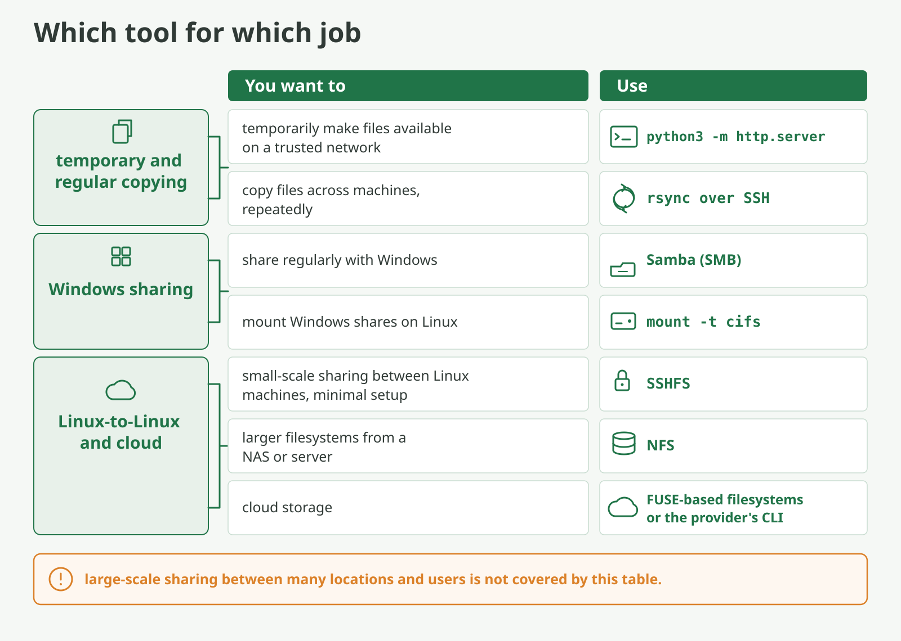

*Figure 1.30.1. Start with the job, not the tool.*

Suppose a colleague asks you to "just share this folder" and leaves every detail to you. Which folder, with whom, for how long, and on which network? Start with the job, not the tool. There are many ways to distribute and share files, and most arguments about tools are really arguments about jobs. Find your situation in the left column of the table below, and the right column names the tool that usually fits it.

| You want to... | Use |
|---|---|
| Make a file or directory on your machine **temporarily available** to others on a trusted network | a one-line web server (`python3 -m http.server`) |
| **Copy files across machines**, especially repeatedly | `rsync` over SSH |
| Share files from Linux **regularly to Windows** machines | Samba (the SMB protocol) |
| **Mount Windows shares** on Linux | the CIFS filesystem (`mount -t cifs`) |
| Small-scale sharing between Linux machines with **minimal setup** | SSHFS |
| Mount **larger filesystems** from a NAS or server on a trusted local network | NFS |
| Mount **cloud storage** | various FUSE-based filesystems (or use the provider's CLI) |

### The scenarios in three groups

The seven rows fall into three groups, and naming your group is the first useful step. Temporary sharing and regular copying use a simple web server or `rsync`. Sharing with Windows uses Samba on the Linux side and CIFS on the client side. Sharing between Linux machines, or from a NAS on your trusted local network, uses SSHFS or NFS. Cloud storage uses one of several FUSE-based filesystems, or the provider's own tools.

Each group answers a different question. A short-lived drop of one file or folder for other machines is a job for a simple web server, such as the Python SimpleHTTPServer module run by `python -m SimpleHTTPServer` on older Python 2 systems. Keeping files in step across machines, on a schedule, is a job for `rsync`. Serving your Linux files to Windows desktops is a job for Samba. Reading a Windows share from Linux is a job for the CIFS client. A small share with almost no setup suits SSHFS. Larger storage from a NAS or server on your trusted local network suits NFS. Cloud storage can appear as a directory through various FUSE-based filesystems. Each job has one natural tool, and the rest of this chapter explains each one in turn.

Notice what the table leaves out: **large-scale sharing between many locations and many users.** It is possible, but it takes a good deal of work. Sections 6 and 7 explain why, and Parts 6 and 13 cover what clusters do instead. Find your job in the left column before you pick a command.

## 2. A quick copy

Say you need to move a file or two to another machine on your own network, and nothing fancy is required. No account, no daemon, no configuration file. You can start a web server in the directory that holds the file:

```bash
python3 -m http.server 8000        # on the machine with the files (older Python 2: python -m SimpleHTTPServer)
# then, on the other machine: open http://10.1.2.4:8000 in a browser, or: curl -O http://10.1.2.4:8000/file
```

The server shares the current directory with anyone who can reach port 8000, and on an open network that includes people you have never met. **Only do this on a network you trust**, because the server has no authentication and no encryption. Bind it to a specific interface where you can (`--bind 10.1.2.4`). Stop it with Ctrl-C when you are done, and do not leave it running overnight.

## 3. `rsync` in depth

Copying a project tree with `scp -r directory user@host:dest` works, but it has two weaknesses. If the destination already holds extra files, they stay behind, so the result is not an exact copy. It also re-sends everything, including files that did not change.

For regular or automated transfers, use **`rsync`**. It is the standard synchroniser on Linux. It compares source and destination, sends only what differs, and can verify, resume and mirror.

That phrase "sends only what differs" deserves a plain explanation, because it is the whole idea of the tool. `rsync` breaks a changed file into blocks and compares those blocks with the copy at the other end. The destination keeps the blocks it already has and receives only the blocks that differ. This is called **delta transfer**, and it is why a small edit to a large checkpoint costs a small transfer rather than a second copy of the file.

### Getting started

You need `rsync` installed on both machines, and a way to reach one from the other. That is normally SSH, because current versions assume SSH. `rsync` also works between two locations on one machine, for instance between two filesystems.

```bash
rsync file1 file2 host:                    # copy files to your home directory on host (same syntax as scp)
rsync file1 file2 user@host:               # if your user name differs
rsync -a dir host:dest_dir                 # a directory tree, with symlinks, permissions, times, devices
rsync -nva dir host:dest_dir               # DRY RUN (-n) with verbose (-v): shows what would be sent, sends nothing
```

The first two lines copy files and use the same syntax as `scp`. The third line copies a whole tree and keeps its symlinks, permissions, times and devices. The last line is a dry run. It shows what would be sent and sends nothing.

Without `-a` (or `-r`), `rsync` copies only plain files and prints `skipping directory dir`. If the remote shell cannot find `rsync`, you will see `rsync not found ... connection unexpectedly closed (code 12)`, which sounds like a network fault and is not one. Install it on the remote machine. If it lives outside the remote user's command path, point to it with `--rsync-path=/path/to/rsync`.

### Exact copies, and the dangerous option

By default, `rsync` ignores what already exists at the destination. Copy `d`, which contains `a` and `b`, to a machine that already has `d/c`, and the destination ends up with `d/a`, `d/b` and `d/c`. That is usually what you want when you are adding files to a tree. When you want an **exact replica**, tell `rsync` to delete anything the source does not have:

```bash
rsync -a --delete dir host:dest_dir
```

This is the most dangerous option in the chapter, so slow down before you type it. Inspect the result first with `-nv`, and read exactly which files it would remove. If the source is accidentally empty, for example because a filesystem was not mounted, `--delete` empties the destination. Safer variants exist. `--backup --backup-dir=../old` keeps replaced and deleted files in a directory, so a mistake becomes a short walk back. A snapshot of the destination also makes mistakes recoverable.

### The trailing slash

A trailing `/` on the source changes what arrives. The two lines below look almost the same, but they behave differently:

- `rsync -a dir host:dest_dir` creates `dest_dir/dir/...`. The directory itself arrives.
- `rsync -a dir/ host:dest_dir` copies the contents of `dir` into `dest_dir` without creating `dir`. Locally, this behaves like `cp dir/* dest_dir`.

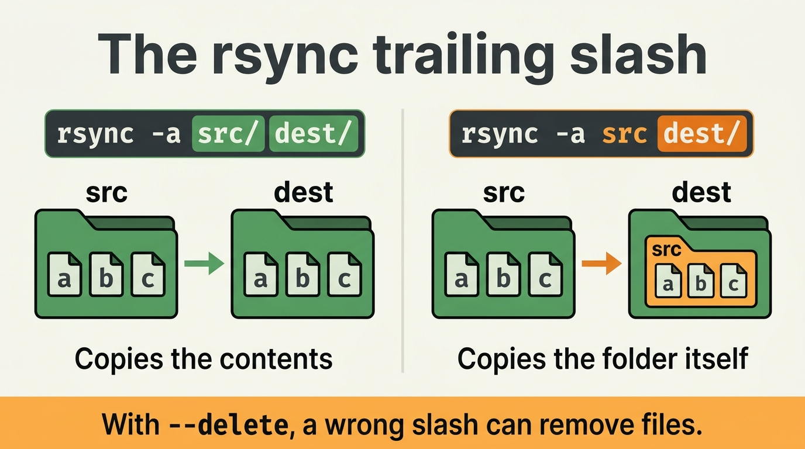

*Figure 1.30.2. A trailing slash on the source copies the contents; without it, the folder itself is copied.*

Combined with `--delete`, a stray slash can remove unrelated files at the destination. Watch out for **shell tab-completion**, which adds trailing slashes after directory names automatically, and does it without asking.

### Excluding and including

Excludes keep unwanted files out of a transfer, and they are how you stop sending the same build leftovers every night. The examples below show the common patterns.

```bash
rsync -a --exclude=.git src host:               # excludes every file or directory NAMED .git, anywhere
rsync -a --exclude=/src/.git src host:          # a leading / anchors to the TRANSFER root, not the system root
rsync -a --exclude='*.pyc' --exclude='__pycache__/' src host:
rsync -a --exclude-from=excludes.txt src host:  # patterns in a file, one per line
rsync -a --exclude='item/' src host:            # a trailing slash matches directories named item, not files
rsync -a --include='keep.log' --exclude='*.log' src host:   # include an exception to a broader exclude
```

A pattern matches a whole file or directory name, and it may use simple globs. For example, `t*s` matches `this` but not `ethers`, because a pattern has to cover the whole name. Order matters, because the first match wins. Put an `--include` before the `--exclude` it carves an exception from, or the exception never gets a chance. Use `--include` when a pattern turns out to be too restrictive.

### How `rsync` decides, and safeguards

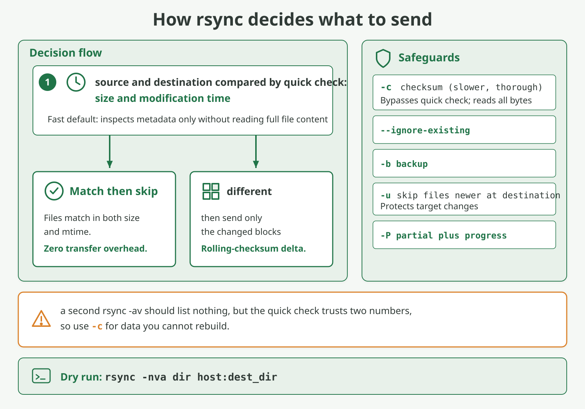

*Figure 1.30.3. The quick check is cheap but trusts only size and time, so use checksums for data you cannot rebuild.*

`rsync` needs a fast way to decide what changed, because reading every file on both sides would cost as much as copying them. So it uses a **quick check**: a file is skipped when its size and modification time match on both sides. The check is cheap, and it is right most of the time.

The first transfer of a tree sends everything. A second run, `rsync -av ...`, should list nothing, and that empty list is a good sign the copy is consistent. It is not proof, because the quick check trusts two numbers. When you need more assurance, or protection from overwriting, the options in the table help.

| Option | Effect |
|---|---|
| `-c`, `--checksum` | compare content checksums instead of size and time (slower, thorough; use for important data or files that often have identical sizes) |
| `--ignore-existing` | never overwrite files that already exist at the destination |
| `-b`, `--backup` | rename an existing destination file (default suffix `~`) before replacing it; `--suffix=.bak` changes the suffix |
| `-u`, `--update` | skip files that are newer at the destination than at the source |
| `-v`, `-vv` | verbose (the default is silence unless there is a problem); `--stats` prints a summary at the end; `--info=progress2` shows overall progress |
| `-P` | `--partial --progress`: keep partially transferred files so interrupted copies resume |

The checksum option costs time, so save it for data you cannot rebuild. The backup options keep the old copy of a file, so use them when a run might overwrite something you need.

### Compression and bandwidth

`-z` compresses data in transit. It helps on slow or high-latency links, where the wire is the bottleneck. On a fast LAN, though, the CPU cost of compressing and decompressing can make the transfer *slower*, so the flag costs you time instead of saving it. Skip it for data that is already compressed, such as most checkpoint formats, images and archives.

`--bwlimit=RATE` caps the transfer rate. The default unit is kibibytes per second, and newer versions accept suffixes such as `50m`. Check `man rsync` for your version. A cap keeps a large upload from filling your uplink and starving everything else, because ACK and request traffic competes for the same outgoing bandwidth. On a shared link, that one flag can be the difference between a slow copy and an unusable network.

### Pulling files to your machine, and other uses

`rsync -a host:src_dir dest_dir` pulls files from the remote side, and the colon is the only thing that tells it which side is which. Omit `host:` on both arguments to copy locally. Batch mode can replay the same set of changes to several hosts. Using `rsync --delete` to a mounted cloud or other network storage is a simple, effective backup. Combined with snapshots or `--link-dest`, which makes hard links to unchanged files from the previous backup, it gives space-efficient daily backups. `rsync --help` and `man rsync` list many more options.

Decide before you run anything whether `--delete` belongs in the job at all, because it changes the destination, and the destination is where other people's work lives.

## 4. Why share files over a network at all? Performance and security

Suppose a user complains that compiling a project on the cluster takes far longer than on a laptop, and the only difference is that the source tree sits on a shared home directory. Nothing is broken. The user has just met the central trade-off of this section.

Network file sharing is attractive, and it always involves compromises. Before you choose it, know what those compromises are and why they exist. Otherwise you inherit a surprise instead of choosing a trade-off.

People share files over a network for two traditional reasons. The first is convenience: you log in to any machine and see the same home directory. The second is economy: you concentrate storage on a few servers instead of buying disks for every desktop. Clusters still do exactly this for home directories and software.

The one constant disadvantage is that network storage is slow compared with local storage. The gap shows up with some access patterns more than others. Streaming a large file in order works well, because the server can read ahead and buffer when it knows the client will ask for the next block. Complex manipulation is different. If you touch many different files, the client spends most of its time waiting on the network.

The culprit is latency. For every new random file access, the server must accept and decode the request, then find and load the data. Those first steps are the slowest, and they happen on almost every new file.

That gives you a simple rule. For large amounts of data that do not need frequent random access, network storage is fine. For editing video, compiling a large project, or reading millions of small training files, keep a local copy. You can also stage the data to local NVMe, which chapter 13.2 covers.

Security is the other side of the trade-off. Historically, file-sharing protocols gave security a low priority, and the easiest options to configure are typically the least secure. If you cannot trust the networks between the machines, you need two things. The first is authentication and authorisation: only parties with correct credentials get access, and the server is who it claims to be. The second is encryption, so data in transit cannot be read.

There are no standardised ways to bolt these on. Instead, you combine tools such as `stunnel`, IPsec or VPNs to protect the layers beneath a basic protocol. Treat any file share as reachable by anyone who can reach its network.

### Centralized storage and its one constant cost

Centralized storage made sense for two traditional reasons. One user could log in to any machine on the network and find the same home directory. It was also cheaper to concentrate storage on a few servers than to buy and maintain a large disk for every machine. Those advantages still hold today.

They are overshadowed, though, by one disadvantage that has stayed the same for decades. Network storage performance is often poor compared with local storage.

### Why a streamed file is fast and random access is slow

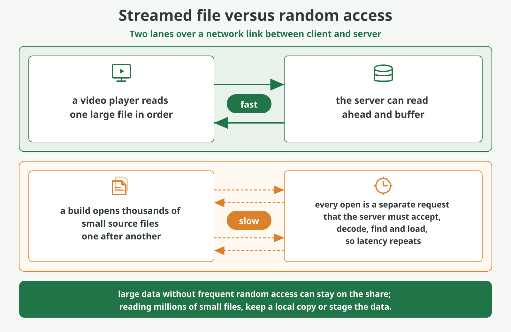

*Figure 1.30.4. The latency of each new file access is what makes network storage slow for many small files.*

The two access patterns look alike, but the network treats them very differently. Think of a video player that reads a movie from a server. The file is read from start to finish, in order. Modern hardware and networks handle that without trouble, because the server can prefetch the next blocks while the player shows the current ones. Nothing has to wait on a fresh request each time.

Now picture a build that opens thousands of small source files, one after another, at random. Each open is a separate request. The server must accept it, decode it, find the file and load it before any data flows. The first steps are the slowest, and they repeat for almost every new file. The client then spends most of its time waiting on the network rather than working. That is why the same share feels fine for a movie and painful for a project tree.

Keep this difference in mind when you decide where data should live. Sequential reads of large files can stay on the share. Many small, changing files should be kept on local storage.

## 5. Samba: sharing with Windows (SMB) and CIFS mounts

Suppose your team runs a Linux file server, and the Windows laptops need to open its folders. That is the job SMB does. **SMB (Server Message Block)** is the standard Windows file and printer sharing protocol, and macOS can speak it too. Samba is the standard suite that implements SMB on Unix. It lets Windows machines use files and printers on your Linux system, and it lets you reach Windows shares from Linux.

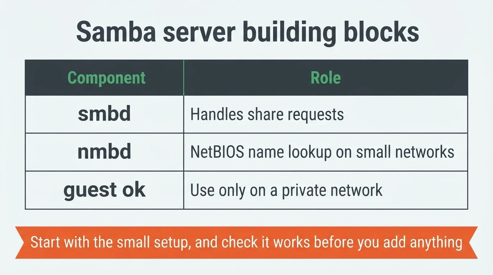
*Figure 1.30.5. Get a small Samba setup working and verified before you add more shares.*


The client filesystem has been called CIFS, which stands for Common Internet File System. On modern systems, SMB 3 is used. Samba is a large topic, so this section covers what you need for a working server and a working client, and it stops there.

A Samba server needs two things. The first is a configuration file, `smb.conf`, usually at `/etc/samba/smb.conf`. It has a `[global]` section and one section per share. The second is two daemons. `smbd` handles share requests, and `nmbd` is a NetBIOS name server, which is how a machine is found by name on a small network.

A distribution package starts both daemons with sensible defaults, so you are not writing startup scripts by hand. The package cannot know which directories you want to share, though. That part is yours.

### Scope of this section

This section is not a comprehensive Samba guide, and it is honest about that. It gets Windows machines on a single subnet to see a standalone Linux machine in the Windows Network Places browser. It does not try to cover every setting. Samba has countless configurations, because access control and network layout differ from site to site. A large, multi-team server needs a full Samba reference. The Samba project website at `https://samba.org/` is the place to look for the complete documentation. Start with the small setup here, and check it works before you add anything.

### Setting up the server, step by step

A Samba server needs four steps. You create the `smb.conf` file, add a section for each file share, add a section for printer sharing if you need one, and start the `nmbd` and `smbd` daemons. A distribution package does the last steps with sensible defaults. It cannot know which directories you want to offer, so you add the share sections yourself. Most distributions keep `smb.conf` in `/etc/samba`. If you built Samba from source, look under `/usr/local/samba/lib` instead.

The file uses square-bracket sections, much like the systemd configuration format, so it will look familiar if you have edited a unit file. The `[global]` section holds options for the whole server, and each share gets its own section. The `[global]` section sets the server name, description and workgroup, so fill those in first.

### The global section and access control

```ini
[global]
   netbios name = fileserver          # server name (default: the Unix host name)
   server string = My server via Samba
   workgroup = MYNETWORK              # Windows workgroup or domain name
   interfaces = 10.23.2.0/255.255.255.0   # listen only on these networks or interfaces
   bind interfaces only = yes         # make 'interfaces' strict
   security = user
   passdb backend = tdbsam            # Samba's own password database (fine for small networks)
   obey pam restrictions = yes        # password changes obey PAM rules
```

The `[global]` section sets the server's name and decides where it listens. The options below it control who gets in, and they are worth reading one at a time. `interfaces` and `bind interfaces only` limit the networks the server listens on. `valid users` lists the allowed users, for example `valid users = jruser, bill`. `guest ok` allows anonymous access, and you should use it **only on a private network**. `browseable` decides whether the share shows up in network browsing. If you set it to `no`, users must know the exact name of the share.

### Passwords

Unix and Windows store passwords differently, so Samba keeps its own password database. The exception is when you authenticate against a Windows domain with `security = domain`. In that case, each domain user still needs a local account with the same name.

```bash
sudo smbpasswd -a alice        # add an existing Linux user to Samba (prompts for the SMB password twice)
sudo smbpasswd -x alice        # delete the user
sudo smbpasswd -d alice        # disable ; -e enables again
sudo smbpasswd alice           # change a user's password as root (users change their own with plain 'smbpasswd')
```

Use `smbpasswd -a` to add a user to Samba, and `smbpasswd -x` to remove one. The user must already exist as a Linux account before you add it, so create the account first.

One setting here causes more help-desk calls than any other: `unix password sync = yes` in `smb.conf`. It changes the user's normal Linux password along with the Samba one. That confuses users who set a different Samba password and then cannot log in to Linux. Some distributions turn it on by default, so check it before you blame the user.

### Shares, homes and printers

Each share is a section in `smb.conf`. The three below cover a directory share, the home directories and the printers.

```ini
[projects]
   path = /srv/projects
   comment = Project files
   guest ok = no
   writable = yes
   printable = no
   veto files = /*.o/bin/            # do not export files matching these patterns

[homes]
   comment = home directories
   browseable = no
   writable = yes
   # path = /u/%S                    # %S is replaced by the user name, if homes live elsewhere

[printers]
   comment = Printers
   browseable = yes
   printing = CUPS                   # needs Samba built with CUPS support
   path = cups
   printable = yes
   writable = no
```

Never combine `guest ok = yes` with `writable = yes`, because anyone could then write to the share. A directory share must have `printable = no`. Check each share against both rules before you reload the server.

### Reloading after configuration changes

You usually do not start Samba by hand. After a package install, check that the daemons run with `systemctl --type=service`. If you built Samba from source, run `nmbd -D -s smb_config_file` and `smbd -D -s smb_config_file`, where `smb_config_file` is the full path to your `smb.conf`. `-D` runs each daemon in daemon mode.

If you change `smb.conf` while `smbd` is running, you can send it a HUP signal to load the changes. Still, letting systemd supervise the server is usually the better choice, because `systemctl` can do that work for you.

### How `[homes]` finds a directory

The `[homes]` section exports each user's home directory. By default, Samba reads the logged-in user's entry in `/etc/passwd` to find that directory. Sometimes Windows home directories should live somewhere other than the usual Linux home. Then put `%S` in the `path` parameter. Samba replaces `%S` with the current username. For example, `path = /u/%S` sends each user to `/u/` followed by their name.

### Starting, diagnosing and the client

Normally systemd starts the daemons. Check them with `systemctl status smbd nmbd`. On newer distributions the units are called `smb` and `nmb`. After you change the configuration, reload the service. If you start the daemons by hand, use `nmbd -D -s /path/smb.conf` and `smbd -D -s /path/smb.conf`, where `-D` runs them in daemon mode.

Startup problems print to the terminal. Runtime diagnostics go to log files in `/var/log/samba`, namely `log.smbd`, `log.nmbd`, and one log per client. Check the configuration file with `testparm`.

The client tool, `smbclient`, lists shares and accesses them.

```bash
smbclient -L SERVER -U alice                 # list the shares (Disk, Printer; IPC shares are for management)
smbclient //SERVER/sharename -U alice        # an FTP-like prompt: get, put, cd, lcd, pwd, ls, help
```

### Reading the share list

The `smbclient -L` command asks the server what it offers. If you omit `-U` because your Linux name matches your name on the server, the command still works. `smbclient` then asks for a password. Press Enter to try a guest connection, or type your password on the server. A successful run prints a table like this one:

```
Sharename       Type      Comment
---------       ----      -------
Software        Disk      Software distribution
Scratch         Disk      Scratch space
IPC$            IPC       IPC Service
ADMIN$          IPC       IPC Service
Printer1        Printer   Printer in room 231A
Printer2        Printer   Printer in basement
```

Read the `Type` column first. Only the `Disk` and `Printer` rows are shares you can use. The `IPC` rows exist for remote management, so ignore them. This list has two disk shares and two printer shares. Use the name in the `Sharename` column to open each one.

### Using the smbclient prompt

For casual access to files in a disk share, open the share with `smbclient -U alice '\\SERVER\sharename'`. On success you get an `smb: \>` prompt. This mode works much like the Unix `ftp` program. Use `get file` to copy a file from the server to the current local directory, and `put file` to copy one the other way. `cd dir` changes the directory on the server, and `lcd localdir` changes the local one. `pwd` prints the server directory, including the server and share names.

A command that starts with `!` runs on your own machine. `!pwd` and `!ls` are handy for checking the local side before a transfer. Type `help` to see the full command list.

### Who can change a Samba password

A superuser changes any Samba password with `smbpasswd` and a username, and no other option. Once the Samba server is running, any user can change their own password by typing `smbpasswd` alone. Remember the warning about `unix password sync = yes`. If that line is in `smb.conf`, a password change here can also change the Linux login password.

To mount a share as a directory, you need the CIFS utilities, which are usually a separate package.

```bash
sudo mount -t cifs //SERVER/sharename /mnt/share -o credentials=/root/.smbcreds,uid=1000
```

Put `username=` and `password=` in a root-only credentials file, not on the command line. Other users could otherwise see them in the process list. The address must use the syntax `//SERVER/sharename`. Before you open a share to other users, decide who may write to it and whether guests may reach it at all.

## 6. SSHFS and NFS: sharing between Linux machines

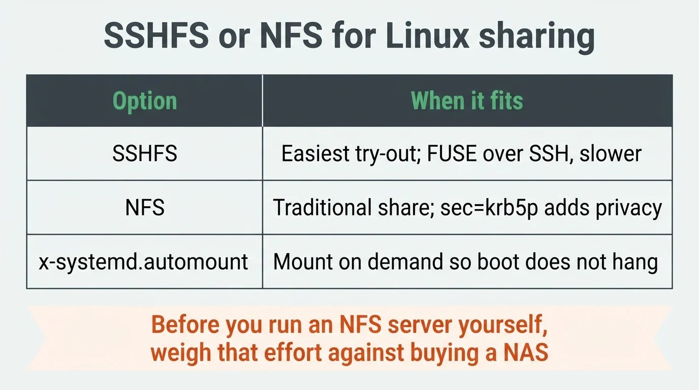
*Figure 1.30.6. Pick the sharing method by effort and security, not by habit.*


### SSHFS

Picture a laptop that needs a dataset from a Linux server, and you do not want to set up anything on the network first. `SSHFS` is a user-space filesystem (`FUSE`). It opens an SSH connection and presents the remote files at a local mount point. That makes it the easiest way to try sharing between Linux machines.

```bash
sshfs alice@host:/data /mnt/data        # mount; omit ':dir' for the remote home directory
fusermount -u /mnt/data                  # unmount as a regular user (fusermount3 on newer systems); root can use umount
```

As a regular user, unmount with `fusermount -u`, or `fusermount3` on newer systems. Root can use `umount`.

It has minimal setup. The remote side only needs SFTP enabled, which most SSH servers already have. It also needs no special network configuration, because it works anywhere you can open an SSH connection, on a trusted network or not.

The trade-offs are real. Performance suffers because of the overhead of encryption, translation and transport, though often not as badly as you might expect. Multiuser setups are limited, so mount it as the regular user whose files they are. That also keeps ownership and security consistent. For modest needs, it is well worth trying.

### NFS (client side)

Now suppose the same laptop should see a directory that thirty other machines also mount, and it should appear at boot without anyone typing a command. That is the job NFS was built for. NFS is the traditional Unix network filesystem. It comes in several versions, and v3 and v4 are common. It can run over TCP or UDP. It offers many authentication and encryption options, but very few of them are enabled by default. To mount an export, use one of these commands:

```bash
sudo mount -t nfs server:/export /mnt/nfs         # the -t is optional; mount normally detects it
sudo mount -t nfs4 -o sec=krb5p server:/export /mnt/nfs   # with Kerberos authentication and privacy
```

The security level is set with the `sec=` option. `sys` trusts the client's user IDs, and it is the default. `krb5`, `krb5i` and `krb5p` use Kerberos for authentication, integrity and encryption. Kerberos is a ticket-based authentication system, and it is the usual way to give NFS real security. Many administrators on small closed networks use host-based access control on the server instead. Stronger methods such as Kerberos require configuration elsewhere. See `man nfs` for the details.

Automounting is the next step once you use network filesystems heavily. You mount a share only when someone uses it, so boot does not depend on the server being up. The traditional tools were autofs and amd. Today much of this is provided by systemd automount units. In `/etc/fstab`, add `x-systemd.automount` to the options, and optionally `x-systemd.idle-timeout=60`.

On the server side, running an NFS server means starting mountd and nfsd and listing exports in `/etc/exports`. Then run `exportfs -ra`. The command `showmount -e server` shows what a server offers. That is considerably more involved than the client. Many teams buy a NAS appliance instead. Many NAS devices run Linux with NFS built in, and vendors add administration tools for RAID, snapshots and cloud backup. Chapters 6.18 to 6.21 cover NFS limits at cluster scale and the parallel filesystems that replace it.

Before you run an NFS server yourself, weigh that effort against buying a NAS.

## 7. Cloud storage, and the state of network file sharing

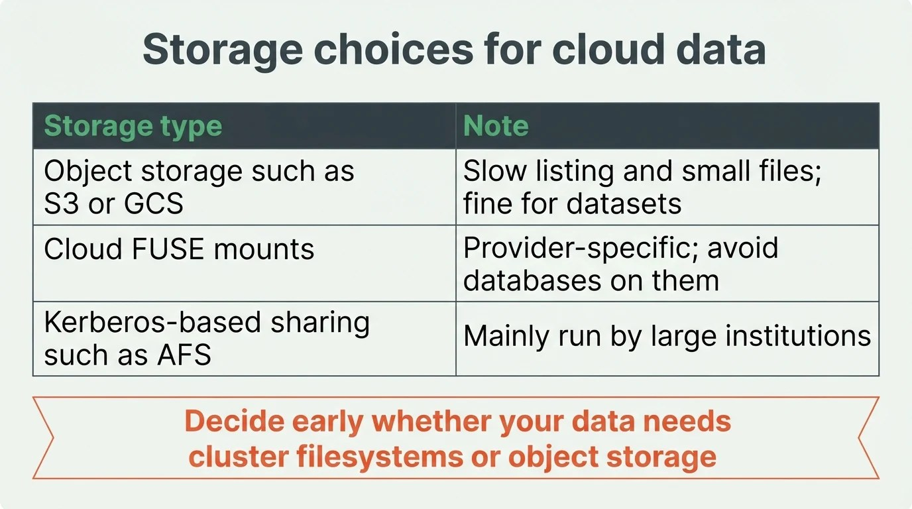
*Figure 1.30.7. Object storage and cluster filesystems solve different problems, so decide early.*


### Setting up a cloud client

Cloud storage has no single setup procedure. Each provider has its own client, its own credentials and its own mount tool, so this chapter describes only the general behaviour. Contemporary tools make mounting possible, but the specifics differ from one service to the next. Read your provider's documentation before you mount anything. Early file sharing protocols gave security little regard, so check the credentials and encryption options first.

### Cloud storage

Suppose your team's datasets already live in a cloud bucket, and a training job on the cluster needs to read them. Cloud object stores such as AWS S3 and Google Cloud Storage perform worse than a local network. In return, you never maintain them, and backups are not your problem. Every provider offers web and programmatic interfaces. Most also ship command-line tools, such as `gcloud storage`, `aws s3` and `rclone`.

Most of these services can also be mounted on Linux through `FUSE` (Filesystem in Userspace). A user-space daemon sits between the data source and the kernel, so no kernel code is involved. For popular services, several `FUSE` options exist, and the details are provider-specific.

The general behaviour is that listing and small-file access are slow. Writes are often whole-object. Consistency and rename semantics differ from a disk. So do not run databases or edit-in-place workloads on them. For AI datasets and checkpoints, use the tools and formats designed for object storage, which chapter 13 covers.

### Why there is no standard answer

This discussion of NFS and file sharing in general can seem incomplete. In part, that is because the file sharing systems themselves are incomplete, and the earlier performance and security sections show where. NFS has a low base security level. CIFS does better, because the encryption layers are built into current software. Its performance limits remain, and so does the poor behaviour when a client cannot reach its network storage.

Network file sharing can feel incomplete, and that is because it is. NFS has a low base security level, and raising it is costly. CIFS is better, since modern software builds in encryption. Its performance limits are hard to remove, though. A client can also behave badly when it temporarily cannot reach its storage. Its processes hang in uninterruptible sleep, a state chapter 1.1 explains.

Several designs tried to fix this. The most thorough was the Andrew File System (AFS), from the 1980s. Why does not everyone use AFS or something like it? Largely because of lack of flexibility. Its security depends on Kerberos. Kerberos is available everywhere, but it never became a standard part of Unix. It takes real effort to set up and run, and you need a server for it. Large institutions such as universities and banks manage that happily, and they are the heartland of AFS. Small sites prefer NFS or CIFS shares. Even Windows moved to Kerberos as the default for its server products in Windows 2000. Small networks, though, do not run Windows domains of that kind.

There is also a technical reason. Network filesystem clients have traditionally been kernel code, NFS especially. Network filesystems are complicated, and authentication does not belong in the kernel. A kernel implementation severely limits the number of developers who can contribute.

Cloud storage changed the picture. Its access methods are built on security mechanisms such as TLS, which work without a Kerberos-style infrastructure. The many `FUSE` clients show that authentication, encryption and file handling can all live in user space. Future designs may well add flexibility in security and in filename translation. For now, Linux and Unix have no truly standard network file-sharing system, unless you are a large site or willing to do significant work. That gap is what cluster filesystems (Part 6) and object storage (Part 13) address. Decide early whether your data needs one of those, rather than stretching NFS or CIFS past what they do well.

## 8. Giving users remote access

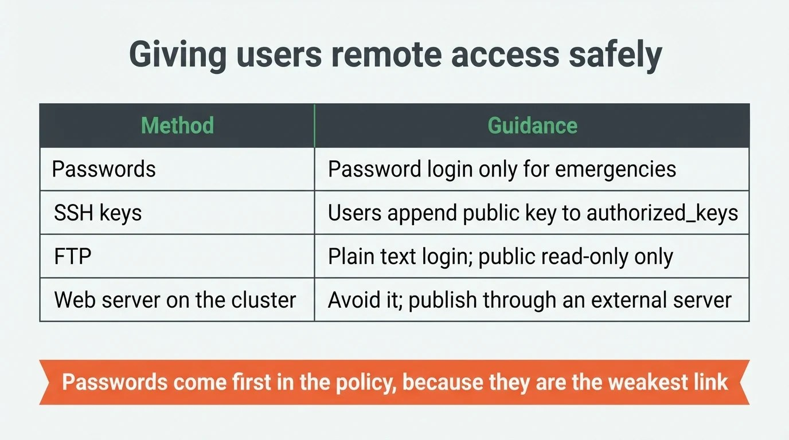
*Figure 1.30.8. Each remote access method has a safe use, and the password path is the weakest.*


### SSH, for users

Many users arrive at a supercomputer with graphical habits and worry that the command line will slow them down. SSH is the main way users reach a supercomputer today, and a few commands are enough for most of them. Their daily work is queueing jobs and reading job status. Copying and editing can be done with a convenient client on their own machine. To ease the start, install Midnight Commander (`mc`) on the access node. It is a two-panel file manager whose interface resembles Total Commander or Far Manager.

Passwords come first in the policy, because they are the weakest link and the easiest thing to get wrong. The classic mode works by default, but it should not be used for ordinary users. If you must allow it, allow it only from a few administrator workstations, and only for a few accounts, to resolve emergencies.

For keys, each user generates a key pair, or uses an existing one, and sends you the public half. You append that half to `~user/.ssh/authorized_keys`, and you always append, never replace.

Public keys come in an OpenSSH single-line format and an RFC multi-line format. Convert an RFC key to OpenSSH with `ssh-keygen -i -f rfc-key.pub >> ~user/.ssh/authorized_keys`. A Linux or macOS user then connects with `ssh -i ~/.ssh/cluster-key cluster`.

Windows users need different tools. PuTTY works well. Use `puttygen` to create and convert keys, which are saved in `.ppk` format, and use the `putty` client. Load the `.ppk` key, then enter the cluster address. For file transfer, use WinSCP or its plug-in for FAR. FileZilla also works, but it needs the PuTTY agent loaded with the key, because it does not otherwise support key authentication.

Linux and macOS users have several ways to transfer files. They can use `scp`, `sftp`, `rsync`, the FISH virtual filesystem in Midnight Commander, `sshfs`, or the remote-connection feature of graphical file managers. Chapter 1.5 covers these options.

### FTP and web access

FTP was once the dominant way to distribute files, and many browsers and file managers still include it. Its big flaw is that it sends the login and password unencrypted. Secure variants exist, but they are not standardised and not universally supported. Even with encryption, a password remains a weak credential. FTP is acceptable in exactly one case: public, anonymous, read-only distribution of files.

For everything else, use SFTP or SCP. Both are standardised, supported by every SSH server, and allow key authentication, which largely removes the guessing risk. Their downsides are higher CPU use and often lower speed, because of encryption overhead and the way data moves over encrypted channels. Standard clients and servers also do not offer modes that encrypt only the login.

For web access over HTTP, you often do not need a web server on the cluster at all. Put the information on a separate, ordinary server instead. Avoid running a web server on the supercomputer, because any web server becomes vulnerable once it serves dynamic content, such as CGI scripts or application servers. Even static-only servers can be attacked through carelessly enabled modules.

When the cluster must publish something, such as queue status, let the external web server fetch the data over SSH or `rsync`. Use a restricted key whose command is limited to one harmless action, which chapter 1.29 covers. Alternatively, configure the server to remove the possibility of compromise. That means a strict `chroot` or, better, running it in a lightweight container or VM, such as LXC, covered in chapters 1.19 and 1.26. Keep logs, analyse them, and run an intrusion-detection system. Every unnecessary service reachable from outside is an invitation to break in, even just for fun.

## 9. Remote graphical access: X11 and its alternatives

### The X Window System

Picture a researcher who needs to inspect a simulation result in a 3D viewer that runs only on the cluster, on a desk with a monitor and a mouse. Now think of the opposite complaint, the remote desktop that feels like dial-up. Both stories begin with the same misunderstanding about who serves whom.

Linux graphics is not part of the operating system. The graphical stack is an ordinary set of programs, and a system can run happily with no graphics at all. That is the normal mode for a supercomputer. Graphical programs are still sometimes unavoidable, because some commercial tools can be configured only graphically or through a browser. Visualising scientific data is often best done next to the data. Moving large results to a workstation costs far more than sending screen images.

The X Window System, called X11 or just X, provides the basics. It draws windows, moves them, and handles the mouse and keyboard. It does not decide how the windows look, and other parts take that job. A window manager handles frames, title bars and placement, for example KWin in KDE or Metacity and Mutter in GNOME. A compositor handles transparency and effects. Widget toolkits, such as GTK+ and Qt, supply shared libraries and themes. In full desktop environments, GNOME, KDE and Xfce add a set of applications and a consistent style.

Wayland is gradually replacing X11 (see How Linux Works, chapter 14). It combines the display server and the compositor into one simpler, lower-latency component. It drops X11's network-protocol baggage. X11 compatibility, through `Xwayland`, will persist for a long time.

Desktop components also rely on D-Bus (How Linux Works, section 14.5), an interprocess communication bus. It has a system instance, used by `systemd`, `NetworkManager` and `Upstart`, which you monitor with `dbus-monitor --system`. It also has a per-user session instance, monitored with `dbus-monitor --session`. Printing uses CUPS, which stands for Common UNIX Printing System. Its commands include `lp`, `lpr`, `lpstat`, `cancel` and `cupstestppd`. It converts PostScript and PDF jobs through RIP filters, and it sends them to IPP or LPD network printers. How Linux Works, section 14.6, covers CUPS in more depth.

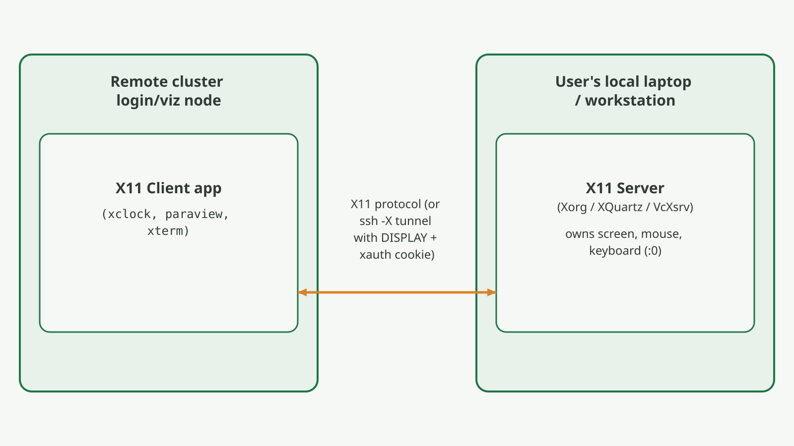

*Figure 1.30.9. The X Window System.*

X uses a client/server architecture, but the names run the opposite way from what you might expect, and this trips up almost everyone the first time. The X server is the program on your machine. It owns the screen, keyboard and mouse. The clients are the graphical applications. They may run on a different machine, and they talk to your server over the X protocol (version 11), through Unix sockets or network sockets. The server consists of drivers for input and output devices, plus the part that talks to applications.

Here is the sentence that makes it stick. The server serves the screen, not the data. Your laptop has the screen attached, so your laptop runs the server. The program that wants to draw a window is a client, even when it runs thousands of kilometres away on the cluster. Once you read "server" as "the machine with the display", the direction stops feeling backwards.

You can inspect X windows, events, input devices and displays with `xwininfo`. Click a window to see its window ID `0x5400024` and its geometry, or run `xlsclients`. `xev` prints `KeyPress` and mouse events in real time. `xinput` takes `xinput --list-props` and `--set-ptr-feedback` for pointer settings. `xrandr` is covered in How Linux Works, section 14.4.

Each X server serves a display with a number, which is `:0` by default. Applications choose a display with the `-display` option, as in `xclock -display :0`, or with the `DISPLAY` environment variable, as in `export DISPLAY=:0`. When you forward over SSH, `ssh` sets `DISPLAY` for you.

The reference implementation is X.Org. Modern versions detect hardware automatically and need no configuration. When they guess wrong, create `/etc/X11/xorg.conf`. You can generate a starting file with `Xorg -configure`, which produces `xorg.conf.new`. Drop-in files in `/etc/X11/xorg.conf.d/` work too. Server problems are logged in `/var/log/Xorg.0.log`, where the 0 is the display number.

Sessions usually start in one of two ways. Rarely, you start one by hand. `startx` starts the server, plus a script that starts the clients. That script lives in `~/.xsession` or `/etc/X11/Xsession.d/`, and the server stops when the script ends.

Normally the server runs as a service, with a display manager as its only client. Display managers include `xdm`, `gdm`, `kdm` and `lightdm`. The display manager shows a graphical login, offers a choice of language and window manager or desktop, and starts the session after a successful login. The `xdm` files are in `/etc/X11/xdm/`, and the `gdm` files are in `/etc/gdm/`.

### Customizing Xorg with `xorg.conf`

Most of the time, the X server detects your hardware correctly, and you never open its configuration file. Sometimes it guesses wrong, or you need to give it a hint. That is when you edit `/etc/X11/xorg.conf`. The file is split into sections. Each section starts with the keyword `Section` and ends with `EndSection`.

The `ServerFlags` section sets the options the X server starts with. On most distributions, window managers set these options, so they often live outside `xorg.conf`. In the example below, `AllowMouseOpenFail` lets the server start even when no mouse is present. `ZapWarning` makes the server sound a long beep when you press Ctrl-Alt-Backspace, instead of stopping. Press Ctrl-Alt-Backspace again, and the server stops.

```text
Section "ServerFlags"
Option "AllowMouseOpenFail" "on"
Option "ZapWarning" "on"
EndSection
```

The `Files` section gives the paths the server needs, such as the font directories. Fonts can also sit on another computer that runs an X Font Server (XFS). The `Module` section lists the modules the server loads at startup.

```text
Section "Files"
FontPath "/usr/share/fonts/misc:unscaled"
FontPath "/usr/share/fonts/local"
.....
EndSection

Section "Module"
Load "dri"
Load "glx"
....
EndSection
```

Each keyboard and mouse gets its own `InputDevice` section, and the `Identifier` tells them apart. Take a keyboard that switches between US and Russian layouts. The `XkbLayout` option lists the layouts, and `XkbOptions` sets the key combination that switches them, here Ctrl+Shift. It also makes the Scroll indicator light up when the Russian layout is active. The `Driver "kbd"` line applies only in graphical mode. Consoles and terminals are handled by the terminal driver built into the kernel. In the mouse section, `ZAxisMapping "4 5"` controls the mouse wheel. If you swap the 4 and the 5, scrolling runs the other way.

```text
Section "InputDevice"
Driver "kbd"
Identifier "Keyboard[0]"
Option "XkbLayout" "us,ru"
Option "XkbOptions" "grp:ctrl_shift_toggle,grp_led:scroll"
EndSection

Section "InputDevice"
Driver "mouse"
Identifier "Mouse[1]"
Option "Buttons" "9"
Option "Device" "/dev/input/mice"
Option "Protocol" "explorerps/2"
Option "ZAxisMapping" "4 5"
EndSection
```

The output side uses three sections. The `Device` section describes the video card and its driver. The `Monitor` section gives the physical limits of the screen, such as the sync ranges. The `Screen` section ties a device and a monitor together, and it sets the color depth and the resolutions. You need at least one of each set. If several monitors are connected, create a set for each device. A `ServerLayout` section then combines the keyboards, mice and screens into one working setup. If you have several keyboards or monitors, you can define several layouts.

```text
Section "Device"
Identifier "Intel Video Controller"
Driver "i810"
EndSection

Section "Monitor"
Identifier "Universal Monitor"
Option "DPMS"
HorizSync 28-64
VertRefresh 43-60
EndSection

Section "Screen"
Identifier "Default Screen"
Device "Intel Video Controller"
Monitor "Universal Monitor"
DefaultDepth 24
SubSection "Display"
Depth 16
Modes "1280x1024" "1024x768" "800x600"
EndSubSection
SubSection "Display"
Depth 24
Modes "1280x1024" "1024x768" "800x600"
EndSubSection
EndSection

Section "ServerLayout"
Identifier "Default Layout"
Screen "Default Screen"
InputDevice "Generic Keyboard"
InputDevice "Configured Mouse"
EndSection
```

### Using X from a Windows or Mac workstation

You need an X server on the machine in front of you. On Windows, there are commercial products and free ones. For years, the popular free choice was Xming, which has an OpenGL variant and a launch tool. Its modern relative is `VcXsrv`. Typical flags include the display number, `-clipboard` to share the clipboard, and `-multiwindow`, which makes each remote window a local window. Keyboard-layout options are also available. The Windows firewall may ask to open ports for the server, so restrict that rule to the machines that will use it. On macOS, XQuartz plays this role.

Start a session like this. Start the X server locally, then connect with an SSH client that has X11 forwarding enabled. On the command line, that is `ssh -X host`, or `-Y` for trusted forwarding. In PuTTY, the setting is under "Connection / SSH / X11 forwarding". The client sets `DISPLAY` and the authorisation cookie (`XAUTHORITY`) automatically. Any X program you start on the remote host then appears on your screen. The remote machine needs `xauth` installed. Keep in mind that this shows remote programs on your local display. You cannot run your local browser on the remote computer this way.

Authorisation is the next concern. Without forwarding, you must tell the X server which machines may connect. On Unix, use `xhost +computer_name`. For the Windows servers, use an `X0.hosts` file that lists allowed names and addresses. `xhost` is weak and often disabled by default, so avoid it. Use `xauth` cookies instead, which SSH forwarding sets up for you. If you use `sudo` on the remote host, the `XAUTHORITY` variable must pass through.

### When X is too slow: alternatives

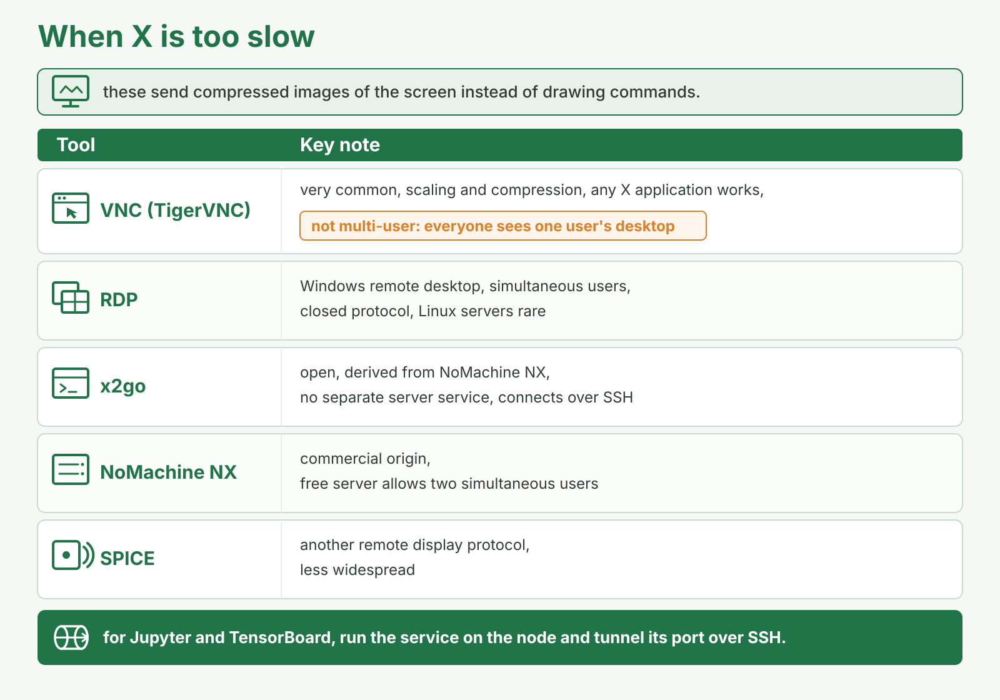

*Figure 1.30.10. The alternatives send compressed screen images, and web UIs usually need only an SSH tunnel.*

X's weakness is speed. With rich graphics over a narrow or high-latency link, it can become unusable. The alternatives send compressed images of the screen instead of drawing commands. The table below lists them, and its notes column matters as much as the names.

| Protocol / tool | Notes |
|---|---|
| **VNC** (TigerVNC, tightvncserver) | very common, many clients; supports scaling and compression; the servers run as X servers so any X application works. Limitation: **not multi-user**: the server runs as one user and everyone who connects sees that user's desktop; dynamic per-user sessions are not available, so it suits a few dedicated uses such as visualisation or administering specific hardware. **Always set a password** (and tunnel it over SSH). |
| **RDP** | Windows' own remote desktop protocol: authentication, simultaneous users, file transfer, usually faster than VNC with better quality; but the protocol is closed and Linux servers for it are rare and not the authors' recommendation. |
| **x2go** | open-source protocol derived from NoMachine's NX; clients and servers for most distributions and for Windows. **No separate server service:** install the package, and the client connects over **SSH** and starts the server program as the user, so authentication is SSH's and the server side is well protected. Speed comparable to VNC, with compression and scaling, and it can show just one program's windows. |
| **NoMachine NX** | the commercial origin of the technology above; the free server allows two simultaneous users; supports password authentication with session saving and reconnection. |
| **SPICE** | another remote display protocol, less widespread. |

Read the notes before you pick one, because the limits differ. For notebooks and web UIs, such as Jupyter and TensorBoard, and for the visualisation work of modern AI, you rarely need any of these. Run the service on the node, and tunnel its port over SSH. See chapter 1.5 for the tunnel. That approach gives the best performance and the smallest attack surface.

### Principle for access design

"The less access, the better," yet users must not feel boxed in. SSH with SCP and SFTP usually suffices. Publish clear instructions for the common tasks. Keep the access paths few and well monitored, and treat remote access as the face of the system for users, because it is what they will use almost all the time.

## How it fails

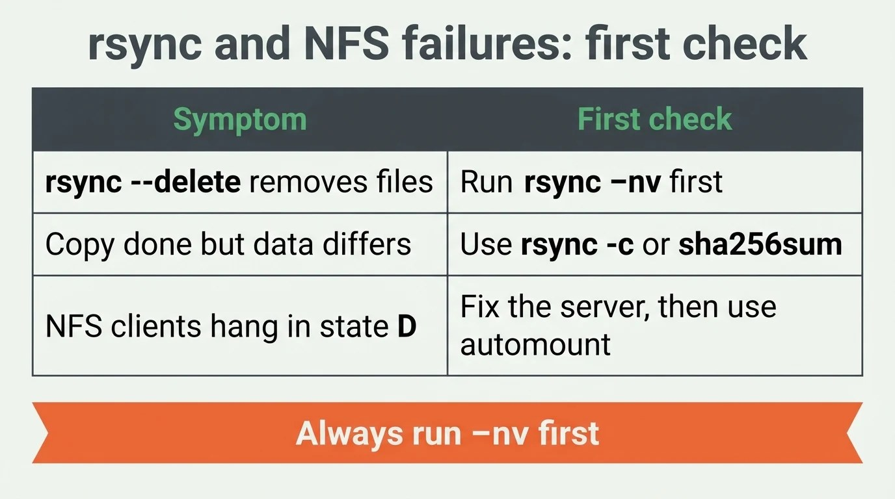
*Figure 1.30.11. Dry-run and checksum before trusting a copy, and fix the server before the client.*


### 1. `rsync --delete` removes the wrong files

Destination data vanishes. In practice the cause is nearly always one of three things: a trailing slash difference, an empty or unmounted source, or the wrong destination path. Always run `-nv` first. Check `df`, and confirm that the source path is populated. Keep `--backup-dir` or snapshots ready, and never put `--delete` in a habit alias.

### 2. A transfer is "done" but data differs

You end up with a corrupted or partial dataset after a copy. An interrupted copy can leave files with a matching size and time. Modification times can also be preserved from a truncated file. To fix it, use `rsync -c` (checksums), or compare with `sha256sum` for critical data. Add `--partial` and re-run until `rsync -avn` lists nothing.

### 3. Samba users cannot log in, or Linux password suddenly changes

Access is denied from Windows, or the Linux login breaks after an SMB password change. The user may not be in Samba's database, so run `smbpasswd -a`. The `[global]` security settings may be wrong, or a firewall may block the traffic. `unix password sync = yes` may also have changed the Unix password too. To diagnose it, run `testparm`, `pdbedit -L`, check `/var/log/samba/*`, and try `smbclient -L localhost -U user`.

### 4. NFS clients hang

Commands that touch an NFS path freeze, and the process shows state `D`. A node that boots with a dead NFS server never finishes booting. Hard mounts wait for a server that cannot be reached, or the boot depends on a mount. Fix the server or the network first. Then use automount (`x-systemd.automount`) so mounts happen on demand. Consider `soft` or `intr`-style options only where the application can tolerate errors, because they risk data loss. Monitor the server as well.

### 5. SSHFS is "slow" or leaves stale mounts

Listing a large directory is very slow, or you see `Transport endpoint is not connected`. `FUSE` overhead and a round trip for every file cause the slowness. The SSH connection may also have dropped. Use `rsync` or NFS for heavy work. Add `-o reconnect,ServerAliveInterval=15` to keep the connection alive. Unmount with `fusermount -u`.

### 6. Remote X programs fail ("cannot open display")

You see `Error: Can't open display`. The usual causes are these. No X server runs locally. Forwarding is not enabled (`-X`). `xauth` is missing on the remote host. `DISPLAY` is unset or wrong, and after `sudo` the variable and cookie are lost. The server has `X11Forwarding no`, or a firewall blocks the traffic. To diagnose it, run `ssh -vX`, `echo $DISPLAY`, `xauth list` and `xclock`. Fix whichever piece is missing. For slow graphics, use x2go or VNC over a tunnel instead.

### 7. FTP or open web services expose the cluster

Credentials are stolen, pages are defaced, or intruders get in. The causes are plaintext FTP logins, a web server with dynamic content on the cluster, and unnecessary services reachable from outside. Use SFTP or SCP only. Put web content on a separate server. Give status feeds restricted, command-limited keys. Use containers or chroot, and analyse your logs with intrusion detection in place.

## Hands-on lab: rsync, Samba, SSHFS, NFS, and X11/x2go

Start with the self-checking Python lab. Run it locally before you touch a real VM. It checks how `rsync` resolves the destination path for `dir` and `dir/`. It also checks how the quick check (`size` + `mtime`) differs from `--checksum` (`-c`) and from `--update` (`-u`). The lab confirms that the first match wins for `--include` and `--exclude`, and that X11 inverts the client and server roles.

```bash
python3 code/part01/network_fs_x11_lab.py
```

Next, use two or three disposable GCP VMs. All interactive VM commands below have not been run on live hardware, so check each result yourself before you rely on it.

Part A covers quick copies and `rsync`, in steps 1 to 5.

1. Serve a directory with `python3 -m http.server --bind <internal IP>`, then fetch a file from another VM with `curl`. Notice what protects the file, which is nothing. Stop the server when you are done.
2. Build a directory with nested folders, a `.git` directory, some `*.pyc` files and a symlink. Run `rsync -nva` and then `rsync -a`, both with and without the trailing slash, and compare the resulting trees. Next, run `rsync -a --exclude=.git --exclude='*.pyc'` and then `--exclude-from`. Finally, use `--include` to keep one `.pyc` file that the broader exclude would remove.
3. Test the safeguards. Modify one file at the destination so that it is newer. Then compare the effect of the default, `--update`, `--ignore-existing`, `--backup --suffix=.old` and `-c`. Create a corrupted copy by truncating a file and keeping its time with `touch -r`. Show that only `-c` catches it.
4. Test `--delete`. Create an extra file at the destination, preview with `-nv --delete`, then run it. Next, show how a wrong trailing slash combined with `--delete` would have behaved, in a scratch directory only.
5. Measure compression and limits. Time a transfer of a large file with and without `-z`. Use `dd if=/dev/urandom` for incompressible data and a text file for compressible data. Then time it with `--bwlimit=1000`.

Part B covers Samba.

6. Install Samba on vm1, create a `[projects]` share with `valid users`, and add a Samba user with `smbpasswd -a`. Validate the file with `testparm`, restart the services, and list the shares with `smbclient -L localhost`. From vm2, install `cifs-utils` and mount the share with a credentials file. Create files from both sides and check the ownership. Next, break it on purpose with `unix password sync = yes` and observe what changes. Clean up when you are done.

Part C covers SSHFS and NFS.

7. Mount a directory from vm1 on vm2 with SSHFS. Time `ls` on a directory with 5,000 files, and compare it with the local result. Unmount with `fusermount -u`.
8. Install an NFS server on vm1 (`nfs-kernel-server`), export a directory in `/etc/exports`, and run `exportfs -ra`. Mount the export on vm2. Create files as users with the **same name but different UIDs** on the two machines, and observe the ownership problem (chapter 1.6). Add `x-systemd.automount` to the `fstab` line. Then stop the server and check that boot and unrelated commands no longer hang.

Part D covers cloud storage.

9. With `gcloud storage cp` and `rclone` (or `gcsfuse`), copy and list a bucket. Then mount it with a FUSE tool. Time a listing of 1,000 small objects, and compare it with a local directory. Write a file and read it back immediately. Note how this differs from a disk.

Part E covers remote graphics.

10. On a VM, install a minimal X application (`x11-apps`) and `xauth`, and make sure `X11Forwarding yes` is set. From your laptop, with an X server running (XQuartz or VcXsrv), run `ssh -X vm xclock`. Then break it in each way listed in failure 6 above, and fix each one. Try `sudo xclock` and see what is lost.
11. Install x2go, or TigerVNC bound to localhost and tunnelled with `-L`. Open a desktop session over a slow link simulated with `tc netem` (chapter 2.23). Compare its responsiveness with forwarded X for a graphics-heavy program.

Compare the numbers you measure with the trade-offs described in the sections above.

## Exercises

Work through these six exercises in order. Write down your answers as you go, so you can check them against the chapter.

1. Choose the right file-sharing tool, and weigh latency against bandwidth. This exercise draws on How Linux Works, chapter 12. (a) Select the best tool from Section 1 for each of these jobs: a temporary LAN file drop, nightly incremental directory mirroring, exporting Linux directories to Windows desktops, mounting a Windows share on Linux, mounting a remote Linux directory with zero server changes, mounting shared home directories across 30 Linux servers, and accessing a cloud object store. (b) Explain why network filesystems handle large sequential streams well but stall when compiling code or loading thousands of small training files.
2. Work through `rsync` trailing slashes, `--delete` and the quick check. (a) Using `resolve_rsync_dest_paths()` in `code/part01/network_fs_x11.py`, compare the destination paths created by `rsync -a dir host:dest_dir` and `rsync -a dir/ host:dest_dir`. Then explain why combining `--delete` with a tab-completed trailing slash or an unmounted source directory is catastrophic. (b) Trace `evaluate_rsync_file_decision()` for a destination file that has the exact same byte size and `mtime` as the source but corrupted contents. Do this with and without `-c` (`--checksum`).
3. Look at filter ordering, compression and bandwidth. (a) Using `evaluate_rsync_filter_rules()`, explain why `rsync -a --include='keep.log' --exclude='*.log' src host:` keeps `keep.log`, whereas reversing the two flags excludes it. (b) When does `-z` slow a transfer down, and what does `--bwlimit` protect on an asymmetric or shared link?
4. Set up Samba and a CIFS mount. Write the workflow to export `/srv/projects` to user `alice` via Samba, using `smb.conf`, `smbpasswd -a alice`, `testparm` and `smbclient -L`. Then mount it on a Linux client with `mount -t cifs //SERVER/projects /mnt/share -o credentials=/root/.smbcreds,uid=1000`. Why is `unix password sync = yes` a trap?
5. Compare the security of `SSHFS` and NFS, and the history of AFS. (a) Compare `SSHFS`, which unmounts with `fusermount -u`, and NFS, using `sec=sys` against `sec=krb5p`. Explain how `x-systemd.automount` in `/etc/fstab` stops a dead NFS server from hanging node boot. (b) Why did the Andrew File System (AFS) never become universal on small networks? How do cloud object stores and `FUSE` clients change the security and kernel-complexity trade-off?
6. Work through X11 roles, the desktop stack and remote display options. (a) Using `describe_x11_roles()`, state which machine is the **X server** and which is the **X client** when you run `ssh -X login01.cluster xclock` from `laptop.local`. Explain how `DISPLAY` and `xauth` cookies work, and why `sudo xclock` loses them. Then explain how Wayland, D-Bus (`dbus-monitor`) and CUPS (`lp`/`lpstat`) fit into the Linux desktop stack (How Linux Works, chapter 14). (b) Compare VNC, RDP, x2go and `ssh -L` port tunneling for Jupyter and TensorBoard.

## Checkpoint questions (20)

<details>
<summary>1. Match each file-sharing scenario to the right tool: temporary LAN drop, repeated cross-host sync, Linux-to-Windows share, Windows-to-Linux mount, zero-setup Linux mount, LAN multi-host mount, and cloud bucket access.</summary>

A temporary LAN drop uses `python3 -m http.server --bind <IP>`. Repeated syncs use `rsync` over SSH. For a Linux-to-Windows share, use Samba, which runs `smbd` and `nmbd`. For a Windows-to-Linux mount, use CIFS with `mount -t cifs`. A zero-setup Linux mount is `SSHFS`. A LAN mount shared by several hosts uses NFS with `x-systemd.automount`. For cloud buckets, use the provider CLI, such as `gcloud storage`, `aws s3` or `rclone`, or a user-space `FUSE` mount.
</details>

<details>
<summary>2. Why does `scp -r` fail to produce an exact mirror of a directory, and why must `rsync -a --delete` always be preceded by `-nva`?</summary>

`scp -r` copies every byte every time, and it leaves old, deleted files at the destination. `rsync -a --delete` removes any destination file that the source no longer has. Suppose the source is an unmounted, empty directory. A wrong path or a stray trailing slash is just as dangerous. In either case, `--delete` wipes the destination clean. Always preview with `rsync -nva --delete`, which is a dry run. Or use `--backup --backup-dir=../old`.
</details>

<details>
<summary>3. What is the exact difference between `rsync -a dir host:dest_dir` and `rsync -a dir/ host:dest_dir`?</summary>

Without the slash, `rsync` copies the directory itself, so the result is `dest_dir/dir/...`. With the slash, `rsync` copies only what is inside `dir`, straight into `dest_dir/...`, and it creates no `dir` subdirectory. Watch out for shell tab-completion, because it adds the `/` for you.
</details>

<details>
<summary>4. How does `rsync`'s default \"quick check\" decide whether to skip a file, and what do `-c`, `-u`, `--ignore-existing`, `-b`, and `-P` do?</summary>

By default, `rsync` skips a file when its byte size and modification time (`mtime`) match on both sides. The other options change that. `-c` or `--checksum` compares full content checksums. `-u` or `--update` skips files that are newer on the destination. `--ignore-existing` never overwrites a file that already exists there. `-b` or `--backup` renames overwritten files, using `~` by default or the `--suffix` you choose. `-P`, which means `--partial --progress`, keeps partial files, so an interrupted large transfer can resume.
</details>

<details>
<summary>5. How do `--exclude` and `--include` ordering work in `rsync`, and what does a leading `/` in `--exclude=/dir` mean?</summary>

`rsync` checks filter rules in order, and the first matching rule wins. So an exception, such as `--include='keep.log'`, must come before the broader exclusion, such as `--exclude='*.log'`. A leading `/` in `--exclude=/src/.git` anchors the pattern to the root of the transfer. It does not mean the root of the Linux filesystem.
</details>

<details>
<summary>6. When does `rsync -z` (compression) help, when does it hurt, and what is `--bwlimit` for?</summary>

`-z` helps with compressible data, such as text, logs and source code, over slow WAN links. It hurts throughput on fast LANs, where CPU compression becomes the bottleneck. It also hurts when the files are already compressed, such as `.tar.gz` archives, images or compressed model checkpoints. `--bwlimit=RATE` caps the bandwidth. A bulk sync then cannot saturate the link and starve interactive SSH or TCP ACKs.
</details>

<details>
<summary>7. Why is network file sharing fast for streaming a single large file but slow when touching thousands of small files?</summary>

When you stream one large file in order, the server and client can prefetch and pipeline large blocks. This is called read-ahead. When you open, `stat` or read thousands of small files at random, each file needs its own network round trips and metadata lookups. Network and metadata latency then dominate, and throughput collapses.
</details>

<details>
<summary>8. Why does Samba maintain its own password database (`tdbsam` / `smbpasswd -a`), and why is `unix password sync = yes` a trap?</summary>

Windows SMB authentication uses password hash formats, such as `NTLM` or Kerberos. Those cannot be checked against the SHA-512 or yescrypt hashes in `/etc/shadow`. So Samba keeps its own database, which you manage with `sudo smbpasswd -a username` for an existing Linux account. If `unix password sync = yes` is set in `smb.conf`, a change to the SMB password silently changes the Linux login password too.
</details>

<details>
<summary>9. How do you validate `/etc/samba/smb.conf`, inspect shares from Linux, and mount a CIFS share securely without exposing credentials in `ps`?</summary>

Check `/etc/samba/smb.conf` with `testparm`. List the shares with `smbclient -L SERVER -U alice`. Mount with `sudo mount -t cifs //SERVER/sharename /mnt/share -o credentials=/root/.smbcreds,uid=1000`. Keep `username=` and `password=` inside `/root/.smbcreds`, and make that file `chmod 600`.
</details>

<details>
<summary>10. What are the pros and cons of `SSHFS`, and how do you mount and unmount it as an unprivileged user?</summary>

`SSHFS` mounts a remote directory over an ordinary SSH or SFTP connection, using `FUSE`. The command is `sshfs alice@host:/data /mnt/data`. It needs no server configuration beyond SSH, and it works across untrusted networks. Its downsides are the `FUSE` and encryption overhead on metadata-heavy workloads, and its single-user semantics. Unmount it with `fusermount -u /mnt/data`, or with `fusermount3 -u`.
</details>

<details>
<summary>11. Compare the four NFS `sec=` security flavors (`sys`, `krb5`, `krb5i`, `krb5p`), and explain why UID consistency across nodes is mandatory under `sec=sys`.</summary>

`sec=sys`, the default, trusts whatever numeric `UID` and `GID` the client kernel sends in the RPC header. Suppose `alice` is `UID 1001` on node 1 but `UID 1002` on node 2. File ownership then gets scrambled. `sec=krb5` authenticates users with Kerberos tickets. `sec=krb5i` adds cryptographic integrity checksums. `sec=krb5p` encrypts all NFS traffic for privacy.
</details>

<details>
<summary>12. How do you configure an NFS mount in `/etc/fstab` so a down NFS server does not hang node boot, and what files configure an NFS server?</summary>

Add `x-systemd.automount` to the mount options in `/etc/fstab`. You can add `nofail,x-systemd.idle-timeout=60` too. With these options, `systemd` mounts the share on demand, only when a process accesses the mount point. An NFS server runs `nfsd` and `mountd`, and it exports the directories listed in `/etc/exports`. Apply the exports with `sudo exportfs -ra`, and inspect them remotely with `showmount -e server`.
</details>

<details>
<summary>13. Why did the Andrew File System (`AFS`) never become the universal Linux default, and how do cloud object stores + `FUSE` change the architecture?</summary>

AFS, from the 1980s, solved wide-area caching and security. It did so by requiring Kerberos infrastructure and a complex in-kernel filesystem client. Both were too heavy for small sites and for kernel maintainers. Cloud object stores, such as S3 and GCS, authenticate over HTTPS and TLS with API tokens, without Kerberos. `FUSE` tools, such as `gcsfuse`, `s3fs` and `rclone mount`, keep the complex protocol and authentication logic safely in user space.
</details>

<details>
<summary>14. How should Windows, macOS, and Linux users access a cluster and transfer files, and when is `FTP` ever acceptable?</summary>

Users should connect with SSH keys, such as `ed25519` or `rsa`. An RFC 4716 key can be converted with `ssh-keygen -i -f`. On Windows, use PuTTY `.ppk` keys and WinSCP. For transfers, use `rsync`, `scp` or `sftp`. Midnight Commander (`mc`) on the login node is another option. Classic FTP sends passwords in cleartext, so it is acceptable only for anonymous, public, read-only file distribution.
</details>

<details>
<summary>15. Why should you avoid running a public web server directly on a cluster head node, and how should cluster queue status be published to the web?</summary>

Any web server, especially one with dynamic scripts or modules, widens the attack surface of the head node. Run the web server on a separate external host, or in an isolated container or VM. Let it pull the status data over `ssh` or `rsync`, using a dedicated key. Restrict that key in `authorized_keys` with `from="...",command="/usr/local/bin/status-only",no-port-forwarding,no-pty`.
</details>

<details>
<summary>16. In the X Window System (`X11`), why are the terms \"X server\" and \"X client\" the opposite of what beginners expect?</summary>

The X server is the program on your local workstation, and it manages the physical display, keyboard and mouse. On Linux that is X.Org. On macOS it is XQuartz, and on Windows it is `VcXsrv` or `Xming`. Its display is `DISPLAY=:0`. The X clients are programs such as `xclock`, `xterm` and `paraview`. They run on the remote cluster node and send drawing requests to your X server.
</details>

<details>
<summary>17. How does `ssh -X` (or `-Y`) authorize remote X11 clients, why is `xhost +` dangerous, and why does `sudo xclock` fail over `ssh -X`?</summary>

`ssh -X` creates a proxy X11 display on the remote host, such as `DISPLAY=localhost:10.0`. It uses `xauth` to store a random session cookie in `~/.Xauthority`. `xhost +` turns off access control, so anyone on the network can snoop keystrokes or inject windows. That is why you avoid it. Running `sudo xclock` switches to `root`, which strips `DISPLAY` or looks in `/root/.Xauthority` instead of your `XAUTHORITY` cookie file.
</details>

<details>
<summary>18. How do Wayland, window managers, widget toolkits, D-Bus, and CUPS fit into the Linux graphical and desktop stack (How Linux Works, chapter 14)?</summary>

In X11, the X server, the window manager (KWin or Mutter) and the compositor are separate processes. Wayland merges the display server and the compositor into one modern protocol. `Xwayland` runs legacy X11 clients on top of it. Toolkits, such as GTK+ and Qt, provide UI widgets. D-Bus provides structured communication over a system bus, which `dbus-monitor --system` shows. That bus is used by `systemd` and `NetworkManager`. D-Bus also has a per-user session bus. CUPS manages local and network printing through `lp`, `lpr`, `lpstat` and `cancel`, using IPP and RIP filters.
</details>

<details>
<summary>19. Compare `VNC`, `RDP`, `x2go`, and `NoMachine NX` when raw X11 forwarding is too slow over a high-latency link.</summary>

Raw X11 sends many small drawing requests, so it stalls over high-latency links. VNC, through `TigerVNC`, sends compressed framebuffer updates. It is fast, but each server instance serves a single user. Always set a password, and tunnel it over `ssh -L`. RDP is fast and multi-user on Windows, but it is less standard on Linux. x2go is open source and derived from NoMachine NX. It compresses the X11 protocol and screen updates. It connects directly over SSH as the user, and it needs no persistent daemon on the server.
</details>

<details>
<summary>20. For modern AI workflows (JupyterLab, TensorBoard, Ray Dashboard, Weights & Biases local UI), why is `ssh -L` port forwarding better than X11 or VNC?</summary>

AI visualisation tools are browser-based web applications. Bind the server to `127.0.0.1` on the cluster node, and forward the port with `ssh -L 8888:localhost:8888 login-node`. Your laptop browser then renders the UI natively at 60 FPS. The traffic uses minimal bandwidth and full SSH encryption and authentication, and the cluster keeps zero open ports.
</details>

## Sources and review notes

- **Sources read in full:**
  - `how-linux-works-3rd-edition` — Brian Ward, *How Linux Works*, 3rd ed., **Chapter 12: Network File Transfer and Sharing** (sections 12.1–12.8: scenario-to-tool list, `python3 -m http.server` / `SimpleHTTPServer`, `rsync` exact copies `--delete`, trailing slash, `--exclude`/`--include` ordering, quick check vs `-c`/`--ignore-existing`/`-b`/`-u`, `-z` compression, `--bwlimit`, pulling files, performance and security of network file sharing, Samba `smb.conf`/`smbpasswd`/`testparm`/`smbclient` and `mount -t cifs`, `SSHFS` `fusermount -u`, `NFS` `sec=sys`/`krb5`/`krb5i`/`krb5p` and `automount`, cloud storage FUSE mounts, and `AFS`/Kerberos) and **Chapter 14: The Linux Desktop and Printing** (sections 14.1–14.6: Wayland vs X Window System `X.Org`, window managers and compositors, toolkits `GTK+`/`Qt` and desktop environments `GNOME`/`KDE`, `xwininfo`/`xev`/`xinput`/`xrandr`, D-Bus system and session buses `dbus-monitor`, and CUPS printing `lp`/`lpr`/`lpstat`/`cancel`).
  - `supercomputers-for-linux-sysadmins-managing-modern-hpc-clusters-and-supercomputers-from-software-to` — Sergey Zhumatiy, *Supercomputers for Linux SysAdmins*, **Chapter 18: Remote User Access** (SSH for users, Midnight Commander `mc`, RFC `4716` `ssh-keygen -i -f`, PuTTY `.ppk` and WinSCP/FileZilla, FTP vs SFTP/SCP, web servers with restricted SSH keys/containers/IDS, X11 client/server roles, `DISPLAY=:0`, `Xorg -configure`, `startx` and display managers `xdm`/`gdm`/`kdm`/`lightdm`, Windows X servers `Xming` and `VcXsrv` `-clipboard -multiwindow`, `xauth` cookies vs `xhost +`, and `VNC`, `RDP`, `x2go`, `NoMachine NX`, and `SPICE`) and **Chapter 28: One-Two-Three Instructions** (NFS server/client and customizing `Xorg`; cross-referenced with Chapters 1.3, 1.5, 1.6, 1.29, 2.23, 6.18, 6.19, 6.20, 6.21, 6.23, 6.24, 6.30, and Part 11).
- **Run here:** `python3 code/part01/network_fs_x11_lab.py` (15 passed, 0 failed).
- **Explicitly labelled inferences:** The X11 client/server Mermaid diagram, `rsync` filter/trailing-slash model, and Jupyter/TensorBoard `ssh -L` recommendation connect Linux file transfer and remote display tools to AI cluster user workflows.
- **Not verified on live hardware:** All interactive VM commands (`python3 -m http.server`, `rsync`, `smbpasswd`, `testparm`, `smbclient`, `mount -t cifs`, `sshfs`, `fusermount`, `mount -t nfs`, `exportfs`, `gcloud storage`, `rclone`, `ssh -X xclock`, `x2go`) are marked and must be executed on disposable test VMs.
