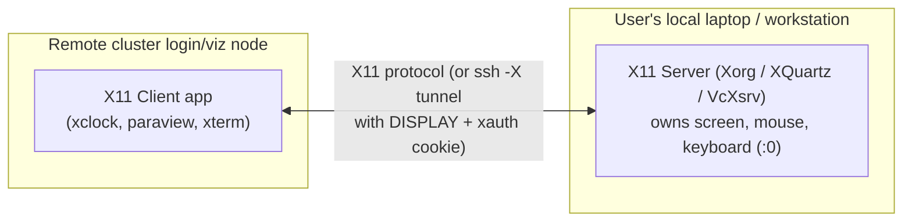

# 1.30 Network file sharing and remote graphical access: rsync in depth, Samba, SSHFS, NFS clients, cloud storage, X11, VNC and alternatives

**Level:** intermediate · **Tier 0 (foundations)** · **Lab venue:** two or three small Ubuntu VMs on GCP · **Status:** drafted, labs untested

Chapter 1.5 introduced `scp`, `rsync` and the idea of shared filesystems. This chapter is the full reference: every way to copy and share files between Linux, Windows and cloud systems, why none of them is a universal answer, and how users reach a cluster remotely, including graphical programs when a command line is not enough.

## Why this matters for AI infrastructure

Data movement is a daily job in AI work: code to nodes, datasets in, checkpoints out, results back to a laptop. The tool choice decides whether a 2 TB transfer takes an hour or a week, whether a deleted directory can be recovered, and whether a home directory is available on 1,000 nodes. Meanwhile the same questions recur for users: how do they log in, copy files, run a visualisation, or open a notebook on a GPU node without exposing services to the internet? Knowing the options, and the performance and security trade-offs behind them, lets you pick the right one instead of the familiar one. This chapter also explains why the "standard" network filesystems are weaker than people expect, which is the background for why AI clusters use parallel filesystems and object storage (Parts 6 and 13).

## Prerequisites and outcomes

You need chapters 1.1 to 1.5 (SSH, `rsync` basics and the filesystem model) and 1.29 (SSH reference). After this chapter you will be able to:

- choose the right tool from a decision table (quick copy, `rsync`, Samba, CIFS, SSHFS, NFS, cloud storage);
- use `rsync` safely in depth: exact copies, trailing slash, excludes and includes, checksums, safeguards, compression, bandwidth limits, in both directions, in dry-run mode;
- explain the performance and security limits of network file sharing, and why they exist;
- set up and use Samba (server and client) and mount CIFS shares;
- use SSHFS and an NFS client, including automounting;
- explain how cloud storage is mounted through FUSE and why it behaves differently from a disk;
- describe how users should be given remote access (SSH, SFTP, why not FTP, how to treat web access);
- explain the X Window System's client/server model, forward X11 safely, and choose an alternative (VNC, x2go, NX, SPICE) when X is too slow;
- diagnose seven common failures.

## 1. Which tool for which job

Many ways exist to distribute and share files; this table summarises the common situations:

| You want to... | Use |
|---|---|
| Make a file or directory on your machine **temporarily available** to others on a trusted network | a one-line web server (`python3 -m http.server`) |
| **Copy files across machines**, especially repeatedly | `rsync` over SSH |
| Share files from Linux **regularly to Windows** machines | Samba (the SMB protocol) |
| **Mount Windows shares** on Linux | the CIFS filesystem (`mount -t cifs`) |
| Small-scale sharing between Linux machines with **minimal setup** | SSHFS |
| Mount **larger filesystems** from a NAS or server on a trusted local network | NFS |
| Mount **cloud storage** | various FUSE-based filesystems (or use the provider's CLI) |

Notice what is missing: **large-scale sharing between many locations and many users.** That is possible, but it takes a good deal of work; sections 6 and 7 explain why, and Parts 6 and 13 cover what clusters do instead.

## 2. A quick copy

If you want to move a file or two to another machine on your own network and do not care about anything fancy, start a web server in the directory:

```bash
python3 -m http.server 8000        # on the machine with the files (older Python 2: python -m SimpleHTTPServer)
# then, on the other machine: open http://10.1.2.4:8000 in a browser, or: curl -O http://10.1.2.4:8000/file
```

It serves the current directory to anyone who can reach port 8000. **Only do this on a network you trust** (it has no authentication and no encryption), bind it to a specific interface where you can (`--bind 10.1.2.4`), and stop it (Ctrl-C) when you are done.

## 3. `rsync` in depth

`scp -r directory user@host:dest` copies a tree but is blunt: if the destination already exists with extra files, those stay, so the result is not an exact copy, and it re-sends everything every time. For regular or automated transfers use **`rsync`**, the standard synchroniser on Linux: it compares source and destination, transfers only what differs, can verify, resume and mirror.

### Getting started

You need `rsync` installed on **both** machines and a way to reach one from the other, normally SSH (current versions assume SSH). It also works between two locations on one machine, for instance between filesystems.

```bash
rsync file1 file2 host:                    # copy files to your home directory on host (same syntax as scp)
rsync file1 file2 user@host:               # if your user name differs
rsync -a dir host:dest_dir                 # a directory tree, with symlinks, permissions, times, devices
rsync -nva dir host:dest_dir               # DRY RUN (-n) with verbose (-v): shows what would be sent, sends nothing
```

Without `-a` (or `-r`), `rsync` copies only plain files and prints `skipping directory dir`. If the remote shell cannot find `rsync` you will see `rsync not found ... connection unexpectedly closed (code 12)`; install it there, or if it exists outside the remote user's command path, point to it with `--rsync-path=/path/to/rsync`.

### Exact copies, and the dangerous option

By default `rsync` ignores what already exists at the destination: copying `d` (containing `a` and `b`) to a machine that already has `d/c` leaves `d/a`, `d/b` and `d/c`. For an **exact replica**, delete what the source does not have:

```bash
rsync -a --delete dir host:dest_dir
```

This is the most dangerous option in the chapter. Always inspect with `-nv` first and read exactly which files it would remove. (If the source is accidentally empty, because a filesystem was not mounted, `--delete` empties the destination.) Safer variants: `--backup --backup-dir=../old` keeps replaced and deleted files in a directory, and a snapshot of the destination makes mistakes recoverable.

### The trailing slash

A trailing `/` on the *source* changes the meaning:

- `rsync -a dir host:dest_dir` creates `dest_dir/dir/...` (the directory itself arrives).
- `rsync -a dir/ host:dest_dir` copies the **contents** of `dir` into `dest_dir` without creating `dir`, like `cp dir/* dest_dir` locally.

Combined with `--delete`, a stray slash can remove unrelated files at the destination. Be wary of **shell tab-completion**, which adds trailing slashes after directory names automatically.

### Excluding and including

```bash
rsync -a --exclude=.git src host:               # excludes every file or directory NAMED .git, anywhere
rsync -a --exclude=/src/.git src host:          # a leading / anchors to the TRANSFER root, not the system root
rsync -a --exclude='*.pyc' --exclude='__pycache__/' src host:
rsync -a --exclude-from=excludes.txt src host:  # patterns in a file, one per line
rsync -a --exclude='item/' src host:            # a trailing slash matches directories named item, not files
rsync -a --include='keep.log' --exclude='*.log' src host:   # include an exception to a broader exclude
```

The pattern is matched against a whole file or directory name component and may use simple globs: `t*s` matches `this` but not `ethers`. Use `--include` when a pattern turns out to be too restrictive; order matters (first match wins), so put includes before the excludes they carve exceptions from.

### How `rsync` decides, and safeguards

To be fast, `rsync` uses a **quick check**: a file is skipped if its **size and modification time** are the same on both sides. The first transfer of a tree sends everything; a second run (`rsync -av ...`) should list nothing, which is a good verification that the copy is consistent. When you need more assurance, or extra protection from overwriting:

| Option | Effect |
|---|---|
| `-c`, `--checksum` | compare content checksums instead of size and time (slower, thorough; use for important data or files that often have identical sizes) |
| `--ignore-existing` | never overwrite files that already exist at the destination |
| `-b`, `--backup` | rename an existing destination file (default suffix `~`) before replacing it; `--suffix=.bak` changes the suffix |
| `-u`, `--update` | skip files that are newer at the destination than at the source |
| `-v`, `-vv` | verbose (the default is silence unless there is a problem); `--stats` prints a summary at the end; `--info=progress2` shows overall progress |
| `-P` | `--partial --progress`: keep partially transferred files so interrupted copies resume |

### Compression and bandwidth

- **`-z`** compresses data in transit. It helps on slow or high-latency links; on a fast LAN the CPU cost of compressing and decompressing can make the transfer *slower*. Skip it for data that is already compressed (most checkpoint formats, images, archives).
- **`--bwlimit=RATE`** caps the transfer rate (the default unit is kibibytes per second; newer versions accept suffixes such as `50m`; see `man rsync`). It keeps a large upload from filling your uplink and starving everything else, because ACK and request traffic competes for the same outgoing bandwidth.

### Pulling files to your machine, and other uses

`rsync -a host:src_dir dest_dir` pulls from the remote side; omit `host:` on both arguments to copy locally. **Batch mode** can replay the same set of changes to several hosts. `rsync --delete` to a mounted cloud or other network storage is a simple, effective **backup**; combined with snapshots or `--link-dest` (hard links to unchanged files from the previous backup) it gives space-efficient daily backups. `rsync --help` and `man rsync` list many more options.

## 4. Why share files over a network at all? Performance and security

Network file sharing is attractive and always compromised, and you should know why before choosing it.

**Why people do it.** Traditionally: **convenience** (log in to any machine and see the same home directory) and **economy** (concentrate storage on a few servers instead of buying disks for every desktop). Clusters still do exactly this for home directories and software.

**Performance.** The one constant disadvantage: *network storage is slow compared with local storage*, and the difference shows with certain access patterns. Streaming a large file sequentially works well, because the server can read ahead and buffer when it knows the client will ask for the next block. But if you do complex manipulation, or touch many different files, the client spends most of its time **waiting on the network**, and the culprit is **latency**: for every new random file access the server must accept and decode the request, then find and load the data, and those first steps are the slowest and happen on almost every new file. The rule that follows: for large amounts of data that do not need frequent random access, network storage is fine; for editing video, compiling a large project, or reading millions of small training files, keep a local copy (or stage data to local NVMe, chapter 13.2).

**Security.** Historically, file-sharing protocols were designed with security as a low priority, and **the easiest options to configure are typically the least secure**. If you cannot trust the networks between the machines, you need both **authentication and authorisation** (only parties with correct credentials get access, and the server is who it claims to be) and **encryption** (so data in transit cannot be read). There are no standardised ways to bolt this on; you combine tools such as `stunnel`, IPsec or VPNs to protect the layers beneath a basic protocol. Treat any file share as reachable by anyone who can reach its network.

## 5. Samba: sharing with Windows (SMB) and CIFS mounts

**SMB (Server Message Block)** is the standard Windows file and printer sharing protocol; macOS can speak it too. **Samba** is the standard suite that implements it on Unix: it lets Windows machines use files and printers on your Linux system, and lets you access Windows shares from Linux. (Over the years the client filesystem has been called **CIFS**, Common Internet File System; on modern systems SMB 3 is used.) Samba is a large topic; here is what you need for a working server and client.

A Samba server needs: a configuration file `smb.conf` (usually `/etc/samba/smb.conf`) with a `[global]` section and one section per share, and the daemons `smbd` (handles share requests) and `nmbd` (a NetBIOS name server). A distribution package starts them with sensible defaults, but it cannot know which directories you want to share.

### The global section and access control

```ini
[global]
   netbios name = fileserver          # server name (default: the Unix host name)
   server string = My server via Samba
   workgroup = MYNETWORK              # Windows workgroup or domain name
   interfaces = 10.23.2.0/255.255.255.0   # listen only on these networks or interfaces
   bind interfaces only = yes         # make 'interfaces' strict
   security = user
   passdb backend = tdbsam            # Samba's own password database (fine for small networks)
   obey pam restrictions = yes        # password changes obey PAM rules
```

Useful access-control options (global or per share): `interfaces` and `bind interfaces only` (limit which networks it listens on), `valid users` (the list of allowed users, for example `valid users = jruser, bill`), `guest ok` (anonymous access; **only on a private network**), and `browseable` (whether the share shows in network browsing; if `no` you must know its exact name).

### Passwords

Unix and Windows store passwords differently, so Samba keeps its own password database (unless you authenticate against a Windows domain with `security = domain`, in which case each domain user still needs a local account with the same name):

```bash
sudo smbpasswd -a alice        # add an existing Linux user to Samba (prompts for the SMB password twice)
sudo smbpasswd -x alice        # delete the user
sudo smbpasswd -d alice        # disable ; -e enables again
sudo smbpasswd alice           # change a user's password as root (users change their own with plain 'smbpasswd')
```

The user must already exist as a Linux account. **Beware `unix password sync = yes`** in `smb.conf`: it changes the user's normal Linux password along with the Samba one, which confuses users who set a different Samba password and then cannot log in to Linux. Some distributions turn it on by default.

### Shares, homes and printers

```ini
[projects]
   path = /srv/projects
   comment = Project files
   guest ok = no
   writable = yes
   printable = no
   veto files = /*.o/bin/            # do not export files matching these patterns

[homes]
   comment = home directories
   browseable = no
   writable = yes
   # path = /u/%S                    # %S is replaced by the user name, if homes live elsewhere

[printers]
   comment = Printers
   browseable = yes
   printing = CUPS                   # needs Samba built with CUPS support
   path = cups
   printable = yes
   writable = no
```

Never combine `guest ok = yes` with `writable = yes`. A directory share must have `printable = no`.

### Starting, diagnosing and the client

Normally systemd starts the daemons (`systemctl status smbd nmbd`; on newer distributions the units are `smb` and `nmb`), and after changing the configuration you reload the service. If started manually: `nmbd -D -s /path/smb.conf` and `smbd -D -s /path/smb.conf` (`-D` daemon mode). Problems during startup print to the terminal; runtime diagnostics go to log files in `/var/log/samba` (`log.smbd`, `log.nmbd`, and one per client). Validate the file with `testparm`.

The client tool **`smbclient`** lists and accesses shares:

```bash
smbclient -L SERVER -U alice                 # list the shares (Disk, Printer; IPC shares are for management)
smbclient //SERVER/sharename -U alice        # an FTP-like prompt: get, put, cd, lcd, pwd, ls, help
```

To mount a share as a directory you need the CIFS utilities (usually a separate package):

```bash
sudo mount -t cifs //SERVER/sharename /mnt/share -o credentials=/root/.smbcreds,uid=1000
```

Put `username=` and `password=` in a root-only credentials file instead of on the command line, where other users could see them in the process list. (The correct address syntax is `//SERVER/sharename`.)

## 6. SSHFS and NFS: sharing between Linux machines

### SSHFS

**SSHFS** is a user-space filesystem (FUSE) that opens an SSH connection and presents the remote files at a local mount point, which makes it the easiest way to try sharing between Linux machines:

```bash
sshfs alice@host:/data /mnt/data        # mount; omit ':dir' for the remote home directory
fusermount -u /mnt/data                  # unmount as a regular user (fusermount3 on newer systems); root can use umount
```

Advantages: **minimal setup** (the remote side only needs SFTP enabled, which most SSH servers do) and **no special network configuration** (it works anywhere you can open an SSH connection, trusted network or not). Disadvantages: **performance suffers** because of the overhead of encryption, translation and transport (though often not as badly as expected), and **multiuser setups are limited**; mount it as the regular user whose files they are, which also keeps ownership and security consistent. It is well worth trying for modest needs.

### NFS (client side)

**NFS** is the traditional Unix network filesystem. There are several versions (v3 and v4 are common), it can run over TCP or UDP, and it has many authentication and encryption options, very few of which are enabled by default. To mount:

```bash
sudo mount -t nfs server:/export /mnt/nfs         # the -t is optional; mount normally detects it
sudo mount -t nfs4 -o sec=krb5p server:/export /mnt/nfs   # with Kerberos authentication and privacy
```

The security choices are set with the **`sec=`** option: `sys` (trust the client's user IDs, the default), or `krb5`, `krb5i`, `krb5p` (Kerberos authentication, integrity, and encryption). Many administrators on small closed networks use **host-based access control** on the server; stronger methods such as Kerberos require configuration elsewhere. See `man nfs`.

**Automounting.** Once you use network filesystems heavily, mount them only when someone *uses* them, so that boot does not depend on the server being up. The traditional tools were `automount` (autofs) and `amd`; today much of this is provided by **systemd automount units**: in `/etc/fstab`, add `x-systemd.automount` (and optionally `x-systemd.idle-timeout=60`) to the options.

**NFS servers.** Running the server means starting `mountd` and `nfsd` and listing exports in **`/etc/exports`** (then `exportfs -ra`; `showmount -e server` shows what a server offers). That is considerably more involved than the client, and it is often more convenient to buy a **NAS** appliance (many run Linux with NFS built in, and vendors add administration tools for RAID, snapshots and cloud backup). Chapters 6.18 to 6.21 cover NFS limits at cluster scale and the parallel filesystems that replace it.

## 7. Cloud storage, and the state of network file sharing

### Cloud storage

Cloud object stores (AWS S3, Google Cloud Storage) have lower performance than a local network but offer two big advantages: **you never maintain them** and **backups are not your problem**. All providers offer web and programmatic interfaces and command-line tools (`gcloud storage`, `aws s3`, `rclone`), and most can also be **mounted** on Linux through **FUSE** (Filesystem in Userspace): a user-space daemon sits between the data source and the kernel, so no kernel code is involved. For popular services there are several FUSE options. The details are provider-specific; the general behaviour is that listing and small-file access are slow, writes are often whole-object, and consistency and rename semantics differ from a disk, so do not run databases or edit-in-place workloads on them. For AI datasets and checkpoints, use the tools and formats designed for object storage (chapter 13).

### Why there is no standard answer

Network file sharing can feel incomplete because **it is**. The base security level of NFS is low and costly to raise; CIFS is better, since modern software builds in encryption, but performance limits are hard to remove, and a client can behave badly when it temporarily cannot reach its storage (processes hang in uninterruptible sleep, chapter 1.1). Several designs tried to fix this, the most thorough being the **Andrew File System (AFS)**, from the 1980s. Why doesn't everyone use AFS or something like it? Largely because of lack of flexibility: its security depends on **Kerberos**, which is available everywhere but never became a standard part of Unix and takes real effort to set up and run (you need a server for it). Large institutions (universities, banks) manage that happily and are the heartland of AFS; small sites prefer NFS or CIFS shares. Even Windows moved to Kerberos as the default for its server products in Windows 2000, but small networks do not run Windows domains of that kind.

There is also a technical reason: **network filesystem clients have traditionally been kernel code** (NFS especially). Network filesystems are complicated, authentication does not belong in the kernel, and a kernel implementation severely limits the number of developers who can contribute.

Cloud storage changed the picture. Access methods there are built on security mechanisms such as TLS that work **without** a Kerberos-style infrastructure, and the many FUSE clients show that authentication, encryption and file handling can all live in user space. Future designs may well add flexibility in security and in filename translation. For now, in Linux and Unix there is no truly standard network file-sharing system unless you are a large site or willing to do significant work, which is the situation that cluster filesystems (Part 6) and object storage (Part 13) address.

## 8. Giving users remote access

### SSH, for users

SSH is the main way users reach a supercomputer today. Do not be intimidated by their graphical habits: with a few commands, most users are productive, because their daily work is queueing jobs and reading their status; copying and editing is done with a convenient client on their own machine. To ease the start, install **Midnight Commander** (`mc`), a two-panel file manager whose interface resembles Total Commander or Far Manager, on the access node.

Policy recommendations:

- **Passwords:** the classic mode works by default but should not be used for ordinary users. If you must allow it, allow it only from a few administrator workstations and for a few accounts, to resolve emergencies.
- **Keys:** users generate a key pair (or use an existing one) and send you the **public** half; you append it to `~user/.ssh/authorized_keys` (append, never replace). Public keys come in an **OpenSSH** single-line format and an **RFC** multi-line format; convert RFC to OpenSSH with `ssh-keygen -i -f rfc-key.pub >> ~user/.ssh/authorized_keys`. A Linux or macOS user then connects with `ssh -i ~/.ssh/cluster-key cluster`.
- **Windows users:** **PuTTY** (with `puttygen` to create and convert keys, saved in `.ppk` format, and the `putty` client) works well; load the `.ppk` key and enter the cluster address. For file transfer, **WinSCP** (or its plug-in for FAR) and FileZilla (which needs the PuTTY agent loaded with the key, because it does not otherwise support key authentication).
- Linux and macOS users can transfer files with `scp`, `sftp`, `rsync`, the FISH virtual filesystem in Midnight Commander, `sshfs`, or the remote-connection feature of graphical file managers (chapter 1.5).

### FTP and web access

**FTP** was once the dominant way to distribute files and is still built into many browsers and file managers, but its big flaw is that it sends the login and password **unencrypted**. Secure variants exist, but they are not standardised and not universally supported, and even with encryption a password remains a weak credential. FTP is acceptable in exactly one case: **public, anonymous, read-only distribution** of files. For everything else use **SFTP or SCP**, which are standardised, supported by every SSH server, and allow key authentication that largely removes the guessing risk. Their downsides are higher CPU use and often lower speed (encryption overhead, and the way data moves over encrypted channels), and standard clients and servers do not offer "encrypt only the login" modes.

For **web access** (HTTP), you often do not need a web server on the cluster at all: put the information on a separate, ordinary server, and avoid running one on the supercomputer, because any web server becomes vulnerable the moment it serves dynamic content (CGI scripts, application servers) and even static-only servers can be attacked through carelessly enabled modules. When the cluster must publish something (for example queue status), let the external web server obtain the data over SSH or `rsync` with a **restricted key** whose command is limited to one harmless action (chapter 1.29), or configure the server to remove the possibility of compromise: strict `chroot` or, better, run it in a lightweight container or VM (LXC, chapter 1.19 and 1.26). Keep logs, analyse them, and run an **intrusion-detection system**: every unnecessary service reachable from outside is an invitation to break in, even just for fun.

## 9. Remote graphical access: X11 and its alternatives

### The X Window System

Linux graphics is not part of the operating system: the graphical stack is an ordinary set of programs, and a system can run happily with no graphics at all, which is the normal mode for a supercomputer. Occasionally graphical programs are unavoidable (some commercial tools can be configured only graphically or through a browser), and **visualising scientific data** is often best done next to the data, because moving large results to a workstation costs far more than sending screen images.

The **X Window System** (X11, or just X) provides the basics: drawing windows, moving them, and handling mouse and keyboard, but **not** the look of the windows. That is the job of a **window manager** (frames, title bars, placement, such as `KWin` in KDE or `Metacity`/`Mutter` in GNOME), a **compositor** (for transparency and effects), **widget toolkits** (`GTK+` and `Qt` shared libraries and themes), and, in full **desktop environments**, a set of applications and a consistent style (**GNOME**, **KDE**, **Xfce**). **Wayland** (`HLW` Chapter 14) is gradually replacing X11 by combining the display server and compositor into one simpler, lower-latency component without X11's network-protocol baggage, though X11 compatibility (`Xwayland`) will persist for a long time. Desktop components also rely on **D-Bus** (`HLW` Section 14.5)—an interprocess communication bus with both a **system instance** (used by `systemd`, `NetworkManager`, and `Upstart`, monitored with `dbus-monitor --system`) and a per-user **session instance** (`dbus-monitor --session`)—and **CUPS** (*Common UNIX Printing System*, `HLW` Section 14.6: `lp`, `lpr`, `lpstat`, `cancel`, `cupstestppd`, converting PostScript/PDF jobs through RIP filters to IPP/LPD network printers).



X uses a **client/server architecture, with the names the opposite way round from what you might expect**: the **X server** is the program on *your* machine that owns the screen, keyboard and mouse; the **clients** are the graphical applications, which may run on a *different* machine and talk to your server over the X protocol (version 11) through Unix sockets or network sockets. The server consists of drivers for input and output devices plus the part that talks to applications. You can inspect X windows, events, input devices, and displays with **`xwininfo`** (click a window to see its window ID `0x5400024` and geometry, or `xlsclients`), **`xev`** (prints `KeyPress` and mouse events in real time), **`xinput`** (`xinput --list-props` and `--set-ptr-feedback` for pointer settings), and **`xrandr`** (`HLW` Section 14.4).

- **Displays.** Each X server serves a **display** with a number; by default `:0`. Applications choose which display to use with the `-display` option (`xclock -display :0`) or the **`DISPLAY`** environment variable (`export DISPLAY=:0`). When forwarded over SSH, `ssh` sets `DISPLAY` for you.
- **Server software and configuration.** The reference implementation is **X.Org**. Modern versions detect hardware automatically and need no configuration; when they guess wrong, create `/etc/X11/xorg.conf` (generate a starting file with `Xorg -configure`, which produces `xorg.conf.new`) or drop-ins in `/etc/X11/xorg.conf.d/`. Server problems are logged in `/var/log/Xorg.0.log` (the 0 is the display number).
- **Starting a session.** Rarely by hand: `startx` starts the server plus a script that starts the clients (a session script in `~/.xsession` or `/etc/X11/Xsession.d/`), and the server stops when that session script ends. Normally the server runs as a service with a **display manager** (`xdm`, `gdm`, `kdm`, `lightdm`) as its only client: it shows a graphical login, offers a choice of language and window manager or desktop, and starts the session after a successful login (`xdm`'s files are in `/etc/X11/xdm/`, `gdm`'s in `/etc/gdm/`).

### Using X from a Windows or Mac workstation

You need an **X server on the machine in front of you**. On Windows there are commercial products and free ones: the popular free choice for years was **Xming** (with an OpenGL variant, plus a launch tool), and its modern relative is **VcXsrv**; typical flags are the display number, `-clipboard` (share the clipboard), `-multiwindow` (each remote window is a local window) and keyboard-layout options. The Windows firewall may ask to open ports for the server; **restrict that rule to the machines that will use it**. On macOS, XQuartz plays this role.

A session: start the X server locally; connect with an SSH client with **X11 forwarding** enabled (`ssh -X host`, or `-Y` for trusted forwarding; in PuTTY, "Connection / SSH / X11 forwarding"); the client sets `DISPLAY` and the authorisation cookie (`XAUTHORITY`) automatically, and any X program you start on the remote host appears on your screen. The remote machine needs **`xauth`** installed. Note that this shows *remote* programs on your local display; you cannot "run your local browser on the remote computer".

**Authorisation.** Without forwarding, you must tell the X server which machines may connect: on Unix `xhost +computer_name` (or, for the Windows servers, an `X0.hosts` file listing allowed names and addresses). **`xhost` is weak and often disabled by default**; avoid it, and use `xauth` cookies, which SSH forwarding sets up for you. If you use `sudo` on the remote host, the `XAUTHORITY` variable must pass through.

### When X is too slow: alternatives

X's weakness is speed: with rich graphics over a narrow or high-latency link, it can become unusable. The alternatives send **images of the screen** (compressed) instead of drawing commands:

| Protocol / tool | Notes |
|---|---|
| **VNC** (TigerVNC, tightvncserver) | very common, many clients; supports scaling and compression; the servers run as X servers so any X application works. Limitation: **not multi-user**: the server runs as one user and everyone who connects sees that user's desktop; dynamic per-user sessions are not available, so it suits a few dedicated uses such as visualisation or administering specific hardware. **Always set a password** (and tunnel it over SSH). |
| **RDP** | Windows' own remote desktop protocol: authentication, simultaneous users, file transfer, usually faster than VNC with better quality; but the protocol is closed and Linux servers for it are rare and not the authors' recommendation. |
| **x2go** | open-source protocol derived from NoMachine's NX; clients and servers for most distributions and for Windows. **No separate server service:** install the package, and the client connects over **SSH** and starts the server program as the user, so authentication is SSH's and the server side is well protected. Speed comparable to VNC, with compression and scaling, and it can show just one program's windows. |
| **NoMachine NX** | the commercial origin of the technology above; the free server allows two simultaneous users; supports password authentication with session saving and reconnection. |
| **SPICE** | another remote display protocol, less widespread. |

For notebooks and web UIs (Jupyter, TensorBoard, the "visualisation" of modern AI work), you rarely need any of these: run the service on the node and **tunnel the port** over SSH (chapter 1.5), which gives the best performance and the smallest attack surface.

### Principle for access design

"The less access, the better", yet users must not feel boxed in. SSH with SCP/SFTP usually suffices. Publish clear instructions for the common tasks, keep the access paths few and well monitored, and treat remote access as the "face" of the system for users, because it is what they will use almost all the time.

## How it fails

### 1. `rsync --delete` removes the wrong files
**Symptom:** destination data vanishes. **Cause:** a trailing slash difference, an empty or unmounted source, or the wrong destination path. **Prevention:** always `-nv` first; check `df` and that the source path is populated; use `--backup-dir` or snapshots; never put `--delete` in a habit alias.

### 2. A transfer is "done" but data differs
**Symptom:** a corrupted or partial dataset after a copy. **Cause:** interrupted copy leaving files with matching size and time, or modification times preserved from a truncated file. **Fix:** `rsync -c` (checksums) or `sha256sum` comparison for critical data, `--partial` and re-run until `rsync -avn` lists nothing.

### 3. Samba users cannot log in, or Linux password suddenly changes
**Symptom:** access denied from Windows, or Linux login breaks after an SMB password change. **Cause:** the user is not in Samba's database (`smbpasswd -a`), the `[global]` security settings are wrong, firewall blocks, or `unix password sync = yes` changed the Unix password too. **Diagnose:** `testparm`, `pdbedit -L`, `/var/log/samba/*`, `smbclient -L localhost -U user`.

### 4. NFS clients hang
**Symptom:** commands touching an NFS path freeze (state `D`); a node that boots with a dead NFS server never finishes booting. **Cause:** hard mounts waiting for an unreachable server, or boot depending on a mount. **Fix:** fix the server or network; use automount (`x-systemd.automount`) so mounts happen on demand; consider `soft` or `intr`-style options only where the application can tolerate errors (they risk data loss); monitor the server.

### 5. SSHFS is "slow" or leaves stale mounts
**Symptom:** very slow listing of large directories; "Transport endpoint is not connected". **Cause:** FUSE overhead and per-file round trips; the SSH connection dropped. **Fix:** use `rsync` or NFS for heavy work; add `-o reconnect,ServerAliveInterval=15`; unmount with `fusermount -u`.

### 6. Remote X programs fail ("cannot open display")
**Symptom:** `Error: Can't open display`. **Cause:** no X server running locally, forwarding not enabled (`-X`), `xauth` missing on the remote host, `DISPLAY` unset or wrong (after `sudo`, the variable and cookie are lost), `X11Forwarding no` on the server, firewall. **Diagnose:** `ssh -vX`, `echo $DISPLAY`, `xauth list`, `xclock`. **Fix:** address the missing piece; for slow graphics use x2go or VNC over a tunnel.

### 7. FTP or open web services expose the cluster
**Symptom:** credential theft, defaced pages, intrusions. **Cause:** plaintext FTP logins, a web server with dynamic content on the cluster, unnecessary services reachable from outside. **Fix:** SFTP/SCP only; web content on a separate server; restricted, command-limited keys for status feeds; containers or chroot; log analysis and intrusion detection.

## Hands-on lab: rsync, Samba, SSHFS, NFS, and X11/x2go

First, run the self-checking Python lab (`code/part01/network_fs_x11_lab.py`) locally. It verifies `rsync` trailing-slash destination path resolution (`dir` vs `dir/`), `rsync` quick-check (`size` + `mtime`) vs `--checksum` (`-c`) and `--update` (`-u`), first-match-wins `--include` / `--exclude` evaluation, and X11 client/server role inversion.

```bash
python3 code/part01/network_fs_x11_lab.py
```

Next, on two or three disposable GCP VMs (all interactive VM commands below are `untested here`), work through these steps:

**Part A: quick copy and rsync.**
1. Serve a directory with `python3 -m http.server --bind <internal IP>` and fetch a file from another VM with `curl`; note what protects it (nothing) and stop it.
2. Build a directory with nested folders, a `.git` directory, some `*.pyc` files and a symlink. Run each of `rsync -nva`, then `rsync -a`, with and without the trailing slash; compare the resulting trees. Then `rsync -a --exclude=.git --exclude='*.pyc'` and `--exclude-from`. Use `--include` to keep one `.pyc` that the broader exclude would remove.
3. Safeguards: modify one file at the destination to be newer; compare the effect of the default, `--update`, `--ignore-existing`, `--backup --suffix=.old`, and `-c`. Produce a corrupted-copy scenario (truncate a file but keep its time with `touch -r`) and show that only `-c` catches it.
4. `--delete`: create an extra file at the destination, preview with `-nv --delete`, run it, then show how a wrong trailing slash combined with `--delete` would have behaved (in a scratch directory only).
5. Compression and limits: time a transfer of a large file with and without `-z` (use `dd if=/dev/urandom` for incompressible data and a text file for compressible data) and with `--bwlimit=1000`.

**Part B: Samba.**
6. Install Samba on vm1, create a `[projects]` share with `valid users`, add a Samba user with `smbpasswd -a`, validate with `testparm`, restart the services, and list shares with `smbclient -L localhost`. From vm2 install `cifs-utils` and mount the share with a credentials file; create files from both sides and check ownership. Break it on purpose with `unix password sync = yes` and observe what changes. Clean up.

**Part C: SSHFS and NFS.**
7. Mount a directory from vm1 on vm2 with SSHFS; time `ls` on a directory with 5,000 files compared with local; unmount with `fusermount -u`.
8. Install an NFS server on vm1 (`nfs-kernel-server`), export a directory in `/etc/exports`, run `exportfs -ra`, and mount it on vm2. Create files as users with the **same name but different UIDs** on the two machines and observe the ownership problem (chapter 1.6). Add `x-systemd.automount` to the `fstab` line and stop the server to see that boot and unrelated commands no longer hang.

**Part D: cloud storage.**
9. With `gcloud storage cp` and `rclone` (or `gcsfuse`), copy and list a bucket, then mount it with a FUSE tool; time listing 1,000 small objects versus a local directory, and write a file and read it back immediately; note how it differs from a disk.

**Part E: remote graphics.**
10. On a VM, install a minimal X application (`x11-apps`) and `xauth`, ensure `X11Forwarding yes`, and from your laptop with an X server (XQuartz or VcXsrv) run `ssh -X vm xclock`. Then break it in each way listed in failure mode 6 and fix it. Try `sudo xclock` and see what is lost.
11. Install x2go (or TigerVNC bound to localhost and tunnelled with `-L`) and open a desktop session over a slow link simulated with `tc netem` (chapter 2.23); compare responsiveness with forwarded X for a graphics-heavy program.

## Exercises

1. **Choosing the Right File-Sharing Tool and Network Latency vs. Bandwidth (`HLW` Chapter 12):** (a) Select the best tool from Section 1 for: a temporary LAN file drop, nightly incremental directory mirroring, exporting Linux directories to Windows desktops, mounting a Windows share on Linux, mounting a remote Linux directory with zero server changes, mounting shared home directories across 30 Linux servers, and accessing a cloud object store; (b) explain why network filesystems handle large sequential streams well but stall when compiling code or loading thousands of small training files.
2. **`rsync` Trailing Slash, `--delete`, and Quick-Check vs. `--checksum`:** (a) Using `resolve_rsync_dest_paths()` in `code/part01/network_fs_x11.py`, compare the destination paths created by `rsync -a dir host:dest_dir` versus `rsync -a dir/ host:dest_dir`, and explain why combining `--delete` with a tab-completed trailing slash or an unmounted source directory is catastrophic; (b) trace `evaluate_rsync_file_decision()` when a destination file has the exact same byte size and `mtime` as the source but corrupted contents, with and without `-c` (`--checksum`).
3. **`rsync` Filter Ordering (`--include` / `--exclude`), `-z`, and `--bwlimit`:** (a) Using `evaluate_rsync_filter_rules()`, explain why `rsync -a --include='keep.log' --exclude='*.log' src host:` keeps `keep.log` whereas reversing the two flags excludes it; (b) when does `-z` slow a transfer down, and what does `--bwlimit` protect on an asymmetric or shared link?
4. **Samba (`smb.conf`, `smbpasswd`, `unix password sync`) and CIFS Mounts:** Write the workflow to export `/srv/projects` to user `alice` via Samba (`smb.conf`, `smbpasswd -a alice`, `testparm`, `smbclient -L`) and mount it on a Linux client with `mount -t cifs //SERVER/projects /mnt/share -o credentials=/root/.smbcreds,uid=1000`. Why is `unix password sync = yes` a trap?
5. **`SSHFS` vs. `NFS` (`sec=`, Automounting) and the Evolution from `AFS` to Cloud `FUSE`:** (a) Compare `SSHFS` (`fusermount -u`) and `NFS` (`sec=sys` vs `sec=krb5p`), and explain how `x-systemd.automount` in `/etc/fstab` prevents a dead NFS server from hanging node boot; (b) why did the Andrew File System (`AFS`) never become universal on small networks, and how do cloud object stores and `FUSE` clients change the security and kernel-complexity trade-off?
6. **X11 Client/Server Role Inversion, Wayland/D-Bus/CUPS, `xauth` vs. `xhost`, and `VNC` / `x2go` / SSH Tunnels:** (a) Using `describe_x11_roles()`, state which machine is the **X server** and which is the **X client** when you run `ssh -X login01.cluster xclock` from `laptop.local`, how `DISPLAY` and `xauth` cookies work (and why `sudo xclock` loses them), and how Wayland, D-Bus (`dbus-monitor`), and CUPS (`lp`/`lpstat`) fit into the Linux desktop stack (`HLW` Chapter 14); (b) compare `VNC`, `RDP`, `x2go`, and `ssh -L` port tunneling for Jupyter/TensorBoard.

## Checkpoint questions (20)

<details>
<summary>1. Match each file-sharing scenario to the right tool: temporary LAN drop, repeated cross-host sync, Linux-to-Windows share, Windows-to-Linux mount, zero-setup Linux mount, LAN multi-host mount, and cloud bucket access.</summary>

Temporary LAN drop: `python3 -m http.server --bind <IP>`; repeated sync: `rsync` over SSH; Linux-to-Windows share: **Samba** (`smbd`/`nmbd`); Windows-to-Linux mount: **CIFS** (`mount -t cifs`); zero-setup Linux mount: **SSHFS**; LAN multi-host mount: **NFS** (with `x-systemd.automount`); cloud bucket access: provider CLI (`gcloud storage`, `aws s3`, `rclone`) or a user-space **FUSE** mount.
</details>

<details>
<summary>2. Why does `scp -r` fail to produce an exact mirror of a directory, and why must `rsync -a --delete` always be preceded by `-nva`?</summary>

`scp -r` copies all bytes unconditionally and leaves old, deleted files sitting at the destination. `rsync -a --delete` removes any file at the destination that no longer exists in the source; if you pass the wrong path, a stray trailing slash, or an unmounted empty source directory, `--delete` wipes the destination clean. Always preview with `rsync -nva --delete` (dry-run) or use `--backup --backup-dir=../old`.
</details>

<details>
<summary>3. What is the exact difference between `rsync -a dir host:dest_dir` and `rsync -a dir/ host:dest_dir`?</summary>

Without a trailing slash (`dir`), `rsync` copies the directory itself, creating `dest_dir/dir/...`. With a trailing slash (`dir/`), `rsync` copies the **contents** of `dir` directly into `dest_dir/...` without creating a `dir` subdirectory. Watch out for shell tab-completion, which appends `/` automatically.
</details>

<details>
<summary>4. How does `rsync`'s default \"quick check\" decide whether to skip a file, and what do `-c`, `-u`, `--ignore-existing`, `-b`, and `-P` do?</summary>

By default, `rsync` skips any file whose **byte size and modification timestamp (`mtime`)** match on source and destination. `-c` (`--checksum`) forces full content checksum comparison; `-u` (`--update`) skips files that are newer on the destination; `--ignore-existing` never overwrites existing destination files; `-b` (`--backup`) renames overwritten files (`~` or `--suffix`); and `-P` (`--partial --progress`) keeps partially transferred files so interrupted large transfers can resume.
</details>

<details>
<summary>5. How do `--exclude` and `--include` ordering work in `rsync`, and what does a leading `/` in `--exclude=/dir` mean?</summary>

`rsync` evaluates filter rules in order and **the first matching rule wins**; therefore, an exception (`--include='keep.log'`) must be placed **before** the broader exclusion (`--exclude='*.log'`). A leading `/` in `--exclude=/src/.git` anchors the pattern to the **root of the transfer**, not the root `/` of the Linux filesystem.
</details>

<details>
<summary>6. When does `rsync -z` (compression) help, when does it hurt, and what is `--bwlimit` for?</summary>

`-z` helps when transferring compressible data (text, logs, source code) over slow WAN links; it **hurts** throughput on fast LANs (where CPU compression becomes the bottleneck) or when transferring already-compressed files (`.tar.gz`, images, compressed model checkpoints). `--bwlimit=RATE` caps transfer bandwidth so a bulk sync does not saturate a link and starve interactive SSH or TCP ACKs.
</details>

<details>
<summary>7. Why is network file sharing fast for streaming a single large file but slow when touching thousands of small files?</summary>

When streaming one large file sequentially, the server and client can prefetch and pipeline large blocks (**read-ahead**). When opening, `stat`ing, or reading thousands of small files randomly, every file requires separate network round trips and server metadata lookups—so **network and metadata latency** dominate and throughput collapses.
</details>

<details>
<summary>8. Why does Samba maintain its own password database (`tdbsam` / `smbpasswd -a`), and why is `unix password sync = yes` a trap?</summary>

Windows SMB authentication uses password hash formats (`NTLM`/Kerberos) that cannot be verified against `/etc/shadow`'s SHA-512/yescrypt hashes, so Samba keeps its own database managed with `sudo smbpasswd -a username` (for an existing Linux account). If `unix password sync = yes` is enabled in `smb.conf`, changing a user's SMB password silently changes their Linux login password too.
</details>

<details>
<summary>9. How do you validate `/etc/samba/smb.conf`, inspect shares from Linux, and mount a CIFS share securely without exposing credentials in `ps`?</summary>

Validate `/etc/samba/smb.conf` with `testparm`, list shares with `smbclient -L SERVER -U alice`, and mount with `sudo mount -t cifs //SERVER/sharename /mnt/share -o credentials=/root/.smbcreds,uid=1000`, storing `username=` and `password=` inside `/root/.smbcreds` (`chmod 600`).
</details>

<details>
<summary>10. What are the pros and cons of `SSHFS`, and how do you mount and unmount it as an unprivileged user?</summary>

`SSHFS` mounts a remote directory over an ordinary SSH/SFTP connection using **FUSE** (`sshfs alice@host:/data /mnt/data`), requiring zero server configuration beyond SSH and working across untrusted networks. Its downsides are FUSE/encryption overhead on metadata-heavy workloads and single-user semantics. Unmount it with `fusermount -u /mnt/data` (or `fusermount3 -u`).
</details>

<details>
<summary>11. Compare the four NFS `sec=` security flavors (`sys`, `krb5`, `krb5i`, `krb5p`), and explain why UID consistency across nodes is mandatory under `sec=sys`.</summary>

`sec=sys` (the default) simply trusts whatever numeric `UID` and `GID` the client kernel sends in the RPC header; if user `alice` is `UID 1001` on node 1 and `UID 1002` on node 2, file ownership is scrambled. `sec=krb5` authenticates users via Kerberos tickets, `sec=krb5i` adds cryptographic integrity checksums, and `sec=krb5p` encrypts all NFS traffic for privacy.
</details>

<details>
<summary>12. How do you configure an NFS mount in `/etc/fstab` so a down NFS server does not hang node boot, and what files configure an NFS server?</summary>

Add **`x-systemd.automount`** (and optionally `nofail,x-systemd.idle-timeout=60`) to the mount options in `/etc/fstab` so `systemd` mounts the share on demand only when a process accesses the mount point. An NFS server (`nfsd` + `mountd`) exports directories listed in **`/etc/exports`**, applied with `sudo exportfs -ra` and inspected remotely with `showmount -e server`.
</details>

<details>
<summary>13. Why did the Andrew File System (`AFS`) never become the universal Linux default, and how do cloud object stores + `FUSE` change the architecture?</summary>

`AFS` (1980s) solved wide-area caching and security by requiring **Kerberos** infrastructure and a complex in-kernel filesystem client—both too heavy for small sites and kernel maintainers. Cloud object stores (`S3`, `GCS`) authenticate over HTTPS/TLS using API tokens without Kerberos, and `FUSE` (`gcsfuse`, `s3fs`, `rclone mount`) keeps complex protocol and auth logic safely in user space.
</details>

<details>
<summary>14. How should Windows, macOS, and Linux users access a cluster and transfer files, and when is `FTP` ever acceptable?</summary>

Users should connect via **SSH keys** (`ed25519`/`rsa`, converting RFC 4716 keys with `ssh-keygen -i -f`, or using PuTTY `.ppk` + WinSCP on Windows) and transfer files via **`rsync`**, **`scp`**, or **`sftp`** (plus `mc` Midnight Commander on the login node). Because classic `FTP` transmits passwords in cleartext, it is acceptable only for **anonymous, public, read-only** file distribution.
</details>

<details>
<summary>15. Why should you avoid running a public web server directly on a cluster head node, and how should cluster queue status be published to the web?</summary>

Any web server (especially with dynamic scripts/modules) expands the attack surface of the head node. Run the web server on a separate external host (or isolated container/VM), and have it pull status data via `ssh`/`rsync` using a dedicated key restricted in `authorized_keys` with `from="...",command="/usr/local/bin/status-only",no-port-forwarding,no-pty`.
</details>

<details>
<summary>16. In the X Window System (`X11`), why are the terms \"X server\" and \"X client\" the opposite of what beginners expect?</summary>

The **X server** (`X.Org` on Linux, `XQuartz` on macOS, `VcXsrv`/`Xming` on Windows) is the program running on **your local workstation** that manages the physical display, keyboard, and mouse (`DISPLAY=:0`). The **X clients** (`xclock`, `xterm`, `paraview`) are the application programs running on the **remote cluster node** that send drawing requests to your X server.
</details>

<details>
<summary>17. How does `ssh -X` (or `-Y`) authorize remote X11 clients, why is `xhost +` dangerous, and why does `sudo xclock` fail over `ssh -X`?</summary>

`ssh -X` creates a proxy X11 display on the remote host (e.g., `DISPLAY=localhost:10.0`) and uses `xauth` to store a random session cookie in `~/.Xauthority`. `xhost +` disables access control and lets anyone on the network snoop keystrokes or inject windows. Running `sudo xclock` switches to `root`, stripping `DISPLAY` or looking in `/root/.Xauthority` instead of the user's `XAUTHORITY` cookie file.
</details>

<details>
<summary>18. How do Wayland, window managers, widget toolkits, D-Bus, and CUPS fit into the Linux graphical and desktop stack (`HLW` Chapter 14)?</summary>

In X11, the X server, window manager (`KWin`, `Mutter`), and compositor are separate processes; **Wayland** merges the display server and compositor into one modern protocol (`Xwayland` runs legacy X11 clients). **Toolkits** (`GTK+`, `Qt`) provide UI widgets. **D-Bus** provides structured IPC across a system bus (`dbus-monitor --system`, used by `systemd`/`NetworkManager`) and a per-user session bus. **CUPS** (`lp`, `lpr`, `lpstat`, `cancel`) manages local and network printing via IPP and RIP filters.
</details>

<details>
<summary>19. Compare `VNC`, `RDP`, `x2go`, and `NoMachine NX` when raw X11 forwarding is too slow over a high-latency link.</summary>

Raw X11 sends chatty drawing primitives and stalls over high-latency links. **VNC** (`TigerVNC`) sends compressed framebuffer updates (fast, but single-user per server instance—always set a password and tunnel over `ssh -L`). **RDP** is fast and multi-user on Windows but less standard on Linux. **`x2go`** (open-source, derived from **NoMachine NX**) compresses the X11 protocol and screen updates and connects directly over **SSH** as the user with **no persistent daemon** needed on the server.
</details>

<details>
<summary>20. For modern AI workflows (JupyterLab, TensorBoard, Ray Dashboard, Weights & Biases local UI), why is `ssh -L` port forwarding better than X11 or VNC?</summary>

AI visualization tools are browser-based web applications. Running the server bound to `127.0.0.1` on the cluster node and forwarding the port (`ssh -L 8888:localhost:8888 login-node`) lets your local laptop browser render the UI natively at 60 FPS with minimal bandwidth, full SSH encryption/authentication, and zero open ports on the cluster.
</details>

## Sources and review notes

- **Sources read in full:**
  - `how-linux-works-3rd-edition` — Brian Ward, *How Linux Works*, 3rd ed., **Chapter 12: Network File Transfer and Sharing** (sections 12.1–12.8: scenario-to-tool list, `python3 -m http.server` / `SimpleHTTPServer`, `rsync` exact copies `--delete`, trailing slash, `--exclude`/`--include` ordering, quick check vs `-c`/`--ignore-existing`/`-b`/`-u`, `-z` compression, `--bwlimit`, pulling files, performance and security of network file sharing, Samba `smb.conf`/`smbpasswd`/`testparm`/`smbclient` and `mount -t cifs`, `SSHFS` `fusermount -u`, `NFS` `sec=sys`/`krb5`/`krb5i`/`krb5p` and `automount`, cloud storage FUSE mounts, and `AFS`/Kerberos) and **Chapter 14: The Linux Desktop and Printing** (sections 14.1–14.6: Wayland vs X Window System `X.Org`, window managers and compositors, toolkits `GTK+`/`Qt` and desktop environments `GNOME`/`KDE`, `xwininfo`/`xev`/`xinput`/`xrandr`, D-Bus system and session buses `dbus-monitor`, and CUPS printing `lp`/`lpr`/`lpstat`/`cancel`).
  - `supercomputers-for-linux-sysadmins-managing-modern-hpc-clusters-and-supercomputers-from-software-to` — Sergey Zhumatiy, *Supercomputers for Linux SysAdmins*, **Chapter 18: Remote User Access** (SSH for users, Midnight Commander `mc`, RFC `4716` `ssh-keygen -i -f`, PuTTY `.ppk` and WinSCP/FileZilla, FTP vs SFTP/SCP, web servers with restricted SSH keys/containers/IDS, X11 client/server roles, `DISPLAY=:0`, `Xorg -configure`, `startx` and display managers `xdm`/`gdm`/`kdm`/`lightdm`, Windows X servers `Xming` and `VcXsrv` `-clipboard -multiwindow`, `xauth` cookies vs `xhost +`, and `VNC`, `RDP`, `x2go`, `NoMachine NX`, and `SPICE`) and **Chapter 28: One-Two-Three Instructions** (NFS server/client and customizing `Xorg`; cross-referenced with Chapters 1.3, 1.5, 1.6, 1.29, 2.23, 6.18, 6.19, 6.20, 6.21, 6.23, 6.24, 6.30, and Part 11).
- **Run here:** `python3 code/part01/network_fs_x11_lab.py` (15 passed, 0 failed).
- **Explicitly labelled inferences:** The X11 client/server Mermaid diagram, `rsync` filter/trailing-slash model, and Jupyter/TensorBoard `ssh -L` recommendation connect Linux file transfer and remote display tools to AI cluster user workflows.
- **Not verified on live hardware:** All interactive VM commands (`python3 -m http.server`, `rsync`, `smbpasswd`, `testparm`, `smbclient`, `mount -t cifs`, `sshfs`, `fusermount`, `mount -t nfs`, `exportfs`, `gcloud storage`, `rclone`, `ssh -X xclock`, `x2go`) are marked (untested here) and must be executed on disposable test VMs.
