# 2.1 What happens when you curl a URL: a packet's journey end to end

| | |
|---|---|
| Level | Beginner |
| Priority tier | 0 |
| Lab venue | Any Linux VM with Internet access (GCP VM is fine) |
| Part | Part 2: Networking, from first principles to AI fabrics |
| Status | Drafted, labs **untested** |

## Why this matters for AI infrastructure

Imagine it is late in the evening and a container image will not pull. Or a training job cannot reach the dataset bucket. Or `torchrun` hangs at rendezvous, NCCL quietly falls back from InfiniBand to sockets, a node stops answering SSH after a switch change, or a pod resolves a name to the wrong address. These look like different problems. They are all the same question: where in the path did something go wrong? The path starts in a process on one machine and ends in a process on another, and every failure sits at one particular step of it. Your first job in any of these cases is to name the step that failed.

Here is how that evening usually goes. A colleague writes in the team channel that the pull is "stuck", and you open a terminal. You do not yet know whether the registry is down, whether the node cannot find it, whether the node finds it but cannot reach it, or whether it reaches it and then quietly distrusts what it hears. The person who finds the answer fastest is rarely the one who knows the most commands. It is the one who can picture the trip a request takes and ask, at each stop on that trip, "did it get this far?" Everything in this chapter exists to give you that picture.

Interviewers know this, which is why they ask the classic question "what happens when you type a URL into a browser, or `curl` it?" If you can narrate the journey in detail and name a command that proves each step, you already hold the mental model for the rest of this Part. That model covers name resolution, routing, ARP/ND, switching, NAT, TCP, TLS, HTTP and teardown.

There is a second reason to learn the trip once, early, and in order. Almost every later chapter in this Part zooms in on one stop of it. If you have already seen the whole road, each zoomed-in chapter has somewhere to land in your head, and you never have to wonder why a topic matters. Think of it as walking a route on foot before you study the map of each street.

This chapter is that narrative. It is a tour, and it touches every layer once without stopping long at any of them. Later chapters slow down at each stop: 2.2 layers, 2.3 Ethernet, 2.4 IP addressing, 2.5 host routing, 2.6 TCP, 2.7 ICMP and diagnostics, 2.8 DNS, 2.9 DHCP and NAT, and 2.10 HTTP/TLS/PKI. If a detail feels rushed here, that is deliberate, because it gets its own chapter.

We will follow one command all the way, `curl https://example.com/`, the way you would follow a parcel on a tracking page. At the end we come back to the traffic that matters most in AI clusters, such as container image pulls, object storage and NCCL, and see how the same journey changes shape for each of them.

## Prerequisites and outcomes

You need a working Linux shell, which Part 1, chapters 1.1 to 1.9, covers. You do not need any networking background. Every term is explained the first time it appears, so a word you have never seen before is not a gap in your knowledge, it is simply the next thing to learn.

Once you have read the chapter and done the lab, use this list as a self-check. Each line is something you should now be able to do.

- Tell the whole story, in order and with the right terms, of what happens between pressing Enter on `curl https://example.com/` and seeing the response, including every protocol that takes part.
- Name the kernel pieces involved: the resolver, `socket`, `connect`, the routing table, the neighbour table, the qdisc, the NIC and the socket buffers.
- Run the commands that expose each step: `strace`, `getent`, `resolvectl`, `dig`, `ip route get`, `ip neigh`, `tcpdump`, `ss`, `openssl s_client` and `curl -w`.
- Split a request's latency into DNS, TCP connect, TLS handshake, time to first byte and transfer, and read a `curl -w` timing report.
- Take a symptom such as "connection refused", "no route to host", "certificate verify failed" or "timeout" and point to the layer that produced it.
- Explain what stays inside a host, what crosses a switch, what crosses a router, and what NAT rewrites.
- Explain how RDMA/InfiniBand traffic in AI clusters differs from this journey, because it bypasses the kernel, and where it stays the same.

## 1. The whole journey in one picture

Before we go step by step, look at the whole trip once. Think of sending a parcel to a friend in another city. You write a name on it, someone has to find the street address for that name, the local post office decides which truck takes it, the truck hands it on at depots, and at the far end somebody checks it is really for them. A network request is the same story told in milliseconds. Read the diagram from top to bottom. The numbered arrows show the order in which things happen.

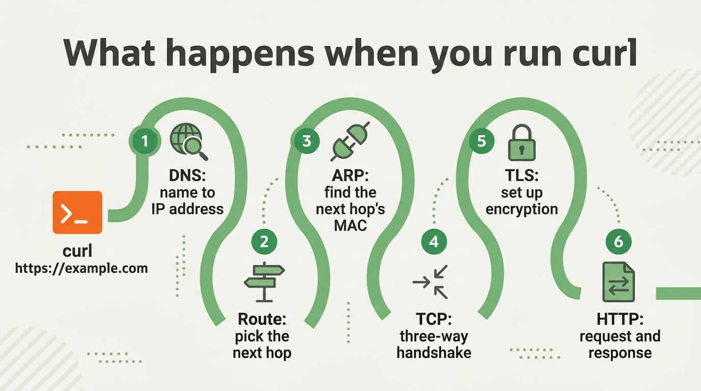

*Figure 2.1.1. The six stages of a curl request: DNS, route, ARP, TCP, TLS and HTTP.*

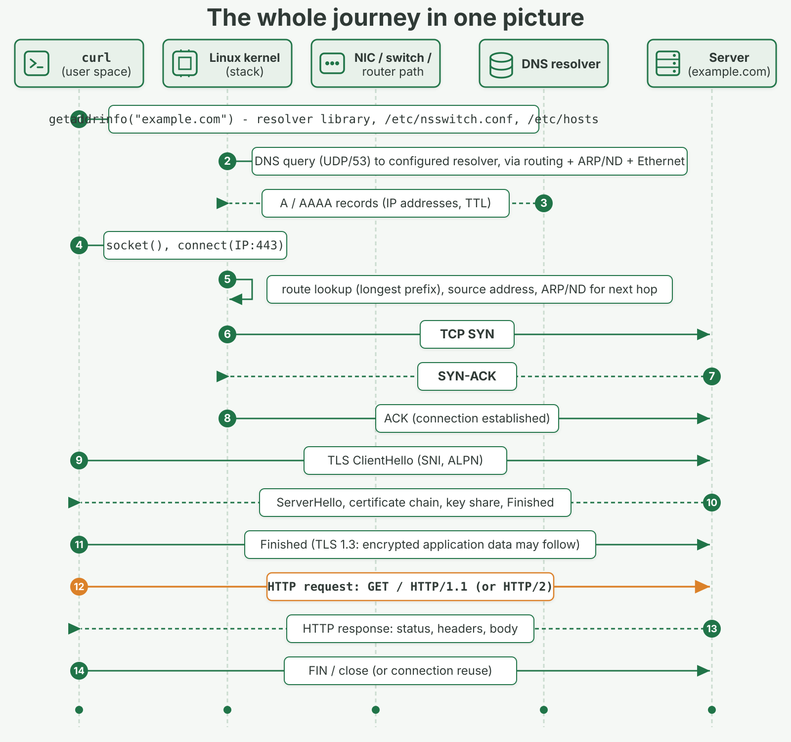

*Figure 2.1.2. The whole journey in one picture, as a diagram.*

Every packet between user and server crosses the same physical sequence: process → socket → TCP/IP stack → queueing discipline → NIC driver → wire → switch → router(s) → … → server NIC → stack → process. Do not worry yet about what each word means. You will meet every one of them in its own section, and by the end the sequence will read like a sentence. Keep that order in your head. The next sections walk along it one stop at a time.

## 2. Step 0: the process and the URL

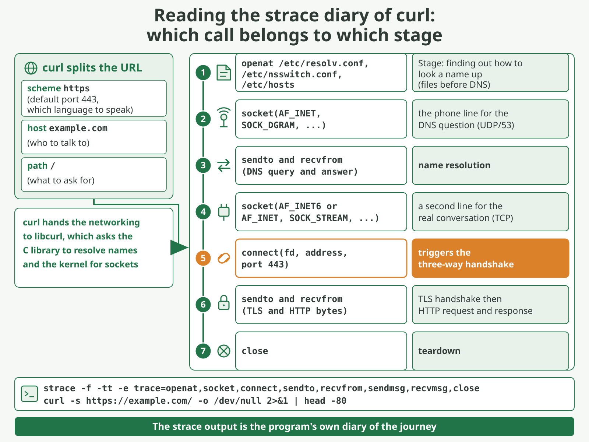

*Figure 2.1.3. Each system call in the strace output belongs to one stage: file lookups, the UDP DNS socket, the TCP socket and connect, then TLS and HTTP bytes.*

Start with what you actually did. You typed a command and pressed Enter, and at this moment nothing has touched the network. The first job belongs to `curl` alone, and it is simply to read what you typed. `curl` splits the URL into three parts: the scheme `https`, whose default port is 443, the host `example.com`, and the path `/`. The scheme tells it which language to speak. The host tells it who to talk to. The path tells it what to ask for once the conversation starts.

`curl` does not do the networking work itself. It hands that job to **libcurl**, and libcurl in turn asks the C library to resolve names and asks the kernel for sockets. A **socket** is the kernel's handle for one conversation, a bit like a numbered phone line the kernel lends to your program. You will see that word again in a moment.

You cannot see any of this by staring at the screen, so let the machine tell you. Three commands let you watch this stage from the outside. The first shows the steps `curl` reports about itself. The second prints timing numbers. The third traces the system calls, which are the requests a program makes to the kernel.

```bash
curl -v https://example.com/ -o /dev/null        # -v shows the steps curl itself reports
curl -sS -o /dev/null -w 'dns=%{time_namelookup} connect=%{time_connect} tls=%{time_appconnect} ttfb=%{time_starttransfer} total=%{time_total} ip=%{remote_ip} http=%{http_version}\n' https://example.com/
strace -f -tt -e trace=openat,socket,connect,sendto,recvfrom,sendmsg,recvmsg,close curl -s https://example.com/ -o /dev/null 2>&1 | head -80
```

The `strace` output tells the story best, because it is the program's own diary. You will see `curl` open `/etc/resolv.conf`, `/etc/nsswitch.conf` and `/etc/hosts`, which is it looking up how to find a name. Then it creates a `socket(AF_INET, SOCK_DGRAM, ...)` for DNS, which is the phone line it will use to ask the question. After that come a `socket(AF_INET6 or AF_INET, SOCK_STREAM, ...)` and a `connect(...)` for TCP, which is a second line for the real conversation. The `sendto` and `recvfrom` calls that follow carry the TLS and HTTP bytes.

## 3. Step 1: name resolution (what is the IP address?)

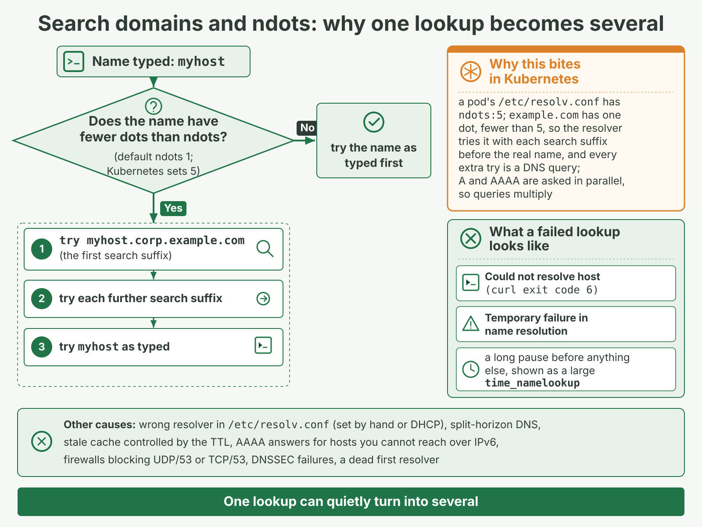

*Figure 2.1.4. A name with fewer dots than ndots is tried with each search suffix first, so ndots 5 in Kubernetes multiplies DNS queries.*

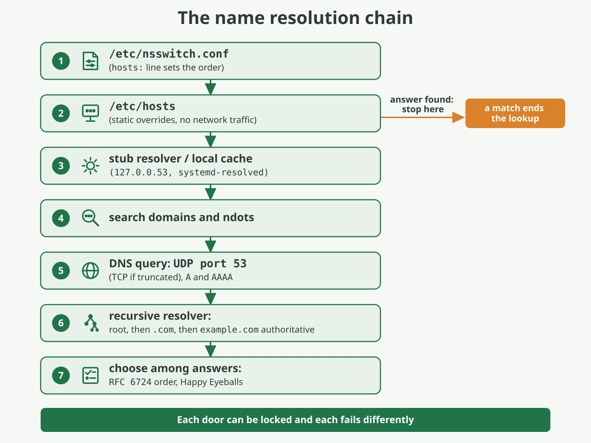

*Figure 2.1.5. The C library tries the files, the local stub or cache, the search domains and finally the recursive resolver, in order.*

Right now `curl` has a name and nowhere to send anything. Computers route by numbers, which are IP addresses, and people type names. It is like having a friend's name but no street address, so the parcel cannot leave the house. The C library function `getaddrinfo()` bridges the two by turning `example.com` into one or more addresses. On a typical Linux system the lookup runs in 7 stages, in this order. Picture a person looking someone up, starting with the cheapest places to look and only then walking to the library.

Stage 1 is the C library reading `/etc/nsswitch.conf`. This file is a short rule sheet that says where to look for each kind of answer and in what order. Its `hosts:` line sets the lookup order. On older systems that line is usually `files dns`. On systemd systems it is usually `files mdns4_minimal [NOTFOUND=return] resolve [!UNAVAIL=return] dns`. In both cases, `files` comes first, so `/etc/hosts` is read before anything else.

Stage 2 is `/etc/hosts`, which is your machine's private address book. It holds static overrides such as `127.0.0.1 localhost`. A match ends the lookup right there, with no network traffic at all. That speed is useful, but it is also why a forgotten line in this file can make a name point somewhere you did not expect, and nobody else can see why. Keep the file short, because entries that DNS can serve do not belong in it.

Stage 3 is a stub resolver or a local cache, which may answer next. On systemd distributions, `/etc/resolv.conf` often points at `127.0.0.53`, the `systemd-resolved` stub. It may also point at a local caching daemon such as `dnsmasq`, `unbound` or `nscd`. To see the real upstream servers for each interface and the DNS domains for each link, run `resolvectl status`.

Stage 4 is the `search` domains. Suppose you type just `myhost`, the way you would at the office. The resolver does not know which company domain you mean, so it has a list of suffixes to try. If a name has fewer dots than `ndots`, the resolver tries it with each `search` suffix first. The default `ndots` is 1, and Kubernetes sets it to 5. So a bare `myhost` may become `myhost.corp.example.com` before it is tried as typed. This helps with short names, and it is also the reason one lookup can quietly turn into several.

Stage 5 is the DNS query itself. Now the machine really does ask someone else. The resolver sends a UDP datagram to port 53 of the configured name server, retries when needed, and switches to TCP when the answer is truncated or large. Modern resolvers ask for both **A** (IPv4) and **AAAA** (IPv6) records in parallel. An A record is the answer that holds an IPv4 address, and an AAAA record holds an IPv6 address. The question travels through the same routing, ARP/ND and Ethernet steps as any other packet, which sections 4 and 5 cover. So the very first packet your command sends is not to the website at all. It is a question to a name server.

Stage 6 is the recursive resolver, which does the legwork on your behalf. It may be your ISP, your cloud provider or an internal server. It either answers from its cache or walks the DNS hierarchy: the root, then the `.com` TLD servers, then the `example.com` authoritative servers. It caches each answer for its **TTL**, the number of seconds the owner of the name says the answer may be remembered. A long TTL makes lookups fast and changes slow to spread. A short TTL does the opposite.

Stage 7 is choosing among the answers, because a name often has more than one address. `getaddrinfo` orders the addresses by the RFC 6724 rules, which prefer IPv6 when it is usable. Many clients also use "Happy Eyeballs", which tries IPv6 and IPv4 with a small head start, so a broken IPv6 path does not leave you waiting. In plain words, the client races the two families and keeps whichever connects first.

Each of these commands shows one stage of the lookup.

```bash
getent hosts example.com                    # what the C library (nsswitch order) returns
getent ahosts example.com                   # all addresses with socket types, in sorted order
cat /etc/nsswitch.conf | grep ^hosts ; cat /etc/resolv.conf ; resolvectl status | head -30
resolvectl query example.com                # through systemd-resolved, shows cache/transport/source
dig example.com A +noall +answer +ttlid     # direct query, TTL visible (use @server to choose resolver)
dig example.com AAAA +short ; dig +trace example.com | head -40     # walk the hierarchy from the root
time getent hosts example.com               # first call vs repeated call: cache effect
```

Run `time getent hosts example.com` twice. The first call may take noticeable time, because someone has to ask the DNS hierarchy. The second call shows the cache effect, because the answer is already close at hand.

Name resolution fails in more ways than most people expect, and chapter 2.8 covers DNS in detail. Think of the lookup chain as a row of doors. Any door can be locked, and each one fails with a different symptom. Common causes include a wrong resolver in `/etc/resolv.conf`, whether it was set by hand or by DHCP, and split-horizon DNS that gives internal and external answers. A stale cache after a change, which the TTL controls, is another.

Other causes are `search`/`ndots` settings that multiply queries in Kubernetes pods, IPv6 AAAA answers for hosts you cannot reach over IPv6, and firewalls that block UDP/53 or TCP/53. DNSSEC failures also appear here, and so does a slow first lookup caused by timeouts to a dead first resolver.

When resolution fails, the symptom is usually `Could not resolve host`, which comes with curl exit code 6. You may instead see `Temporary failure in name resolution`. Or you may see a long pause before anything else happens, which shows up as a large `time_namelookup`. A long pause followed by success is the quiet one, and it is easy to blame the server for something the resolver did.

## 4. Step 2: the socket, the route and the source address

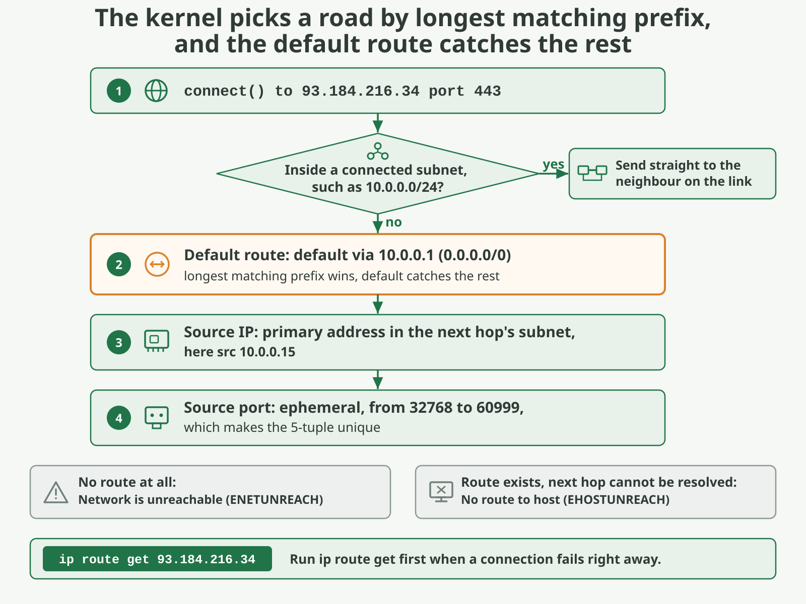

*Figure 2.1.6. The kernel sends directly for a connected subnet and otherwise uses the default route, then picks a source IP and ephemeral port.*

Now `curl` has an address and wants a connection to it. Before any packet leaves the host, the kernel has to decide where it goes, in the same way a driver must pick a road before leaving the garage. Say the address is 93.184.216.34, the one you will see in the examples below. `curl` makes these two calls.

```c
fd = socket(AF_INET, SOCK_STREAM, 0);      // or AF_INET6; creates a TCP socket (a kernel object with send/receive buffers)
connect(fd, {93.184.216.34, port 443});    // triggers the whole connection setup
```

`connect()` asks the kernel to deliver a packet to that destination. So the kernel first answers one question: **where do I send it?** It answers with a **routing table lookup**.

```bash
ip route show                                 # the host's table
ip route get 93.184.216.34                    # the decision for THIS destination: next hop, device, chosen source address
# example output:  93.184.216.34 via 10.0.0.1 dev ens4 src 10.0.0.15 uid 1000 \ cache
ip -6 route get 2606:2800:220:1:248:1893:25c8:1946
```

In the output, `via` gives the gateway, `dev` gives the outgoing interface, and `src` gives the source address. Routing follows a few rules, and chapter 2.5 covers them in depth.

Each route pairs a destination prefix with a way to reach it. A **prefix** is a block of addresses written with a slash, and the routing table is simply a list of such blocks with directions beside each. The way to reach a block is either directly on a link, as in `dev ens4 scope link`, or through a **gateway**, as in `via 10.0.0.1`. When several routes match, the kernel picks the **longest matching prefix**, which means the most specific directions win, like preferring "take the first left onto Mill Street" over "head toward the city". The **default route**, `default via 10.0.0.1`, matches anything that no more specific route covers. Its IPv4 form is `0.0.0.0/0`, and its IPv6 form is `::/0`. Ties are broken by metric.

A worked example makes the choice concrete. If the destination sits inside a connected subnet, such as 10.0.0.0/24, the host sends straight to it, because it is a neighbour on the same street. Otherwise it hands the packet to the gateway, which is the router, and the router worries about the rest of the Internet. For our `curl`, the address 93.184.216.34 is nowhere near 10.0.0.0/24, so the kernel falls back on the default route and hands the packet to 10.0.0.1.

The kernel also has to write a return address on the packet. It chooses the source IP, and it takes the primary address of the outgoing interface in the same subnet as the next hop, unless a configured `src` overrides it. The source port is an **ephemeral port**, a short-lived port number the kernel picks for this one connection, drawn from `net.ipv4.ip_local_port_range`, whose default range is 32768 to 60999. The connection is then identified by its 5-tuple: protocol, source IP, source port, destination IP and destination port. Two connections from your machine to the same server differ only in the source port, which is how replies find the right one.

Policy routing with multiple tables, VRFs, VPN interfaces and container networks can all change the answer. `ip rule show` and `ip route show table all` reveal them.

Two errors come from this step, and they sound alike but mean different things. `Network is unreachable` (`ENETUNREACH`) means there is no route at all, for example when you have no default gateway. The kernel could not even pick a road. `No route to host` (`EHOSTUNREACH`) means a route exists, but the next hop could not be resolved, or an ICMP unreachable came back. The kernel picked a road and found it blocked.

A route that sends traffic out the wrong interface, or with the wrong source address, is a classic cause of connections that work in one direction only. Asymmetric routing and multiple NICs are two common ways to end up there. When a connection fails right away, run `ip route get` for the destination before you check anything else.

## 5. Step 3: from IP to Ethernet (ARP or NDP) and out of the NIC

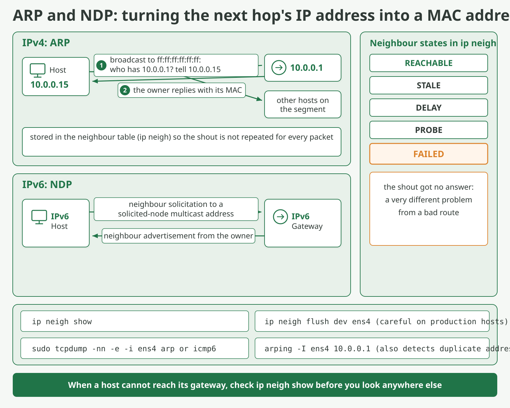

*Figure 2.1.7. ARP asks the whole segment for the next hop's MAC and caches the answer in the neighbour table, and a FAILED entry means no one answered.*

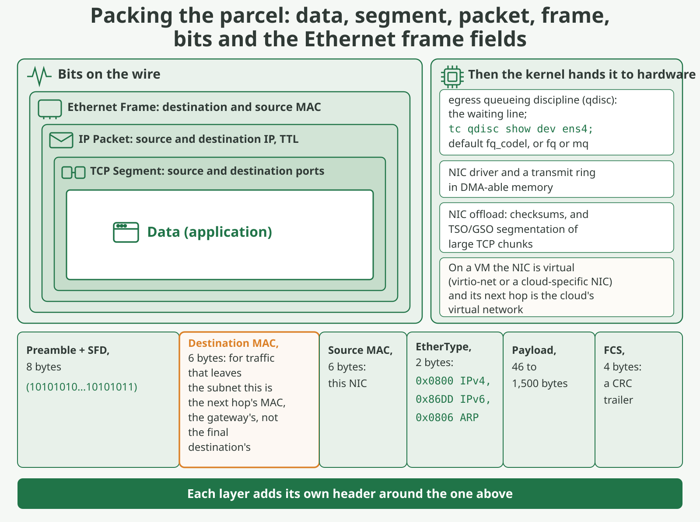

*Figure 2.1.8. Each layer wraps the one above, and the Ethernet frame carries the next hop's MAC as its destination.*

Routing has picked the next hop, but the kernel still cannot build a frame. Think of the router's address as a name and the device's hardware address as the actual door the parcel is handed through. An IP packet needs a link-layer destination before it can go into an Ethernet frame. So the next hop's IP address, which is the gateway `10.0.0.1` or the destination itself when it is on the same link, must be mapped to a **MAC address**, the hardware address of that device's network card.

In IPv4 the host uses **ARP**, the Address Resolution Protocol. It shouts a question to the whole local network: broadcasts "who has 10.0.0.1? tell 10.0.0.15" to `ff:ff:ff:ff:ff:ff`, and the owner replies unicast with its MAC. The result goes into the **neighbour table**, which is a small cache so the shout does not have to be repeated for every packet. `ip neigh` displays it with the states `REACHABLE`, `STALE`, `DELAY`, `PROBE` and `FAILED`. In IPv6 the host uses **NDP**, Neighbor Discovery. It sends a neighbour solicitation to a solicited-node multicast address, and the owner answers with a neighbour advertisement.

```bash
ip neigh show                      # IP -> MAC mappings and their states
ip neigh flush dev ens4            # force re-resolution (careful on production hosts)
sudo tcpdump -nn -e -i ens4 arp or icmp6        # watch ARP/NDP with Ethernet headers (-e)
arping -I ens4 10.0.0.1            # active ARP probe (also detects duplicate addresses)
```

The kernel then builds the packet one layer at a time, like packing a parcel inside a box inside a bigger box. Each layer adds its own **Protocol Data Unit (PDU)**, which is just the name for the unit of data at that layer. The chain runs from application **Data** to TCP **Segment**, which carries the source and destination ports. Next comes the IP **Packet**, which carries the source and destination IP and the TTL. Then comes the Ethernet **Frame**, and finally the physical **Bits** on the wire. The standards behind these layers come from Networking and Kubernetes, chapter 1. ISO/IEC 7498-1..4 defines the 7-layer OSI model. IETF RFCs define the 4-layer TCP/IP model, such as `RFC 1122`, and they move from *Proposed Standard* to *Internet Standard*.

Now look at the frame itself, keeping in mind that the next hop's MAC is the one that goes in it. On the wire, an Ethernet II frame starts with an **8-byte Preamble + Start Frame Delimiter (`SFD`)**, which reads `10101010...10101011`. Next comes the **6-byte Destination MAC**. For traffic that leaves the subnet, this is the next hop's MAC, which is the gateway's, not the final destination's. The **6-byte Source MAC** is this NIC. The **2-byte EtherType** says what is inside: `0x0800` for IPv4, `0x86DD` for IPv6 or `0x0806` for ARP. Then come the **46 to 1,500-byte payload** and a **4-byte Frame Check Sequence (`FCS`)**, which is a CRC trailer.

This detail trips up many beginners, so say it out loud once. **MAC addresses change at every router hop, but IP addresses stay the same end to end unless NAT is involved.** The postal comparison helps here. The street address on the parcel never changes on the way to your friend, but each truck driver only cares about which depot is next, and that "next depot" label is rewritten at every stop. The IP address is the street address. The MAC address is the next-depot label.

The frame then passes through the egress **queueing discipline (qdisc)**, which is the waiting line that decides the order in which frames leave. You can inspect it with `tc qdisc show dev ens4`, and the default is `fq_codel`, or `fq`/`mq`. From there the frame goes to the NIC driver and into a transmit ring in DMA-able memory. The NIC reads the frame and may compute checksums, which is called offload. It also segments large TCP chunks through TSO/GSO, and it serialises the bits onto the medium. In short, the kernel hands the work to the hardware as soon as the frame is ready, so the CPU can get on with other things.

On a VM, the "NIC" is a virtual device, such as virtio-net or a cloud-specific NIC. Its next hop is the cloud's virtual network, which chapter 2.32 covers.

When a host cannot reach its gateway, check `ip neigh show` before you look anywhere else. A neighbour entry stuck in `FAILED` tells you the shout got no answer, which is a very different problem from a bad route.

## 6. Step 4: the switch, the router, NAT and the Internet

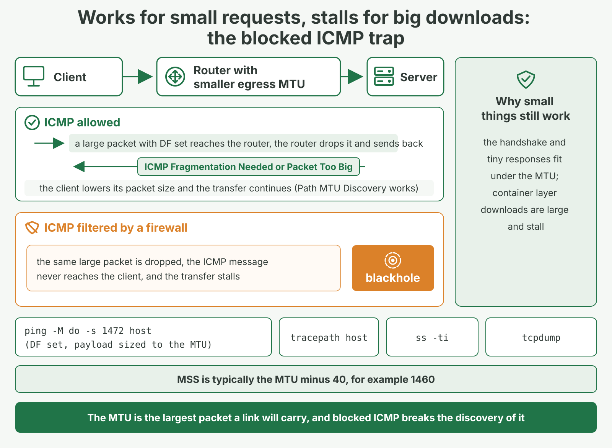

*Figure 2.1.9. When a firewall filters ICMP Packet Too Big, large transfers stall while small requests still work.*

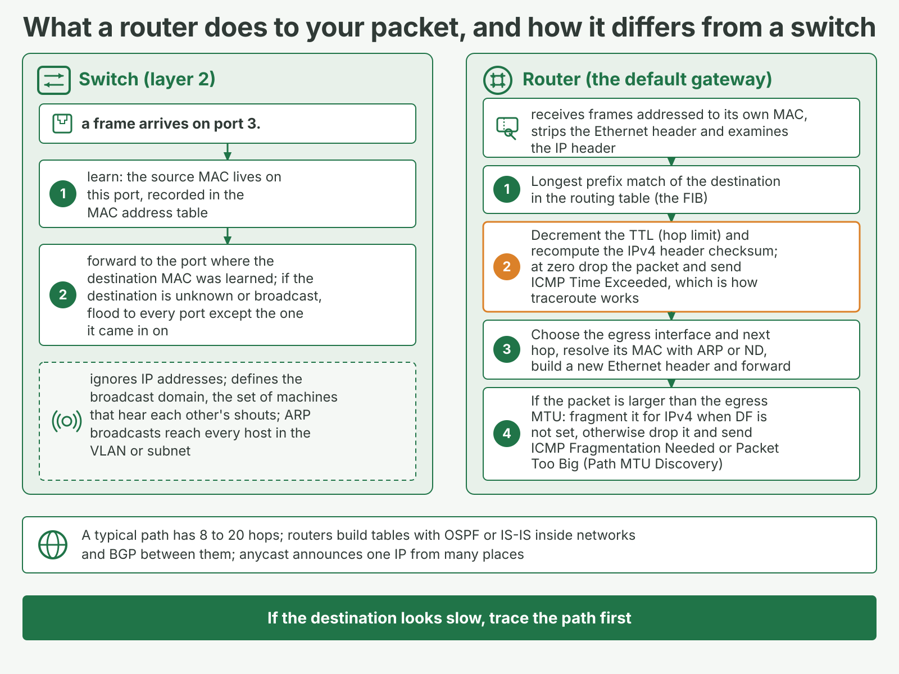

*Figure 2.1.10. A switch learns and forwards by MAC address, while a router matches the prefix, decrements the TTL, rewrites the MAC and handles the MTU.*

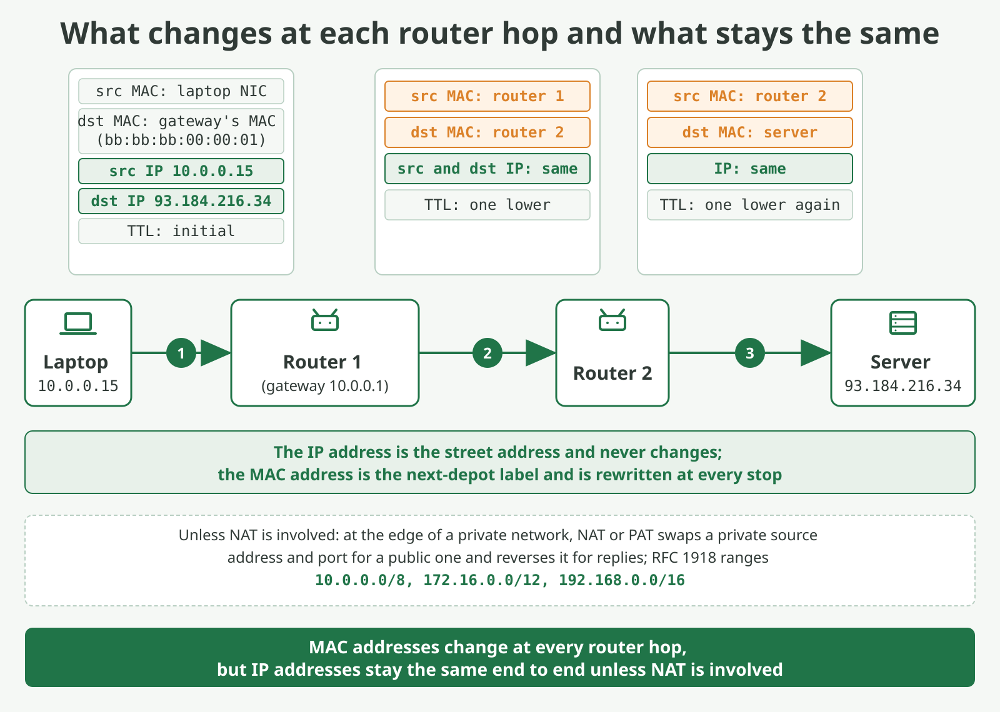

*Figure 2.1.11. MAC addresses are rewritten at every router hop and the TTL drops by one, while the IP addresses stay the same unless NAT is involved.*

Suppose your frame reaches the first switch in the rack. What happens to it? A **switch** works at layer 2 and receives the frame on a port. It **learns** that the source MAC lives on that port and records it in the MAC address table, the way a receptionist writes down which desk each visitor came from. It then forwards the frame to the port where the destination MAC was learned. If the destination is unknown or broadcast, it **floods** the frame to every port except the one it came in on. For plain L2 switching, the switch ignores IP addresses. What it does define is the **broadcast domain**, the set of machines that hear each other's shouts. ARP broadcasts reach every host in the VLAN or subnet, which chapters 2.3 and 2.11 cover.

The default gateway is a router, and it behaves differently from the switch. It receives frames addressed to its own MAC, strips the Ethernet header and examines the IP header. That is the moment the local conversation ends and the wider journey begins. Then it works through four steps.

In step 1, the router checks the destination against its **routing table**, using a longest prefix match in the FIB. In step 2, it decrements the **TTL**, also called the hop limit, and recomputes the header checksum for IPv4. If the TTL reaches zero, the router drops the packet and sends back an ICMP **Time Exceeded** message. That is how `traceroute` works.

In step 3, the router chooses the egress interface and the next hop, resolves the next hop's MAC with ARP or ND, builds a new Ethernet header and forwards the frame. This is exactly the point where the "next depot" label gets rewritten. In step 4, if the packet is larger than the egress MTU, the router fragments it for IPv4 when DF is not set. Otherwise it drops the packet and sends ICMP **Fragmentation Needed** or **Packet Too Big**. The MTU is the largest packet a link will carry. That exchange is Path MTU Discovery, and blackholed ICMP breaks it.

At the **edge of a private network**, such as a home router, a corporate firewall or a cloud NAT gateway, NAT/PAT rewrites outgoing packets. Your laptop has a private address that is meaningless on the public Internet, so something has to swap in a public one on the way out. It replaces a private source address and port with a public one. RFC 1918 defines the private ranges: 10.0.0.0/8, 172.16.0.0/12 and 192.168.0.0/16. The device keeps a translation table, also known as connection tracking, and reverses the rewrite for replies. The server therefore sees the NAT's public IP, not your private address. Chapter 2.9 covers this.

Across the Internet, each router on the path repeats the same lookup and forward step. A typical path has 8 to 20 hops. The routers build their tables with routing protocols: OSPF/IS-IS inside networks, and BGP between them. Chapters 2.13 to 2.16 cover those.

Large services are often reached through **anycast**, where the same IP is announced from many locations and BGP delivers you to the nearest one. CDNs, load balancers and reverse proxies are common too, and chapter 2.20 covers them. So the "server" you reach is typically a front end, not the machine that finally generates the page.

```bash
traceroute -n example.com            # or: mtr -n -c 20 --report example.com   (hops via TTL expiry)
ping -c 4 example.com                # ICMP echo: reachability and RTT
ip -s link show dev ens4             # TX/RX packets, errors, drops on the first hop
```

`traceroute` and `mtr` show each hop through TTL expiry, which means they send packets that are designed to die early so each router along the road introduces itself. `ping` gives reachability and round-trip time. `ip -s link show` shows errors and drops on the first hop.

If the destination looks slow, trace the path first. That tells you whether the delay is in the network or at the server, and it saves you from tuning a server that was never the problem.

## 7. Step 5: TCP connection establishment

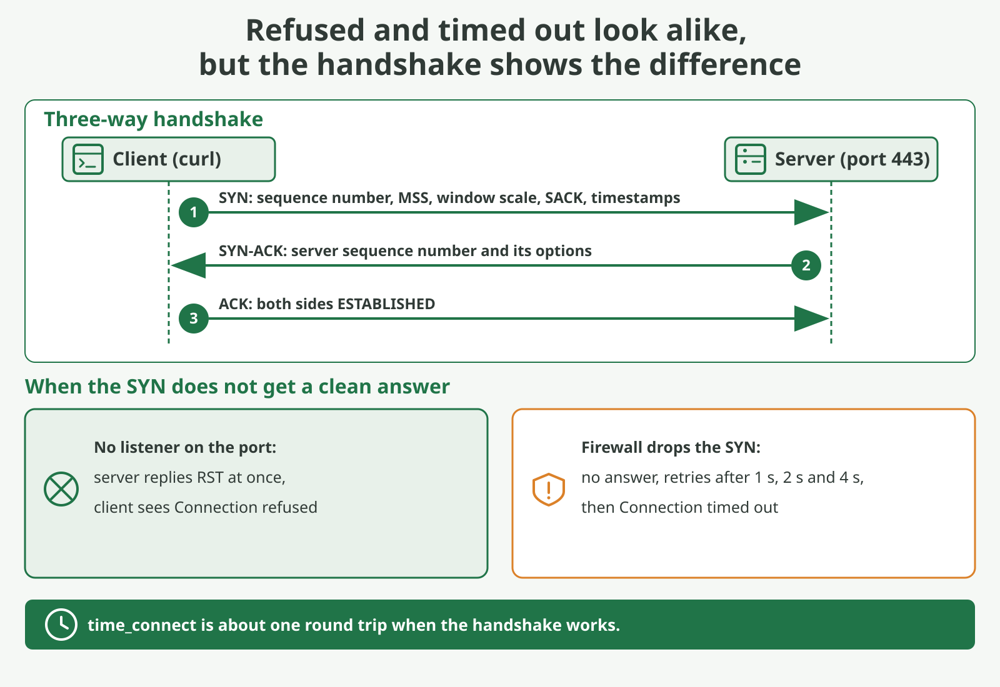

*Figure 2.1.12. The three-way handshake takes about one round trip, and a reset gives a fast refusal while a dropped SYN gives a timeout after retries.*

Before a single byte of your request moves, both ends must agree to talk. It is like a phone call, where each side says "hello, can you hear me" before the real conversation begins. TCP does that with a handshake, and many connection failures show up right here.

`connect()` on a TCP socket triggers the **three-way handshake**. In step 1, the client sends a **SYN**. It carries the client's initial sequence number and its options: MSS, the maximum segment size, which is typically the MTU minus 40, for example 1460; window scale; SACK permitted; timestamps; and optionally ECN.

In step 2, the server answers with a **SYN-ACK**. It acknowledges the client and carries the server's own sequence number and options. Two quite different things can go wrong here, and the difference is worth learning. If no process listens on port 443, the server's kernel answers with **RST** instead, and the client sees `Connection refused` at once. Somebody is home and says "no". If a firewall silently drops the SYN, the client gets nothing back. Nobody answers the door. It retries after 1 s, then 2 s, then 4 s, with backoff, and the attempt ends with `Connection timed out`.

In step 3, the client sends an **ACK**. The connection is now **ESTABLISHED** on both sides, and `connect()` returns.

On the server, a `listen()` socket keeps a SYN queue and an accept queue, which is the backlog. `accept()` returns a new socket for each connection. TCP then provides a reliable, ordered byte stream. It uses sequence numbers, acknowledgements and retransmission timers. Flow control runs through the receiver's advertised window, and congestion control runs through the sender's congestion window. That window goes through slow start, then congestion avoidance with CUBIC or BBR. Chapter 2.6 covers all of this.

```bash
sudo tcpdump -nn -i any 'host 93.184.216.34 and tcp' -c 20      # watch SYN, SYN-ACK, ACK, TLS bytes, FIN
ss -tni dst 93.184.216.34                                       # per-connection info: rtt, cwnd, mss, retrans, bytes
ss -s ; ss -ltnp                                                # summary; listening sockets with owning processes
```

`tcpdump` shows the handshake and the TLS bytes as they cross the wire, so you can watch each step yourself. `ss -tni` shows per-connection numbers such as RTT, congestion window, MSS and retransmissions. `ss -s` and `ss -ltnp` give a summary and the listening sockets with their owning processes.

`time_connect` in `curl -w` equals about one round-trip time (RTT) to the server, plus any DNS time before it. The RTT is the time a message needs to go there and for the reply to come back. Intra-datacentre RTTs are about 0.05 to 0.5 ms. Across continents, RTTs reach 100 ms or more. That gap is why connection reuse and fewer round trips matter. A page that needs many separate connections pays that price many times.

If `time_connect` is far above the RTT that `ping` reports, look for loss or an overloaded accept queue. The handshake should cost about one round trip, so anything much larger means a SYN was lost and retried, or the server was too busy to answer.

## 8. Step 6: TLS handshake (HTTPS)

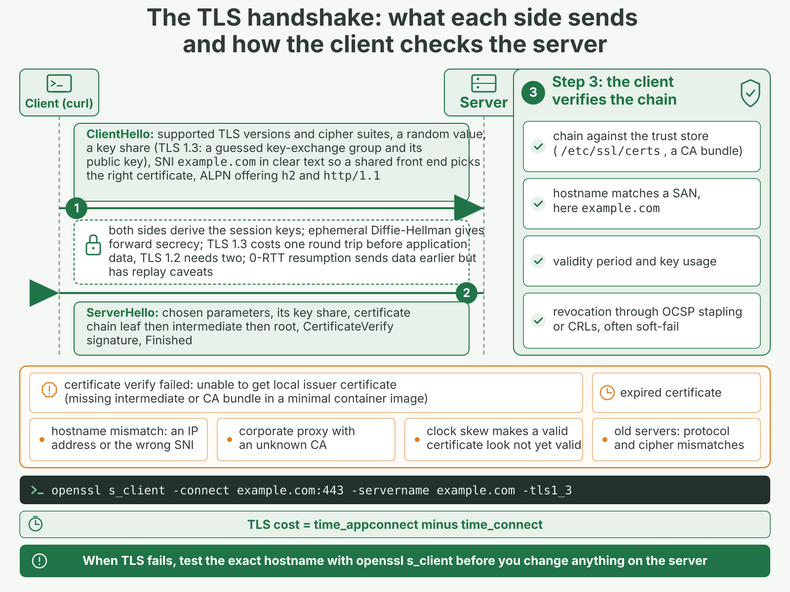

*Figure 2.1.13. The client sends ClientHello with SNI and ALPN, the server answers with its key share and certificate chain, and the client verifies the chain, hostname, validity and revocation.*

A server that answers on port 443 is reachable, but you have no reason to trust it yet. Anyone can answer on a port. Before any request goes out, you need proof that you reached the right server and that nobody on the road can read or alter the conversation, and the TLS handshake supplies it. For `https://`, the client and server now set up an encrypted, authenticated channel on top of the TCP connection.

In step 1, the client sends a **ClientHello**. It lists the supported TLS versions and cipher suites, along with a random value and a key share. In TLS 1.3, the client guesses a key-exchange group and sends its public key in that share. The hello also carries **SNI**, the Server Name Indication, which sends `example.com` in clear text so that a shared front end can pick the right certificate. Last, **ALPN** offers the application protocols the client can speak, such as `h2` and `http/1.1`.

In step 2, the server replies with a **ServerHello**, its key share and its certificate chain, followed by **Finished**. The server chooses the parameters and proves its identity with an X.509 certificate chain that runs leaf → intermediate → root. It signs the handshake in a CertificateVerify message. Both sides then derive the session keys, and ephemeral Diffie-Hellman gives forward secrecy. In TLS 1.3 this costs one round trip before application data can flow. TLS 1.2 needs two round trips. 0-RTT resumption can send data earlier, but it has replay caveats.

In step 3, the client **verifies** the chain, in the way a bouncer checks an ID. It checks the chain against its trust store, `/etc/ssl/certs` and a CA bundle, which is a list of authorities it already trusts. It checks that the hostname matches a SAN, which must be `example.com` here, and it checks the validity period and key usage. It also checks revocation through OCSP stapling or CRLs, which is often soft-fail, meaning a failed check is tolerated rather than fatal.

```bash
openssl s_client -connect example.com:443 -servername example.com -tls1_3 </dev/null 2>/dev/null | egrep 'Protocol|Cipher|Verify|subject|issuer'
openssl s_client -connect example.com:443 -servername example.com -showcerts </dev/null | less     # whole chain
curl -v --tlsv1.3 https://example.com/ -o /dev/null 2>&1 | egrep 'TLS|ALPN|subject|issuer|expire'
echo | openssl s_client -connect example.com:443 -servername example.com 2>/dev/null | openssl x509 -noout -dates -subject -ext subjectAltName
```

`curl -v` shows the TLS and ALPN details in one place, so it is a good first look before you reach for heavier tools.

Chapter 2.10 covers the failures that show up here. A missing intermediate or CA bundle in a minimal container image produces `certificate verify failed: unable to get local issuer certificate`. An expired certificate fails here too, and so does a hostname mismatch, such as using an IP address or the wrong SNI. A corporate proxy with an unknown CA can intercept TLS. Clock skew can make a valid certificate look "not yet valid", and old servers can cause protocol and cipher mismatches.

The TLS cost is `time_appconnect - time_connect`. It covers one RTT plus the cryptography. When you read a timing report later in this chapter, this is the slice to look at if the secure part feels slow.

When TLS fails, test the exact hostname with `openssl s_client` before you change anything on the server.

## 9. Step 7: the HTTP request and response

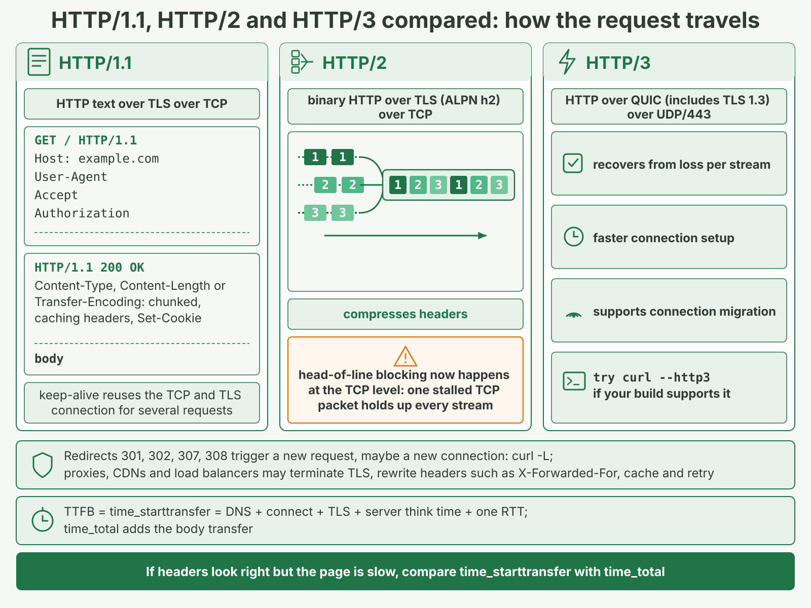

*Figure 2.1.14. HTTP/2 multiplexes streams over one TCP connection, so one lost packet holds up all of them, while HTTP/3 over QUIC recovers per stream.*

The encrypted channel is ready, so `curl` finally sends its request through it. This is the step most people think of as "the web", and it turns out to be the last of many. What comes back depends on which HTTP version the two sides agreed on.

With **HTTP/1.1**, the request is plain text. It holds `GET / HTTP/1.1`, `Host: example.com`, `User-Agent`, `Accept`, optional `Authorization`, and a blank line. The response starts with a status line such as `HTTP/1.1 200 OK`. Headers follow, such as `Content-Type`, `Content-Length` or `Transfer-Encoding: chunked`, caching headers and `Set-Cookie`. A blank line comes next, then the body. Persistent connections, called keep-alive, reuse the TCP and TLS connection for several requests.

**HTTP/2** is binary and runs over TLS with ALPN `h2`. It multiplexes many request and response streams on one connection, and it compresses headers. Head-of-line blocking now happens at the TCP level, so one stalled TCP packet holds up every stream.

**HTTP/3** runs over **QUIC**, which uses UDP/443 and includes TLS 1.3. It recovers from loss per stream, sets up connections faster and supports connection migration. If your `curl` build supports it, try `curl --http3`.

A redirect with status 301/302/307/308 triggers a new request, which may need a new connection. `curl -L` follows redirects for you. Proxies, CDNs and load balancers may terminate TLS, rewrite headers such as `X-Forwarded-For`, cache responses and retry requests.

The time to first byte, or TTFB, is `time_starttransfer`. It adds up DNS, connect, TLS, server think time and one RTT for the response to start arriving. In other words, it is how long you waited before anything at all came back. `time_total` adds the body transfer, which depends on size, bandwidth, the TCP congestion window and loss.

```bash
curl -sS -D - -o /dev/null https://example.com/                 # response headers only
curl -sS --http1.1 -I https://example.com/ ; curl -sS --http2 -I https://example.com/
curl -sS -w '\nhttp=%{http_version} code=%{http_code} size=%{size_download} speed=%{speed_download}\n' -o /dev/null https://example.com/
curl --resolve example.com:443:93.184.216.34 https://example.com/ -o /dev/null -v     # bypass DNS: test a specific backend
curl -H 'Host: example.com' http://93.184.216.34/ -I                                  # virtual hosting check without DNS
```

The last two commands skip DNS. One tests a specific backend, and the other checks virtual hosting without DNS. They are handy when you suspect the name lookup and want to take it out of the picture.

If the headers look right but the page is still slow, compare `time_starttransfer` with `time_total` to see whether the wait or the body is the cost.

## 10. Step 8: transfer, acknowledgements and teardown

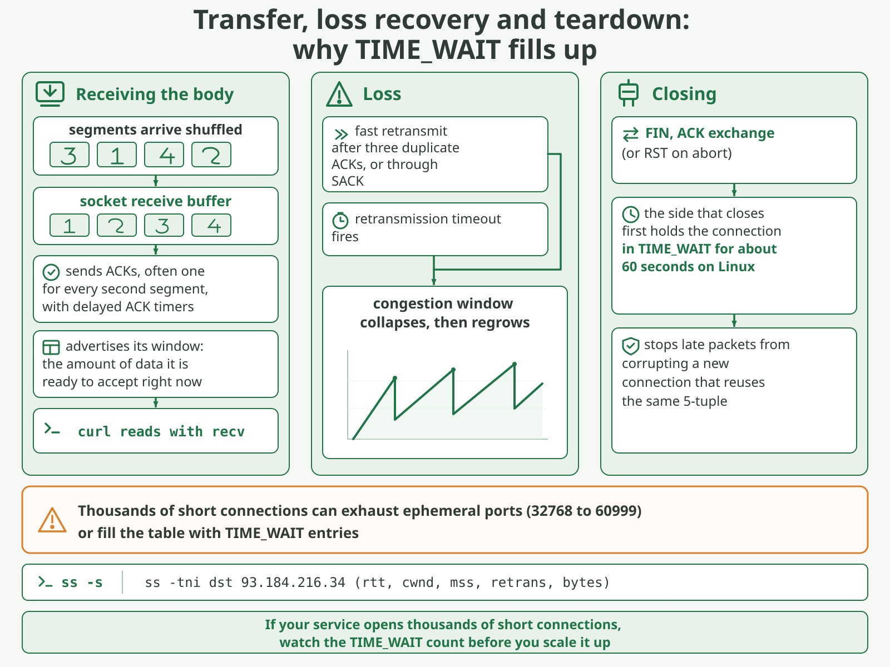

*Figure 2.1.15. Loss collapses the congestion window, and the side that closes first sits in TIME_WAIT for about 60 seconds, which thousands of short connections can pile up.*

The response body arrives as TCP segments, and the receiving kernel has to put them back in order, because packets can arrive shuffled. It reassembles them in the socket receive buffer. It sends **ACKs**, often one for every second segment, with delayed ACK timers. It also advertises its **window**, the amount of data it is ready to accept right now. Then `curl` reads the data with `recv`.

Loss triggers a fast retransmit after three duplicate ACKs, or through SACK. Otherwise a retransmission timeout fires. Either way, the congestion window collapses and then regrows. You can think of the window as TCP's cautious estimate of how much the road can carry, which it shrinks quickly after a scare and rebuilds slowly.

When both sides are done, TCP closes with **FIN/ACK** exchanges, or with **RST** on abort. The side that closes first keeps the connection in **TIME_WAIT** for about 60 seconds on Linux. That delay stops late packets from corrupting a new connection that reuses the same 5-tuple. It is a little like keeping a closed file on your desk for a minute in case a late letter about it arrives.

Thousands of short connections can exhaust ephemeral ports or fill the table with `TIME_WAIT` entries. Chapter 2.6 covers this, and chapter 1.22 covers the tuning.

If your service opens thousands of short connections, watch the `TIME_WAIT` count before you scale it up.

## 11. Timing: reading `curl -w`

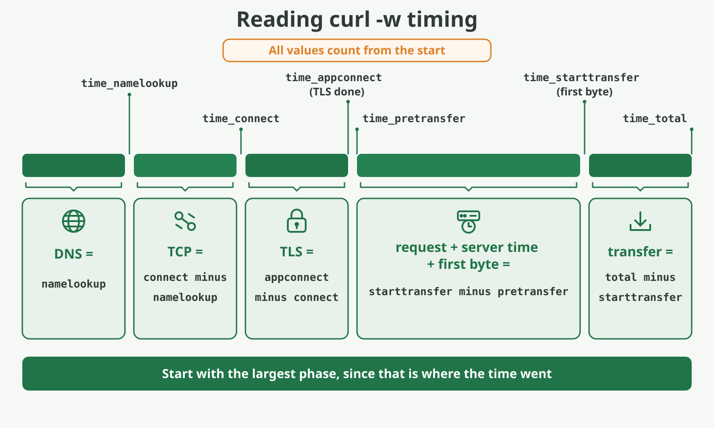

*Figure 2.1.16. Each curl -w value counts from zero, so each phase is the difference between two values.*

A single total time hides where the wait happened. Imagine telling a doctor only "I felt unwell for a while". A slow request is only useful to you once you know which phase was slow, and `curl -w` splits the request into phases.

```bash
cat > curl-format.txt <<'EOF'
     namelookup:  %{time_namelookup}s
        connect:  %{time_connect}s
     appconnect:  %{time_appconnect}s   (TLS done)
    pretransfer:  %{time_pretransfer}s
  starttransfer:  %{time_starttransfer}s   (first byte)
          total:  %{time_total}s
      remote_ip:  %{remote_ip}   local_ip: %{local_ip}   http: %{http_version}   connects: %{num_connects}
EOF
curl -sS -o /dev/null -w @curl-format.txt https://example.com/
```

All values count from the start, so each phase is a difference between two of them. DNS is namelookup. TCP is connect minus namelookup. TLS is appconnect minus connect. The request, server time and first byte together are starttransfer minus pretransfer. The transfer is total minus starttransfer.

Let us work one example with the numbers from exercise 5. Suppose `time_namelookup` is 0.012 s and `time_connect` is 0.032 s. DNS takes 0.012 s, because the clock started at zero. TCP takes 0.032 minus 0.012, which is 0.020 s, because the connect number already includes the time DNS took. Every other phase follows the same pattern of taking one number and subtracting the one before it.

Then read each phase against its likely cause. A large DNS phase points to the resolver or a search-domain explosion. A large TCP phase points to distance, loss (a SYN retransmit adds 1 s) or an overloaded accept queue. A large TLS phase points to distance, the certificate chain or CPU load. A large TTFB points to the server, the application or the backend. A large transfer points to bandwidth, loss, window limits or response size.

Start with the largest phase, since that is where the time went.

## 12. A map from symptom to layer

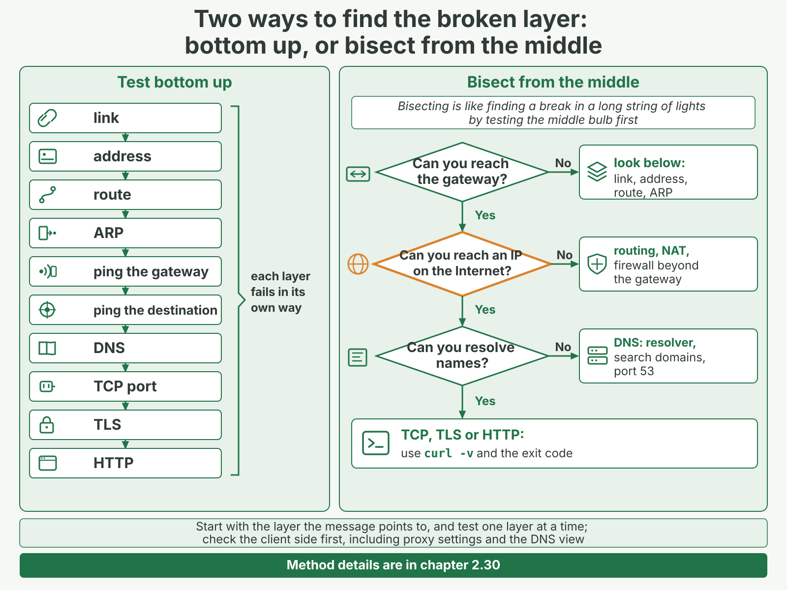

*Figure 2.1.17. Test bottom up through ten layers, or bisect by checking the gateway, then an Internet IP, then name resolution.*

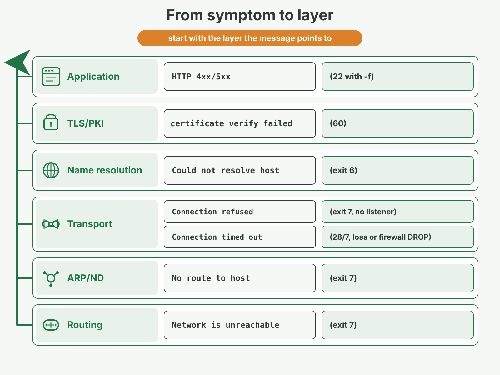

*Figure 2.1.18. A curl error message and exit code point to the layer where you should start looking.*

When `curl` fails, the message and the exit code point to a layer. You now know every layer in the trip, so you can use the table below as a lookup. Match your symptom to a row and start with the layer that row names.

| Symptom (curl) | Exit code / message | Layer and likely cause | First tools |
|---|---|---|---|
| `Could not resolve host` | 6 | Name resolution: wrong/dead resolver, NXDOMAIN, firewall on port 53, nsswitch | `getent`, `resolvectl`, `dig @server`, `/etc/resolv.conf` |
| Long pause, then success | | DNS timeout to a dead first resolver, IPv6 fallback delay, slow ARP | `strace -tt`, `curl -w`, `tcpdump port 53` |
| `Network is unreachable` | 7 | Routing: no route/default gateway | `ip route`, `ip route get` |
| `No route to host` | 7 | ARP/ND failure, ICMP unreachable | `ip neigh`, `tcpdump arp` |
| `Connection refused` | 7 | Transport: server reachable, no listener (RST), or firewall REJECT | `ss -ltn` on server, `nc -vz`, `tcpdump` |
| `Connection timed out` / `Operation timed out` | 28/7 | Packet loss or firewall DROP, security group, wrong route/NAT, asymmetric routing | `tcpdump` both ends, `mtr`, firewall logs |
| `SSL: certificate problem`, `certificate verify failed` | 60 | TLS/PKI: chain, expiry, hostname, interception, clock | `openssl s_client`, `date`, CA bundle |
| `SSL_ERROR_SYSCALL`/`wrong version number` | 35 | TLS vs plain-HTTP port mismatch, middlebox reset | `tcpdump`, `openssl s_client` |
| `HTTP 4xx/5xx` | 22 with `-f` | Application layer: auth, routing rules, backend down, rate limit | `curl -v`, server logs, load balancer logs |
| Works for small, stalls for big transfers | | MTU/PMTUD blackhole (ICMP filtered), TCP window/loss | `ping -M do -s 1472`, `tracepath`, `ss -ti`, `tcpdump` |
| Works from A, fails from B | | Different route, firewall, DNS view, proxy settings (`HTTP(S)_PROXY`) | `curl -v` from both, `env \| grep -i proxy` |

The method is in chapter 2.30. You can test each layer from the bottom up: link, address, route, ARP, ping the gateway, ping the destination, DNS, TCP port, TLS and HTTP. Or you can bisect from the middle. Ask whether you can reach the gateway, then whether you can reach an IP on the Internet, then whether you can resolve names. Bisecting is like finding a break in a long string of lights by testing the middle bulb first.

Either way, start with the layer that the message points to, and test one layer at a time.

## 13. The same journey in AI infrastructure

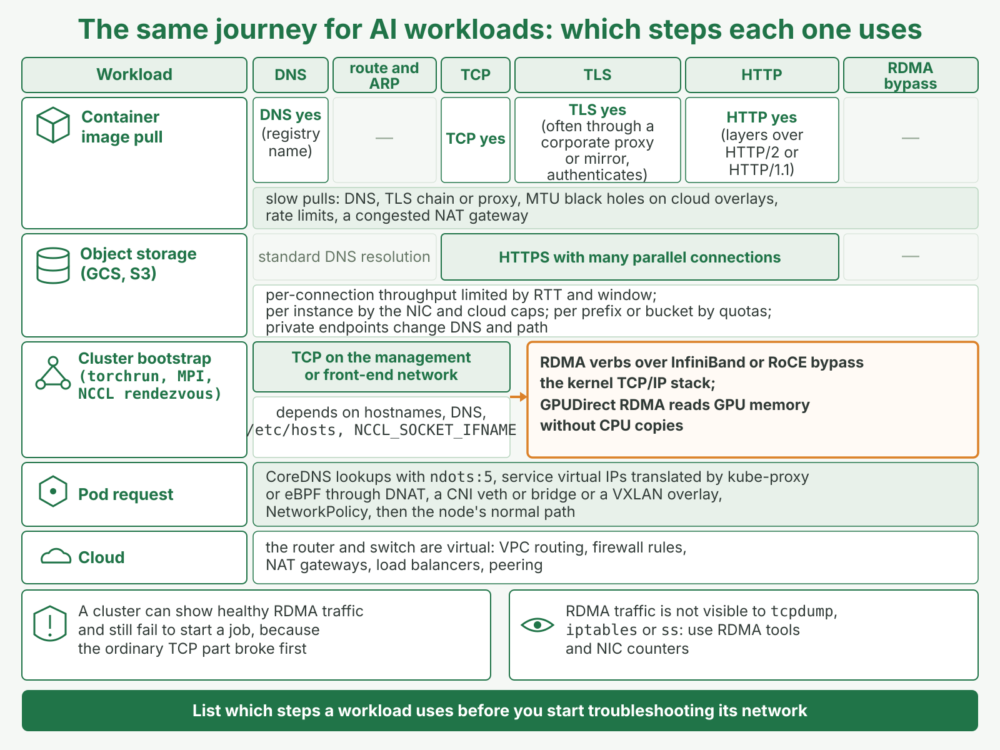

*Figure 2.1.19. Every AI workload walks a version of the curl journey, and RDMA bulk transfers bypass the kernel TCP/IP stack while the control path still uses TCP.*

Every AI workload walks some version of this journey, but each one adds steps or skips them. If you can say which steps a workload uses, you know where to look when it breaks. Here is how it changes for the traffic you will meet most often.

Container image pulls come first. `containerd` or Docker resolves the registry name with DNS. It then connects over TLS, often through a corporate proxy or mirror, and authenticates. Layers download over HTTP/2 or HTTP/1.1. A slow pull can come from DNS, from a TLS chain or proxy problem, from MTU black holes on cloud overlays, from rate limits or from a congested NAT gateway.

Object storage, such as GCS or S3, uses HTTPS with many parallel connections. Throughput per connection is limited by RTT and window. Throughput per instance is limited by the NIC and cloud caps, and throughput per prefix or bucket is limited by service quotas. Private connectivity and DNS, through private endpoints, change the path entirely.

Cluster bootstrap comes next. `torchrun`, MPI and NCCL rendezvous over ordinary TCP connections on the management or front-end network. That path depends on hostnames, DNS, `/etc/hosts` and `NCCL_SOCKET_IFNAME`. The bulk transfers then use RDMA verbs over InfiniBand or RoCE, which **bypass the kernel TCP/IP stack**. User-space libraries post work requests directly to the NIC, and the NIC does its own segmentation, reliability and memory access. GPUDirect RDMA reads GPU memory without CPU copies.

So the journey is shorter here, with no routing table, qdisc or TCP in the kernel. The lower layers still exist, though. You still find Ethernet or IB addressing, switches and routing in the fabric, and the control plane still uses TCP/IP for connection setup. This is why a cluster can show perfectly healthy RDMA traffic and still fail to start a job, because the ordinary TCP part of the story broke first.

A pod's request adds steps of its own. CoreDNS lookups use `ndots:5`. Service virtual IPs are translated by kube-proxy or eBPF through DNAT. A CNI-managed veth or bridge, or an overlay with VXLAN encapsulation, carries the packet, and NetworkPolicy applies. Then the node's normal path takes over. Chapters 2.23 and 2.25, and Part 5, cover this.

In the cloud, the router and the switch are virtual. VPC routing, firewall rules, NAT gateways, load balancers and peering decide what happens to your packet. Chapter 2.32 covers this case.

For each workload, list which of these steps it uses before you start troubleshooting its network. A two-minute list saves an afternoon of looking in the wrong place.

## 14. Hands-on lab: trace one request end to end

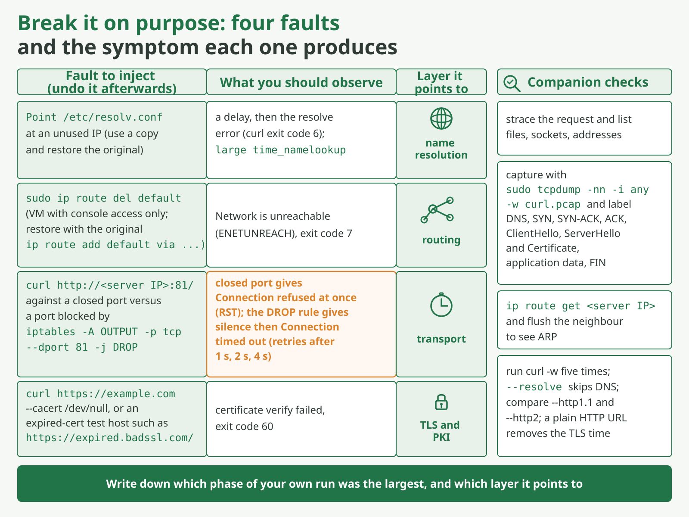

*Figure 2.1.20. Each injected fault produces a distinct curl symptom that points to one layer: resolver, route, transport or TLS.*

A word on status first. The self-checking Python lab below runs locally and has been run, while the interactive VM commands that follow have not been run for this chapter. Start with the Python lab, which runs locally from `code/part02/curl_packet_journey_lab.py`. It checks three things. First, the `curl -w` phase subtraction for DNS, TCP connect, TLS handshake, TTFB wait and body transfer. Second, the hop-by-hop L2 MAC rewrites, against the constant L3 IP and the decrementing `TTL`. Third, the layer diagnosis for the `curl` exit codes `6`, `7`, `22`, `28`, `35` and `60`.

```bash
python3 code/part02/curl_packet_journey_lab.py
```

Next, move to a disposable Linux VM with `curl`, `dig`, `tcpdump`, `strace`, `openssl`, `iproute2` and `mtr` installed. Treat each result as something you still need to confirm on your own machine. Then work through these steps.

1. Record your configuration. Run `ip -br addr`, `ip route`, `ip neigh`, `cat /etc/resolv.conf`, `resolvectl status` and `cat /etc/nsswitch.conf | grep hosts`. Then draw your host's view: interface, address, gateway and resolver.
2. Narrate the request with strace. Run the `strace` command from section 2, and list in order the files opened, the sockets created and the addresses connected. Then identify the DNS query socket and the TCP socket.
3. Capture the traffic. In one terminal, run `sudo tcpdump -nn -i any -w curl.pcap 'port 53 or host <example.com IP>'`. In another terminal, run `curl -sS -o /dev/null https://example.com/`. Stop the capture, then read it with `tcpdump -nn -r curl.pcap | head -60`, or open it in Wireshark. Label each packet as a DNS query or response, SYN, SYN-ACK, ACK, ClientHello, ServerHello/Certificate, application data or FIN.
4. Check the route and the neighbour. Run `ip route get <server IP>`. Then flush the gateway neighbour with `sudo ip neigh flush dev <if>`, and repeat the capture with `arp or icmp6` included, so you can see ARP and NDP.
5. Time it. Run the `curl -w` report five times. Then add `--resolve` to skip DNS, and compare `--http1.1` with `--http2`. Compare the phases you get. Last, try a plain HTTP URL, and watch the TLS time disappear.
6. Break it on purpose, one change at a time, and undo each change. (a) Point `/etc/resolv.conf` at an unused IP. Use a copy, restore the original afterwards, and observe the delay and the error. (b) Run `sudo ip route del default` and observe `Network is unreachable`. Restore the route with the original `ip route add default via ...`, and do this only on a VM with console access. (c) Run `curl http://<server IP>:81/` against a closed port, then compare it with a port blocked by `iptables -A OUTPUT -p tcp --dport 81 -j DROP`. Note whether you get a timeout or a refusal. (d) Run `curl https://example.com --cacert /dev/null`, or use an expired-cert test host such as `https://expired.badssl.com/`, and read the TLS error.
7. Trace the path. Run `traceroute -n` and `mtr -n -c 30 --report` to the server. Note the hop count, how the RTT grows and where it increases. Compare the RTT with `ping`'s result and with `time_connect`.
8. On an optional GPU VM, run `ss -tnp` while a PyTorch distributed job rendezvous runs. Compare what you see with `rdma link` and `ibv_devinfo`, and note which traffic is TCP and which is RDMA.

Finish by writing down which phase of your own run was the largest, and which layer that phase points to. That one sentence is the habit this whole chapter is training.

## 15. Common mistakes

Most network debugging goes wrong in the same few ways, and nearly all of them come from losing the picture of the path. The first is treating "the network" as one thing. It is a path with layers, and each layer fails in its own way. Another is forgetting DNS when the network feels slow, including `search`/`ndots` and IPv6 AAAA.

If you think the destination MAC belongs to the final server, you will be confused, because MAC addresses change at every hop. Forgetting that NAT hides your address leads to the same confusion. Testing with `ping` alone is another trap. ICMP may be filtered, and `ping` says nothing about TCP ports, TLS or HTTP. A reply to `ping` is real evidence, but only about ICMP.

Using the IP in place of the name for HTTPS surprises people with certificate errors, and so does omitting SNI. Ignoring MTU and ICMP filtering breaks large transfers. Reading `time_total` without the phase breakdown hides the cause.

Assuming that the client's problem is the server's problem ignores proxy variables, split DNS and different routes from different hosts. In AI clusters, the classic mistake is assuming RDMA traffic is visible to `tcpdump`, `iptables` or `ss`. It is not, so use RDMA tools and NIC counters instead.

Check the client side first, including its proxy settings and DNS view. It is the cheapest place to look, and it is surprisingly often where the answer is.

## 16. Interview angles

Interviewers use these questions to check whether you can narrate the path step by step, with a command for each step. A calm walk through the trip, in order, impresses more than a list of memorised facts.

- "Walk me through what happens when you run `curl https://example.com`." Follow the sections of this chapter in order, and name a command for each step.
- "How does a packet get from your laptop to a server in another continent? What changes at each hop?" The MAC address and the TTL change at every hop. The IP address stays constant, except where NAT changes it at the edge.
- "Difference between 'connection refused' and 'timed out'?" A refusal is an RST that comes back at once. A timeout is silence.
- "How would you debug 'works from my machine, not from the pod'?" Check the resolver, the route, NAT, policy and the proxy.
- "What is a three-way handshake and why? What are SYN cookies?"
- "What does the TLS handshake do? How does the client know it is talking to the right server?"
- "Where does TCP end up in AI training traffic, and where does it not?"
- "A download is fast for small files and stalls for large ones. Why?" Look at MTU and PMTUD first, then at the window and loss.

## Exercises

Work through these six exercises in order. Each one uses the commands from the earlier sections, and each starts from a situation you could meet on a real machine.

1. Write out the 9 ordered stages of `curl https://example.com/`, from URL parsing through the `FIN`/`ACK` exchange and the `TIME_WAIT` state. Then match each `strace` system call (`openat`, `socket`, `connect`, `sendto`, `recvfrom`, `close`) to its stage: the `/etc/nsswitch.conf` and `/etc/hosts` lookup, the UDP/53 DNS query, or the TCP/443 connection.
2. Name resolution raises two questions, one about `systemd-resolved` and one about Kubernetes. (a) Explain how `getent ahosts example.com`, `resolvectl query example.com` and `dig +trace example.com` differ in what they test. (b) Explain why setting `ndots:5` in a Kubernetes Pod's `/etc/resolv.conf` multiplies DNS queries when you look up `example.com`.
3. Take a host at `10.0.0.15/24` with default gateway `10.0.0.1` (`bb:bb:bb:00:00:01`) that sends a packet to `93.184.216.34`. (a) What does `ip route get 93.184.216.34` return, and whose MAC address goes into the outgoing frame's Destination MAC field? (b) Use `simulate_router_hop_headers()` in `code/part02/curl_packet_journey.py` to trace which header fields change and which stay constant across three router hops.
4. Compare two failures at the packet level. (a) What is the difference, in `tcpdump`, between a host where no process listens on port 443, which gives `Connection refused`, and a host where a firewall drops the `SYN`, which gives `Connection timed out`? (b) Why does filtering ICMP `Fragmentation Needed` / `Packet Too Big` let `curl` handshakes and tiny responses succeed, while large container layer downloads stall? How does `ping -M do -s 1472` test this?
5. Work with `curl -w` numbers and exit codes. (a) Given `curl -w` output `namelookup=0.012s, connect=0.032s, appconnect=0.072s, pretransfer=0.073s, starttransfer=0.123s, total=0.153s`, use `decompose_curl_timings()` to compute the exact duration of the DNS, TCP connect, TLS handshake, server TTFB wait and body transfer phases. (b) Map `curl` exit codes `6`, `7`, `22`, `28`, `35` and `60` (`diagnose_curl_exit_code()`) to their exact network layers and first diagnostic commands.
6. Contrast two paths. Trace a `torchrun`/`NCCL` TCP bootstrap connection (`getaddrinfo` -> `socket` -> routing table -> ARP -> `qdisc` -> NIC) with an InfiniBand or RoCEv2 GPUDirect RDMA collective transfer. Then explain why `tcpdump`, `ss` and `iptables` do not see the RDMA data-plane packets.

Pick the exercises that match the tools on your VM, and write each answer in your own words.

## Checkpoint questions (20)

<details>
<summary>1. Which C library function resolves a hostname in Linux, and how do `/etc/nsswitch.conf`, `/etc/hosts`, and `/etc/resolv.conf` interact?</summary>

When your program needs a name, it calls `getaddrinfo()`. That function reads the `hosts:` line in `/etc/nsswitch.conf`, which is typically `files resolve dns` or `files dns`. Because of `files`, it checks `/etc/hosts` first. If that does not answer, it asks the local stub resolver, `systemd-resolved` at `127.0.0.53`, or the DNS nameservers listed in `/etc/resolv.conf`.
</details>

<details>
<summary>2. Why do modern resolvers query both `A` and `AAAA` records in parallel, and what is \"Happy Eyeballs\" (RFC 6724 / RFC 8305)?</summary>

Resolvers ask for both IPv4 (`A`) and IPv6 (`AAAA`) records, so dual-stack clients can prefer IPv6. Happy Eyeballs starts an IPv6 connection first. If it has not completed within a few tens of milliseconds, the client starts an IPv4 attempt in parallel. A broken IPv6 path therefore cannot cause a multi-second hang.
</details>

<details>
<summary>3. What do `search` domains and `ndots` in `/etc/resolv.conf` do, and why does `ndots:5` in Kubernetes matter?</summary>

A hostname with fewer dots than `ndots` is first queried with each `search` suffix appended. The default is `1` on Linux, and Kubernetes Pods use `5`. For example, `api.openai.com` has `2` dots in Kubernetes, which is less than `5`. So the resolver first tries `api.openai.com.<ns>.svc.cluster.local`, then `api.openai.com.svc.cluster.local`, then `api.openai.com.cluster.local`, with both `A` and `AAAA` queries for each. Only after those does it query `api.openai.com.` as an absolute name.
</details>

<details>
<summary>4. What does `ip route get 93.184.216.34` show, and how does the Linux kernel choose between multiple matching routes?</summary>

If you run `ip route get`, the kernel's Forwarding Information Base (FIB) gives the answer. It prints the route, the next-hop gateway (`via 10.0.0.1`), the outgoing interface (`dev ens4`) and the source IP (`src 10.0.0.15`) that the kernel will use. When several routes match, the kernel picks the longest matching prefix. A `/24` beats a `/16`, and a `/16` beats the default `0.0.0.0/0`. Ties are broken by route `metric`.
</details>

<details>
<summary>5. How is a TCP connection uniquely identified in the kernel, and where does the client's source port come from?</summary>

A TCP connection is identified by its **5-tuple**: the protocol (TCP), the source IP, the source port, the destination IP and the destination port. When an unbound client socket calls `connect()`, the kernel picks an unused **ephemeral port** from `net.ipv4.ip_local_port_range`. The default range is `32768` to `60999`.
</details>

<details>
<summary>6. How do ARP (IPv4) and NDP (IPv6) resolve the next hop's MAC address, and where does Linux cache the result?</summary>

In IPv4, your host broadcasts an **ARP Request** to `ff:ff:ff:ff:ff:ff`, asking "Who has 10.0.0.1? Tell 10.0.0.15." The owner replies unicast with its 6-byte MAC address. In IPv6, **NDP**, the Neighbor Discovery Protocol, uses ICMPv6 Neighbor Solicitation and Advertisement messages sent to a solicited-node multicast address. Both methods fill the kernel **neighbour table**. You can read it with `ip neigh show`, which shows states such as `REACHABLE`, `STALE`, `DELAY`, `PROBE` and `FAILED`.
</details>

<details>
<summary>7. When a host at `10.0.0.15/24` sends a packet to `93.184.216.34` via gateway `10.0.0.1`, what MAC address is in the Ethernet frame's Destination MAC field?</summary>

The frame carries the default gateway's MAC address, the one for `10.0.0.1`. It never carries the remote server's MAC address. Ethernet works only on the local link, so you can think of the frame as addressed to your local router.
</details>

<details>
<summary>8. Name the fields of an Ethernet II frame and the Protocol Data Units (`PDU`s) at each layer of the TCP/IP stack (Networking and Kubernetes, chapter 1).</summary>

From top to bottom, the PDUs are: application **Data**, transport **Segment** for TCP or **Datagram** for UDP, network **Packet** for IP, link **Frame** for Ethernet, and physical **Bits**. An Ethernet II frame has an `8`-byte Preamble + SFD, a `6`-byte Destination MAC, a `6`-byte Source MAC, a `2`-byte EtherType (`0x0800` for IPv4, `0x86DD` for IPv6, `0x0806` for ARP), a `46–1500`-byte payload and a `4`-byte `FCS` (CRC-32).
</details>

<details>
<summary>9. As a packet traverses 12 routers across the Internet (without NAT), what changes in the headers at each hop and what stays constant?</summary>

For example, as your packet crosses each router, the outer Ethernet source and destination MAC addresses are replaced with the MACs for the next link. The IP header's `TTL` (IPv4) or `Hop Limit` (IPv6) drops by `1`, and the IPv4 header checksum is recomputed. The source IP, the destination IP, the TCP ports and the payload stay the same. The exception is a NAT gateway, which rewrites the source IP and port at a private-network boundary.
</details>

<details>
<summary>10. How does a Layer 2 switch decide where to forward an Ethernet frame compared to a Layer 3 router?</summary>

A Layer 2 switch reads the source MAC of each incoming frame to learn which port that MAC lives on, and it stores this in its MAC address table. It forwards the frame out the one port that matches the destination MAC. If the destination MAC is unknown or is broadcast (`ff:ff:ff:ff:ff:ff`), it **floods** the frame out all ports in the VLAN. A Layer 3 router works differently. It ends the Ethernet frame and looks up the destination IP in its routing table, the FIB. It decrements `TTL` and wraps the packet in a new Ethernet frame for the next hop.
</details>

<details>
<summary>11. Trace the TCP three-way handshake (`SYN`, `SYN-ACK`, `ACK`) and the options negotiated during `SYN`.</summary>

The client sends a `SYN` with its initial sequence number, `ISN`, and TCP options: **MSS**, typically `MTU - 40 = 1460` bytes; a window scale factor; SACK permitted; and timestamps. The server answers with a `SYN-ACK` that carries its own `ISN`, `ACK = client_ISN + 1`, and the options it agrees to. The client then sends an `ACK` with `server_ISN + 1`. Both sockets are now `ESTABLISHED`.
</details>

<details>
<summary>12. At the packet level, what is the difference between `Connection refused` and `Connection timed out`?</summary>

When you see `Connection refused`, the answer came back in about one round trip, 1 RTT. The packet reached the host, found no listener on that port, and got a TCP **`RST`** (Reset) in return. A firewall that sends REJECT produces the same fast refusal. `Connection timed out` takes several seconds, because the client retries the `SYN` at `1 s`, `2 s`, `4 s` and so on. A firewall `DROP` or a blackholed route never answers, so every retry goes unanswered.
</details>

<details>
<summary>13. What happens during a TLS 1.3 handshake (`ClientHello` -> `ServerHello`), and what roles do `SNI` and `ALPN` play?</summary>

In TLS 1.3, the handshake completes in 1 RTT. The client's `ClientHello` carries its cipher suites, an ephemeral Diffie-Hellman key share, **`SNI`** and **`ALPN`**. `SNI`, which stands for Server Name Indication, names `example.com`, so a multi-tenant server or load balancer can select the right X.509 certificate. `ALPN`, Application-Layer Protocol Negotiation, offers `h2` and `http/1.1`. The server answers with `ServerHello`, its key share, its certificate chain, a `CertificateVerify` signature and `Finished`. The client checks the chain against `/etc/ssl/certs` and the hostname against the SANs before it sends encrypted HTTP data.
</details>

<details>
<summary>14. Compare HTTP/1.1, HTTP/2, and HTTP/3 (QUIC) at the transport layer.</summary>

With HTTP/1.1, you send text requests one after another over TCP, and connections are reused with keep-alive. HTTP/2 multiplexes several binary request and response streams over one TCP and TLS connection, with HPACK header compression. The catch is that one lost TCP packet stalls all of them. That is TCP head-of-line blocking. HTTP/3 runs over QUIC, on UDP port `443`, with TLS 1.3 built in. Each stream recovers from loss on its own, so there is no head-of-line blocking, and setup takes 1-RTT or 0-RTT.
</details>

<details>
<summary>15. Given cumulative `curl -w` timings (`time_namelookup`, `time_connect`, `time_appconnect`, `time_pretransfer`, `time_starttransfer`, `time_total`), how do you calculate the time spent in each phase?</summary>

All `curl -w` timestamps count from `t = 0`, so each phase is a difference between two of them. DNS lookup is `time_namelookup`. The TCP handshake, which takes 1 RTT, is `time_connect - time_namelookup`. The TLS handshake, which takes 1–2 RTTs, is `time_appconnect - time_connect`. Server processing and the first-byte RTT are `time_starttransfer - time_pretransfer`. The response body download is `time_total - time_starttransfer`.
</details>

<details>
<summary>16. Why does TCP keep a closed connection in `TIME_WAIT` for ~60 seconds, and which side enters `TIME_WAIT`?</summary>

The side that starts the close, and so sends the first `FIN`, enters `TIME_WAIT`. It stays there for about 60 seconds after it sends the final `ACK`. That stops delayed duplicate packets from the old connection from reaching a new connection that reuses the same 5-tuple. It also lets the peer receive a retransmitted `ACK` if the final `ACK` was lost.
</details>

<details>
<summary>17. How does `traceroute` (or `mtr`) discover every router along a path, and how does Path MTU Discovery (`PMTUD`) work?</summary>

`traceroute` sends probes with `TTL = 1`, then `TTL = 2`, then `TTL = 3`, and so on. Each router that decrements the TTL to `0` drops the packet and replies with an ICMP **Time Exceeded** message from its own IP. PMTUD sets the **Don't Fragment (`DF`)** bit on IPv4 packets. If a link on the path has a smaller MTU, such as an overlay tunnel at `1450` bytes, the router drops the oversized packet. It returns ICMP **Fragmentation Needed**, or IPv6 **Packet Too Big**, with the next-hop MTU, so the sender lowers its TCP segment size. `ping -M do -s 1472` tests a 1500-byte path.
</details>

<details>
<summary>18. Map `curl` exit codes `6`, `7`, `22`, `28`, `35`, and `60` to their exact failure layers.</summary>

- `6` is a DNS resolution failure, shown as `Could not resolve host`.
- `7` is an L3/L4 connect failure, shown as `Connection refused`, `No route to host` or `Network is unreachable`.
- `22` is an HTTP 4xx or 5xx error, which appears when `-f` or `--fail` is passed.
- `28` is an operation timeout, from a dropped SYN or a read timeout.
- `35` is an SSL/TLS handshake error, such as a wrong version, a non-TLS server on a TLS port or a middlebox reset.
- `60` is an X.509 PKI verification failure, such as an expired certificate, an untrusted CA, a wrong hostname SAN or a skewed system clock.
</details>

<details>
<summary>19. How does distributed training traffic (`torchrun` rendezvous vs. `NCCL` RDMA collectives) use—and bypass—this packet journey?</summary>

Job rendezvous uses the standard Linux TCP/IP journey: `getaddrinfo`, the routing table, ARP, `qdisc` and TCP sockets. That covers the `torchrun` `c10d` store, the MPI launch and NCCL's ring and tree setup. After initialization, the bulk gradient and activation collectives, such as `AllReduce` and `AllGather`, use RDMA verbs over InfiniBand or RoCEv2. That path bypasses the kernel. `libnccl` and `libmlx5` post Work Queue Elements straight to the NIC hardware. The NIC DMAs tensors out of GPU `HBM` through GPUDirect RDMA, and it segments and acknowledges packets in its own silicon. That traffic is completely invisible to `tcpdump`, `ss` and `iptables`.
</details>

<details>
<summary>20. What extra hops are added to a `curl` request when it originates inside a Kubernetes Pod?</summary>

First, DNS queries go to CoreDNS, which expands names with `ndots:5` and the search domains. Second, if the target is a Kubernetes `Service` VIP (`ClusterIP`), `kube-proxy` (`iptables` or `IPVS`) or Cilium eBPF rewrites the destination IP, through DNAT, to a backing Pod endpoint IP. Third, the packet crosses a `veth` pair out of the container's network namespace into the host bridge or CNI router, and it may be encapsulated in VXLAN or Geneve. Last, NetworkPolicy filters ingress and egress before the packet leaves the node's physical NIC.
</details>

## Sources and review notes

- **Sources read in full:**
  - `how-linux-works-3rd-edition` — Brian Ward, *How Linux Works*, 3rd ed., **Chapter 9: Understanding Your Network and Its Configuration** (packets, network layers, IP addresses, subnets, routes and default gateway, ICMP and DNS tools, Ethernet and kernel interfaces, name resolution via `nsswitch.conf`, `/etc/hosts`, `resolv.conf`, `systemd-resolved`, localhost, TCP ports and connections, UDP, DHCP, NAT, ARP/NDP) and **Chapter 10: Network Applications and Services** (services, `ssh`, `lsof`, `tcpdump`, `netcat`, sockets).
  - `networking-and-kubernetes` — James Strong and Vallery Lancey, *Networking and Kubernetes*, **Chapter 1: Networking Introduction** ("Guilty until proven innocent", IETF RFC states *Proposed Standard* vs *Internet Standard*, `ISO/IEC 7498-1..4` OSI model vs `RFC 1122` TCP/IP model, Protocol Data Units `PDU`s, Ethernet frame `8`-byte Preamble/SFD + `6+6`-byte MACs + `2`-byte EtherType + `4`-byte `FCS`, and the end-to-end `cURL` walkthrough).
  - `computer-networking-problems-and-solutions` — Russ White and Ethan Banks, *Computer Networking Problems and Solutions*, **Chapter 1: Fundamental Concepts** (packet switching, hop-by-hop forwarding, layered models, multiplexing, and interlayer discovery; cross-referenced with Chapters 2.2 to 2.10, 2.13 to 2.20, 2.22 to 2.26, 2.30, and 2.32, plus original study items 21–30).
- **Run here:** `python3 code/part02/curl_packet_journey_lab.py` (16 passed, 0 failed).
- **Explicitly labelled inferences:** The Section 13 AI-infrastructure comparison (container registry pulls, S3/GCS parallel HTTPS streams, `torchrun` TCP rendezvous vs `NCCL` kernel-bypass GPUDirect RDMA, and Kubernetes `ndots:5` + CNI path) connects the classic `curl` packet walkthrough to Part 5, Part 8, and Part 9 GPU cluster networking (plus original study items 23, 26, 27, and 29).
- **Not verified on live hardware:** All interactive VM commands (`curl`, `strace`, `getent`, `resolvectl`, `dig`, `ip route`, `ip neigh`, `tcpdump`, `arping`, `traceroute`, `mtr`, `ss`, `openssl s_client`) are marked and should be executed on a disposable Linux VM.

