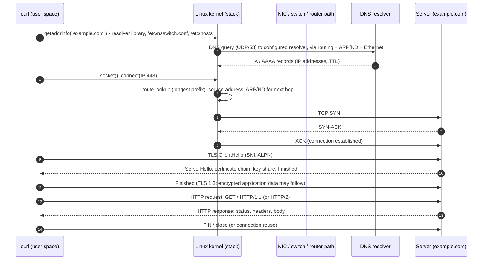

# 2.1 What happens when you curl a URL: a packet's journey end to end

| | |
|---|---|
| Level | Beginner |
| Priority tier | 0 |
| Lab venue | Any Linux VM with Internet access (GCP VM is fine) |
| Part | Part 2: Networking, from first principles to AI fabrics |
| Status | Drafted, labs **untested** |

## Why this matters for AI infrastructure

Almost every network problem you will ever debug in an AI cluster is a question about *where in a path something went wrong*. A container image does not pull. A training job cannot reach the dataset bucket. `torchrun` hangs at rendezvous. NCCL falls back from InfiniBand to sockets. A node cannot be reached by SSH after a switch change. A pod resolves a name to the wrong address. Each of these is a failure at a particular step of a journey that starts in a process and ends in another process on another machine.

Interview loops ask the classic question "what happens when you type a URL into a browser (or `curl` it)?" because a candidate who can narrate that journey in detail, with the commands that prove each step, has the mental model needed for everything in this Part: name resolution, routing, ARP/ND, switching, NAT, TCP, TLS, HTTP, and teardown. This chapter is that narrative. It is deliberately a *tour* that touches every layer once; later chapters take each stop in depth (2.2 layers, 2.3 Ethernet, 2.4 IP addressing, 2.5 host routing, 2.6 TCP, 2.7 ICMP and diagnostics, 2.8 DNS, 2.9 DHCP and NAT, 2.10 HTTP/TLS/PKI).

We use `curl https://example.com/` as the running example and finish by showing how the same journey (and its shortcuts) looks for the traffic that matters most in AI clusters: container image pulls, object storage, and NCCL.

## Prerequisites and outcomes

You should be comfortable with a Linux shell (Part 1, chapters 1.1 to 1.9). No prior networking knowledge is needed.

After this chapter you can:

- Narrate, in order and with correct terminology, everything that happens between pressing Enter on `curl https://example.com/` and seeing the response, including every protocol that participates.
- Name the kernel data structures and system calls involved (resolver, `socket`, `connect`, routing table, neighbour table, qdisc, NIC, socket buffers).
- Run commands that expose each step: `strace`, `getent`, `resolvectl`, `dig`, `ip route get`, `ip neigh`, `tcpdump`, `ss`, `openssl s_client`, `curl -w`.
- Break a request's latency into DNS, TCP connect, TLS handshake, time to first byte and transfer, and read a `curl -w` timing report.
- Map a symptom ("connection refused", "no route to host", "certificate verify failed", "timeout") to the layer that produced it.
- Explain what stays inside a host, what crosses a switch, what crosses a router, and what is rewritten by NAT.
- Explain how RDMA/InfiniBand traffic in AI clusters differs from this journey (kernel bypass) and where it is the same.

## 1. The whole journey in one picture



Every arrow between user and server crosses the same physical sequence: process → socket → TCP/IP stack → queueing discipline → NIC driver → wire → switch → router(s) → … → server NIC → stack → process. The next sections follow that path.

## 2. Step 0: the process and the URL

`curl` parses the URL: scheme `https` (default port 443), host `example.com`, path `/`. It uses **libcurl**, which calls the C library for name resolution and the kernel for sockets. Nothing about the network has happened yet.

```bash
curl -v https://example.com/ -o /dev/null        # -v shows the steps curl itself reports
curl -sS -o /dev/null -w 'dns=%{time_namelookup} connect=%{time_connect} tls=%{time_appconnect} ttfb=%{time_starttransfer} total=%{time_total} ip=%{remote_ip} http=%{http_version}\n' https://example.com/
strace -f -tt -e trace=openat,socket,connect,sendto,recvfrom,sendmsg,recvmsg,close curl -s https://example.com/ -o /dev/null 2>&1 | head -80
```

The `strace` output is a powerful teaching tool: you will see `curl` open `/etc/resolv.conf`, `/etc/nsswitch.conf`, `/etc/hosts`, then `socket(AF_INET, SOCK_DGRAM, ...)` for DNS, then `socket(AF_INET6 or AF_INET, SOCK_STREAM, ...)` and `connect(...)` for the TCP connection, and `sendto`/`recvfrom` calls carrying TLS and HTTP bytes.

## 3. Step 1: name resolution (what is the IP address?)

Computers route by numbers (IP addresses); people use names. The C library function `getaddrinfo()` turns `example.com` into one or more addresses. The sequence on a typical Linux system:

1. **`/etc/nsswitch.conf`** (line `hosts:`) defines the lookup order, usually `files dns` (older) or `files mdns4_minimal [NOTFOUND=return] resolve [!UNAVAIL=return] dns` (systemd systems). `files` means `/etc/hosts` first.
2. **`/etc/hosts`**: static overrides (`127.0.0.1 localhost`). A match ends the lookup. Keep it short; entries that DNS can serve do not belong there.
3. **The stub resolver / local cache**: on systemd distributions `/etc/resolv.conf` often points at `127.0.0.53` (the `systemd-resolved` stub) or a local caching daemon (`dnsmasq`, `unbound`, `nscd`). `resolvectl status` shows the real upstream servers per interface and per-link DNS domains.
4. **`search` domains and `ndots`**: names with fewer dots than `ndots` (default 1; Kubernetes sets 5) are tried with each `search` suffix first. A bare `myhost` may become `myhost.corp.example.com`.
5. **The DNS query** itself: the resolver sends a UDP datagram to port 53 of the configured name server (retrying, and switching to TCP when the answer is truncated or large). Modern resolvers ask for both **A** (IPv4) and **AAAA** (IPv6) records in parallel. The question travels through the same routing/ARP/Ethernet steps as any packet (sections 4 and 5).
6. **The recursive resolver** (your ISP, cloud, or an internal server) either answers from cache or walks the DNS hierarchy: root → `.com` TLD servers → `example.com` authoritative servers, caching each answer for its **TTL**.
7. **Answer selection**: `getaddrinfo` orders addresses by RFC 6724 rules (IPv6 preferred if usable), and many clients implement "Happy Eyeballs" (try IPv6 and IPv4 with a small head start) to avoid long IPv6 black-hole timeouts.

```bash
getent hosts example.com                    # what the C library (nsswitch order) returns
getent ahosts example.com                   # all addresses with socket types, in sorted order
cat /etc/nsswitch.conf | grep ^hosts ; cat /etc/resolv.conf ; resolvectl status | head -30
resolvectl query example.com                # through systemd-resolved, shows cache/transport/source
dig example.com A +noall +answer +ttlid     # direct query, TTL visible (use @server to choose resolver)
dig example.com AAAA +short ; dig +trace example.com | head -40     # walk the hierarchy from the root
time getent hosts example.com               # first call vs repeated call: cache effect
```

What goes wrong here (details in chapter 2.8): wrong resolver in `/etc/resolv.conf` or by DHCP; split-horizon DNS giving internal vs external answers; stale cache after a change (TTL); `search`/`ndots` multiplying queries (Kubernetes pods); IPv6 AAAA answers for hosts you cannot reach over IPv6; firewalls blocking UDP/53 or TCP/53; DNSSEC failures; slow first lookup due to timeouts to a dead first resolver. Symptom: `Could not resolve host` (curl exit code 6), `Temporary failure in name resolution`, or a long pause before anything else happens (`time_namelookup` large).

## 4. Step 2: the socket, the route and the source address

With an IP address (say 93.184.216.34), `curl` calls:

```c
fd = socket(AF_INET, SOCK_STREAM, 0);      // or AF_INET6; creates a TCP socket (a kernel object with send/receive buffers)
connect(fd, {93.184.216.34, port 443});    // triggers the whole connection setup
```

`connect()` asks the kernel to deliver a packet to that destination, so the kernel first answers the question **"where do I send it?"** with a **routing table lookup**:

```bash
ip route show                                 # the host's table
ip route get 93.184.216.34                    # the decision for THIS destination: next hop, device, chosen source address
# example output:  93.184.216.34 via 10.0.0.1 dev ens4 src 10.0.0.15 uid 1000 \ cache
ip -6 route get 2606:2800:220:1:248:1893:25c8:1946
```

The rules (chapter 2.5 in depth):

- Each route is a destination prefix plus how to reach it: directly on a link (`dev ens4 scope link`) or via a **gateway** (`via 10.0.0.1`). The kernel picks the **longest matching prefix**; the **default route** `default via 10.0.0.1` (`0.0.0.0/0`) matches anything not covered by something more specific. Ties are broken by metric.
- If the destination is inside a connected subnet (for example 10.0.0.0/24), the host sends directly to it; otherwise it sends to the gateway ("the router") and lets the rest of the Internet worry about the destination.
- The kernel also chooses the **source IP**: the primary address of the outgoing interface in the same subnet as the next hop (or a configured `src`). The **source port** is an **ephemeral port** chosen from `net.ipv4.ip_local_port_range` (default 32768 to 60999). The connection is then uniquely identified by the 5-tuple (protocol, source IP, source port, destination IP, destination port).
- Policy routing (rules, multiple tables), VRFs, VPN interfaces, and container networks can change the answer; `ip rule show` and `ip route show table all` reveal them.

Failures: `Network is unreachable` (`ENETUNREACH`): no route at all (no default gateway). `No route to host` (`EHOSTUNREACH`): the route exists but the next hop could not be resolved (ARP failed) or an ICMP unreachable came back. A route that sends traffic out the wrong interface or with the wrong source address (asymmetric routing, multiple NICs) is a classic cause of connections that work in one direction only.

## 5. Step 3: from IP to Ethernet (ARP or NDP) and out of the NIC

An IP packet needs a link-layer destination to be placed in an Ethernet frame. The next hop's IP address (the gateway 10.0.0.1, or the destination itself if on-link) must be mapped to a **MAC address**:

- **IPv4: ARP** (Address Resolution Protocol): the host broadcasts "who has 10.0.0.1? tell 10.0.0.15" to `ff:ff:ff:ff:ff:ff`; the owner replies unicast with its MAC. The result is cached in the **neighbour table** (`ip neigh`), states `REACHABLE`, `STALE`, `DELAY`, `PROBE`, `FAILED`.
- **IPv6: NDP** (Neighbor Discovery): neighbour solicitation to a solicited-node multicast address, neighbour advertisement in reply.

```bash
ip neigh show                      # IP -> MAC mappings and their states
ip neigh flush dev ens4            # force re-resolution (careful on production hosts)
sudo tcpdump -nn -e -i ens4 arp or icmp6        # watch ARP/NDP with Ethernet headers (-e)
arping -I ens4 10.0.0.1            # active ARP probe (also detects duplicate addresses)
```

The kernel then builds the packet: application bytes → TCP segment (with ports) → IP packet (with source/destination IP and TTL) → Ethernet frame (source MAC = this NIC, destination MAC = the **next hop's MAC**, which for off-subnet traffic is the *gateway's*, not the final destination's). This detail trips up many beginners: **MAC addresses change at every router hop; IP addresses (absent NAT) stay the same end to end.**

The frame passes through the egress **queueing discipline (qdisc)** (`tc qdisc show dev ens4`; default `fq_codel` or `fq`/`mq`), to the NIC driver, into a transmit ring in DMA-able memory; the NIC reads it, may compute checksums (offload), segments large TCP chunks (TSO/GSO), and serialises the bits onto the medium. On a VM, the "NIC" is a virtual device (virtio-net or a cloud-specific NIC) and the next hop is the cloud's virtual network (chapter 2.32).

## 6. Step 4: the switch, the router, NAT and the Internet

**A switch** (layer 2) receives the frame on a port, **learns** that the source MAC lives on that port (MAC address table), and forwards it to the port where the destination MAC was learned, or **floods** it to all ports (except the ingress) if unknown or broadcast. Switches do not look at IP addresses (for plain L2 switching); they define the **broadcast domain**: ARP broadcasts reach every host in the VLAN/subnet (chapters 2.3, 2.11).

**The default gateway (a router)** receives the frame addressed to its own MAC, strips the Ethernet header, examines the IP header, and:

1. Checks the destination against its **routing table** (longest prefix match in the FIB).
2. Decrements the **TTL** (hop limit) and recomputes the header checksum (IPv4); if TTL reaches zero it drops the packet and sends back an ICMP **Time Exceeded** (this is how `traceroute` works).
3. Chooses the egress interface and next hop, resolves the next hop's MAC (ARP/ND), builds a new Ethernet header, and forwards the frame.
4. If the packet exceeds the egress MTU: fragments it (IPv4, if DF is not set) or drops it and sends ICMP **Fragmentation Needed / Packet Too Big** (Path MTU Discovery; blackholed ICMP breaks it).

At the **edge of a private network** (home router, corporate firewall, cloud NAT gateway), **NAT/PAT** rewrites the source address (and port) of outgoing packets from a private address (RFC 1918: 10.0.0.0/8, 172.16.0.0/12, 192.168.0.0/16) to a public one, keeps a translation table (connection tracking), and reverses it for replies. The server therefore sees the NAT's public IP, not your private address (chapter 2.9).

Across the **Internet**, each router along the path (typically 8 to 20 hops) repeats the lookup-and-forward step using tables built by routing protocols: OSPF/IS-IS inside networks and **BGP** between them (chapters 2.13 to 2.16). Large services are often reached through **anycast** (the same IP announced from many locations; BGP delivers you to the nearest) and CDNs, load balancers and reverse proxies (chapter 2.20), so "the server" you reach is typically a front end, not the machine that finally generates the page.

```bash
traceroute -n example.com            # or: mtr -n -c 20 --report example.com   (hops via TTL expiry)
ping -c 4 example.com                # ICMP echo: reachability and RTT
ip -s link show dev ens4             # TX/RX packets, errors, drops on the first hop
```

## 7. Step 5: TCP connection establishment

`connect()` on a TCP socket triggers the **three-way handshake**:

1. **SYN**: client → server, with the client's initial sequence number and options: MSS (maximum segment size, typically MTU minus 40, e.g. 1460), window scale, SACK permitted, timestamps, optionally ECN.
2. **SYN-ACK**: server → client, acknowledging and carrying the server's own sequence number and options. If no process is listening on port 443, the server's kernel answers **RST** instead: the client sees `Connection refused` immediately. If a firewall silently drops the SYN, the client gets nothing and retries (1 s, 2 s, 4 s … backoff): `Connection timed out`.
3. **ACK**: client → server. The connection is **ESTABLISHED** on both sides; `connect()` returns.

The server side: a `listen()` socket has a SYN queue and an accept queue (backlog); `accept()` returns a new socket for the connection. TCP then provides a reliable, ordered byte stream using sequence numbers, acknowledgements, retransmission timers, flow control (the receiver's advertised window) and congestion control (the sender's congestion window, slow start, then congestion avoidance with CUBIC or BBR). Chapter 2.6 covers all of this.

```bash
sudo tcpdump -nn -i any 'host 93.184.216.34 and tcp' -c 20      # watch SYN, SYN-ACK, ACK, TLS bytes, FIN
ss -tni dst 93.184.216.34                                       # per-connection info: rtt, cwnd, mss, retrans, bytes
ss -s ; ss -ltnp                                                # summary; listening sockets with owning processes
```

`time_connect` in `curl -w` equals about one round-trip time (RTT) to the server (plus DNS time before it). Intra-datacentre RTTs are about 0.05 to 0.5 ms; across continents 100 ms or more, which is why connection reuse and fewer round trips matter.

## 8. Step 6: TLS handshake (HTTPS)

For `https://`, the client and server now establish an encrypted, authenticated channel on top of the TCP connection:

1. **ClientHello**: supported TLS versions and cipher suites, a random value, key share (TLS 1.3: the client guesses a key-exchange group and sends its public key), **SNI** (Server Name Indication: `example.com` in clear text so a shared front end can pick the right certificate), **ALPN** (application protocols offered: `h2`, `http/1.1`).
2. **ServerHello + certificate chain + key share + Finished**: the server selects parameters, proves its identity with an X.509 certificate chain (leaf → intermediate → root), signs the handshake (CertificateVerify), and both sides derive the session keys (ephemeral Diffie-Hellman gives forward secrecy). In TLS 1.3 this costs **one round trip** before application data (0-RTT resumption can send data earlier with replay caveats); TLS 1.2 needs two.
3. The client **verifies** the chain against its trust store (`/etc/ssl/certs`, a CA bundle), the hostname (SAN must match `example.com`), validity period, key usage, and revocation (OCSP stapling / CRLs, often soft-fail).

```bash
openssl s_client -connect example.com:443 -servername example.com -tls1_3 </dev/null 2>/dev/null | egrep 'Protocol|Cipher|Verify|subject|issuer'
openssl s_client -connect example.com:443 -servername example.com -showcerts </dev/null | less     # whole chain
curl -v --tlsv1.3 https://example.com/ -o /dev/null 2>&1 | egrep 'TLS|ALPN|subject|issuer|expire'
echo | openssl s_client -connect example.com:443 -servername example.com 2>/dev/null | openssl x509 -noout -dates -subject -ext subjectAltName
```

Typical failures (chapter 2.10): `certificate verify failed: unable to get local issuer certificate` (missing intermediate or CA bundle in a minimal container image), expired certificate, hostname mismatch (using an IP, or the wrong SNI), TLS interception by a corporate proxy with an unknown CA, clock skew making a valid certificate look "not yet valid", protocol/cipher mismatch with old servers. `time_appconnect - time_connect` is the TLS cost (one RTT plus crypto).

## 9. Step 7: the HTTP request and response

Inside the encrypted channel:

- **HTTP/1.1** (text): `GET / HTTP/1.1`, `Host: example.com`, `User-Agent`, `Accept`, optional `Authorization`, and a blank line; the response is a status line (`HTTP/1.1 200 OK`), headers (`Content-Type`, `Content-Length` or `Transfer-Encoding: chunked`, caching headers, `Set-Cookie`), a blank line, and the body. Persistent connections (keep-alive) reuse the TCP+TLS connection for multiple requests.
- **HTTP/2** (binary, over TLS with ALPN `h2`): multiplexes many request/response streams on one connection, with header compression; head-of-line blocking now occurs at the TCP level.
- **HTTP/3** (over **QUIC**, which runs on UDP/443 and includes TLS 1.3): per-stream loss recovery, faster connection setup, connection migration. `curl --http3` if supported.
- A **redirect** (301/302/307/308) causes a new request (maybe a new connection); `curl -L` follows them. Proxies, CDNs and load balancers may terminate TLS, rewrite headers (`X-Forwarded-For`), cache, and retry.

`time_starttransfer` (time to first byte, TTFB) = DNS + connect + TLS + server think time + one RTT for the response to start arriving; `time_total` adds the body transfer, which depends on size, bandwidth, the TCP congestion window and loss.

```bash
curl -sS -D - -o /dev/null https://example.com/                 # response headers only
curl -sS --http1.1 -I https://example.com/ ; curl -sS --http2 -I https://example.com/
curl -sS -w '\nhttp=%{http_version} code=%{http_code} size=%{size_download} speed=%{speed_download}\n' -o /dev/null https://example.com/
curl --resolve example.com:443:93.184.216.34 https://example.com/ -o /dev/null -v     # bypass DNS: test a specific backend
curl -H 'Host: example.com' http://93.184.216.34/ -I                                  # virtual hosting check without DNS
```

## 10. Step 8: transfer, acknowledgements and teardown

The response body arrives as TCP segments; the receiver's kernel reassembles them in order into the socket receive buffer, sends **ACKs** (often every second segment, with delayed ACK timers), advertises its **window**, and `curl` reads the data with `recv`. Loss triggers fast retransmit (three duplicate ACKs / SACK) or a retransmission timeout; the congestion window collapses and regrows. When both sides are done, TCP closes with **FIN/ACK** exchanges (or **RST** on abort); the side that closes first keeps the connection in **TIME_WAIT** (about 60 seconds on Linux) so late packets cannot corrupt a new connection using the same 5-tuple. Thousands of short connections can exhaust ephemeral ports or fill the table with `TIME_WAIT` (chapter 2.6, and tuning in 1.22).

## 11. Timing: reading `curl -w`

```bash
cat > curl-format.txt <<'EOF'
     namelookup:  %{time_namelookup}s
        connect:  %{time_connect}s
     appconnect:  %{time_appconnect}s   (TLS done)
    pretransfer:  %{time_pretransfer}s
  starttransfer:  %{time_starttransfer}s   (first byte)
          total:  %{time_total}s
      remote_ip:  %{remote_ip}   local_ip: %{local_ip}   http: %{http_version}   connects: %{num_connects}
EOF
curl -sS -o /dev/null -w @curl-format.txt https://example.com/
```

All values are cumulative from the start. Subtract successive values to get each phase: DNS = namelookup; TCP = connect − namelookup; TLS = appconnect − connect; request + server time + first byte = starttransfer − pretransfer; transfer = total − starttransfer. Interpretation by phase: large DNS → resolver problem or search-domain explosion; large TCP → distance, loss (SYN retransmit adds 1 s), or an overloaded accept queue; large TLS → distance, certificate chain/OCSP fetch, CPU on a busy terminator; large TTFB → the server/application or backend; large transfer → bandwidth, loss, window limits, or response size.

## 12. A map from symptom to layer

| Symptom (curl) | Exit code / message | Layer and likely cause | First tools |
|---|---|---|---|
| `Could not resolve host` | 6 | Name resolution: wrong/dead resolver, NXDOMAIN, firewall on port 53, nsswitch | `getent`, `resolvectl`, `dig @server`, `/etc/resolv.conf` |
| Long pause, then success | | DNS timeout to a dead first resolver, IPv6 fallback delay, slow ARP | `strace -tt`, `curl -w`, `tcpdump port 53` |
| `Network is unreachable` | 7 | Routing: no route/default gateway | `ip route`, `ip route get` |
| `No route to host` | 7 | ARP/ND failure, ICMP unreachable | `ip neigh`, `tcpdump arp` |
| `Connection refused` | 7 | Transport: server reachable, no listener (RST), or firewall REJECT | `ss -ltn` on server, `nc -vz`, `tcpdump` |
| `Connection timed out` / `Operation timed out` | 28/7 | Packet loss or firewall DROP, security group, wrong route/NAT, asymmetric routing | `tcpdump` both ends, `mtr`, firewall logs |
| `SSL: certificate problem`, `certificate verify failed` | 60 | TLS/PKI: chain, expiry, hostname, interception, clock | `openssl s_client`, `date`, CA bundle |
| `SSL_ERROR_SYSCALL`/`wrong version number` | 35 | TLS vs plain-HTTP port mismatch, middlebox reset | `tcpdump`, `openssl s_client` |
| `HTTP 4xx/5xx` | 22 with `-f` | Application layer: auth, routing rules, backend down, rate limit | `curl -v`, server logs, load balancer logs |
| Works for small, stalls for big transfers | | MTU/PMTUD blackhole (ICMP filtered), TCP window/loss | `ping -M do -s 1472`, `tracepath`, `ss -ti`, `tcpdump` |
| Works from A, fails from B | | Different route, firewall, DNS view, proxy settings (`HTTP(S)_PROXY`) | `curl -v` from both, `env \| grep -i proxy` |

The method (chapter 2.30): test each layer from the bottom up (link, address, route, ARP, ping the gateway, ping the destination, DNS, TCP port, TLS, HTTP), or bisect from the middle (can I reach the gateway? can I reach an IP on the Internet? can I resolve names?).

## 13. The same journey in AI infrastructure

- **Container image pulls**: `containerd`/Docker resolves the registry name (DNS), connects over TLS (often through a corporate proxy or mirror), authenticates, and downloads layers over HTTP/2 or HTTP/1.1. Slow pulls are DNS, TLS chain/proxy issues, MTU black holes on cloud overlays, rate limits, or a congested NAT gateway.
- **Object storage (GCS/S3)**: HTTPS with many parallel connections; throughput is limited per connection by RTT and window, per instance by the NIC and cloud caps, and per prefix/bucket by service quotas. Private connectivity and DNS (private endpoints) change the path entirely.
- **Cluster bootstrap**: `torchrun`/MPI/NCCL rendezvous uses ordinary TCP connections over the management or front-end network (hostnames, DNS, `/etc/hosts`, `NCCL_SOCKET_IFNAME`), then the bulk transfers use RDMA verbs (InfiniBand or RoCE), **bypassing the kernel TCP/IP stack**: user-space libraries post work requests directly to the NIC, which does its own segmentation, reliability and memory access (GPUDirect RDMA reads GPU memory without CPU copies). The "journey" is shorter (no routing table, qdisc or TCP in the kernel), but the lower layers still exist (Ethernet or IB addressing, switches, routing in the fabric), and the control plane (connection setup) still uses TCP/IP.
- **Kubernetes**: a pod's request adds more steps: CoreDNS lookups with `ndots:5`, service virtual IPs translated by kube-proxy/eBPF (DNAT), CNI-managed veth/bridge or overlay (VXLAN) encapsulation, NetworkPolicy, then the node's normal path (chapters 2.23, 2.25, Part 5).
- **Cloud**: the "router" and "switch" are virtual; VPC routing, firewall rules, NAT gateways, load balancers and peering decide what happens (chapter 2.32).

## 14. Lab: trace one request end to end (untested)

Use a Linux VM with `curl`, `dig`, `tcpdump`, `strace`, `openssl`, `iproute2`, `mtr` installed (`apt install curl dnsutils tcpdump strace openssl iproute2 mtr-tiny iputils-arping`).

1. **Record your configuration**: `ip -br addr`, `ip route`, `ip neigh`, `cat /etc/resolv.conf`, `resolvectl status`, `cat /etc/nsswitch.conf | grep hosts`. Draw your host's view: interface, address, gateway, resolver.
2. **Narrate with strace**: run the `strace` command from section 2; list in order the files opened, sockets created, and addresses connected. Identify the DNS query socket and the TCP socket.
3. **Capture everything**: in one terminal `sudo tcpdump -nn -i any -w curl.pcap 'port 53 or host <example.com IP>'`; in another `curl -sS -o /dev/null https://example.com/`; stop the capture; read it with `tcpdump -nn -r curl.pcap | head -60` (or Wireshark). Label each packet: DNS query/response, SYN, SYN-ACK, ACK, ClientHello, ServerHello/Certificate, application data, FIN.
4. **Route and neighbour**: `ip route get <server IP>`; flush the gateway neighbour (`sudo ip neigh flush dev <if>`) and repeat the capture including `arp or icmp6` to see ARP/NDP.
5. **Timing**: run the `curl -w` report five times; then add `--resolve` to skip DNS; then try `--http1.1` versus `--http2`; compare phases. Try an HTTP (non-TLS) URL to see TLS time disappear.
6. **Break it on purpose** (one at a time, undo each): (a) point `/etc/resolv.conf` at an unused IP (use a copy, restore afterwards) and observe the delay and error; (b) `sudo ip route del default` and observe `Network is unreachable` (restore with the original `ip route add default via ...`; do this only on a VM with console access); (c) `curl http://<server IP>:81/` (closed port) vs a port blocked with `iptables -A OUTPUT -p tcp --dport 81 -j DROP` (timeout vs refused); (d) `curl https://example.com --cacert /dev/null` or an expired-cert test host (`https://expired.badssl.com/`) and read the TLS error.
7. **Path**: `traceroute -n` and `mtr -n -c 30 --report` to the server; note hop count, RTT growth, and where it increases; compare with `ping`'s RTT and with `time_connect`.
8. **AI-cluster variant** (optional, GPU VM): `ss -tnp` while a PyTorch distributed job rendezvous runs; compare to `rdma link`/`ibv_devinfo` and note which traffic is TCP and which is RDMA.

Mark the lab tested only after executing it and recording the outputs.

## 15. Common mistakes

- Treating "the network" as one thing instead of a path with layers.
- Forgetting DNS (or `search`/`ndots`, or IPv6 AAAA) when "the network is slow".
- Believing the destination MAC is the final server's MAC; forgetting that NAT hides your address.
- Testing with `ping` only (ICMP may be filtered, and it says nothing about TCP ports, TLS or HTTP).
- Using the IP in place of the name for HTTPS and being surprised by certificate errors; omitting SNI.
- Ignoring MTU and ICMP filtering.
- Reading `time_total` without the phase breakdown.
- Assuming that the client's problem is the server's problem (proxy variables, split DNS, different routes from different hosts).
- In AI clusters, assuming RDMA traffic is visible to `tcpdump`/`iptables`/`ss` (it is not; use RDMA tools and NIC counters).

## 16. Interview angles

- "Walk me through what happens when you run `curl https://example.com`." (The sections of this chapter, in order, with a command per step.)
- "How does a packet get from your laptop to a server in another continent? What changes at each hop?" (MAC rewrite and TTL decrement per hop; IP constant; NAT at edge.)
- "Difference between 'connection refused' and 'timed out'?" (RST vs silence.)
- "How would you debug 'works from my machine, not from the pod'?" (Resolver, route, NAT, policy, proxy.)
- "What is a three-way handshake and why? What are SYN cookies?"
- "What does the TLS handshake do? How does the client know it is talking to the right server?"
- "Where does TCP end up in AI training traffic, and where does it not?"
- "A download is fast for small files and stalls for large ones. Why?" (MTU/PMTUD, window/loss.)

## 17. Checkpoint questions (30)

1. What function resolves a name in a C program? **A:** `getaddrinfo()` (libc), which follows nsswitch.conf.
2. What does `hosts: files dns` mean? **A:** Check `/etc/hosts` first, then DNS.
3. Why does a resolver ask for both A and AAAA? **A:** To get IPv4 and IPv6 addresses so the client can choose/race them.
4. What is a DNS TTL? **A:** How long a cached answer may be reused.
5. What does `ip route get X` tell you? **A:** The route, next hop, interface and source address the kernel would use for X.
6. How does the kernel pick between several matching routes? **A:** Longest prefix, then metric.
7. What is the default route? **A:** `0.0.0.0/0` (`::/0`), used when nothing more specific matches; points at the default gateway.
8. What is an ephemeral port? **A:** A temporary client-side source port chosen from a configured range.
9. How is a TCP connection uniquely identified? **A:** By the 5-tuple (protocol, src IP, src port, dst IP, dst port).
10. What is ARP and when is it needed? **A:** Maps an IPv4 address on the local link to a MAC address, needed before sending a frame to the next hop.
11. IPv6 equivalent of ARP? **A:** NDP (neighbor solicitation/advertisement).
12. Which MAC address is in the frame for an off-subnet destination? **A:** The default gateway's MAC.
13. What changes at each router hop and what does not (without NAT)? **A:** MACs and TTL change; IP addresses stay.
14. What does a switch do with an unknown destination MAC? **A:** Floods the frame out all other ports in the VLAN.
15. What does NAT/PAT change? **A:** Source IP (and port) on the way out; reverses it on the way back using a state table.
16. What is the TCP three-way handshake? **A:** SYN, SYN-ACK, ACK.
17. What does "connection refused" mean at the packet level? **A:** The server host sent RST because nothing listens on that port.
18. What does "timed out" usually imply? **A:** Packets were dropped silently or lost (firewall, routing, outage).
19. What is MSS and how is it set? **A:** Largest TCP payload per segment, negotiated in SYN options (≈ MTU − 40).
20. What is SNI and why is it needed? **A:** The hostname sent in ClientHello so a shared IP can serve the right certificate.
21. What does ALPN do? **A:** Negotiates the application protocol (h2, http/1.1) during the TLS handshake.
22. How many round trips does TLS 1.3 need before application data? **A:** One (full handshake).
23. What does the client verify in a certificate? **A:** Chain to a trusted root, validity dates, hostname (SAN), key usage, revocation (soft).
24. What does `time_starttransfer` measure? **A:** Time until the first response byte arrives (TTFB).
25. How do you compute the TLS time from curl's output? **A:** `time_appconnect − time_connect`.
26. Why is TIME_WAIT needed? **A:** To absorb late packets and ensure the final ACK is delivered before the 5-tuple is reused.
27. What does `traceroute` rely on? **A:** TTL expiry and ICMP Time Exceeded replies from each hop.
28. What breaks if ICMP "Fragmentation Needed" is filtered? **A:** Path MTU discovery: large packets blackhole.
29. How does RDMA traffic differ from this journey? **A:** It bypasses the kernel TCP/IP stack; NIC hardware handles transport; invisible to normal firewalls/tcpdump.
30. Where does DNS fit in Kubernetes pod requests? **A:** CoreDNS via the pod's resolv.conf with `ndots:5` and search domains, then service VIP translation.

## 18. Sources and review notes

**Written in original words.** Principal sources:

- Brian Ward, *How Linux Works*, 3rd ed., chapter 9 (packets, network layers, IP addresses, subnets, routes and the default gateway, ICMP and DNS tools, Ethernet and kernel interfaces, name resolution via `nsswitch.conf`, `/etc/hosts`, `resolv.conf`, `systemd-resolved`, localhost, TCP ports and connections, UDP, DHCP, NAT, ARP/NDP) and chapter 10 (services, `ssh`, diagnostic tools such as `lsof`, `tcpdump`, `netcat`, sockets).
- Russ White and Jeff Tantsura (and co-authors), *Computer Networking Problems and Solutions*, chapters 1, 3 to 7 for the conceptual framing (packet switching and hop-by-hop forwarding, layered models, Ethernet multiplexing, interlayer discovery, how a router switches a packet). Used in more depth in chapters 2.2 to 2.7.
- The AI-infrastructure notes (RDMA bypass, Kubernetes DNS, cloud) are the author's synthesis and are developed in Parts 2, 5, 12 and later chapters.
- Command outputs shown as examples are illustrative; run them yourself.

**Flagged for verification before publishing:**

- Default values: TIME_WAIT duration, ephemeral port range, `ndots` defaults per environment, TCP retry timers.
- Exact `curl` write-out variable names and HTTP/3 availability in your build.
- All labs are **untested**.
