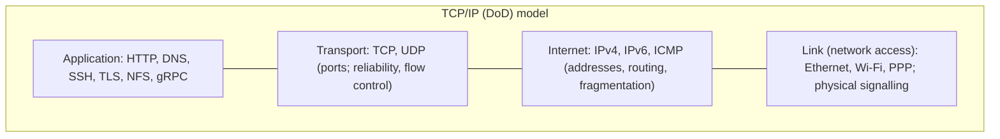
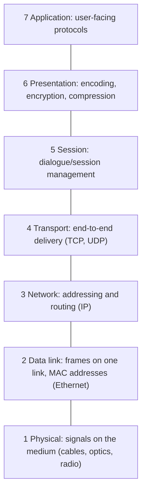
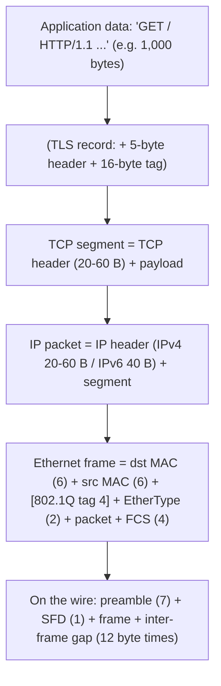
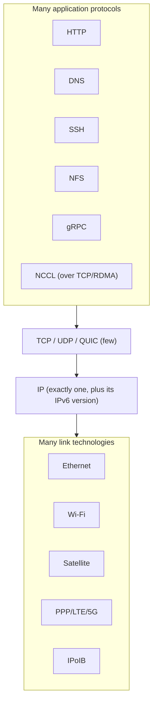
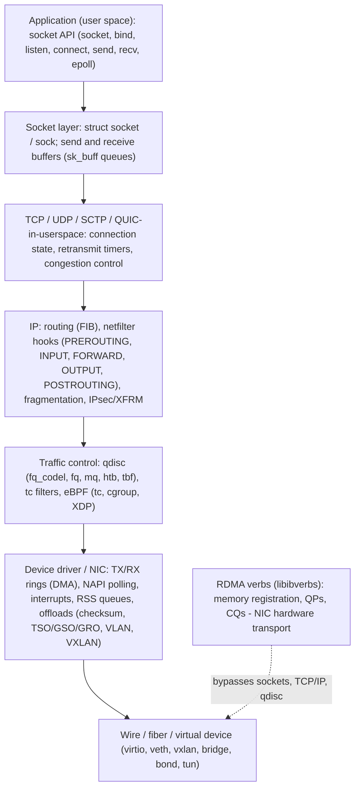

# 2.2 How networks work: layers, encapsulation, the TCP/IP model

| | |
|---|---|
| Level | Beginner |
| Priority tier | 0 |
| Lab venue | Any Linux VM (packet captures and small calculations) |
| Part | Part 2: Networking, from first principles to AI fabrics |
| Status | Drafted, labs **untested** |

## Why this matters for AI infrastructure

Every networking term in an AI cluster (RoCE, InfiniBand, VXLAN, EVPN, ECMP, PFC, MTU, MSS, GRE, NAT, CNI) names something at a particular place in a stack, and every performance or reliability problem becomes tractable once you can say *which layer* it lives at and *what that layer is responsible for*. The vocabulary of layers is also the shared language of every network engineer you will work with: when a switch engineer says "that's an L2 problem" and a platform engineer says "the pod can't reach the service", you need to translate between them in your head.

This chapter builds the foundation: why networks are built from packets rather than circuits; what the four jobs of any data-carrying protocol are; how layered models (the DoD/TCP-IP model, the OSI model, and the recursive view) organise those jobs; how **encapsulation** wraps data at each layer and what the overhead costs; why the Internet's **hourglass** shape (many link technologies below, many applications above, one IP in the middle) is the reason it scaled; the difference between the **data plane**, **control plane** and **management plane**; and how the layers map onto the Linux kernel and onto the AI-cluster fabrics you will meet (Ethernet/RoCE and InfiniBand). Later chapters in this Part take each layer in depth.

## Prerequisites and outcomes

You should have read chapter 2.1 (the packet's journey) and know basic Linux commands.

After this chapter you can:

- Explain circuit switching versus packet switching, and the trade-offs that produced today's packet-switched Internet.
- State the four functions every data-carrying protocol performs (transport, multiplexing, error control, flow control) and classify familiar protocols with them.
- Draw and compare the 4-layer TCP/IP (DoD) model and the 7-layer OSI model; explain why both are useful and neither is perfect; explain the recursive (RINA) view.
- Explain encapsulation and decapsulation, name each layer's PDU (bits, frame, packet, segment/datagram), and compute header overhead and goodput for a given MTU.
- Explain demultiplexing keys (EtherType, IP protocol number, port number) and how a received frame reaches the right process.
- Distinguish connection-oriented from connectionless service, hop-by-hop forwarding from end-to-end state, and the three network planes.
- Explain the hourglass/wasp-waist idea and the State/Optimisation/Surface trade-off model of complexity.
- Locate the layers in the Linux networking stack (`sk_buff`, netfilter hooks, qdisc, NIC drivers, offloads, XDP) and in the RDMA/InfiniBand stack that bypasses it.
- Read a packet capture and label each layer.

## 1. Two ways to build a network

### Circuit switching

In a **circuit-switched** network the path (and bandwidth) between two endpoints is reserved before any data flows. The telephone network is the classic example. With **time-division multiplexing (TDM)**, each link is divided into fixed time slots in a repeating frame; a controller assigns, for each call, one slot on each link along the path, and each switch simply copies the contents of an input slot into an output slot without reading any address (the slot position *is* the address). The reserved slots form a **circuit**.

Advantages: forwarding is trivial (no header parsing), delay and jitter are deterministic, bandwidth is guaranteed, and a central controller can engineer the optimal path with complete knowledge of the load. Disadvantages: unused slots are wasted (bandwidth reserved for a circuit cannot be lent to someone else), the controller becomes a complexity and failure bottleneck as the network grows, and reacting to a topology change is slow (the controller must learn of it and reprogram every switch on each affected path). Frame Relay, SONET/SDH, ISDN and X.25 are circuit- or virtual-circuit-style technologies, many now historical.

### Packet switching

In a **packet-switched** network the data is cut into **packets**, each carrying a **header** with at least the destination (and usually the source and handling information). Every device along the path reads the header, looks up the destination in a **forwarding table**, and sends the packet out the chosen interface: **hop-by-hop forwarding**, each device deciding independently for each packet. The network is a shared resource: packets from many sources interleave on the same link (**statistical multiplexing**), so bandwidth is used only when there is data.

Advantages: efficient use of links; resilience (if a link fails, devices can forward around it as soon as their tables change, without asking a controller; with at least two disjoint paths the network keeps working); simple endpoints and cheap, scalable core devices; incremental deployment. Disadvantages: every device must parse headers and do a table lookup (a real cost in early hardware, now solved in silicon); no inherent guarantee of bandwidth, delay or order; **congestion** can occur when more traffic arrives than a link can send, so queues build up and packets are dropped, which requires **flow control** and **congestion control** to be added on top (TCP, from 1974 onwards).

The Internet is packet switched. The packet-versus-circuit debate left permanent legacies: *virtual circuits and label switching* (MPLS), *reserved bandwidth and QoS* for real-time traffic, *centralised control planes* (SDN) returning for hyperscale fabrics, and *lossless Ethernet* for RDMA (priority flow control creates something like circuit-style "no drop" behaviour inside a packet network, with its own risks: chapter 2.19).

### Fixed versus variable length frames

ATM tried to merge the two worlds with **53-byte fixed cells** (a 5-byte header, 48 bytes of payload) and **label switching** (a short fixed-size label instead of a full destination address, looked up in a small table). Fixed-size cells simplified hardware (no fragmentation, easy buffering and queueing) but wasted bandwidth: a 64-byte data packet needed two cells (one full, one nearly empty), so half or more of the link could carry padding. ATM died; its ideas survived: **label switching became MPLS** and the lesson that *fragmentation hurts performance* led to the IPv4 "Don't Fragment" bit, path MTU discovery, and removal of in-network fragmentation in IPv6. In modern AI fabrics, buffers and switching chips again use fixed-size internal cells even though external frames are variable length, and "message size versus MTU" remains a first-order performance variable.

### Flow control and congestion

Circuit-switched networks cannot oversubscribe a circuit (the slots are pre-allocated), so flow control is built in. Packet networks need it explicitly: **TCP** (Cerf and Kahn, 1973/74) provides end-to-end flow control (do not overrun the receiver) and congestion control (do not overrun the network). Link-level flow control exists too (Ethernet PAUSE frames; PFC per priority; InfiniBand credit-based flow control), and its interaction with end-to-end control is a central topic in AI fabrics.

## 2. The four jobs of a protocol

Every protocol that carries data does some combination of four things:

1. **Transport**: move bits from one place to another, including translating between data formats and addressing endpoints.
2. **Multiplexing**: keep data from different senders, applications or flows separate on a shared medium or connection (and demultiplex them at the other end).
3. **Error control**: detect (CRC, checksum) and optionally correct (FEC) or retransmit (ARQ) damaged or lost data.
4. **Flow control**: match the sender's rate to what the receiver and the network can absorb (windows, credits, pause frames, rate control).

These group naturally into two pairs: *transport + multiplexing* and *error control + flow control*. Examples:

| Protocol | Transport | Multiplexing | Error control | Flow/congestion control |
|---|---|---|---|---|
| Ethernet | Link-local frames, MAC addressing | EtherType, VLAN tags | FCS (CRC32) detects errors (drops); FEC at high speed PHYs | None originally; PAUSE/PFC optional |
| IP | Network-wide addressing, routing | Protocol number | Header checksum (IPv4) only | None (ICMP signals) |
| UDP | Datagrams between ports | Ports | Optional checksum | None |
| TCP | Reliable byte stream | Ports | Checksum, sequence numbers, ACK, retransmit | Receive window, congestion window |
| TLS | Secure channel over TCP | (single stream) | MAC/AEAD integrity | None (relies on TCP) |
| HTTP/2 | Requests/responses | Streams | Relies on TCP | Per-stream flow-control windows |
| QUIC | Streams over UDP | Connection IDs, streams | Own ACKs/retransmit | Own congestion control, stream windows |
| InfiniBand (link + transport) | Packets in a lossless fabric | LIDs/QPs | ICRC/VCRC, ACK/NAK retransmit | Credit-based link flow control, CC |
| RoCE v2 | InfiniBand transport over UDP/IP/Ethernet | UDP port 4791, QP numbers | ICRC + retransmit (go-back-N or selective) | Needs PFC/ECN + DCQCN/other CC |

Seeing each protocol as "which of these four does it do, and at what scope (one link, or end to end)?" is a more reliable guide than memorising layer numbers. The **scope** matters: Ethernet's jobs apply on one link; IP's job applies across many links; TCP's apply end to end. This recursive pattern (the same four functions at different scopes) is the insight of the **Recursive InterNetwork Architecture (RINA)** model.

## 3. Layered models

A **protocol stack model** helps classify protocols by purpose, know which questions to ask about a new protocol, and see how the pieces fit together. Layers talk to the layer above and below through well-defined interfaces (for example the *socket API* between application and transport), and to the *peer layer* on the other machine through a protocol.

### The DoD / TCP/IP model (4 layers)



Developed in the 1960s to 1980s under DARPA sponsorship (not to survive nuclear war, but to let incompatible computers at universities and labs communicate). It separated the problem into link (frames on one network), internet (datagrams across networks), transport (end-to-end conversations) and application (user-visible protocols). A key characteristic: **multiple protocols may exist at each layer** (several link types, TCP and UDP, thousands of applications), connected by **one** at the middle (IP). Earlier seven-layer variants of the DoD model (adding utility, network, internetwork) were dropped.

Placement in Linux: application code runs in **user space** (curl, nginx, PyTorch); the transport layer and everything below live in the **kernel** (with exceptions: user-space networking like DPDK, XDP in the driver, QUIC in user space, RDMA verbs bypassing the kernel stack).

### The OSI model (7 layers)



Proposed by ISO in 1977 as an alternative to the DoD stack (an attempt to blend circuit- and packet-oriented thinking, driven by telecom and database interests). The full OSI protocol suite never won (the specifications were slow, complex and sold in paper form to members, whereas TCP/IP specifications and implementations were free), but the **model** became the universal teaching and troubleshooting vocabulary, and it made lasting contributions: strict modularity, well-defined interfaces, and the idea that intermediate systems (routers and switches) are part of the architecture. Several OSI-era protocols survive, notably **IS-IS** (Intermediate System to Intermediate System, a routing protocol widely used in data centres and ISP backbones: chapter 2.14).

Practical mapping and usage: people say **L1** (cables, optics, signal, link up/down), **L2** (Ethernet, MAC addresses, VLANs, switching, ARP lives between 2 and 3), **L3** (IP, routing), **L4** (TCP/UDP, ports; load balancers, firewalls), **L7** (HTTP and application-aware proxies). Layers 5 and 6 rarely matter in practice (TLS is often described at L6 or "L4.5"). Protocols often straddle layers: Ethernet is L1+L2; TCP covers parts of L4 and L5; TLS is "Transport Layer Security" yet sits above TCP; BGP runs over TCP (an application!) but provides the L3 forwarding information; IPsec is arguably L3 or L4; VXLAN is L2 over L3 over UDP; MPLS is "L2.5". Do not waste energy on classification quarrels; use the model to **ask the right questions**.

### Comparison

| TCP/IP (4) | OSI (7) | Typical protocols and devices | PDU name |
|---|---|---|---|
| Application | 7, 6, 5 | HTTP, DNS, SSH, TLS, gRPC, NFS | Message / data |
| Transport | 4 | TCP, UDP, QUIC (over UDP), SCTP | Segment (TCP) / datagram (UDP) |
| Internet | 3 | IPv4, IPv6, ICMP; routers, L3 switches | Packet |
| Link | 2, 1 | Ethernet, Wi-Fi, PPP; switches, NICs, cables | Frame / bits |

### Connection-oriented and connectionless

A **connection-oriented** service establishes state (and often reserves resources and a path) before sending data, then data flows with little per-packet overhead (TCP at the edge, ATM, MPLS LSPs, InfiniBand queue pairs, RDMA reliable connections). A **connectionless** service carries everything needed to deliver each unit in the unit itself (IP datagrams, UDP, Ethernet frames). The Internet is built connectionless in the core and connection-oriented at the edges: "state in the middle" (circuit-style) makes failure recovery expensive, whereas state at the edges and datagrams in the core let the network route around failures without touching the endpoints' connections (the **end-to-end principle**: put intelligence in the endpoints, keep the core simple). QoS and flow control are often layered on top as connection-like state, which can create mismatches with a connectionless forwarding plane when paths change.

## 4. Encapsulation and decapsulation

When an application sends data, each layer wraps what it receives from above in its own **header** (and sometimes a **trailer**), adds it to the unit, and passes it down. This is **encapsulation**. On the receiving side each layer strips its header and hands the payload up: **decapsulation**.



Header sizes (typical): Ethernet header 14 B (+4 B for an 802.1Q VLAN tag) + FCS 4 B; IPv4 header 20 B (IPv6: 40 B); TCP header 20 B (up to 60 B with options; timestamps add 12 B); UDP header 8 B. On the wire add 8 B preamble/SFD and 12 B inter-frame gap = 20 B of fixed per-frame overhead.

### Overhead and goodput (worked examples)

For a 1500-byte MTU (the maximum IP packet size on standard Ethernet), a TCP/IPv4 segment carries at most **MSS = 1500 − 20 − 20 = 1460 bytes** of data (1448 with the TCP timestamp option). Each such segment occupies 1460 + 20 (TCP) + 20 (IP) + 14 (Eth hdr) + 4 (FCS) + 20 (preamble+IFG) = **1538 byte times** on the wire. Goodput fraction = 1460/1538 = **94.9%**. With a 9000-byte MTU (jumbo): MSS 8960; wire = 8960 + 78 = 9038; efficiency = **99.1%**. For small messages the overhead dominates: a 64-byte minimum frame carries as little as 18 bytes of application data (UDP) and occupies 84 byte times, so a 100 Gb/s link can carry at most 148.8 million minimum-size frames per second (100e9 / (84 × 8)). RoCE v2 adds its own headers (UDP 8 B + IB BTH 12 B + extension headers + ICRC 4 B), and with a 4096-byte RDMA MTU on a jumbo-frame Ethernet fabric the efficiency is again about 98% to 99%. These calculations explain why jumbo frames and larger messages help throughput, and why message-rate (packets per second) limits matter for small-message workloads such as allreduce latency phases or key-value traffic.

```bash
# See the layers in a live packet: -e shows the Ethernet header, -v adds IP/TCP details
sudo tcpdump -nn -e -v -c 5 -i any 'tcp port 443'
# Show raw bytes of a frame; match the layers by offset (Ethernet 0-13, IP 14-33, TCP 34-53 ...)
sudo tcpdump -nn -XX -c 1 -i eth0 'tcp'
ip -s link show dev eth0 ; ethtool -k eth0 | egrep 'segmentation|checksum|scatter|gro|gso|tso'      # offloads hide the true on-wire sizes from tcpdump
```

### Demultiplexing: how the right code gets the bytes

Each layer includes a field that tells the receiver which protocol to hand the payload to:

- **Ethernet EtherType** (16 bits): 0x0800 IPv4, 0x86DD IPv6, 0x0806 ARP, 0x8100 VLAN tag (802.1Q), 0x88A8 QinQ, 0x8847/8848 MPLS, 0x8915 RoCE v1, 0x8808 MAC control (PAUSE/PFC), 0x88CC LLDP.
- **IP protocol / next header** (8 bits): 1 ICMP, 6 TCP, 17 UDP, 41 IPv6-in-IPv4, 47 GRE, 50 ESP (IPsec), 58 ICMPv6, 89 OSPF, 132 SCTP.
- **UDP/TCP port numbers** (16 bits each): identify the endpoint application; **well-known ports** below 1024 (22 SSH, 53 DNS, 80/443 HTTP/HTTPS, 4791 RoCE v2), registered ports 1024 to 49151, ephemeral ports above.

So the first bits of a received frame determine the path through the stack: Ethernet → EtherType 0x0800 → IPv4 → protocol 6 → TCP → destination port 443 → the socket bound to that port (or the connection's 5-tuple) → the process. If any key does not match a handler, the packet is dropped or answered with an error (ICMP protocol/port unreachable, TCP RST).

### MTU, MSS and tunnels

The **MTU** (maximum transmission unit) is the largest IP packet a link can carry (1500 on standard Ethernet; commonly 9000 on storage and AI fabrics; 1460 on some cloud networks). The **MSS** is the largest TCP payload per segment, announced in SYN options (MTU − 40 for IPv4). **Tunnels and overlays** add outer headers: VXLAN adds 50 bytes (outer Ethernet 14 + IP 20 + UDP 8 + VXLAN 8), GRE 24 (IPv4), IPsec ESP 50 to 70+, WireGuard 60; Kubernetes overlays and VPNs therefore reduce the effective MTU of the inner traffic. If the inner packets are not reduced (or MSS clamped), large packets exceed the path MTU: either they are fragmented (slow) or dropped with ICMP "fragmentation needed" (if that ICMP is filtered, connections hang on large transfers: a black hole). Always verify end-to-end MTU in AI clusters: a single link at 1500 in a 9000 fabric cripples throughput or breaks RoCE.

## 5. The three planes

Network devices and networks are organised into functional planes:

| Plane | Job | Examples |
|---|---|---|
| **Data (forwarding) plane** | Moves packets: parse headers, look up the forwarding table (FIB), rewrite, queue, transmit; must run at line rate (ASICs in switches, kernel/XDP/eBPF on hosts, SmartNIC/DPU) | Switching, routing lookups, ACL matching, NAT, encapsulation, QoS queueing |
| **Control plane** | Builds the information the data plane needs: routing protocols, spanning tree, ARP/ND, LACP, BGP/EVPN, SDN controllers | OSPF, IS-IS, BGP, STP, LLDP, DHCP |
| **Management plane** | Configures and monitors the device: CLI, SNMP, NETCONF/gNMI, syslog, telemetry | SSH, REST APIs, Prometheus exporters |

In traditional networks, the control plane is **distributed**: every router runs the protocol and computes its own table (a RIB of candidate routes from which the best go into the FIB). In **SDN**, a **centralised controller** computes and installs forwarding state (OpenFlow was the first widely known interface). In practice hybrid designs win: hyperscale data centres run distributed BGP with automation on top; some AI fabric managers (InfiniBand's **Subnet Manager**) are logically centralised controllers computing routes for a lossless fabric. Where exactly a function sits (is manual static route configuration management plane or control plane?) is a matter of definition; the useful question is "what happens to traffic when the control plane fails, the controller is unreachable, or the device reboots?" (fail-open/fail-static behaviour, graceful restart).

### Loop-free paths: the control plane's core problem

Whatever the protocol, the control plane must produce **loop-free** forwarding paths: if traffic can circle, packets eventually die by TTL (IP) or, worse in L2 where there is no TTL, multiply and melt the network (broadcast storms: chapter 2.11). Three families of algorithm are used: **distance vector** (each router tells neighbours its distances; hop-by-hop; RIP, EIGRP), **link state** (every router floods topology and runs Dijkstra shortest path first on an identical database; OSPF, IS-IS), and **path vector** (each announcement carries the list of autonomous systems it traversed to prevent loops and allow policy; BGP). Chapters 2.13 to 2.16 develop them. An important design insight: advances in CPU, memory and bandwidth made the early arguments about protocol overhead less decisive, but *stability, scalability and operability* remain the criteria.

### Quality of service

Real-time traffic (voice, video, now also tightly synchronised distributed training and RDMA) cares about **delay** and **jitter**. Early thinking said such traffic could never share a packet network; the solution became marking, classification and queueing: classify packets (DSCP/IP precedence, 802.1p PCP), give them separate **queues** with scheduling (strict priority, weighted round robin), shape/police rates, and use ECN/early drop to signal congestion. With faster links and better queueing algorithms, four to eight queues usually suffice. In AI fabrics QoS means dedicating a lossless priority to RDMA traffic with PFC + ECN and keeping storage, management and other traffic in different classes (chapter 2.19).

## 6. Taming complexity: the hourglass and the SOS triangle

### The hourglass (wasp waist)



Protocols are numerous at the top (applications) and at the bottom (physical media) but there is essentially **one** protocol at the narrow waist: IP. This keeps three kinds of complexity bounded: **state** is separated into "information about the network" (lower layers) and "information about the data" (upper layers), so neither needs the other's detail; **interaction surfaces** between components are reduced to a single well-regulated interface (IP) that changes rarely; and some **optimisation** is deliberately given up by hiding network state from applications (TCP infers congestion from loss and delay rather than knowing the network). Layer violations (a transport that peeks at link state, a switch that parses TCP ports for ECMP, a NIC that offloads TCP) buy performance but add interaction surfaces and make evolution harder (ossification: middleboxes that break new TCP options or QUIC). AI fabrics are a deliberate, controlled violation of layering: RDMA transport hardware is tightly integrated with link-layer flow control and a specific fabric design to buy microsecond latency and zero CPU overhead.

### State, Optimisation, Surface

A useful trade-off model for any network design decision:

- **State**: how much information devices must hold (routes, ACLs, MAC tables, flows).
- **Optimisation**: how well the design uses resources (shortest paths, load balance, low latency, cost).
- **Surface**: how many places and ways components interact (protocols, interfaces, configuration touch points, failure interactions).

Increasing optimisation tends to require more state or more interaction surfaces; reducing state tends to reduce optimisation or increase surfaces; reducing surfaces tends to cost optimisation or state. The *plane of the possible* is the region of designs you can actually build. Example: **stretch** is the difference between the shortest physical path and the path traffic actually takes; any policy (traffic engineering, PBR) increases stretch; the extra state and interaction needed to implement it is the price. Similar three-way trade-offs appear everywhere (CAP theorem; quick/cheap/good). "If you have not found the trade-off, you have not looked hard enough." Complexity cannot be "solved", only moved or managed: abstraction (black boxes), moving the problem elsewhere, adding a layer of indirection (overlays), replacing the system, or deferring it. Each has costs; a network that is robust against the predictable can be brittle against the unpredictable ("robust yet fragile"). Keep this in mind when you design clusters: every special case (a rail-optimised topology exception, a custom NCCL topology file, a per-tenant policy) adds state and surface.

## 7. Where the layers live: Linux and AI fabrics

### The Linux stack



The unit of data inside the kernel is the **`sk_buff`** (socket buffer): a descriptor with pointers into packet data and metadata (headers, device, timestamps, checksum state). Layers add and remove headers by moving pointers (cheap), not by copying. Software constructs map to the layer model: **`lo`, `eth0`, `ens4`** (L2 devices), **bridge** (software switch, L2), **bond/team** (link aggregation, L2), **VLAN subinterface** (802.1Q, L2), **veth** (virtual cable between namespaces), **VXLAN/GRE/Geneve** devices (L2/L3 overlays), **WireGuard** (L3 tunnel), routing tables and rules (L3), netfilter/nftables and conntrack (L3/L4 filtering and NAT), qdiscs (egress queueing), XDP (programs at the earliest driver point).

```bash
ip -d link show                          # device types: bridge, bond, vlan, veth, vxlan, tun ...
ip -s link show dev eth0                 # RX/TX counters, errors, drops (L1/L2 health)
ss -s ; ss -tanp | head                  # sockets (L4) per state and process
nstat -az | egrep 'TcpRetrans|IpInDiscards|UdpInErrors'      # protocol counters
tc qdisc show ; tc -s qdisc show dev eth0                      # queueing discipline and drops
sudo nft list ruleset | head -50 ; sudo conntrack -L | head    # filtering and NAT state
sudo bpftool net list 2>/dev/null | head                       # XDP / tc eBPF programs
```

### AI fabrics in the model

| Fabric | L1/L2 | L3 | L4 / transport | How it maps |
|---|---|---|---|---|
| **Ethernet with TCP** (front-end, storage, control plane) | Ethernet (25/100/400 GbE) | IP (BGP/ECMP in Clos) | TCP/UDP (kernel) | Standard stack; congestion control CUBIC/BBR |
| **RoCE v2** (RDMA over Converged Ethernet) | Lossless Ethernet (PFC, ECN, DCB) | IP (routable) | UDP (4791) + IB transport (BTH) in the NIC | RDMA verbs bypass the kernel stack; fabric must be engineered for near-zero loss |
| **InfiniBand** | IB link layer (credit-based, virtual lanes) | IB network layer (GIDs; routing via LIDs inside subnets, GRH across) | IB transport (RC/UD/...) in the NIC | Own addressing and a Subnet Manager computing forwarding tables |
| **NVLink / NVSwitch** | Proprietary GPU-to-GPU links | (memory-semantic, no IP) | Load/store and DMA between GPUs | Inside a node (and now rack-scale): collectives use it before leaving via NICs |
| **PCIe** | Serial links, TLPs | (bus) | | GPU-NIC-CPU paths; locality matters (chapter 1.28) |

For NCCL, "the network" is therefore a hierarchy: NVLink inside the node, NIC and fabric between nodes, TCP sockets as the fallback and for bootstrap. Chapters in Part 12 take these in depth.

## 8. Reading a capture: labelling layers

A frame decoded by `tcpdump -nn -e -v` (illustrative):

```text
12:00:01.123456 52:54:00:12:34:56 > 52:54:00:ab:cd:ef, ethertype IPv4 (0x0800), length 74:
    10.0.0.15.51234 > 93.184.216.34.443: Flags [S], seq 1, win 64240, options [mss 1460,sackOK,TS val 1 ecr 0,nop,wscale 7], length 0
    (tos 0x0, ttl 64, id 12345, offset 0, flags [DF], proto TCP (6), length 60)
```

Layer by layer: **L2** source MAC 52:54:00:12:34:56 to destination 52:54:00:ab:cd:ef, EtherType 0x0800 → next header is IPv4; frame length 74 = 14 (Eth) + 60 (IP). **L3** source 10.0.0.15, destination 93.184.216.34, TTL 64, DF set, protocol 6 → TCP; IP total length 60 = 20 (IP) + 40 (TCP with options). **L4** TCP source port 51234 (ephemeral) to destination 443; flag S (SYN); options MSS 1460, SACK, timestamps, window scale 7. No payload yet (length 0): this is the first packet of the handshake. The same frame viewed in Wireshark expands each header's fields as a tree; the OSI/TCP-IP model is the table of contents of that tree.

## 9. Lab: layers in practice (untested)

1. **Capture and label**: run `sudo tcpdump -nn -e -v -w layers.pcap -i any 'host example.com or port 53'` while running `curl -s https://example.com/ >/dev/null`; open in Wireshark (or `tshark -r layers.pcap -V -c 3`). For one DNS packet and one TCP packet, write down each header's key fields and the demultiplexing key that selected the next layer.
2. **Overhead calculator**: write a small script (Python) taking MTU, L3 (IPv4/IPv6), L4 (TCP/UDP, options), VLAN yes/no and returning MSS, bytes on the wire per full segment, and efficiency; test 1500, 9000, 4096-byte RDMA payloads, VXLAN encapsulation; compute max packets/s for a 100 Gb/s and 400 Gb/s link for 64-byte and 1500-byte frames.
3. **MTU experiment**: `ping -M do -s 1472 <host>` (1472 + 28 = 1500) then 1473; observe the "message too long"/"frag needed" behaviour; `tracepath <host>` to discover path MTU; lower an interface MTU in a network namespace pair and watch TCP's MSS and PMTUD adapt (see chapter 2.25 for the namespace setup).
4. **See the stack**: use `ip -d link`, `ss -s`, `nstat`, `tc -s qdisc`, `nft list ruleset` on your VM; classify each output as L1/L2, L3, L4, or "between"; run `ethtool -k` and note which functions are offloaded to the NIC.
5. **Encapsulation by hand**: create a VXLAN device between two namespaces (or two VMs), capture the outer and inner headers, and verify the 50-byte overhead and the MTU reduction.
6. **RDMA contrast** (if hardware available): run `ib_write_bw` and observe with `tcpdump` (nothing appears for IB; RoCE appears only on a mirrored port or with a special capture tool); read `ethtool -S` / `rdma statistic` counters; write down which layers the traffic "skips".
7. **Complexity exercise**: pick a cluster design choice (for example, using a dedicated RDMA VLAN and policy routing for a second NIC) and write down the added state, the optimisation gained and the new interaction surfaces; discuss the trade-off.

Mark the lab tested only after executing it and recording outputs.

## 10. Common mistakes

- Treating the OSI numbers as strict facts; arguing about where a protocol "belongs" instead of asking what it does and at what scope.
- Forgetting overhead: assuming 100 Gb/s of line rate equals 100 Gb/s of application throughput; ignoring per-packet limits for small messages.
- Ignoring MTU in tunnels, VPNs, overlays and clouds.
- Confusing hop-by-hop identifiers (MAC) with end-to-end ones (IP) and with application identifiers (port).
- Assuming a lossless fabric behaves like a normal Ethernet network (PFC deadlocks, head-of-line blocking, pause storms).
- Believing TCP/IP tools see all traffic on a host (RDMA, DPDK, XDP-redirected traffic, and offloaded flows bypass them).
- Adding "just one more" overlay or special case without accounting for state and interaction surfaces.

## 11. Interview angles

- "Explain the OSI model and where TCP, IP, Ethernet, VXLAN and TLS fit." (With the caveats.)
- "What does encapsulation mean? What is the overhead of VXLAN? What happens to MTU?"
- "Circuit versus packet switching: why did packet switching win, and where does circuit-like behaviour reappear?" (MPLS, lossless RDMA fabrics.)
- "What is the difference between the control plane and the data plane? What happens when the control plane fails?"
- "How does a frame find the right process on a server?" (EtherType → IP protocol → port → socket.)
- "Why can't I see RDMA traffic with tcpdump?"
- "What is the hourglass model and why did the Internet scale?"
- "Where does NCCL traffic live in these layers when it uses InfiniBand versus sockets?"

## 12. Checkpoint questions (30)

1. What is the essential difference between circuit and packet switching? **A:** Reserved path/bandwidth set up in advance versus independent per-packet forwarding on shared links.
2. Name two advantages of packet switching. **A:** Efficient bandwidth use; resilience via hop-by-hop forwarding around failures.
3. What is statistical multiplexing? **A:** Sharing a link among flows that use it only when they have data.
4. Why did ATM fail but its ideas persist? **A:** 53-byte cells wasted bandwidth for data; label switching lives on as MPLS and fragmentation avoidance as a design rule.
5. List the four functions of a data-carrying protocol. **A:** Transport, multiplexing, error control, flow control.
6. Which of the four does UDP implement? **A:** Mostly multiplexing (ports) plus optional error detection; no flow or reliability.
7. Name the four layers of the TCP/IP model. **A:** Application, transport, internet, link.
8. Where does the transport layer run in Linux? **A:** In the kernel (TCP/UDP), with the socket API to user space.
9. Why did the OSI protocols lose but the model survive? **A:** Slow, complex, closed specs vs free TCP/IP implementations; the model is a useful teaching and troubleshooting vocabulary.
10. What does encapsulation do? **A:** Each layer wraps the data from above with its own header (and trailer) as it moves down.
11. What are the PDU names by layer? **A:** Frame (L2), packet (L3), segment/datagram (L4).
12. What are the EtherType values for IPv4, IPv6, ARP? **A:** 0x0800, 0x86DD, 0x0806.
13. What IP protocol numbers do TCP and UDP use? **A:** 6 and 17.
14. What is the MSS for a 1500-byte MTU with IPv4 and TCP without options? **A:** 1460.
15. What is the on-wire efficiency of full-size TCP/IPv4 segments at MTU 1500? **A:** About 94.9% (1460/1538).
16. How much overhead does VXLAN add? **A:** 50 bytes (outer Ethernet 14 + IP 20 + UDP 8 + VXLAN 8).
17. What happens if an overlay does not reduce the MTU? **A:** Large packets are fragmented or dropped (PMTUD blackhole if ICMP is filtered).
18. What defines the data plane versus control plane? **A:** Data plane forwards packets at line rate; control plane computes the tables and state it uses.
19. What is the RIB versus FIB? **A:** RIB holds candidate routes from all protocols; FIB is the best-route forwarding table used per packet.
20. Name three loop-free path algorithm families. **A:** Distance vector, link state, path vector.
21. Why is the Internet shaped like an hourglass? **A:** One IP at the middle limits state and interaction surfaces between many link and application protocols.
22. What is "stretch"? **A:** Difference between the shortest physical path and the path traffic actually takes.
23. State the SOS trade-off. **A:** Improving optimisation increases state or interaction surfaces; reducing state or surfaces costs optimisation or the other.
24. What is connection-oriented versus connectionless? **A:** State set up before data (TCP, MPLS LSP) versus every unit self-contained (IP, UDP, Ethernet).
25. What is the `sk_buff`? **A:** The Linux kernel's packet buffer descriptor passed through the stack.
26. What is a qdisc? **A:** The queueing discipline that schedules packets leaving an interface.
27. Where do netfilter hooks sit? **A:** In the IP layer paths (prerouting, input, forward, output, postrouting).
28. Why can't tcpdump see RDMA traffic on a host? **A:** RDMA bypasses the kernel stack; the NIC handles the transport.
29. Which layers does RoCE v2 use? **A:** Ethernet, IP, UDP (4791), then InfiniBand transport headers.
30. How is a frame demultiplexed to a process? **A:** EtherType selects the L3 protocol, IP protocol selects TCP/UDP, port/5-tuple selects the socket.

## 13. Sources and review notes

**Written in original words.** Principal sources:

- Russ White and Jeff Tantsura (with co-authors), *Computer Networking Problems and Solutions*, chapter 1 (Fundamental Concepts: art or engineering; circuit switching and TDM; packet switching and hop-by-hop forwarding; flow control; fixed versus variable length frames and label switching; loop-free path algorithms; QoS; centralised control planes; complexity, stretch, the State/Optimisation/Surface model, interaction surfaces, the wasp waist; trade-off triangles) and chapter 3 (DoD, OSI and RINA models; connection-oriented versus connectionless).
- Brian Ward, *How Linux Works*, 3rd ed., chapter 9 (network layers, packets, hosts, routers; the Linux view of kernel network interfaces).
- Linux stack and AI fabric mappings are the author's synthesis; RDMA/InfiniBand/RoCE details are developed in Part 12.
- Overhead arithmetic uses standard Ethernet/IP/TCP/VXLAN header sizes.

**Flagged for verification before publishing:** header sizes for specific options (TCP timestamps, IPv6 extension headers), RoCE v2 header overheads, and EtherType assignments; all labs are **untested**.
