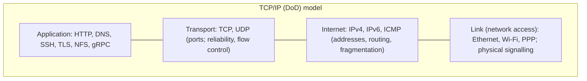
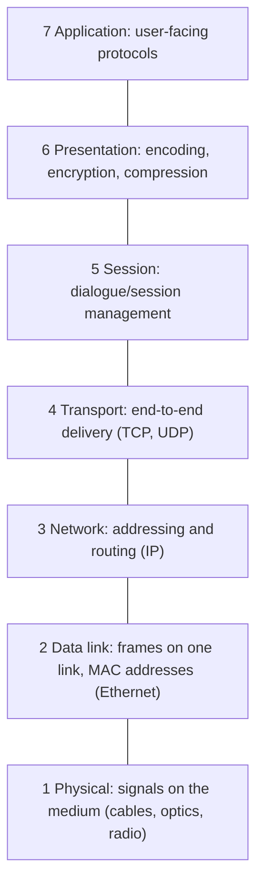
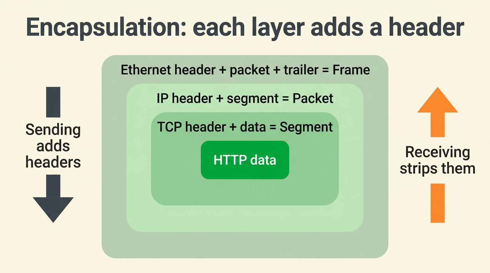
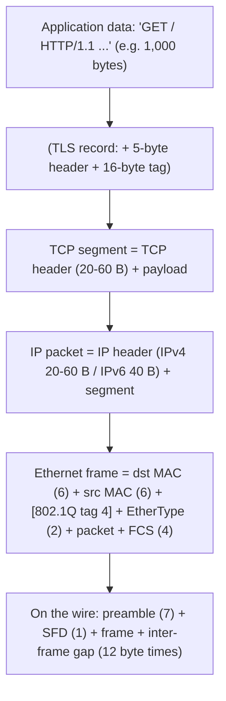
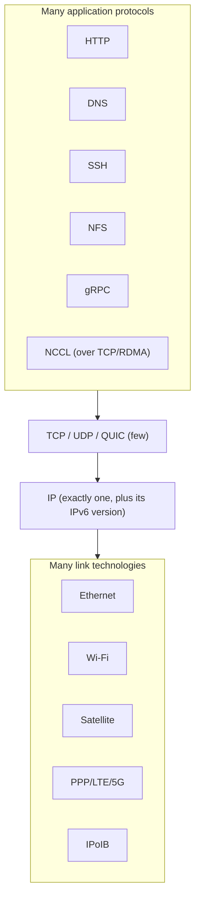
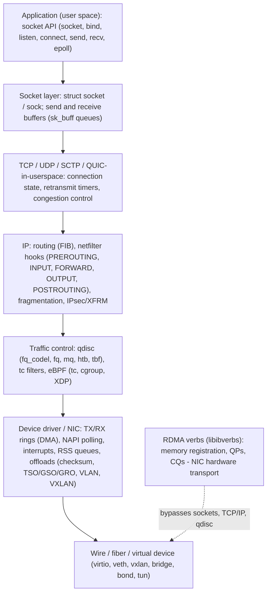

# 2.2 How networks work: layers, encapsulation, the TCP/IP model

| | |
|---|---|
| Level | Beginner |
| Priority tier | 0 |
| Lab venue | Any Linux VM (packet captures and small calculations) |
| Part | Part 2: Networking, from first principles to AI fabrics |
| Status | Drafted, labs **untested** |

## Why this matters for AI infrastructure

Picture a 1,500-byte piece of a training checkpoint leaving one GPU server for another. Inside the sending program it is just bytes. Before it reaches the wire, three wrappers get added. A transport header tells the far side which program should receive the data. An IP header lets switches and routers steer it. An Ethernet header makes the next device accept it. Each wrapper is called a **header**, and the act of adding it is **encapsulation**. A different **layer** adds each wrapper, and a layer is simply a group of related jobs with a fixed interface to the groups above and below it.

Once you can say which layer a performance or reliability problem lives at, and what that layer is responsible for, the problem becomes manageable. The names you will meet later in an AI cluster, such as RoCE, VXLAN, ECMP, PFC, MTU and CNI, each sit at one particular place in that stack. This chapter gives you the map, and later chapters take each layer in depth.

Layers are also the shared language of network engineers. A switch engineer says "that's an L2 problem" and a platform engineer says "the pod can't reach the service". You will often have to translate between the two in your head.

Here is the situation that makes this useful. A teammate says the training job is slow, and a second teammate says the switch ports look fine. Both can be right, because they are looking at different layers. Without a shared map, the two of you talk past each other for an hour. With the map, one question settles it: at which layer does the slowness appear? Think of a building with floors. A leak on the third floor can come from a pipe on the fourth, but you cannot fix it until you agree which floor you are standing on. The rest of this chapter builds that building one floor at a time.

The story begins with a choice the early network builders had to make, between reserving a wire for each conversation and letting everyone share. That choice explains why every protocol you will meet does the same four jobs, and why the pieces are stacked in layers. Once the layers are on the table, the cost of wrapping data in headers turns into simple arithmetic, and the reason the Internet has one IP layer in the middle becomes clear. By the end, the Linux kernel and the two AI-cluster fabrics, Ethernet with RoCE and InfiniBand, sit on the same map.

## Prerequisites and outcomes

You should have read chapter 2.1, which follows a packet's journey, and know basic Linux commands. Nothing else is assumed. Terms such as header, frame and layer are explained the first time they appear.

After this chapter you can:

- Explain circuit switching versus packet switching, and the trade-offs that produced today's packet-switched Internet.
- Name the four functions every data-carrying protocol performs (transport, multiplexing, error control and flow control), and classify familiar protocols with them.
- Draw and compare the 4-layer TCP/IP model, also called the DoD model, with the 7-layer OSI model. Explain why both are useful, why neither is perfect, and what the recursive RINA view adds.
- Explain encapsulation and decapsulation, name each layer's PDU (bits, frame, packet, segment or datagram), and compute header overhead and goodput for a given MTU.
- Explain the demultiplexing keys (EtherType, IP protocol number and port number) and how a received frame reaches the right process.
- Distinguish connection-oriented from connectionless service, hop-by-hop forwarding from end-to-end state, and the three network planes.
- Explain the hourglass or wasp-waist idea, and the State/Optimisation/Surface model of complexity.
- Locate the layers in the Linux networking stack (`sk_buff`, netfilter hooks, qdisc, NIC drivers, offloads and XDP) and in the RDMA/InfiniBand stack that bypasses it.
- Read a packet capture and label each layer.

## 1. Two ways to build a network

Suppose you need to send a file to a server on the other side of the country. The network has to decide how to carry your bytes, and that decision shapes everything else in this chapter. Compare two ways of moving a crowd of people across a city. You could book a whole train for them, which nobody else may use, or you could let everyone take buses that share the same roads. There are two basic designs in networks as well. One reserves a path before any data moves. The other chops the data into pieces and lets those pieces share the wires.

### Circuit switching

In a **circuit-switched** network, the path and its bandwidth are reserved between two endpoints before any data flows. The telephone network is the classic example. When you phone someone, a line is held for your call from start to finish, even during the silences. Each link is cut into repeating time slots, and a controller gives one slot on each link along the path to each call. A switch copies a slot from input to output without reading any address, because the slot position is the address.

The design has real strengths, and it is worth seeing why engineers loved it. Forwarding is trivial, delay and jitter are predictable, and bandwidth is guaranteed. Your voice arrives smoothly because the road was yours alone. The costs are just as real. Bandwidth reserved for one circuit cannot be lent to anyone else, so unused slots are wasted, like an empty train carriage that nobody else may sit in. As the network grows, the central controller becomes a bottleneck and a point of failure, and reacting to a topology change is slow.

### Packet switching

In a **packet-switched** network, the data is cut into packets. Each packet carries a header with at least the destination, like a letter with an address on the envelope. Every device on the path reads that header, looks up the destination in a forwarding table, and sends the packet out the chosen interface. This is hop-by-hop forwarding: each device decides for each packet on its own, and none of them needs to know the whole route. Packets from many sources interleave on the same link, which is called statistical multiplexing. Bandwidth is used only when there is data to send.

Packet switching has real advantages. Links are used efficiently, because a silent sender uses nothing. If a link fails, devices forward around it as soon as their tables change, without asking a controller. Endpoints stay simple, and the network can grow piece by piece. The costs are different. Every device must parse headers and do a table lookup, which early hardware found expensive and modern chips do in silicon. And nothing guarantees bandwidth, delay or order. Your letter may arrive after the one you posted later.

What happens when more traffic arrives than a link can send? Think of a motorway slip road at rush hour. Cars queue, and when the queue is full, the next car is turned away. In a network, queues build up and packets are dropped. Flow control and congestion control must then be added on top. TCP, from 1974 onwards, supplies them.

The Internet is packet switched, but the older design left legacies. Virtual circuits and label switching came back as MPLS. Reserved bandwidth and QoS still serve real-time traffic. Centralised control planes, known as SDN, are returning in hyperscale fabrics. Lossless Ethernet for RDMA is another legacy: priority flow control creates circuit-style "no drop" behaviour inside a packet network, and that brings its own risks. Chapter 2.19 covers them.

### Fixed versus variable length frames

One historical detour deserves a paragraph, because its lesson still shows up in cluster design. ATM tried to merge the two worlds with fixed 53-byte cells, 5 bytes of header and 48 of payload, switched by short labels. Fixed cells simplified hardware, but a 64-byte packet needed two cells, so half or more of the link could carry padding. Imagine always shipping goods in identical crates: a small item still takes a whole crate. ATM lost, but label switching survived as MPLS. The lesson that fragmentation hurts led to the IPv4 "Don't Fragment" bit, path MTU discovery, and the removal of in-network fragmentation in IPv6. Modern switch chips again use fixed-size internal cells, even though external frames vary. So message size against MTU stays a first-order performance variable.

### Flow control and congestion

Circuit-switched networks cannot oversubscribe a circuit, because the slots are pre-allocated, so flow control is built in. Packet networks need it explicitly, and there are two places it can live. TCP, from the work of Cerf and Kahn in 1973/74, provides end-to-end flow control, so the sender does not overrun the receiver. It also provides congestion control, so the sender does not overrun the network. Link-level flow control exists too, between two neighbouring devices. Ethernet has PAUSE frames, PFC works per priority, and InfiniBand uses credit-based flow control. How these interact with end-to-end control is a central topic in AI fabrics.

When you read about a network, first ask whether it reserves a path or shares one. That choice sets how the network handles congestion, and it explains why the same traffic can feel perfectly smooth on one network and stuttery on another.

## 2. The four jobs of a protocol

When a transfer stalls or a connection breaks, you need to know what each protocol in the path is supposed to do. Every protocol that carries data does some combination of four things. Once you know the four, you can ask the same questions about any protocol, including ones you have never seen before. Read the four jobs slowly, because the rest of the chapter keeps coming back to them.

1. Transport moves bits from one place to another. It also translates between data formats and addresses the endpoints.
2. Multiplexing keeps data from different senders, applications or flows separate on a shared medium or connection. It demultiplexes them again at the other end.
3. Error control detects damaged or lost data, using CRC or checksums. It can correct errors with FEC, or retransmit lost data with ARQ.
4. Flow control matches the sender's rate to what the receiver and the network can absorb. It uses windows, credits, pause frames or rate control to do this.

These four group naturally into two pairs: transport with multiplexing, and error control with flow control. The first pair is about getting data to the right place and keeping conversations apart. The second pair is about getting it there intact and at a sensible speed. The table below shows how common protocols handle each job.

| Protocol | Transport | Multiplexing | Error control | Flow/congestion control |
|---|---|---|---|---|
| Ethernet | Link-local frames, MAC addressing | EtherType, VLAN tags | FCS (CRC32) detects errors (drops); FEC at high speed PHYs | None originally; PAUSE/PFC optional |
| IP | Network-wide addressing, routing | Protocol number | Header checksum (IPv4) only | None (ICMP signals) |
| UDP | Datagrams between ports | Ports | Optional checksum | None |
| TCP | Reliable byte stream | Ports | Checksum, sequence numbers, ACK, retransmit | Receive window, congestion window |
| TLS | Secure channel over TCP | (single stream) | MAC/AEAD integrity | None (relies on TCP) |
| HTTP/2 | Requests/responses | Streams | Relies on TCP | Per-stream flow-control windows |
| QUIC | Streams over UDP | Connection IDs, streams | Own ACKs/retransmit | Own congestion control, stream windows |
| InfiniBand (link + transport) | Packets in a lossless fabric | LIDs/QPs | ICRC/VCRC, ACK/NAK retransmit | Credit-based link flow control, CC |
| RoCE v2 | InfiniBand transport over UDP/IP/Ethernet | UDP port 4791, QP numbers | ICRC + retransmit (go-back-N or selective) | Needs PFC/ECN + DCQCN/other CC |

Read the table with one question in mind. The most reliable way to learn a protocol is to ask which of the four jobs it does, and at what scope. Scope means one link or the whole path, end to end. Ethernet's jobs apply on one link. IP's job applies across many links. TCP's apply end to end. A courier analogy fits: the local driver is responsible for one leg, the dispatcher for the whole route, and the sender and recipient for making sure the goods arrive complete.

This same pattern, the same four functions repeated at different scopes, is the insight of the Recursive InterNetwork Architecture (RINA) model. When you meet a new protocol, list its four jobs and their scope before you read its header format. You will find that a header format becomes much easier to read once you know what jobs its fields exist to do.

## 3. Layered models

A web page loads slowly, and you need to know which part of the stack to blame. A protocol stack model gives you the map. It groups protocols by purpose and shows how the pieces fit together. Each layer talks to the layer above and below it through a well-defined interface. For example, the socket API sits between the application and the transport. Each layer also talks to its peer layer on the other machine, using a protocol. So every message has two directions of conversation at once, one up and down inside a machine, and one across to the matching layer on the far machine.

### The DoD / TCP/IP model (4 layers)



The DoD model was developed in the 1960s to 1980s under DARPA sponsorship. It was not built to survive nuclear war. Its goal was much more practical. It aimed to let incompatible computers at universities and labs communicate. The model split the problem into four layers: link for frames on one network, internet for datagrams across networks, transport for end-to-end conversations, and application for user-visible protocols.

Its key feature is that many protocols can exist at each layer. There are several link types, TCP and UDP, and thousands of applications. Everything is connected through one protocol in the middle, IP. That is why you can plug a laptop into Wi-Fi at home and a cable at work and run the same programs. Earlier seven-layer variants of the DoD model, which added utility, network and internetwork layers, were dropped.

On a Linux host, the practical question is where each layer lives. Start by checking whether the problem sits in the kernel or in user space. Application code runs in user space: curl, nginx and PyTorch are examples. The transport layer and everything below it live in the kernel, so a packet you cannot find in an application log may still be visible one floor down. There are exceptions, including user-space networking such as DPDK, XDP in the driver, QUIC in user space, and RDMA verbs that bypass the kernel stack.

### The OSI model (7 layers)



ISO proposed the OSI model in 1977 as an alternative to the DoD stack. It tried to blend circuit-oriented and packet-oriented thinking, and telecom and database interests drove it. The full OSI protocol suite never won. Its specifications were slow, complex and sold in paper form to members, while the TCP/IP specifications and implementations were free. When two designs are both reasonable, the one that people can download and try tends to win.

The model itself became the universal teaching and troubleshooting vocabulary, even though the protocols did not. It also made lasting contributions: strict modularity, well-defined interfaces, and the idea that intermediate systems such as routers and switches are part of the architecture. Several OSI-era protocols survive. The most notable is IS-IS, which stands for Intermediate System to Intermediate System. It is a routing protocol widely used in data centres and ISP backbones, and chapter 2.14 covers it.

In practice, people use the layers as shorthand, and you will hear the numbers in every network conversation. L1 means cables, optics, signal, and link up or down. L2 means Ethernet, MAC addresses, VLANs and switching, and ARP lives between layers 2 and 3. L3 means IP and routing. L4 means TCP and UDP, ports, load balancers and firewalls. L7 means HTTP and application-aware proxies. Layers 5 and 6 rarely matter in practice, although TLS is often described at L6 or as "L4.5". A good habit is to translate the shorthand when you hear it. "An L2 problem" means "something about frames and MAC addresses on one network".

Many protocols straddle layers, so do not expect a clean fit. Ethernet is L1+L2. TCP covers parts of L4 and L5. TLS is called Transport Layer Security, yet it sits above TCP. BGP runs over TCP, which is an application protocol, but it provides the L3 forwarding information. IPsec is arguably L3 or L4. VXLAN is L2 over L3 over UDP, and MPLS is "L2.5". If that sounds untidy, it is. The model is a tool, and real protocols were never obliged to follow it.

Do not spend too long on classification quarrels. Use the model to **ask the right questions**.

### Comparison

| TCP/IP (4) | OSI (7) | Typical protocols and devices | PDU name |
|---|---|---|---|
| Application | 7, 6, 5 | HTTP, DNS, SSH, TLS, gRPC, NFS | Message / data |
| Transport | 4 | TCP, UDP, QUIC (over UDP), SCTP | Segment (TCP) / datagram (UDP) |
| Internet | 3 | IPv4, IPv6, ICMP; routers, L3 switches | Packet |
| Link | 2, 1 | Ethernet, Wi-Fi, PPP; switches, NICs, cables | Frame / bits |

Read the table from left to right. Each TCP/IP layer maps to one or more OSI layers, and the last column names the unit of data at that layer. When you see a unit name in a capture, this table tells you which layer it belongs to. For instance, if someone says "the frame was dropped", you now know they are talking about the link layer, not about TCP.

### Packets, headers and payloads

Data crosses a network in small chunks called packets. Each packet has two parts: a header and a payload. The header holds identifying facts, such as the source and destination hosts and the basic protocol. The payload is the real application data, such as an HTML page or an image. Think of a postcard: the header is the address side, and the payload is the message.

A host can send, receive and process packets in any order, which lets several hosts talk at once. A host sending to two others can alternate between them packet by packet. Small pieces also make errors easier to detect and fix, because only a damaged piece needs to be sent again, not the whole file. The operating system does this splitting for you, but knowing the role of packets helps when you read the lower layers.

### A note on the OSI model

You may meet the Open Systems Interconnection (OSI) Reference Model. It is a seven-layer model that teachers and network designers use a lot. This handbook sticks to the four-layer view, because that is the stack you work with directly on Linux. For a deeper look at layers and networks in general, see Andrew S. Tanenbaum and David J. Wetherall, *Computer Networks*, 5th edition (Prentice Hall, 2010).

### Where the layers blur

Layers do not always stay in neat order. For speed, some devices look at transport and internet data together, even though they once handled only the physical layer. The names can mislead too. TLS stands for Transport Layer Security, but it lives in the application layer, one level higher. Do not worry about these details while you learn the basics.

In Linux, the kernel mostly handles the transport layer and everything below it. A few exceptions send packets into user space for processing.

### Connection-oriented and connectionless

A connection-oriented service sets up state before it sends data. Often it also reserves resources and a path. It is like a phone call, where you dial, wait for an answer and then talk. After that, data flows with little overhead for each packet. TCP at the edge works this way, and so do ATM, MPLS LSPs, InfiniBand queue pairs and RDMA reliable connections.

A connectionless service carries everything needed to deliver each unit inside the unit itself. It is like posting letters, where each envelope carries the full address and nobody sets up anything first. IP datagrams, UDP and Ethernet frames are examples.

The Internet mixes the two. It is connectionless in the core and connection-oriented at the edges. Think about what happens when a link fails. State in the middle, as in a circuit, makes recovery expensive, because every device holding state for the broken path must be told. State at the edges and datagrams in the core let the network route around the failure without touching the endpoints' connections. This is the end-to-end principle: put intelligence in the endpoints and keep the core simple.

QoS and flow control are often layered on top as connection-like state. That can create mismatches with a connectionless forwarding plane when paths change. When you design a path, decide where the state lives: in the endpoints, or in the middle of the network.

## 4. Encapsulation and decapsulation

Think about one HTTP request leaving your laptop. The request text is not sent as it is. Picture writing a letter, putting it in an envelope, putting that envelope in a courier bag and putting the bag in a van. Each layer adds its own header on the way down. When an application sends data, each layer wraps what it receives from above in its own header, and sometimes a trailer. It then passes the larger unit down. This is encapsulation. On the receiving side, each layer strips its header and hands the payload up. That reverse step is decapsulation, like unpacking the van, then the bag, then the envelope.



*Figure 2.2.1. Each layer wraps the data from the layer above with its own header; the receiver strips them in reverse.*



The headers are small, but they add up, and you will use these numbers constantly. A typical Ethernet header is 14 B, and an 802.1Q VLAN tag adds 4 B more. The FCS adds 4 B at the end of the frame. An IPv4 header is 20 B, while an IPv6 header is 40 B. A TCP header is 20 B, and it can grow to 60 B with options. Timestamps add 12 B of that. A UDP header is 8 B.

On the wire, the preamble and SFD add 8 B, and the inter-frame gap adds 12 B. Together that is 20 B of fixed overhead for every frame. These two are not part of the frame you see in a capture, but the wire still has to spend time on them.

### Overhead and goodput (worked examples)

How much of the link carries your data, and how much carries wrapping? Work it out for one ordinary case. Start with a standard 1500-byte MTU, the largest IP packet on ordinary Ethernet. A TCP/IPv4 segment can carry at most 1500 bytes minus 20 bytes of IP header and 20 bytes of TCP header. That leaves a maximum segment size, or MSS, of 1460 bytes of data. With the TCP timestamp option, the payload drops to 1448 bytes.

Now count what is on the wire for that segment, adding every wrapper in turn. The 1460 bytes of data travel with a 20-byte TCP header, a 20-byte IP header, a 14-byte Ethernet header and a 4-byte FCS. The preamble and inter-frame gap add another 20 bytes.

Adding those up gives 1460 + 20 + 20 + 14 + 4 + 20 = 1538 byte times. A byte time is the time one byte occupies the wire. So goodput is 1460 / 1538 = 94.9%. Goodput is the share of the wire that carries useful application data. At a 1500-byte MTU, about 95 percent of the bits on the wire are application data. If you are sizing a link, that is the figure to plan with.

Jumbo frames change the picture, because the wrapping stays the same size while the cargo grows. With a 9000-byte MTU, the MSS is 8960, and the wire carries 8960 + 78 = 9038 byte times. So goodput is 8960 / 9038 = 99.1%.

Overhead dominates for small messages, as a tiny parcel in a big box shows. A 64-byte minimum frame carries as little as 18 bytes of application data over UDP, and it occupies 84 byte times on the wire. A 100 Gb/s link can therefore carry at most 148.8 million minimum-size frames per second.

The arithmetic is 100e9 / (84 × 8) = 148.8 million frames per second, where 84 × 8 converts the byte times into bits. If you care about small messages, check packets per second as well as bandwidth. A link can be nowhere near full in bits and still be out of packets per second.

RoCE v2 adds its own headers: a UDP header of 8 B, an IB BTH of 12 B, extension headers, and an ICRC of 4 B. With a 4096-byte RDMA MTU on a jumbo-frame Ethernet fabric, efficiency is again about 98% to 99%. These calculations explain why jumbo frames and larger messages raise throughput. They also show why packets-per-second limits matter for small-message workloads, such as allreduce latency phases or key-value traffic.

To see these layers on a live host, run the capture below and read the Ethernet, IP and TCP fields in order.

```bash
# See the layers in a live packet: -e shows the Ethernet header, -v adds IP/TCP details
sudo tcpdump -nn -e -v -c 5 -i any 'tcp port 443'
# Show raw bytes of a frame; match the layers by offset (Ethernet 0-13, IP 14-33, TCP 34-53 ...)
sudo tcpdump -nn -XX -c 1 -i eth0 'tcp'
ip -s link show dev eth0 ; ethtool -k eth0 | egrep 'segmentation|checksum|scatter|gro|gso|tso'      # offloads hide the true on-wire sizes from tcpdump
```

Keep offloads in mind when you read these outputs, because they change what tcpdump shows. If you want to see the layers in your own traffic, start with the first command.

### Demultiplexing: how the right code gets the bytes

A frame arrives at the NIC. How does it end up in the right process? The network card does not know which program wants it, and neither does the cable. Each layer includes a field that tells the receiver which protocol should get the payload, a bit like the department name on an internal mail label. Three fields do this job.

- The Ethernet EtherType is a 16-bit field. Its values include `0x0800` for IPv4, `0x86DD` for IPv6, `0x0806` for ARP, `0x8100` for a VLAN tag (802.1Q), `0x88A8` for QinQ, `0x8847` and `0x8848` for MPLS, `0x8915` for RoCE v1, `0x8808` for MAC control, which carries PAUSE and PFC, and `0x88CC` for LLDP.
- The IP protocol field, also called the next header, is 8 bits wide. Its values are 1 for ICMP, 6 for TCP, 17 for UDP, 41 for IPv6 in IPv4, 47 for GRE, 50 for ESP, which IPsec uses, 58 for ICMPv6, 89 for OSPF and 132 for SCTP.
- The UDP and TCP port numbers are 16 bits each. They identify the endpoint application. Ports below 1024 are well-known ports. Among them, 22 is SSH, 53 is DNS, 80 and 443 are HTTP and HTTPS, and 4791 is RoCE v2. Registered ports run from 1024 to 49151, and ephemeral ports sit above that.

Each key picks the next handler, so follow one frame from the bottom up. Ethernet reads EtherType `0x0800` and hands the frame to IPv4. IPv4 reads protocol 6 and hands the packet to TCP. TCP reads destination port 443 and passes the segment to the socket bound to that port, or to the connection's 5-tuple. The socket then delivers the data to the process. Three small numbers, read one after another, carry the data from a wire to a program.

If a key matches no handler, the packet is dropped. Or the sender gets an error back, such as an ICMP protocol or port unreachable message, or a TCP RST. So a refused connection is not a mystery. It is the kernel saying that the last key pointed at nobody.

### MTU, MSS and tunnels

The MTU, or maximum transmission unit, is the largest IP packet a link can carry. It is 1500 on standard Ethernet, commonly 9000 on storage and AI fabrics, and 1460 on some cloud networks. The MSS is the largest TCP payload per segment. It is announced in SYN options, and for IPv4 it equals the MTU minus 40 bytes. In plain words, the MTU is the size of the pipe and the MSS is how much cargo TCP loads so it fits through.

Tunnels and overlays add outer headers, and each one shrinks what the inner packets can carry. This is like putting a parcel inside a second, slightly larger parcel for a leg of the trip. VXLAN adds 50 bytes, made up of an outer Ethernet header of 14, an IP header of 20, a UDP header of 8 and a VXLAN header of 8. GRE adds 24 bytes over IPv4. IPsec ESP adds 50 to 70 bytes or more, and WireGuard adds 60. Kubernetes overlays and VPNs therefore reduce the effective MTU of the inner traffic.

If the inner packets are not reduced, or the MSS is not clamped, large packets exceed the path MTU. They are then either fragmented, which is slow, or dropped with an ICMP "fragmentation needed" message. If that ICMP is filtered, connections hang on large transfers. That failure is called a black hole. Small requests work and large ones vanish, which is exactly the kind of symptom that wastes a day. Always verify the end-to-end MTU in AI clusters. A single link at 1500 in a 9000 fabric cripples throughput or breaks RoCE.

Before you deploy an overlay, measure the end-to-end MTU across it.

## 5. The three planes

What should keep working when the routing software fails? A router that stops forwarding the moment its routing process crashes would be a fragile router. The answer depends on which plane does which job. Network devices and networks are organised into functional planes, and the table lists them.

| Plane | Job | Examples |
|---|---|---|
| **Data (forwarding) plane** | Moves packets: parse headers, look up the forwarding table (FIB), rewrite, queue, transmit; must run at line rate (ASICs in switches, kernel/XDP/eBPF on hosts, SmartNIC/DPU) | Switching, routing lookups, ACL matching, NAT, encapsulation, QoS queueing |
| **Control plane** | Builds the information the data plane needs: routing protocols, spanning tree, ARP/ND, LACP, BGP/EVPN, SDN controllers | OSPF, IS-IS, BGP, STP, LLDP, DHCP |
| **Management plane** | Configures and monitors the device: CLI, SNMP, NETCONF/gNMI, syslog, telemetry | SSH, REST APIs, Prometheus exporters |

In traditional networks, the control plane is distributed. Every router runs the protocol and computes its own table, in the way that every driver in a city reads the road signs and plans their own route. A RIB holds the candidate routes, and the best ones go into the FIB. In SDN, a centralised controller computes and installs the forwarding state instead, like a traffic centre telling every driver where to turn. OpenFlow was the first widely known interface for this.

In practice, hybrid designs win. Hyperscale data centres run distributed BGP with automation on top. Some AI fabric managers are logically centralised controllers. InfiniBand's Subnet Manager, for example, computes routes for a lossless fabric.

Where a function sits is partly a matter of definition. Is manual static route configuration part of the management plane or the control plane? The more useful question is what happens to traffic when the control plane fails, the controller is unreachable, or the device reboots. The answer depends on fail-open or fail-static behaviour, and on graceful restart. When you evaluate a design, ask that question first.

### Loop-free paths: the control plane's core problem

Whatever the protocol, the control plane must produce loop-free forwarding paths. If traffic can circle, IP packets eventually die when their TTL runs out. L2 has no TTL, so a loop is worse there. Packets multiply and can melt the network in broadcast storms, which chapter 2.11 covers.

Three families of algorithm avoid loops, and each takes a different approach to the same worry. In distance vector, each router tells its neighbours its distances, hop by hop, like a rumour passed along a street. RIP and EIGRP work this way. In link state, every router floods the topology and runs Dijkstra shortest path first on the same database, so everyone holds the same map. OSPF and IS-IS use this design. In path vector, each announcement carries the list of autonomous systems it has crossed. That list prevents loops and allows policy, because a router that sees its own name on the list knows the route has already been through it. BGP is a path-vector protocol.

Chapters 2.13 to 2.16 develop these families in depth. One design insight matters here. Advances in CPU, memory and bandwidth made early arguments about protocol overhead less decisive. Stability, scalability and operability remain the criteria, though. Judge a routing protocol by those three, not by overhead alone.

### Quality of service

A voice call stutters when a large transfer shares the same link. That is the problem QoS solves. Real-time traffic cares about delay and jitter, the variation in delay. That includes voice, video, and now tightly synchronised distributed training and RDMA. Early thinking said such traffic could never share a packet network. The solution that emerged was marking, classification and queueing.

You classify packets using DSCP or IP precedence, or 802.1p PCP. In plain words, you put a label on each packet saying how urgent it is. Then you give each class its own queue, with a scheduler such as strict priority or weighted round robin. It works like separate checkout lanes in a shop. You can also shape or police rates. ECN and early drop signal congestion to the sender. With faster links and better queueing algorithms, four to eight queues usually suffice.

In AI fabrics, QoS means dedicating a lossless priority to RDMA traffic with PFC and ECN. Storage, management and other traffic stay in different classes, as chapter 2.19 explains.

Before you add a queue, decide which traffic needs a lossless class and which does not.

## 6. Taming complexity: the hourglass and the SOS triangle

Picture the Internet with many applications on top and many kinds of link underneath. Connecting every application to every link type would be unmanageable, with every combination needing its own adapter. The hourglass shape keeps those connections simple.

### The hourglass (wasp waist)



Protocols are numerous at the top, where the applications are, and at the bottom, where the physical media are. At the narrow waist there is essentially one protocol, IP. Think of the electrical plug in a country. There are thousands of appliances and several power sources, but one socket shape in the wall means they all work together.

That single waist keeps three kinds of complexity under control. The first is state. Information about the network lives in the lower layers, and information about the data lives in the upper layers, so neither needs the other's detail. The second is interaction surface. Components meet through one well-regulated interface, IP, which changes rarely. The third is optimisation. Some optimisation is deliberately given up by hiding network state from applications. TCP, for example, infers congestion from loss and delay rather than knowing the network. These three words come back in the SOS triangle later in this section.

Layer violations buy performance, but they cost you. A transport that peeks at link state, a switch that parses TCP ports for ECMP, and a NIC that offloads TCP all add interaction surfaces. They also make evolution harder. This is called ossification, where middleboxes break new TCP options or QUIC. A middlebox is any device in the middle of the path that opens up packets it was only meant to forward.

AI fabrics are a deliberate, controlled violation of layering. RDMA transport hardware is tightly integrated with link-layer flow control and a specific fabric design. The payoff is microsecond latency and zero CPU overhead. When you read a design, look for each layer violation and ask what it buys and what it costs.

### State, Optimisation, Surface

Every network design involves a trade. You cannot get everything at once, and the useful skill is to see what you are paying. More capability usually means more to store, or more ways for parts to interact. A useful trade-off model for any network design decision has three corners:

- State is how much information devices must hold, such as routes, ACLs, MAC tables and flows.
- Optimisation is how well the design uses resources, through shortest paths, load balance, low latency and cost.
- Surface is how many places and ways components interact, such as protocols, interfaces, configuration touch points and failure interactions.

Pushing one corner usually strains another. Increasing optimisation tends to require more state or more interaction surfaces. Reducing state tends to reduce optimisation or increase surfaces. Reducing surfaces tends to cost optimisation or state. The plane of the possible is the region of designs you can actually build. A simple analogy is a sat-nav app. Asking it for the absolute fastest route means it must track live traffic everywhere, which is more state, and you must trust more moving parts, which is more surface.

Stretch makes this concrete. Stretch is the difference between the shortest physical path and the path traffic actually takes. Any policy, such as traffic engineering or PBR, increases stretch. A rule that says "send this traffic via that data centre" is a detour by definition. The extra state and interaction needed to implement that policy is the price.

Similar three-way trade-offs appear everywhere, for example in the CAP theorem and in quick, cheap, good. One line sums up the lesson: "If you have not found the trade-off, you have not looked hard enough."

Complexity cannot be solved, only moved or managed. You can hide it behind abstraction and black boxes. You can move the problem elsewhere, add a layer of indirection such as overlays, replace the system, or defer the problem. Each option has costs. A network that is robust against the predictable can be brittle against the unpredictable. This is the "robust yet fragile" pattern, like a house that survives storms but not a fire in the one place nobody planned for.

Keep this in mind when you design clusters. Every special case adds state and surface. A rail-optimised topology exception, a custom NCCL topology file and a per-tenant policy are all examples. Count the state and surface of each one before you approve it.

## 7. Where the layers live: Linux and AI fabrics

Suppose a packet from your training job disappears somewhere between an application and the NIC. You need to know which layer to inspect first, and in what order the packet passes through the software that handles it. The Linux stack and the AI fabric tables below show where each layer lives.

### The Linux stack



The unit of data inside the kernel is the `sk_buff`, or socket buffer. It is a descriptor with pointers into the packet data and metadata, such as headers, device, timestamps and checksum state. Layers add and remove headers by moving pointers, which is cheap, instead of copying the bytes. It is like sliding a stack of papers into a different folder instead of retyping each page.

Many software constructs map onto the layer model, and it helps to attach a layer number to the names you already know. `lo`, `eth0` and `ens4` are L2 devices. A bridge is a software switch at L2, and a bond or team does link aggregation at L2. A VLAN subinterface follows 802.1Q at L2, and a veth is a virtual cable between namespaces. VXLAN, GRE and Geneve devices are L2/L3 overlays, and WireGuard is an L3 tunnel.

Routing tables and rules work at L3. Netfilter, nftables and conntrack handle L3 and L4 filtering and NAT. Qdiscs handle egress queueing, and XDP runs programs at the earliest point in the driver.

Run these commands on a Linux host to see each layer at work. Each one reports on a different part of the stack, so note which layer each output belongs to.

```bash
ip -d link show                          # device types: bridge, bond, vlan, veth, vxlan, tun ...
ip -s link show dev eth0                 # RX/TX counters, errors, drops (L1/L2 health)
ss -s ; ss -tanp | head                  # sockets (L4) per state and process
nstat -az | egrep 'TcpRetrans|IpInDiscards|UdpInErrors'      # protocol counters
tc qdisc show ; tc -s qdisc show dev eth0                      # queueing discipline and drops
sudo nft list ruleset | head -50 ; sudo conntrack -L | head    # filtering and NAT state
sudo bpftool net list 2>/dev/null | head                       # XDP / tc eBPF programs
```

### AI fabrics in the model

AI clusters use several fabrics at once, and a new engineer often assumes there is only one network. Each fabric puts its work at different layers. The table compares them.

| Fabric | L1/L2 | L3 | L4 / transport | How it maps |
|---|---|---|---|---|
| **Ethernet with TCP** (front-end, storage, control plane) | Ethernet (25/100/400 GbE) | IP (BGP/ECMP in Clos) | TCP/UDP (kernel) | Standard stack; congestion control CUBIC/BBR |
| **RoCE v2** (RDMA over Converged Ethernet) | Lossless Ethernet (PFC, ECN, DCB) | IP (routable) | UDP (4791) + IB transport (BTH) in the NIC | RDMA verbs bypass the kernel stack; fabric must be engineered for near-zero loss |
| **InfiniBand** | IB link layer (credit-based, virtual lanes) | IB network layer (GIDs; routing via LIDs inside subnets, GRH across) | IB transport (RC/UD/...) in the NIC | Own addressing and a Subnet Manager computing forwarding tables |
| **NVLink / NVSwitch** | Proprietary GPU-to-GPU links | (memory-semantic, no IP) | Load/store and DMA between GPUs | Inside a node (and now rack-scale): collectives use it before leaving via NICs |
| **PCIe** | Serial links, TLPs | (bus) | | GPU-NIC-CPU paths; locality matters (chapter 1.28) |

For NCCL, the network is a hierarchy, a bit like a postal service with in-house mail, city vans and long-distance flights. NVLink carries traffic inside the node. The NIC and the fabric carry it between nodes. TCP sockets serve as the fallback, and they handle bootstrap. Chapters in Part 12 take these in depth.

When a collective runs slowly, first find out which link in this hierarchy it is using.

## 8. Reading a capture: labelling layers

Suppose a server's capture shows a SYN packet heading to port 443. You can read the frame one layer at a time, and each layer tells you what the next one is, like opening a set of nested boxes. The frame below is illustrative. It is decoded by `tcpdump -nn -e -v`.

```text
12:00:01.123456 52:54:00:12:34:56 > 52:54:00:ab:cd:ef, ethertype IPv4 (0x0800), length 74:
    10.0.0.15.51234 > 93.184.216.34.443: Flags [S], seq 1, win 64240, options [mss 1460,sackOK,TS val 1 ecr 0,nop,wscale 7], length 0
    (tos 0x0, ttl 64, id 12345, offset 0, flags [DF], proto TCP (6), length 60)
```

Start at L2. The source MAC is 52:54:00:12:34:56, and the destination MAC is 52:54:00:ab:cd:ef. The EtherType 0x0800 says the next header is IPv4. The frame length of 74 is 14 for Ethernet plus 60 for IP.

At L3, the source is 10.0.0.15 and the destination is 93.184.216.34. The TTL is 64, and the DF flag is set. Protocol 6 says the next header is TCP. The IP total length of 60 is 20 for the IP header plus 40 for TCP with its options.

At L4, the TCP source port is 51234, an ephemeral port, and the destination port is 443. The S flag means SYN. The options are MSS 1460, SACK, timestamps and window scale 7. The payload length is 0, so this is the first packet of the handshake.

The same frame in Wireshark expands each header's fields as a tree. The OSI and TCP/IP models are the table of contents for that tree. When you open a capture, label each layer before you read the flags. It is a good discipline, because most confusion in captures comes from mixing up which header a field belongs to.

## 9. Hands-on lab: layers, overhead, and captures

A word on status first. The Python lab below has been run, and its figures are checked against the arithmetic in this chapter. The VM steps after it have not been run on live hardware, so confirm each result on your own machine. Start with the self-checking Python lab, and run it locally. It verifies four things. Goodput efficiency is `94.9%` at a `1500` MTU and `99.1%` at a `9000` jumbo MTU. VXLAN's `50`-byte overhead cuts the MSS to `1410` B. Maximum packet rates for `64`-byte frames are `148.8` Mpps on a `100` Gb/s link and `595.2` Mpps on a `400` Gb/s link. The lab also checks the demultiplexing keys from L2 to L3 to L4. Each figure comes from the arithmetic earlier in this chapter, so you can check the lab against the text. Then the VM steps show you how the same layers look in your own traffic.

```bash
python3 code/part02/layers_encapsulation_lab.py
```

Next, work through the following steps on a disposable Linux VM.

1. Capture and label the layers. Run `sudo tcpdump -nn -e -v -w layers.pcap -i any 'host example.com or port 53'` while you run `curl -s https://example.com/ >/dev/null`. Open the file in Wireshark, or use `tshark -r layers.pcap -V -c 3`. Pick one DNS packet and one TCP packet. Write down each header's key fields, and the demultiplexing key that selected the next layer.
2. Build an overhead calculator. Write a small Python script that takes the MTU, the L3 choice (IPv4 or IPv6), the L4 choice (TCP or UDP, with options) and whether a VLAN is used. It should return the MSS, the bytes on the wire per full segment, and the efficiency. Test it with a 1500 and a 9000 MTU, 4096-byte RDMA payloads, and VXLAN encapsulation. Then compute the maximum packets per second for a 100 Gb/s and a 400 Gb/s link, using 64-byte and 1500-byte frames.
3. Run the MTU experiment. Start with `ping -M do -s 1472 <host>`. Since 1472 plus 28 makes 1500, that packet should fit. Then try 1473, and watch for the "message too long" or "frag needed" behaviour. Use `tracepath <host>` to discover the path MTU. Finally, lower an interface MTU in a network namespace pair, and watch TCP's MSS and PMTUD adapt. Chapter 2.25 shows the namespace setup.
4. See the stack for yourself. Run `ip -d link`, `ss -s`, `nstat`, `tc -s qdisc` and `nft list ruleset` on your VM. Classify each output as L1/L2, L3, L4, or "between". Then run `ethtool -k` and note which functions are offloaded to the NIC.
5. Build encapsulation by hand. Create a VXLAN device between two namespaces, or between two VMs. Capture the outer and inner headers. Then verify the 50-byte overhead and the MTU reduction.
6. If you have the hardware, run the RDMA contrast. Start `ib_write_bw` and watch with `tcpdump`. For InfiniBand, nothing appears. RoCE appears only on a mirrored port or with a special capture tool. Read the `ethtool -S` and `rdma statistic` counters, and write down which layers the traffic "skips".
7. Do a complexity exercise. Pick a cluster design choice, such as a dedicated RDMA VLAN with policy routing for a second NIC. Write down the added state, the optimisation you gain and the new interaction surfaces. Then discuss the trade-off.

Start with the Python lab, since its numbers give you something to check the VM results against.

## 10. Common mistakes

Watch for these habits, because you will meet each one on a real cluster. Each one leads to a wrong conclusion about where a problem lives, and each one can cost you real debugging time. They look harmless until the day they cost you an afternoon.

- Treating the OSI numbers as strict facts, and arguing about where a protocol belongs. Ask what it does and at what scope instead.
- Forgetting overhead. Assuming 100 Gb/s of line rate equals 100 Gb/s of application throughput, and ignoring per-packet limits for small messages.
- Ignoring MTU in tunnels, VPNs, overlays and clouds.
- Confusing hop-by-hop identifiers, such as MAC, with end-to-end identifiers, such as IP, and with application identifiers, such as port.
- Assuming a lossless fabric behaves like a normal Ethernet network. PFC deadlocks, head-of-line blocking and pause storms can all result from that assumption.
- Believing that TCP/IP tools see all traffic on a host. RDMA, DPDK, XDP-redirected traffic and offloaded flows bypass them.
- Adding just one more overlay or special case without counting its state and interaction surfaces.

If a transfer is slower than expected, check the MTU and the per-packet overhead first.

## 11. Interview angles

These are questions an interviewer may ask. Answer each one in your own words, and name the layer every answer lives at. If you can say the layer out loud each time, you will sound like someone who has debugged real networks.

- "Explain the OSI model and where TCP, IP, Ethernet, VXLAN and TLS fit." Include the caveats.
- "What does encapsulation mean? What is the overhead of VXLAN? What happens to MTU?"
- "Circuit versus packet switching: why did packet switching win, and where does circuit-like behaviour reappear?" Mention MPLS and lossless RDMA fabrics.
- "What is the difference between the control plane and the data plane? What happens when the control plane fails?"
- "How does a frame find the right process on a server?" Walk through EtherType, then the IP protocol, then the port, then the socket.
- "Why can't I see RDMA traffic with tcpdump?"
- "What is the hourglass model and why did the Internet scale?"
- "Where does NCCL traffic live in these layers when it uses InfiniBand versus sockets?"

## Exercises

1. Compare circuit switching with packet switching, and trace the legacy of ATM. (a) Compare circuit switching, which uses TDM time slots, with packet switching, which uses hop-by-hop statistical multiplexing. Judge both by link utilization, resilience to link failures and control-plane complexity. (b) Explain why ATM's `53`-byte fixed cells, with a `5`-byte header and a `48`-byte payload, lost to variable-length IP and Ethernet packets. Then name the two ATM concepts that survived into modern networks.
2. State the four functions performed by data-carrying protocols: transport, multiplexing, error control, and flow and congestion control. Then compare how Ethernet, IPv4, UDP, TCP, QUIC, InfiniBand and RoCE v2 implement each one. For RoCE v2, include UDP port `4791`, the IB BTH and the ICRC.
3. Work out encapsulation overhead, goodput, and packet rates. (a) Use `compute_tcp_ethernet_goodput()` in `code/part02/layers_encapsulation.py` to compute the TCP/IPv4 MSS. Also compute the total on-wire byte times, counting `14` bytes of Ethernet header, `4` bytes of FCS, `8` bytes of preamble and SFD, and `12` bytes of inter-frame gap. Then compute the goodput percentage for MTU `1500`, MTU `9000` (jumbo), and MTU `1500` with a `50`-byte VXLAN overlay. (b) Use `compute_max_frame_rate_mpps()` to find the maximum packet rate in Mpps for minimum `64`-byte frames, which take `84` byte times on the wire. Do this for a `100` Gb/s link and for a `400` Gb/s link.
4. Demultiplexing keys: trace how a receiving Linux kernel sorts an incoming frame with `demultiplex_packet()`. Work through three cases. (a) `EtherType` `0x0800`, protocol `6`, destination port `443`. (b) `EtherType` `0x0800`, protocol `17`, destination port `4791`. (c) `EtherType` `0x86DD`, next header `58`.
5. Explain the three network planes, the hourglass model, and the State/Optimization/Surface (`SOS`) triangle. (a) Distinguish the data plane (`FIB`), the control plane (`RIB`, with distance vector, link state or path vector, or the centralised IB Subnet Manager), and the management plane. (b) Explain the Internet hourglass, also called the wasp waist. Then use White's State/Optimization/Surface (`SOS`) triangle to explain the cost of reducing path stretch with traffic-engineering policies or overlays.
6. Map the layers to the Linux kernel and to AI fabrics. Trace a packet through the Linux kernel stack: from `socket` to `sk_buff`, then to TCP or UDP, then to the IP FIB and netfilter hooks, then to `tc qdisc`, and finally to the NIC ring or XDP. Then contrast that path with how RoCE v2, InfiniBand, and NVLink/NVSwitch map onto L1 to L4.

Work through these in order and write your answers down as you go. You can check your work against the checkpoint questions at the end of the chapter. Do exercises `3` and `4` first, since their numbers give you something to check the rest against. Each exercise starts from something you could really meet on a host, so try to picture the machine while you answer.

## Checkpoint questions (20)

<details>
<summary>1. What is the fundamental difference between circuit switching and packet switching?</summary>

In circuit switching, such as TDM telephony, a dedicated path with fixed bandwidth time slots is reserved end to end before any data flows. That guarantees bandwidth and jitter, but the reserved capacity is wasted whenever the sender is silent. If you have used a classic telephone call, you have seen this design at work. In packet switching, the data is sliced into self-describing packets. The packets share links through statistical multiplexing, and each one is forwarded independently, hop by hop.
</details>

<details>
<summary>2. Why did ATM's 53-byte fixed cells fail against variable-length Ethernet/IP, and which ATM ideas survived?</summary>

ATM used 53-byte cells, with a 5-byte header and a 48-byte payload, so that hardware switching would be deterministic. But slicing variable-length data into 48-byte chunks wasted bandwidth on headers and padding. That cost is known as the "cell tax". ATM's label switching evolved directly into MPLS. Its proof that in-network fragmentation hurts router performance led to IPv4 Path MTU Discovery, which uses the `DF` bit, and to the removal of router fragmentation in IPv6. When you size MTUs today, you are still living with both lessons.
</details>

<details>
<summary>3. What are the four functions of any data-carrying protocol, and how does the RINA model view them?</summary>

The four functions are transport, which moves bits and addresses endpoints; multiplexing, which separates multiple flows on a shared channel; error control, which uses CRC, checksums, FEC and ARQ retransmissions; and flow and congestion control, which match the sender's rate to what the receiver and the network can absorb. The RINA model, Recursive InterNetwork Architecture, observes that these four functions repeat at different scopes. Ethernet works across one link, IP across an internetwork, and TCP end to end between processes. When you meet a new protocol, you can ask the same four questions.
</details>

<details>
<summary>4. Compare the 4-layer TCP/IP (DoD) model and the 7-layer ISO OSI model, and name the PDU at each layer.</summary>

The 4-layer TCP/IP model has four layers. The application layer uses messages or data, and it covers OSI layers 7, 6 and 5. The transport layer uses segments for TCP and datagrams for UDP, and it maps to OSI layer 4. The internet layer uses packets and maps to OSI layer 3. The link layer uses frames at OSI layer 2 and bits at OSI layer 1.
</details>

<details>
<summary>5. Why did the TCP/IP protocol suite beat the ISO OSI protocol suite in practice, while the 7-layer OSI numbering survived?</summary>

The DARPA TCP/IP specifications were open and free, and they shipped as working C code inside BSD Unix. The ISO OSI specifications were slow and committee-driven, and they were sold as expensive paper documents. The 7-layer OSI numbering survived anyway. L1 is physical optics, L2 is Ethernet switching, L3 is IP routing, L4 is TCP and UDP load balancing, and L7 is HTTP proxies. The numbering separates physical from data link, and it gives a clear troubleshooting vocabulary.
</details>

<details>
<summary>6. Give four examples of protocols that blur or straddle strict OSI layer boundaries.</summary>

The first is ARP. It sits between L2 and L3, travels in Ethernet frames with EtherType `0x0806`, and resolves L3 IPv4 addresses to L2 MAC addresses. The second is MPLS, which sits at "L2.5" between Ethernet and IP. The third is BGP. It runs over TCP port 179, which is an L7 application socket, yet it builds the L3 IP routing table. The fourth is VXLAN. It encapsulates L2 Ethernet frames inside L4 UDP datagrams on port 4789, and those ride over L3 IP packets.
</details>

<details>
<summary>7. What is the difference between connection-oriented and connectionless protocols, and how does the End-to-End Principle combine them?</summary>

A connection-oriented protocol, such as TCP, MPLS LSPs or InfiniBand RC QPs, sets up state at the endpoints or along the path before data moves. A connectionless protocol, such as IP, UDP or Ethernet, routes each packet independently, using only its header. The End-to-End Principle combines the two. The Internet keeps the core connectionless with IP, so routers can route around link failures instantly without tearing down connections. Connection state and reliability sit at the endpoints, in TCP or in NIC RDMA engines. When you review a design, check where the connection state lives.
</details>

<details>
<summary>8. Calculate the on-wire goodput efficiency of a full-size TCP/IPv4 segment at `MTU = 1500` versus `MTU = 9000` (jumbo frames).</summary>

At `MTU = 1500`, the MSS is 1500 minus 20 bytes of IPv4 header minus 20 bytes of TCP header, which is 1460 bytes of payload. On the Ethernet wire, the frame takes 1500 bytes plus 14 for the Ethernet header, 4 for the FCS, 8 for the preamble and SFD, and 12 for the inter-frame gap. That totals 1538 byte times, so goodput is 1460 / 1538 = 94.9%. With 12-byte TCP timestamps, the payload is 1448 bytes, and goodput is 1448 / 1538 = 94.1%. At `MTU = 9000`, the MSS is 8960 over 9038 wire byte times, which gives 99.1% goodput.
</details>

<details>
<summary>9. What is the maximum packet rate (`Mpps`) of a `100 Gb/s` link and a `400 Gb/s` link when sending minimum 64-byte Ethernet frames?</summary>

A minimum 64-byte Ethernet frame has a 14-byte header, a 46-byte payload and a 4-byte FCS. Add the 8-byte preamble and SFD and the 12-byte inter-frame gap, and the frame occupies 84 byte times, or 672 bits, on the wire. For example, a 100 Gb/s link can carry at most 100e9 / 672, which is 148.8 million packets per second. A 400 Gb/s link can carry at most 595.2 Mpps.
</details>

<details>
<summary>10. State the exact demultiplexing keys at L2 (`EtherType`), L3 (`IP Protocol`), and L4 (`Port`) for IPv4, IPv6, ARP, VLAN, TCP, UDP, ICMP, HTTPS, and RoCE v2.</summary>

- **L2 `EtherType` (16-bit)**: `0x0800` is IPv4, `0x86DD` is IPv6, `0x0806` is ARP, `0x8100` is an 802.1Q VLAN tag, `0x8915` is RoCE v1, and `0x88CC` is LLDP.
- **L3 `Protocol` / `Next Header` (8-bit)**: `1` is ICMP, `6` is TCP, `17` is UDP, `47` is GRE, `50` is IPsec ESP, `58` is ICMPv6, and `89` is OSPF.
- **L4 `Port` (16-bit)**: `22` is SSH, `53` is DNS, `80` is HTTP, `443` is HTTPS and QUIC, and `4791` is RoCE v2.
</details>

<details>
<summary>11. How many bytes of header overhead does VXLAN add, and what happens if the inner container/VM MTU is not reduced?</summary>

VXLAN adds 50 bytes of outer headers. Those are 14 bytes of outer Ethernet, 20 bytes of outer IPv4, 8 bytes of UDP and 8 bytes of VXLAN header. With outer IPv6 the total is 70 bytes. On a 1500-MTU underlay, the inner virtual interface MTU must drop to 1450 bytes. If you leave it alone, full-size inner packets exceed the underlay MTU, and they are either fragmented or dropped. The other option is to raise the underlay to a jumbo 9000-byte MTU.
</details>

<details>
<summary>12. Distinguish the Data Plane, Control Plane, and Management Plane, and explain `RIB` versus `FIB`.</summary>

The data plane forwards packets at line rate, in switch ASICs or in kernel and NIC fast paths, using the FIB, or Forwarding Information Base. The control plane runs protocols such as OSPF, IS-IS, BGP, STP and ARP, or an InfiniBand Subnet Manager. It discovers the topology and fills the RIB, or Routing Information Base, with candidate routes. The best routes are then programmed into the FIB. The management plane, using SSH, NETCONF or gNMI, SNMP or Prometheus, configures and monitors the device. If you ever lose the control plane, ask what the data plane still does.
</details>

<details>
<summary>13. Name the three families of control-plane algorithms used to build loop-free forwarding paths.</summary>

The three families are distance vector, link state and path vector. Distance vector, used by RIP and EIGRP, has routers exchange distance vectors with immediate neighbours, hop by hop. Link state, used by OSPF and IS-IS, has routers flood link-state advertisements across an area, so every router runs Dijkstra's SPF algorithm on the same topology graph. Path vector, used by BGP, carries the explicit sequence of Autonomous Systems in the `AS_PATH`. That sequence detects loops and enforces policy.
</details>

<details>
<summary>14. What is the \"hourglass\" (wasp-waist) model of the Internet, and how do AI RDMA fabrics intentionally violate it?</summary>

The Internet hourglass has many application protocols at the top and many physical and link media at the bottom. It connects them through one narrow waist, which is IP. That lets new applications and new link technologies be deployed independently, without knowing each other's internals. AI RDMA fabrics, RoCE v2 and InfiniBand, cross layer boundaries on purpose. They couple the NIC's transport retry engine to L2 lossless flow control, such as PFC or credits, and to L3 ECN marking. The payoff is microsecond latency and zero host CPU overhead. That lets you reason about a fabric's latency without treating it as ordinary Ethernet.
</details>

<details>
<summary>15. Explain Russ White's **State / Optimization / Surface (`SOS`)** trade-off triangle and the concept of path *stretch*.</summary>

Every network design balances three coupled quantities. State is the amount of routing and flow state stored across devices. Optimization is how closely traffic follows the optimal path and uses the links. Interaction Surface is the number of protocol touchpoints and failure interactions. Stretch is the gap between the shortest physical path and the path traffic actually takes. Reducing stretch, or engineering custom per-flow paths for higher Optimization, inevitably increases both State and Interaction Surface. If you chase one corner, you pay in the other two.
</details>

<details>
<summary>16. What is `sk_buff` inside the Linux kernel, and how does it avoid copying packet bytes as a packet moves through L4, L3, and L2?</summary>

`struct sk_buff`, the socket buffer, is the kernel's metadata descriptor for a packet. It allocates headroom and tailroom around the payload buffer. Each layer adds or removes headers by advancing or retreating the data pointers, using `skb_push` and `skb_pull`. When you read kernel code, look for those calls to see headers come and go. The payload bytes are never copied in memory as the packet moves through L4, L3 and L2.
</details>

<details>
<summary>17. Where do `netfilter` (`iptables`/`nftables`), `tc qdisc`, and `XDP` sit in the Linux networking stack?</summary>

XDP, the eXpress Data Path, runs eBPF programs at the earliest point in the NIC driver's RX ring, before an `sk_buff` is even allocated. Netfilter hooks, namely `PREROUTING`, `INPUT`, `FORWARD`, `OUTPUT` and `POSTROUTING`, sit inside the L3 IP layer. Filtering and NAT there use `nftables` or `iptables`, together with conntrack. The `tc qdisc`, or queueing discipline, such as `fq_codel` or `fq`, sits between L3 IP and the NIC driver's TX ring. It schedules and shapes outgoing packets, which is where you look when outgoing traffic queues up.
</details>

<details>
<summary>18. Why can `ethtool -k` offloads (`TSO`, `GSO`, `GRO`) make `tcpdump` show packets that appear larger than the `1500`-byte MTU?</summary>

If you see a packet bigger than the MTU in tcpdump, offloads are the likely cause. With TSO, which is TCP Segmentation Offload, and GSO on transmit, and with GRO, which is Generic Receive Offload, on receive, the kernel hands a single 64 KiB super-segment to the NIC driver. The driver is where `libpcap` and `tcpdump` tap the packet, so the capture shows that large packet. The NIC hardware then slices it into 1500-byte MTU frames on the wire.
</details>

<details>
<summary>19. Compare how Ethernet+TCP, RoCE v2, InfiniBand, and NVLink/NVSwitch map onto L1–L4 in an AI cluster.</summary>

- **Ethernet + TCP**: L1 and L2 are Ethernet, L3 is IP, and L4 is kernel TCP. It carries management, HTTP and S3 traffic, and bootstrap.
- **RoCE v2**: L1 and L2 are lossless Ethernet with PFC and DCB, L3 is IP with ECN, and L4 is UDP on port 4791, with the InfiniBand Base Transport Header (BTH) implemented in NIC hardware.
- **InfiniBand**: L1 and L2 are the native IB link layer, with credit-based flow control, Virtual Lanes and LIDs. L3 is the IB Global Route Header (GRH) with GIDs. L4 is the IB transport, with RC or UD Queue Pairs, in NIC hardware, managed by a Subnet Manager.
- **NVLink / NVSwitch**: a high-speed, memory-semantic GPU-to-GPU interconnect inside a node or rack, such as NVL72. CUDA and NCCL use it directly, through load/store and DMA engines, with no IP or Ethernet headers.
</details>

<details>
<summary>20. In the `tcpdump -nn -e -v` capture `frame length 74`, `IP length 60`, `Flags [S]`, `mss 1460`, `length 0`, account for every byte of the 74-byte frame.</summary>

For example, start with the 14-byte Ethernet II header. The 74 bytes are that header followed by a 60-byte IPv4 packet. The Ethernet header holds a 6-byte destination MAC, a 6-byte source MAC and a 2-byte EtherType of `0x0800`. Inside the 60-byte packet, a 20-byte IPv4 header comes first. A 40-byte TCP SYN header follows. It has a 20-byte base TCP header and 20 bytes of TCP options: `mss 1460`, `sackOK`, `TS`, `nop` and `wscale 7`. The TCP payload is 0 bytes. The NIC strips the 4-byte Ethernet `FCS` before `tcpdump` sees the frame.
</details>

## Sources and review notes

- **Sources read in full:**
  - `computer-networking-problems-and-solutions` — Russ White and Ethan Banks, *Computer Networking Problems and Solutions*, **Chapter 1: Fundamental Concepts** (art vs engineering, circuit switching and TDM vs packet switching and statistical multiplexing, ATM `53`-byte cells and label switching -> MPLS, flow control and TCP `1973`/`1974`, loop-free path algorithm families distance vector / link state / path vector, QoS `4 to 8` queues, centralized SDN control planes, the hourglass / wasp-waist model, and the State / Optimization / Surface `SOS` trade-off triangle and path *stretch*) and **Chapter 3: Modeling Network Transport** (the 4 jobs of a data-carrying protocol transport / multiplexing / error control / flow control, the 4-layer DoD TCP/IP model vs the 7-layer `1977` ISO OSI model vs the Recursive InterNetwork Architecture `RINA` model, and connection-oriented vs connectionless transport).
  - `how-linux-works-3rd-edition` — Brian Ward, *How Linux Works*, 3rd ed., **Chapter 9: Understanding Your Network and Its Configuration** (network layers, packets, hosts, routers, and Linux network interfaces).
- **Review note (2026-11):** the opening now starts from one packet, defines three terms, and compresses circuit switching and ATM history to short passages. The four-jobs and layered-model material is unchanged.
- **Run here:** the Python lab, `python3 code/part02/layers_encapsulation_lab.py`, ran with `15` passed and `0` failed.
- **Inferences, labelled as such:** The goodput figures for `1500` and `9000` MTU (`94.9`% and `99.1`%), the frame-rate arithmetic (`148.8` and `595.2` Mpps), the Linux `sk_buff`, `netfilter`, `qdisc` and `XDP` stack diagram, and the AI fabric table (Ethernet/TCP, RoCE v2 on UDP port `4791`, InfiniBand, NVLink/NVSwitch and `PCIe`) connect these foundational layering models to the AI cluster fabrics in Parts `9` and `12`. Cross-references: chapters `1.28`, `2.1`, `2.3`, `2.11`, `2.13` to `2.16`, `2.19` and `2.25`, plus original study items `21`, `22`, `23`, `24`, `25`, `26`, `27`, `28`, `29` and `30`.
- **Not verified on live hardware:** The interactive VM commands (`tcpdump`, `tshark`, `ethtool`, `ip -d link`, `ss`, `nstat`, `tc`, `nft`, `bpftool`, `ping -M do`, `tracepath`, `ib_write_bw`) were not run on live hardware. Run them on a disposable Linux VM before you rely on them.

