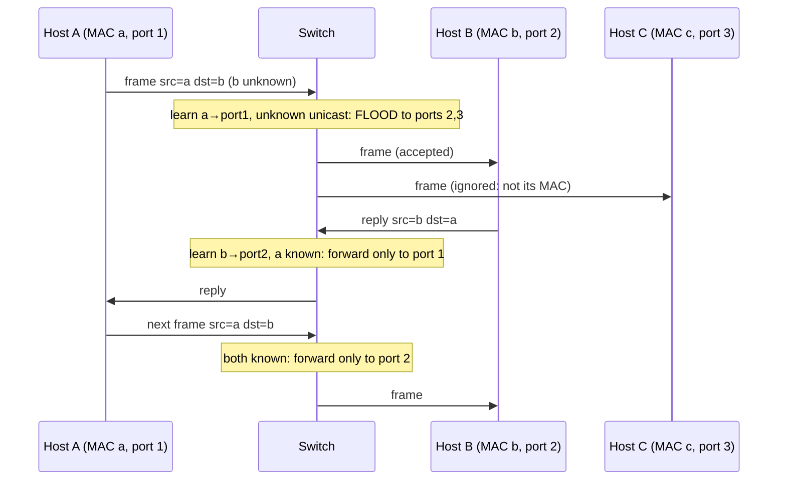

# 2.3 Ethernet and L2: frames, MAC addresses, switching, ARP and NDP

| | |
|---|---|
| Level | Beginner |
| Priority tier | 0 |
| Lab venue | A Linux VM with root (network namespaces and a Linux bridge) |
| Part | Part 2: Networking, from first principles to AI fabrics |
| Status | Drafted, labs **untested** |

## Why this matters for AI infrastructure

Every GPU server, storage node and switch in a cluster is joined by Ethernet or InfiniBand links, and almost every mysterious "network" symptom in a training job starts below IP: a link that trained at 200 Gb/s instead of 400, a transceiver with rising bit errors that turns into NCCL timeouts, a switch port flapping, a duplicate MAC after a clone, two NICs on one subnet answering ARP for each other's addresses, a broadcast storm after a cabling mistake, jumbo frames configured on the hosts but not on one switch, a lossless RDMA class that is not actually lossless. Cloud networks emulate Ethernet semantics too (ARP still exists inside a VPC; the "switch" is software).

This chapter covers layer 2 end to end: how Ethernet puts frames on a medium and addresses them, what a frame contains, how physical layers and optics are named (so you can read `ethtool` output and BoM lines like "QSFP-DD 400G-DR4"), how a switch learns and forwards, how a host finds the MAC address of a neighbour (ARP for IPv4, Neighbor Discovery for IPv6), how addresses are assigned automatically at the link level (SLAAC, DAD), how Wi-Fi differs, and how to observe all of it on Linux. Chapter 2.11 builds VLANs and spanning tree on top; 2.12 adds link aggregation; 2.17 and 2.19 take L2 into overlays and lossless RDMA fabrics.

## Prerequisites and outcomes

You should have read chapters 2.1 and 2.2 and be comfortable with the Linux shell.

After this chapter you can:

- Describe how Ethernet shares a medium (CSMA/CD), why modern switched full-duplex Ethernet no longer needs it, and what half and full duplex mean.
- Decode a MAC address (OUI, unicast/multicast bit, globally unique/locally administered bit) and an Ethernet frame (preamble, destination, source, EtherType, optional 802.1Q tag, payload, FCS), with sizes, minimum/maximum frame size and MTU relationships.
- Read Ethernet standard names (1000BASE-T, 25GBASE-SR, 100GBASE-CR4, 400GBASE-DR4), form factors (SFP28, QSFP28, QSFP-DD, OSFP), media types (copper, DAC, AOC, MMF, SMF), lane counts and encodings (NRZ, PAM4, FEC), and relate them to `ethtool` fields and error counters.
- Explain how an Ethernet switch learns MAC addresses, floods unknown unicast, broadcast and multicast, ages entries, and forwards by cut-through or store-and-forward; explain broadcast domains and why L2 loops are dangerous.
- Describe how a packet moves through a network device (receive ring, processing, fabric, transmit ring), and the difference between process, interrupt and ASIC switching paths and between switching and routing.
- Explain ARP in detail (request, reply, gratuitous ARP, proxy ARP, cache timers, duplicate detection) and IPv6 Neighbor Discovery (RS, RA, NS, NA, redirect, DAD, SLAAC, solicited-node multicast), and read `ip neigh`.
- Configure and verify Linux L2 behaviour that matters on multi-NIC AI servers (`arp_ignore`, `arp_announce`, `rp_filter`) and diagnose duplicate IPs and MAC flapping.
- Compare wired Ethernet with 802.11 (CSMA/CA, hidden node, OFDM, MIMO, beamforming, goodput).
- Build a switched L2 lab with namespaces and a bridge, watch ARP and MAC learning, and break it deliberately.

## 1. Ethernet in one page

Ethernet (invented at Xerox PARC in the early 1970s) is the dominant link layer. It defines **physical signalling** (how bits are put on copper, fibre or backplane) and **media access control** (who may transmit when, and how stations are addressed), standardised as IEEE 802.3 with the 802.1 family (bridging, VLANs, priority flow control) alongside.

**Shared medium and CSMA/CD.** In the original design, all hosts shared one cable; whatever one transmitted every other received (like a conversation in an open room). To avoid chaos, stations use **CSMA/CD** (Carrier Sense Multiple Access with Collision Detection): listen before sending (carrier sense); if the wire is idle, transmit; if two stations transmit at once their signals collide, each detects the collision by listening to its own transmission, sends a jam signal long enough that everyone notices, and then waits a *random* back-off time (binary exponential back-off) before retrying. The minimum frame size (64 bytes) exists so that a sender is still transmitting when a collision from the far end of the cable reaches it.

**Switched, full-duplex Ethernet.** Today's networks do not share a medium. Each host has a dedicated link to a switch port; transmit and receive use separate wire pairs (or separate fibres or lanes), so the two ends can transmit simultaneously (**full duplex**) and there is **no collision and no CSMA/CD**. (**Half duplex**, where the link must still arbitrate, survives only as a misconfiguration: a duplex mismatch (one side auto-negotiated half, the other forced full) causes late collisions, CRC errors and terrible throughput.) The "shared medium" survives conceptually as the **broadcast domain** (all ports that receive each other's broadcasts).

**What Ethernet provides** (in the four-function vocabulary of chapter 2.2): *transport* of frames between stations on one link or switched segment, *multiplexing* by MAC address and EtherType (and VLAN tag), *error detection* with a 32-bit CRC (frames with a bad FCS are silently discarded; there is no retransmission at this layer) and forward error correction in high-speed PHYs, and (optionally) *flow control* with PAUSE and priority-based PFC frames. Reliability and end-to-end flow control are left to higher layers (TCP), or to the lossless-fabric engineering of RDMA networks.

## 2. MAC addresses

A **MAC address** (EUI-48) is 48 bits written as six hex octets (`52:54:00:12:34:56`). It identifies a *network interface*, not a host (a server with four NICs has four, plus virtual ones). Structure:

```text
 octet 1                       octets 1-3                    octets 4-6
 bit 0 (LSB) = I/G             OUI (assigned by IEEE)        NIC-specific (assigned by manufacturer)
   0 = individual (unicast)    bit 1 = U/L
   1 = group (multicast)         0 = universally administered (burned-in)
                                 1 = locally administered (set by software/admin)
 ff:ff:ff:ff:ff:ff  = broadcast (all ones, a group address)
 01:00:5e:xx:xx:xx  = IPv4 multicast mapping;  33:33:xx:xx:xx:xx = IPv6 multicast mapping
```

- **OUI** (organisationally unique identifier): the first three octets identify the vendor (NVIDIA/Mellanox, Intel, Broadcom ...); `ip link` shows the address, and online OUI lookups or `/usr/share/ieee-data/oui.txt` translate it. Useful for recognising what a device is from a captured frame or a switch MAC table.
- **I/G bit** (least significant bit of the first octet): 0 = unicast, 1 = multicast/broadcast. **U/L bit** (second least significant): 1 means the address was assigned locally. Virtual NICs generated by hypervisors, container runtimes and software usually have locally administered MACs (`02:` , `52:54:00` for QEMU/KVM, `02:42:` for Docker, `fa:16:3e` for OpenStack).
- 46 usable bits give about 7×10¹³ unicast addresses; **EUI-64** (64-bit) addresses exist for IPv6 interface identifiers and some link types.
- MAC addresses are only meaningful on one link/broadcast domain; routers rewrite them at every hop (chapter 2.1). Uniqueness is required only within that domain, but manufacturers assign globally unique addresses; **duplicates** appear after careless cloning of VMs/NICs or manual assignment, causing intermittent connectivity and **MAC flapping** (a switch repeatedly relearning the same MAC on different ports).
- Receiving behaviour: a NIC accepts frames addressed to its own MAC, to broadcast, and to multicast groups it joined (a small hardware filter table); **promiscuous mode** copies everything (used by routers/bridges, `tcpdump`, packet monitoring) at CPU cost.

```bash
ip -br link                                  # interface names, state, MACs
ip link show dev eth0                        # flags: BROADCAST,MULTICAST,UP,LOWER_UP ; link/ether MAC ; mtu
cat /sys/class/net/eth0/address ; cat /sys/class/net/eth0/addr_assign_type    # 0 = permanent, 3 = set by user
sudo ip link set dev eth0 address 02:00:00:aa:bb:cc      # change MAC (interface must usually be down)
ip maddr show dev eth0                       # multicast MAC filters joined
sudo ip link set dev eth0 promisc on         # (tcpdump does this for you)
```

## 3. The Ethernet frame

```text
  7 B        1 B   6 B        6 B        [4 B]            2 B          46-1500 B      4 B
+----------+-----+----------+----------+----------------+-----------+------------------+------+ ...12 B idle
| Preamble | SFD | Dest MAC | Src MAC  | 802.1Q tag     | EtherType | Payload (+pad)   | FCS  | (inter-frame gap)
|  10101010| 0xAB|          |          | (TPID 0x8100,  | or length |                  |CRC-32|
|  ...     |     |          |          |  PCP,DEI,VID)  |           |                  |      |
+----------+-----+----------+----------+----------------+-----------+------------------+------+
            <-------------------- Ethernet frame: 64 to 1518 B (1522 B with VLAN tag) ------------------->
```

- **Preamble + SFD** (8 bytes): alternating bits so the receiver synchronises its clock, then the start-of-frame delimiter. Not part of the "frame" size but occupies the wire.
- **Destination first**: the destination MAC is received before anything else, so the NIC can decide *immediately* whether to keep copying the frame into memory.
- **EtherType** (≥ 0x0600): selects the payload protocol (0x0800 IPv4, 0x0806 ARP, 0x86DD IPv6, 0x8100 VLAN, 0x88A8 QinQ, 0x8847 MPLS, 0x88CC LLDP, 0x8808 MAC control/PAUSE/PFC, 0x8915 RoCE v1). Values below 1536 are an 802.3 *length*.
- **Payload**: 46 to 1500 bytes (padded to 46) in standard frames, so the *minimum frame* is 64 bytes (14 header + 46 + 4 FCS) and the *maximum* 1518 (1522 with one VLAN tag). The **MTU** (1500) is the maximum payload. **Jumbo frames** extend this (commonly 9000 or 9216 bytes), supported only if *every* device on the path agrees.
- **FCS**: CRC-32 over the frame. If it fails the frame is dropped and an error counter increments (`rx_crc_errors`, `FCS errors`). At 25G and above, link-level FEC corrects many errors before the CRC sees them; rising *uncorrected* FEC codewords or CRC errors indicate a bad cable, dirty/failing optic, or marginal signal.
- **Inter-frame gap**: 12 byte times of idle between frames (96 bit times). With preamble this is the 20-byte per-frame cost discussed in chapter 2.2: a 64-byte frame occupies 84 byte times on the wire (max 148.8 Mpps at 100 Gb/s).

```bash
sudo tcpdump -nn -e -XX -c 3 -i eth0                # MACs + EtherType + raw hex; FCS and preamble are stripped by the NIC
ethtool -S eth0 | egrep -i 'crc|fcs|err|drop|pause|pfc'     # driver/NIC counters; names differ by NIC (mlx5: rx_crc_errors_phy, rx_symbol_err_phy)
ethtool -m eth0                                     # transceiver module info (DOM): vendor, part, temperature, Tx/Rx optical power
```

### Frame types you will see on a network

- **Unicast** (one destination), **broadcast** (`ff:ff:ff:ff:ff:ff`; every station in the broadcast domain: ARP requests, DHCP discover), **multicast** (group MAC; IPv6 ND, mDNS, routing protocol hellos, LLDP/LACP/STP reserved addresses `01:80:c2:00:00:xx`, `01:00:0c:cc:cc:cc`), and **unknown unicast** (a unicast frame whose destination the switch has not learned: flooded).
- **Control frames**: PAUSE (802.3x: stop sending for a time), PFC (802.1Qbb: per-priority pause), LACP (802.3ad), STP BPDUs, LLDP advertisements.

## 4. Physical layers, media and optics (reading the names)

An Ethernet standard name encodes **speed, signalling and reach**: `<speed>BASE-<medium/reach><lanes>`.

| Name | Speed | Medium | Typical reach | Notes |
|---|---|---|---|---|
| 1000BASE-T | 1 Gb/s | Cat5e/6 twisted pair (4 pairs) | 100 m | Management, BMC |
| 10GBASE-T | 10 Gb/s | Cat6a | 100 m | Power-hungry, higher latency |
| 10GBASE-SR / 25GBASE-SR | 10/25 | MMF (850 nm) | 100 m (OM4) | SFP+/SFP28 |
| 25GBASE-CR (DAC) | 25 | Twinax copper | 3 to 5 m | Passive DAC, in-rack |
| 100GBASE-SR4 / -CR4 | 100 | 4 lanes × 25G, MMF / twinax | 100 m / 3 m | QSFP28 |
| 100GBASE-LR4 / -DR / -FR | 100 | SMF | 10 km / 500 m / 2 km | |
| 200GBASE-SR4 / -DR4 | 200 | 4 × 50G PAM4 | 100 m / 500 m | QSFP56 |
| 400GBASE-SR8 / -DR4 / -FR4 / -LR4 | 400 | 8 × 50G or 4 × 100G PAM4 | 100 m / 500 m / 2 km / 10 km | QSFP-DD, OSFP |
| 800GBASE-SR8 / -DR8 | 800 | 8 × 100G PAM4 | 50 to 100 m / 500 m | OSFP, QSFP-DD800 |

**Media**: *Copper twisted pair* (Cat5e/6/6a) for 1/2.5/5/10G; *DAC* (direct-attach copper twinax cables, passive or active) for short, cheap, low-power in-rack links at 10 to 400G; *AOC* (active optical cable, fibre with optics permanently attached) for 5 to 100 m; *multi-mode fibre* (OM3/OM4/OM5, 850 nm, short reach, cheaper optics) and *single-mode fibre* (OS2, 1310/1550 nm, long reach). AI cluster fabrics use DAC inside racks, AOC/MMF between racks and SMF for longer runs or when distance/future-proofing requires.

**Form factors**: SFP/SFP+/SFP28 (1/10/25G, one lane), QSFP+/QSFP28/QSFP56 (40/100/200G, four lanes), QSFP-DD and OSFP (400/800G, eight lanes). **Breakout** cables split one high-speed port into several lower-speed ones (e.g. 400G to 4 × 100G), common for leaf-to-NIC connections. NICs sometimes use RJ45, SFP28 or QSFP; cards from NVIDIA include ConnectX-6/7/8 (200/400/800G) in OCP3 or PCIe form factors.

**Encoding and FEC.** Up to 25G per lane uses **NRZ** (two voltage levels, 1 bit per symbol); 50 and 100G per lane use **PAM4** (four levels, 2 bits per symbol), which has a lower signal-to-noise margin and therefore mandatory **Reed-Solomon FEC** (RS-FEC / "KP4"), adding about 100–250 ns of latency and requiring both ends to use the same FEC mode. Mismatched FEC settings cause links to refuse to come up or to show errors. **Auto-negotiation** (and link training on copper/backplane) selects speed, duplex and FEC with the peer; forced settings must match on both ends. Link *up* does not mean link *healthy*: always inspect error counters.

```bash
ethtool eth0                                  # supported/advertised modes, speed, duplex, auto-negotiation, link detected
ethtool --show-fec eth0                       # FEC mode (Auto/RS/BaseR/Off) and corrected/uncorrected counts (if supported)
ethtool -S eth0 | egrep 'symbol|fec|crc|discard|errors'      # physical-layer health
mlxlink -d /dev/mst/mt4129_pciconf0 --show_ber --show_module 2>/dev/null   # NVIDIA: BER, link state, FEC, module (needs MFT)
ip -s link show eth0 ; cat /sys/class/net/eth0/{speed,duplex,carrier,carrier_changes,mtu}   # carrier_changes counts flaps
dmesg -T | egrep -i 'link (is )?(up|down)|NIC Link'          # link events with timestamps
```

**Reading health:** `carrier_changes` rising = flapping link (cable, optic, transceiver seating, switch port, power); non-zero `rx_crc_errors`/uncorrected FEC = marginal signal; `rx_discards`/`rx_out_of_buffer` = host cannot drain fast enough or the switch/NIC buffers overflow; `rx_pause`/`tx_pause` = flow control active; wrong speed (400G NIC at 100G) = cable/optic/lane problem or switch config.

## 5. How an Ethernet switch works

A **switch** (a *bridge* with many ports) connects stations into one L2 segment and forwards frames only where they need to go.

### Learning, forwarding and flooding

State: the **MAC address table** (also called forwarding database, FDB, CAM table): entries of (VLAN, MAC) → port, with an **age timer** (commonly 300 s).

For each frame received on port *P*:

1. **Learn**: record *source MAC → P* (refresh the timer). This is how the table builds itself; no control protocol is needed.
2. **Forward**: look up the *destination MAC*:
   - found, and the port ≠ ingress port: send out that port only (**selective forwarding**);
   - found, and the port = ingress port: discard (**filter**; both stations are on the same segment);
   - not found (**unknown unicast**), broadcast or (unfiltered) multicast: **flood** to all other ports in the VLAN.
3. Frames to the switch's own MAC (management) go to its control plane.



Consequences: (1) switching **cuts collision domains to one per port** while a **broadcast domain** still spans the whole VLAN, because broadcasts and unknown unicast are flooded; (2) the MAC table is a finite resource (thousands to hundreds of thousands of entries); a MAC flood attack (or a large layer-2 domain with many VMs/containers) can overflow it and force flooding; (3) when a host *moves* (VM migration, failover with a virtual MAC, a NIC replaced), the switch relearns on the next frame from the new port (gratuitous ARP helps by sending one immediately); (4) a **loop** in the L2 topology (two switches connected by two cables without spanning tree, or an accidentally bridged pair of NICs) makes floods circulate forever: Ethernet frames have **no TTL**, so broadcasts multiply exponentially, saturating links and CPUs in seconds (**broadcast storm**) and making the MAC table flap between ports. Preventing this is the job of **spanning tree** (chapter 2.11), loop-free designs (L3 to the rack: chapter 2.18), storm control, and cabling discipline.

```bash
bridge fdb show br0                        # Linux bridge MAC table (and: bridge -s fdb)
bridge link show ; bridge vlan show        # port states, VLAN membership
# Show a vendor switch table equivalent (CLI differs): "show mac address-table", "show mac-address-table dynamic", "net show bridge macs" (Cumulus)
```

### Switching modes and latency

- **Store-and-forward**: receive the whole frame, check FCS, then forward. Latency grows with frame size; errors are filtered.
- **Cut-through**: start forwarding as soon as the destination MAC is read (after about the first 14–24 bytes); latency is a few hundred nanoseconds independent of frame size, but corrupted frames may be forwarded before the FCS is checked (some designs poison them at egress).
- Port-to-port latency of data-centre switches is on the order of 300 ns to 1 µs (cut-through) up to several µs; at µs scales it can matter for latency-sensitive workloads and for multi-hop collectives (3 to 5 hops in a Clos). **Serialisation delay** = frame size / link rate (a 1500-byte frame at 100 Gb/s takes 120 ns; at 1 Gb/s 12 µs), added at every store-and-forward hop.

### Inside a network device (packet switching, in brief)

Moving a packet through a switch or router takes four steps: (1) **clock it off the wire** into a receive ring in memory (the PHY writes into a ring buffer; to avoid copying, only pointers move between stages), (2) **process** it (lookup destination in the MAC table (switching) or the FIB (routing); apply filters, NAT, QoS marking), (3) **move it across the device** to the outbound port (a shared memory pool for small devices, or an internal fabric/crossbar for larger ones), (4) **clock it onto the wire** from a transmit ring after queueing (egress QoS scheduling). Three common implementation paths, in order of performance: **process switching** (interrupt the general-purpose CPU, which schedules a process: slow path), **interrupt-context/fast switching** (the interrupt handler itself switches the packet: moderate), and **ASIC/NPU hardware switching** (a dedicated packet-processing chip with specialised memory (TCAM/SRAM/HBM), pipelines and recirculation: line rate at 12.8 to 51.2 Tb/s per chip). High port-count devices use a **crossbar fabric** (multi-stage Clos inside the chassis) with a **scheduler** to resolve **contention** when several inputs want the same output; **virtual output queues (VOQs)** (a separate queue per output at each input) avoid **head-of-line blocking**, and iterative matching algorithms such as iSLIP (request, grant, accept, run several iterations) pick non-conflicting input/output pairs each cycle. Why it matters to you: loss and latency inside a switch happen in these queues (buffers fill when multiple inputs target one output, i.e. **incast**, the signature pattern of all-reduce/all-to-all and storage reads), and the Linux host mirrors the same structure (NIC rings → NAPI → softirq → protocol handlers; qdisc → TX ring).

### Switching versus routing (L2 versus L3)

**Switching** forwards on destination MAC without modifying the frame. **Routing** strips the L2 header, looks up the destination IP in a forwarding table, decrements TTL, and builds a *new* L2 header for the next hop (MAC header rewrite). Reasons to route rather than switch: connect dissimilar link types; limit state (L2 tables grow with every host; IP prefixes aggregate); and **contain broadcast domains** (routers do not forward broadcasts). Most data-centre "switches" are in fact **L3 switches** (routers with Ethernet ports); modern fabrics push routing to the top-of-rack switch (L3 to the host or the rack) to avoid large L2 domains (chapters 2.16, 2.18).

## 6. Mapping between layers: ARP and Neighbor Discovery

Hosts address packets with IP addresses but frames with MAC addresses. The general problem is **interlayer discovery**: mapping an identifier at one layer to one at another. There are four solution patterns: (1) **well-known or manually configured mappings** (port numbers in `/etc/services`), (2) a **mapping database with a query protocol** (DNS; DHCP for assignment), (3) **advertising the mapping in a protocol directly between the peers** (ARP, IPv6 ND), and (4) **calculating one identifier from the other** (IPv6 link-local address derived from a MAC; SLAAC). This section covers (3) and (4) at layer 2/3 boundary; DNS and DHCP are in chapters 2.8 and 2.9.

### The default gateway problem

First the host must decide whether the destination is *on the same wire*. It ANDs its own address and the destination with the subnet mask; if the results match, the destination is on-link and the host ARPs for the destination itself; otherwise it sends the frame to the **default gateway's** MAC. If the host's mask is wrong, it will ARP for off-link addresses (nobody answers: "no route to host") or send on-link traffic to the router (works, but is inefficient and may trigger ICMP redirects).

### IPv4 ARP (Address Resolution Protocol)

An **ARP request** is an Ethernet broadcast: "who has 203.0.113.12? tell 203.0.113.10". Everyone receives it; the owner replies **unicast** with an **ARP reply** containing its MAC. The requester stores the mapping in the **ARP cache** (Linux: the *neighbour table*). Other hosts that see the request may also learn the *sender's* mapping.

```text
ARP packet (28 bytes after the Ethernet header, EtherType 0x0806):
 hardware type (Ethernet=1) | protocol type (IPv4=0x0800) | HLEN 6 | PLEN 4 | opcode (1=request, 2=reply)
 sender MAC | sender IP | target MAC (00:00:.. in request) | target IP
```

- **Cache entries** age out. Linux neighbour states: `INCOMPLETE` (request sent), `REACHABLE` (confirmed recently, typically about 30 s ±), `STALE` (usable but must be revalidated on use), `DELAY`, `PROBE` (unicast probes), `FAILED`, `PERMANENT`/`NOARP`. `base_reachable_time_ms` and `gc_stale_time` tune this (`/proc/sys/net/ipv4/neigh/<if>/`). A short timeout reacts faster to moves; a long one reduces ARP chatter.
- **Gratuitous ARP**: a host announces its own IP→MAC mapping unprompted (request or reply with sender IP = target IP). Uses: (a) update neighbours' caches and switch tables immediately after a failover or VM migration (VRRP/keepalived, load balancers, live-migrated VMs), (b) **duplicate address detection**: if somebody replies, the address is already in use (`arping -D`).
- **Proxy ARP**: a router answers ARP requests for addresses it can reach on behalf of those hosts. Disabled by default on most systems; occasionally used for legacy subnetting, cloud network emulation, or Kubernetes CNIs; it hides misconfigured masks and enlarges ARP tables.
- **Security**: ARP is unauthenticated; **ARP spoofing/poisoning** lets an attacker redirect traffic. Mitigations: dynamic ARP inspection and DHCP snooping on switches, static entries for critical hosts, 802.1X, private VLANs.
- **Scale**: every host in an L2 domain caches entries for its peers; the **neighbour table size** limit (`net.ipv4.neigh.default.gc_thresh1/2/3`, defaults 128/512/1024) causes "neighbour table overflow" messages in large flat networks or on Kubernetes nodes/routers with many peers: raise them.

```bash
ip neigh show                                   # table with states
ip -s neigh show ; ip neigh show nud stale      # filter by state; counters
sudo ip neigh add 10.0.0.9 lladdr 02:00:00:00:00:09 dev eth0 nud permanent      # static entry (rarely needed)
sudo ip neigh del 10.0.0.9 dev eth0 ; sudo ip neigh flush dev eth0
sudo arping -I eth0 10.0.0.1 -c 3               # who has / reply; round-trip at L2
sudo arping -D -I eth0 -c 2 10.0.0.15           # duplicate address detection for MY address
sudo arp-scan -l                                # enumerate the local segment (needs arp-scan)
sudo tcpdump -nn -e -i eth0 arp                 # watch requests/replies
sysctl net.ipv4.neigh.default.gc_thresh{1,2,3}
```

### Linux ARP behaviour on multi-NIC hosts (important for AI nodes)

By default Linux is "weak host" about ARP: it answers an ARP request for **any local IP on any interface**. On a server with several NICs in the *same* subnet (or with multiple IPs per interface), the wrong interface may answer and the switch learns the IP on the wrong port; traffic returns on a different NIC than intended, creating asymmetric paths, RDMA/NCCL oddities, flapping MAC tables, and confusing bonding. Control it with:

| sysctl | Meaning |
|---|---|
| `net.ipv4.conf.<if>.arp_ignore` | 0 reply for any local address on any interface (default); **1** reply only if the target IP is configured on the *receiving* interface; 2 additionally require the sender in the same subnet |
| `net.ipv4.conf.<if>.arp_announce` | Which source IP to use in outgoing ARP requests: 0 any; 1 prefer same subnet; **2** always use the best source address of the outgoing interface |
| `net.ipv4.conf.<if>.arp_filter` | 1: only answer if the route to the sender would use this interface |
| `net.ipv4.conf.<if>.rp_filter` | Reverse path filtering (0 off, 1 strict, 2 loose); strict mode drops asymmetric traffic |
| `net.ipv4.conf.all.arp_notify` | Send gratuitous ARP when the interface comes up / address changes |

A common recipe for multi-homed servers with one subnet per NIC (e.g. one IP per rail/GPU NIC) is `arp_ignore=1`, `arp_announce=2`, `rp_filter=2` (loose), plus **policy routing** with one routing table per NIC (chapter 2.24) so replies leave on the interface that received the request. Document it: this is a frequent source of "works until another NIC is plugged in" incidents.

### IPv6 Neighbor Discovery (NDP)

IPv6 has no broadcast; it uses **ICMPv6** messages (carried in IPv6, not as a separate Ethernet protocol) with **multicast**:

| ICMPv6 type | Message | Purpose |
|---|---|---|
| 133 | Router Solicitation (RS) | Host asks "any routers here?" (to `ff02::2`, all-routers) |
| 134 | Router Advertisement (RA) | Router announces prefixes, default gateway lifetime, MTU, flags (M = use DHCPv6 for addresses, O = other config via DHCPv6), sent periodically and in reply to RS |
| 135 | Neighbor Solicitation (NS) | "What is the MAC of this IPv6 address?" sent to the **solicited-node multicast address** `ff02::1:ffXX:XXXX` (last 24 bits of the target address); also used for DAD and reachability probing |
| 136 | Neighbor Advertisement (NA) | The answer (also unsolicited announcements) |
| 137 | Redirect | Router tells a host about a better first hop |

**Solicited-node multicast** means only hosts whose address ends in those 24 bits listen/receive, so NDP does not disturb every host the way ARP broadcasts do. The Ethernet destination is the corresponding `33:33:ff:XX:XX:XX` multicast MAC.

**Address autoconfiguration:**

1. The host forms a **link-local address** `fe80::/64` + interface ID (from the MAC as modified EUI-64, or random "stable privacy" IDs per RFC 7217 on modern systems; Linux default `addr_gen_mode`). Example: MAC `01:23:45:67:89:ab` → EUI-64 `0323:45ff:fe67:89ab` (U/L bit flipped, `ff:fe` inserted) → `fe80::323:45ff:fe67:89ab`.
2. **DAD** (Duplicate Address Detection): before using any address, the host sends NS for it from `::`; if an NA (or another host's DAD NS) for that address arrives, the address is a duplicate and is not used. Looping switches can reflect the host's own NS and cause false positives; Enhanced DAD uses a nonce to detect self-reflection.
3. The host sends an **RS**; routers answer with an **RA**. If the RA's **A** flag is set on a /64 prefix, the host builds a global address using **SLAAC** (stateless address autoconfiguration): prefix + interface ID. If **M** is set, it asks a DHCPv6 server for addresses; if **O**, for other options (DNS). The default gateway is the router's **link-local** address (so the route survives renumbering). Prefix lifetimes (preferred/valid) govern address deprecation.

```bash
ip -6 addr show ; ip -6 route show ; ip -6 neigh show
sysctl net.ipv6.conf.eth0.{accept_ra,autoconf,addr_gen_mode,use_tempaddr,disable_ipv6}
sudo ip -6 neigh flush dev eth0
sudo ndisc6 fe80::1 eth0 ; sudo rdisc6 eth0       # active NS and RS (package ndisc6)
sudo tcpdump -nn -e -i eth0 icmp6 and 'ip6[40] >= 133 and ip6[40] <= 137'   # RS/RA/NS/NA/Redirect
```

Hosts in datacentres commonly disable RA/SLAAC and use static addressing or DHCPv6, but RA is how cloud VMs, laptops and Kubernetes pods often get IPv6 gateways. `RA` guard on switch ports prevents rogue router advertisements.

## 7. L2 on Linux: the objects behind the concepts

| Object | Meaning |
|---|---|
| Physical NIC (`eth0`, `ens4`, `enp129s0f0`, `ibs...` for IPoIB) | Ethernet port; queues (RSS), offloads, ring sizes |
| `lo` | Loopback; no L2 |
| **bridge** (`br0`) | Software switch: MAC learning, flooding, STP, VLAN filtering; used by libvirt, Docker, CNIs |
| **veth** pair | Virtual cable; one end in a namespace/container, the other in a bridge |
| **VLAN subinterface** (`eth0.100`) | 802.1Q tagging |
| **bond/team** | Link aggregation or active-backup |
| **macvlan / ipvlan** | Multiple L2/L3 identities on one NIC |
| **tap/tun** | VM or user-space L2/L3 interfaces |
| **vxlan / geneve** | L2-over-L3 tunnels |

Chapter 2.25 develops these. For L2 observation: `ip -d link`, `bridge fdb/vlan/link/mdb`, `ethtool`, `tc`, `tcpdump -e`. On a hypervisor or Kubernetes node, a frame may traverse several of these objects (pod `eth0` → veth → bridge/OVS/eBPF → host NIC → switch).

## 8. Wi-Fi (802.11) in contrast

Wi-Fi uses the same frame concepts (MAC addresses, an FCS) but a very different medium: radio is a shared broadcast medium where a transmitter cannot listen while transmitting (its own signal swamps its receiver), so **collision detection is impossible**. Instead of CSMA/CD, 802.11 uses **CSMA/CA** (collision *avoidance*): listen, wait a random back-off, transmit the whole frame, and require an **ACK** from the receiver (no ACK = assume loss, back off, retry). The **hidden node problem** (A and C both reach B but cannot hear each other) is mitigated optionally by **RTS/CTS**. Capacity comes from **OFDM** (many orthogonal sub-carriers), wider channels (20/40/80/160/320 MHz), denser modulation (up to 1024-/4096-QAM), **MIMO** (spatial multiplexing across multiple antennas using multipath), **MU-MIMO** and **beamforming** (shaping signals toward a client). Real **goodput** is typically 40–60% of the nominal PHY rate because of preambles, ACKs, contention and protocol overhead; always plan with goodput, not the headline number. On Linux: `iw dev wlan0 scan/link`, `wpa_supplicant`, NetworkManager. For data centres and clusters, wireless is mostly irrelevant, but the lessons (collision avoidance, hidden terminals, goodput versus bandwidth) recur in discussions of shared-media effects, incast and lossless fabrics.

## 9. AI fabrics at layer 2

- **Ethernet back-end fabrics for RDMA (RoCE v2)** require a **lossless** class: configure **PFC** (priority flow control, 802.1Qbb) for the RoCE priority end to end (NIC, every switch), **ECN** marking with DCQCN or similar rate control, correct **DSCP/PCP trust and mapping**, buffer allocation and headroom per port speed and cable length (chapter 2.19). L2 problems here have outsized impact: a missing PFC config on one switch port causes drops (RDMA retransmits are costly) or, if misconfigured the other way, **pause storms** and deadlocks.
- **InfiniBand** has its own link layer with credit-based flow control per virtual lane, giving a losslessness by construction; LIDs/GIDs replace MACs/IPs; the Subnet Manager does the "learning" (programs forwarding tables).
- **Host design**: rail-optimised designs give each GPU its own NIC and often its own subnet/VLAN/VRF; hence the ARP/`rp_filter`/policy-routing details above. Server links are typically 2 × 100/200G for front-end and 8 × 400G for back-end (one NIC per GPU) in HGX H100/H200-class nodes; verify speed, FEC and MTU on all of them (a single x4 link running at 100G instead of 400G degrades a whole job).
- **Monitoring**: per-port error counters (CRC, FEC uncorrected, symbol errors), PFC pause counts per priority, ECN-marked packets, buffer occupancy, link flaps, optical power (DOM), topology via **LLDP** (`lldpctl`, `lldpcli show neighbors`): LLDP tells you which switch and port each NIC connects to, which is essential to find the end of a faulty cable quickly.

```bash
sudo lldpcli show neighbors                          # which switch/port is this NIC plugged into? (lldpd package)
ethtool -a eth0 ; ethtool -A eth0 rx on tx on        # PAUSE (802.3x) settings
mlnx_qos -i eth0                                      # NVIDIA: PFC/ETS/trust configuration (MOFED)
ethtool -S eth0 | egrep -i 'prio[0-9]_(rx|tx)_(pause|ecn)|rx_prio|discard'
```

## 10. Failure modes and diagnosis

| Symptom | Likely cause | First checks |
|---|---|---|
| Link down / flapping | Cable, optic, seating, dirty fibre, speed/FEC mismatch, power, switch port | `ethtool`, `dmesg -T`, `carrier_changes`, `ethtool -m` (DOM), swap cable/optic |
| Link up at lower speed | Cable/optic rated lower, lane failure, auto-neg limits, switch config | `ethtool eth0`, `ethtool -m`, switch port status |
| CRC / FEC errors, slow throughput | Dirty/marginal fibre, bad DAC, bent fibre, wrong cable type, EMI | Counters over time, clean connectors, replace |
| Duplex mismatch | One side forced, the other auto | `ethtool`, late collision/runt counters |
| Intermittent connectivity, "works for some hosts" | Duplicate IP/MAC, MAC flapping, ARP cache poisoning, stale ARP after failover | `arping -D`, `ip neigh`, switch MAC-flap logs, `tcpdump arp` |
| "No route to host" on local subnet | ARP unanswered: host down, wrong VLAN, port security, filter, wrong mask | `ip neigh` shows FAILED/INCOMPLETE, `tcpdump arp` both ends |
| Network melts down | L2 loop / broadcast storm | Switch CPU/port rates, STP topology changes, `tcpdump -c` shows repeating broadcasts, unplug suspicious links |
| Large frames dropped | MTU mismatch on some hop | `ping -M do -s 8972`, switch MTU configs, `ip link` |
| Wrong NIC answers | Linux weak-host ARP on multi-NIC host | `arp_ignore`/`arp_announce`, `ip neigh` on peers, switch MAC table |
| RDMA retransmits / stalls | Lossy class, PFC/ECN missing, congestion, pause storm | Switch PFC counters, `ethtool -S` pause/ECN counters, topology |
| Neighbour table overflow messages | Large L2 domain, small gc_thresh | `dmesg`, raise `gc_thresh*` |

## 11. Hands-on lab: a switched L2 network in network namespaces

First, run the self-checking Python lab (`code/part02/ethernet_l2_arp_ndp_lab.py`) locally. It verifies MAC address `I/G` (unicast vs multicast) and `U/L` (globally unique vs locally administered) bit decoding, L2 switch FDB learning/flooding/filtering, IPv6 EUI-64 link-local (`fe80::323:45ff:fe67:89ab`) and solicited-node multicast (`ff02::1:ff67:89ab`, MAC `33:33:ff:67:89:ab`) derivation, and `1500`-byte frame serialization delay (`120 ns` at `100 Gb/s` vs `12 µs` at `1 Gb/s`).

```bash
python3 code/part02/ethernet_l2_arp_ndp_lab.py
```

Next, on a disposable Linux VM with `root` (`iproute2`, `bridge-utils` or `bridge`, `tcpdump`, `arping`; all interactive VM commands below are `untested here`), work through these steps:

1. **Build the switch and three hosts**:

```bash
sudo ip link add br0 type bridge && sudo ip link set br0 up # (untested here)
for n in h1 h2 h3; do
  sudo ip netns add $n
  sudo ip link add v-$n type veth peer name e0 netns $n
  sudo ip link set v-$n master br0 up
  sudo ip -n $n link set lo up ; sudo ip -n $n link set e0 up
done # (untested here)
sudo ip -n h1 addr add 10.20.0.1/24 dev e0 # (untested here)
sudo ip -n h2 addr add 10.20.0.2/24 dev e0 # (untested here)
sudo ip -n h3 addr add 10.20.0.3/24 dev e0 # (untested here)
bridge link show ; bridge fdb show br br0  # (untested here)
```

2. **Watch ARP and learning**: in one terminal `sudo ip netns exec h3 tcpdump -nn -e -i e0`; in another `sudo ip netns exec h1 ping -c1 10.20.0.2`. Observe the broadcast ARP request reaching h3 (flooded) but the unicast reply and ICMP not reaching h3 once learned. Check `ip -n h1 neigh`, `bridge fdb show br br0` before and after. Age the table: `sudo bridge fdb flush dev v-h2` (or wait) and watch flooding resume (`brctl setageing br0 10` shortens the timer).
3. **Frame anatomy**: capture with `-XX`, identify destination/source MAC, EtherType, payload; compute frame length; change MTU on all links (`ip link set ... mtu 9000`) and send `ping -s 8000 -M do`; reduce one veth to 1500 and observe the failure and the error message.
4. **Duplicate IP**: `sudo ip -n h3 addr add 10.20.0.2/24 dev e0`; from h1 `arping -I e0 -c 4 10.20.0.2` (run via `ip netns exec h1`); observe two different replying MACs, flapping neighbour entry and MAC table; use `arping -D` from h3 before assigning to detect.
5. **MAC flapping and a loop (safe, small)**: add a second bridge `br1` and connect it to `br0` with two veth pairs without STP; send one broadcast (`arping`) and watch packet counters rise with `ip -s link`; stop at once (delete one link). Then enable STP (`ip link set br0 type bridge stp_state 1`) on both and repeat (`bridge link` shows blocking/forwarding states). Do this only in a throwaway namespace/VM.
6. **IPv6 ND**: assign `fd00:20::1/64` etc.; `ping -6`; watch NS/NA with `tcpdump icmp6`; observe the solicited-node multicast destination MAC (`33:33:ff:...`); enable `radvd` or `dnsmasq` RA in a namespace acting as router and watch RA/RS and SLAAC address formation (`ip -6 addr`, flags `A`, `M`, `O`).
7. **Linux ARP policy**: give h1 two interfaces on the same subnet (second veth into the bridge); from h2 ARP for each address and see which MAC answers; apply `arp_ignore=1`, `arp_announce=2` and compare; add `rp_filter=1` and show asymmetric reply drops.
8. **Physical NIC (VM or hardware)**: record `ethtool`, `ethtool -S`, `ethtool -m` (if present), `cat /sys/class/net/*/carrier_changes`, `lldpcli show neighbors`; compute the error ratio per billion frames.
9. **Wi-Fi (optional)**: `iw dev wlan0 scan | head`, `iw dev wlan0 link`, compare PHY rate to `iperf3` goodput.

## 12. Common mistakes

- Equating link-up with healthy; ignoring FEC/CRC counters and flap counts.
- Forgetting that MAC addresses are per-hop and per-interface; confusing the L2 destination with the final destination.
- Assuming a switch never floods; ignoring unknown-unicast and broadcast domain size.
- Creating a loop with a second cable or a mis-bridged NIC; disabling spanning tree without a loop-free design.
- Jumbo frames on hosts but not on every switch/port/tunnel.
- Ignoring Linux weak-host ARP behaviour on multi-NIC servers; cloning VMs with identical MACs.
- Treating lossless Ethernet as just "turn on PFC"; ignoring headroom, ECN, trust, and end-to-end consistency.
- Treating Wi-Fi's nominal PHY rate as throughput.

## 13. Interview angles

- "Walk through how a switch forwards a frame; what happens with an unknown destination?"
- "What is the difference between a collision domain and a broadcast domain?"
- "Explain ARP. What is gratuitous ARP and when is it used? What is proxy ARP?"
- "How does IPv6 replace ARP? What is DAD and SLAAC? Why solicited-node multicast?"
- "A server has two NICs on the same subnet and traffic is asymmetric. Why? How do you fix it?" (`arp_ignore/announce`, policy routing.)
- "A 400G link is up at 100G. How do you diagnose?" (cable/optic/lane/FEC/negotiation.)
- "Why is there no TTL in Ethernet and what does that imply?" (L2 loops/storms, STP.)
- "What makes RoCE need a lossless Ethernet configuration, and what can go wrong?"

## Exercises

1. **MAC Address Anatomy (`I/G` and `U/L` Bits), Ethernet Frame Format, and CSMA/CD vs. Full Duplex:** (a) Using `decode_mac_address()` in `code/part02/ethernet_l2_arp_ndp.py`, decode `52:54:00:12:34:56`, `ff:ff:ff:ff:ff:ff`, and `33:33:ff:67:89:ab`, explaining the `OUI`, `I/G` bit, and `U/L` bit; (b) why is the minimum Ethernet frame `64` bytes, why does the Destination MAC appear first in the frame header, and why is CSMA/CD inactive on modern switched full-duplex links?
2. **Reading Optics/Transceiver Names (`100GBASE-CR4`, `400GBASE-DR4`), `NRZ` vs. `PAM4`, and `RS-FEC`:** Decode `25GBASE-SR`, `100GBASE-CR4`, and `400GBASE-DR4` (`speed`, `medium/reach`, `lane count`, `NRZ` vs `PAM4`, `SFP28`/`QSFP28`/`QSFP-DD`/`OSFP`), explain why 50G/100G-per-lane `PAM4` requires Reed-Solomon FEC (`RS-FEC`), and list the Linux commands (`ethtool`, `ethtool --show-fec`, `ethtool -m`, `ethtool -S`, `mlxlink`, `lldpcli`) that diagnose a flapping or downtrained GPU fabric link.
3. **Switch MAC Learning, Flooding, L2 Loops, and Internal Switch Fabric `VOQ`s / `iSLIP` (`CN` Chapter 7):** (a) Trace `simulate_switch_frame_action()` across a 3-port switch when Host A (`port 1`) sends a frame to unknown Host B (`port 2`) and Host B replies; why does an L2 loop cause an immediate broadcast storm? (b) Explain the four internal steps inside a packet switch (`RX ring -> lookup -> fabric -> TX ring`), how **Virtual Output Queues (`VOQ`s)** and **iSLIP** eliminate head-of-line blocking, and compare store-and-forward (`compute_serialization_delay_ns()`) with cut-through switching.
4. **IPv4 ARP, Gratuitous ARP, Proxy ARP, and Multi-NIC AI Server `arp_ignore` / `arp_announce` Tuning:** (a) Trace an IPv4 ARP request and reply (`28` bytes, EtherType `0x0806`), and explain two uses of **gratuitous ARP** (`arping -D`); (b) why does a Linux server with 8 rail NICs on overlapping/shared subnets answer ARP out the wrong NIC by default, and what exact `sysctl` values (`arp_ignore=1`, `arp_announce=2`, `rp_filter=2`, `gc_thresh1/2/3`) fix it?
5. **IPv6 Neighbor Discovery (`NDP`), Solicited-Node Multicast, `EUI-64`, `DAD`, and `SLAAC` (`CN` Chapter 6):** Given MAC address `01:23:45:67:89:ab`, use `mac_to_ipv6_eui64_link_local()` to derive its modified EUI-64 link-local IPv6 address (`fe80::323:45ff:fe67:89ab`), its solicited-node multicast IPv6 address (`ff02::1:ff67:89ab`), and its Ethernet multicast MAC (`33:33:ff:67:89:ab`), and explain the roles of ICMPv6 types `133` (`RS`), `134` (`RA`: `A`/`M`/`O` flags), `135` (`NS`), `136` (`NA`), and `137` (`Redirect`).
6. **Wired Ethernet vs. 802.11 Wi-Fi (`CSMA/CA`, Hidden Node, `OFDM`, `MIMO`):** Explain why 802.11 Wi-Fi cannot use `CSMA/CD` and instead uses **`CSMA/CA`** with per-frame ACKs and optional `RTS/CTS` (hidden node problem), and why real Wi-Fi goodput is only `40%–60%` of the nominal PHY rate.

## Checkpoint questions (20)

<details>
<summary>1. How did CSMA/CD work on shared coaxial Ethernet, why is the minimum frame 64 bytes, and why is CSMA/CD unused on modern switched links?</summary>

On shared half-duplex media, **CSMA/CD** listened before transmitting, detected collisions if two stations transmitted simultaneously, sent a jam signal, and backed off for a random binary-exponential delay; the `64`-byte minimum frame ensured the sender was still transmitting when a collision from the far end of the cable propagated back. Modern Ethernet uses point-to-point switched **full-duplex** links with separate TX and RX paths, so collisions cannot occur.
</details>

<details>
<summary>2. Decode the structure of a 48-bit MAC address (`OUI`, `I/G` bit, and `U/L` bit).</summary>

The first 3 octets (`24` bits) are the IEEE-assigned **OUI** (*Organizationally Unique Identifier*) identifying the vendor, and the last 3 octets are the interface serial number. In the first octet, bit 0 (least significant bit) is the **`I/G` bit** (`0` = individual unicast, `1` = group multicast/broadcast `ff:ff:ff:ff:ff:ff`), and bit 1 is the **`U/L` bit** (`0` = universally administered burned-in MAC, `1` = locally administered software MAC such as `52:54:00:...` in QEMU).
</details>

<details>
<summary>3. List the fields of an Ethernet II frame in wire order and state why the Destination MAC comes before the Source MAC.</summary>

In wire order: `7`-byte Preamble + `1`-byte Start Frame Delimiter (`SFD` `0xAB`) -> **`6`-byte Destination MAC** -> `6`-byte Source MAC -> optional `4`-byte `802.1Q` VLAN tag (`0x8100`) -> `2`-byte EtherType -> `46–1500`-byte Payload -> `4`-byte `FCS` (CRC-32) -> `12`-byte Inter-Frame Gap. Placing the Destination MAC first allows the receiving NIC hardware or cut-through switch ASIC to decide immediately (after reading just 6 bytes) whether to accept or forward the frame.
</details>

<details>
<summary>4. What happens when a NIC or switch detects a Frame Check Sequence (`FCS`) CRC-32 error, and how does `RS-FEC` interact with it on 50G/100G-per-lane links?</summary>

Ethernet does not send NAKs or retransmit at L2: a frame failing the `FCS` check is silently dropped and increments `rx_crc_errors`. On `50G`/`100G`-per-lane **PAM4** links, physical **Reed-Solomon Forward Error Correction (`RS-FEC`)** corrects symbol bit errors on the fly before the `FCS` check; you monitor both *corrected* FEC codewords (early warning of a degrading optic/cable) and *uncorrected* FEC codewords (which become frame drops).
</details>

<details>
<summary>5. Decode the Ethernet standard names `25GBASE-SR`, `100GBASE-CR4`, `400GBASE-DR4`, and `400GBASE-LR4`, and name the transceiver form factors.</summary>

- `25GBASE-SR`: `25 Gb/s`, 1 lane NRZ, short-reach `850 nm` multi-mode fiber (`OM4` to `100 m`), `SFP28`.
- `100GBASE-CR4`: `100 Gb/s`, `4 x 25G` NRZ lanes over twinax passive copper `DAC` (`3–5 m`), `QSFP28`.
- `400GBASE-DR4`: `400 Gb/s`, `4 x 100G` PAM4 parallel single-mode fiber (`SMF` to `500 m`), `QSFP-DD` or `OSFP`.
- `400GBASE-LR4`: `400 Gb/s`, WDM over duplex single-mode fiber (`SMF` to `10 km`), `QSFP-DD` or `OSFP`.
</details>

<details>
<summary>6. Which Linux commands inspect a NIC's negotiated speed, FEC counters, optical transceiver DOM power/temperature, link flap count, and connected switch port?</summary>

`ethtool eth0` (speed, duplex, link detected), `ethtool --show-fec eth0` and `ethtool -S eth0` (FEC, CRC, symbol errors, pause frames), `ethtool -m eth0` (transceiver DOM: vendor, part number, temperature, TX/RX optical power in dBm, or `mlxlink --show_module --show_ber`), `cat /sys/class/net/eth0/carrier_changes` (link flap counter), and `sudo lldpcli show neighbors` (switch hostname and port via LLDP).
</details>

<details>
<summary>7. How does an L2 Ethernet switch build its MAC address table (`FDB`) and decide whether to forward, filter, or flood a frame?</summary>

When a frame arrives on port `P`, the switch records `(VLAN, src_mac) -> P` in its FDB with an aging timer (~`300 s`). It then looks up `(VLAN, dst_mac)`: if found on port `Q != P`, it forwards the frame out port `Q` only; if found on `Q == P`, it filters (drops) the frame; if `dst_mac` is **not in the FDB (unknown unicast)**, **broadcast**, or **multicast**, it **floods** the frame out all other ports in that VLAN.
</details>

<details>
<summary>8. What is the difference between a collision domain and a broadcast domain, and why does an L2 loop cause a broadcast storm?</summary>

On a modern full-duplex switch, every port is its own collision-free point-to-point link, while the **broadcast domain** spans all ports in the same VLAN. Because Ethernet frames have **no `TTL` (Time To Live) field**, a physical or logical loop between switches causes flooded broadcast, multicast, and unknown-unicast frames to circulate and multiply around the loop indefinitely, saturating link bandwidth and switch CPUs in seconds.
</details>

<details>
<summary>9. Compare Store-and-Forward switching with Cut-Through switching, and calculate the serialization delay of a `1500`-byte frame at `100 Gb/s` versus `1 Gb/s`.</summary>

**Store-and-forward** buffers the entire frame and verifies the trailing 4-byte `FCS` before forwarding (dropping corrupt frames, but adding full serialization delay at each hop). **Cut-through** begins forwarding as soon as the destination MAC is read (`~300 ns–1 µs` latency independent of frame size, though corrupt frames cannot be dropped before transmission starts). Serialization delay (`bits / rate`) for `1500` bytes (`12,000` bits) is **`120 ns`** at `100 Gb/s` versus **`12,000 ns` (`12 µs`)** at `1 Gb/s`.
</details>

<details>
<summary>10. What are the four steps of packet movement inside a network device (`CN` Chapter 7), and how do Virtual Output Queues (`VOQ`s) and `iSLIP` prevent Head-of-Line (`HOL`) blocking?</summary>

The four steps are: (1) clock bits off the wire into an RX ring buffer, (2) perform header lookup (`FDB` or `FIB`) and policy checks, (3) move the packet across the internal crossbar/shared-memory fabric to the egress port, and (4) schedule (`QoS` queues) and clock bits out the TX ring. If an input port used a single FIFO queue, a packet at the head waiting for a congested output port would block packets behind it destined for idle output ports (**HOL blocking**). **VOQs** maintain a separate queue per destination port at every input, scheduled across the crossbar by iterative matching (**iSLIP**).
</details>

<details>
<summary>11. What are the four general patterns for interlayer identifier discovery (`CN` Chapter 6)?</summary>

(1) **Static / well-known configuration** (`/etc/hosts`, `/etc/services`), (2) **Centralized mapping database with a query protocol** (`DNS` for names to IPs, `DHCP` for assignment), (3) **Direct peer-to-peer advertisement/query on the link** (`ARP` in IPv4, `NDP` in IPv6), and (4) **Algorithmic calculation of one identifier from the other** (deriving an IPv6 EUI-64 interface identifier or multicast MAC `33:33:...` directly from the MAC/IP).
</details>

<details>
<summary>12. How does a host decide whether to ARP for the destination IP itself or for its default gateway, and what happens if its subnet mask is too wide or too narrow?</summary>

The host bitwise-ANDs its own IP and the destination IP with its subnet mask: if equal, it ARPs for the destination IP directly; if different, it ARPs for the default gateway's IP. If the host's subnet mask is configured **too wide** (e.g., `/16` instead of `/24`), it assumes off-subnet hosts are on-link and ARPs for them directly—receiving no reply (`No route to host`) unless the router runs Proxy ARP.
</details>

<details>
<summary>13. What are Gratuitous ARP and Proxy ARP, and when is each used?</summary>

**Gratuitous ARP** is an unprompted ARP announcement where `sender IP == target IP`, sent when an interface comes up or a virtual IP (`VRRP`/`keepalived`) fails over so peers and switches update their ARP/FDB tables immediately—and used before binding an IP to detect duplicate addresses (`arping -D`). **Proxy ARP** is when a router answers ARP requests on behalf of hosts on another subnet/interface so senders without a proper route can still reach them.
</details>

<details>
<summary>14. Explain the Linux neighbour cache states (`REACHABLE`, `STALE`, `DELAY`, `PROBE`, `INCOMPLETE`, `FAILED`) and why `gc_thresh1/2/3` must be raised on large clusters.</summary>

`INCOMPLETE`: ARP/NS sent, waiting for reply; `REACHABLE`: positively confirmed within `base_reachable_time_ms` (~`30 s`); `STALE`: timer expired, still usable, transitions to `DELAY` then unicast `PROBE` on next packet; `FAILED`: resolution failed after retries. The default neighbour table limits (`gc_thresh1=128`, `gc_thresh2=512`, `gc_thresh3=1024`) overflow (`neighbour: arp_cache: neighbor table overflow`) on flat cluster networks with >1,000 endpoints unless raised via `sysctl`.
</details>

<details>
<summary>15. Why does Linux's default weak-host ARP model cause trouble on multi-NIC GPU servers, and how do `arp_ignore=1` and `arp_announce=2` fix it?</summary>

By default (`arp_ignore=0`, `arp_announce=0`), Linux considers IP addresses owned by the *host* rather than the *interface*, so `eth0` will happily reply to an ARP request for `eth1`'s IP address with `eth0`'s MAC. Setting `arp_ignore=1` (reply only if the target IP is configured on the incoming interface) and `arp_announce=2` (always use the outgoing interface's own primary IP in ARP requests), paired with `rp_filter=2` and policy routing, isolates each rail NIC cleanly.
</details>

<details>
<summary>16. Name the five ICMPv6 Neighbor Discovery (`NDP`) message types (`133`–`137`) and explain why Solicited-Node Multicast (`ff02::1:ffXX:XXXX`) is better than broadcast ARP.</summary>

- `133`: **Router Solicitation (`RS`)** (host -> `ff02::2` all-routers)
- `134`: **Router Advertisement (`RA`)** (router -> `ff02::1` all-nodes: prefixes, `A`/`M`/`O` flags, gateway lifetime, MTU)
- `135`: **Neighbor Solicitation (`NS`)** (MAC lookup, DAD, and reachability check)
- `136`: **Neighbor Advertisement (`NA`)** (MAC reply)
- `137`: **Redirect**
Instead of disturbing every host in the VLAN with a broadcast (`ff:ff:ff:ff:ff:ff`), `NS` targets `ff02::1:ffXX:XXXX` (and Ethernet multicast `33:33:ff:XX:XX:XX`) formed from the low 24 bits of the target IPv6 address, which NIC hardware multicast filters ignore on almost every other host.
</details>

<details>
<summary>17. How does an IPv6 host form a link-local address (`fe80::/64`), run Duplicate Address Detection (`DAD`), and configure a global address via `SLAAC`?</summary>

The host combines `fe80::/64` with a 64-bit interface identifier (either modified EUI-64 from its MAC—flipping the U/L bit and inserting `ff:fe`—or a RFC 7217 privacy hash). Before using the address, it sends a **DAD** Neighbor Solicitation from `::` to that address's solicited-node multicast group; if no `NA` replies, the address is unique. Upon receiving a Router Advertisement (`134`) with the Autonomous (`A`) flag set on a `/64` prefix, the host combines that `/64` prefix with its interface ID (**SLAAC**).
</details>

<details>
<summary>18. Why does 802.11 Wi-Fi use `CSMA/CA` with explicit ACKs (and optional `RTS/CTS`) instead of `CSMA/CD`?</summary>

On radio, a transmitting antenna's own signal overwhelms its receiver (preventing collision detection while transmitting), and obstacles create the **hidden node problem** (stations A and C can both reach AP B but cannot hear each other). Therefore 802.11 uses **Collision Avoidance (`CSMA/CA`)** with random backoff, requires an immediate link-layer **ACK** for every unicast frame, and optionally exchanges short `RTS`/`CTS` reservation frames.
</details>

<details>
<summary>19. What Layer 2 features are required on an Ethernet fabric carrying RoCE v2 (`RDMA over Converged Ethernet`)?</summary>

RoCE v2 requires a **lossless Ethernet queue** across every NIC and switch port: **Priority Flow Control (`PFC`, IEEE 802.1Qbb)** enabled on the RDMA priority class (e.g., priority 3) so a congested receiver pauses the upstream sender before buffer overflow, paired with **Explicit Congestion Notification (`ECN`)** marking (`DCQCN`), consistent **DSCP-to-PCP QoS trust/mapping**, end-to-end **jumbo MTU** (`4096` RDMA MTU inside `9000` Ethernet MTU), and tuned switch buffer headroom.
</details>

<details>
<summary>20. How do you inspect and manipulate a Linux software bridge (`br0`) and its forwarding database (`FDB`) from the command line?</summary>

Create and attach ports with `ip link add br0 type bridge` and `ip link set veth0 master br0`; inspect attached ports and STP states with `bridge link show`; inspect learned and static MAC entries per port/VLAN with `bridge fdb show br br0` (or `bridge -s fdb`); inspect VLAN filtering with `bridge vlan show`; and flush learned entries with `sudo bridge fdb flush dev veth0`.
</details>

## Sources and review notes

- **Sources read in full:**
  - `computer-networking-problems-and-solutions` — Russ White and Ethan Banks, *Computer Networking Problems and Solutions*, **Chapter 4: Lower Layer Transports** (Ethernet multiplexing, CSMA/CD, MAC addressing `I/G` and `U/L` bits and promiscuous mode, switched full-duplex Ethernet, error control CRC and PAM4/NRZ encodings, frame format, PAUSE frames, and 802.11 Wi-Fi CSMA/CA, hidden node RTS/CTS, OFDM, MIMO, beamforming, and goodput vs throughput), **Chapter 6: Interlayer Discovery** (the 4 discovery patterns, DNS, DHCPv6, ARP, gratuitous ARP, proxy ARP, IPv6 Neighbor Discovery ICMPv6 `133`–`137`, EUI-64 `01:23:45:67:89:ab` -> `fe80::323:45ff:fe67:89ab`, DAD, SLAAC, and the default gateway mask problem), and **Chapter 7: Packet Switching** (the 4 internal switching steps RX ring -> lookup -> fabric -> TX ring, switching vs routing, process/interrupt/ASIC switching paths, crossbar fabrics, Virtual Output Queues `VOQ`s and `iSLIP` iterative matching; link aggregation and ECMP are covered in Chapters 2.12, 2.13, and 2.20).
  - `how-linux-works-3rd-edition` — Brian Ward, *How Linux Works*, 3rd ed., **Chapter 9: Understanding Your Network and Its Configuration** (sections 9.9 physical layer and Ethernet, 9.10 kernel network interfaces, 9.26 Ethernet, IP, ARP and NDP, and 9.27 wireless).
- **Run here:** `python3 code/part02/ethernet_l2_arp_ndp_lab.py` (15 passed, 0 failed).
- **Explicitly labelled inferences:** The 10G–800G transceiver/optics table (`SFP28`, `QSFP28`, `QSFP-DD`, `OSFP`, `DAC`/`AOC`/`MMF`/`SMF`, `NRZ` vs `PAM4` `RS-FEC`), multi-NIC AI server ARP sysctl recipe (`arp_ignore=1`, `arp_announce=2`, `rp_filter=2`), and `ethtool`/`mlxlink`/`lldpcli` fabric diagnostics connect L2 Ethernet and ARP/NDP fundamentals to Part 8 and Part 9 GPU cluster operations (cross-referenced with Chapters 1.28, 2.1, 2.2, 2.8, 2.9, 2.11, 2.12, 2.16, 2.18, 2.19, 2.20, 2.24, and 2.25, plus original study items 21, 22, 26, 27, and 29).
- **Not verified on live hardware:** All interactive VM and NIC commands (`ip link`, `ip neigh`, `bridge`, `ethtool`, `mlxlink`, `mlnx_qos`, `lldpcli`, `arping`, `arp-scan`, `ndisc6`, `rdisc6`, `tcpdump`, `iw`) are marked (untested here) and must be executed on a disposable Linux VM or test switch/node.
