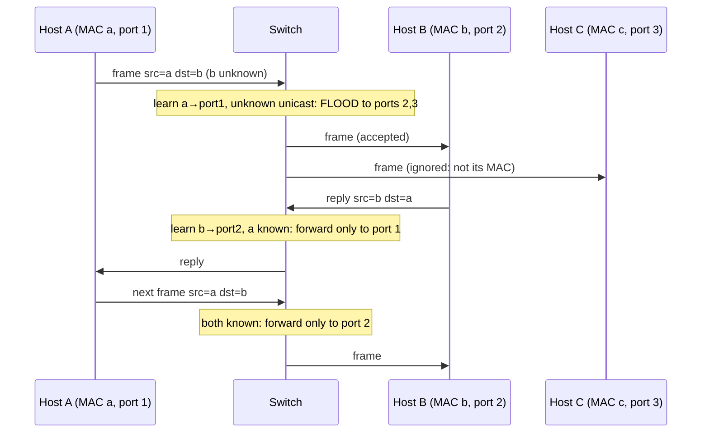

# 2.3 Ethernet and L2: frames, MAC addresses, switching, ARP and NDP

| | |
|---|---|
| Level | Beginner |
| Priority tier | 0 |
| Lab venue | A Linux VM with root (network namespaces and a Linux bridge) |
| Part | Part 2: Networking, from first principles to AI fabrics |
| Status | Drafted, labs **untested** |

## Why this matters for AI infrastructure

A training job that ran at 200 Gb/s when it should have run at 400 Gb/s does not look broken. It looks slow. The cause often sits below IP, in the link layer. A transceiver with rising bit errors can turn into NCCL timeouts. A switch port can flap. Two NICs on one subnet can answer ARP for each other's addresses after a careless clone.

Each of these faults starts at layer 2 and shows up much higher, as a timeout or a slow step. A broadcast storm after a cabling mistake, jumbo frames set on the hosts but not on one switch, and a lossless RDMA class that is not actually lossless all follow the same pattern. Cloud networks emulate Ethernet semantics too. ARP still exists inside a VPC, and the switch there is software.

This chapter covers layer 2 from end to end. You will see how Ethernet puts frames on a medium and addresses them, and what a frame contains. You will learn how physical layers and optics are named, so that `ethtool` output and BoM lines like "QSFP-DD 400G-DR4" make sense. Then comes how a switch learns and forwards, how a host finds a neighbour's MAC address (ARP for IPv4, Neighbor Discovery for IPv6), and how addresses are assigned at the link level through SLAAC and DAD. The chapter closes with how Wi-Fi differs and how to observe all of it on Linux. Chapter 2.11 builds VLANs and spanning tree on top of this. Chapter 2.12 adds link aggregation, and chapters 2.17 and 2.19 take L2 into overlays and lossless RDMA fabrics.

Read the rest of the chapter with a symptom in mind, and ask which layer that symptom comes from.

## Prerequisites and outcomes

Read chapters 2.1 and 2.2 first, and be comfortable working in the Linux shell.

By the end of this chapter, you should be able to:

- Describe how Ethernet shares a medium with CSMA/CD, why modern switched full-duplex Ethernet does not need it, and what half and full duplex mean.
- Decode a MAC address (OUI, the unicast or multicast bit, and the globally unique or locally administered bit). Decode an Ethernet frame (preamble, destination, source, EtherType, optional 802.1Q tag, payload and FCS), including its sizes, its minimum and maximum, and how the MTU fits in.
- Read Ethernet standard names (1000BASE-T, 25GBASE-SR, 100GBASE-CR4, 400GBASE-DR4), form factors (SFP28, QSFP28, QSFP-DD, OSFP), media types (copper, DAC, AOC, MMF, SMF), lane counts and encodings (NRZ, PAM4, FEC). Then connect them to `ethtool` fields and error counters.
- Explain how a switch learns MAC addresses, floods unknown unicast, broadcast and multicast, ages its entries, and forwards by cut-through or store-and-forward. Explain broadcast domains, and why L2 loops are dangerous.
- Describe how a packet moves through a network device: receive ring, processing, fabric, transmit ring. Tell apart the process, interrupt and ASIC switching paths, and switching from routing.
- Explain ARP in detail (request, reply, gratuitous ARP, proxy ARP, cache timers, duplicate detection). Explain IPv6 Neighbor Discovery (RS, RA, NS, NA, redirect, DAD, SLAAC, solicited-node multicast), and read `ip neigh`.
- Configure and verify the Linux L2 settings that matter on multi-NIC AI servers (`arp_ignore`, `arp_announce`, `rp_filter`). Diagnose duplicate IPs and MAC flapping.
- Compare wired Ethernet with 802.11 (CSMA/CA, hidden node, OFDM, MIMO, beamforming, goodput).
- Build a switched L2 lab with namespaces and a bridge, watch ARP and MAC learning, and break it on purpose.

Work through the lab in section 11 once you have read the middle sections, since it exercises most of these outcomes.

## 1. Ethernet in one page

Ethernet was invented at Xerox PARC in the early 1970s, and you will find it on almost every link you touch, because it is now the dominant link layer. It defines physical signalling, which is how bits go onto copper, fibre or a backplane. It also defines media access control, which sets who may transmit and when, and how stations are addressed. The standard is IEEE 802.3. The 802.1 family, covering bridging, VLANs and priority flow control, sits alongside it.

**Shared medium and CSMA/CD.** In the original design, every host shared one cable. Whatever one host sent, every other host heard, much like a conversation in an open room. To keep that from turning into chaos, stations used CSMA/CD, which stands for Carrier Sense Multiple Access with Collision Detection. If you listen before you speak, you avoid talking over someone. A station does the same, and it transmits only when the wire is idle. If two stations transmit at once, their signals collide. Each one notices the collision by listening to its own transmission, then sends a jam signal long enough for everyone to notice. Both then wait a random back-off time, called binary exponential back-off, before they retry. That is why the minimum frame size is 64 bytes. A sender must still be transmitting when a collision from the far end of the cable reaches it.

Today's networks do not share a medium. Each host has its own link to a switch port. Transmit and receive use separate wire pairs, or separate fibres or lanes, so both ends can send at the same time. This is full duplex, and there is no collision and no CSMA/CD. Half duplex, where the link must still arbitrate, survives only as a misconfiguration. A duplex mismatch, where one side auto-negotiated half and the other was forced to full, causes late collisions, CRC errors and terrible throughput. The shared medium lives on as the broadcast domain, the set of ports that receive each other's broadcasts.

In the four-function vocabulary of chapter 2.2, Ethernet provides transport of frames between stations on one link or switched segment. It multiplexes traffic by MAC address, EtherType and VLAN tag. It detects errors with a 32-bit CRC, and high-speed PHYs add forward error correction. It can also apply flow control, using PAUSE frames and priority-based PFC frames. A frame with a bad FCS is silently discarded, and there is no retransmission at this layer. Reliability and end-to-end flow control are left to higher layers, such as TCP, or to the lossless-fabric engineering of RDMA networks.

When you troubleshoot an Ethernet link, ask first whether it is switched and full duplex. If it is, you have no collision to chase.

## 2. MAC addresses

Every network interface needs an address that identifies it on the local wire. A **MAC address** is 48 bits, written as six hex octets such as `52:54:00:12:34:56`. It identifies a network interface, not a host. A server with four NICs has four MAC addresses, and virtual NICs add more. The bits inside the address carry meaning, and you can read them straight off the diagram.

```text
 octet 1                       octets 1-3                    octets 4-6
 bit 0 (LSB) = I/G             OUI (assigned by IEEE)        NIC-specific (assigned by manufacturer)
   0 = individual (unicast)    bit 1 = U/L
   1 = group (multicast)         0 = universally administered (burned-in)
                                 1 = locally administered (set by software/admin)
 ff:ff:ff:ff:ff:ff  = broadcast (all ones, a group address)
 01:00:5e:xx:xx:xx  = IPv4 multicast mapping;  33:33:xx:xx:xx:xx = IPv6 multicast mapping
```

- The first three octets form the **OUI**, the organisationally unique identifier, which names the vendor. NVIDIA/Mellanox, Intel and Broadcom are examples. `ip link` shows the address, and an online OUI lookup or `/usr/share/ieee-data/oui.txt` translates it. This helps when you need to recognise a device from a captured frame or a switch MAC table.
- The least significant bit of the first octet is the I/G bit. A 0 means unicast, and a 1 means multicast or broadcast. The next bit is the U/L bit. A 1 means the address was assigned locally. Virtual NICs made by hypervisors, container runtimes and software usually carry locally administered MACs. Examples are `02:`, `52:54:00` for QEMU/KVM, `02:42:` for Docker and `fa:16:3e` for OpenStack.
- The 46 usable bits give about 7×10¹³ unicast addresses. EUI-64 is a 64-bit format used for IPv6 interface identifiers and by some link types.
- A MAC address only has meaning on one link or broadcast domain. Routers rewrite it at every hop (chapter 2.1). Uniqueness is strictly required only within that domain, but manufacturers assign globally unique addresses anyway. Duplicates appear after careless cloning of VMs or NICs, or after manual assignment. They cause intermittent connectivity and **MAC flapping**, where a switch keeps relearning the same MAC on different ports.
- A NIC accepts frames addressed to its own MAC, to broadcast, and to multicast groups it has joined. It does this with a small hardware filter table. **Promiscuous mode** copies everything. Routers, bridges and packet monitors such as `tcpdump` use it, at a CPU cost.

The commands below show the address from the host side.

```bash
ip -br link                                  # interface names, state, MACs
ip link show dev eth0                        # flags: BROADCAST,MULTICAST,UP,LOWER_UP ; link/ether MAC ; mtu
cat /sys/class/net/eth0/address ; cat /sys/class/net/eth0/addr_assign_type    # 0 = permanent, 3 = set by user
sudo ip link set dev eth0 address 02:00:00:aa:bb:cc      # change MAC (interface must usually be down)
ip maddr show dev eth0                       # multicast MAC filters joined
sudo ip link set dev eth0 promisc on         # (tcpdump does this for you)
```

Before you clone a VM or a NIC, check its MAC address, because a duplicate is the usual cause of MAC flapping.

## 3. The Ethernet frame

Every frame on the wire has the same layout. The diagram shows the fields in order. Keep it nearby when a capture or a counter points at one field.

```text
  7 B        1 B   6 B        6 B        [4 B]            2 B          46-1500 B      4 B
+----------+-----+----------+----------+----------------+-----------+------------------+------+ ...12 B idle
| Preamble | SFD | Dest MAC | Src MAC  | 802.1Q tag     | EtherType | Payload (+pad)   | FCS  | (inter-frame gap)
|  10101010| 0xAB|          |          | (TPID 0x8100,  | or length |                  |CRC-32|
|  ...     |     |          |          |  PCP,DEI,VID)  |           |                  |      |
+----------+-----+----------+----------+----------------+-----------+------------------+------+
            <-------------------- Ethernet frame: 64 to 1518 B (1522 B with VLAN tag) ------------------->
```

- The preamble and the start-of-frame delimiter (SFD) take 8 bytes. The alternating bits in the preamble let the receiver synchronise its clock, and the SFD marks where the frame begins. They are not counted in the frame size, but they still occupy the wire.
- The destination MAC arrives before anything else. That lets the NIC decide straight away whether to keep copying the frame into memory.
- The EtherType, at 0x0600 and above, names the protocol in the payload. 0x0800 is IPv4, 0x0806 is ARP, 0x86DD is IPv6 and 0x8100 is a VLAN tag. 0x88A8 is QinQ, 0x8847 is MPLS, 0x88CC is LLDP and 0x8808 is MAC control, which carries PAUSE and PFC. 0x8915 is RoCE v1. Values below 1536 are an 802.3 length instead.
- In standard frames the payload is 46 to 1500 bytes, padded up to 46 when it is shorter. The minimum frame is therefore 64 bytes: a 14-byte header, 46 bytes of payload and a 4-byte FCS. The maximum is 1518 bytes, or 1522 with one VLAN tag. The MTU, 1500, is the largest payload you can send. Jumbo frames extend this, commonly to 9000 or 9216 bytes, but only if every device on the path agrees.
- The FCS is a CRC-32 over the frame. If the check fails, the frame is dropped and an error counter goes up, such as `rx_crc_errors` or `FCS errors`. At 25G and above, link-level FEC corrects many errors before the CRC sees them. So rising uncorrected FEC codewords or CRC errors point to a bad cable, a dirty or failing optic, or a marginal signal.
- Between frames sits an idle gap of 12 byte times, or 96 bit times. Add the preamble and that is the 20-byte per-frame cost from chapter 2.2. A 64-byte frame therefore occupies 84 byte times on the wire. At 100 Gb/s, that caps the link at 148.8 Mpps.

The first command shows what a frame looks like, and the second shows whether the NIC is counting errors or drops.

```bash
sudo tcpdump -nn -e -XX -c 3 -i eth0                # MACs + EtherType + raw hex; FCS and preamble are stripped by the NIC
ethtool -S eth0 | egrep -i 'crc|fcs|err|drop|pause|pfc'     # driver/NIC counters; names differ by NIC (mlx5: rx_crc_errors_phy, rx_symbol_err_phy)
ethtool -m eth0                                     # transceiver module info (DOM): vendor, part, temperature, Tx/Rx optical power
```

### Frame types you will see on a network

A **unicast** frame has one destination. A **broadcast** frame, sent to `ff:ff:ff:ff:ff:ff`, reaches every station in the broadcast domain, as ARP requests and DHCP discovers do. A **multicast** frame goes to a group MAC. IPv6 Neighbor Discovery, mDNS and routing protocol hellos use them, and so do the reserved addresses `01:80:c2:00:00:xx` and `01:00:0c:cc:cc:cc` for LLDP, LACP and STP. An **unknown unicast** frame is a unicast frame whose destination the switch has not learned yet, so the switch floods it.

Control frames are a separate kind. PAUSE (802.3x) tells the sender to stop for a time. PFC (802.1Qbb) pauses one priority at a time. LACP (802.3ad), STP BPDUs and LLDP advertisements are control frames too. Knowing which kind of frame you are looking at tells you whether the switch will flood it.

## 4. Physical layers, media and optics (reading the names)

The name of an Ethernet standard encodes speed, signalling and reach, in the form `<speed>BASE-<medium/reach><lanes>`. Once you can read the name, you know most of what a link can do before you open a datasheet. The table lists the names you will meet most often.

| Name | Speed | Medium | Typical reach | Notes |
|---|---|---|---|---|
| 1000BASE-T | 1 Gb/s | Cat5e/6 twisted pair (4 pairs) | 100 m | Management, BMC |
| 10GBASE-T | 10 Gb/s | Cat6a | 100 m | Power-hungry, higher latency |
| 10GBASE-SR / 25GBASE-SR | 10/25 | MMF (850 nm) | 100 m (OM4) | SFP+/SFP28 |
| 25GBASE-CR (DAC) | 25 | Twinax copper | 3 to 5 m | Passive DAC, in-rack |
| 100GBASE-SR4 / -CR4 | 100 | 4 lanes × 25G, MMF / twinax | 100 m / 3 m | QSFP28 |
| 100GBASE-LR4 / -DR / -FR | 100 | SMF | 10 km / 500 m / 2 km | |
| 200GBASE-SR4 / -DR4 | 200 | 4 × 50G PAM4 | 100 m / 500 m | QSFP56 |
| 400GBASE-SR8 / -DR4 / -FR4 / -LR4 | 400 | 8 × 50G or 4 × 100G PAM4 | 100 m / 500 m / 2 km / 10 km | QSFP-DD, OSFP |
| 800GBASE-SR8 / -DR8 | 800 | 8 × 100G PAM4 | 50 to 100 m / 500 m | OSFP, QSFP-DD800 |

Notice that the reach column varies within one speed. 100GBASE-LR4 reaches 10 km over SMF, while 100GBASE-DR reaches 500 m over the same kind of fibre. The name alone does not tell you the distance, so read the reach as well.

Five media types show up in these names. Copper twisted pair (Cat5e, Cat6 and Cat6a) carries 1, 2.5, 5 and 10 Gb/s. **DAC**, a direct-attach copper twinax cable with passive or active electronics, makes short, cheap, low-power links inside a rack, at 10 to 400G. **AOC**, an active optical cable with the optics permanently attached, covers 5 to 100 m. Multi-mode fibre (OM3, OM4 and OM5) runs at 850 nm over short distances with cheaper optics. Single-mode fibre (OS2, at 1310 or 1550 nm) handles long reach. AI cluster fabrics use DAC inside racks, AOC or multi-mode fibre between racks, and single-mode fibre for longer runs or when distance and future growth demand it.

Form factors set how many lanes a module carries. SFP, SFP+ and SFP28 carry one lane at 1, 10 and 25G. QSFP+, QSFP28 and QSFP56 carry four lanes at 40, 100 and 200G. QSFP-DD and OSFP carry eight lanes at 400 and 800G. A **breakout** cable splits one high-speed port into several lower-speed ones, such as one 400G port into four 100G links. Breakout is common on leaf-to-NIC connections. NICs use RJ45, SFP28 or QSFP ports. NVIDIA's ConnectX-6, ConnectX-7 and ConnectX-8 cards cover 200G, 400G and 800G, in OCP3 or PCIe form factors.

Each lane carries its signal in one of two encodings. Up to 25G per lane uses NRZ, which has two voltage levels and one bit per symbol. At 50G and 100G per lane, PAM4 uses four levels and two bits per symbol. PAM4 has a smaller signal-to-noise margin, so it needs Reed-Solomon FEC, also known as RS-FEC or KP4. RS-FEC adds about 100–250 ns of latency, and both ends must use the same FEC mode. Mismatched FEC settings stop links from coming up, or make them show errors. Auto-negotiation, or link training on copper and backplanes, picks the speed, duplex and FEC with the peer. When you force settings, they must match on both ends. A link that is up is not necessarily healthy, so always check its error counters.

```bash
ethtool eth0                                  # supported/advertised modes, speed, duplex, auto-negotiation, link detected
ethtool --show-fec eth0                       # FEC mode (Auto/RS/BaseR/Off) and corrected/uncorrected counts (if supported)
ethtool -S eth0 | egrep 'symbol|fec|crc|discard|errors'      # physical-layer health
mlxlink -d /dev/mst/mt4129_pciconf0 --show_ber --show_module 2>/dev/null   # NVIDIA: BER, link state, FEC, module (needs MFT)
ip -s link show eth0 ; cat /sys/class/net/eth0/{speed,duplex,carrier,carrier_changes,mtu}   # carrier_changes counts flaps
dmesg -T | egrep -i 'link (is )?(up|down)|NIC Link'          # link events with timestamps
```

Read the counters this way. A rising `carrier_changes` means the link is flapping, which points to a cable, an optic, a transceiver seating, a switch port or power. Non-zero `rx_crc_errors` or uncorrected FEC means a marginal signal. `rx_discards` and `rx_out_of_buffer` mean the host cannot drain traffic fast enough, or that switch or NIC buffers overflow. `rx_pause` and `tx_pause` show that flow control is active. A NIC running at the wrong speed, such as a 400G NIC at 100G, points to a cable, an optic, a lane problem or a switch configuration.

Before you accept a link as working, check its speed, FEC mode and error counters, not just its link state.

## 5. How an Ethernet switch works

A **switch** is a bridge with many ports. It joins stations into one layer 2 segment, and it forwards each frame only to the place that frame needs to go. A switch starts with no knowledge of where hosts sit. You can watch it learn that as traffic flows.

### Learning, forwarding and flooding

The switch keeps a **MAC address table**, also called the forwarding database (FDB) or CAM table. Each entry maps a VLAN and a MAC address to a port. Each entry also has an age timer, commonly 300 s.

When a frame arrives on port *P*, the switch does two things. First it learns: it records the source MAC against *P* and refreshes the timer. No control protocol is needed, so the table builds itself. Then it forwards by looking up the destination MAC.

- If the destination is on a different port, the switch sends the frame out that port only. This is selective forwarding.
- If the destination is on the port the frame came in on, the switch discards it. Both stations sit on the same segment, so the frame has no work to do.
- If the destination is unknown unicast, broadcast or unfiltered multicast, the switch floods the frame to every other port in the VLAN.
- Frames addressed to the switch's own MAC, such as management traffic, go to its control plane.



Read the diagram from top to bottom, and you will see the first frame flood, because the switch has never seen host B. B's reply teaches the switch where B is, so the next frames go to one port only.

Flooding has three consequences. Switching gives every port its own collision domain, but the broadcast domain still spans the whole VLAN, since broadcasts and unknown unicast get flooded. The MAC table is also a finite resource, holding thousands to hundreds of thousands of entries. A MAC flood attack, or a large layer 2 domain full of VMs and containers, can overflow it and force flooding.

When a host moves, the switch relearns its location from the next frame that arrives on the new port. A VM migration, a failover with a virtual MAC or a replaced NIC all cause this. A gratuitous ARP helps by announcing the move at once.

A loop in the topology is the most dangerous case. Two switches joined by two cables with no spanning tree, or a pair of NICs bridged by accident, make floods circulate forever. Ethernet frames carry no TTL, so broadcasts multiply and saturate links and CPUs within seconds. This is a broadcast storm, and the MAC table flaps between ports as well. Spanning tree (chapter 2.11), loop-free designs with L3 to the rack (chapter 2.18), storm control and careful cabling prevent it.

```bash
bridge fdb show br0                        # Linux bridge MAC table (and: bridge -s fdb)
bridge link show ; bridge vlan show        # port states, VLAN membership
# Show a vendor switch table equivalent (CLI differs): "show mac address-table", "show mac-address-table dynamic", "net show bridge macs" (Cumulus)
```

If you build any design with two paths between switches, it needs spanning tree, a loop-free design or storm control before it goes live.

### Switching modes and latency

You can choose how a switch forwards frames, and the choice changes latency. **Store-and-forward** receives the whole frame, checks the FCS, and then forwards it. Latency grows with frame size, but errors are filtered out. **Cut-through** starts forwarding as soon as it has read the destination MAC, which is after about the first 14–24 bytes. Its latency stays at a few hundred nanoseconds whatever the frame size. The trade-off is that a corrupted frame may already be on its way before the FCS is checked, although some designs poison such frames at egress.

Port-to-port latency in data-centre switches is on the order of 300 ns to 1 µs with cut-through, rising to several µs. At microsecond scales this matters for latency-sensitive workloads, and for multi-hop collectives that may cross 3 to 5 hops in a Clos fabric. Serialisation delay is the time it takes to put a frame on the wire. It equals frame size divided by link rate. A 1500-byte frame takes 120 ns at 100 Gb/s, and 12 µs at 1 Gb/s. A store-and-forward hop adds that delay every time.

### Inside a network device (packet switching, in brief)

Moving a packet through a switch or router takes four steps:

1. The packet is clocked off the wire into a receive ring in memory. The PHY writes into a ring buffer, and only pointers move between stages, so nothing is copied.

2. The device processes the packet. It looks up the destination in the MAC table for switching or in the FIB for routing, then applies filters, NAT and QoS marking. 3. The packet crosses the device to the outbound port. In small devices that is a shared memory pool. In larger ones it is an internal fabric or crossbar. 4. The packet is clocked onto the wire from a transmit ring, after queueing and egress QoS scheduling.

Three implementation paths exist, from slowest to fastest. In **process switching**, the device interrupts its general-purpose CPU, which schedules a process to handle the packet. That is the slow path. In **interrupt-context switching**, the interrupt handler switches the packet itself, which is moderate. In **ASIC or NPU hardware switching**, a dedicated packet-processing chip uses specialised memory such as TCAM, SRAM and HBM, along with pipelines and recirculation. It runs at line rate, which is 12.8 to 51.2 Tb/s per chip.

High port-count devices use a crossbar fabric, a multi-stage Clos inside the chassis. A scheduler resolves contention when several inputs want the same output. **Virtual output queues** (VOQs) keep a separate queue per output at each input, which avoids head-of-line blocking. Iterative matching algorithms such as iSLIP run request, grant and accept steps over several iterations, to pick non-conflicting input and output pairs each cycle. This matters for you because loss and latency happen in these queues. Buffers fill when several inputs target one output, which is called incast. Incast is the signature pattern of all-reduce, all-to-all and storage reads. The Linux host mirrors the same structure, with NIC rings, then NAPI, then softirq and protocol handlers, and on transmit a qdisc followed by the TX ring.

### Switching versus routing (L2 versus L3)

Switching forwards on the destination MAC and leaves the frame unchanged. Routing strips the L2 header, looks up the destination IP in a forwarding table, decrements the TTL and builds a new L2 header for the next hop. You route rather than switch for three reasons. Routing connects dissimilar link types. It limits state, because L2 tables grow with every host while IP prefixes aggregate. It also contains broadcast domains, since routers do not forward broadcasts. Most data-centre switches are really L3 switches, meaning routers with Ethernet ports. Modern fabrics push routing down to the top-of-rack switch to avoid large L2 domains (chapters 2.16, 2.18).

For a large fabric, you should decide early whether routing to the rack keeps your broadcast domains small enough.

## 6. Mapping between layers: ARP and Neighbor Discovery

Hosts address packets with IP addresses but send frames with MAC addresses, so something has to translate between the two. This is interlayer discovery, which maps an identifier at one layer to one at another. There are four patterns. The first uses well-known or manually configured mappings, such as the port numbers in `/etc/services`. The second uses a mapping database with a query protocol: DNS for names, and DHCP for assignment. The third advertises the mapping directly between peers, as ARP and IPv6 Neighbor Discovery do. The fourth calculates one identifier from the other, as an IPv6 link-local address derived from a MAC does, or as SLAAC does. This section covers the third and fourth patterns, at the boundary of layers 2 and 3. DNS and DHCP come in chapters 2.8 and 2.9.

### The default gateway problem

Before your host sends anything, it has to decide whether the destination is on the same wire. It ANDs its own address and the destination with its subnet mask. If the two results match, the destination is on-link, and the host ARPs for the destination itself. If they differ, the host sends the frame to the default gateway's MAC address.

A wrong mask causes trouble in either direction. If the mask is too wide, the host treats off-link addresses as on-link and ARPs for them. Nobody answers, so you get "no route to host". If the mask is too narrow, on-link traffic goes to the router instead. That still works, but it is inefficient, and it may trigger ICMP redirects.

### IPv4 ARP (Address Resolution Protocol)

An ARP request is an Ethernet broadcast. It asks a question: "who has 203.0.113.12? tell 203.0.113.10". If you capture one with `tcpdump`, you will see every host receive it. The owner replies with a unicast ARP reply that carries its MAC address. The requester stores the mapping in the ARP cache, which Linux calls the neighbour table. Other hosts that see the request may also learn the sender's mapping.

An ARP packet is 28 bytes long. It sits after the Ethernet header, with EtherType 0x0806. Its fields are laid out below.

```text
ARP packet (28 bytes after the Ethernet header, EtherType 0x0806):
 hardware type (Ethernet=1) | protocol type (IPv4=0x0800) | HLEN 6 | PLEN 4 | opcode (1=request, 2=reply)
 sender MAC | sender IP | target MAC (00:00:.. in request) | target IP
```

The sender and target fields tell you who asked and who should answer. In a request, the target MAC is `00:00:..`, because the requester does not know it yet.

- **Cache entries age out.** Linux marks each entry with a state. `INCOMPLETE` means a request has gone out. `REACHABLE` means the entry was confirmed recently, typically about 30 s, give or take. `STALE` means the entry is still usable but must be revalidated when it is used. `DELAY` and `PROBE` cover the unicast probes that follow. `FAILED` means resolution did not succeed. `PERMANENT` and `NOARP` complete the list. Two tunables control the timing, `base_reachable_time_ms` and `gc_stale_time`, which live under `/proc/sys/net/ipv4/neigh/<if>/`. If you shorten the timeout, the table reacts faster to moves. A long one cuts ARP chatter, so choose based on how often your hosts move.
- **Gratuitous ARP** is an announcement a host makes without being asked. Its sender IP equals its target IP. It has two uses. It updates neighbours' caches and switch tables at once after a failover or a VM migration, as with VRRP, keepalived, load balancers and live-migrated VMs. It also works as duplicate address detection: if somebody replies, the address is already in use (`arping -D`).
- **Proxy ARP** means a router answers ARP requests on behalf of hosts it can reach. Most systems disable it by default. It shows up occasionally in legacy subnetting, cloud network emulation and some Kubernetes CNIs. It hides misconfigured masks and enlarges ARP tables.
- **Security.** ARP has no authentication, so ARP spoofing or poisoning lets an attacker redirect traffic. Dynamic ARP inspection and DHCP snooping on switches help. So do static entries for critical hosts, 802.1X and private VLANs.
- **Scale.** Every host in a layer 2 domain caches entries for its peers, and the neighbour table has a size limit. The limits live in `net.ipv4.neigh.default.gc_thresh1/2/3`, and they default to 128, 512 and 1024. In large flat networks, or on Kubernetes nodes and routers with many peers, the kernel logs "neighbour table overflow". Raise the limits when you see it.

```bash
ip neigh show                                   # table with states
ip -s neigh show ; ip neigh show nud stale      # filter by state; counters
sudo ip neigh add 10.0.0.9 lladdr 02:00:00:00:00:09 dev eth0 nud permanent      # static entry (rarely needed)
sudo ip neigh del 10.0.0.9 dev eth0 ; sudo ip neigh flush dev eth0
sudo arping -I eth0 10.0.0.1 -c 3               # who has / reply; round-trip at L2
sudo arping -D -I eth0 -c 2 10.0.0.15           # duplicate address detection for MY address
sudo arp-scan -l                                # enumerate the local segment (needs arp-scan)
sudo tcpdump -nn -e -i eth0 arp                 # watch requests/replies
sysctl net.ipv4.neigh.default.gc_thresh{1,2,3}
```

### Linux ARP behaviour on multi-NIC hosts (important for AI nodes)

By default, Linux is weak-host about ARP. It answers an ARP request for any local IP on any interface. On a server with several NICs in the same subnet, or with several IPs on one interface, the wrong interface may answer. The switch then learns the IP on the wrong port. Traffic comes back on a different NIC from the one you intended. The result is asymmetric paths, RDMA and NCCL oddities, flapping MAC tables and confused bonding. Four sysctl settings control this.

| sysctl | Meaning |
|---|---|
| `net.ipv4.conf.<if>.arp_ignore` | 0 reply for any local address on any interface (default); **1** reply only if the target IP is configured on the *receiving* interface; 2 additionally require the sender in the same subnet |
| `net.ipv4.conf.<if>.arp_announce` | Which source IP to use in outgoing ARP requests: 0 any; 1 prefer same subnet; **2** always use the best source address of the outgoing interface |
| `net.ipv4.conf.<if>.arp_filter` | 1: only answer if the route to the sender would use this interface |
| `net.ipv4.conf.<if>.rp_filter` | Reverse path filtering (0 off, 1 strict, 2 loose); strict mode drops asymmetric traffic |
| `net.ipv4.conf.all.arp_notify` | Send gratuitous ARP when the interface comes up / address changes |

Each row is set per interface, through the `<if>` part of the key.

A common recipe for multi-homed servers, with one subnet per NIC (for example one IP per rail or GPU NIC), is `arp_ignore=1`, `arp_announce=2` and `rp_filter=2` in loose mode. Add policy routing with one routing table per NIC (chapter 2.24), so replies leave on the interface that received the request. This is a frequent cause of incidents that appear only after another NIC is plugged in, so if you run this design, write the recipe down.

### IPv6 Neighbor Discovery (NDP)

IPv6 has no broadcast. It uses ICMPv6 messages instead. They are carried inside IPv6 rather than as a separate Ethernet protocol, and they go to multicast addresses.

| ICMPv6 type | Message | Purpose |
|---|---|---|
| 133 | Router Solicitation (RS) | Host asks "any routers here?" (to `ff02::2`, all-routers) |
| 134 | Router Advertisement (RA) | Router announces prefixes, default gateway lifetime, MTU, flags (M = use DHCPv6 for addresses, O = other config via DHCPv6), sent periodically and in reply to RS |
| 135 | Neighbor Solicitation (NS) | "What is the MAC of this IPv6 address?" sent to the **solicited-node multicast address** `ff02::1:ffXX:XXXX` (last 24 bits of the target address); also used for DAD and reachability probing |
| 136 | Neighbor Advertisement (NA) | The answer (also unsolicited announcements) |
| 137 | Redirect | Router tells a host about a better first hop |

Solicited-node multicast means only hosts whose address ends in those 24 bits receive the solicitation. NDP therefore does not disturb every host the way an ARP broadcast does. The Ethernet destination is the matching `33:33:ff:XX:XX:XX` multicast MAC.

You can follow how a host builds its own IPv6 addresses in three steps.

1. It forms a link-local address, `fe80::/64` plus an interface ID. The ID comes from the MAC as a modified EUI-64, or from a random stable privacy ID under RFC 7217 on modern systems. The Linux setting for this is `addr_gen_mode`. For example, the MAC `01:23:45:67:89:ab` becomes the EUI-64 `0323:45ff:fe67:89ab`, by flipping the U/L bit and inserting `ff:fe`. The link-local address is then `fe80::323:45ff:fe67:89ab`.
2. Before using any address, it runs Duplicate Address Detection (DAD). It sends an NS for the address from `::`. If an NA arrives for that address, or another host's DAD NS does, the address is a duplicate and the host does not use it. Looping switches can reflect the host's own NS and cause false positives. Enhanced DAD uses a nonce to detect that self-reflection.
3. It sends an RS, and routers answer with an RA. If the RA's A flag is set on a /64 prefix, the host builds a global address with SLAAC (stateless address autoconfiguration), from the prefix and its interface ID. If M is set, the host asks a DHCPv6 server for addresses. If O is set, it asks for other options, such as DNS. The default gateway is the router's link-local address, so the route survives renumbering. The preferred and valid lifetimes of a prefix decide when an address is deprecated.

```bash
ip -6 addr show ; ip -6 route show ; ip -6 neigh show
sysctl net.ipv6.conf.eth0.{accept_ra,autoconf,addr_gen_mode,use_tempaddr,disable_ipv6}
sudo ip -6 neigh flush dev eth0
sudo ndisc6 fe80::1 eth0 ; sudo rdisc6 eth0       # active NS and RS (package ndisc6)
sudo tcpdump -nn -e -i eth0 icmp6 and 'ip6[40] >= 133 and ip6[40] <= 137'   # RS/RA/NS/NA/Redirect
```

If you work in a data centre, you will often find hosts that disable RA and SLAAC, and use static addressing or DHCPv6 instead. Cloud VMs, laptops and Kubernetes pods often learn their IPv6 gateway from RA. An RA guard on switch ports blocks rogue router advertisements. For each network, choose between RA with SLAAC and static or DHCPv6 addressing, and guard the switch ports against rogue RAs.

## 7. L2 on Linux: the objects behind the concepts

Linux builds layer 2 out of software objects as well as hardware ports. The table lists the ones you will meet most often on a server or a hypervisor.

| Object | Meaning |
|---|---|
| Physical NIC (`eth0`, `ens4`, `enp129s0f0`, `ibs...` for IPoIB) | Ethernet port; queues (RSS), offloads, ring sizes |
| `lo` | Loopback; no L2 |
| **bridge** (`br0`) | Software switch: MAC learning, flooding, STP, VLAN filtering; used by libvirt, Docker, CNIs |
| **veth** pair | Virtual cable; one end in a namespace/container, the other in a bridge |
| **VLAN subinterface** (`eth0.100`) | 802.1Q tagging |
| **bond/team** | Link aggregation or active-backup |
| **macvlan / ipvlan** | Multiple L2/L3 identities on one NIC |
| **tap/tun** | VM or user-space L2/L3 interfaces |
| **vxlan / geneve** | L2-over-L3 tunnels |

Chapter 2.25 covers these objects in depth. To observe layer 2 on Linux, use `ip -d link`, `bridge fdb/vlan/link/mdb`, `ethtool`, `tc` and `tcpdump -e`. On a hypervisor or Kubernetes node, one frame can cross several of these objects. It may run from a pod's `eth0` through a veth, then a bridge, OVS or eBPF, then the host NIC, and finally out to the switch. Follow the frame through each object in turn when you trace a problem on such a node.

## 8. Wi-Fi (802.11) in contrast

When you move from a cable to a radio, the rules change. Wi-Fi uses the same frame ideas, MAC addresses and an FCS, but its medium is very different. Radio is a shared broadcast medium. A transmitter cannot listen while it transmits, because its own signal swamps its receiver. So collision detection is impossible. Instead of CSMA/CD, 802.11 uses CSMA/CA, collision avoidance. A station listens, waits a random back-off, transmits the whole frame, and needs an ACK from the receiver. No ACK means it assumes the frame was lost, backs off and retries.

The hidden node problem arises when stations A and C both reach B but cannot hear each other. RTS/CTS can mitigate it, but using it is optional.

Capacity comes from several sources. OFDM spreads data across many orthogonal sub-carriers. Channels can be 20, 40, 80, 160 or 320 MHz wide. Denser modulation goes up to 1024-QAM and 4096-QAM. MIMO multiplexes data spatially across several antennas by using multipath, and MU-MIMO extends that to several clients. Beamforming shapes the signal toward a client.

Real goodput is typically 40 to 60 percent of the nominal PHY rate. Preambles, ACKs, contention and protocol overhead all take a share. On Linux, you can check with `iw dev wlan0 scan/link`, which shows what the radio sees and what it is joined to. `wpa_supplicant` and NetworkManager handle the connection side.

For data centres and clusters, wireless matters little. The lessons still carry over, though. Collision avoidance, hidden terminals, and goodput versus bandwidth come up again in shared-media effects, incast and lossless fabrics. When you plan a link, plan with goodput, not the headline rate.

## 9. AI fabrics at layer 2

Ethernet back-end fabrics that carry RDMA (RoCE v2) need a lossless class. Configure PFC, which is priority flow control defined in 802.1Qbb, for the RoCE priority from end to end, on the NIC and on every switch. Add ECN marking with DCQCN or a similar rate control. Set correct DSCP and PCP trust and mapping, and size buffer allocation and headroom for each port speed and cable length (chapter 2.19). L2 problems hurt more here than anywhere else. A missing PFC configuration on one switch port causes drops, and RDMA retransmits are costly. If it is misconfigured the other way, the result is pause storms and deadlocks.

InfiniBand has its own link layer, with credit-based flow control per virtual lane. That makes it lossless by construction. LIDs and GIDs replace MACs and IPs, and the Subnet Manager does the learning by programming the forwarding tables.

In a rail-optimised design, you give each GPU its own NIC, often with its own subnet, VLAN or VRF. That is why the ARP, `rp_filter` and policy-routing details above matter. Server links are typically 2 × 100/200G for the front end and 8 × 400G for the back end, one NIC per GPU, in HGX H100 and H200-class nodes. Verify the speed, FEC and MTU on every one of them. A single x4 link running at 100G instead of 400G degrades a whole job.

You should watch per-port error counters for CRC, FEC uncorrected and symbol errors. Also watch PFC pause counts per priority, ECN-marked packets, buffer occupancy, link flaps and optical power (DOM). LLDP shows you the topology. `lldpctl` and `lldpcli show neighbors` tell you which switch and port each NIC connects to, which is essential for finding the far end of a faulty cable quickly.

```bash
sudo lldpcli show neighbors                          # which switch/port is this NIC plugged into? (lldpd package)
ethtool -a eth0 ; ethtool -A eth0 rx on tx on        # PAUSE (802.3x) settings
mlnx_qos -i eth0                                      # NVIDIA: PFC/ETS/trust configuration (MOFED)
ethtool -S eth0 | egrep -i 'prio[0-9]_(rx|tx)_(pause|ecn)|rx_prio|discard'
```

Treat a PFC change on one switch as a change to the whole fabric, because the lossless class only works end to end.

## 10. Failure modes and diagnosis

If you are chasing a fault, the table maps each symptom to its likely cause and the first checks to run. Read each row from left to right: the symptom, the likely cause, then the checks.

| Symptom | Likely cause | First checks |
|---|---|---|
| Link down / flapping | Cable, optic, seating, dirty fibre, speed/FEC mismatch, power, switch port | `ethtool`, `dmesg -T`, `carrier_changes`, `ethtool -m` (DOM), swap cable/optic |
| Link up at lower speed | Cable/optic rated lower, lane failure, auto-neg limits, switch config | `ethtool eth0`, `ethtool -m`, switch port status |
| CRC / FEC errors, slow throughput | Dirty/marginal fibre, bad DAC, bent fibre, wrong cable type, EMI | Counters over time, clean connectors, replace |
| Duplex mismatch | One side forced, the other auto | `ethtool`, late collision/runt counters |
| Intermittent connectivity, "works for some hosts" | Duplicate IP/MAC, MAC flapping, ARP cache poisoning, stale ARP after failover | `arping -D`, `ip neigh`, switch MAC-flap logs, `tcpdump arp` |
| "No route to host" on local subnet | ARP unanswered: host down, wrong VLAN, port security, filter, wrong mask | `ip neigh` shows FAILED/INCOMPLETE, `tcpdump arp` both ends |
| Network melts down | L2 loop / broadcast storm | Switch CPU/port rates, STP topology changes, `tcpdump -c` shows repeating broadcasts, unplug suspicious links |
| Large frames dropped | MTU mismatch on some hop | `ping -M do -s 8972`, switch MTU configs, `ip link` |
| Wrong NIC answers | Linux weak-host ARP on multi-NIC host | `arp_ignore`/`arp_announce`, `ip neigh` on peers, switch MAC table |
| RDMA retransmits / stalls | Lossy class, PFC/ECN missing, congestion, pause storm | Switch PFC counters, `ethtool -S` pause/ECN counters, topology |
| Neighbour table overflow messages | Large L2 domain, small gc_thresh | `dmesg`, raise `gc_thresh*` |

Use the first-checks column as your starting point for each symptom.

## 11. Hands-on lab: a switched L2 network in network namespaces

Start with the self-checking Python lab, and run it locally before you touch any network. It checks the I/G bit (unicast or multicast) and the U/L bit (globally unique or locally administered) when it decodes a MAC address. It checks FDB learning, flooding and filtering in an L2 switch. It derives the IPv6 EUI-64 link-local address (`fe80::323:45ff:fe67:89ab`), the solicited-node multicast address (`ff02::1:ff67:89ab`) and its MAC (`33:33:ff:67:89:ab`). It also checks serialisation delay for a 1500-byte frame, which is 120 ns at 100 Gb/s and 12 µs at 1 Gb/s.

```bash
python3 code/part02/ethernet_l2_arp_ndp_lab.py
```

Next, move to a disposable Linux VM where you have root. You need `iproute2`, `bridge-utils` or `bridge`, `tcpdump` and `arping`. Every interactive VM command below is untested here, so run them only on a throwaway machine. Work through these steps in order.

1. Build the switch and three hosts. Each host gets its own namespace, joined to the bridge by a veth pair.

```bash
sudo ip link add br0 type bridge && sudo ip link set br0 up # (untested here)
for n in h1 h2 h3; do
  sudo ip netns add $n
  sudo ip link add v-$n type veth peer name e0 netns $n
  sudo ip link set v-$n master br0 up
  sudo ip -n $n link set lo up ; sudo ip -n $n link set e0 up
done # (untested here)
sudo ip -n h1 addr add 10.20.0.1/24 dev e0 # (untested here)
sudo ip -n h2 addr add 10.20.0.2/24 dev e0 # (untested here)
sudo ip -n h3 addr add 10.20.0.3/24 dev e0 # (untested here)
bridge link show ; bridge fdb show br br0  # (untested here)
```

2. Watch ARP and learning. In one terminal, run `sudo ip netns exec h3 tcpdump -nn -e -i e0`. In another, run `sudo ip netns exec h1 ping -c1 10.20.0.2`. The broadcast ARP request reaches h3, because the switch floods it. Once the switch has learned both addresses, the unicast reply and the ICMP traffic no longer reach h3. Check `ip -n h1 neigh` and `bridge fdb show br br0` before and after. To age the table, run `sudo bridge fdb flush dev v-h2`, or wait, and watch flooding resume. `brctl setageing br0 10` shortens the timer.
3. Study the frame. Capture with `-XX`, and identify the destination and source MAC, the EtherType and the payload. Compute the frame length. Change the MTU on all links with `ip link set ... mtu 9000`, then send `ping -s 8000 -M do`. Reduce one veth to 1500, and observe the failure and the error message.
4. Create a duplicate IP. Run `sudo ip -n h3 addr add 10.20.0.2/24 dev e0`. From h1, run `arping -I e0 -c 4 10.20.0.2` through `ip netns exec h1`. You should see two different MACs replying, a flapping neighbour entry and a flapping MAC table. Run `arping -D` from h3 before you assign the address, to detect the duplicate.
5. Cause MAC flapping and a loop, in a safe, small setup. Add a second bridge, `br1`, and connect it to `br0` with two veth pairs, without STP. Send one broadcast with `arping`, and watch the packet counters rise with `ip -s link`. Stop at once by deleting one link. Then enable STP on both bridges with `ip link set br0 type bridge stp_state 1`, and repeat the test. `bridge link` shows the blocking and forwarding states. Do this only in a throwaway namespace or VM.
6. Explore IPv6 Neighbor Discovery. Assign `fd00:20::1/64` and similar addresses, run `ping -6`, and watch NS and NA with `tcpdump icmp6`. Note the solicited-node multicast destination MAC (`33:33:ff:...`). Enable `radvd` or `dnsmasq` RA in a namespace that acts as a router. Then watch RA and RS, and the SLAAC address formation (`ip -6 addr`, flags `A`, `M`, `O`).
7. Test Linux ARP policy. Give h1 two interfaces on the same subnet, with the second veth going into the bridge. From h2, ARP for each address, and see which MAC answers. Apply `arp_ignore=1` and `arp_announce=2`, and compare the results. Add `rp_filter=1`, and show the asymmetric reply drops.
8. Read a physical NIC, on a VM or real hardware. Record `ethtool`, `ethtool -S`, `ethtool -m` (if present), `cat /sys/class/net/*/carrier_changes` and `lldpcli show neighbors`. Then compute the error ratio per billion frames.
9. Optionally, look at Wi-Fi. Run `iw dev wlan0 scan | head` and `iw dev wlan0 link`, then compare the PHY rate with `iperf3` goodput.

## 12. Common mistakes

Each of these mistakes comes from a point covered above.

- Treating link-up as healthy, and ignoring FEC and CRC counters and flap counts.
- Forgetting that MAC addresses are per hop and per interface, and confusing the L2 destination with the final destination.
- Assuming a switch never floods, and ignoring unknown-unicast and broadcast domain size.
- Creating a loop with a second cable or a mis-bridged NIC, or disabling spanning tree without a loop-free design.
- Setting jumbo frames on hosts but not on every switch, port or tunnel.
- Ignoring Linux weak-host ARP behaviour on multi-NIC servers, or cloning VMs with identical MACs.
- Treating lossless Ethernet as just turning on PFC, and ignoring headroom, ECN, trust and end-to-end consistency.
- Treating Wi-Fi's nominal PHY rate as throughput.

Before you call a link healthy, look at its counters, not just its state.

## 13. Interview angles

- "Walk through how a switch forwards a frame; what happens with an unknown destination?"
- "What is the difference between a collision domain and a broadcast domain?"
- "Explain ARP. What is gratuitous ARP and when is it used? What is proxy ARP?"
- "How does IPv6 replace ARP? What is DAD and SLAAC? Why solicited-node multicast?"
- "A server has two NICs on the same subnet and traffic is asymmetric. Why? How do you fix it?" (`arp_ignore/announce`, policy routing.)
- "A 400G link is up at 100G. How do you diagnose?" (cable/optic/lane/FEC/negotiation.)
- "Why is there no TTL in Ethernet and what does that imply?" (L2 loops/storms, STP.)
- "What makes RoCE need a lossless Ethernet configuration, and what can go wrong?"

## Exercises

You will get the most from these six exercises if you work through them in order. Each one builds on the chapter's commands and functions.

1. Start with MAC addresses and frames. Use `decode_mac_address()` in `code/part02/ethernet_l2_arp_ndp.py` to decode `52:54:00:12:34:56`, `ff:ff:ff:ff:ff:ff` and `33:33:ff:67:89:ab`. For each one, explain the OUI, the I/G bit and the U/L bit. Then answer two questions. Why is the minimum Ethernet frame `64` bytes? Why does the destination MAC appear first in the header, and why is CSMA/CD inactive on modern switched full-duplex links?
2. Read the optics names. Decode `25GBASE-SR`, `100GBASE-CR4` and `400GBASE-DR4`. For each one, work out the speed, the medium/reach, the lane count, whether it uses NRZ or PAM4, and its form factor (SFP28, QSFP28, QSFP-DD or OSFP). Then explain why 50G and 100G per lane PAM4 needs Reed-Solomon FEC (RS-FEC). Finally, list the Linux commands (`ethtool`, `ethtool --show-fec`, `ethtool -m`, `ethtool -S`, `mlxlink`, `lldpcli`) you would use to diagnose a flapping or downtrained GPU fabric link.
3. Trace the switch. First, follow `simulate_switch_frame_action()` through a three-port switch, where Host A on port 1 sends a frame to unknown Host B on port 2, and Host B replies. Why does an L2 loop cause an immediate broadcast storm? Second, walk through the four internal steps of a packet switch: RX ring, lookup, fabric, TX ring. Explain how Virtual Output Queues (VOQs) and iSLIP remove head-of-line blocking. Then compare store-and-forward, using `compute_serialization_delay_ns()`, with cut-through switching. The internal-switch material comes from Computer Networking Problems and Solutions, chapter 7.
4. Work through ARP. Trace an IPv4 ARP request and its reply, which are 28 bytes with EtherType `0x0806`. Explain two uses of gratuitous ARP (`arping -D`). Then take a Linux server with 8 rail NICs on overlapping or shared subnets. Why does it answer ARP out of the wrong NIC by default? Which exact sysctl values (`arp_ignore=1`, `arp_announce=2`, `rp_filter=2`, `gc_thresh1/2/3`) fix it?
5. Derive the IPv6 addresses yourself. For the MAC `01:23:45:67:89:ab`, use `mac_to_ipv6_eui64_link_local()` to derive its modified EUI-64 link-local address (`fe80::323:45ff:fe67:89ab`), its solicited-node multicast address (`ff02::1:ff67:89ab`) and its Ethernet multicast MAC (`33:33:ff:67:89:ab`). Then explain the roles of ICMPv6 types `133` (RS), `134` (RA, with its `A`, `M` and `O` flags), `135` (NS), `136` (NA) and `137` (Redirect). Say where DAD and SLAAC fit in. The NDP material comes from Computer Networking Problems and Solutions, chapter 6.
6. Compare wired Ethernet with Wi-Fi. Explain why 802.11 cannot use CSMA/CD, and why it uses CSMA/CA instead, with per-frame ACKs and optional `RTS/CTS` for the hidden node problem. Name the roles of OFDM and MIMO in Wi-Fi capacity. Then explain why real Wi-Fi goodput is only 40%–60% of the nominal PHY rate.

## Checkpoint questions (20)

<details>
<summary>1. How did CSMA/CD work on shared coaxial Ethernet, why is the minimum frame 64 bytes, and why is CSMA/CD unused on modern switched links?</summary>

On shared half-duplex media, stations listened before transmitting. If two stations sent at once, they detected the collision, sent a jam signal, and backed off for a random binary-exponential delay. The `64`-byte minimum frame made sure the sender was still transmitting when a collision from the far end of the cable came back. Modern Ethernet uses switched, point-to-point, **full-duplex** links with separate TX and RX paths, so collisions cannot occur.
</details>

<details>
<summary>2. Decode the structure of a 48-bit MAC address (`OUI`, `I/G` bit, and `U/L` bit).</summary>

When you read a MAC address, the first 3 octets, `24` bits in all, form the IEEE-assigned **OUI** (*Organizationally Unique Identifier*), which names the vendor. The last 3 octets are the interface serial number. In the first octet, bit 0 is the **`I/G` bit**. A `0` means individual unicast, and a `1` means group multicast or broadcast, as in `ff:ff:ff:ff:ff:ff`. Bit 1 is the **`U/L` bit**. A `0` means universally administered, burned-in MAC. A `1` means locally administered, set in software, as with `52:54:00:...` in QEMU.
</details>

<details>
<summary>3. List the fields of an Ethernet II frame in wire order and state why the Destination MAC comes before the Source MAC.</summary>

In wire order, the frame has a `7`-byte Preamble and a `1`-byte Start Frame Delimiter (`SFD`, `0xAB`). Then come the `6`-byte Destination MAC and the `6`-byte Source MAC, an optional `4`-byte `802.1Q` VLAN tag (`0x8100`), and the `2`-byte EtherType. Next is the `46–1500`-byte Payload, the `4`-byte `FCS` (CRC-32), and the `12`-byte Inter-Frame Gap. The Destination MAC comes early so that the NIC hardware, or a cut-through switch ASIC, can decide after reading just 6 bytes whether to accept or forward the frame.
</details>

<details>
<summary>4. What happens when a NIC or switch detects a Frame Check Sequence (`FCS`) CRC-32 error, and how does `RS-FEC` interact with it on 50G/100G-per-lane links?</summary>

Ethernet does not send NAKs or retransmit at L2. A frame that fails the `FCS` check is dropped silently, and `rx_crc_errors` goes up. On `50G` and `100G`-per-lane **PAM4** links, Reed-Solomon forward error correction (**RS-FEC**) corrects bit errors on the fly, before the `FCS` check runs. You should watch both counters. Corrected FEC codewords warn you that an optic or cable is degrading. Uncorrected codewords turn into frame drops.
</details>

<details>
<summary>5. Decode the Ethernet standard names `25GBASE-SR`, `100GBASE-CR4`, `400GBASE-DR4`, and `400GBASE-LR4`, and name the transceiver form factors.</summary>

- `25GBASE-SR`: `25 Gb/s` over one NRZ lane of short-reach `850 nm` multi-mode fibre, reaching `100 m` on `OM4`, in an SFP28.
- `100GBASE-CR4`: `100 Gb/s` over four `25G` NRZ lanes on passive twinax copper `DAC`, reaching `3–5 m`, in a QSFP28.
- `400GBASE-DR4`: `400 Gb/s` over four `100G` PAM4 lanes on parallel single-mode fibre (`SMF`), reaching `500 m`, in a QSFP-DD or OSFP.
- `400GBASE-LR4`: `400 Gb/s` using WDM over duplex single-mode fibre (`SMF`), reaching `10 km`, in a QSFP-DD or OSFP.
</details>

<details>
<summary>6. Which Linux commands inspect a NIC's negotiated speed, FEC counters, optical transceiver DOM power/temperature, link flap count, and connected switch port?</summary>

If you run `ethtool eth0`, it shows the speed, duplex and link state. `ethtool --show-fec eth0` and `ethtool -S eth0` show the FEC, CRC and symbol errors, and the pause frames. `ethtool -m eth0` shows the transceiver DOM data: vendor, part number, temperature, and TX and RX optical power in dBm. On NVIDIA hardware, `mlxlink --show_module --show_ber` gives the same view. `cat /sys/class/net/eth0/carrier_changes` is the link flap counter. `sudo lldpcli show neighbors` shows the switch hostname and port, learned through LLDP.
</details>

<details>
<summary>7. How does an L2 Ethernet switch build its MAC address table (`FDB`) and decide whether to forward, filter, or flood a frame?</summary>

When a frame arrives on port `P`, the switch records `(VLAN, src_mac) -> P` in its FDB, with an aging timer of about `300 s`. It then looks up `(VLAN, dst_mac)`. If the entry points to a different port `Q`, the switch forwards the frame out `Q` only. If it points to `P` itself, the switch filters, or drops, the frame. If `dst_mac` is **not in the FDB (unknown unicast)**, or the frame is **broadcast** or **multicast**, the switch **floods** it out every other port in that VLAN.
</details>

<details>
<summary>8. What is the difference between a collision domain and a broadcast domain, and why does an L2 loop cause a broadcast storm?</summary>

On a modern full-duplex switch, every port is its own collision-free point-to-point link. The **broadcast domain**, however, spans all ports in the same VLAN. Ethernet frames have **no `TTL` (Time To Live) field**. So a physical or logical loop between switches lets flooded broadcast, multicast and unknown-unicast frames circulate and multiply indefinitely. Within seconds they saturate link bandwidth and switch CPUs.
</details>

<details>
<summary>9. Compare Store-and-Forward switching with Cut-Through switching, and calculate the serialization delay of a `1500`-byte frame at `100 Gb/s` versus `1 Gb/s`.</summary>

**Store-and-forward** buffers the entire frame and checks the trailing 4-byte `FCS` before it forwards. It drops corrupt frames, but it adds the full serialisation delay at each hop. **Cut-through** starts forwarding as soon as it has read the destination MAC. Its latency is about `300 ns–1 µs`, whatever the frame size. The cost is that a corrupt frame cannot be dropped before transmission starts. If you work it out, serialisation delay is bits divided by rate. A `1500`-byte frame is `12,000` bits, so it takes **`120 ns`** at `100 Gb/s`, and **`12,000 ns`, or `12 µs`**, at `1 Gb/s`.
</details>

<details>
<summary>10. What are the four steps of packet movement inside a network device (Computer Networking Problems and Solutions, chapter 7), and how do Virtual Output Queues (`VOQ`s) and `iSLIP` prevent Head-of-Line (`HOL`) blocking?</summary>

The four steps are: (1) clock bits off the wire into an RX ring buffer, (2) look up the header in the `FDB` or `FIB` and apply policy checks, (3) move the packet across the internal crossbar or shared-memory fabric to the egress port, and (4) schedule it through the `QoS` queues and clock it out of the TX ring. With a single FIFO queue per input, a packet at the head that waits for a congested output blocks every packet behind it, even those bound for idle outputs. That is **HOL blocking**. **VOQs** keep a separate queue per destination port at every input. Iterative matching, called **iSLIP**, schedules those queues across the crossbar.
</details>

<details>
<summary>11. What are the four general patterns for interlayer identifier discovery (Computer Networking Problems and Solutions, chapter 6)?</summary>

The four patterns are: (1) **static or well-known configuration**, such as `/etc/hosts` and `/etc/services`; (2) a **centralized mapping database with a query protocol**, such as `DNS` for names to IPs and `DHCP` for assignment; (3) **direct peer-to-peer advertisement or query on the link**, such as `ARP` in IPv4 and `NDP` in IPv6; and (4) **algorithmic calculation of one identifier from the other**, such as deriving an IPv6 EUI-64 interface identifier, or the multicast MAC `33:33:...`, directly from the MAC or IP address.
</details>

<details>
<summary>12. How does a host decide whether to ARP for the destination IP itself or for its default gateway, and what happens if its subnet mask is too wide or too narrow?</summary>

The host ANDs its own IP and the destination IP with its subnet mask. If the results match, it ARPs for the destination IP directly. If they differ, it ARPs for the default gateway's IP. If the mask is too wide, for example `/16` where `/24` is correct, the host treats off-subnet hosts as on-link and ARPs for them directly. Nobody replies, so you get `No route to host`, unless the router runs Proxy ARP.
</details>

<details>
<summary>13. What are Gratuitous ARP and Proxy ARP, and when is each used?</summary>

**Gratuitous ARP** is an unprompted announcement, where `sender IP == target IP`. A host sends one when an interface comes up, or when a virtual IP fails over under `VRRP` or `keepalived`. Peers and switches then update their ARP and FDB tables at once. A host also sends one before binding an IP, to detect duplicate addresses (`arping -D`). **Proxy ARP** is when a router answers ARP requests on behalf of hosts on another subnet or interface. Senders without a proper route can still reach those hosts that way.
</details>

<details>
<summary>14. Explain the Linux neighbour cache states (`REACHABLE`, `STALE`, `DELAY`, `PROBE`, `INCOMPLETE`, `FAILED`) and why `gc_thresh1/2/3` must be raised on large clusters.</summary>

`INCOMPLETE` means an ARP or NS request is out and the host is waiting for a reply. `REACHABLE` means the neighbour was confirmed within `base_reachable_time_ms`, about `30 s`. `STALE` means the timer has expired, but the entry is still usable. On the next packet it moves to `DELAY`, then to a unicast `PROBE`. `FAILED` means resolution failed after retries. The default limits are `gc_thresh1=128`, `gc_thresh2=512` and `gc_thresh3=1024`. If you run flat cluster networks with more than `1,000` endpoints, these overflow and log `neighbor table overflow` unless you raise them with `sysctl`.
</details>

<details>
<summary>15. Why does Linux's default weak-host ARP model cause trouble on multi-NIC GPU servers, and how do `arp_ignore=1` and `arp_announce=2` fix it?</summary>

By default (`arp_ignore=0`, `arp_announce=0`), Linux treats IP addresses as owned by the host rather than by the interface. So `eth0` will happily answer an ARP request for `eth1`'s IP address, using `eth0`'s MAC. `arp_ignore=1` allows a reply only if the target IP is configured on the incoming interface. `arp_announce=2` makes ARP requests use the best source address on the outgoing interface. Together with `rp_filter=2` and policy routing, they isolate each rail NIC cleanly.
</details>

<details>
<summary>16. Name the five ICMPv6 Neighbor Discovery (`NDP`) message types (`133`–`137`) and explain why Solicited-Node Multicast (`ff02::1:ffXX:XXXX`) is better than broadcast ARP.</summary>

- `133`: **Router Solicitation (`RS`)**, sent by a host to `ff02::2`, the all-routers group.
- `134`: **Router Advertisement (`RA`)**, sent by a router to `ff02::1`, the all-nodes group. It carries prefixes, the `A`, `M` and `O` flags, the gateway lifetime and the MTU.
- `135`: **Neighbor Solicitation (`NS`)**, used for MAC lookup, DAD and reachability checks.
- `136`: **Neighbor Advertisement (`NA`)**, the MAC reply.
- `137`: **Redirect**.

An `NS` goes to `ff02::1:ffXX:XXXX`, and to the Ethernet multicast MAC `33:33:ff:XX:XX:XX`. Both are formed from the low 24 bits of the target IPv6 address. NIC hardware filters on most other hosts ignore that traffic. A broadcast (`ff:ff:ff:ff:ff:ff`) would disturb every host in the VLAN.
</details>

<details>
<summary>17. How does an IPv6 host form a link-local address (`fe80::/64`), run Duplicate Address Detection (`DAD`), and configure a global address via `SLAAC`?</summary>

The host combines `fe80::/64` with a 64-bit interface identifier. That identifier is either the modified EUI-64 made from its MAC, which flips the U/L bit and inserts `ff:fe`, or an RFC 7217 privacy hash. Before using the address, the host runs **DAD**. It sends a Neighbor Solicitation from `::` to the address's solicited-node group. If no `NA` comes back, the address is unique. When a Router Advertisement (`134`) arrives with the Autonomous (`A`) flag set on a `/64` prefix, the host combines that prefix with its interface ID. That is **SLAAC**.
</details>

<details>
<summary>18. Why does 802.11 Wi-Fi use `CSMA/CA` with explicit ACKs (and optional `RTS/CTS`) instead of `CSMA/CD`?</summary>

A radio transmitter's own signal overwhelms its receiver, so it cannot detect a collision while it sends. Obstacles also create the **hidden node problem**: stations A and C can both reach AP B but cannot hear each other. So 802.11 uses **Collision Avoidance (`CSMA/CA`)**, with random back-off. It requires an immediate link-layer **ACK** for every unicast frame, and it can optionally exchange short `RTS` and `CTS` reservation frames.
</details>

<details>
<summary>19. What Layer 2 features are required on an Ethernet fabric carrying RoCE v2 (`RDMA over Converged Ethernet`)?</summary>

If you run RoCE v2, you need a **lossless Ethernet queue** on every NIC and switch port. That means **Priority Flow Control (`PFC`, IEEE 802.1Qbb)** on the RDMA priority class, for example priority 3. A congested receiver then pauses the sender before its buffers overflow. **Explicit Congestion Notification (`ECN`)** marking, using `DCQCN`, works alongside it. The fabric also needs consistent **DSCP-to-PCP QoS trust and mapping**, an end-to-end jumbo MTU (a `4096` RDMA MTU inside a `9000` Ethernet MTU), and tuned switch buffer headroom.
</details>

<details>
<summary>20. How do you inspect and manipulate a Linux software bridge (`br0`) and its forwarding database (`FDB`) from the command line?</summary>

You create the bridge with `ip link add br0 type bridge`, and attach ports with `ip link set veth0 master br0`. Check the attached ports and STP states with `bridge link show`. Inspect learned and static MAC entries per port and VLAN with `bridge fdb show br br0`, or `bridge -s fdb`. Check VLAN filtering with `bridge vlan show`. Flush learned entries with `sudo bridge fdb flush dev veth0`.
</details>

## Sources and review notes

- **Sources read in full:**
  - `computer-networking-problems-and-solutions` — Russ White and Ethan Banks, *Computer Networking Problems and Solutions*, **Chapter 4: Lower Layer Transports** (Ethernet multiplexing, CSMA/CD, MAC addressing `I/G` and `U/L` bits and promiscuous mode, switched full-duplex Ethernet, error control CRC and PAM4/NRZ encodings, frame format, PAUSE frames, and 802.11 Wi-Fi CSMA/CA, hidden node RTS/CTS, OFDM, MIMO, beamforming, and goodput vs throughput), **Chapter 6: Interlayer Discovery** (the 4 discovery patterns, DNS, DHCPv6, ARP, gratuitous ARP, proxy ARP, IPv6 Neighbor Discovery ICMPv6 `133`–`137`, EUI-64 `01:23:45:67:89:ab` -> `fe80::323:45ff:fe67:89ab`, DAD, SLAAC, and the default gateway mask problem), and **Chapter 7: Packet Switching** (the 4 internal switching steps RX ring -> lookup -> fabric -> TX ring, switching vs routing, process/interrupt/ASIC switching paths, crossbar fabrics, Virtual Output Queues `VOQ`s and `iSLIP` iterative matching; link aggregation and ECMP are covered in Chapters 2.12, 2.13, and 2.20).
  - `how-linux-works-3rd-edition` — Brian Ward, *How Linux Works*, 3rd ed., **Chapter 9: Understanding Your Network and Its Configuration** (sections 9.9 physical layer and Ethernet, 9.10 kernel network interfaces, 9.26 Ethernet, IP, ARP and NDP, and 9.27 wireless).
- **Run here:** `python3 code/part02/ethernet_l2_arp_ndp_lab.py` (15 passed, 0 failed).
- **Explicitly labelled inferences:** The 10G–800G transceiver/optics table (`SFP28`, `QSFP28`, `QSFP-DD`, `OSFP`, `DAC`/`AOC`/`MMF`/`SMF`, `NRZ` vs `PAM4` `RS-FEC`), multi-NIC AI server ARP sysctl recipe (`arp_ignore=1`, `arp_announce=2`, `rp_filter=2`), and `ethtool`/`mlxlink`/`lldpcli` fabric diagnostics connect L2 Ethernet and ARP/NDP fundamentals to Part 8 and Part 9 GPU cluster operations (cross-referenced with Chapters 1.28, 2.1, 2.2, 2.8, 2.9, 2.11, 2.12, 2.16, 2.18, 2.19, 2.20, 2.24, and 2.25, plus original study items 21, 22, 26, 27, and 29).
- **Not verified on live hardware:** All interactive VM and NIC commands (`ip link`, `ip neigh`, `bridge`, `ethtool`, `mlxlink`, `mlnx_qos`, `lldpcli`, `arping`, `arp-scan`, `ndisc6`, `rdisc6`, `tcpdump`, `iw`) are marked (untested here) and must be executed on a disposable Linux VM or test switch/node.
