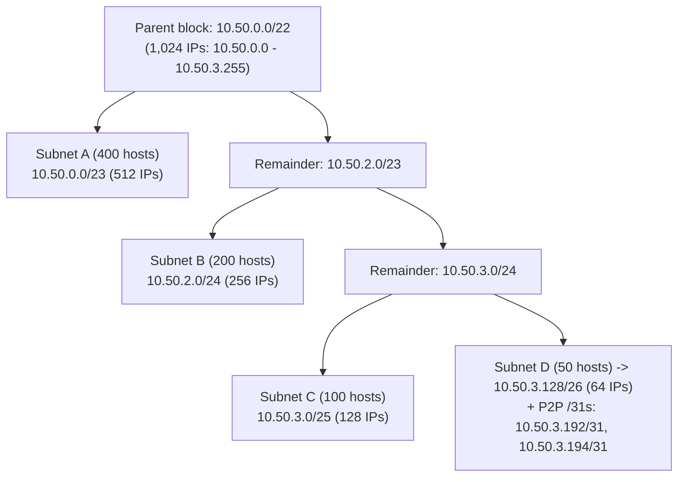

# 2.4 IP addressing, subnetting and CIDR (IPv4 and IPv6), with practice

| | |
|---|---|
| Level | Beginner |
| Priority tier | 0 |
| Lab venue | Any Linux shell with Python 3 (no special hardware) |
| Part | Part 2: Networking, from first principles to AI fabrics |
| Status | Drafted, labs **untested** |

## Why this matters for AI infrastructure

Think about the address plan before any cable goes in. You decide how many subnets each rack gets, how large the Kubernetes pod and service ranges will be, and how the rails are numbered. The rails are the per-GPU back-end networks. You also decide which ranges must never overlap with the corporate network, the VPN or a peered cloud VPC. Finally, you leave room to grow from 64 to 4,096 nodes without renumbering.

A wrong choice shows up months later, and it usually appears as an error message. You might see "pod CIDR overlaps with the on-prem network", "we ran out of IPs in the node subnet", "GKE cluster cannot be created: secondary range too small", or "VPC peering rejected because ranges overlap". Subnetting is also a core interview skill. You are expected to do it on a whiteboard without a calculator. It is equally a daily debugging tool. When a packet goes missing, you ask whether 10.20.37.130 sits inside 10.20.36.0/22, or what the broadcast of 172.16.5.77/27 is.

This chapter teaches IPv4 and IPv6 addressing from the bits up. It covers address structure, masks and CIDR, and fast calculation of network, broadcast and host ranges. Then it moves on to variable-length subnet masks (VLSM), summarisation (aggregation), special-purpose ranges, IPv6 notation and prefix design, the IP header formats, fragmentation and MTU, and address-plan design for AI clusters and clouds. The chapter ends with a large set of practice problems with worked solutions, and a lab that uses Python's `ipaddress` module and `ip`.

## Prerequisites and outcomes

You should know binary and hexadecimal at a basic level. The chapter reviews both, and it assumes the layer model from chapter 2.2.

When you finish this chapter, you should be able to do the following.

- You can convert between decimal, binary and hexadecimal quickly, and between dotted-decimal masks and prefix lengths.
- You can work out the network address, broadcast address, first and last usable host, host count and wildcard mask for any IPv4 prefix by hand, in under a minute.
- You can design a VLSM address plan. You divide a block into subnets of different sizes without overlap, and you summarise several subnets into the fewest prefixes.
- You can recognise the special IPv4 ranges: private, loopback, link-local, CGNAT shared, multicast and documentation. You know why 127.0.0.1, 169.254.x.x and 100.64/10 appear where they do.
- You can read and write IPv6 addresses using the compression rules. You can identify address types by prefix, explain /64 subnets, link-local addresses and how interface IDs are formed, and plan an IPv6 allocation hierarchy.
- You can describe the IPv4 and IPv6 header fields, including TTL and hop limit, protocol and next header, DSCP and ECN, flow label and fragmentation. You can explain fragmentation and path MTU discovery.
- You can configure addresses and routes with `ip`, Netplan and NetworkManager, and verify them.
- You can plan addressing for a GPU cluster with room to grow and no overlaps. The plan covers management, front-end, per-rail back-end, storage, Kubernetes pod and service ranges, and GCP VPC subnets with their secondary ranges.

## 1. Number systems you need

Every IPv4 address is four octets, and an octet is one byte. Before you can subnet, you have to read those bytes in binary. A byte, or octet, is 8 bits, with a value from 0 to 255. Each bit position has a fixed weight, as the table shows.

| Bit position | 7 | 6 | 5 | 4 | 3 | 2 | 1 | 0 |
|---|---|---|---|---|---|---|---|---|
| Weight | 128 | 64 | 32 | 16 | 8 | 4 | 2 | 1 |

To convert 172 to binary, subtract the weights that fit, from largest to smallest. 172 − 128 = 44, so bit 7 is 1. Since 44 is less than 64, bit 6 is 0. Since 44 is not below 32, you subtract it: 44 − 32 = 12, so bit 5 is 1. Since 12 is less than 16, bit 4 is 0. Then 12 − 8 = 4, so bit 3 is 1. Then 4 − 4 = 0, so bit 2 is 1. Bits 1 and 0 are both 0. So 172 = `10101100`.

Going the other way is simpler. Add the weights of the bits that are 1. Some mask octets come up again and again, so memorise them: `0`, `128`, `192`, `224`, `240`, `248`, `252`, `254` and `255`. The non-zero values are runs of 1 to 8 leading ones.

Hexadecimal packs 4 bits into one digit, with digits 0 to 9 and then a to f. So `ac` is 1010 1100, which is 172. IPv6 and MAC addresses are written in hex, so this skill carries over. Try these to check your work: `printf '%d\n' 0xac`, `printf '%x\n' 172`, `echo 'obase=2; 172' | bc`, Python `bin(172)` and `int('10101100', 2)`.

Get comfortable with these conversions before you go on, because every subnet calculation in the next section depends on them.

## 2. IPv4 addresses and masks

Suppose a node reports the address 10.23.2.37, and you need to know which other hosts it can reach directly. The answer depends on the mask as much as on the address. An IPv4 address is 32 bits, written as four decimal octets. This notation is called dotted quad, and an example is `10.23.2.37`. The address identifies an interface, not a host. It has two parts. The network prefix names the subnet, and the host part names the interface inside that subnet. The subnet mask, or prefix length, marks where the split falls. Its 1s cover the network part, and its 0s cover the host part.

```text
Address     10.23.2.37    = 00001010.00010111.00000010.00100101
Mask /24    255.255.255.0 = 11111111.11111111.11111111.00000000
Network     10.23.2.0     = address AND mask = 00001010.00010111.00000010.00000000
Broadcast   10.23.2.255   = network OR (NOT mask) = ...00000010.11111111
Hosts       10.23.2.1 - 10.23.2.254   (2^8 - 2 = 254 usable)
```

Read the block from top to bottom. The AND keeps the bits where the mask is 1, which gives the network address. Notice that only the last octet changes between the network and the broadcast address.

CIDR, or Classless Inter-Domain Routing, dates from 1993. It writes the mask as a count of leading 1 bits after a slash. So `10.23.2.37/24` means the mask 255.255.255.0. The mask must be contiguous 1s followed by 0s. The prefix `10.23.2.0/24` names the whole subnet, which holds every address that shares the first 24 bits. CIDR replaced the older classful scheme, which wasted addresses. Under that scheme, Class A used /8 for 0–127, Class B used /16 for 128–191, and Class C used /24 for 192–223. Class D covers 224–239 and is for multicast. Class E covers 240–255 and is reserved. People still say "a class C" to mean /24, but the class names no longer have a technical meaning.

### The reserved host addresses

In a normal subnet, two host numbers cannot go to a host. The all-zeros host part is the network address, which is the name of the subnet. The all-ones host part is the directed broadcast address. So a subnet with *h* host bits has 2^h − 2 usable addresses.

There are two exceptions to keep in mind. A /31 is a point-to-point link under RFC 3021. It has 2 usable addresses and no network or broadcast address. A /32 is a single host route, which you use for loopbacks and service addresses. Clouds add their own reservations. For example, a cloud may take the first address as the gateway, a second for DNS, and the last as broadcast. GCP reserves the first two and the last two addresses of each primary range. Check your provider's rules before you size a subnet.

### Fast subnetting: the block-size method

The block-size method works for a prefix between /24 and /30, where the split falls inside the last octet. The block size equals 256 minus the mask octet, which is also 2^(32 − p). Subnets start at multiples of the block size. The network address is the largest multiple of the block size that is at or below the host octet. The broadcast address is the next network minus 1.

Take `192.168.10.77/27`. The mask is 255.255.255.224, so the block size is 32. The multiples of 32 are 0, 32, 64, 96, and so on. The host octet 77 falls in the 64 block. So the network is 192.168.10.64, and the broadcast is 192.168.10.95, which is 96 − 1. The usable range is 192.168.10.65 – .94, which gives 30 hosts.

For prefixes that split an earlier octet, from /8 to /23, use the same idea on the octet where the split happens. Keep the earlier octets, and set the later ones to zero. Take `172.20.133.9/21`. The /21 mask is 255.255.248.0, so the split falls in the third octet. The block size there is 256 − 248 = 8. The multiples of 8 near 133 are 128 and 136, so 133 falls in the 128 block. The network is 172.20.128.0, and the next network starts at 172.20.136.0. The broadcast is 172.20.135.255. The usable range is 172.20.128.1 – 172.20.135.254, which gives 2^11 − 2 = 2,046 hosts.

### Reference table

Use this table as a lookup. It lists the common prefixes, their masks, and how many addresses each one holds. Each extra bit in the prefix halves the number of addresses.

| Prefix | Mask | Addresses | Usable hosts | Typical use |
|---|---|---|---|---|
| /8 | 255.0.0.0 | 16,777,216 | 16,777,214 | Large private block (10/8) |
| /12 | 255.240.0.0 | 1,048,576 | 1,048,574 | 172.16/12 private |
| /16 | 255.255.0.0 | 65,536 | 65,534 | VPC, large site, pod range |
| /20 | 255.255.240.0 | 4,096 | 4,094 | Large subnet, GKE node subnet |
| /21 | 255.255.248.0 | 2,048 | 2,046 | |
| /22 | 255.255.252.0 | 1,024 | 1,022 | |
| /23 | 255.255.254.0 | 512 | 510 | |
| /24 | 255.255.255.0 | 256 | 254 | Classic LAN/rack subnet |
| /25 | 255.255.255.128 | 128 | 126 | |
| /26 | 255.255.255.192 | 64 | 62 | |
| /27 | 255.255.255.224 | 32 | 30 | |
| /28 | 255.255.255.240 | 16 | 14 | |
| /29 | 255.255.255.248 | 8 | 6 | Small server group |
| /30 | 255.255.255.252 | 4 | 2 | Legacy point-to-point |
| /31 | 255.255.255.254 | 2 | 2 (RFC 3021) | Point-to-point |
| /32 | 255.255.255.255 | 1 | 1 | Loopback / host route |

The wildcard mask is the inverse of the subnet mask. You meet it in OSPF `network` statements and in some ACLs. The inverse of /24 is 0.0.0.255, and the inverse of /27 is 0.0.0.31.

### Same subnet or not?

Two addresses share a subnet when `(A AND mask) == (B AND mask)`. Here is a check you can run in your head. Take `10.20.37.130` and the prefix `10.20.36.0/22`. The mask's third octet is 252, so the block size is 4. The network covers third-octet values 36 to 39, which means 10.20.36.0 to 10.20.39.255. The third octet 37 falls inside that range, so the address is in the subnet. The address `10.20.40.1` has third octet 40, which is outside it.

Every host runs this check for every packet. It decides whether to send the packet directly, using ARP, or to the gateway. Chapter 2.3/2.5 covers the details. Use this test whenever you are unsure whether two hosts can talk directly.

## 3. VLSM, supernetting and summarisation

Suppose one block has to serve several groups of different sizes. VLSM, or variable-length subnet masks, lets you match each subnet to its need. A large group gets a large subnet, and a small group gets a small one. Follow four rules. Allocate the largest subnets first. Align each subnet at a multiple of its block size. Never let two subnets overlap. Keep contiguous free space for growth.

The diagram shows how each split leaves a remainder for the next subnet.



Now divide `10.50.0.0/22`, which holds 1,024 addresses from 10.50.0.0 to 10.50.3.255. You need subnets for five needs: A with 400 hosts, B with 200, C with 100, D with 50, and E with two point-to-point links. For each group, find the smallest block that holds its hosts.

- A needs 400 hosts, which means 512 addresses, so the prefix is /23: `10.50.0.0/23`, covering 10.50.0.0 – 10.50.1.255.
- B needs 200 hosts, which means 256 addresses, so the prefix is /24: `10.50.2.0/24`.
- C needs 100 hosts, which means 128 addresses, so the prefix is /25: `10.50.3.0/25`, covering 10.50.3.0 – .127.
- D needs 50 hosts, which means 64 addresses, so the prefix is /26: `10.50.3.128/26`, covering .128 – .191.
- E needs two point-to-point links, so use two /31s: `10.50.3.192/31` and `10.50.3.194/31`. You could use /30s instead. Either way, the range `10.50.3.196 – .255` stays free for growth.

Summarisation runs the same process in reverse. It replaces several contiguous, properly aligned prefixes with one shorter prefix. Take `192.168.4.0/24`, `192.168.5.0/24`, `192.168.6.0/24` and `192.168.7.0/24`. Their third-octet values 4 to 7 form a block of four that starts at a multiple of four. So they collapse into `192.168.4.0/22`.

Now try the pair `192.168.5.0/24` and `192.168.6.0/24`. They cannot become one /23, because 5 is not a multiple of 2. A /23 would have to be 192.168.4.0/23 or 192.168.6.0/23. To find a summary yourself, write the third octets in binary, count the leading bits they share, and add the bits from the earlier octets.

Summarisation shrinks routing tables and hides churn. It is the reason address plans are hierarchical. A region gets a /12, a site gets a /16, and a rack gets a /24. A badly planned, fragmented numbering scheme cannot be summarised, so it costs forwarding-table entries and creates operational pain. BGP in data centres relies on rack and pod prefixes that aggregate cleanly, as chapter 2.16 explains. The opposite rule, longest-prefix match, makes the more specific route win. Chapter 2.5 covers it.

Try these commands on a machine that has the tools installed. The `ipcalc` and `sipcalc` lines report the same ranges that you worked out above. The Python block uses the standard `ipaddress` module to repeat several of these checks.

```bash
ipcalc 10.50.0.0/22                    # (package ipcalc/sipcalc) network, broadcast, ranges, wildcard
sipcalc 10.50.3.128/26
python3 - <<'EOF'
import ipaddress as ip
n = ip.ip_network("10.50.0.0/22")
print(list(n.subnets(new_prefix=24)))                       # split
print(list(ip.collapse_addresses([ip.ip_network(f"192.168.{i}.0/24") for i in range(4,8)])))   # summarise
a = ip.ip_interface("172.20.133.9/21"); print(a.network, a.network.broadcast_address, a.network.num_addresses - 2)
print(ip.ip_address("10.20.37.130") in ip.ip_network("10.20.36.0/22"))
print(ip.ip_network("10.0.0.0/8").address_exclude(ip.ip_network("10.1.0.0/16")).__next__())
EOF
```

When you design a plan, number the racks and pods so that each level can be summarised with one prefix.

## 4. Special-purpose IPv4 ranges

Some IPv4 ranges have fixed meanings, and you should recognise them on sight. The table lists each range with its meaning and the notes you need to use it correctly.

| Range | Meaning | Notes |
|---|---|---|
| `0.0.0.0/8` | "This network"; `0.0.0.0` = unspecified/any | `0.0.0.0` as a listen address = all interfaces; as a route = default |
| `10.0.0.0/8`, `172.16.0.0/12`, `192.168.0.0/16` | **Private (RFC 1918)** | Not routable on the public Internet; reused by everyone, so overlaps are common |
| `100.64.0.0/10` | **Shared address space / CGNAT (RFC 6598)** | Used by ISPs and by some clouds and Kubernetes designs to avoid RFC 1918 clashes (e.g. GKE can use 100.64/10-like ranges) |
| `127.0.0.0/8` | **Loopback** | Entire /8 is the host itself; `127.0.0.1` conventionally; systemd-resolved stub on `127.0.0.53` |
| `169.254.0.0/16` | **Link-local (APIPA)** | Self-assigned when DHCP fails; cloud metadata server `169.254.169.254` |
| `192.0.0.0/24`, `192.0.2.0/24`, `198.51.100.0/24`, `203.0.113.0/24` | Documentation (TEST-NET) | Use in examples; never on real networks |
| `198.18.0.0/15` | Benchmarking | Used in test labs |
| `224.0.0.0/4` | **Multicast** | `224.0.0.1` all hosts, `224.0.0.5/6` OSPF, `224.0.0.18` VRRP, `239/8` administratively scoped |
| `240.0.0.0/4` | Reserved (Class E) | `255.255.255.255` = limited broadcast |

Private ranges are the working vocabulary of cluster design. Use RFC 1918 space for nodes and fabrics. Never let ranges overlap if they might ever be connected. That covers on-premises networks, VPNs, cloud VPCs and peerings, Kubernetes pod and service CIDRs, container bridge defaults and lab ranges. Docker, for example, uses 172.17.0.0/16 by default, and that can clash with corporate use of 172.16/12. Keep a central address registry, which is called IPAM. Tools such as NetBox, phpIPAM, Infoblox and cloud IPAM do this job.

Check every new range against your VPN and peering plans before you assign it.

## 5. NAT, briefly (more in chapter 2.9)

IPv4 space ran out, so most private networks share public addresses. Private addressing combines with NAT or PAT. Many hosts then share one public address. The device rewrites addresses and ports, using a stateful translation table. Chapter 2.9 covers NAT in more depth.

Four consequences matter when you plan addresses. Private ranges can be reused by separate organisations, so you only need to avoid collisions where you connect them. Applications that embed IP addresses in their payloads, peer-to-peer connections and inbound connectivity need extra mechanisms. NAT hides internal addressing from outsiders, but it is not a security control. Cluster-internal traffic, such as pod-to-pod or GPU-to-GPU fabric traffic, should normally not be NATed.

Keep the cluster fabric addressed so that its traffic is never translated.

## 6. IPv6

### Why and what

IPv6 was designed in the 1990s to replace IPv4. It uses 128-bit addresses, which gives 3.4 × 10³⁸ of them. The header is simpler, and in-network fragmentation is gone. Neighbor Discovery and multicast replace ARP and broadcast, as chapter 2.3 explains. Autoconfiguration (SLAAC) is built in. End-to-end addressing returns, so NAT becomes unnecessary.

Most deployments run dual-stack, with IPv4 and IPv6 side by side. Applications choose between them, and Happy Eyeballs describes how. Many public clouds, CDNs and ISPs offer IPv6. AI clusters mostly run IPv4 internally today. IPv6 is becoming a requirement anyway, for three reasons. Large Kubernetes clusters can run out of IPv4 pod space. Public-sector mandates exist. Some back-ends are IPv6-only.

### Notation

Write an IPv6 address as eight groups of 16 bits, called hextets. Each group is written as four hex digits, and the groups are separated by colons: `2001:0db8:0a0b:12f0:0000:0000:0000:8b6e`. Two compression rules make it shorter. First, drop the leading zeros in each group, so `0db8` becomes `db8`. Second, replace one longest run of all-zero groups with `::`. You can use `::` only once per address. The example becomes `2001:db8:a0b:12f0::8b6e`.

Prefixes use CIDR style, as in `2001:db8:a0b:12f0::/64`. In a URL, wrap a literal address in brackets, as in `http://[2001:db8::10]:8080/`. Colons would otherwise be read as the port separator. A link-local address needs an interface scope, written as `fe80::1%eth0`. To see the full form of an address, run `python3 -c "import ipaddress as i; print(i.ip_address('2001:db8::1').exploded)"`.

### Address types

The table lists the prefixes you will meet most often. The first few digits tell you the address type, so learn to read them.

| Prefix | Type | Notes |
|---|---|---|
| `::/128` | Unspecified | Source before an address exists (DAD) |
| `::1/128` | Loopback | |
| `::ffff:0:0/96` | IPv4-mapped | `::ffff:192.0.2.1`: dual-stack sockets present IPv4 clients this way |
| `64:ff9b::/96` | NAT64 well-known prefix | IPv6-only clients reaching IPv4 servers via NAT64/DNS64 |
| `2000::/3` | **Global unicast** (publicly routable); begins with 2 or 3 | Allocated by RIRs: e.g. `2001:db8::/32` is documentation |
| `fc00::/7` (in practice `fd00::/8`) | **Unique local addresses (ULA)** | Private, like RFC 1918; generate a random 40-bit Global ID (`fdXX:XXXX:XXXX::/48`) |
| `fe80::/10` | **Link-local** | Automatic on every interface; valid only on the link; used for NDP, routing protocol adjacencies and default gateway next hops |
| `ff00::/8` | **Multicast** | `ff02::1` all nodes (link), `ff02::2` all routers, `ff02::1:ffXX:XXXX` solicited-node, `ff02::5/6` OSPFv3, `ff02::1:2` DHCPv6 |
| `2001:db8::/32` | Documentation | Use in examples |

There is **no broadcast** in IPv6. Multicast does that job instead.

### Global and link-local addresses

Every IPv6 host normally has at least two addresses. The global unicast address works across the internet. Its prefix is `2000::/3`. The first byte begins with the bits 001, so that byte is either 0010 or 0011. A global unicast address therefore always starts with 2 or 3.

The second is the link-local address, which only works on the local network. Link-local addresses always use the `fe80::/10` prefix. After that come an all-zero 54-bit network ID and a 64-bit interface ID. So every link-local address on your machine sits in the `fe80::/64` subnet.

When `ip -6 address show` labels an address `scope link`, it is link-local. A label of `scope global` marks the internet-facing address.

### Structure and the /64 convention

A global unicast address usually has three parts: a routing prefix, a subnet ID and a 64-bit interface ID. The block below shows that split for one example.

```text
|<------------- 48 bits site prefix ------------>|<- 16 bits subnet ID ->|<--------- 64 bits interface ID --------->|
 2001:0db8:0a0b                                    12f0                   0000:0000:0000:8b6e
```

The 48-bit site prefix and the 16-bit subnet ID together fill the first 64 bits. Almost every subnet is a /64. SLAAC, Neighbor Discovery and many other features assume a 64-bit interface ID, and the address space is so large that saving addresses here is unnecessary. There are two exceptions. A /127 suits point-to-point router links under RFC 6164, and a /128 suits loopbacks.

Providers hand out prefixes in layers. An ISP or cloud gives a /32 to a provider network. A site or customer gets a /48, which holds 65,536 /64 subnets. A home sometimes gets a /56, which holds 256 /64s. Inside your allocation, divide on hex nibble boundaries, such as /52, /56, /60 and /64. Those boundaries keep the prefixes readable and let them aggregate cleanly.

Here is one plan built on a /48. The cluster gets `2001:db8:100::/48`. Management takes `2001:db8:100:1::/64`. The 16 rail subnets fit in `2001:db8:100:10::/60`, which runs from `...:10::/64` through `...:1f::/64`. Per-rack /64s sit in `2001:db8:100:100::/56`.

The interface ID can come from several sources. You can set it by hand, as `::1` or `::10`. EUI-64 builds it from the MAC address. You flip the U/L bit and insert `ff:fe` in the middle. For MAC `52:54:00:12:34:56`, the first octet 0x52 is 01010010. Flipping bit 1, which has the value 0x02, gives 01010000, which is 0x50. So the interface ID is `5054:00ff:fe12:3456`. Stable privacy addresses, defined in RFC 7217, are hash-based and stay constant for each network. That is the common Linux default. Temporary privacy addresses, under RFC 4941, rotate for outgoing connections. DHCPv6 is the remaining option.

### Configuration and inspection

Use these commands to see and change IPv6 on a host.

```bash
ip -6 addr show ; ip -6 route show ; ip -6 neigh show
sudo ip -6 addr add 2001:db8:100:1::10/64 dev eth0
sudo ip -6 route add default via fe80::1 dev eth0         # next hop = router's link-local address (needs dev)
sysctl net.ipv6.conf.all.disable_ipv6 net.ipv6.conf.eth0.accept_ra
ping -6 -c3 2001:db8:100:1::1 ; ping -6 -c3 fe80::1%eth0
```

The `ip -6` commands show addresses, routes and neighbours. A default route that uses a link-local next hop needs `dev`, because a link-local address means nothing without its interface. The `sysctl` line checks the kernel settings, and the two `ping -6` commands test a global address and a link-local address.

Three shortcuts are handy. `::1` is the loopback address. Pinging `ff02::1%eth0` reaches every node on the link, which reveals your neighbours. And `getent ahostsv6 name` checks how a name resolves over IPv6.

On a dual-stack host, check the /64 and the link-local address before you blame the application.

### Running IPv4 and IPv6 side by side

Many hosts run both protocols at once. People call this a dual-stack network. The word "stack" is a little loose here, because only the network layer is duplicated. Still, IPv4 and IPv6 are independent and can run at the same time.

The application decides which one to use. A web browser, for example, chooses IPv4 or IPv6 when it connects. An older application written only for IPv4 has no IPv6 support by default. The good news is that the layers above the network layer stay the same, so the code needed to add IPv6 is small. Most important applications and servers support it now.

Check both families on Linux with `ip -4 address show` and `ip -6 address show`.

## 7. The IP headers

Every packet starts with a header, and the header fields tell the routers what to do with it. Here is the IPv4 header first.

### IPv4 header (20 bytes minimum)

```text
 0                   1                   2                   3
 0 1 2 3 4 5 6 7 8 9 0 1 2 3 4 5 6 7 8 9 0 1 2 3 4 5 6 7 8 9 0 1
+-+-+-+-+-+-+-+-+-+-+-+-+-+-+-+-+-+-+-+-+-+-+-+-+-+-+-+-+-+-+-+-+
|Version|  IHL  |    DSCP   |ECN|         Total Length          |
+-------+-------+-----------+---+-----+-------------------------+
|        Identification         |Flags|     Fragment Offset     |
+---------------+---------------+-----+-------------------------+
|      TTL      |   Protocol    |        Header Checksum          |
+---------------+---------------+---------------------------------+
|                       Source Address                            |
+-----------------------------------------------------------------+
|                    Destination Address                          |
+-----------------------------------------------------------------+
|                    Options (rare) ...                           |
```

The Version field is 4. IHL gives the header length in 32-bit words, so 5 means 20 bytes. DSCP is a 6-bit quality-of-service code point. ECN is a 2-bit field for explicit congestion notification: 00 means not-ECT, 01 or 10 means ECT, and 11 means CE. Total Length can reach 65,535 bytes.

Identification, Flags and Fragment Offset handle fragmentation. The Flags hold DF, which means Don't Fragment, and MF, which means More Fragments. The TTL drops by one at each router. When it reaches 0, the router drops the packet and sends ICMP Time Exceeded. Protocol names the payload that follows, such as 6 for TCP, 17 for UDP, 1 for ICMP, 47 for GRE, 50 for ESP and 89 for OSPF, among others. The header checksum must be recomputed at every hop, because the TTL changes at every hop. The header ends with the source and destination addresses.

### IPv6 header (40 bytes, fixed)

```text
 Version(4) | Traffic Class(8 = DSCP6 + ECN2) | Flow Label(20)
 Payload Length(16) | Next Header(8) | Hop Limit(8)
 Source Address (128)
 Destination Address (128)
 [extension headers chained via Next Header: hop-by-hop, routing, fragment, destination options, AH, ESP]
```

The IPv6 header is a fixed 40 bytes. It has no checksum, because the link and transport layers cover errors. Its base header has no fragmentation fields. Fragmentation uses an extension header, and only the source host may do it. The Traffic Class byte holds DSCP and ECN, as the IPv4 byte does. The 20-bit flow label helps routers keep a flow on one path when ECMP spreads traffic. A fixed header keeps hardware parsing simple, and extension headers keep the design flexible. The hop limit plays the role of the TTL.

### Fragmentation and path MTU

Every link has a maximum transmission unit, or MTU, which is the largest packet it can carry. If a packet is larger than the next link's MTU, an IPv4 router may fragment it, unless DF is set. Fragments are reassembled only at the destination. Each fragment carries an ID, an offset in 8-byte units and the MF flag. Fragmentation is expensive and fragile. Lose one fragment and you lose the whole packet. Firewalls and middleboxes often drop fragments, and some hardware paths send fragments to the CPU.

In modern practice, TCP sets DF and uses Path MTU Discovery, or PMTUD. A router that cannot forward a too-big DF packet drops it. It then sends ICMP Destination Unreachable, Fragmentation Needed, which is type 3, code 4, and that message carries the next-hop MTU. In IPv6 the equivalent is ICMPv6 Packet Too Big, type 2. The sender lowers its path MTU to match. If those ICMP messages are blocked, large transfers stall. That failure is called a PMTU black hole.

You have four ways to fix a black hole. Allow the required ICMP messages. Clamp the TCP MSS on tunnels with `iptables -t mangle -A FORWARD -p tcp --tcp-flags SYN,RST SYN -j TCPMSS --clamp-mss-to-pmtu`. Use a consistent MTU across the path. Enable PLPMTUD through `net.ipv4.tcp_mtu_probing`. In IPv6, only the source may fragment, and routers never do.

Use these commands to test the path. Each ping size is the payload, so the headers must be added to reach 1500 bytes.

```bash
ping -M do -s 1472 -c 2 target          # IPv4: 1472 + 8 (ICMP) + 20 (IP) = 1500; do = set DF
ping -6 -M do -s 1452 -c 2 target6      # IPv6: 1452 + 8 + 40 = 1500
tracepath target ; tracepath -6 target6  # discovers path MTU hop by hop
ip route get target ; ip link show | grep mtu ; ss -ti dst target | grep -o 'mss:[0-9]*\|pmtu:[0-9]*'
```

The IPv4 test sends 1472 bytes of payload. Add 8 for the ICMP header and 20 for the IPv4 header, and you reach 1500. The IPv6 test sends 1452 bytes, which plus 8 for ICMP and 40 for the IPv6 header also gives 1500. Run `tracepath` when you need the path MTU discovered hop by hop.

## 8. Configuring addresses on Linux

Linux address changes come in two kinds. Runtime changes apply now, but they are lost on reboot. Persistent changes live in configuration files.

```bash
# Manual, runtime-only (lost on reboot):
sudo ip addr add 10.23.2.4/24 dev ens4
sudo ip link set ens4 up
sudo ip route add default via 10.23.2.1 dev ens4
sudo ip addr del 10.23.2.4/24 dev ens4
ip -br addr ; ip -4 addr show dev ens4 ; ip addr show dev ens4 scope global
# Multiple addresses on an interface (secondary), labels:
sudo ip addr add 10.23.2.5/24 dev ens4 label ens4:vip
# Persistent: Netplan (Ubuntu), NetworkManager (nmcli), systemd-networkd, or distribution files
```

The first block adds an address, brings the interface up and sets the default route. The `del` line removes the address again. If you need a second address on the same interface, give it a label such as `ens4:vip`.

If you run Ubuntu, Netplan reads YAML files. The example below sets two addresses, a default route, a DNS server and an MTU of 9000.

```yaml
# /etc/netplan/60-fabric.yaml   (apply: sudo netplan try; sudo netplan apply)
network:
  version: 2
  ethernets:
    ens4:
      dhcp4: false
      addresses: [10.23.2.4/24, "2001:db8:100:1::4/64"]
      routes:
        - to: default
          via: 10.23.2.1
      nameservers: {addresses: [10.23.0.2]}
      mtu: 9000
```

Apply it with `sudo netplan try` and then `sudo netplan apply`. Other systems use NetworkManager, systemd-networkd or distribution files.

```bash
nmcli device status ; nmcli connection show
sudo nmcli connection modify "Wired connection 1" ipv4.addresses 10.23.2.4/24 ipv4.gateway 10.23.2.1 ipv4.method manual
sudo nmcli connection up "Wired connection 1"
```

The `modify` command sets the address, gateway and manual method, and `up` applies them.

Check three things after any change. The subnets must not overlap on the host, because overlapping prefixes on two interfaces lead to ambiguous routing. The mask must match the network's, since a /16 on a /24 network makes the host ARP for off-link addresses. Only one DHCP server should answer per subnet. Addresses on different interfaces can coexist, and the kernel picks the interface by longest prefix match, then by metric, as chapter 2.5 explains.

## 9. Address planning for AI clusters and clouds

A 1,024-GPU cluster needs its address plan settled before the first cable goes in. Every plan should be hierarchical, aligned and summarisable. It should not overlap with anything you may connect to. It needs room to grow ×4, it should be documented in IPAM, and each range should serve one purpose.

### A worked cluster plan (illustrative)

Take a 1,024-GPU cluster. It has 128 nodes with 8 GPUs each, so 128 × 8 = 1,024 GPUs. Each node has 8 back-end NICs, one per GPU, plus 2 front-end NICs and 1 BMC. Lay out the ranges in the `10.0.0.0/8` space.

| Purpose | Range | Sizing logic |
|---|---|---|
| Out-of-band (BMC/IPMI/Redfish, switch management) | `10.10.0.0/20` | 4,094 addresses, covers nodes + switches + PDUs with growth |
| In-band management / front-end (SSH, Slurm, Kubernetes node IPs) | `10.20.0.0/20` | One /20, or per-rack /24s summarised as /20 |
| Storage network (parallel FS, NFS) | `10.30.0.0/20` | |
| Back-end compute fabric, rail *r* (r = 0..7) | `10.100.r.0/21`... or `10.(100+r).0.0/22` | One subnet per rail (one NIC per GPU index per node) so each rail is its own L3 domain or VLAN; per-rack /26 or /27 slices within the rail range |
| Kubernetes pod CIDR (cluster) | `10.64.0.0/14` (262,144 IPs) with `/24` per node (254 pods per node) | Pod ranges consume a lot; plan max nodes × pods per node |
| Kubernetes service CIDR | `10.96.0.0/16` | 65,534 services; cannot overlap anything routed |
| Loopbacks for BGP routers/servers | `10.255.0.0/24` /32s | One /32 per router/leaf/spine |
| Point-to-point links (leaf-spine) | `10.250.0.0/16` /31s | Each link a /31 (or unnumbered BGP) |

Each row serves one purpose, and the sizing column says why that size was chosen. Before you finalise a range, run the calculations below against it. Multiply the nodes by the NICs per node, then by a growth factor. Count the hosts in each subnet, including gateway and virtual IPs and any addresses the cloud reserves. For Kubernetes, use `max_nodes × (pods_per_node rounded up to the per-node CIDR size)`.

The per-node pod CIDR depends on how many pods each node runs. The kubelet default of `maxPods=110` needs a 256-address block, which is a `/24`. A `/25` is enough for fewer pods. Take 500 nodes at a `/24` each. That is 500 × 256 = 128,000 addresses. The smallest block that holds it is a `/15`, which has 131,072 addresses.

GKE VPC-native clusters take their pod and service ranges from secondary ranges on the subnet. Nodes use the primary range. The default limit of 110 pods per node maps to a `/24` pod range for each node. Pod ranges cannot be shrunk later, so size them carefully. Also check which ranges are supported, including non-RFC 1918 space and 100.64/10. Overlapping ranges block VPC peering and VPN or Interconnect routing. With several clusters, give each one its own pod and service ranges. Alternatively, use IPv6 or dual-stack to relieve the pressure.

### Rail-optimised and L3-to-the-host numbering

Back-end fabrics often give each host-to-leaf link its own /31 or /24. Each link can be routed to the host, use BGP unnumbered, or sit in a per-rail subnet with host routes. Each server connects its NIC with the same number to the same leaf. A group of such NICs is called a rail. That arrangement keeps all-reduce on rail *k* inside one leaf tier.

Consistent numbering makes troubleshooting easy. An address such as `10.100.<rail>.<node>` tells you the rail and node, and the NIC too, without a database lookup. Chapter 2.18 covers topology, and chapter 2.16 covers BGP numbering and unnumbered interfaces.

### GCP/VPC notes

VPC networks are global, and subnets are regional. In custom-mode subnets, you choose the ranges yourself. Firewall rules and routes are set at the VPC level. RFC 1918 and some other ranges are allowed, and each subnet reserves some addresses. You also get internal IP assignment, Private Google Access, alias IP ranges and secondary ranges for containers. VPC peering requires non-overlapping ranges, and Shared VPC serves multi-project setups. Chapter 2.32 has the details.

Write down every range that a GCP subnet must not overlap before you create the subnet.

## 10. Practice problems (with answers)

Work these by hand first, and then check your answers with `ipcalc` or Python. If you get a result that differs from the answer, recheck the block size before anything else.

1. Convert 203.0.113.77 to binary. **A:** `11001011.00000000.01110001.01001101`.
2. Convert 10101100.00010000.00000001.00000101 to dotted decimal. **A:** 172.16.1.5.
3. What prefix length does the mask 255.255.240.0 give? **A:** /20 (8+8+4).
4. What is the mask for /27? **A:** 255.255.255.224.
5. For `192.168.10.77/27`, find the network, broadcast, usable range and host count. **A:** 192.168.10.64 / .95 / .65–.94 / 30.
6. For `172.20.133.9/21`, find the network, broadcast and host count. **A:** 172.20.128.0 / 172.20.135.255 / 2,046.
7. Find the network and broadcast of `10.1.200.15/18`. **A:** Mask 255.255.192.0 (third octet block 64): 200 in 192–255 → network 10.1.192.0, broadcast 10.1.255.255.
8. Are `10.20.37.130` and `10.20.40.5` in the same /22? **A:** 37 is in 36–39, 40 is in 40–43: different subnets.
9. How many /26 subnets fit in a /22, and how many hosts would you get in each one? **A:** 16 subnets, 62 hosts each.
10. What is the smallest prefix that holds 500 hosts? **A:** /23 (510 usable).
11. Give the broadcast address of 192.168.1.130/25. **A:** Block 128: network .128, broadcast 192.168.1.255.
12. A /29 has how many usable addresses? What are the network and broadcast addresses for 10.0.0.37/29? **A:** 6 usable; network 10.0.0.32, broadcast 10.0.0.39.
13. Summarise 172.16.8.0/24 through 172.16.15.0/24. **A:** Third octets 8–15 = 8 blocks aligned on 8 → 172.16.8.0/21.
14. Can 10.0.2.0/24, 10.0.3.0/24 and 10.0.4.0/24 be summarised into one prefix? **A:** Not exactly: 2–3 form 10.0.2.0/23; 4 is separate; the single covering prefix 10.0.0.0/21 would also include 10.0.0.0, 10.0.1.0, 10.0.5–7 (over-summarisation).
15. Split 192.168.0.0/24 into four equal subnets. **A:** .0/26, .64/26, .128/26, .192/26.
16. Using VLSM, allocate from 10.9.0.0/24 a subnet for 100 hosts, one for 50, one for 25, and two point-to-point links. **A:** /25 → 10.9.0.0/25; /26 → 10.9.0.128/26; /27 → 10.9.0.192/27; two /31 → 10.9.0.224/31, 10.9.0.226/31; free 10.9.0.228 – .255.
17. Identify 169.254.12.9, 100.64.3.4, 192.0.2.8, 224.0.0.5 and 127.0.1.1. **A:** Link-local, CGNAT shared space, documentation, OSPF multicast, loopback.
18. Compress `2001:0db8:0000:0000:0000:ff00:0042:8329`. **A:** `2001:db8::ff00:42:8329`.
19. Expand `fe80::1`. **A:** `fe80:0000:0000:0000:0000:0000:0000:0001`.
20. How many /64 subnets could you fit in a /48? In a /56? **A:** 65,536; 256.
21. What type is fd12:3456:789a::10? **A:** ULA (fd00::/8).
22. Form the link-local address for MAC 00:1a:2b:3c:4d:5e using EUI-64. **A:** Flip the U/L bit so that 00 becomes 02, then insert ff:fe → `fe80::21a:2bff:fe3c:4d5e`.
23. Is 2001:db8:100:1::10 inside 2001:db8:100::/48? Is it inside 2001:db8:100:2::/64? **A:** Yes; no.
24. What is the TCP MSS with IPv6 at MTU 1500? **A:** 1500 − 40 − 20 = 1440.
25. A Kubernetes cluster must support 500 nodes with 110 pods each. Size the pod CIDR. **A:** /24 per node → 500 × 256 = 128,000 addresses → /15 (131,072); round to /15 or /14 for growth.
26. Why can't one host carry 10.0.0.5/24 and 10.0.0.9/24 on two interfaces attached to different physical networks? **A:** Overlapping connected prefixes make routing ambiguous (the kernel picks by metric/order); use distinct subnets or policy routing.
27. A host has 192.168.1.50/24, but its gateway is configured as 192.168.0.1. What happens? **A:** The gateway is not on-link (not in the connected subnet), so the route cannot be installed ("Nexthop has invalid gateway") or the host will fail to ARP.
28. What happens if a host is given 10.0.0.10/16 on a network whose real mask is /24? **A:** It believes 10.0.1.x is on-link and ARPs for it (no answer): off-link destinations in that /16 fail; also the host may answer ARP for the wrong range.

## 11. Hands-on lab: subnetting, VLSM, IPv6, and cluster IP plans

Start with the self-checking Python lab in `code/part02/ip_subnetting_cidr_lab.py`. It checks block-size subnetting for `192.168.10.77/27` and `172.20.133.9/21`, and the RFC 3021 `/31` case. It also checks largest-first VLSM allocation on `10.50.0.0/22`, and route summarization with `collapse_addresses` on aligned and unaligned `/24`s. Finally, it checks Kubernetes Pod CIDR sizing, which gives `/15` for 500 nodes and `/14` for 1,024 nodes. Run it locally with this command.

```bash
python3 code/part02/ip_subnetting_cidr_lab.py
```

The rest of the lab runs on any Linux host or VM. All the interactive commands below are `untested here`, so treat each one as a step to verify. Work through the eight steps in order.

1. Calculate by hand, then check with a tool. Pick 10 random address and prefix pairs, using `python3 -c 'import random...'` or a worksheet. Work out the network, broadcast, range and host count on paper. Verify each one with `ipcalc` and `ipaddress`. Aim for under 60 seconds per pair.
2. Build a VLSM planner. Write a Python script that takes a parent block and a list of required host counts. It should allocate subnets largest first, keep each one aligned, and print a table. Test it with the example in section 3. Then check that no subnets overlap, using `ipaddress` `overlaps()`.
3. Summarise. Use `ipaddress.collapse_addresses` on contiguous sets and on non-contiguous sets. For a start and end pair, use `ipaddress.summarize_address_range` to find the minimal covering prefix. Then explain over-summarisation in your own words.
4. Look at your own host. Run `ip -br addr`, `ip route`, `ip -6 addr` and `ip -6 route`. Work out each interface's network and broadcast. Identify the link-local, ULA, global and loopback addresses. Then run `ip route get` for one target inside your subnet and one outside it.
5. Practise IPv6. Generate a ULA /48 with `python3 -c "import os,ipaddress; r=os.urandom(5); print('fd%02x:%02x%02x:%02x%02x::/48'%(r[0],r[1],r[2],r[3],r[4]))"`. Assign a /64 to each of two namespaces joined by a bridge, as the chapter 2.3 lab shows. Ping across it with `ping -6`, and watch the NS and NA messages and the link-local addresses. Derive the EUI-64 address by hand, then compare it with `ip -6 addr`. The `addr_gen_mode` setting may use stable privacy, so set `net.ipv6.conf.<if>.addr_gen_mode=0` to see EUI-64.
6. Test MTU and fragmentation. Send `ping -s 1472/1473 -M do`. Capture the traffic with `tcpdump -nn -v`, once with `-M do` and once without it. Repeat with a smaller MTU on an intermediate namespace link. Look at the fragment offsets and flags, find the ICMP "frag needed" message, and confirm that PMTUD updates the `mtu` field in `ip route get`.
7. Plan a cluster. For a 256-node, 8-rail cluster in GCP-like terms, draw up an address plan. Use regional subnets, secondary ranges for GKE pods and services, and peering to an on-prem `10.0.0.0/12`. The plan must not overlap, must leave room to grow 4×, and must summarise per rail and per site. Write it in NetBox or YAML form.
8. Catch the overlap. Write a checker that reads a CSV of prefixes with their owners. It should report overlaps and allocations that are not aligned.

Work the first two steps on paper before you touch a real host.

## 12. Common mistakes

The first group of mistakes is about counting. Forgetting to subtract the network and broadcast addresses leaves you short, and so does forgetting the cloud's reserved addresses. Mixing up block-size arithmetic in a non-last octet, or failing to align subnets to block boundaries, gives you ranges that do not fit the plan.

Summaries go wrong in two ways. Over-summarising covers addresses you do not own, and under-summarising leaves unaggregatable fragments. Overlaps cause the other big problems, especially where VPN, peering, Kubernetes and Docker defaults meet. Sizing Kubernetes pod ranges from node count alone is another trap, because it forgets the per-node pod CIDRs.

The last group is about links and IPv6. Using /30 where /31 would do is a common slip, and so is mismatching masks at the two ends of a link. Treating a /64 as wasteful and subnetting it smaller breaks SLAAC. Giving hosts addresses from the wrong scope is another mistake. In route commands, IPv6 link-local next hops need `dev` or a scope. Assuming NAT will fix overlaps is wrong unless you understand what breaks. Finally, do not assume that 100.64/10 or link-local addresses are routable across your WAN.

## 13. Interview angles

Interviewers return to the same ideas, so practise each of these on paper before you read an answer. The first two questions test arithmetic, and the rest test whether you can explain a design. Each item below pairs a question with its short answer.

- "Subnet 10.0.0.0/16 into 100 subnets of equal size; give a few subnets and host counts." A /23 gives 128 subnets with 510 hosts each.
- "What is the broadcast address of 172.16.5.77/27? Is 172.16.5.100 in the same subnet?" The broadcast is 172.16.5.95, and the answer is no, because 172.16.5.100 sits in the 96–127 block.
- "How would you design the IP plan for a new 512-node GPU cluster with 8 rails and Kubernetes? What do you reserve for growth?"
- "Why is the pod CIDR hard to change later? How do you avoid overlaps with on-prem and with VPC peering?"
- "How many addresses are in a /64? Why not subnet below /64?"
- "What is a link-local address, and why does the default gateway use it in IPv6?"
- "Explain CIDR and summarisation. Why does the Internet need them?"
- "What is path MTU discovery, and what happens when ICMP is blocked?"
- "Why use /31 on point-to-point links? What about unnumbered interfaces?"

## Exercises

Work through them in order. Each exercise names the function to use from the chapter's code, so you can check the hand calculations you make against it.

1. Compute the block-size results for the `/27`, `/21` and `/18` prefixes, using `192.168.10.77/27`, `172.20.133.9/21` and `10.1.200.15/18`. Do the work by hand first, then check it with `analyze_ipv4_cidr()` in `code/part02/ip_subnetting_cidr.py`. For each prefix, find the network address, broadcast address, first and last usable host, usable host count, dotted netmask and wildcard mask. Then decide whether `10.20.37.130` and `10.20.40.5` sit in the same `/22`, and say how you know.
2. Divide `10.50.0.0/22` into aligned, non-overlapping subnets for 400 hosts, 200 hosts, 100 hosts and 50 hosts, plus two 2-host point-to-point `/31` links. Use `allocate_vlsm_subnets()` for this. Then use `summarize_ipv4_prefixes()` to explain two results. First, why `192.168.4.0/24` through `192.168.7.0/24` collapse into `192.168.4.0/22`. Second, why `192.168.5.0/24` and `192.168.6.0/24` cannot collapse into a single `/23`.
3. State the CIDR range and purpose of each special block. Cover the three RFC 1918 private blocks, the RFC 6598 CGNAT shared space at `100.64.0.0/10`, loopback at `127.0.0.0/8`, APIPA link-local at `169.254.0.0/16` (with the metadata address `169.254.169.254`), the TEST-NET documentation ranges, and IPv4 multicast at `224.0.0.0/4`. Then explain why Docker's default `172.17.0.0/16` bridge often collides with corporate networks.
4. Work with IPv6 notation and prefix types. Compress `2001:0db8:0000:0000:0000:ff00:0042:8329` and expand `fe80::1`. Identify `2000::/3`, `fd00::/8`, `fe80::/10`, `ff00::/8` and `64:ff9b::/96`. State how many `/64` subnets fit inside a `/48` (`65,536`) and inside a `/56` (`256`). Then derive the EUI-64 link-local address for MAC `52:54:00:12:34:56`. The result should be `fe80::5054:ff:fe12:3456`.
5. Compare the 20-byte IPv4 header with the fixed 40-byte IPv6 header. Cover the checksum, the fragmentation fields, `DSCP`/`ECN` and the `Flow Label`. Explain why `ping -M do -s 1472` (IPv4) and `ping -6 -M do -s 1452` (IPv6) each test a 1500-byte MTU path without fragmentation. Last, name the exact ICMPv4 message, `Type 3 Code 4`, and the ICMPv6 message, `Type 2`, that PMTUD requires.
6. Use `size_kubernetes_pod_cidr()` to size the cluster Pod CIDR for 500 nodes and for 1,024 nodes. Assume each node gets a `/24`, because `maxPods=110`. Then design a hierarchical, summarisable IP plan for a 1,024-GPU cluster. The plan must cover OOB BMCs, in-band management, storage, 8 per-GPU back-end rails at `10.100.<rail>.<node>`, BGP `/32` loopbacks and leaf-spine `/31` point-to-point links.

## Checkpoint questions (20)

<details>
<summary>1. How many bits are in an IPv4 address versus an IPv6 address, and what are the nine valid non-zero mask octet values?</summary>

If you count the bits, an IPv4 address has **32 bits**, written as four octets in dotted decimal. An IPv6 address has **128 bits**, written as eight 16-bit hextets in hexadecimal. A subnet mask is a run of leading `1` bits, so every mask octet must be one of `{0, 128, 192, 224, 240, 248, 252, 254, 255}`.
</details>

<details>
<summary>2. Why do standard IPv4 subnets provide `2^h - 2` usable host addresses, and what are the exceptions (`/31`, `/32`, and cloud subnets)?</summary>

A standard subnet with `h` host bits reserves two addresses. The **all-zeros** host address is the **network address**, and the **all-ones** host address is the **directed broadcast address**. The exceptions are the **`/31` point-to-point links** (RFC 3021), which have `2` usable addresses and no network or broadcast overhead, and the **`/32`**, which is a single-address host or loopback route. Cloud VPC subnets reserve more. GCP, for example, reserves 4 addresses per subnet: the network address, the default gateway, the second-to-last address and the broadcast address.
</details>

<details>
<summary>3. Explain the fast "block-size" method for finding the network and broadcast addresses of `192.168.10.77/27` and `172.20.133.9/21`.</summary>

For `192.168.10.77/27`, the mask is `255.255.255.224` in the fourth octet, so the block size is `256 - 224 = 32`. The multiples of 32 are `0, 32, 64, 96`, and `77` falls in the `64` block. That gives network `192.168.10.64`, broadcast `192.168.10.95` (`96 - 1`) and `30` usable hosts (`.65` to `.94`). For `172.20.133.9/21`, the split falls in the third octet with mask `248`, so the block size is `256 - 248 = 8`. The multiples of 8 are `..., 128, 136`, and `133` falls in the `128` block. That gives network `172.20.128.0`, broadcast `172.20.135.255` and `2,046` usable hosts.
</details>

<details>
<summary>4. How do you test whether two IPv4 addresses (`10.20.37.130` and `10.20.40.5`) belong to the same `/22` subnet, and what is a wildcard mask?</summary>

You AND each address with the `/22` mask, `255.255.252.0`, whose third-octet block size is `4`. The address `37` falls in the block `36..39`, which is `10.20.36.0/22`. The address `40` starts the next block, `40..43`, which is `10.20.40.0/22`. So the two addresses are in different subnets. A **wildcard mask** is the bitwise inverse of the subnet mask. For `/22` it is `0.0.3.255`, and routers use it in OSPF `network` statements and ACLs.
</details>

<details>
<summary>5. What is Variable-Length Subnet Masking (`VLSM`), and what are its four allocation rules?</summary>

**VLSM** divides a parent CIDR block into child subnets with different prefix lengths, sized to each segment's needs. The four rules are these. Allocate the **largest subnets first**. **Align** each subnet's starting address to a multiple of its block size. Never let ranges **overlap**. Leave contiguous unallocated blocks for future growth.
</details>

<details>
<summary>6. What is route summarization (aggregation), why does it matter in data-center BGP fabrics, and why can `10.0.1.0/24` + `10.0.2.0/24` NOT be summarized into a `/23`?</summary>

Route summarization replaces several contiguous, block-aligned prefixes with one shorter covering prefix. For example, `192.168.4.0/24` through `7.0/24` become `192.168.4.0/22`. This shrinks router FIB tables and hides link-flap churn inside a rack or pod. A `/23` has a third-octet block size of `2`, so it must start on an **even** number, such as `0, 2, 4`. The pair `10.0.1.0/24` and `10.0.2.0/24` straddles the boundary between `10.0.0.0/23` and `10.0.2.0/23`, so it cannot become a single `/23`.
</details>

<details>
<summary>7. List the three RFC 1918 private IPv4 ranges, the RFC 6598 CGNAT range, the loopback range, and the APIPA link-local range.</summary>

- **RFC 1918 private:** `10.0.0.0/8`, `172.16.0.0/12` (from `172.16.0.0` to `172.31.255.255`) and `192.168.0.0/16`.
- **RFC 6598 CGNAT / shared space:** `100.64.0.0/10` (from `100.64.0.0` to `100.127.255.255`). Large Kubernetes Pod CIDRs often use it when RFC 1918 space is scarce.
- **Loopback:** `127.0.0.0/8`, where `127.0.0.1` is localhost and `127.0.0.53` is the `systemd-resolved` stub.
- **Link-local (APIPA):** `169.254.0.0/16`, which includes `169.254.169.254`, the cloud Instance Metadata Server.
</details>

<details>
<summary>8. State the two IPv6 address compression rules and why literal IPv6 addresses in URLs require square brackets.</summary>

The first rule drops **leading zeros** within each 16-bit hex group, so `0db8` becomes `db8` and `0000` becomes `0`. The second rule replaces at most **one** run of all-zero groups with `::`. Using `::` twice in one address is ambiguous, so it is illegal. When you write a URL, colons separate the port number, so a literal IPv6 address goes in brackets, as in `http://[2001:db8::10]:8080/`.
</details>

<details>
<summary>9. Match the key IPv6 prefixes to their address types: `::1/128`, `2000::/3`, `fc00::/7` (`fd00::/8`), `fe80::/10`, `ff00::/8`, `2001:db8::/32`, and `64:ff9b::/96`.</summary>

- `::1/128` is the loopback address.
- `2000::/3` is global unicast, which is publicly routable and starts with `2` or `3`.
- `fc00::/7`, in practice `fd00::/8`, is the Unique Local Address range (`ULA`). It is private, with a random 40-bit Global ID in a `/48`.
- `fe80::/10`, in practice `fe80::/64`, is link-local. Every interface gets one automatically, and it needs a `%iface` scope ID.
- `ff00::/8` is multicast, with `ff02::1` for all nodes and `ff02::2` for all routers.
- `2001:db8::/32` is reserved for documentation.
- `64:ff9b::/96` is the NAT64 well-known prefix.
</details>

<details>
<summary>10. Why are IPv6 LAN subnets almost always `/64` (except `/127` p2p and `/128` loopback), and how many `/64` subnets are in a `/48` site allocation?</summary>

SLAAC, Neighbor Discovery and RFC 7217 privacy addresses are all built around a 64-bit interface identifier. That makes 64 prefix bits plus 64 interface bits, which is 128 bits in total. A `/48` site prefix leaves `64 - 48 = 16` bits for the subnet ID. That gives **`2^16 = 65,536` `/64` subnets**. A `/56` gives `2^8 = 256` of them. Point-to-point router links use `/127` under RFC 6164, which helps prevent Neighbor Cache exhaustion attacks.
</details>

<details>
<summary>11. Why do IPv6 routing protocols and Router Advertisements use the router's `fe80::` link-local address as the default gateway next hop?</summary>

A link-local address is bound to the physical link. It does not change when the site's global unicast prefix (`2000::/3`) or ULA prefix is renumbered. Routing adjacencies and host default routes therefore stay stable through a renumbering.
</details>

<details>
<summary>12. Compare the 20-byte IPv4 header and the 40-byte IPv6 header.</summary>

If you compare the two, the IPv4 header is variable in length, from `20` to `60` bytes as set by `IHL`. It carries a header checksum that is recomputed at every router hop, and it has fragmentation fields in the header (`ID`, `DF`/`MF` and `Fragment Offset`). The IPv6 header is a fixed `40` bytes. It has **no header checksum**, relying on the L2 FCS and the L4 TCP or UDP checksums. It has **no in-network router fragmentation**, because only the source host fragments, using an extension header. It also has a 20-bit **Flow Label**, which is used with the 5-tuple in ECMP load-balancing hashes.
</details>

<details>
<summary>13. Where are the `DSCP` and `ECN` bits located in IPv4 and IPv6 headers, and how do AI RDMA fabrics use them?</summary>

Both headers keep them in an 8-bit byte, called TOS in IPv4 and Traffic Class in IPv6. The first `6` bits are **DSCP**, the Differentiated Services Code Point, which sorts traffic into QoS queues such as RoCEv2 RDMA, storage and management. The last `2` bits are **ECN**, Explicit Congestion Notification. The value `00` means non-ECT, `01` or `10` means ECT-capable, and `11` is **CE**, Congestion Experienced. Switches set CE when the queue depth passes a threshold. The NICs then slow their sending rate through DCQCN before the buffers overflow.
</details>

<details>
<summary>14. Why does `ping -M do -s 1472` test a 1500-byte IPv4 MTU while `ping -6 -M do -s 1452` tests a 1500-byte IPv6 MTU?</summary>

The `-s` flag sets only the ICMP payload size. In IPv4, the `1472` payload, plus the `8`-byte ICMP header and the `20`-byte IPv4 header, comes to `1500` bytes. In IPv6, the header is `40` bytes instead of `20`. So the `1452` payload, plus the `8`-byte ICMPv6 header and the `40`-byte IPv6 header, also comes to `1500` bytes.
</details>

<details>
<summary>15. How do you configure IPv4 and IPv6 addresses, routes, and MTU transiently (`ip`) versus persistently (`Netplan` and `nmcli`)?</summary>

For a transient change, use `sudo ip addr add 10.23.2.4/24 dev ens4`, `sudo ip link set ens4 mtu 9000 up` and `sudo ip route add default via 10.23.2.1 dev ens4`. For a persistent change on Ubuntu, add `addresses:`, `routes:`, `nameservers:` and `mtu: 9000` to `/etc/netplan/60-fabric.yaml`, then run `sudo netplan apply`. On RHEL or Rocky, run `sudo nmcli connection modify ...` and then `nmcli connection up ...`.
</details>

<details>
<summary>16. What happens if a host is configured with `192.168.1.50/24` and default gateway `192.168.0.1`?</summary>

The gateway `192.168.0.1` is outside the host's connected `192.168.1.0/24` subnet. The kernel knows it cannot reach that gateway directly at Layer 2 on this interface, so it rejects the route with `Error: Nexthop has invalid gateway`.
</details>

<details>
<summary>17. How do you size a Kubernetes cluster's Pod CIDR and Service CIDR for a 1,024-node GPU cluster?</summary>

If you keep the standard kubelet `maxPods = 110`, Kubernetes gives each node a **`/24` (`256` IPs)** Pod CIDR slice. For `1,024` nodes, you need `1024 * 256 = 262,144` IPs, which is a **`/14` block**, such as `10.64.0.0/14`. A `/13` leaves 2x growth headroom. The Service ClusterIP CIDR needs its own non-overlapping `/16`, which holds `65,534` IPs, such as `10.96.0.0/16`.
</details>

<details>
<summary>18. How are GKE VPC-native Pod and Service IPs allocated in Google Cloud, and why must you plan secondary ranges carefully?</summary>

GKE VPC-native clusters take Node IPs from the subnet's primary CIDR range. They take Pod IPs and Service IPs from **alias IP secondary ranges** on the VPC subnet. GKE reserves a `/24` (`256` IPs) from the Pod secondary range for every node, at the default limit of 110 pods per node. So a `/20` secondary range (`4,096` IPs) caps the cluster at `16` nodes.
</details>

<details>
<summary>19. How should the 8 GPU back-end NICs ("rails") on an 8-GPU server be numbered in a rail-optimized AI fabric?</summary>

Give each rail index `r` in `0..7` its own deterministic address block. Examples are `10.100.<rail>.<node>/24`, a `/21` per rail with per-rack `/26`s, or `/31` point-to-point links from host to leaf. Then GPU `r` on every node connects to the rail `r` leaf switches. If you read `10.100.5.42` in a log, you know at once that this is **Rail 5 (GPU 5), Node 42**.
</details>

<details>
<summary>20. What are the seven golden rules of cluster IP address planning (IPAM)?</summary>

The seven rules are these. (1) Keep the plan **hierarchical and aligned** on power-of-two block boundaries, so routes summarize cleanly. (2) Keep it **strictly non-overlapping** with corporate LANs, VPNs, peered VPCs and container defaults. (3) Give each block **one dedicated purpose**, such as OOB BMC, in-band management, storage, per-rail compute, Pods, Services, loopbacks or `/31` links. (4) Size it for **4x growth**. (5) Use a **deterministic encoding** of rack, rail and node in the octets. (6) Track everything in a **single source-of-truth IPAM**, such as NetBox. (7) Be **dual-stack or IPv6-ready** where Pod and container scale demands it.
</details>

## Sources and review notes

- **Sources read in full:**
  - `how-linux-works-3rd-edition` — Brian Ward, *How Linux Works*, 3rd ed., **Chapter 9: Understanding Your Network and Its Configuration** (IPv4 addresses `ip address show`, subnets and masks, CIDR notation and common masks, routes and default gateway, longest-prefix selection, IPv6 addresses, link-local and global unicast, dual-stack, RFC 1918 private networks, `ip` commands, Netplan, and NetworkManager).
  - `computer-networking-problems-and-solutions` — Russ White and Ethan Banks, *Computer Networking Problems and Solutions*, **Chapter 4: Lower Layer Transports**, **Chapter 5: Transport** (the Internet Protocol: history, IPv4 address exhaustion, IPv6 header and fields, fragmentation and PMTUD, route aggregation/summarization, special-use IPv6 prefixes, protocol numbers/next header, and extension headers), and **Chapter 6: Interlayer Discovery** (default gateway mask determination and EUI-64 link-local derivation; TCP, QUIC, and ICMP material from Chapter 5 is covered in Chapters 2.6 and 2.7).
- **Run here:** `python3 code/part02/ip_subnetting_cidr_lab.py` (14 passed, 0 failed).
- **Explicitly labelled inferences:** The 1,024-GPU cluster IP address plan (`10.10.0.0/20` OOB, `10.20.0.0/20` mgmt, `10.30.0.0/20` storage, `10.100.r.0/21` rails, `10.64.0.0/14` Kubernetes Pods, `10.96.0.0/16` Services, `/32` loopbacks, `/31` links) and GKE secondary-range sizing math connect IPv4/IPv6 subnetting to Part 5, Part 8, and Part 9 cluster design (cross-referenced with Chapters 2.2, 2.3, 2.5, 2.9, 2.16, 2.18, 2.24, 2.25, and 2.32, plus original study items 21–30).
- **Not verified on live hardware:** All interactive VM commands (`ip addr`, `ip route`, `netplan`, `nmcli`, `ipcalc`, `sipcalc`, `ping -M do`, `tracepath`) are marked (untested here) and should be executed on a disposable Linux VM.
