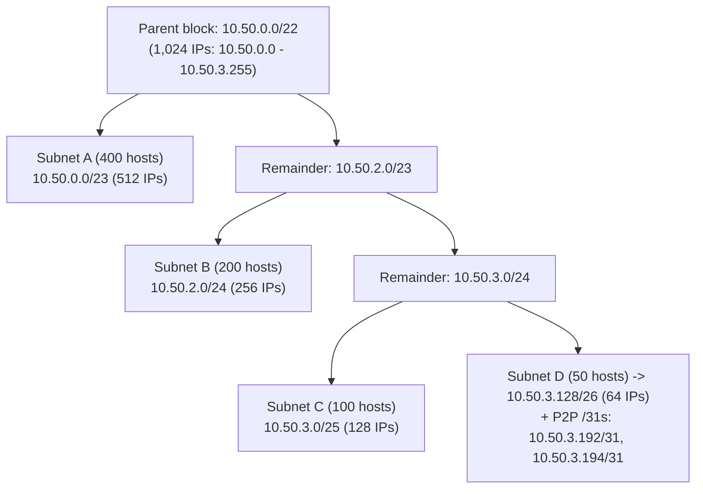

# 2.4 IP addressing, subnetting and CIDR (IPv4 and IPv6), with practice

| | |
|---|---|
| Level | Beginner |
| Priority tier | 0 |
| Lab venue | Any Linux shell with Python 3 (no special hardware) |
| Part | Part 2: Networking, from first principles to AI fabrics |
| Status | Drafted, labs **untested** |

## Why this matters for AI infrastructure

Address plans are the skeleton of a cluster. Before anything is cabled you decide how many subnets a rack gets, how big the Kubernetes pod and service ranges are, how rails (the per-GPU back-end networks) are numbered, which ranges cannot overlap with the corporate network, the VPN or a peered cloud VPC, and how to leave room to grow from 64 to 4,096 nodes without renumbering. A wrong choice shows up months later as "pod CIDR overlaps with the on-prem network", "we ran out of IPs in the node subnet", "GKE cluster cannot be created: secondary range too small", or "VPC peering rejected because ranges overlap". Subnetting is also a core interview skill (you are expected to do it on a whiteboard without a calculator) and a daily debugging tool (is 10.20.37.130 inside 10.20.36.0/22? what is the broadcast of 172.16.5.77/27?).

This chapter teaches IPv4 and IPv6 addressing from the bits up: address structure, masks and CIDR, calculating network, broadcast and host ranges quickly, variable-length subnet masks (VLSM), summarisation (aggregation), special-purpose ranges, IPv6 notation and prefix design, the IP header formats, fragmentation and MTU, and practical address-plan design for AI clusters and clouds. It ends with a large set of practice problems with worked solutions, and a lab using Python's `ipaddress` module and `ip`.

## Prerequisites and outcomes

You should know binary and hexadecimal at a basic level (we review them) and the layer model from chapter 2.2.

After this chapter you can:

- Convert between decimal, binary and hexadecimal quickly, and between dotted-decimal masks and prefix lengths.
- For any IPv4 address/prefix, compute the network address, broadcast address, first/last usable host, number of hosts, and wildcard mask, by hand in under a minute.
- Design a VLSM address plan: divide a block into subnets of different sizes without overlap, and summarise multiple subnets into the fewest prefixes.
- Recognise special IPv4 ranges (private, loopback, link-local, CGNAT shared, multicast, documentation) and know why 127.0.0.1, 169.254.x.x, and 100.64/10 appear where they do.
- Read and write IPv6 addresses (compression rules), identify address types by prefix, explain /64 subnets, link-local addresses and how interface IDs are formed, and plan an IPv6 allocation hierarchy.
- Describe the IPv4 and IPv6 header fields (TTL/hop limit, protocol/next header, DSCP/ECN, flow label, fragmentation), and explain fragmentation and path MTU discovery.
- Configure addresses and routes with `ip`, Netplan and NetworkManager, and verify them.
- Plan addressing for a GPU cluster (management, front-end, per-rail back-end, storage, Kubernetes pod/service ranges, GCP VPC subnets and secondary ranges) with room to grow and no overlaps.

## 1. Number systems you need

A byte (octet) is 8 bits, value 0 to 255. Each bit position in an octet has weight:

| Bit position | 7 | 6 | 5 | 4 | 3 | 2 | 1 | 0 |
|---|---|---|---|---|---|---|---|---|
| Weight | 128 | 64 | 32 | 16 | 8 | 4 | 2 | 1 |

To convert 172 to binary: 172 − 128 = 44 (bit 7 = 1); 44 < 64 (bit 6 = 0); 44 < 32? no, 44 − 32 = 12 (bit 5 = 1); 12 < 16 (bit 4 = 0); 12 − 8 = 4 (bit 3 = 1); 4 − 4 = 0 (bit 2 = 1); bits 1 and 0 = 0. So 172 = `10101100`. To go back, add the weights of the 1 bits. Memorise the useful values: **mask octets** are `0`, `128`, `192`, `224`, `240`, `248`, `252`, `254`, `255` (that is, 1 to 8 leading ones). Hex: each hex digit is 4 bits (0–9, a–f); `ac` = 1010 1100 = 172. IPv6 and MAC addresses are written in hex.

Handy tools: `printf '%d\n' 0xac`, `printf '%x\n' 172`, `echo 'obase=2; 172' | bc`, Python `bin(172)`, `int('10101100', 2)`.

## 2. IPv4 addresses and masks

An IPv4 address is **32 bits**, written as four decimal octets (dotted quad): `10.23.2.37`. It identifies an interface (not a host) and has two parts: a **network prefix** (identifying the subnet) and a **host part** (identifying the interface within the subnet). The **subnet mask** (or **prefix length**) tells you where the split is: the mask has 1s for the network part and 0s for the host part.

```text
Address     10.23.2.37    = 00001010.00010111.00000010.00100101
Mask /24    255.255.255.0 = 11111111.11111111.11111111.00000000
Network     10.23.2.0     = address AND mask = 00001010.00010111.00000010.00000000
Broadcast   10.23.2.255   = network OR (NOT mask) = ...00000010.11111111
Hosts       10.23.2.1 - 10.23.2.254   (2^8 - 2 = 254 usable)
```

**CIDR** (Classless Inter-Domain Routing, 1993) writes the mask as the number of leading 1 bits after a slash: `10.23.2.37/24`. The masks must be contiguous 1s followed by 0s. The **prefix** `10.23.2.0/24` identifies the whole subnet: all addresses sharing the first 24 bits. CIDR replaced the older **classful** scheme (Class A /8 for 0–127, Class B /16 for 128–191, Class C /24 for 192–223; Class D 224–239 multicast; Class E 240–255 reserved) that wasted addresses; the class names survive in conversation ("a class C", meaning /24) but have no technical meaning.

### The reserved host addresses

In a normal subnet the **all-zeros host part** is the **network address** (the name of the subnet) and the **all-ones host part** is the **directed broadcast** address. Neither is assigned to a host, so a subnet with *h* host bits has **2^h − 2** usable addresses. Exceptions: **/31** (RFC 3021: point-to-point links, 2 usable addresses, no network or broadcast), and **/32** (a single host route, used for loopbacks and service addresses). Many clouds additionally reserve addresses in each subnet (for example, the first address as the gateway, a second for DNS, and the last as broadcast): GCP reserves the first two and last two addresses of each primary range; check your provider's rules before sizing.

### Fast subnetting: the block-size method

For a prefix length /p between /24 and /30 (host bits within the last octet): **block size = 256 − mask octet = 2^(32−p)**. Subnets begin at multiples of the block size. The network address is the largest multiple of the block size ≤ the host octet; broadcast = next network − 1.

Example: `192.168.10.77/27`. Mask 255.255.255.224, block size 32. Multiples: 0, 32, 64, 96 ... 77 lies in the 64 block. Network = 192.168.10.64; broadcast = 192.168.10.95 (96 − 1); usable 192.168.10.65 – .94 (30 hosts).

For prefixes that fall in other octets (/8 to /23), apply the same idea to the octet where the split occurs, keeping earlier octets and zeroing later ones. Example: `172.20.133.9/21`. /21 = 255.255.248.0; the interesting octet is the third, block size = 256 − 248 = 8. Multiples of 8: 128, 136 → 133 is in the 128 block. Network 172.20.128.0, next network 172.20.136.0, broadcast 172.20.135.255, usable 172.20.128.1 – 172.20.135.254 (2^11 − 2 = 2,046 hosts).

### Reference table

| Prefix | Mask | Addresses | Usable hosts | Typical use |
|---|---|---|---|---|
| /8 | 255.0.0.0 | 16,777,216 | 16,777,214 | Large private block (10/8) |
| /12 | 255.240.0.0 | 1,048,576 | 1,048,574 | 172.16/12 private |
| /16 | 255.255.0.0 | 65,536 | 65,534 | VPC, large site, pod range |
| /20 | 255.255.240.0 | 4,096 | 4,094 | Large subnet, GKE node subnet |
| /21 | 255.255.248.0 | 2,048 | 2,046 | |
| /22 | 255.255.252.0 | 1,024 | 1,022 | |
| /23 | 255.255.254.0 | 512 | 510 | |
| /24 | 255.255.255.0 | 256 | 254 | Classic LAN/rack subnet |
| /25 | 255.255.255.128 | 128 | 126 | |
| /26 | 255.255.255.192 | 64 | 62 | |
| /27 | 255.255.255.224 | 32 | 30 | |
| /28 | 255.255.255.240 | 16 | 14 | |
| /29 | 255.255.255.248 | 8 | 6 | Small server group |
| /30 | 255.255.255.252 | 4 | 2 | Legacy point-to-point |
| /31 | 255.255.255.254 | 2 | 2 (RFC 3021) | Point-to-point |
| /32 | 255.255.255.255 | 1 | 1 | Loopback / host route |

**Wildcard mask** (used in OSPF `network` statements and some ACLs) = inverse of the mask: /24 → 0.0.0.255; /27 → 0.0.0.31.

### Same subnet or not?

Two addresses are in the same subnet iff `(A AND mask) == (B AND mask)`. Is `10.20.37.130` inside `10.20.36.0/22`? /22: mask third octet 252, block 4; 36 is a multiple of 4; the network spans third octet 36 – 39 (10.20.36.0 – 10.20.39.255). 37 is in 36–39 → yes. Is `10.20.40.1`? Third octet 40 ≥ 40 → no. This check is what a host does for every packet to decide "send directly via ARP, or send to the gateway" (chapter 2.3/2.5).

## 3. VLSM, supernetting and summarisation

**VLSM (variable-length subnet masks)** means using different prefix lengths within one address block, matching each subnet to its need. **Rules**: allocate largest subnets first; align each subnet at a multiple of its block size; never overlap; keep contiguous free space for growth.



Example: divide `10.50.0.0/22` (1,024 addresses; 10.50.0.0 – 10.50.3.255) into subnets for: A: 400 hosts, B: 200 hosts, C: 100 hosts, D: 50 hosts, E: two point-to-point links.

- A needs 400 → 512 addresses → /23: `10.50.0.0/23` (10.50.0.0 – 10.50.1.255).
- B needs 200 → 256 → /24: `10.50.2.0/24`.
- C needs 100 → 128 → /25: `10.50.3.0/25` (10.50.3.0 – .127).
- D needs 50 → 64 → /26: `10.50.3.128/26` (.128 – .191).
- E: two /31 links: `10.50.3.192/31` and `10.50.3.194/31` (or /30s), leaving `10.50.3.196 – .255` free.

**Summarisation (aggregation)** is the reverse: replace several contiguous, properly aligned prefixes with a single shorter prefix. Example: `192.168.4.0/24`, `192.168.5.0/24`, `192.168.6.0/24`, `192.168.7.0/24`: the third octet values 4–7 cover a block of four starting at a multiple of four, so they summarise to `192.168.4.0/22`. But `192.168.5.0/24 + 192.168.6.0/24` cannot be a /23 because 5 is not a multiple of 2 (a /23 would be 192.168.4.0/23 or 192.168.6.0/23). Method: write the third octets in binary, find the common leading bits, count them, add the earlier octets' bits.

Why it matters: summarisation shrinks routing tables, hides churn, and is the reason address plans are hierarchical (a region gets a /12, a site a /16, a rack a /24...). A badly planned, fragmented numbering scheme cannot be summarised and costs forwarding-table entries and operational pain. BGP in data centres relies on rack and pod prefixes that aggregate cleanly (chapter 2.16). The opposite, **longest-prefix match**, ensures that more specific routes win (chapter 2.5).

```bash
ipcalc 10.50.0.0/22                    # (package ipcalc/sipcalc) network, broadcast, ranges, wildcard
sipcalc 10.50.3.128/26
python3 - <<'EOF'
import ipaddress as ip
n = ip.ip_network("10.50.0.0/22")
print(list(n.subnets(new_prefix=24)))                       # split
print(list(ip.collapse_addresses([ip.ip_network(f"192.168.{i}.0/24") for i in range(4,8)])))   # summarise
a = ip.ip_interface("172.20.133.9/21"); print(a.network, a.network.broadcast_address, a.network.num_addresses - 2)
print(ip.ip_address("10.20.37.130") in ip.ip_network("10.20.36.0/22"))
print(ip.ip_network("10.0.0.0/8").address_exclude(ip.ip_network("10.1.0.0/16")).__next__())
EOF
```

## 4. Special-purpose IPv4 ranges

| Range | Meaning | Notes |
|---|---|---|
| `0.0.0.0/8` | "This network"; `0.0.0.0` = unspecified/any | `0.0.0.0` as a listen address = all interfaces; as a route = default |
| `10.0.0.0/8`, `172.16.0.0/12`, `192.168.0.0/16` | **Private (RFC 1918)** | Not routable on the public Internet; reused by everyone, so overlaps are common |
| `100.64.0.0/10` | **Shared address space / CGNAT (RFC 6598)** | Used by ISPs and by some clouds and Kubernetes designs to avoid RFC 1918 clashes (e.g. GKE can use 100.64/10-like ranges) |
| `127.0.0.0/8` | **Loopback** | Entire /8 is the host itself; `127.0.0.1` conventionally; systemd-resolved stub on `127.0.0.53` |
| `169.254.0.0/16` | **Link-local (APIPA)** | Self-assigned when DHCP fails; cloud metadata server `169.254.169.254` |
| `192.0.0.0/24`, `192.0.2.0/24`, `198.51.100.0/24`, `203.0.113.0/24` | Documentation (TEST-NET) | Use in examples; never on real networks |
| `198.18.0.0/15` | Benchmarking | Used in test labs |
| `224.0.0.0/4` | **Multicast** | `224.0.0.1` all hosts, `224.0.0.5/6` OSPF, `224.0.0.18` VRRP, `239/8` administratively scoped |
| `240.0.0.0/4` | Reserved (Class E) | `255.255.255.255` = limited broadcast |

Private ranges are the working vocabulary of cluster design: use RFC 1918 space for nodes and fabrics, and **never overlap** ranges that may be connected: on-premises networks, VPNs, cloud VPCs and peerings, Kubernetes pod and service CIDRs, container bridge defaults (Docker uses 172.17.0.0/16 by default and may clash with corporate 172.16/12 use), lab ranges. Maintain a central address registry (IPAM: NetBox, phpIPAM, Infoblox, cloud IPAM).

## 5. NAT, briefly (more in chapter 2.9)

Because IPv4 space ran out, private addressing plus **NAT/PAT** lets many hosts share one public address by rewriting addresses and ports (stateful translation table). Consequences you must know when planning addresses: private ranges can be reused in separate organisations (so you must avoid collisions only where you interconnect them); applications that embed IP addresses in payloads, peer-to-peer connections, and inbound connectivity need extra mechanisms; NAT hides internal addressing from outsiders but is not a security control; and cluster-internal traffic (pod-to-pod, GPU-to-GPU fabrics) should normally **not** be NATed.

## 6. IPv6

### Why and what

IPv6 uses **128-bit** addresses (3.4 × 10³⁸), designed in the 1990s to replace IPv4. It also simplifies the header, removes in-network fragmentation, replaces ARP/broadcast with Neighbor Discovery/multicast (chapter 2.3), builds in autoconfiguration (SLAAC), and restores end-to-end addressing (NAT is unnecessary). Dual-stack (running IPv4 and IPv6 side by side) is the common deployment; applications choose between them (Happy Eyeballs). Many public clouds, CDNs and ISPs offer IPv6; AI clusters mostly run IPv4 internally today but IPv6 is increasingly required (large Kubernetes clusters running out of IPv4 pod space, public-sector mandates, IPv6-only back-ends).

### Notation

Eight groups of 16 bits (hextets), colon separated, hexadecimal: `2001:0db8:0a0b:12f0:0000:0000:0000:8b6e`. Two compression rules: (1) drop **leading zeros** in each group (`0db8` → `db8`); (2) replace **one** longest run of all-zero groups with `::` (once per address). So the example becomes `2001:db8:a0b:12f0::8b6e`. A prefix is written like CIDR: `2001:db8:a0b:12f0::/64`. In URLs, literal addresses go in brackets: `http://[2001:db8::10]:8080/`. Interface scope for link-local: `fe80::1%eth0`. Expand an address to full form with `python3 -c "import ipaddress as i; print(i.ip_address('2001:db8::1').exploded)"`.

### Address types

| Prefix | Type | Notes |
|---|---|---|
| `::/128` | Unspecified | Source before an address exists (DAD) |
| `::1/128` | Loopback | |
| `::ffff:0:0/96` | IPv4-mapped | `::ffff:192.0.2.1`: dual-stack sockets present IPv4 clients this way |
| `64:ff9b::/96` | NAT64 well-known prefix | IPv6-only clients reaching IPv4 servers via NAT64/DNS64 |
| `2000::/3` | **Global unicast** (publicly routable); begins with 2 or 3 | Allocated by RIRs: e.g. `2001:db8::/32` is documentation |
| `fc00::/7` (in practice `fd00::/8`) | **Unique local addresses (ULA)** | Private, like RFC 1918; generate a random 40-bit Global ID (`fdXX:XXXX:XXXX::/48`) |
| `fe80::/10` | **Link-local** | Automatic on every interface; valid only on the link; used for NDP, routing protocol adjacencies and default gateway next hops |
| `ff00::/8` | **Multicast** | `ff02::1` all nodes (link), `ff02::2` all routers, `ff02::1:ffXX:XXXX` solicited-node, `ff02::5/6` OSPFv3, `ff02::1:2` DHCPv6 |
| `2001:db8::/32` | Documentation | Use in examples |

There is **no broadcast** in IPv6; multicast replaces it.

### Structure and the /64 convention

A global unicast address is conventionally **routing prefix + subnet ID + 64-bit interface ID**:

```text
|<------------- 48 bits site prefix ------------>|<- 16 bits subnet ID ->|<--------- 64 bits interface ID --------->|
 2001:0db8:0a0b                                    12f0                   0000:0000:0000:8b6e
```

Subnets are almost always **/64**: SLAAC, Neighbor Discovery and many features assume a 64-bit interface ID, and the vast space makes conservation unnecessary. (Exceptions: /127 for point-to-point router links per RFC 6164; /128 for loopbacks.) Typical allocation hierarchy: an ISP or cloud gives a **/32** to a provider network, a **/48** to a site/customer (65,536 /64 subnets), sometimes a /56 to a home (256 /64s); you divide within it in hex nibble boundaries (/52, /56, /60, /64) so prefixes are readable and aggregate cleanly. Example: `2001:db8:100::/48` for the cluster; `2001:db8:100:1::/64` management; `2001:db8:100:10::/60` for 16 rail subnets (`...:10::/64` through `...:1f::/64`); `2001:db8:100:100::/56` for per-rack /64s.

**Interface IDs** are formed by: manual configuration (`::1`, `::10`), **EUI-64** from the MAC (flip the U/L bit and insert `ff:fe` in the middle: MAC `52:54:00:12:34:56`: the first octet 0x52 = 01010010, flipping bit 1 (value 0x02) gives 01010000 = 0x50, so the interface ID is `5054:00ff:fe12:3456`), **stable privacy addresses** (RFC 7217, hash-based and constant per network, the common Linux default), **temporary privacy addresses** (RFC 4941, rotated for outgoing connections), or DHCPv6.

### Configuration and inspection

```bash
ip -6 addr show ; ip -6 route show ; ip -6 neigh show
sudo ip -6 addr add 2001:db8:100:1::10/64 dev eth0
sudo ip -6 route add default via fe80::1 dev eth0         # next hop = router's link-local address (needs dev)
sysctl net.ipv6.conf.all.disable_ipv6 net.ipv6.conf.eth0.accept_ra
ping -6 -c3 2001:db8:100:1::1 ; ping -6 -c3 fe80::1%eth0
```

Useful shortcuts: `::1` loopback; `ff02::1%eth0` ping6 to all nodes on the link reveals neighbours; `getent ahostsv6 name`.

## 7. The IP headers

### IPv4 header (20 bytes minimum)

```text
 0                   1                   2                   3
 0 1 2 3 4 5 6 7 8 9 0 1 2 3 4 5 6 7 8 9 0 1 2 3 4 5 6 7 8 9 0 1
+-+-+-+-+-+-+-+-+-+-+-+-+-+-+-+-+-+-+-+-+-+-+-+-+-+-+-+-+-+-+-+-+
|Version|  IHL  |    DSCP   |ECN|         Total Length          |
+-------+-------+-----------+---+-----+-------------------------+
|        Identification         |Flags|     Fragment Offset     |
+---------------+---------------+-----+-------------------------+
|      TTL      |   Protocol    |        Header Checksum          |
+---------------+---------------+---------------------------------+
|                       Source Address                            |
+-----------------------------------------------------------------+
|                    Destination Address                          |
+-----------------------------------------------------------------+
|                    Options (rare) ...                           |
```

- **Version** 4; **IHL** header length in 32-bit words (5 = 20 bytes); **DSCP** (6 bits, differentiated services code point for QoS) and **ECN** (2 bits, explicit congestion notification: 00 not-ECT, 01/10 ECT, 11 CE); **Total Length** (up to 65,535 bytes); **Identification, Flags (DF = Don't Fragment, MF = More Fragments), Fragment Offset** (fragmentation); **TTL** (decremented per router; 0 → drop + ICMP Time Exceeded); **Protocol** (6 TCP, 17 UDP, 1 ICMP, 47 GRE, 50 ESP, 89 OSPF ...); **Header Checksum** (recomputed at every hop because TTL changes); source and destination addresses.

### IPv6 header (40 bytes, fixed)

```text
 Version(4) | Traffic Class(8 = DSCP6 + ECN2) | Flow Label(20)
 Payload Length(16) | Next Header(8) | Hop Limit(8)
 Source Address (128)
 Destination Address (128)
 [extension headers chained via Next Header: hop-by-hop, routing, fragment, destination options, AH, ESP]
```

The IPv6 header has **no checksum** (transport and link layers cover it), **no fragmentation fields** in the base header (fragmentation uses an extension header and is performed only by the *source*), and a **flow label** that helps routers keep a flow on one path in ECMP. The fixed 40-byte header makes hardware parsing simple; the extension headers keep flexibility. **Hop limit** = TTL.

### Fragmentation and path MTU

If a packet is larger than the **MTU** of the next link, IPv4 routers may fragment it (if DF is clear) into pieces that are reassembled only at the destination (each fragment carries ID, offset in 8-byte units, MF flag); fragmentation is expensive and fragile (losing any fragment loses the packet; middleboxes and firewalls often drop fragments; hardware paths may punt fragments to the CPU). Modern practice: TCP sets **DF** and uses **Path MTU Discovery** (PMTUD): routers that cannot forward a too-big DF packet drop it and send **ICMP Destination Unreachable, Fragmentation Needed (type 3 code 4)** (IPv6: **ICMPv6 Packet Too Big, type 2**) with the next-hop MTU; the sender lowers its path MTU. If such ICMP messages are blocked, large transfers stall ("PMTU black hole"). Mitigations: allow the required ICMP, clamp TCP MSS on tunnels (`iptables -t mangle -A FORWARD -p tcp --tcp-flags SYN,RST SYN -j TCPMSS --clamp-mss-to-pmtu`), use consistent MTU across the path, and enable PLPMTUD (`net.ipv4.tcp_mtu_probing`). In IPv6 only the source may fragment; routers never do.

```bash
ping -M do -s 1472 -c 2 target          # IPv4: 1472 + 8 (ICMP) + 20 (IP) = 1500; do = set DF
ping -6 -M do -s 1452 -c 2 target6      # IPv6: 1452 + 8 + 40 = 1500
tracepath target ; tracepath -6 target6  # discovers path MTU hop by hop
ip route get target ; ip link show | grep mtu ; ss -ti dst target | grep -o 'mss:[0-9]*\|pmtu:[0-9]*'
```

## 8. Configuring addresses on Linux

```bash
# Manual, runtime-only (lost on reboot):
sudo ip addr add 10.23.2.4/24 dev ens4
sudo ip link set ens4 up
sudo ip route add default via 10.23.2.1 dev ens4
sudo ip addr del 10.23.2.4/24 dev ens4
ip -br addr ; ip -4 addr show dev ens4 ; ip addr show dev ens4 scope global
# Multiple addresses on an interface (secondary), labels:
sudo ip addr add 10.23.2.5/24 dev ens4 label ens4:vip
# Persistent: Netplan (Ubuntu), NetworkManager (nmcli), systemd-networkd, or distribution files
```

```yaml
# /etc/netplan/60-fabric.yaml   (apply: sudo netplan try; sudo netplan apply)
network:
  version: 2
  ethernets:
    ens4:
      dhcp4: false
      addresses: [10.23.2.4/24, "2001:db8:100:1::4/64"]
      routes:
        - to: default
          via: 10.23.2.1
      nameservers: {addresses: [10.23.0.2]}
      mtu: 9000
```

```bash
nmcli device status ; nmcli connection show
sudo nmcli connection modify "Wired connection 1" ipv4.addresses 10.23.2.4/24 ipv4.gateway 10.23.2.1 ipv4.method manual
sudo nmcli connection up "Wired connection 1"
```

Check that subnets do not overlap on the host (two interfaces in overlapping prefixes lead to ambiguous routing), that the mask matches the network's (a /16 on a /24 network makes the host ARP for off-link addresses), and that only one DHCP server answers per subnet. Addresses of different interfaces may coexist, but the kernel's routing decisions (chapter 2.5) pick the interface by longest prefix match, then metric.

## 9. Address planning for AI clusters and clouds

Principles: **hierarchical**, **aligned**, **summarisable**, **non-overlapping with anything you may connect to**, **room to grow ×4**, **documented in IPAM**, **one purpose per range**.

### A worked cluster plan (illustrative)

A 1,024-GPU cluster: 128 nodes × 8 GPUs, 8 back-end NICs per node (one per GPU), 2 front-end NICs, 1 BMC. Use `10.0.0.0/8` space sensibly:

| Purpose | Range | Sizing logic |
|---|---|---|
| Out-of-band (BMC/IPMI/Redfish, switch management) | `10.10.0.0/20` | 4,094 addresses, covers nodes + switches + PDUs with growth |
| In-band management / front-end (SSH, Slurm, Kubernetes node IPs) | `10.20.0.0/20` | One /20, or per-rack /24s summarised as /20 |
| Storage network (parallel FS, NFS) | `10.30.0.0/20` | |
| Back-end compute fabric, rail *r* (r = 0..7) | `10.100.r.0/21`... or `10.(100+r).0.0/22` | One subnet per rail (one NIC per GPU index per node) so each rail is its own L3 domain or VLAN; per-rack /26 or /27 slices within the rail range |
| Kubernetes pod CIDR (cluster) | `10.64.0.0/14` (262,144 IPs) with `/24` per node (254 pods per node) | Pod ranges consume a lot; plan max nodes × pods per node |
| Kubernetes service CIDR | `10.96.0.0/16` | 65,534 services; cannot overlap anything routed |
| Loopbacks for BGP routers/servers | `10.255.0.0/24` /32s | One /32 per router/leaf/spine |
| Point-to-point links (leaf-spine) | `10.250.0.0/16` /31s | Each link a /31 (or unnumbered BGP) |

Calculations to do for any plan: nodes × NICs per node × growth factor; hosts per subnet including gateway/virtual IPs and cloud-reserved addresses; for Kubernetes: `max_nodes × (pods_per_node rounded up to the per-node CIDR size)`. Typical per-node pod CIDR: `/24` for up to 110 pods (kubelet default `maxPods=110` → 256-address block), `/25` for fewer. Cloud specifics: GKE VPC-native clusters use **secondary ranges** on the subnet for pods and services (primary range for nodes), with the default maximum 110 pods per node mapping to a /24 pod range per node; pod ranges cannot be shrunk later; plan carefully (and note non-RFC1918 and 100.64/10 support). Overlapping ranges prevent VPC peering and VPN/Interconnect routing. With multiple clusters, allocate distinct pod/service ranges per cluster, or use IPv6/dual-stack to relieve pressure.

### Rail-optimised and L3-to-the-host numbering

Back-end fabrics often assign one **/31 or /24 per host-leaf link** (routed to the host, BGP unnumbered, or per-rail subnets with host routes), with the **same-numbered NIC on every server connecting to the same leaf** ("rail") so that all-reduce on rail *k* stays within one leaf tier. Numbering consistently (`10.100.<rail>.<node>`) makes troubleshooting trivial: from an address you know the rail, node and NIC without a database. Chapter 2.18 covers topology, 2.16 covers BGP numbering and unnumbered interfaces.

### GCP/VPC notes

VPC networks are global, subnets are regional (custom-mode subnets; you choose ranges); firewall rules and routes are VPC-level; RFC 1918 and some other ranges allowed; reserved addresses per subnet; internal IP assignment; Private Google Access; alias IP ranges and secondary ranges for containers; VPC peering requires non-overlapping ranges; Shared VPC for multi-project. Details in chapter 2.32.

## 10. Practice problems (with answers)

Do these by hand first; verify with `ipcalc` or Python.

1. Convert 203.0.113.77 to binary. **A:** `11001011.00000000.01110001.01001101`.
2. Convert 10101100.00010000.00000001.00000101 to dotted decimal. **A:** 172.16.1.5.
3. What is the prefix length of 255.255.240.0? **A:** /20 (8+8+4).
4. What is the mask for /27? **A:** 255.255.255.224.
5. `192.168.10.77/27`: network, broadcast, usable range, hosts. **A:** 192.168.10.64 / .95 / .65–.94 / 30.
6. `172.20.133.9/21`: network, broadcast, hosts. **A:** 172.20.128.0 / 172.20.135.255 / 2,046.
7. `10.1.200.15/18`: network and broadcast. **A:** Mask 255.255.192.0 (third octet block 64): 200 in 192–255 → network 10.1.192.0, broadcast 10.1.255.255.
8. Are 10.20.37.130 and 10.20.40.5 in the same /22? **A:** 37 is in 36–39, 40 is in 40–43: different subnets.
9. How many /26 subnets in a /22, and how many hosts in each? **A:** 16 subnets, 62 hosts each.
10. What is the smallest prefix that holds 500 hosts? **A:** /23 (510 usable).
11. Give the broadcast of 192.168.1.130/25. **A:** Block 128: network .128, broadcast 192.168.1.255.
12. A /29 has how many usable addresses and what are the network/broadcast for 10.0.0.37/29? **A:** 6 usable; network 10.0.0.32, broadcast 10.0.0.39.
13. Summarise 172.16.8.0/24 through 172.16.15.0/24. **A:** Third octets 8–15 = 8 blocks aligned on 8 → 172.16.8.0/21.
14. Can 10.0.2.0/24, 10.0.3.0/24 and 10.0.4.0/24 be summarised into one prefix? **A:** Not exactly: 2–3 form 10.0.2.0/23; 4 is separate; the single covering prefix 10.0.0.0/21 would also include 10.0.0.0, 10.0.1.0, 10.0.5–7 (over-summarisation).
15. Split 192.168.0.0/24 into four equal subnets. **A:** .0/26, .64/26, .128/26, .192/26.
16. VLSM: from 10.9.0.0/24 allocate 100, 50, 25, and two point-to-point links. **A:** /25 → 10.9.0.0/25; /26 → 10.9.0.128/26; /27 → 10.9.0.192/27; two /31 → 10.9.0.224/31, 10.9.0.226/31; free 10.9.0.228 – .255.
17. Identify: 169.254.12.9, 100.64.3.4, 192.0.2.8, 224.0.0.5, 127.0.1.1. **A:** Link-local, CGNAT shared space, documentation, OSPF multicast, loopback.
18. Compress `2001:0db8:0000:0000:0000:ff00:0042:8329`. **A:** `2001:db8::ff00:42:8329`.
19. Expand `fe80::1`. **A:** `fe80:0000:0000:0000:0000:0000:0000:0001`.
20. How many /64 subnets in a /48? In a /56? **A:** 65,536; 256.
21. What type is `fd12:3456:789a::10`? **A:** ULA (fd00::/8).
22. Form the link-local address for MAC 00:1a:2b:3c:4d:5e using EUI-64. **A:** flip U/L bit (00→02), insert ff:fe → `fe80::21a:2bff:fe3c:4d5e`.
23. Is `2001:db8:100:1::10` inside `2001:db8:100::/48`? In `2001:db8:100:2::/64`? **A:** Yes; no.
24. Compute the on-wire MTU/MSS: TCP MSS with IPv6 at MTU 1500. **A:** 1500 − 40 − 20 = 1440.
25. A Kubernetes cluster must support 500 nodes with 110 pods each. Size the pod CIDR. **A:** /24 per node → 500 × 256 = 128,000 addresses → /15 (131,072); round to /15 or /14 for growth.
26. Why can't you configure two interfaces of one host with 10.0.0.5/24 and 10.0.0.9/24 on different physical networks? **A:** Overlapping connected prefixes make routing ambiguous (the kernel picks by metric/order); use distinct subnets or policy routing.
27. A host has 192.168.1.50/24 but its gateway 192.168.0.1 is configured: what happens? **A:** The gateway is not on-link (not in the connected subnet), so the route cannot be installed ("Nexthop has invalid gateway") or the host will fail to ARP.
28. What happens if a host is given 10.0.0.10/16 on a network whose real mask is /24? **A:** It believes 10.0.1.x is on-link and ARPs for it (no answer): off-link destinations in that /16 fail; also the host may answer ARP for the wrong range.

## 11. Hands-on lab: subnetting, VLSM, IPv6, and cluster IP plans

First, run the self-checking Python lab (`code/part02/ip_subnetting_cidr_lab.py`) locally. It verifies fast block-size subnetting (`192.168.10.77/27`, `172.20.133.9/21`, RFC 3021 `/31`), largest-first VLSM allocation on `10.50.0.0/22`, route summarization (`collapse_addresses` on aligned vs unaligned `/24`s), and Kubernetes Pod CIDR sizing (`/15` for 500 nodes, `/14` for 1,024 nodes).

```bash
python3 code/part02/ip_subnetting_cidr_lab.py
```

Next, on any Linux host or VM (all interactive commands below are `untested here`), work through these steps:

1. **Subnet calculator by hand then by tool**: pick 10 random address/prefix pairs (use `python3 -c 'import random...'` or a worksheet); calculate network, broadcast, range, hosts on paper; verify with `ipcalc` and `ipaddress`; time yourself: aim for under 60 seconds each.
2. **VLSM plan**: write a Python script that, given a parent block and a list of required host counts, allocates subnets (largest first, aligned) and prints a table; test with the example in section 3; check that no subnets overlap (`ipaddress` `overlaps()`).
3. **Summarisation**: use `ipaddress.collapse_addresses` on contiguous and non-contiguous sets; find the minimal covering prefix (`ipaddress.summarize_address_range`) for a start/end pair; explain over-summarisation.
4. **Look at your host**: `ip -br addr`, `ip route`, `ip -6 addr`, `ip -6 route`; compute each interface's network and broadcast; identify link-local, ULA, global, loopback addresses; run `ip route get` for in-subnet and off-subnet targets.
5. **IPv6 practice**: generate a ULA /48 (`python3 -c "import os,ipaddress; r=os.urandom(5); print('fd%02x:%02x%02x:%02x%02x::/48'%(r[0],r[1],r[2],r[3],r[4]))"`); assign `/64`s to two namespaces joined by a bridge (see chapter 2.3 lab), ping with `ping -6`, observe NS/NA and link-local addresses; derive the EUI-64 address by hand and compare to `ip -6 addr` (`addr_gen_mode` may use stable-privacy; set `net.ipv6.conf.<if>.addr_gen_mode=0` to see EUI-64).
6. **MTU and fragmentation**: send `ping -s 1472/1473 -M do`; capture with `tcpdump -nn -v` with and without `-M do`, and with a smaller MTU on an intermediate namespace link; view the fragment offsets and flags; show the ICMP "frag needed" message and PMTUD updating `ip route get` cache (`mtu` field).
7. **Cluster plan exercise**: for a 256-node, 8-rail cluster in GCP-like terms (regional subnets, secondary ranges for GKE pods/services, peering to an on-prem 10.0.0.0/12), produce an address plan table that does not overlap, with growth room 4×, summarisable per rail and per site, and write the NetBox/YAML representation.
8. **Catch the overlap**: write a checker that reads a CSV of prefixes with owners and reports overlaps and non-aligned allocations.

## 12. Common mistakes

- Forgetting to subtract the network and broadcast addresses (and the cloud's reserved addresses).
- Mixing up block size arithmetic in non-last octets; failing to align subnets to block boundaries.
- Over-summarising (covering addresses you do not own) or under-summarising (leaving unaggregatable fragments).
- Overlapping ranges across VPN/peering/Kubernetes/Docker defaults.
- Sizing Kubernetes pod ranges from node count alone (forgetting per-node pod CIDRs).
- Using /30 where /31 would do, or mismatching masks on the two ends of a link.
- Treating IPv6 /64 as wasteful and subnetting smaller (breaking SLAAC) or giving hosts addresses from the wrong scope.
- Assuming NAT will fix overlaps without understanding what breaks.
- Forgetting that IPv6 link-local next hops need `dev`/scope in route commands.
- Assuming 100.64/10 or link-local addresses are routable across your WAN.

## 13. Interview angles

- "Subnet 10.0.0.0/16 into 100 subnets of equal size; give a few subnets and host counts." (/23 gives 128 subnets with 510 hosts.)
- "What is the broadcast address of 172.16.5.77/27? Is 172.16.5.100 in the same subnet?" (172.16.5.95; no: 96–127 block.)
- "How would you design the IP plan for a new 512-node GPU cluster with 8 rails and Kubernetes? What do you reserve for growth?"
- "Why is the pod CIDR hard to change later? How do you avoid overlaps with on-prem and with VPC peering?"
- "How many addresses in a /64? Why not subnet below /64?"
- "What is a link-local address, and why does the default gateway use it in IPv6?"
- "Explain CIDR and summarisation; why does the Internet need them?"
- "What is path MTU discovery and what happens when ICMP is blocked?"
- "Why use /31 on point-to-point links? What about unnumbered interfaces?"

## Exercises

1. **Fast Block-Size Subnetting (`/27`, `/21`, `/18`) and Same-Subnet Membership:** Using `analyze_ipv4_cidr()` in `code/part02/ip_subnetting_cidr.py` (and by hand using the block-size method), compute the network address, broadcast address, first and last usable host, usable host count, dotted netmask, and wildcard mask for `192.168.10.77/27`, `172.20.133.9/21`, and `10.1.200.15/18`. Are `10.20.37.130` and `10.20.40.5` in the same `/22`?
2. **VLSM Allocation and Route Summarization / Alignment:** (a) Using `allocate_vlsm_subnets()`, divide `10.50.0.0/22` into aligned non-overlapping subnets for 400 hosts, 200 hosts, 100 hosts, 50 hosts, and two 2-host point-to-point links (`/31`); (b) using `summarize_ipv4_prefixes()`, explain why `192.168.4.0/24` through `192.168.7.0/24` collapse into `192.168.4.0/22`, whereas `192.168.5.0/24` and `192.168.6.0/24` cannot collapse into a single `/23`.
3. **Special-Purpose IPv4 Ranges and Preventing Enterprise/Cloud Collisions:** State the CIDR range and purpose of RFC 1918 private space (`3` blocks), RFC 6598 CGNAT shared space (`100.64.0.0/10`), loopback (`127.0.0.0/8`), APIPA link-local (`169.254.0.0/16` and `169.254.169.254`), TEST-NET documentation ranges, and IPv4 multicast (`224.0.0.0/4`), and explain why Docker's default `172.17.0.0/16` bridge often collides with corporate networks.
4. **IPv6 Notation, Prefix Types, the `/64` Convention, and EUI-64:** (a) Compress `2001:0db8:0000:0000:0000:ff00:0042:8329` and expand `fe80::1`; (b) identify `2000::/3`, `fd00::/8`, `fe80::/10`, `ff00::/8`, and `64:ff9b::/96`, state how many `/64` subnets fit inside a `/48` (`65,536`) and a `/56` (`256`), and derive the EUI-64 link-local address for MAC `52:54:00:12:34:56` (`fe80::5054:ff:fe12:3456`).
5. **IPv4 vs. IPv6 Header Fields, Fragmentation, and Path MTU Discovery:** Contrast the `20`-byte IPv4 header with the fixed `40`-byte IPv6 header (checksum, fragmentation fields, `DSCP`/`ECN`, `Flow Label`), explain why `ping -M do -s 1472` (IPv4) and `ping -6 -M do -s 1452` (IPv6) test a `1500`-byte MTU path without fragmentation, and name the exact ICMPv4 (`Type 3 Code 4`) and ICMPv6 (`Type 2`) messages required for PMTUD.
6. **Designing a Non-Overlapping Address Plan for a 1,024-GPU Cluster and Kubernetes:** Using `size_kubernetes_pod_cidr()`, size the cluster Pod CIDR for `500` nodes and `1,024` nodes when each node receives a `/24` (`maxPods=110`), and design a hierarchical, summarizable IP plan for OOB BMCs, in-band management, storage, 8 per-GPU back-end rails (`10.100.<rail>.<node>`), BGP `/32` loopbacks, and leaf-spine `/31` point-to-point links.

## Checkpoint questions (20)

<details>
<summary>1. How many bits are in an IPv4 address versus an IPv6 address, and what are the nine valid non-zero mask octet values?</summary>
IPv4 addresses are **32 bits** (4 octets in dotted decimal); IPv6 addresses are **128 bits** (8 16-bit hextets in hexadecimal). Because CIDR subnet masks consist of contiguous leading `1` bits, every mask octet is one of `{0, 128, 192, 224, 240, 248, 252, 254, 255}`.
</details>

<details>
<summary>2. Why do standard IPv4 subnets provide `2^h - 2` usable host addresses, and what are the exceptions (`/31`, `/32`, and cloud subnets)?</summary>
In a standard subnet with `h` host bits, the **all-zeros** host address is reserved as the **network address** and the **all-ones** host address is reserved as the **directed broadcast address**. Exceptions: **`/31` point-to-point links** (RFC 3021) have `2` usable host addresses with no network/broadcast overhead, **`/32`** is a `1`-address host/loopback route, and cloud VPC subnets reserve additional addresses (e.g., GCP reserves 4 addresses per subnet: network, default gateway, second-to-last, and broadcast).
</details>

<details>
<summary>3. Explain the fast \"block-size\" method for finding the network and broadcast addresses of `192.168.10.77/27` and `172.20.133.9/21`.</summary>
For `192.168.10.77/27`: `/27` has mask `255.255.255.224` in the 4th octet; block size = `256 - 224 = 32`. Multiples of 32 are `0, 32, 64, 96...`, so `77` falls in the `64` block: network `192.168.10.64`, broadcast `192.168.10.95` (`96 - 1`), `30` usable hosts (`.65–.94`). For `172.20.133.9/21`: `/21` splits in the 3rd octet with mask `248`; block size = `256 - 248 = 8`. Multiples of 8 are `..., 128, 136`, so `133` falls in `128`: network `172.20.128.0`, broadcast `172.20.135.255`, `2,046` usable hosts.
</details>

<details>
<summary>4. How do you test whether two IPv4 addresses (`10.20.37.130` and `10.20.40.5`) belong to the same `/22` subnet, and what is a wildcard mask?</summary>
Bitwise-AND both addresses with the `/22` mask (`255.255.252.0`, 3rd-octet block size `4`): `37` falls in block `36..39` (`10.20.36.0/22`), whereas `40` starts the next block `40..43` (`10.20.40.0/22`), so they are in different subnets. A **wildcard mask** (`~netmask`, e.g., `0.0.3.255` for `/22`) is the bitwise inverse of the subnet mask, used in OSPF `network` statements and router ACLs.
</details>

<details>
<summary>5. What is Variable-Length Subnet Masking (`VLSM`), and what are its four allocation rules?</summary>
**VLSM** divides a parent CIDR block into child subnets of different prefix lengths tailored to each segment's size. The four rules are: (1) sort and allocate the **largest subnets first**, (2) **align** every subnet's starting address on an exact integer multiple of its block size, (3) never overlap ranges, and (4) leave contiguous unallocated blocks for future growth.
</details>

<details>
<summary>6. What is route summarization (aggregation), why does it matter in data-center BGP fabrics, and why can `10.0.1.0/24` + `10.0.2.0/24` NOT be summarized into a `/23`?</summary>
Route summarization replaces multiple contiguous, block-aligned prefixes with a single shorter covering prefix (e.g., `192.168.4.0/24`..`7.0/24` -> `192.168.4.0/22`), shrinking router FIB tables and hiding link-flap churn inside a rack/pod. A `/23` has a 3rd-octet block size of `2` and must start on an **even** number (`0, 2, 4...`), so `10.0.1.0/24` and `10.0.2.0/24` straddle the boundary between `10.0.0.0/23` and `10.0.2.0/23` and cannot be summarized into a single `/23`.
</details>

<details>
<summary>7. List the three RFC 1918 private IPv4 ranges, the RFC 6598 CGNAT range, the loopback range, and the APIPA link-local range.</summary>
- **RFC 1918 Private**: `10.0.0.0/8`, `172.16.0.0/12` (`172.16.0.0–172.31.255.255`), and `192.168.0.0/16`
- **RFC 6598 CGNAT / Shared Space**: `100.64.0.0/10` (`100.64.0.0–100.127.255.255`, often used for large Kubernetes Pod CIDRs when RFC 1918 is scarce)
- **Loopback**: `127.0.0.0/8` (`127.0.0.1` localhost, `127.0.0.53` `systemd-resolved`)
- **Link-Local (APIPA)**: `169.254.0.0/16` (`169.254.169.254` cloud Instance Metadata Server)
</details>

<details>
<summary>8. State the two IPv6 address compression rules and why literal IPv6 addresses in URLs require square brackets.</summary>
(1) Strip **leading zeros** within each 16-bit hex group (`0db8` -> `db8`, `0000` -> `0`); (2) replace at most **one** contiguous run of all-zero groups with `::` (using `::` twice in one address is ambiguous and illegal). In URLs, colons separate the port number, so literal IPv6 addresses are wrapped in brackets: `http://[2001:db8::10]:8080/`.
</details>

<details>
<summary>9. Match the key IPv6 prefixes to their address types: `::1/128`, `2000::/3`, `fc00::/7` (`fd00::/8`), `fe80::/10`, `ff00::/8`, `2001:db8::/32`, and `64:ff9b::/96`.</summary>
- `::1/128`: Loopback
- `2000::/3` (starts with `2` or `3`): Global Unicast (publicly routable)
- `fc00::/7` (`fd00::/8`): Unique Local Address (`ULA`, private space with a random 40-bit Global ID `/48`)
- `fe80::/10` (`fe80::/64` in practice): Link-Local (auto-configured on every interface; requires `%iface` scope ID)
- `ff00::/8`: Multicast (`ff02::1` all-nodes, `ff02::2` all-routers)
- `2001:db8::/32`: Documentation
- `64:ff9b::/96`: NAT64 well-known prefix
</details>

<details>
<summary>10. Why are IPv6 LAN subnets almost always `/64` (except `/127` p2p and `/128` loopback), and how many `/64` subnets are in a `/48` site allocation?</summary>
IPv6 SLAAC, Neighbor Discovery, and RFC 7217 privacy addressing are standardized around a 64-bit interface identifier (`64` prefix bits + `64` interface bits = `128` bits). A `/48` site prefix leaves `64 - 48 = 16` bits for the subnet ID, providing **`2^16 = 65,536` `/64` subnets** (a `/56` provides `2^8 = 256` `/64` subnets). Point-to-point router links use `/127` (RFC 6164) to prevent Neighbor Cache exhaustion attacks.
</details>

<details>
<summary>11. Why do IPv6 routing protocols and Router Advertisements use the router's `fe80::` link-local address as the default gateway next hop?</summary>
Link-local addresses (`fe80::/64`) are permanently bound to the physical link and never change when a site's global unicast prefix (`2000::/3`) or ULA prefix is renumbered, so routing adjacencies and host default routes remain stable across prefix renumbering.
</details>

<details>
<summary>12. Compare the 20-byte IPv4 header and the 40-byte IPv6 header.</summary>
IPv4 has a variable-length header (`20–60` bytes via `IHL`), an header checksum recomputed at every router hop, and in-header fragmentation fields (`ID`, `DF`/`MF`, `Fragment Offset`). IPv6 has a **fixed `40`-byte base header**, **no header checksum** (relying on L2 FCS and L4 TCP/UDP checksums), **no in-network router fragmentation** (fragmentation is done only by the source host via an extension header), and a 20-bit **Flow Label** used alongside the 5-tuple for ECMP load-balancing hashes.
</details>

<details>
<summary>13. Where are the `DSCP` and `ECN` bits located in IPv4 and IPv6 headers, and how do AI RDMA fabrics use them?</summary>
They occupy the 8-bit **TOS / Traffic Class** byte in both IPv4 and IPv6: `6` bits for **DSCP** (*Differentiated Services Code Point*, which classifies traffic into QoS queues such as RoCEv2 RDMA vs storage vs management) and `2` bits for **ECN** (*Explicit Congestion Notification*: `00` non-ECT, `01`/`10` ECT-capable, `11` **CE** Congestion Experienced, set by switches when queue depth crosses a threshold so NICs throttle sending rate via DCQCN before buffers overflow).
</details>

<details>
<summary>14. Why does `ping -M do -s 1472` test a 1500-byte IPv4 MTU while `ping -6 -M do -s 1452` tests a 1500-byte IPv6 MTU?</summary>
The `-s` flag in `ping` specifies only the ICMP payload bytes. In IPv4, `1472` payload + `8`B ICMP header + `20`B IPv4 header = `1500` bytes. In IPv6, the IPv6 header is `40` bytes instead of `20`, so `1452` payload + `8`B ICMPv6 header + `40`B IPv6 header = `1500` bytes.
</details>

<details>
<summary>15. How do you configure IPv4 and IPv6 addresses, routes, and MTU transiently (`ip`) versus persistently (`Netplan` and `nmcli`)?</summary>
Transiently: `sudo ip addr add 10.23.2.4/24 dev ens4`, `sudo ip link set ens4 mtu 9000 up`, and `sudo ip route add default via 10.23.2.1 dev ens4`. Persistently: define `addresses:`, `routes:`, `nameservers:`, and `mtu: 9000` in `/etc/netplan/60-fabric.yaml` (`sudo netplan apply`) on Ubuntu, or run `sudo nmcli connection modify ...` (`nmcli connection up ...`) on RHEL/Rocky.
</details>

<details>
<summary>16. What happens if a host is configured with `192.168.1.50/24` and default gateway `192.168.0.1`?</summary>
`192.168.0.1` is outside the host's connected `192.168.1.0/24` subnet, so the kernel knows the gateway is not directly reachable at Layer 2 on that interface and rejects the route with `Error: Nexthop has invalid gateway`.
</details>

<details>
<summary>17. How do you size a Kubernetes cluster's Pod CIDR and Service CIDR for a 1,024-node GPU cluster?</summary>
With the standard kubelet `maxPods = 110`, Kubernetes assigns a **`/24` (`256` IPs)** Pod CIDR slice to each node. For `1,024` nodes, that requires `1024 * 256 = 262,144` IPs = a **`/14` block** (e.g., `10.64.0.0/14`, or `/13` to leave 2x growth headroom), plus a non-overlapping `/16` (`65,534` IPs, e.g., `10.96.0.0/16`) for the Service ClusterIP CIDR.
</details>

<details>
<summary>18. How are GKE VPC-native Pod and Service IPs allocated in Google Cloud, and why must you plan secondary ranges carefully?</summary>
GKE VPC-native clusters allocate Node IPs from the subnet's primary CIDR range and allocate Pod IPs and Service IPs from **alias IP secondary ranges** on the VPC subnet. Because GKE reserves a `/24` (`256` IPs) from the Pod secondary range for every node (at default 110 max pods/node), a `/20` secondary range (`4,096` IPs) caps the cluster at just `16` nodes.
</details>

<details>
<summary>19. How should the 8 GPU back-end NICs ("rails") on an 8-GPU server be numbered in a rail-optimized AI fabric?</summary>
Assign a dedicated, deterministic address block per rail index `r in 0..7`—such as `10.100.<rail>.<node>/24` (or `/21` per rail with per-rack `/26`s, or `/31` point-to-point host-to-leaf links)—so that GPU `r` on every node connects to rail `r` leaf switches, and any engineer reading an IP address `10.100.5.42` in a log immediately knows it is **Rail 5 (GPU 5), Node 42**.
</details>

<details>
<summary>20. What are the seven golden rules of cluster IP address planning (IPAM)?</summary>
(1) **Hierarchical and aligned** on power-of-two block boundaries so routes summarize cleanly, (2) **strictly non-overlapping** with corporate LANs, VPNs, peered VPCs, and container defaults, (3) **one dedicated purpose per block** (OOB BMC, in-band mgmt, storage, per-rail compute, Pods, Services, loopbacks, `/31` links), (4) **sized for 4x growth**, (5) **deterministic encoding** of rack/rail/node in octets, (6) **tracked in a single source-of-truth IPAM** (NetBox), and (7) **dual-stack / IPv6-ready** where Pod/container scale demands it.
</details>

## Sources and review notes

- **Sources read in full:**
  - `how-linux-works-3rd-edition` — Brian Ward, *How Linux Works*, 3rd ed., **Chapter 9: Understanding Your Network and Its Configuration** (IPv4 addresses `ip address show`, subnets and masks, CIDR notation and common masks, routes and default gateway, longest-prefix selection, IPv6 addresses, link-local and global unicast, dual-stack, RFC 1918 private networks, `ip` commands, Netplan, and NetworkManager).
  - `computer-networking-problems-and-solutions` — Russ White and Ethan Banks, *Computer Networking Problems and Solutions*, **Chapter 4: Lower Layer Transports**, **Chapter 5: Transport** (the Internet Protocol: history, IPv4 address exhaustion, IPv6 header and fields, fragmentation and PMTUD, route aggregation/summarization, special-use IPv6 prefixes, protocol numbers/next header, and extension headers), and **Chapter 6: Interlayer Discovery** (default gateway mask determination and EUI-64 link-local derivation; TCP, QUIC, and ICMP material from Chapter 5 is covered in Chapters 2.6 and 2.7).
- **Run here:** `python3 code/part02/ip_subnetting_cidr_lab.py` (14 passed, 0 failed).
- **Explicitly labelled inferences:** The 1,024-GPU cluster IP address plan (`10.10.0.0/20` OOB, `10.20.0.0/20` mgmt, `10.30.0.0/20` storage, `10.100.r.0/21` rails, `10.64.0.0/14` Kubernetes Pods, `10.96.0.0/16` Services, `/32` loopbacks, `/31` links) and GKE secondary-range sizing math connect IPv4/IPv6 subnetting to Part 5, Part 8, and Part 9 cluster design (cross-referenced with Chapters 2.2, 2.3, 2.5, 2.9, 2.16, 2.18, 2.24, 2.25, and 2.32, plus original study items 21–30).
- **Not verified on live hardware:** All interactive VM commands (`ip addr`, `ip route`, `netplan`, `nmcli`, `ipcalc`, `sipcalc`, `ping -M do`, `tracepath`) are marked (untested here) and should be executed on a disposable Linux VM.
