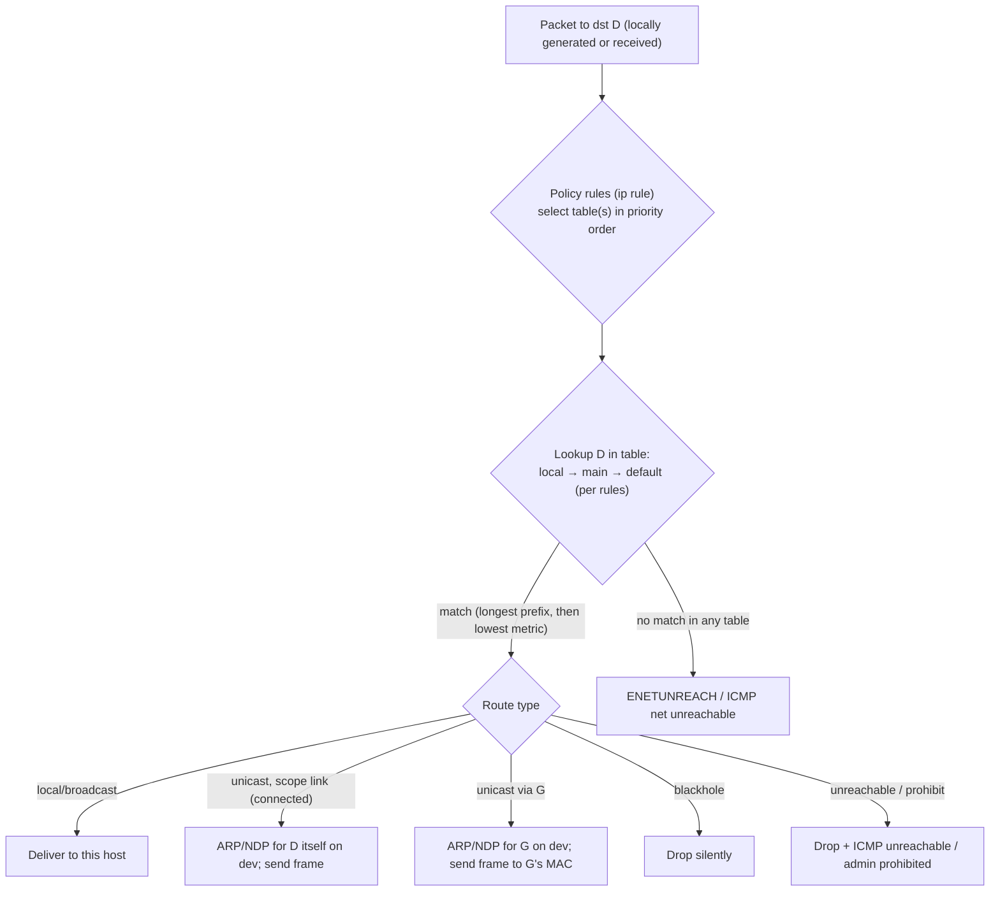
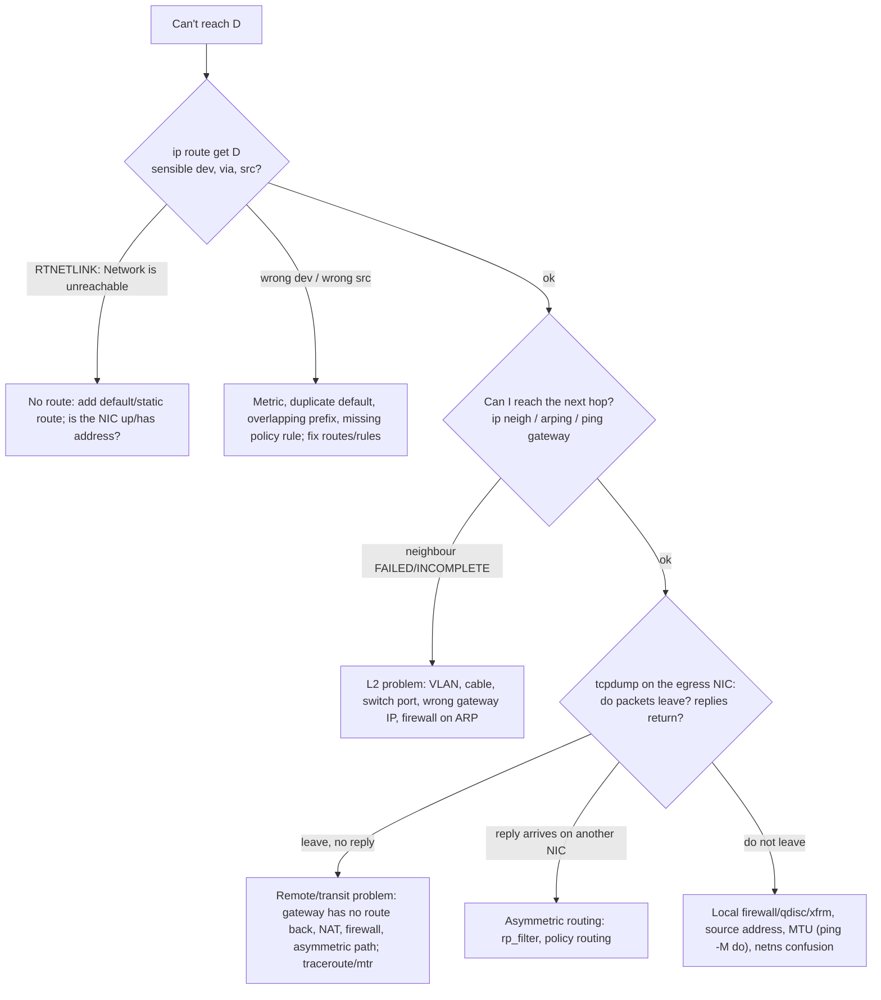

# 2.5 Routing on a host: routing tables, default gateways and forwarding

| | |
|---|---|
| Level | Beginner |
| Priority tier | 0 |
| Lab venue | A Linux VM with root (network namespaces) |
| Part | Part 2: Networking, from first principles to AI fabrics |
| Status | Drafted, labs **untested** |

## Why this matters for AI infrastructure

A GPU server is a router in miniature. It has a routing table that decides which NIC every packet leaves by, a default gateway for the world beyond its subnet, often several NICs on several networks (management, front-end, storage, one NIC per GPU for the back-end fabric), and, in Kubernetes, it forwards packets for pods. Misunderstood host routing is the root of many baffling failures: SSH works over one NIC and not another, a storage mount goes over the management network and saturates it, NCCL picks the wrong interface, a second default route silently takes over, pod traffic cannot leave the node, replies leave through a different NIC than the request arrived on (asymmetric routing) and a reverse-path filter drops them, or a stale static route sends traffic into a black hole after a network change.

This chapter explains how a Linux host decides where to send a packet: the routing table and route attributes, longest-prefix match and metrics, the default gateway, the three tables (`local`, `main`, `default`) and policy rules, source-address selection, multiple interfaces and asymmetric routing, special route types (blackhole, unreachable, local), forwarding (turning a host into a router), ICMP redirects, ECMP multipath routes, and how to configure, persist and debug all of it. Policy routing, VRFs and bonding come in chapter 2.24; dynamic routing protocols in chapters 2.13 to 2.16.

## Prerequisites and outcomes

You should know IP addressing and subnetting (chapter 2.4) and ARP/NDP (chapter 2.3).

After this chapter you can:

- Read `ip route show` fluently: destination, `via`, `dev`, `src`, `proto`, `scope`, `metric`, and flags; explain how each line got there.
- Explain longest-prefix match and metric tie-breaking, the default route, and what happens with multiple default routes.
- Explain connected (on-link) versus gateway routes, and why the gateway must be reachable on a connected subnet.
- Use `ip route get` to predict exactly what the kernel will do for a destination, including the chosen source address and interface.
- Describe the `local`, `main` and `default` routing tables, `ip rule`, and the order of lookup, and know that the routing cache is gone from modern kernels.
- Add, change and remove routes (IPv4 and IPv6), make them persistent (Netplan, NetworkManager, systemd-networkd), and add blackhole/unreachable/prohibit routes.
- Turn a Linux host into a router (`ip_forward`, forwarding per interface, firewall FORWARD policy, NAT), and understand ICMP redirects, `rp_filter` and asymmetric routing.
- Configure and understand ECMP routes and the hashing policy.
- Design the routing for a multi-NIC AI server (management, storage, rails) and Kubernetes nodes, and diagnose misrouting.

## 1. The routing decision

Every outgoing packet a host creates (and every packet it forwards) triggers a **route lookup** in the kernel's **FIB** (Forwarding Information Base): given a destination address (and often source address, input interface, TOS/DSCP, mark), find the **next hop** and **outgoing interface**. The lookup yields one of:

- **Local delivery** (the destination is one of this host's own addresses): deliver up the stack.
- **On-link (connected) delivery**: the destination is in a subnet directly attached to an interface: resolve its MAC by ARP/NDP and send the frame straight there.
- **Via a gateway**: the destination is elsewhere: send the frame to the gateway's MAC (resolved by ARP/NDP) with the destination IP unchanged; the gateway continues the process.
- **Special action**: drop silently (`blackhole`), reject with ICMP (`unreachable`, `prohibit`), or other types.
- **No route**: `Network is unreachable` (`ENETUNREACH`).



## 2. Reading the routing table

```bash
ip route show                     # IPv4 main table (default view);  ip -4 route
ip -6 route show                  # IPv6
ip route show table all           # all tables (including local and any custom tables)
route -n ; netstat -rn            # legacy tools (net-tools): same information, older format
```

Example (a GPU server with management and fabric NICs):

```text
default via 10.20.0.1 dev eno1 proto dhcp src 10.20.0.45 metric 100
10.20.0.0/24 dev eno1 proto kernel scope link src 10.20.0.45 metric 100
10.100.0.0/24 dev ens1f0 proto kernel scope link src 10.100.0.45
10.100.1.0/24 dev ens2f0 proto kernel scope link src 10.100.1.45
10.30.0.0/16 via 10.20.0.254 dev eno1 proto static metric 50
172.17.0.0/16 dev docker0 proto kernel scope link src 172.17.0.1 linkdown
blackhole 192.0.2.0/24 proto static
```

How to read a line: **destination prefix** (`default` = `0.0.0.0/0`), then attributes:

| Attribute | Meaning |
|---|---|
| `via <gateway>` | Next-hop router address; absent for connected routes. The gateway must be reachable on a connected route (the kernel refuses `Nexthop has invalid gateway` otherwise). |
| `dev <if>` | Outgoing interface |
| `proto` | Who installed it: `kernel` (from an interface address), `dhcp`, `static`, `boot`, `ra` (IPv6 router advertisement), `bgp`, `ospf`, `zebra`/`bird`/`frr`, `redirect`, `unspec` |
| `scope` | `global` (via a gateway), `link` (on-link), `host` (this host) |
| `src <addr>` | **Preferred source address** the kernel uses for packets using this route |
| `metric <n>` | Preference among routes with the *same prefix*: lower wins |
| `linkdown` / `dead` | Interface has no carrier |
| `onlink` | Treat the gateway as on-link even if no connected prefix covers it (cloud /32 setups) |
| `mtu`, `advmss`, `initcwnd`, `rto_min` ... | Per-route TCP/path tuning (`ip route show` shows them) |
| `nexthop ... weight` | Multipath (ECMP) members |

The kernel **creates the connected route automatically** when you assign an address with a prefix to an interface (`proto kernel scope link`), e.g. `ip addr add 10.100.0.45/24 dev ens1f0` adds `10.100.0.0/24 dev ens1f0 ... src 10.100.0.45`. Deleting the address deletes the route.

### Longest-prefix match and metrics

When several routes match, the kernel chooses by:

1. **Longest prefix** (most specific): `10.30.0.0/16` beats `default`; `10.30.5.0/24` beats `10.30.0.0/16`. Table order does not matter.
2. For equal prefix length: lowest **metric** (priority); then if equal, the kernel treats the routes as **multipath** only if configured as such; otherwise the first installed is used (don't rely on that).
3. Policy rules (below) can select a different *table* first.

Example: destination 10.30.7.8. Matching routes: `10.30.0.0/16 via 10.20.0.254` and `default via 10.20.0.1`. The /16 wins. Destination 8.8.8.8 matches only `default`.

### The default gateway

The **default route** matches everything not covered by a more specific route. The next hop is the **default gateway**, conventionally the first usable address in the subnet (10.20.0.1) but this is only convention. Without a default route a host reaches only its connected and static destinations. **Multiple default routes** (one per NIC, with DHCP on each) are a common accident on multi-NIC servers: with equal metrics the kernel uses one (the first), with different metrics the lowest; if the preferred NIC goes down, the other takes over; returns arriving on the wrong NIC may be dropped by `rp_filter`. Rule: **exactly one default route per routing table**, then reach other networks with specific routes or policy routing.

```bash
ip route show default
ip route replace default via 10.20.0.1 dev eno1 metric 100        # idempotent set
ip route del default via 10.99.0.1 dev ens1f0                      # remove an unwanted default
```

### `ip route get`: ask the kernel

```bash
ip route get 10.30.7.8                       # 10.30.7.8 via 10.20.0.254 dev eno1 src 10.20.0.45 uid 1000
ip route get 10.100.1.77                     # on-link: 10.100.1.77 dev ens2f0 src 10.100.1.45
ip route get 8.8.8.8 from 10.100.0.45 iif lo # what if the source were this address? (outputs route for policy routing)
ip route get 10.30.7.8 mark 0x10             # firewall mark (used with policy rules)
ip -6 route get 2001:db8::1
```

`ip route get` runs the real lookup and tells you the chosen device, gateway and **source address**: it is the single most useful debugging command in this chapter.

## 3. Routing tables, rules and special routes

Linux has up to 2^32 routing tables, identified by number (names in `/etc/iproute2/rt_tables`). The important ones:

| Table | ID | Content |
|---|---|---|
| `local` | 255 | Routes for local and broadcast addresses (`local 10.20.0.45 dev eno1`, `broadcast ...`, `local 127.0.0.0/8 dev lo`), maintained by the kernel; consulted first |
| `main` | 254 | The ordinary table: what `ip route` shows by default; where connected, static, DHCP and daemon-installed routes live |
| `default` | 253 | Usually empty fallback |
| custom (e.g. 100, 200, `fabric0`) | 1-252, 256+ | Used by policy routing: one table per NIC/tenant/VRF |

**Routing policy database** (`ip rule`) is a prioritised list that picks which table(s) to consult based on source address, destination, incoming interface, TOS, fwmark, uid, etc. The default rules are:

```text
$ ip rule show
0:      from all lookup local
32766:  from all lookup main
32767:  from all lookup default
```

so lookups go `local` → `main` → `default`. Custom rules (lower number = higher priority) implement **source-based routing**, e.g. `ip rule add from 10.100.1.45/32 table 101` then `ip route add default via 10.100.1.1 dev ens2f0 table 101` makes traffic sourced from that address use its own default gateway (chapter 2.24). Because the kernel's routing cache was removed in 3.6, lookups use the FIB trie directly and route attributes are per-route.

### Special route types

```bash
sudo ip route add blackhole 192.0.2.0/24            # silently drop (used for summary routes, security, avoiding loops)
sudo ip route add unreachable 198.51.100.0/24       # drop + ICMP host unreachable
sudo ip route add prohibit 203.0.113.0/24           # drop + ICMP administratively prohibited
sudo ip route add throw 10.9.0.0/16 table 101       # in a table, "stop looking in this table"
sudo ip route add local 10.200.0.1/32 dev lo        # make an address local (anycast/VIP on loopback)
ip route show type blackhole
```

### Loopback, VIPs and dummy interfaces

`lo` carries `127.0.0.1/8` and `::1`; **any** `127.x.y.z` address is local (so services can bind distinct loopback addresses; systemd-resolved uses 127.0.0.53). Hosts commonly add **service or router-ID addresses** as `/32` on `lo` or a `dummy` interface (`ip link add dummy0 type dummy; ip addr add 10.255.0.45/32 dev dummy0`), which are always up independent of any physical link and are what BGP and BGP-unnumbered designs advertise (chapter 2.16). `ip route show table local` lists them.

## 4. Choosing the source address

For a packet generated locally, the kernel picks the **source IP** as follows: if the application bound a specific address, use it; else use the route's `src` (when set); else the **primary address** of the output interface in the same subnet as the next hop (`ip addr` marks primary vs `secondary`); for IPv6, RFC 6724 rules choose among candidate addresses (scope matching, prefer public vs temporary per `use_tempaddr`, longest common prefix). Consequences: a packet to the Internet leaves the default-gateway NIC with that NIC's address; traffic to a connected subnet uses the address on that subnet; if two NICs share a subnet (bad practice) either may be used; applications that bind `0.0.0.0` get the chosen source per destination; services meant to answer from a particular address must bind to it (or you need policy routing so replies take the correct path). The `src` attribute of a route (`ip route add 10.30.0.0/16 via ... src 10.20.0.45`) pins the source for that route; DHCP/NetworkManager often set it.

## 5. Multiple interfaces: weak host model, rp_filter and asymmetric routing

Linux uses the **weak host model** for IPv4: it accepts a packet destined for *any* of its local addresses on *any* interface, and (subject to ARP policies, chapter 2.3) may answer from any interface. Routing for replies is by destination only (unless policy routing says otherwise). This produces **asymmetric routing**: a request arrives on NIC B (to B's address), but the reply is routed by the main table, e.g. out NIC A with A's source address or B's address from A, which the client or intermediate firewalls may drop, or the host itself may drop on input.

**Reverse path filtering** (`rp_filter`) drops packets whose source address would not be routed back out the interface they arrived on:

| `net.ipv4.conf.<if>.rp_filter` | Behaviour |
|---|---|
| 0 | No source validation |
| 1 | **Strict**: the best route back to the source must use the same interface (RFC 3704 strict) |
| 2 | **Loose**: the source must be reachable via *any* interface |

The effective value for an interface is the **maximum** of `conf.all.rp_filter` and `conf.<if>.rp_filter`. Many distributions default to strict (1) or loose (2). On multi-homed servers with per-NIC subnets and asymmetric flows (rails, storage, VIPs), strict mode causes silent drops that look like packet loss in `ethtool` (`nstat -z | grep -i IPReversePathFilter`, `/proc/net/netstat` `IPReversePathFilter` counter). Set to 2 (loose) or 0 where appropriate, and use policy routing so that replies leave the same NIC as requests arrived.

```bash
sysctl net.ipv4.conf.all.rp_filter net.ipv4.conf.default.rp_filter net.ipv4.conf.eth0.rp_filter
nstat -az | egrep 'IPReversePathFilter|IpInAddrErrors'
sudo sysctl -w net.ipv4.conf.all.log_martians=1        # log packets with impossible sources (see dmesg)
```

### Diagnosing "SSH works on NIC A but not NIC B"

1. `ip addr`, `ip route`, `ip rule`: are both NICs configured, on distinct subnets, with one default gateway?
2. From a client on subnet B, `ping` the server's B address; watch `sudo tcpdump -ni any host <client> and icmp` on the server: do requests arrive, and on which interface do the replies leave?
3. `ip route get <client IP> from <B address>`: does the reply leave on NIC B? If not, add policy routing.
4. `nstat` for `IPReversePathFilter`; relax `rp_filter`.
5. Check ARP behaviour (`arp_ignore`/`arp_announce`) so the right NIC answers ARP for the right address.

## 6. Static routes and persistence

Routes added with `ip route add` disappear on reboot or when the interface is reconfigured. Persist with the network manager of your distribution:

```yaml
# Netplan (Ubuntu): /etc/netplan/60-routes.yaml
network:
  version: 2
  ethernets:
    eno1:
      addresses: [10.20.0.45/24]
      routes:
        - to: default
          via: 10.20.0.1
        - to: 10.30.0.0/16
          via: 10.20.0.254
          metric: 50
    ens1f0:
      addresses: [10.100.0.45/24]
      routing-policy:
        - from: 10.100.0.45
          table: 101
      routes:
        - to: default
          via: 10.100.0.1
          table: 101
```

```bash
sudo nmcli connection modify eno1 +ipv4.routes "10.30.0.0/16 10.20.0.254 50"      # NetworkManager
sudo nmcli connection modify eno1 ipv4.never-default no ; sudo nmcli connection modify ens1f0 ipv4.never-default yes   # keep a NIC from installing a default route
# systemd-networkd:  [Route] Destination=10.30.0.0/16 Gateway=10.20.0.254 Metric=50   in /etc/systemd/network/*.network
# DHCP-learned routes: dhclient / NM take them from DHCP options (3 router, 121 classless static routes)
```

For clusters, push the same routes via configuration management (Ansible `ansible.builtin.template` for netplan, or role `systemd-networkd`) and verify after boot with an audit (chapter 1.28). Dynamic routing daemons (FRR, BIRD) install routes with their own `proto` and replace static configuration at scale (chapters 2.13 to 2.16).

```bash
ip route add 10.30.0.0/16 via 10.20.0.254            # add
ip route change 10.30.0.0/16 via 10.20.0.253         # change next hop
ip route replace 10.30.0.0/16 via 10.20.0.253 dev eno1 metric 50      # add or replace (preferred in scripts)
ip route del 10.30.0.0/16                            # delete (no need to specify gateway)
ip route flush dev ens1f0                            # remove all routes of a device (careful)
ip route add 10.31.0.0/24 dev ens2f0 src 10.100.1.45                 # on-link route with source pin
ip route add 10.32.0.0/24 via 10.100.1.254 onlink dev ens2f0         # gateway not in a connected subnet (cloud, /32 hosts)
ip -6 route add 2001:db8:200::/48 via fe80::1 dev eno1               # IPv6 needs dev with link-local next hop
ip monitor route                                      # watch route changes live (netlink events)
```

## 7. Linux as a router: forwarding

By default a Linux host **does not forward** packets between interfaces (it behaves as an end system). To make it a router:

```bash
sysctl net.ipv4.ip_forward net.ipv6.conf.all.forwarding           # 0 = host, 1 = router
sudo sysctl -w net.ipv4.ip_forward=1                               # or per interface: net.ipv4.conf.<if>.forwarding
echo 'net.ipv4.ip_forward = 1' | sudo tee /etc/sysctl.d/90-forward.conf ; sudo sysctl --system
```

Forwarding changes behaviour: the host now routes packets whose destination is not local (decrementing TTL, rewriting L2); IPv6 forwarding disables accepting RAs for some settings (`accept_ra=2` needed to keep SLAAC while forwarding); `rp_filter` and ICMP redirect handling matter; the firewall **FORWARD** chain/hook (nftables `forward`) now governs transit traffic (default policy `DROP` under Docker); and **NAT** (masquerade) is typically added to share a private network behind one address:

```bash
# Minimal NAT router (nftables); replace names. For iptables syntax see chapter 2.23.
sudo nft add table ip nat
sudo nft 'add chain ip nat postrouting { type nat hook postrouting priority 100 ; }'
sudo nft add rule ip nat postrouting oifname "eno1" masquerade
```

Typical roles: gateway for a lab subnet; a **bastion/NAT instance**; **Kubernetes nodes** (kernel forwards pod traffic: `ip_forward=1` is required by kubeadm and container runtimes; `br_netfilter` and `net.bridge.bridge-nf-call-iptables=1` let iptables see bridged pod traffic); **VPN/WireGuard concentrators**; software routers using FRR. High packet rates on a software router need NIC multi-queue, IRQ affinity and often XDP/DPDK or a hardware router; per-core forwarding on a modern kernel is on the order of a few Mpps.

### ICMP redirects and source routing

A router that forwards a packet out the **same interface** it arrived on, to a next hop that is on the sender's own subnet, sends an **ICMP Redirect** ("use gateway X for that destination"); hosts may install a cached host route (`proto redirect`). Redirects are mostly a legacy feature that complicates security and troubleshooting; production hosts disable them: `net.ipv4.conf.all.accept_redirects=0`, `send_redirects=0`, `secure_redirects=0`. Likewise `accept_source_route=0` (IP source routing, an attack vector). Verify with `sysctl -a | grep -E 'redirects|source_route'`.

## 8. Multipath (ECMP) routes

A route can have several next hops of equal cost; the kernel picks one **per flow** using a hash so that packets of a flow stay in order:

```bash
sudo ip route add 10.200.0.0/16 \
   nexthop via 10.100.0.1 dev ens1f0 weight 1 \
   nexthop via 10.100.1.1 dev ens2f0 weight 1
ip route show 10.200.0.0/16
sysctl net.ipv4.fib_multipath_hash_policy    # 0 = L3 (src/dst IP), 1 = L4 (5-tuple), 2 = inner L3 for encapsulated, 3 = custom fields
sysctl net.ipv4.fib_multipath_use_neigh      # skip next hops whose neighbour is failed
```

ECMP with L3-only hashing sends every connection between the same two hosts down the same path (no entropy), which is why data-centre fabrics hash on the full **5-tuple** (policy 1). In AI clusters with RDMA, the UDP source port varies per queue pair to give the fabric entropy; NCCL even sets multiple QPs per connection for the same reason (chapter 2.20 and Part 12). Host-level ECMP across NICs is usually done with a bond (L2, chapter 2.12) or per-rail routing, not by a default multipath route, unless the design explicitly wants L3 ECMP (BGP to the host).

## 9. IPv6 routing on a host

Same model, with differences: the **default route usually comes from an RA** (`proto ra`) with a **link-local next hop**; routes need `dev` for link-local gateways; the connected prefix route is installed when the address is configured or learned from an RA prefix (on-link flag); there is no ARP (neighbour discovery) and no broadcast; privacy/temporary addresses influence source selection; `accept_ra` (0 ignore, 1 accept if not forwarding, 2 accept even when forwarding) and `accept_ra_defrtr`, `accept_ra_pinfo` control what the host learns; `net.ipv6.conf.<if>.forwarding` per interface. `ip -6 route get`, `ip -6 rule` behave like their IPv4 counterparts.

## 10. Containers, VMs and Kubernetes: more routing tables than you think

Each **network namespace** has its own interfaces and routing tables (chapter 2.25). A pod's namespace has a default route via the CNI's gateway (the host-side veth peer or bridge address) and the node has routes to each pod's /32 or /24, or overlay (VXLAN, Geneve, IPIP) routes through tunnel devices, or BGP-advertised pod prefixes (Calico, Cilium native routing). When traffic fails between pods or to the Internet, check routes in **both** namespaces: `kubectl exec ... -- ip route`, `nsenter -t <pid> -n ip route`, and on the node `ip route | grep -E 'cali|cni|flannel|cilium|vxlan'`. `hostNetwork: true` pods use the node's tables. Docker's `docker0` (172.17.0.0/16) appears as a connected route and can collide with real networks: change `default-address-pools` in `/etc/docker/daemon.json`. Cloud VMs have routes managed by the cloud (a default route via the subnet gateway, `/32` host routes with `onlink`, and cloud route tables outside the VM, chapter 2.32); do not delete them.

## 11. Diagnosing routing problems



Checklist of commands: `ip -br addr`, `ip -br link`, `ip route show table all`, `ip rule show`, `ip route get <dest> [from <src>]`, `ip neigh`, `sysctl net.ipv4.conf.all.rp_filter net.ipv4.ip_forward`, `ss -tn`, `tracepath`, `mtr -n`, `sudo tcpdump -ni any`, `nstat -z | grep -i drop`, `nft list ruleset`, `conntrack -L`. Document the intended routing for each server class and automate an audit that compares actual routes with intended ones.

## 12. Case study: a GPU server with six networks

A server has `eno1` (management 10.20.0.0/24, default route), `eno2` (storage 10.30.4.0/24 to NFS/Lustre servers at 10.30.0.0/16), and eight back-end NICs `ens1f0..ens8f0` for RoCE rails (one /24 per rail: `10.100.R.0/24`, no gateway, rail switches in L2 or routed with /31 per link). Symptoms: Lustre traffic uses the management NIC; NCCL occasionally uses the wrong interface; some rail pings fail one way. Fixes:

1. Exactly one default route (management). `nmcli connection modify <rail NIC> ipv4.never-default yes` on others.
2. Static route `10.30.0.0/16 via 10.30.4.1 dev eno2` (or the connected subnet if servers are on-link) so storage uses `eno2`.
3. Each rail is its own subnet; peers on the same rail reach each other on-link. Cross-rail traffic must not exist (or is routed by the leaf/spine). Set `NCCL_SOCKET_IFNAME` (bootstrap) and let NCCL choose IB/RoCE devices by `NCCL_IB_HCA`; configure `rp_filter=2`, `arp_ignore=1`, `arp_announce=2` for the multi-NIC ARP behaviour.
4. If rails use L3 (routed) with a gateway per rail: policy routing tables per rail (`ip rule add from 10.100.R.N/32 table 10R`, default route per table) so each source address returns by its own NIC.
5. Audit: for every pair of (source NIC address, destination), `ip route get <dst> from <src>` must give the expected device; run in CI after provisioning.

## 13. Hands-on lab: routing between network namespaces

First, run the self-checking Python lab (`code/part02/host_routing_tables_lab.py`) locally. It verifies the standard Linux routing tables (`255 local`, `254 main`, `253 default`), Longest-Prefix Match (`LPM`) and metric tie-breaking, multi-NIC policy-based routing (`ip rule` -> per-rail routing tables), and reverse-path filtering (`effective = max(all, iface)` across modes `0`, `1`, and `2`).

```bash
python3 code/part02/host_routing_tables_lab.py
```

Next, on a disposable Linux VM with `root` (all interactive VM commands below are `untested here`), build two subnets joined by a router namespace:

```bash
# topology:  hA(10.1.0.2/24) -- r(10.1.0.1/24, 10.2.0.1/24) -- hB(10.2.0.2/24)
for n in hA r hB; do sudo ip netns add $n; sudo ip -n $n link set lo up; done # (untested here)
sudo ip link add vA type veth peer name rA; sudo ip link set vA netns hA; sudo ip link set rA netns r # (untested here)
sudo ip link add vB type veth peer name rB; sudo ip link set vB netns hB; sudo ip link set rB netns r # (untested here)
sudo ip -n hA addr add 10.1.0.2/24 dev vA ; sudo ip -n r addr add 10.1.0.1/24 dev rA # (untested here)
sudo ip -n hB addr add 10.2.0.2/24 dev vB ; sudo ip -n r addr add 10.2.0.1/24 dev rB # (untested here)
for d in "hA vA" "r rA" "r rB" "hB vB"; do set -- $d; sudo ip -n $1 link set $2 up; done # (untested here)
sudo ip netns exec hA ping -c1 10.2.0.2      # (untested here) fails: Network is unreachable (no route)
```

1. **Observe failures in order**: (a) no route (`ip -n hA route`), add `ip -n hA route add default via 10.1.0.1`; ping again: still fails? Because the router does not forward: `sudo ip netns exec r sysctl -w net.ipv4.ip_forward=1`; and hB has no route back: add `ip -n hB route add default via 10.2.0.1`. Ping works. Capture on `rA` and `rB` (`ip netns exec r tcpdump -ni rA`) and note the TTL decrement (64 → 63) and unchanged IPs; note the MAC rewrite (`tcpdump -e`).
2. **`ip route get`** from hA for various destinations; explain the output.
3. **Longest prefix**: add a more specific route in hA for 10.2.0.2/32 via a nonexistent gateway or a blackhole; show it overrides the default; `ip route del`.
4. **Special routes**: add `blackhole`, `unreachable`, `prohibit` routes in hA and compare the `ping` errors and ICMP types (`tcpdump icmp`).
5. **Metric and failover**: give hA two gateways (second router namespace r2 or a second link) with metrics 100 and 200; bring down the first link; observe failover (`ip route` shows `linkdown`).
6. **Asymmetric routing and rp_filter**: add a second path so replies return on a different interface; set `rp_filter=1` on the receiving host; see drops (`nstat | grep ReversePath`); set `rp_filter=2`; add policy routing to fix properly.
7. **Policy routing**: add table 101 with its own default route and `ip rule add from 10.1.0.2/32 table 101`; use `ip route get ... from ...` to show the table in use.
8. **ECMP**: create two parallel links between hA and r; add a multipath route; run several `iperf3` flows and ping with different source ports; see the distribution with `ip -s link`; change `fib_multipath_hash_policy` from 0 to 1.
9. **ICMP redirects** (optional): place hA and a second router on the same subnet as r and watch an ICMP Redirect and the `proto redirect` route; then disable.
10. **Persist**: write the netplan or systemd-networkd equivalent for a VM, apply with `netplan try`, reboot, verify.
11. **Cleanup**: `sudo ip netns del hA hB r` (one by one).

## 14. Common mistakes

- Two or more default routes (or a default route on every NIC from DHCP).
- A gateway that is not on a connected subnet; a mask that disagrees with the real network.
- Overlapping prefixes on different interfaces without understanding the metric/longest-prefix rules.
- Forgetting the return path: a route to a remote network without a route back from it.
- Relying on routes added with `ip` that vanish on reboot.
- Leaving `rp_filter` strict on multi-homed hosts; leaving ICMP redirects enabled on production machines.
- Enabling forwarding without reviewing firewall FORWARD policy, NAT and `rp_filter`.
- Debugging with `ping` only; not checking which interface and source address were used.
- Forgetting that containers and namespaces have their own routing tables.

## 15. Interview angles

- "How does a Linux host decide where to send a packet? What if two routes match?" (Longest prefix, metric, policy rules, tables.)
- "What does `default via 10.0.0.1 dev eth0` mean? What requirement does the gateway meet?"
- "A server has two NICs on two subnets and the reply goes out the wrong one. Why? How do you fix it?" (Weak host, asymmetric routing, policy routing, rp_filter.)
- "What does `ip_forward` do? What else do you need to build a NAT router?"
- "What is `rp_filter` and why does it drop legitimate packets sometimes?"
- "Explain `ip route get` output. What's the `src` field?"
- "How do pods reach other nodes' pods in your CNI of choice? Where are the routes?"
- "What are ICMP redirects and why disable them?"
- "What is a blackhole route and when would you use one?" (Summary route anchors, DDoS mitigation, avoiding loops.)

## Exercises

1. **Reading the Routing Table, Longest-Prefix Match (`LPM`), and Metric Tie-Breaking:** (a) Distinguish a connected route (`proto kernel scope link src ...`) from an indirect gateway route (`via ...`), and explain what the `src` and `metric` fields do; (b) using `select_best_route_lpm()` in `code/part02/host_routing_tables.py`, determine which route wins for destination `10.200.5.42` and destination `93.184.216.34` when the table contains `0.0.0.0/0` (`metric 100` via `10.0.0.1`), `0.0.0.0/0` (`metric 200` via `10.0.1.1`), `10.200.0.0/16` (`metric 50`), and `10.200.5.0/24` (`metric 500`).
2. **Special Route Types (`local`, `blackhole`, `unreachable`, `prohibit`), `onlink`, and IPv6 Link-Local Gateways:** (a) Compare `blackhole`, `unreachable`, and `prohibit` routes in terms of packet behavior, ICMP messages sent, and local socket `errno`; (b) when is the `onlink` flag needed on a cloud VM, and why must an IPv6 route with a link-local next hop (`fe80::1`) always specify `dev <iface>`?
3. **The Multiple-Default-Gateway Trap and Policy-Based Routing (`ip rule`):** Why does configuring a default gateway on every NIC of an 8-rail GPU server break connectivity? Using `evaluate_policy_routing()`, trace how `ip rule` priorities (`100`, `101`, `32766`) and per-rail routing tables (`rail0`, `rail1`, `main` in `/etc/iproute2/rt_tables`) route packets sourced from `10.100.1.15` out `eth2` (`via 10.100.1.1`) while management traffic from `10.0.0.15` exits `ens4`.
4. **Reverse-Path Filtering (`rp_filter`) Modes `0`/`1`/`2` and the `max(all, iface)` Trap:** (a) Explain `rp_filter` modes `0` (disabled), `1` (strict), and `2` (loose); (b) using `evaluate_rp_filter()`, explain why setting `net.ipv4.conf.eth1.rp_filter=0` while `net.ipv4.conf.all.rp_filter=1` still leaves `eth1` in strict mode (`1`) and drops asymmetric packets (`IPStatsInAddrErrors` in `nstat -az`).
5. **Linux as a Router (`ip_forward=1`), NAT (`MASQUERADE`), and Host ECMP (`fib_multipath_hash_policy=1`):** (a) List the four requirements for turning a Linux host into a working IPv4/IPv6 router between two subnets; (b) why is L3-only ECMP hashing (`fib_multipath_hash_policy=0`) ineffective when two GPU hosts open multiple parallel TCP streams between the same pair of IP addresses, and what do `fib_multipath_hash_policy=1` and `fib_multipath_use_neigh=1` change?
6. **Host Routing in Kubernetes Nodes and Multi-NIC GPU Servers:** Compare the host routing table (`ip route`) of a Kubernetes node running an **overlay CNI** (`flannel.1` / `cilium_vxlan`) versus a **direct-routing / BGP CNI** (Calico/Cilium native routing), and write the 5-step routing and ARP verification checklist from Section 12 for a 6-network GPU server.

## Checkpoint questions (20)

<details>
<summary>1. In what exact order does the Linux kernel select a route from a routing table?</summary>
Within a routing table, the kernel always applies **Longest-Prefix Match (`LPM`)** first—a `/32` beats a `/24`, which beats a `/16`, which beats the `/0` default route, **regardless of metric**. Only when two routes have the **exact same prefix length** does the kernel pick the one with the **lowest `metric`** (preference).
</details>

<details>
<summary>2. What is the difference between a connected (`scope link`) route and an indirect (`via`) route at the ARP/NDP layer?</summary>
For a **connected route** (`10.0.0.0/24 dev ens4 proto kernel scope link src 10.0.0.15`), the destination IP is on the local link, so the kernel ARPs directly for the **destination IP's MAC address**. For an **indirect route** (`default via 10.0.0.1 dev ens4`), the kernel ARPs for the **gateway's (`10.0.0.1`) MAC address** and addresses the Ethernet frame to the gateway while keeping the final destination IP in the IPv4 header.
</details>

<details>
<summary>3. What rule must a gateway IP (`via <gw>`) satisfy, and what does the `onlink` flag do?</summary>
Normally, the gateway IP in `via <gw>` must be directly reachable via an existing connected (`scope link`) subnet on that interface, or the kernel rejects the route with `Error: Nexthop has invalid gateway`. The **`onlink`** flag tells the kernel to pretend the gateway is directly attached on that link and ARP for it even when the host's own IP (such as a `/32` cloud address) does not cover the gateway's prefix.
</details>

<details>
<summary>4. What does `ip route get 93.184.216.34` (and `ip route get <dst> from <src> iif <dev>`) show that `ip route show` does not?</summary>
`ip route show` only lists the contents of the `main` routing table. `ip route get` actually executes the kernel's full FIB + `ip rule` policy-routing lookup for that specific destination (and optional source IP/interface/fwmark) and prints the winning table, next hop `via`, egress `dev`, chosen `src` IP, and cached Path MTU.
</details>

<details>
<summary>5. Compare the four special route types: `local`, `blackhole`, `unreachable`, and `prohibit`.</summary>
- **`local`**: delivers packets to the local host itself (stored in table `255`, including loopback and every local interface IP).
- **`blackhole`**: drops matching packets **silently** with no ICMP reply (used on summary-route anchors to prevent routing loops and for DDoS mitigation).
- **`unreachable`**: drops matching packets and sends **ICMP Host/Network Unreachable** (local sockets fail immediately with `EHOSTUNREACH` / `ENETUNREACH`).
- **`prohibit`**: drops matching packets and sends **ICMP Administratively Prohibited** (`EACCES`).
</details>

<details>
<summary>6. Why do routers and GPU nodes assign `/32` (or `/128`) addresses to the loopback interface (`lo`) or a `dummy0` interface?</summary>\nA physical NIC goes down whenever its cable or switch port flaps, which withdraws its interface IP. Loopback (`lo`) and `dummy` interfaces are virtual and stay **`UP` as long as the kernel is running**, providing an indestructible router ID, BGP session source IP, or health-check/anycast VIP reachable via any active physical uplink.\n</details>

<details>
<summary>7. Why must an IPv6 route with a link-local next hop (`fe80::1`) always include `dev <iface>`?</summary>
Because every IPv6-enabled interface on a host uses the exact same link-local prefix **`fe80::/64`**, the address `fe80::1` by itself is ambiguous across interfaces; `dev ens4` (or `fe80::1%ens4`) tells the kernel which physical link that neighbor lives on.
</details>

<details>
<summary>8. What are the three default Linux routing tables (`255`, `254`, `253`) and their `ip rule` priorities (`NK` Chapter 2)?</summary>
`ip rule show` lists three built-in rules evaluated in ascending priority order:\n- Priority **`0`** -> table **`local` (`255`)**: local interface IPs and broadcast routes (cannot be overridden without custom rules at priority `< 0` / early priorities).\n- Priority **`32766`** -> table **`main` (`254`)**: normal connected, static, and DHCP routes (`ip route show`).\n- Priority **`32767`** -> table **`default` (`253`)**: fallback table (normally empty).\n</details>

<details>
<summary>9. Why is configuring a default gateway on more than one NIC a classic multi-homed server bug?</summary>
A default route (`0.0.0.0/0`) matches every destination in the world. If a secondary NIC (such as a storage or GPU rail NIC) installs a default route with a lower or equal metric—or if DHCP installs a second default route—outbound internet/management traffic is hijacked onto the private storage/rail network and blackholed, or replies leave the wrong NIC.
</details>

<details>
<summary>10. How does Policy-Based Routing (`ip rule` + `/etc/iproute2/rt_tables`) solve asymmetric routing on a multi-NIC server?</summary>
For each additional routed NIC (e.g., `eth1` with IP `10.100.0.15/24` and gateway `10.100.0.1`), you create a dedicated routing table (`100 rail0` in `/etc/iproute2/rt_tables`) containing that NIC's connected route and default gateway (`ip route add default via 10.100.0.1 dev eth1 table rail0`), and add a source-based policy rule (`ip rule add from 10.100.0.0/24 table rail0 priority 100`) so any packet sourced from `eth1`'s IP is guaranteed to route out `eth1`.
</details>

<details>
<summary>11. What is Linux's \"weak host model\", and how does it cause asymmetric routing when a server has multiple NICs?</summary>
Linux follows the **weak host model**: it considers IP addresses to belong to the **host as a whole** rather than to individual interfaces, and standard FIB lookup depends only on the **destination IP**. If a client sends a request to `eth1`'s IP (`10.100.0.15`) from a subnet whose best route in `main` points out `ens4`, Linux accepts the packet on `eth1` and sends the reply out `ens4` (with source IP `10.100.0.15`).
</details>

<details>
<summary>12. Explain the three modes of `rp_filter` (`0`, `1`, `2`), how the effective value is calculated, and how to check for `rp_filter` drops.</summary>
- `0`: disabled (no source validation).\n- `1` (**strict**): the incoming packet is dropped unless the best route in the FIB back to the packet's **source IP** exits the **exact same interface** the packet arrived on.\n- `2` (**loose**): the packet is accepted as long as the source IP is reachable via **any** interface.\nThe kernel computes **`effective_rp_filter = max(net.ipv4.conf.all.rp_filter, net.ipv4.conf.<if>.rp_filter)`**—so you must lower **both** `all` and `<if>` to `2` (or `0`). Check drops with `nstat -az | grep -iE 'InAddrErrors|ReversePath'`.
</details>

<details>
<summary>13. What four steps are required to make a Linux host act as a router between two networks (`HLW` Chapter 9)?</summary>
(1) Enable kernel packet forwarding (`sysctl -w net.ipv4.ip_forward=1` and `net.ipv6.conf.all.forwarding=1`); (2) ensure the firewall (`nftables`/`iptables`) `FORWARD` chain permits traffic between the interfaces; (3) ensure downstream hosts point their routes at the Linux router **and** upstream routers have a return route back (or add `MASQUERADE` SNAT if downstream is private); and (4) tune `rp_filter` and disable ICMP redirects (`send_redirects=0`, `accept_redirects=0`).
</details>

<details>
<summary>14. What is an ICMP Redirect, and why should `accept_redirects` and `send_redirects` be disabled (`0`) on servers?</summary>
An **ICMP Redirect** is sent by a router when it notices a host forwarded a packet to it even though a better next-hop router sits on the same LAN subnet. On production servers, accepting ICMP Redirects allows an attacker or misconfigured router on the LAN to inject host routes into the routing cache; always set `accept_redirects=0` and `send_redirects=0`.
</details>

<details>
<summary>15. How does Equal-Cost Multipath (`ECMP`) work on a Linux host, and why must you set `net.ipv4.fib_multipath_hash_policy = 1`?</summary>
A multipath route lists multiple `nexthop via ... dev ... weight ...` entries for the same prefix. With the legacy default `fib_multipath_hash_policy = 0` (**L3 hash**), the kernel hashes only `(source IP, destination IP)`, pinning **all** TCP connections between two hosts onto a single link. Setting **`fib_multipath_hash_policy = 1` (**L4 hash**)** hashes the full **5-tuple** `(src IP, dst IP, proto, src port, dst port)` so parallel connections spread across all uplinks (pair with `fib_multipath_use_neigh = 1` to skip failed ARP neighbours).
</details>

<details>
<summary>16. Why is per-packet round-robin load balancing across two links avoided for TCP and RDMA flows?</summary>
If consecutive packets of the **same** TCP or RDMA flow take different physical paths with even slightly different queue depths or cable lengths, packets arrive **out of order** at the receiver. In TCP, out-of-order arrival triggers triple duplicate ACKs and false fast-retransmit rate cuts; in traditional RoCEv2/InfiniBand (`RC` QPs without adaptive routing), out-of-order packets trigger sequence-error drops and go-back-N retransmissions. Flow-based 5-tuple hashing keeps each flow in order on one path.
</details>

<details>
<summary>17. How do you persist static routes and policy-routing rules in `Netplan` (Ubuntu) and `NetworkManager` (`nmcli`, RHEL/Rocky)?</summary>
In **Netplan** (`/etc/netplan/*.yaml`): add `routes:` (`to:`, `via:`, `metric:`, `table:`) and `routing-policy:` (`from:`, `table:`, `priority:`) under the interface, and test safely with `sudo netplan try`. In **NetworkManager**: use `nmcli connection modify <conn> +ipv4.routes "10.200.0.0/16 10.0.0.254" +ipv4.routing-rules "priority 100 from 10.100.0.0/24 table 100"` and prevent secondary NICs from adding default routes with **`ipv4.never-default yes`**.
</details>

<details>
<summary>18. What does a Kubernetes node's routing table look like under an overlay CNI versus a direct-routing / BGP CNI?</summary>
In both modes, `net.ipv4.ip_forward=1` is enabled and each **local Pod** on the node has a `/32` host route pointing into its `veth` interface (`10.244.1.5 dev cali1234 scope link`). For **remote Pods** on other nodes: a **direct-routing / BGP CNI** (Calico, Cilium native routing) installs `/24` routes pointing directly at each peer node's underlay IP (`10.244.2.0/24 via 10.0.0.16 dev ens4`), whereas an **overlay CNI** routes remote `/24`s into a tunnel device (`flannel.1` or `cilium_vxlan`).
</details>

<details>
<summary>19. On an 8-GPU server with management (`eno1`), storage (`eno2`), and 8 RoCE rail NICs (`ens1f0..ens8f0`), how should routing be structured?</summary>
(1) Install **exactly one** default route in `main` on the management NIC (`eno1`, setting `ipv4.never-default yes` on all other NICs); (2) add a specific static prefix route (`10.30.0.0/16 via 10.30.4.1 dev eno2`) for the storage cluster; (3) place each rail NIC on its own subnet (`10.100.R.0/24`) with per-rail policy-routing tables (`ip rule add from 10.100.R.N/32 table 10R`) if L3-routed across leaf/spine; and (4) set `rp_filter=2`, `arp_ignore=1`, and `arp_announce=2`.
</details>

<details>
<summary>20. Walk through the 4-step command sequence to debug \"Host A cannot reach Host B (`10.200.5.42`)\".</summary>
(1) Run **`ip route get 10.200.5.42`** (and `ip route get 10.200.5.42 from <src_ip>`) to verify which table, next-hop gateway, outgoing `dev`, and `src` IP the kernel selects; (2) run **`ip neigh show dev <dev>`** to verify whether the next hop's MAC is `REACHABLE` or `FAILED`/`INCOMPLETE`; (3) run **`sudo tcpdump -ni <dev> host 10.200.5.42`** while pinging to see whether packets leave `<dev>` and whether replies return on `<dev>` or another NIC; and (4) check **`ip route get <src_ip>` on Host B** (and `nstat -az | grep InAddrErrors`) to verify the return path and `rp_filter`.
</details>

## Sources and review notes

- **Sources read in full:**
  - `how-linux-works-3rd-edition` — Brian Ward, *How Linux Works*, 3rd ed., **Chapter 9: Understanding Your Network and Its Configuration** (routes and the kernel routing table, `ip route show`, default gateway and longest-prefix selection, IPv6 routes and link-local default gateways, manual interface/route configuration, boot-time configuration problems and network managers, Linux as a router `net.ipv4.ip_forward=1`, private networks and NAT, firewalls and routers, and ARP/NDP interplay).
  - `networking-and-kubernetes` — James Strong and Vallery Lancey, *Networking and Kubernetes*, **Chapter 2: Linux Networking** (Linux kernel networking parameters, routing tables `255 local` / `254 main` / `253 default`, netfilter, `conntrack`, and `IPVS`).
  - `computer-networking-problems-and-solutions` — Russ White and Ethan Banks, *Computer Networking Problems and Solutions*, **Chapter 6: Interlayer Discovery** (default gateway mask problem) and **Chapter 7: Packet Switching** (switching vs routing, the forwarding table and MAC header rewrite, ECMP and 5-tuple hashing).
- **Run here:** `python3 code/part02/host_routing_tables_lab.py` (11 passed, 0 failed).
- **Explicitly labelled inferences:** The 6-network GPU server case study (management `eno1`, storage `eno2`, 8 RoCE rails `ens1f0..ens8f0` with per-rail policy routing, `0.0.0.0/0` / `::/0` default routes, `rp_filter=2`, `arp_ignore=1`, `arp_announce=2`), Kubernetes Pod routing comparison, and `fib_multipath_hash_policy=1` ECMP recipe (`ip-route(8)`, `ip-rule(8)`, `ip-sysctl.rst`) connect Linux host FIB and policy routing to Part 5, Part 8, and Part 9 GPU cluster networking (cross-referenced with Chapters 2.1–2.4, 2.9, 2.13, 2.20, 2.22, 2.25, and 2.27, plus original study items 21, 22, 23, 24, 25, 26, 27, 28, 29, and 30).
- **Not verified on live hardware:** All interactive VM commands (`ip route`, `ip rule`, `ip netns`, `sysctl`, `tcpdump`, `nstat`, `netplan`, `nmcli`) are marked (untested here) and must be executed on a disposable Linux VM with console access.
