# 2.5 Routing on a host: routing tables, default gateways and forwarding

| | |
|---|---|
| Level | Beginner |
| Priority tier | 0 |
| Lab venue | A Linux VM with root (network namespaces) |
| Part | Part 2: Networking, from first principles to AI fabrics |
| Status | Drafted, labs **untested** |

## Why this matters for AI infrastructure

Picture a storage mount that goes over the management network and saturates it. Everyone suspects the storage system, because that is where the slowness shows. The fault sits in the routing table, not in the storage. A GPU server is a router in miniature. It has a routing table that decides which NIC every packet leaves by, and a default gateway for the world beyond its subnet. It often has several NICs on several networks: management, front-end, storage, and one NIC per GPU for the back-end fabric. In Kubernetes it also forwards packets for pods.

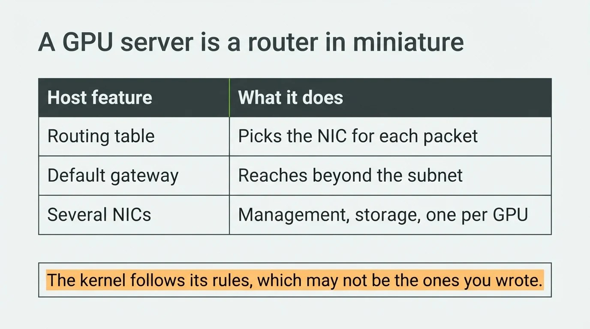
*Figure 2.5.1. A misread routing table causes baffling failures that look like other problems.*


Misunderstood host routing causes many baffling failures, and they often seem to contradict each other. SSH works over one NIC and not another. NCCL picks the wrong interface. A second default route silently takes over. Pod traffic cannot leave the node. Replies leave through a different NIC than the request arrived on, which is called asymmetric routing, and a reverse-path filter drops them. A stale static route sends traffic into a black hole after a network change. Each of these is the machine following its own routing rules faithfully, and the rules are not the ones you thought you had written.

The best way in is to watch one packet leave a server and ask what the kernel has to know before it can let go of it. It needs to match the destination against a list of routes, pick the most specific one, and settle on a gateway, an interface and a source address. That list is the routing table, and reading it fluently is the core skill. Once a single table makes sense, the story grows. Linux actually keeps several tables and a set of rules that choose between them, and special route types can drop or reject packets instead of sending them. A host can also forward other machines' packets and become a router, answer ICMP redirects, and spread traffic over several equal paths. The last step is to configure, persist and debug all of it. Policy routing, VRFs and bonding come in chapter 2.24. Dynamic routing protocols come in chapters 2.13 to 2.16.

## Prerequisites and outcomes

Suppose a node reaches one subnet but not another. To find out why, you need to read its routing table, and this chapter shows you how. You should already know IP addressing and subnetting (chapter 2.4) and ARP/NDP (chapter 2.3). If a term here is new, it is explained where it first appears.

When you have finished, use the next three paragraphs as a self-check. You can read `ip route show` fluently. You can name the destination, `via`, `dev`, `src`, `proto`, `scope`, `metric` and the flags, and explain how each line got there. You can also explain longest-prefix match, metric tie-breaking, the default route, and what happens when there are several default routes.

You can tell a connected (on-link) route from a gateway route, and explain why the gateway must be reachable on a connected subnet. You can use `ip route get` to predict exactly what the kernel will do for a destination, including the chosen source address and interface. You can describe the `local`, `main` and `default` routing tables, `ip rule`, and the order of lookup. You know that the routing cache is gone from modern kernels.

Finally, you can add, change and remove routes for IPv4 and IPv6, and make them persistent with Netplan, NetworkManager or systemd-networkd. You can add blackhole, unreachable and prohibit routes. You can turn a Linux host into a router (`ip_forward`, forwarding per interface, the firewall FORWARD policy, NAT), and you understand ICMP redirects, `rp_filter` and asymmetric routing. You can configure ECMP routes and their hashing policy, design the routing for a multi-NIC AI server and for Kubernetes nodes, and diagnose misrouting.

## 1. The routing decision

Suppose a packet is about to leave your server for a remote address. Before it leaves, the kernel has to decide where it goes, much as a driver at a junction has to choose a road. Every outgoing packet a host creates, and every packet it forwards, triggers a **route lookup** in the kernel's FIB (Forwarding Information Base). The FIB is simply the kernel's table of routes, organised for fast searching. The kernel takes the destination address, and often the source address, input interface, TOS/DSCP and mark. From those it finds the next hop and the outgoing interface.

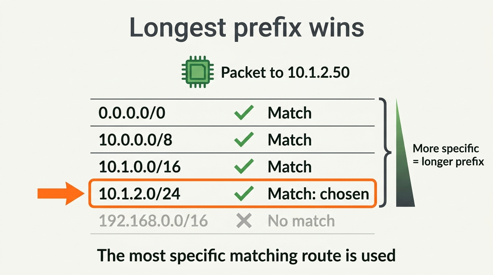

*Figure 2.5.2. Several routes can match a destination; the most specific, longest prefix is used.*

The lookup ends in one of five outcomes.

- Local delivery: the destination is one of this host's own addresses, so the packet goes up the stack.
- On-link (connected) delivery: the destination sits in a subnet attached directly to an interface. The kernel resolves its MAC with ARP or NDP and sends the frame straight there.
- Via a gateway: the destination is elsewhere. The frame goes to the gateway's MAC, which ARP or NDP resolves, while the destination IP stays unchanged. The gateway continues the process.
- Special action: the packet is dropped silently (`blackhole`), or rejected with ICMP (`unreachable`, `prohibit`), or handled by another route type.
- No route: the host reports `Network is unreachable` (`ENETUNREACH`).

The diagram shows the same decision in order. The rules pick a table, the lookup picks a route, and the route type decides what happens to the packet.

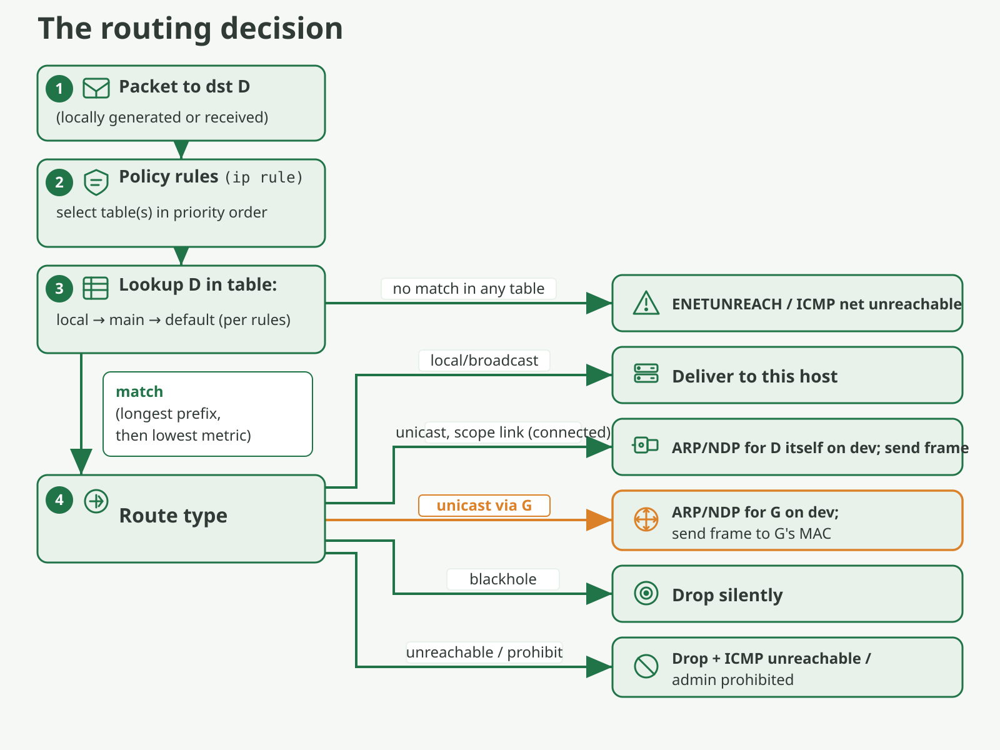

*Figure 2.5.3. The routing decision, as a diagram.*

Keep these five outcomes in mind, because every command in this chapter is a way of finding out which one applies. When a packet misbehaves, ask which of the five it hit.

## 2. Reading the routing table

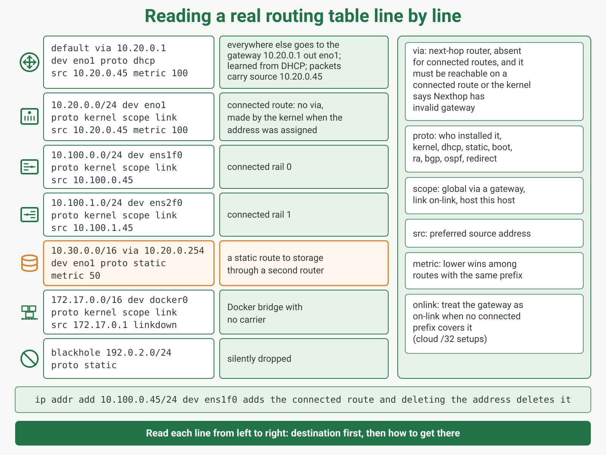

*Figure 2.5.4. Each routing table line starts with the destination and then says how to get there, and connected routes have no via.*

When a node cannot reach something, its routing table is the first place to look, the way you would check a map before blaming the car. You read it with `ip route show`. The commands below show the IPv4 main table, the IPv6 table, and every table on the machine.

```bash
ip route show                     # IPv4 main table (default view);  ip -4 route
ip -6 route show                  # IPv6
ip route show table all           # all tables (including local and any custom tables)
route -n ; netstat -rn            # legacy tools (net-tools): same information, older format
```

The example below comes from a GPU server with management and fabric NICs. Read each line from left to right.

```text
default via 10.20.0.1 dev eno1 proto dhcp src 10.20.0.45 metric 100
10.20.0.0/24 dev eno1 proto kernel scope link src 10.20.0.45 metric 100
10.100.0.0/24 dev ens1f0 proto kernel scope link src 10.100.0.45
10.100.1.0/24 dev ens2f0 proto kernel scope link src 10.100.1.45
10.30.0.0/16 via 10.20.0.254 dev eno1 proto static metric 50
172.17.0.0/16 dev docker0 proto kernel scope link src 172.17.0.1 linkdown
blackhole 192.0.2.0/24 proto static
```

Each line starts with the destination prefix, where `default` means `0.0.0.0/0`. The attributes after it say how the route works. Read them as the directions that go with each destination. The table below explains each one.

| Attribute | Meaning |
|---|---|
| `via <gateway>` | Next-hop router address; absent for connected routes. The gateway must be reachable on a connected route (the kernel refuses `Nexthop has invalid gateway` otherwise). |
| `dev <if>` | Outgoing interface |
| `proto` | Who installed it: `kernel` (from an interface address), `dhcp`, `static`, `boot`, `ra` (IPv6 router advertisement), `bgp`, `ospf`, `zebra`/`bird`/`frr`, `redirect`, `unspec` |
| `scope` | `global` (via a gateway), `link` (on-link), `host` (this host) |
| `src <addr>` | **Preferred source address** the kernel uses for packets using this route |
| `metric <n>` | Preference among routes with the *same prefix*: lower wins |
| `linkdown` / `dead` | Interface has no carrier |
| `onlink` | Treat the gateway as on-link even if no connected prefix covers it (cloud /32 setups) |
| `mtu`, `advmss`, `initcwnd`, `rto_min` ... | Per-route TCP/path tuning (`ip route show` shows them) |
| `nexthop ... weight` | Multipath (ECMP) members |

Connected routes have no `via`, because their destinations are reached directly on that link. The kernel creates these routes for you, so you never have to write them by hand. When you assign an address with a prefix to an interface, the kernel adds a route marked `proto kernel scope link`. For example, `ip addr add 10.100.0.45/24 dev ens1f0` adds `10.100.0.0/24 dev ens1f0 ... src 10.100.0.45`. Deleting the address deletes the route.

### Longest-prefix match and metrics

Several routes often match the same destination, so the kernel needs a rule for choosing one. Think of two signposts at a junction, one saying "town centre" and another saying "Mill Street, number 12". You follow the more specific one. The kernel applies these checks in order.

1. The longest prefix, the most specific route, wins. `10.30.0.0/16` beats `default`, and `10.30.5.0/24` beats `10.30.0.0/16`. The order of tables does not matter here.
2. If the prefix lengths are equal, the lowest metric wins, because the metric is the priority. If the metrics are also equal, the routes count as multipath only when they are configured that way. Otherwise the first installed route is used, and you should not rely on that.
3. Policy rules, covered below, can select a different table before any of this happens.

Here is a worked example. Suppose the destination is 10.30.7.8. Two routes match it: `10.30.0.0/16 via 10.20.0.254` and `default via 10.20.0.1`. The /16 wins because it is more specific, since it describes a smaller set of addresses. A destination of 8.8.8.8 matches only the `default` route, so it has no competition.

Try one more case, this time with a tie. Imagine two routes to the same /24 prefix, one with metric 100 and one with metric 200. The kernel uses the one with metric 100. If its interface loses carrier, that route stops being usable and the metric 200 route takes over without anyone touching the table. This is why metrics are the usual way to describe "primary" and "backup" paths on a host.

### The default gateway

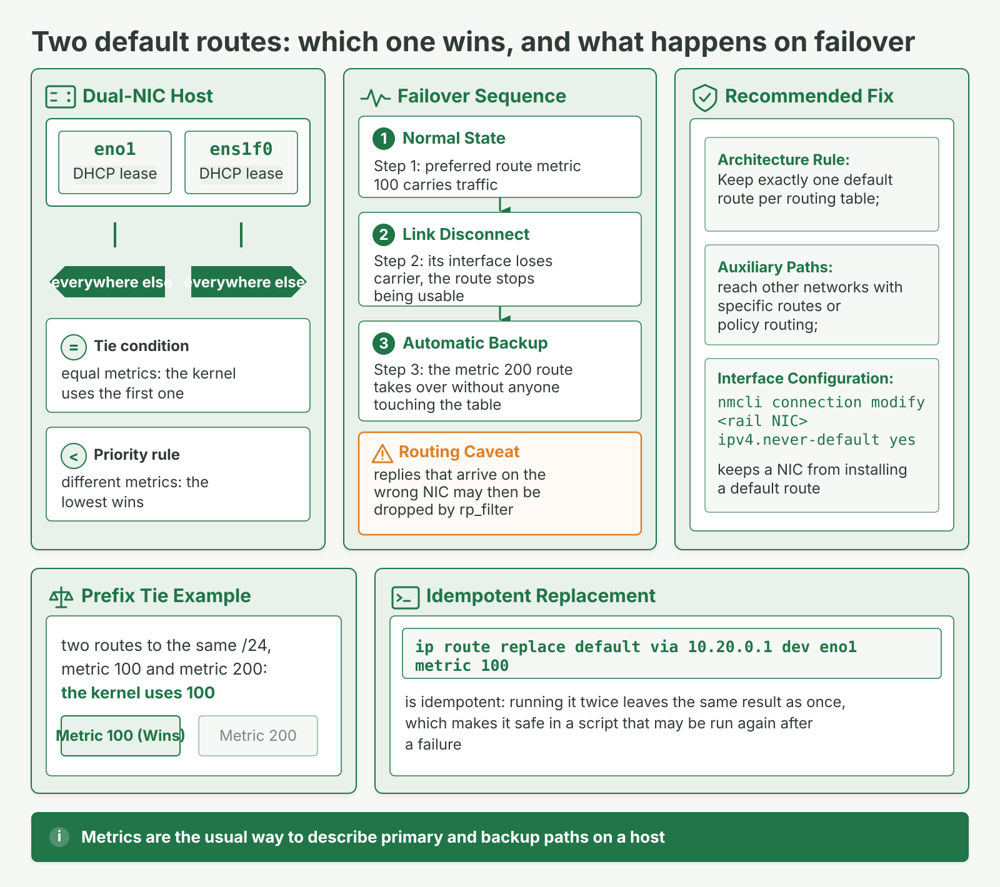

*Figure 2.5.5. With two default routes the lowest metric wins and the other takes over on link loss, but replies on the wrong NIC may hit rp_filter.*

The default route matches everything that no more specific route covers. It is the "everywhere else" sign. Its next hop is the default gateway. By convention the gateway is the first usable address in the subnet, such as 10.20.0.1, but that is only a convention. Without a default route, a host reaches only its connected and static destinations.

Multiple default routes are a common accident on multi-NIC servers, often because each NIC gets one from DHCP. Picture two signposts that both say "everywhere else", pointing in different directions. With equal metrics, the kernel uses the first one. With different metrics, it uses the lowest. If the preferred NIC goes down, the other one takes over, and replies that arrive on the wrong NIC may be dropped by `rp_filter`. Keep exactly one default route per routing table, and reach other networks with specific routes or policy routing.

```bash
ip route show default
ip route replace default via 10.20.0.1 dev eno1 metric 100        # idempotent set
ip route del default via 10.99.0.1 dev ens1f0                      # remove an unwanted default
```

The `replace` form is idempotent, which means running it twice leaves the same result as running it once. That makes it safe in a script that may be run again after a failure. Use it when a script sets the default route.

### `ip route get`: ask the kernel

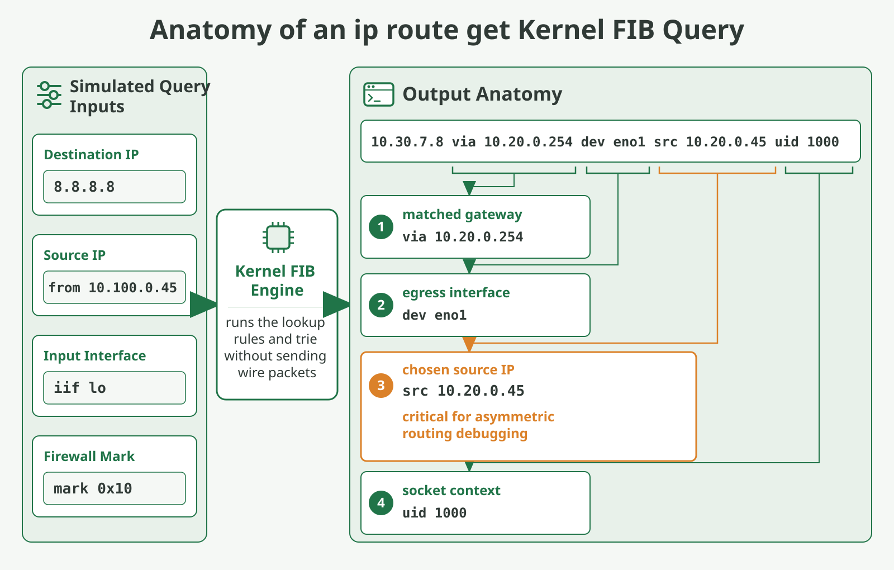

*Figure 2.5.6. The ip route get command runs a full FIB lookup without sending traffic, exposing the selected gateway, egress device, and source address.*

Reading the table tells you what should happen. `ip route get` tells you what will happen, because it runs the real lookup, the same one the kernel does for a live packet. It is the difference between reading a recipe and tasting the dish.

```bash
ip route get 10.30.7.8                       # 10.30.7.8 via 10.20.0.254 dev eno1 src 10.20.0.45 uid 1000
ip route get 10.100.1.77                     # on-link: 10.100.1.77 dev ens2f0 src 10.100.1.45
ip route get 8.8.8.8 from 10.100.0.45 iif lo # what if the source were this address? (outputs route for policy routing)
ip route get 10.30.7.8 mark 0x10             # firewall mark (used with policy rules)
ip -6 route get 2001:db8::1
```

The first command returns a gateway, the second is on-link, and the third asks what would happen if the source were `10.100.0.45`, which matters for policy routing. `ip route get` reports the chosen device, gateway and **source address**, which makes it the single most useful debugging command in this chapter. When a route looks right but traffic still goes the wrong way, ask the kernel with `ip route get` before you change anything.

## 3. Routing tables, rules and special routes

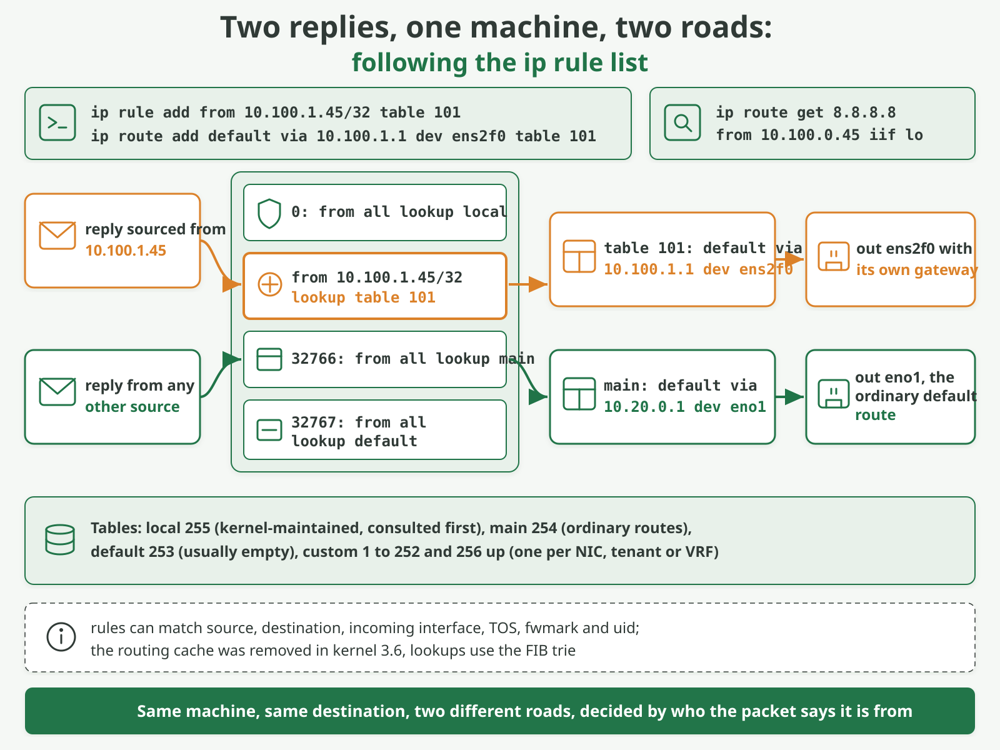

*Figure 2.5.7. A reply sourced from 10.100.1.45 hits the custom rule and table 101, while any other source falls through to main and the ordinary default route.*

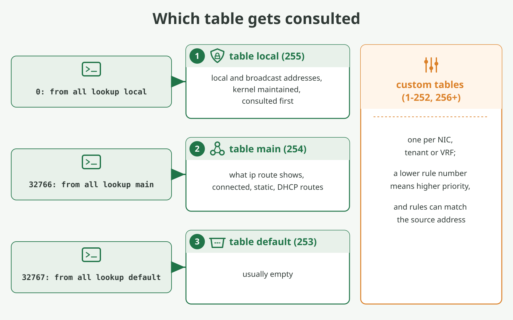

*Figure 2.5.8. Rules in ip rule decide which routing table the kernel looks in, starting with local, then main, then default.*

A single routing table is not enough for a server with several networks, because one list cannot express "traffic from this NIC goes this way". So Linux keeps several. Each table has a number. Names for some of them live in `/etc/iproute2/rt_tables`. Linux has up to 2^32 routing tables in total.

| Table | ID | Content |
|---|---|---|
| `local` | 255 | Routes for local and broadcast addresses (`local 10.20.0.45 dev eno1`, `broadcast ...`, `local 127.0.0.0/8 dev lo`), maintained by the kernel; consulted first |
| `main` | 254 | The ordinary table: what `ip route` shows by default; where connected, static, DHCP and daemon-installed routes live |
| `default` | 253 | Usually empty fallback |
| custom (e.g. 100, 200, `fabric0`) | 1-252, 256+ | Used by policy routing: one table per NIC/tenant/VRF |

When you look at the `local` table, you see the addresses the kernel treats as its own. The routing policy database, managed with `ip rule`, is a prioritised list. It decides which table or tables to consult, based on source address, destination, incoming interface, TOS, fwmark, uid and so on. It is like a receptionist's checklist of which department to ask first. The default rules look like this:

```text
$ ip rule show
0:      from all lookup local
32766:  from all lookup main
32767:  from all lookup default
```

Read the rules from the top, the way the kernel does. They send lookups to `local`, then `main`, then `default`, in that order. Custom rules with a lower number have higher priority, and they add source-based routing. For example, `ip rule add from 10.100.1.45/32 table 101` followed by `ip route add default via 10.100.1.1 dev ens2f0 table 101` makes traffic sourced from that address use its own default gateway. Chapter 2.24 covers this in more depth. The kernel's routing cache was removed in 3.6, so lookups use the FIB trie directly, and each route carries its own attributes.

Follow one packet through those rules to see why they matter. A reply sourced from 10.100.1.45 reaches the lookup. The kernel walks the rules in priority order. The custom rule matches the source address, so the lookup goes to table 101 and finds the default route there. A reply from any other source skips that rule, falls through to `main`, and takes the ordinary default route. Same machine, same destination, two different roads, decided purely by who the packet says it is from.

### Special route types

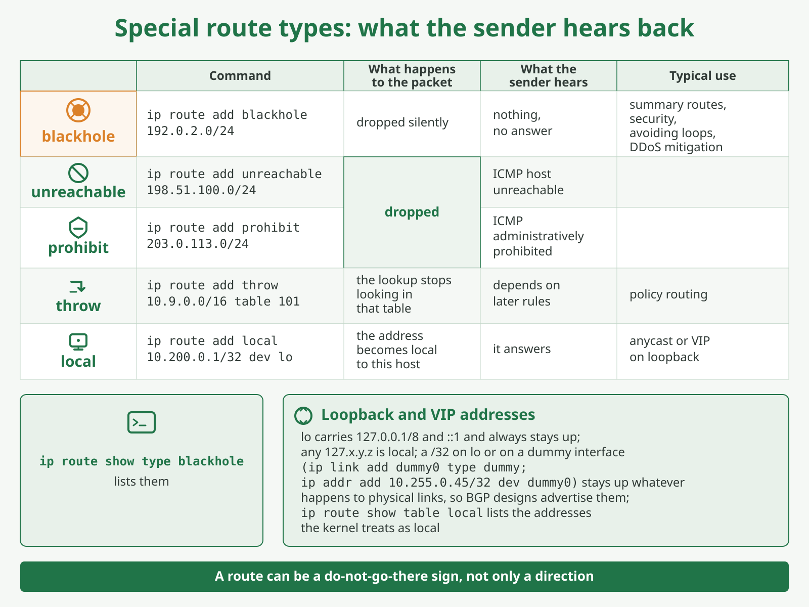

*Figure 2.5.9. A blackhole drops silently while unreachable and prohibit drop with an ICMP message, and a local route makes an address local for VIPs.*

Sometimes you want a destination dropped, rejected or treated as local, instead of sent to a gateway. A route does not always have to be a direction. It can also be a "do not go there" sign. The commands below add those special route types.

```bash
sudo ip route add blackhole 192.0.2.0/24            # silently drop (used for summary routes, security, avoiding loops)
sudo ip route add unreachable 198.51.100.0/24       # drop + ICMP host unreachable
sudo ip route add prohibit 203.0.113.0/24           # drop + ICMP administratively prohibited
sudo ip route add throw 10.9.0.0/16 table 101       # in a table, "stop looking in this table"
sudo ip route add local 10.200.0.1/32 dev lo        # make an address local (anycast/VIP on loopback)
ip route show type blackhole
```

Each type treats the packet differently, and the difference is in what the sender hears back. A blackhole drops it silently, which suits summary routes, security and avoiding loops. The sender simply gets no answer. An unreachable route drops it and sends back an ICMP host unreachable. A prohibit route drops it and sends back an ICMP administratively prohibited message. A `throw` route tells the lookup to stop looking in that table. A `local` route makes an address local, which is how you place an anycast or VIP address on loopback.

### Loopback, VIPs and dummy interfaces

`lo` carries `127.0.0.1/8` and `::1`. This is the loopback interface, a virtual one that always stays up and exists only inside the host. Any `127.x.y.z` address counts as local, so services can bind distinct loopback addresses. systemd-resolved uses 127.0.0.53. Hosts often add service or router-ID addresses as `/32` addresses on `lo` or on a `dummy` interface. For example, `ip link add dummy0 type dummy; ip addr add 10.255.0.45/32 dev dummy0` creates one. These addresses stay up whatever happens to physical links, which is why BGP and BGP-unnumbered designs advertise them (chapter 2.16). To see the addresses the kernel treats as local, run `ip route show table local`.

### Adding and deleting routes by hand

The default route is not always enough. Suppose your host is on `10.23.2.0/24`, and you need to reach `192.168.45.0/24`. You know that the host at `10.23.2.44` can route to that network. Add a route that sends that traffic to the router. You are telling the kernel: for that destination, use this door instead of the default one.

```
# ip route add 192.168.45.0/24 via 10.23.2.44
```

To delete the route, you do not need to name the router:

```
# ip route del 192.168.45.0/24
```

Routes are often harder than they look. The return path matters too. Hosts on `192.168.45.0/24` must have a way back to `10.23.2.0/24`, or your new route is useless. A route is only half of a conversation. Replies need a road too.

To remove the default gateway, run `ip route del default`. To set it again, run `ip route add default via gw-address dev interface`. The `gw-address` must be an address in a subnet already attached to one of your interfaces.

Keep it simple where you can. Give local hosts only a default route. When you need several subnets, let the routers that act as default gateways do the routing between them.

## 4. Choosing the source address

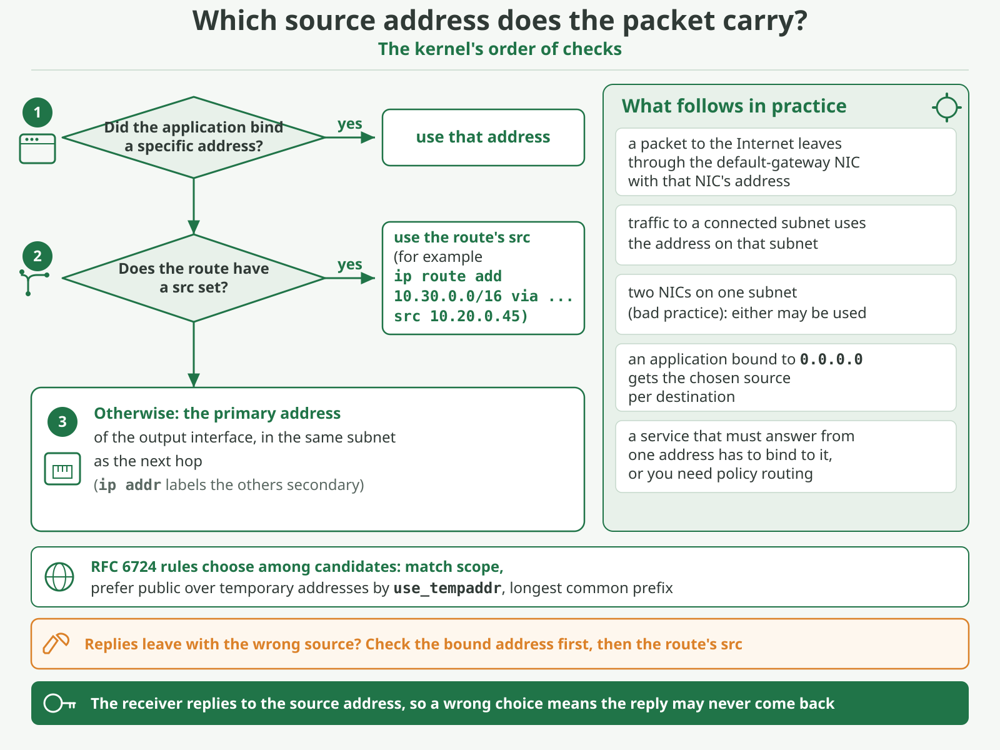

*Figure 2.5.10. The kernel uses the bound address, then the route's src, then the primary address of the output interface.*

Suppose a server has several addresses and an application opens a connection. Which address does the packet carry as its source? The receiver will use that address to reply, so a wrong choice means the reply may never come back. For a packet the host generates itself, the kernel follows a fixed order. If the application bound a specific address, the kernel uses that address. If not, it uses the route's `src`, when one is set. If neither applies, it uses the primary address of the output interface, in the same subnet as the next hop. `ip addr` marks the primary address and labels the others `secondary`.

For IPv6, RFC 6724 rules choose among the candidate addresses. They match scope, prefer public over temporary addresses according to `use_tempaddr`, and look at the longest common prefix.

These rules have practical results that you can predict. A packet to the Internet leaves through the default-gateway NIC, with that NIC's address. Traffic to a connected subnet uses the address on that subnet. If two NICs share a subnet, which is bad practice, either one may be used. An application that binds `0.0.0.0` gets the chosen source for each destination. A service that must answer from one particular address has to bind to it, or you need policy routing so that replies take the correct path.

The `src` attribute pins the source for a route. For example, `ip route add 10.30.0.0/16 via ... src 10.20.0.45` does that. DHCP and NetworkManager often set it for you. If replies leave with the wrong source address, check the bound address first, then the route's `src`.

## 5. Multiple interfaces: weak host model, rp_filter and asymmetric routing

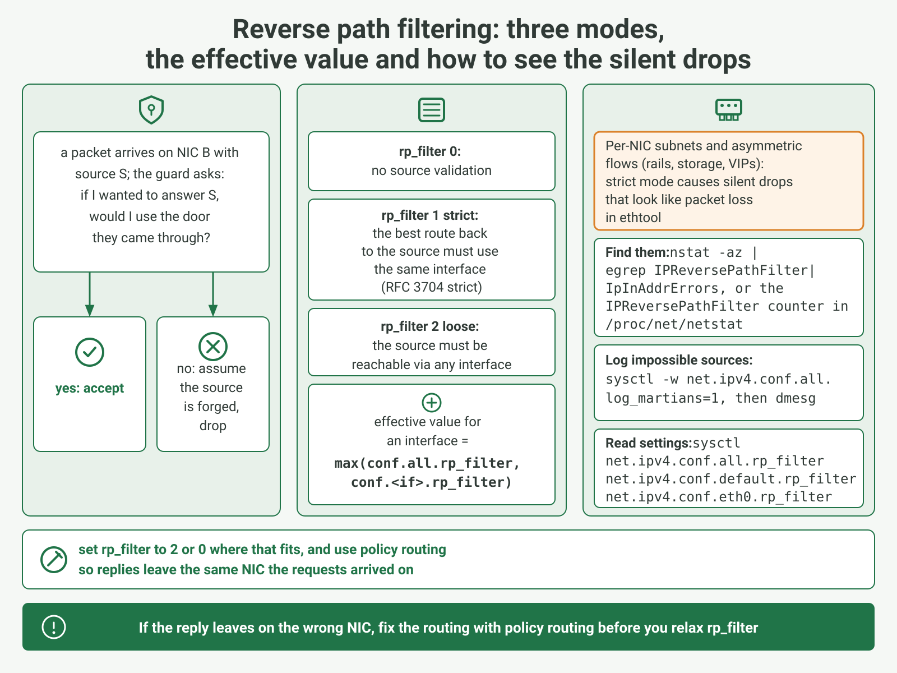

*Figure 2.5.11. Strict rp_filter drops packets whose best return route uses another interface, and the effective setting is the maximum of the all and per-interface values.*

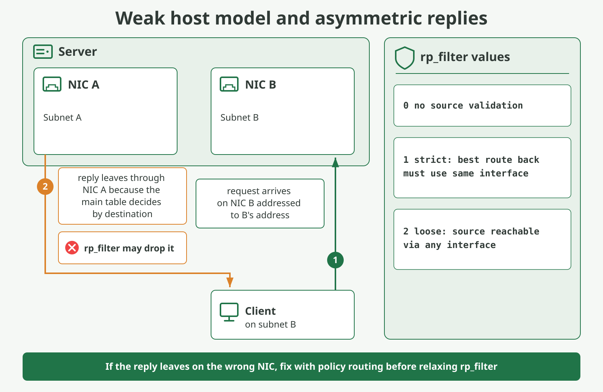

*Figure 2.5.12. Linux routes replies by destination only, so a reply can leave on a different NIC than the request arrived on.*

Consider a server with two NICs on two subnets. A request arrives on NIC B, addressed to B's address, and the reply leaves through NIC A. That happens because Linux uses the weak host model for IPv4. In plain words, "weak host" means the machine thinks of its addresses as belonging to the whole host, not to one particular card. The kernel accepts a packet addressed to any of its local addresses, on any interface. Subject to the ARP policies in chapter 2.3, it may also answer from any interface.

Routing for replies depends only on the destination, unless policy routing says otherwise. The reply therefore follows the main table. It may leave NIC A with A's source address, or leave NIC A with B's address. The client or an intermediate firewall may drop that reply, and the host itself may drop it on input. This is asymmetric routing. The request came in one door and the answer went out a different one.

Reverse path filtering (`rp_filter`) is a check that drops packets whose source address would not route back out the interface they arrived on. It is a guard that asks, "if I wanted to answer this sender, would I use the door they came through?" If the answer is no, the guard assumes the source address is forged. The modes below control how strict that check is.

| `net.ipv4.conf.<if>.rp_filter` | Behaviour |
|---|---|
| 0 | No source validation |
| 1 | **Strict**: the best route back to the source must use the same interface (RFC 3704 strict) |
| 2 | **Loose**: the source must be reachable via *any* interface |

The effective value for an interface is the maximum of `conf.all.rp_filter` and `conf.<if>.rp_filter`. Many distributions default to strict (1) or loose (2). On a multi-homed server with per-NIC subnets and asymmetric flows, such as rails, storage and VIPs, strict mode causes silent drops. Those drops look like packet loss in `ethtool`. You can find them with `nstat -z | grep -i IPReversePathFilter`, or in the `IPReversePathFilter` counter in `/proc/net/netstat`. Set `rp_filter` to 2 (loose) or 0 where that fits, and use policy routing so that replies leave the same NIC the requests arrived on.

The commands below read the settings and counters, and turn on logging for impossible source addresses.

```bash
sysctl net.ipv4.conf.all.rp_filter net.ipv4.conf.default.rp_filter net.ipv4.conf.eth0.rp_filter
nstat -az | egrep 'IPReversePathFilter|IpInAddrErrors'
sudo sysctl -w net.ipv4.conf.all.log_martians=1        # log packets with impossible sources (see dmesg)
```

### Diagnosing "SSH works on NIC A but not NIC B"

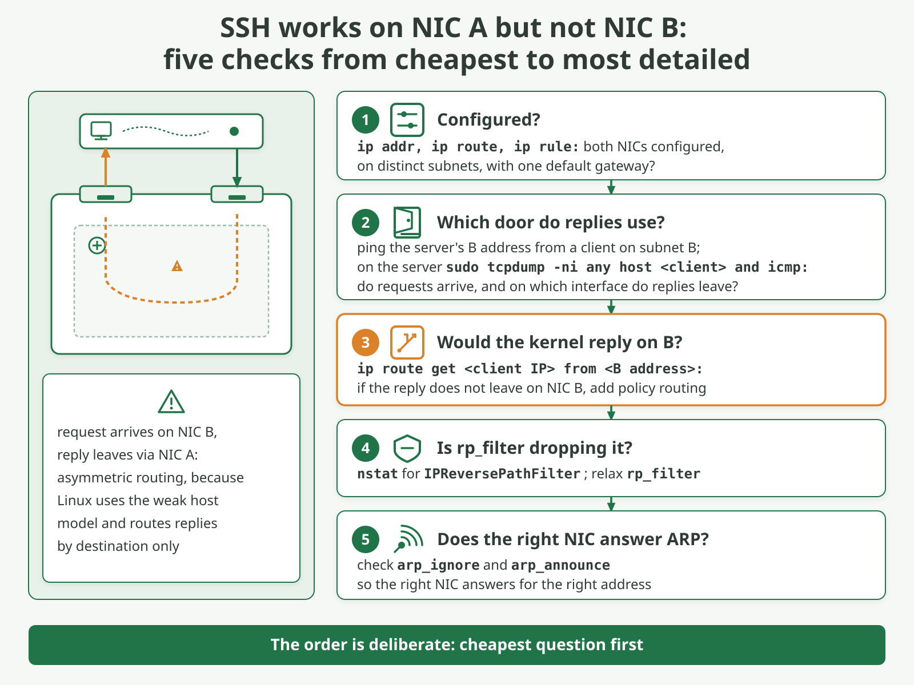

*Figure 2.5.13. Work from configuration, to which interface replies leave on, to ip route get, rp_filter and ARP, cheapest question first.*

When SSH works on one NIC but not on the other, work through these checks. Each one narrows down the cause, and the order is deliberate, from the cheapest question to the more detailed one.

1. Start with `ip addr`, `ip route` and `ip rule`. Are both NICs configured, on distinct subnets, with one default gateway?
2. From a client on subnet B, `ping` the server's B address. On the server, run `sudo tcpdump -ni any host <client> and icmp`. Do the requests arrive, and on which interface do the replies leave?
3. Run `ip route get <client IP> from <B address>`. Does the reply leave on NIC B? If not, add policy routing.
4. Check `nstat` for `IPReversePathFilter`, and relax `rp_filter`.
5. Check the ARP behaviour (`arp_ignore` and `arp_announce`), so that the right NIC answers ARP for the right address.

If the reply leaves on the wrong NIC, fix the routing with policy routing before you relax `rp_filter`.

## 6. Static routes and persistence

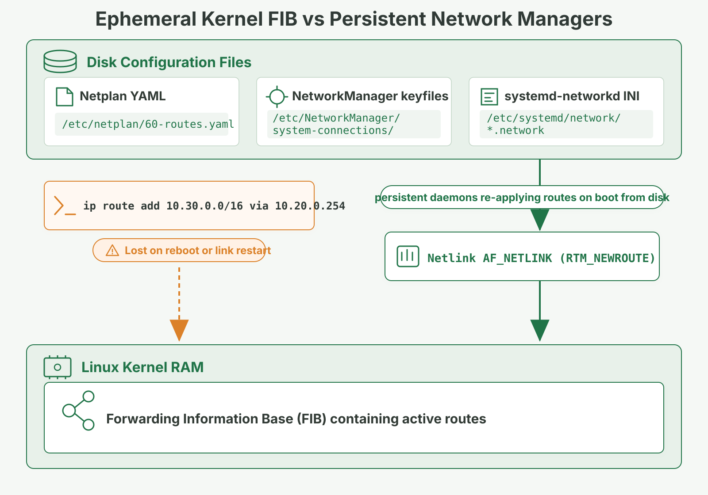

*Figure 2.5.14. Routes added manually with ip route exist only in kernel RAM and vanish on reboot, whereas persistent managers reinstall routes from disk via Netlink during boot.*

Suppose you add a route by hand, reboot the server, and the route is gone. That is expected, because routes added with `ip route add` disappear on reboot or when the interface is reconfigured. They live only in the kernel's memory. To keep a route, put it in the network manager your distribution uses. The Netplan file below sets a default route and a static route on `eno1`. It also gives `ens1f0` its own table with a source rule.

```yaml
# Netplan (Ubuntu): /etc/netplan/60-routes.yaml
network:
  version: 2
  ethernets:
    eno1:
      addresses: [10.20.0.45/24]
      routes:
        - to: default
          via: 10.20.0.1
        - to: 10.30.0.0/16
          via: 10.20.0.254
          metric: 50
    ens1f0:
      addresses: [10.100.0.45/24]
      routing-policy:
        - from: 10.100.0.45
          table: 101
      routes:
        - to: default
          via: 10.100.0.1
          table: 101
```

The other managers use different files and commands. The block below shows the NetworkManager and systemd-networkd forms, and where DHCP-learned routes come from.

```bash
sudo nmcli connection modify eno1 +ipv4.routes "10.30.0.0/16 10.20.0.254 50"      # NetworkManager
sudo nmcli connection modify eno1 ipv4.never-default no ; sudo nmcli connection modify ens1f0 ipv4.never-default yes   # keep a NIC from installing a default route
# systemd-networkd:  [Route] Destination=10.30.0.0/16 Gateway=10.20.0.254 Metric=50   in /etc/systemd/network/*.network
# DHCP-learned routes: dhclient / NM take them from DHCP options (3 router, 121 classless static routes)
```

On a cluster, you do not want to repeat this by hand on every node, because one forgotten node becomes the odd one out that fails later. Push the same routes with configuration management, such as the Ansible `ansible.builtin.template` module for netplan or the `systemd-networkd` role. Check them after boot with an audit (chapter 1.28). Dynamic routing daemons such as FRR and BIRD install routes with their own `proto`, and at scale they replace static configuration (chapters 2.13 to 2.16).

Until a route is persisted, the commands below change only the running system. They cover adding, changing, deleting and watching routes.

```bash
ip route add 10.30.0.0/16 via 10.20.0.254            # add
ip route change 10.30.0.0/16 via 10.20.0.253         # change next hop
ip route replace 10.30.0.0/16 via 10.20.0.253 dev eno1 metric 50      # add or replace (preferred in scripts)
ip route del 10.30.0.0/16                            # delete (no need to specify gateway)
ip route flush dev ens1f0                            # remove all routes of a device (careful)
ip route add 10.31.0.0/24 dev ens2f0 src 10.100.1.45                 # on-link route with source pin
ip route add 10.32.0.0/24 via 10.100.1.254 onlink dev ens2f0         # gateway not in a connected subnet (cloud, /32 hosts)
ip -6 route add 2001:db8:200::/48 via fe80::1 dev eno1               # IPv6 needs dev with link-local next hop
ip monitor route                                      # watch route changes live (netlink events)
```

Use `ip route replace` in scripts, because it adds the route or updates an existing one. Treat `ip route flush` with care, since it removes every route on a device.

## 7. Linux as a router: forwarding

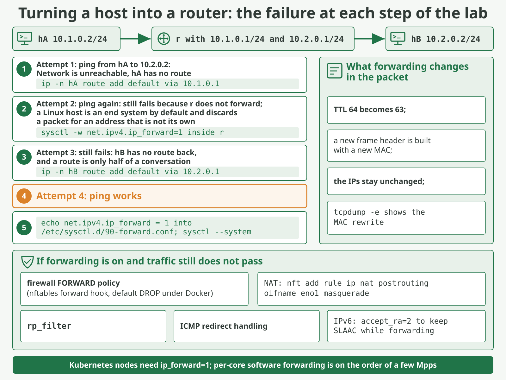

*Figure 2.5.15. A Linux host forwards only after ip_forward is set to 1, and each side also needs a route, including the return path.*

Suppose a lab subnet needs to reach another network through this server. By default, a Linux host does not forward packets between its interfaces. It behaves as an end system, which is a machine that sends and receives its own traffic but does not carry other people's. To make it a router, you turn forwarding on, usually with the `ip_forward` setting.

```bash
sysctl net.ipv4.ip_forward net.ipv6.conf.all.forwarding           # 0 = host, 1 = router
sudo sysctl -w net.ipv4.ip_forward=1                               # or per interface: net.ipv4.conf.<if>.forwarding
echo 'net.ipv4.ip_forward = 1' | sudo tee /etc/sysctl.d/90-forward.conf ; sudo sysctl --system
```

The value 0 means host and 1 means router. The `tee` line writes the setting to a file in `/etc/sysctl.d`, so it persists, and `sysctl --system` loads it.

If you turn on forwarding and traffic still does not pass, check the firewall FORWARD policy first. Forwarding changes how the host behaves. The host now routes packets whose destination is not local, decrementing the TTL and rewriting the L2 header. IPv6 forwarding changes how router advertisements are accepted, and `accept_ra=2` is needed to keep SLAAC while forwarding. Both `rp_filter` and ICMP redirect handling matter now. The firewall FORWARD chain, which is the nftables `forward` hook, governs transit traffic, and its default policy is `DROP` under Docker. NAT, usually added as a masquerade rule, lets a private network share one address.

A short example shows what forwarding changes. Imagine a host with one interface on 10.1.0.0/24 and another on 10.2.0.0/24. Before forwarding is on, a packet arriving for 10.2.0.2 on the first interface is discarded, because that address is not the host's own. After forwarding is on, the same packet is looked up, its TTL goes down by one, a new frame header is built, and it leaves on the second interface. The host has quietly become a router, and nothing in the packet itself changed except those two fields.

The commands below build a minimal NAT router with nftables. For the iptables syntax, see chapter 2.23.

```bash
# Minimal NAT router (nftables); replace names. For iptables syntax see chapter 2.23.
sudo nft add table ip nat
sudo nft 'add chain ip nat postrouting { type nat hook postrouting priority 100 ; }'
sudo nft add rule ip nat postrouting oifname "eno1" masquerade
```

Forwarding shows up in several roles, and it helps to recognise them. A host can be a gateway for a lab subnet, a bastion or NAT instance, a VPN or WireGuard concentrator, or a software router that runs FRR. Kubernetes nodes forward pod traffic through the kernel. kubeadm and the container runtimes require `ip_forward=1`, and `br_netfilter` with `net.bridge.bridge-nf-call-iptables=1` lets iptables see bridged pod traffic. A software router at high packet rates needs NIC multi-queue and IRQ affinity, and often XDP/DPDK or a hardware router. Per-core forwarding on a modern kernel is on the order of a few Mpps.

### ICMP redirects and source routing

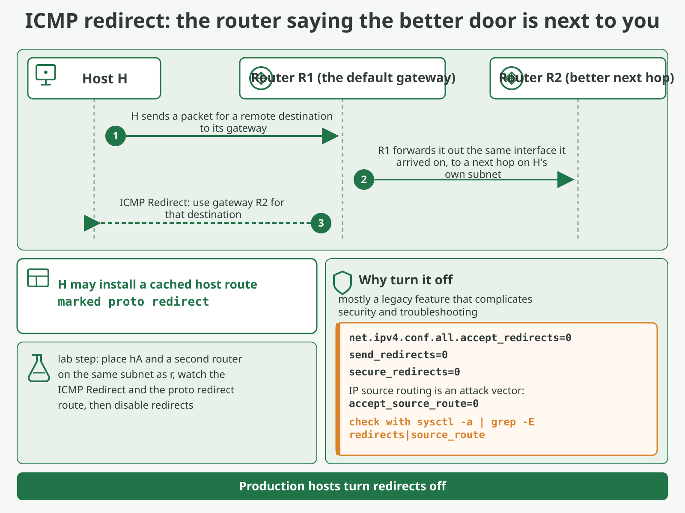

*Figure 2.5.16. A router that forwards a packet back out the arrival interface sends an ICMP Redirect, and production hosts disable redirects and source routing.*

A router sends an ICMP Redirect when it forwards a packet out the same interface it arrived on, to a next hop on the sender's own subnet. It is the router saying, "you did not need to ask me, the better door is right next to you." The message says, in effect, use gateway X for that destination. The host may then install a cached host route marked `proto redirect`. Redirects are mostly a legacy feature that complicates security and troubleshooting. Production hosts turn them off with `net.ipv4.conf.all.accept_redirects=0`, `send_redirects=0` and `secure_redirects=0`. Do the same for IP source routing, which is an attack vector, with `accept_source_route=0`. To check these settings, run `sysctl -a | grep -E 'redirects|source_route'`.

## 8. Multipath (ECMP) routes

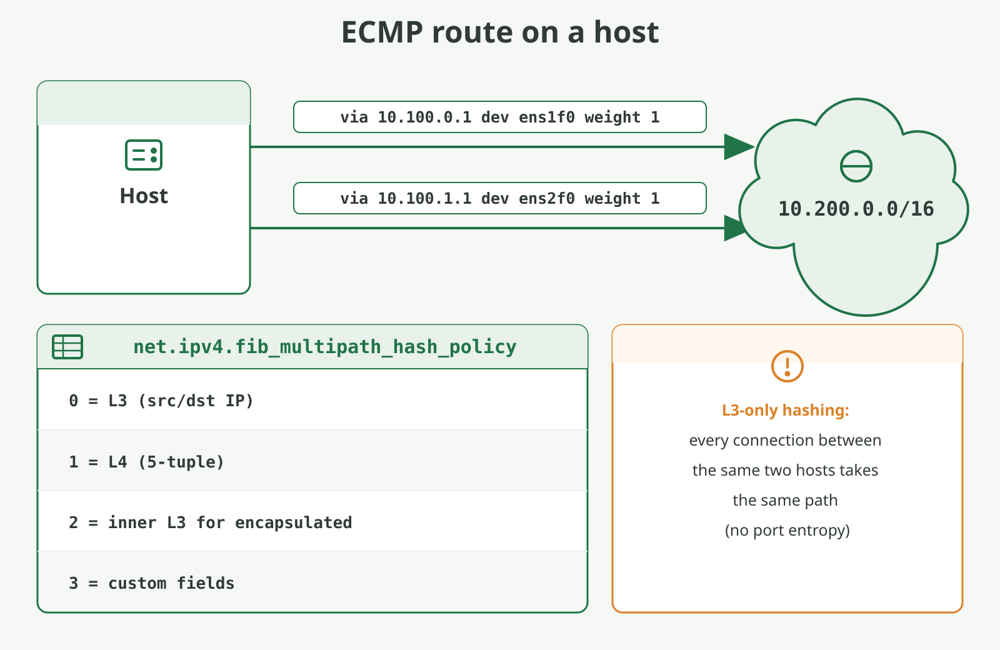

*Figure 2.5.17. A multipath route has several equal-cost next hops, and the hash policy decides which packet details pick the path.*

Suppose two links lead to the same destination, and both cost the same. It would be wasteful to leave one idle. A multipath route lets the host use both. A route can have several equal-cost next hops. The kernel picks one next hop per flow, using a hash, so that the packets of a flow stay in order. A hash is a quick calculation that turns details of a packet into a number, so the same flow always lands on the same path.

```bash
sudo ip route add 10.200.0.0/16 \
   nexthop via 10.100.0.1 dev ens1f0 weight 1 \
   nexthop via 10.100.1.1 dev ens2f0 weight 1
ip route show 10.200.0.0/16
sysctl net.ipv4.fib_multipath_hash_policy    # 0 = L3 (src/dst IP), 1 = L4 (5-tuple), 2 = inner L3 for encapsulated, 3 = custom fields
sysctl net.ipv4.fib_multipath_use_neigh      # skip next hops whose neighbour is failed
```

If you want flows spread across your links, the hash policy is the first setting to check. It decides what the kernel hashes, which means which details of the packet feed the calculation. Policy `0` hashes the source and destination IP. Policy `1` hashes the 5-tuple. Policy `2` hashes the inner L3 header of encapsulated traffic, and policy `3` uses custom fields. The `fib_multipath_use_neigh` setting skips next hops whose neighbour has failed.

L3-only hashing has a weakness. Every connection between the same two hosts uses the same path, because there is no port entropy. Entropy here just means variety. If every input to the hash is identical, the output is identical too. That is why data-centre fabrics hash on the full **5-tuple**, with policy 1. In AI clusters with RDMA, the UDP source port varies per queue pair to give the fabric entropy. NCCL even sets multiple QPs per connection for the same reason (chapter 2.20 and Part 12).

Host-level ECMP across NICs is usually done with a bond (L2, chapter 2.12) or with per-rail routing. A default multipath route is not the usual choice, unless the design explicitly wants L3 ECMP with BGP to the host.

## 9. IPv6 routing on a host

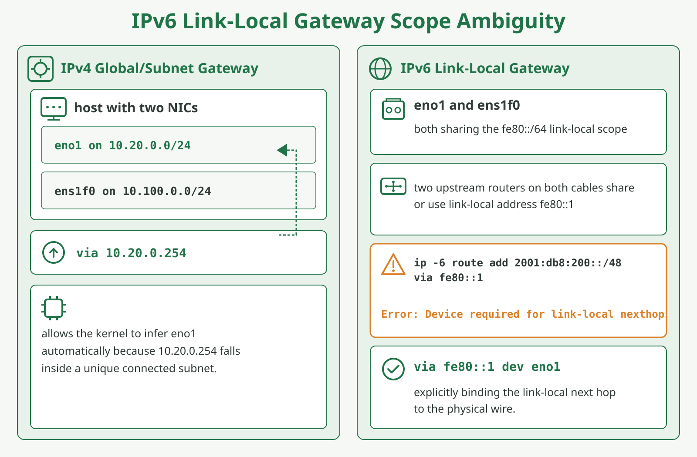

*Figure 2.5.18. Because every IPv6 interface shares the link-local fe80::/64 prefix, a next-hop gateway of fe80::1 is ambiguous without an explicit egress device.*

IPv6 uses the same routing model as IPv4, with a few differences. If you can read an IPv4 table, you can read an IPv6 one after a short adjustment. The default route usually comes from a router advertisement (RA), so it carries `proto ra` and a link-local next hop. Routes with a link-local gateway need `dev`. The connected prefix route is installed when the address is configured, or when the host learns the prefix from an RA with the on-link flag.

IPv6 has no ARP and no broadcast. Neighbour discovery does that job instead. Privacy and temporary addresses influence source selection. The settings `accept_ra` (0 ignore, 1 accept if not forwarding, 2 accept even when forwarding), `accept_ra_defrtr` and `accept_ra_pinfo` control what the host learns. `net.ipv6.conf.<if>.forwarding` sets forwarding for each interface.

`ip -6 route get` and `ip -6 rule` work like their IPv4 counterparts, so you use them the same way.

## 10. Containers, VMs and Kubernetes: more routing tables than you think

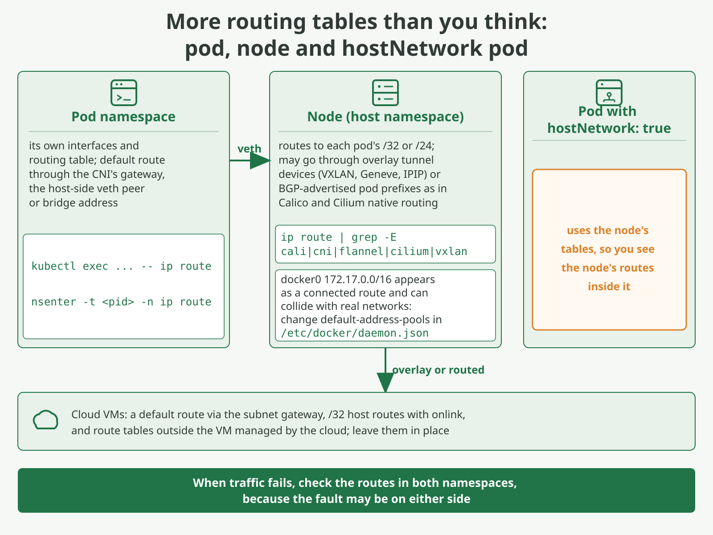

*Figure 2.5.19. A pod, the node and a hostNetwork pod each have their own view of routing, so check both namespaces when traffic fails.*

Each network namespace has its own interfaces and routing tables (chapter 2.25). A namespace is a separate copy of the network stack, a bit like a separate apartment with its own front door. So a pod's routing table is separate from the table on the node it runs on. A pod's namespace has a default route through the CNI's gateway, which is the host-side veth peer or bridge address. The node holds routes to each pod's /32 or /24. Those routes may go through overlay tunnel devices (VXLAN, Geneve, IPIP), or they may be BGP-advertised pod prefixes, as in Calico and Cilium native routing.

When traffic fails between pods or to the Internet, check the routes in both namespaces, because the fault may be on either side. Run `kubectl exec ... -- ip route` for the pod, or `nsenter -t <pid> -n ip route`. On the node, run `ip route | grep -E 'cali|cni|flannel|cilium|vxlan'`. Pods with `hostNetwork: true` use the node's tables instead, so if you see the node's routes inside such a pod, that is why.

Docker's `docker0` (172.17.0.0/16) appears as a connected route, and it can collide with real networks. To avoid the collision, change `default-address-pools` in `/etc/docker/daemon.json`. Cloud VMs have routes that the cloud manages: a default route via the subnet gateway, `/32` host routes with `onlink`, and cloud route tables outside the VM (chapter 2.32). If you find one of these routes on a cloud VM, leave it in place, because you did not create it and the cloud manages it.

## 11. Diagnosing routing problems

When a host cannot reach a destination, you can work through the diagram from the top. Each branch names the next check you run, from the route, to the neighbour, to the packets on the wire. If your first check shows a sensible route, move on to the neighbour check. Following the order stops you from jumping to a favourite theory.

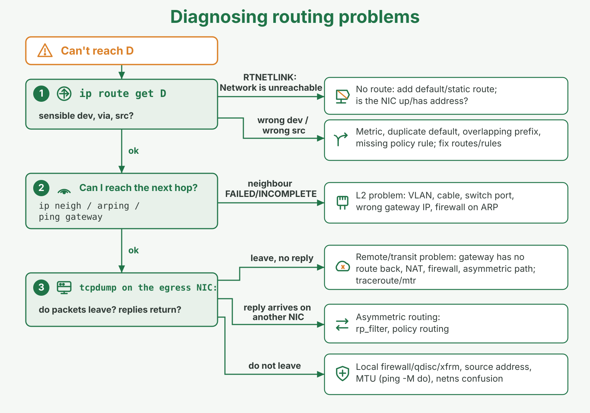

*Figure 2.5.20. Diagnosing routing problems, as a diagram.*

The checklist below lists the commands for these checks. They are `ip -br addr`, `ip -br link`, `ip route show table all`, `ip rule show`, `ip route get <dest> [from <src>]`, `ip neigh`, `sysctl net.ipv4.conf.all.rp_filter net.ipv4.ip_forward`, `ss -tn`, `tracepath`, `mtr -n`, `sudo tcpdump -ni any`, `nstat -z | grep -i drop`, `nft list ruleset` and `conntrack -L`.

Document the intended routing for each class of server. Then automate an audit that compares the actual routes with the intended ones.

## 12. Case study: a GPU server with six networks

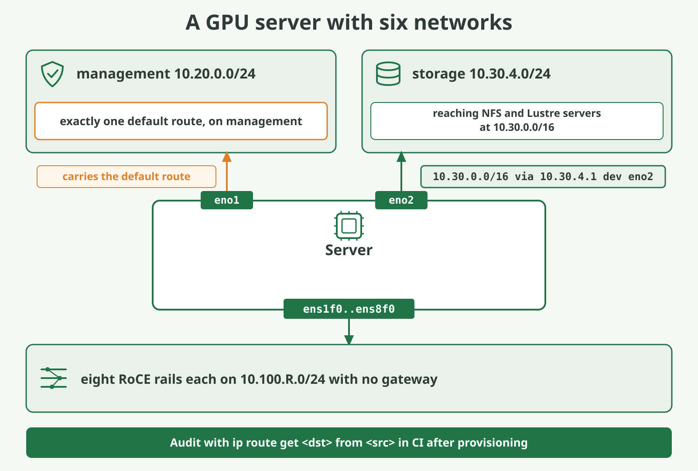

*Figure 2.5.21. One default route on management, a static route for storage, and one subnet per rail keep each kind of traffic on its own NIC.*

Consider a GPU server with `eno1` on management (10.20.0.0/24, carrying the default route), `eno2` on storage (10.30.4.0/24, reaching the NFS and Lustre servers at 10.30.0.0/16), and eight back-end NICs, `ens1f0..ens8f0`, for RoCE rails. Each rail gets one /24, `10.100.R.0/24`, with no gateway. The rail switches run in L2, or they are routed with a /31 per link. This is the kind of machine that turns the chapter into a real puzzle.

Three symptoms show up on this server. Lustre traffic uses the management NIC. NCCL occasionally uses the wrong interface. Some rail pings fail in one direction. Each one traces back to a section above. If you see any of these on your own server, the fixes follow.

1. Keep exactly one default route, on management. Set `nmcli connection modify <rail NIC> ipv4.never-default yes` on the others.
2. Add the static route `10.30.0.0/16 via 10.30.4.1 dev eno2`, or use the connected subnet if the servers are on-link, so that storage uses `eno2`.
3. Give each rail its own subnet, so that peers on the same rail reach each other on-link. Cross-rail traffic must not exist, or the leaf and spine switches must route it. Set `NCCL_SOCKET_IFNAME` for bootstrap, and let NCCL choose the IB/RoCE devices with `NCCL_IB_HCA`. For the multi-NIC ARP behaviour, configure `rp_filter=2`, `arp_ignore=1` and `arp_announce=2`.
4. If the rails use L3 with a gateway per rail, create policy-routing tables per rail. Use `ip rule add from 10.100.R.N/32 table 10R` and a default route in each table, so that each source address returns through its own NIC.
5. Audit the result. For every pair of source NIC address and destination, `ip route get <dst> from <src>` must return the expected device. Run this check in CI after provisioning.

Treat the audit in step 5 as part of provisioning, not as a one-time check.

## 13. Hands-on lab: routing between network namespaces

A word on status first. The Python lab below has been run, while the interactive commands after it have not been run for this chapter, so check each result as you go. Start with the self-checking Python lab, and run it locally first. You will see it verify the standard Linux routing tables (255 local, 254 main, 253 default), Longest-Prefix Match (LPM) and metric tie-breaking. It also verifies multi-NIC policy-based routing, from `ip rule` to per-rail routing tables, and reverse-path filtering. There, the effective value is `effective = max(all, iface)` across modes `0`, `1`, and `2`.

```bash
python3 code/part02/host_routing_tables_lab.py
```

Next, on a disposable Linux VM with `root`, build two subnets joined by a router namespace.

```bash
# topology:  hA(10.1.0.2/24) -- r(10.1.0.1/24, 10.2.0.1/24) -- hB(10.2.0.2/24)
for n in hA r hB; do sudo ip netns add $n; sudo ip -n $n link set lo up; done
sudo ip link add vA type veth peer name rA; sudo ip link set vA netns hA; sudo ip link set rA netns r
sudo ip link add vB type veth peer name rB; sudo ip link set vB netns hB; sudo ip link set rB netns r
sudo ip -n hA addr add 10.1.0.2/24 dev vA ; sudo ip -n r addr add 10.1.0.1/24 dev rA
sudo ip -n hB addr add 10.2.0.2/24 dev vB ; sudo ip -n r addr add 10.2.0.1/24 dev rB
for d in "hA vA" "r rA" "r rB" "hB vB"; do set -- $d; sudo ip -n $1 link set $2 up; done
sudo ip netns exec hA ping -c1 10.2.0.2      # fails: Network is unreachable (no route)
```

Work through the following steps in order.

1. Observe the failures one at a time. First, `hA` has no route, which you can confirm with `ip -n hA route`. Add `ip -n hA route add default via 10.1.0.1` and ping again. It still fails, because the router does not forward yet. Turn on forwarding with `sudo ip netns exec r sysctl -w net.ipv4.ip_forward=1`. Then `hB` needs a route back, so add `ip -n hB route add default via 10.2.0.1`. The ping works now. Capture on `rA` and `rB` with `ip netns exec r tcpdump -ni rA`. Note the TTL decrement (64 → 63) while the IPs stay unchanged, and use `tcpdump -e` to see the MAC rewrite.
2. Run `ip route get` from `hA` for several destinations, and explain each output.
3. Test longest-prefix match. Add a more specific route on `hA` for 10.2.0.2/32, pointing at a nonexistent gateway or set as a blackhole. Show that it overrides the default route. Then remove it with `ip route del`.
4. Add `blackhole`, `unreachable` and `prohibit` routes on `hA`. Compare the `ping` errors and the ICMP types you see with `tcpdump icmp`.
5. Give `hA` two gateways, using a second router namespace `r2` or a second link, with metrics 100 and 200. Bring down the first link and watch the failover. `ip route` shows `linkdown` on the failed route.
6. Add a second path so that replies come back on a different interface. Set `rp_filter=1` on the receiving host, and look for drops with `nstat | grep ReversePath`. Then set `rp_filter=2`, and add policy routing to fix the problem properly.
7. Add table 101 with its own default route, and `ip rule add from 10.1.0.2/32 table 101`. Use `ip route get ... from ...` to show that the table is in use.
8. For ECMP, create two parallel links between `hA` and `r`, and add a multipath route. Run several `iperf3` flows, and ping with different source ports. Check the distribution with `ip -s link`. Then change `fib_multipath_hash_policy` from 0 to 1.
9. Optionally, place `hA` and a second router on the same subnet as `r`. Watch for an ICMP Redirect and the `proto redirect` route, then disable redirects.
10. Write the netplan or systemd-networkd equivalent for the VM, apply it with `netplan try`, reboot, and verify the routes.
11. Clean up with `sudo ip netns del hA hB r`, one namespace at a time.

Do the cleanup last, so the namespaces do not stay on the VM.

## 14. Common mistakes

These mistakes are all easy to make, because each one looks reasonable when you make it. The most common mistake is adding two or more default routes, or a default route on every NIC that DHCP configures. A gateway that is not on a connected subnet is another. So is a mask that disagrees with the real network. Overlapping prefixes on different interfaces cause trouble when you do not understand the metric and longest-prefix rules.

Forgetting the return path is a mistake too. A route to a remote network does not work if the remote side has no route back. Relying on routes added with `ip` is another mistake, because those routes vanish on reboot.

Leaving `rp_filter` strict on multi-homed hosts causes silent drops. Leaving ICMP redirects enabled on production machines is another mistake. Enabling forwarding without reviewing the firewall FORWARD policy, NAT and `rp_filter` causes trouble as well. Debugging with `ping` alone hides which interface and source address were used. Finally, forgetting that containers and namespaces have their own routing tables sends you looking in the wrong place. If a fix does not change the behaviour, check which namespace and interface the traffic really uses.

## 15. Interview angles

- How does a Linux host decide where to send a packet? What if two routes match? A good answer covers longest prefix, metric, policy rules and tables.
- What does `default via 10.0.0.1 dev eth0` mean? What requirement does the gateway meet?
- A server has two NICs on two subnets and the reply goes out the wrong one. Why? How do you fix it? A good answer covers the weak host model, asymmetric routing, policy routing and `rp_filter`.
- What does `ip_forward` do? What else do you need to build a NAT router?
- What is `rp_filter` and why does it drop legitimate packets sometimes?
- Explain `ip route get` output. What's the `src` field?
- How do pods reach other nodes' pods in your CNI of choice? Where are the routes?
- What are ICMP redirects and why disable them?
- What is a blackhole route and when would you use one? A good answer covers summary-route anchors, DDoS mitigation and avoiding loops.

## Exercises

1. Start with the routing table and longest-prefix match. (a) Distinguish a connected route (`proto kernel scope link src ...`) from an indirect gateway route (`via ...`), and explain what the `src` and `metric` fields do. (b) Using `select_best_route_lpm()` in `code/part02/host_routing_tables.py`, work out which route wins for destination `10.200.5.42` and for destination `93.184.216.34`. The table contains `0.0.0.0/0` (`metric 100` via `10.0.0.1`), `0.0.0.0/0` (`metric 200` via `10.0.1.1`), `10.200.0.0/16` (`metric 50`), and `10.200.5.0/24` (`metric 500`).
2. Work through the special route types and the `onlink` flag. (a) Compare `blackhole`, `unreachable` and `prohibit` routes by packet behavior, the ICMP messages sent, and the local socket `errno`. (b) Explain when the `onlink` flag is needed on a cloud VM, and why an IPv6 route with a link-local next hop (`fe80::1`) must always specify `dev <iface>`.
3. Consider the multiple-default-gateway trap and policy-based routing. Why does configuring a default gateway on every NIC of an 8-rail GPU server break connectivity? Using `evaluate_policy_routing()`, trace how the `ip rule` priorities (`100`, `101`, `32766`) and the per-rail routing tables (`rail0`, `rail1`, `main` in `/etc/iproute2/rt_tables`) send packets sourced from `10.100.1.15` out `eth2` (`via 10.100.1.1`), while management traffic from `10.0.0.15` exits `ens4`.
4. Look at reverse-path filtering and the `max(all, iface)` trap. (a) Explain `rp_filter` modes `0` (disabled), `1` (strict) and `2` (loose). (b) Using `evaluate_rp_filter()`, explain why setting `net.ipv4.conf.eth1.rp_filter=0` while `net.ipv4.conf.all.rp_filter=1` still leaves `eth1` in strict mode (`1`), and why that drops asymmetric packets, which show up as `IPStatsInAddrErrors` in `nstat -az`.
5. Turn a Linux host into a router (`ip_forward=1`), add NAT with `MASQUERADE`, and use host ECMP. (a) List the four requirements for a working IPv4 or IPv6 router between two subnets. (b) Explain why L3-only ECMP hashing (`fib_multipath_hash_policy=0`) is ineffective when two GPU hosts open several parallel TCP streams between the same pair of IP addresses. Then say what `fib_multipath_hash_policy=1` and `fib_multipath_use_neigh=1` change.
6. Compare the host routing table (`ip route`) of a Kubernetes node that runs an overlay CNI (`flannel.1` or `cilium_vxlan`) with one that runs a direct-routing or BGP CNI (Calico or Cilium native routing). Then write the 5-step routing and ARP verification checklist from Section 12 for a 6-network GPU server.

Write the checklist from item 6 in full, so you can run it on a GPU server. Answer each item in your own words, and check your answer against the commands in the lab. Try to picture the server as you write, with its eight rails and its two other networks.

## Checkpoint questions (20)

<details>
<summary>1. In what exact order does the Linux kernel select a route from a routing table?</summary>

Inside one routing table, the kernel applies Longest-Prefix Match (`LPM`) first, so you can often predict the winner from the prefix length alone. A `/32` beats a `/24`, a `/24` beats a `/16`, and a `/16` beats the `/0` default route, whatever the metric. Only when two routes have exactly the same prefix length does the kernel look at the metric. It picks the lowest one, which is the preference.
</details>

<details>
<summary>2. What is the difference between a connected (`scope link`) route and an indirect (`via`) route at the ARP/NDP layer?</summary>

With a connected route, such as `10.0.0.0/24 dev ens4 proto kernel scope link src 10.0.0.15`, the destination is on the local link. The kernel therefore ARPs for the destination's own MAC address. With an indirect route, such as `default via 10.0.0.1 dev ens4`, the kernel ARPs for the gateway's MAC address instead. It addresses the Ethernet frame to the gateway, and the IPv4 header keeps the final destination IP.
</details>

<details>
<summary>3. What rule must a gateway IP (`via <gw>`) satisfy, and what does the `onlink` flag do?</summary>

Normally the gateway in `via <gw>` must sit inside a connected (`scope link`) subnet on that interface. Otherwise the kernel rejects the route with `Error: Nexthop has invalid gateway`. The `onlink` flag tells the kernel to treat the gateway as directly attached and to ARP for it. You use it when the host's own address, such as a `/32` cloud address, does not cover the gateway's prefix.
</details>

<details>
<summary>4. What does `ip route get 93.184.216.34` (and `ip route get <dst> from <src> iif <dev>`) show that `ip route show` does not?</summary>

`ip route show` lists only the `main` routing table. `ip route get` runs the kernel's full FIB and `ip rule` policy-routing lookup for one destination. It can also take a source IP, an interface or a fwmark. It then prints the winning table, the next hop `via`, the egress `dev`, the chosen `src` IP and the cached Path MTU.
</details>

<details>
<summary>5. Compare the four special route types: `local`, `blackhole`, `unreachable`, and `prohibit`.</summary>

- **`local`**: delivers packets to the host itself. It lives in table `255` and holds loopback and every local interface IP.
- **`blackhole`**: drops matching packets silently, with no ICMP reply. It is used on summary-route anchors to prevent routing loops, and for DDoS mitigation.
- **`unreachable`**: drops matching packets and sends ICMP Host or Network Unreachable. Local sockets fail at once with `EHOSTUNREACH` or `ENETUNREACH`.
- **`prohibit`**: drops matching packets and sends ICMP Administratively Prohibited. Local sockets fail with `EACCES`.
</details>

<details>
<summary>6. Why do routers and GPU nodes assign `/32` (or `/128`) addresses to the loopback interface (`lo`) or a `dummy0` interface?</summary>

A physical NIC goes down when its cable or switch port flaps, and its interface IP goes with it. Loopback (`lo`) and `dummy` interfaces are virtual. They stay `UP` for as long as the kernel is running. That makes them a steady router ID, a BGP session source IP, or a health-check or anycast VIP that any active physical uplink can reach.
</details>

<details>
<summary>7. Why must an IPv6 route with a link-local next hop (`fe80::1`) always include `dev <iface>`?</summary>

Every IPv6-enabled interface on a host uses the same link-local prefix, `fe80::/64`. So `fe80::1` on its own is ambiguous, because it could belong to any of those interfaces. `dev ens4`, or `fe80::1%ens4`, tells the kernel which link that neighbor is on.
</details>

<details>
<summary>8. What are the three default Linux routing tables (`255`, `254`, `253`) and their `ip rule` priorities (Networking and Kubernetes, chapter 2)?</summary>

`ip rule show` lists three built-in rules, checked in ascending priority order. Priority `0` points to the `local` table (`255`), which holds local interface IPs and broadcast routes. It cannot be overridden unless you add custom rules at priority below 0 or at early priorities. Priority `32766` points to the `main` table (`254`), which holds the normal connected, static and DHCP routes that `ip route show` lists. Priority `32767` points to the `default` table (`253`), a fallback that is normally empty.
</details>

<details>
<summary>9. Why is configuring a default gateway on more than one NIC a classic multi-homed server bug?</summary>

A default route (`0.0.0.0/0`) matches every destination. If a secondary NIC, such as a storage or GPU rail NIC, installs a default route with a lower or equal metric, the problem starts. The same happens when DHCP installs a second default route. Outbound internet and management traffic is then hijacked onto the private storage or rail network and blackholed, or replies leave through the wrong NIC.
</details>

<details>
<summary>10. How does Policy-Based Routing (`ip rule` + `/etc/iproute2/rt_tables`) solve asymmetric routing on a multi-NIC server?</summary>

For each extra routed NIC, create a dedicated routing table. For example, `eth1` has IP `10.100.0.15/24` and gateway `10.100.0.1`. The table `100 rail0` in `/etc/iproute2/rt_tables` holds that NIC's connected route and its default gateway, added with `ip route add default via 10.100.0.1 dev eth1 table rail0`. Then add a source-based policy rule, `ip rule add from 10.100.0.0/24 table rail0 priority 100`. That rule guarantees that any packet sourced from `eth1`'s IP routes out `eth1`.
</details>

<details>
<summary>11. What is Linux's "weak host model", and how does it cause asymmetric routing when a server has multiple NICs?</summary>

Linux follows the weak host model. It treats IP addresses as belonging to the host as a whole, not to each interface. The standard FIB lookup depends only on the destination IP. Suppose a client sends a request to `eth1`'s IP, `10.100.0.15`, and the best route in `main` for that client's subnet points out `ens4`. Linux accepts the packet on `eth1`, and it sends the reply out `ens4` with source IP `10.100.0.15`.
</details>

<details>
<summary>12. Explain the three modes of `rp_filter` (`0`, `1`, `2`), how the effective value is calculated, and how to check for `rp_filter` drops.</summary>

- `0`: disabled, with no source validation.
- `1` (strict): the packet is dropped unless the best route back to its source IP leaves through the exact same interface it arrived on.
- `2` (loose): the packet is accepted as long as its source IP is reachable through any interface.

The effective value is `effective_rp_filter = max(net.ipv4.conf.all.rp_filter, net.ipv4.conf.<if>.rp_filter)`. So you must lower both `all` and `<if>` to `2` or to `0`. To check for drops, run `nstat -az | grep -iE 'InAddrErrors|ReversePath'`.
</details>

<details>
<summary>13. What four steps are required to make a Linux host act as a router between two networks (How Linux Works, chapter 9)?</summary>

The four steps are these. First, enable kernel packet forwarding with `sysctl -w net.ipv4.ip_forward=1` and `net.ipv6.conf.all.forwarding=1`. Second, make sure the firewall `FORWARD` chain, in `nftables` or `iptables`, lets traffic pass between the interfaces. Third, point downstream hosts at the Linux router, and give upstream routers a return route back. Or, if the downstream network is private, add `MASQUERADE` SNAT. Fourth, tune `rp_filter` and disable ICMP redirects with `send_redirects=0` and `accept_redirects=0`.
</details>

<details>
<summary>14. What is an ICMP Redirect, and why should `accept_redirects` and `send_redirects` be disabled (`0`) on servers?</summary>

A router sends an ICMP Redirect when it sees a host forward a packet to it, even though a better next-hop router sits on the same LAN subnet. On production servers, accepting redirects lets an attacker or a misconfigured router on the LAN inject host routes into the routing cache. If you run production hosts, always set `accept_redirects=0` and `send_redirects=0`.
</details>

<details>
<summary>15. How does Equal-Cost Multipath (`ECMP`) work on a Linux host, and why must you set `net.ipv4.fib_multipath_hash_policy = 1`?</summary>

A multipath route lists several `nexthop via ... dev ... weight ...` entries for the same prefix. The legacy default, `fib_multipath_hash_policy = 0`, is an L3 hash. It hashes only the source IP and destination IP, so all TCP connections between two hosts land on one link. Setting `fib_multipath_hash_policy = 1` selects an L4 hash instead. It hashes the full 5-tuple, meaning source IP, destination IP, protocol, source port and destination port, so parallel connections spread across all uplinks. Pair it with `fib_multipath_use_neigh = 1` to skip next hops whose ARP neighbour has failed.
</details>

<details>
<summary>16. Why is per-packet round-robin load balancing across two links avoided for TCP and RDMA flows?</summary>

Suppose consecutive packets of the same TCP or RDMA flow take different physical paths. Even slightly different queue depths or cable lengths can make them arrive out of order at the receiver. In TCP, that out-of-order arrival triggers triple duplicate ACKs and false fast-retransmit rate cuts. In traditional RoCEv2/InfiniBand, using `RC` QPs without adaptive routing, out-of-order packets trigger sequence-error drops and go-back-N retransmissions. Hashing on the 5-tuple keeps each flow in order on one path.
</details>

<details>
<summary>17. How do you persist static routes and policy-routing rules in `Netplan` (Ubuntu) and `NetworkManager` (`nmcli`, RHEL/Rocky)?</summary>

In Netplan, the files live in `/etc/netplan/*.yaml`. Add `routes:` (with `to:`, `via:`, `metric:` and `table:`) and `routing-policy:` (with `from:`, `table:` and `priority:`) under the interface. Test the change safely with `sudo netplan try`. In NetworkManager, use `nmcli connection modify <conn> +ipv4.routes "10.200.0.0/16 10.0.0.254" +ipv4.routing-rules "priority 100 from 10.100.0.0/24 table 100"`. To stop a secondary NIC from adding default routes, set `ipv4.never-default yes`.
</details>

<details>
<summary>18. What does a Kubernetes node's routing table look like under an overlay CNI versus a direct-routing / BGP CNI?</summary>

In both modes, `net.ipv4.ip_forward=1` is enabled. Each local Pod has a `/32` host route that points into its `veth` interface, such as `10.244.1.5 dev cali1234 scope link`. For remote Pods on other nodes, the two modes differ. A direct-routing or BGP CNI, such as Calico or Cilium native routing, installs `/24` routes that point straight at each peer node's underlay IP, such as `10.244.2.0/24 via 10.0.0.16 dev ens4`. An overlay CNI instead routes the remote `/24`s into a tunnel device, such as `flannel.1` or `cilium_vxlan`.
</details>

<details>
<summary>19. On an 8-GPU server with management (`eno1`), storage (`eno2`), and 8 RoCE rail NICs (`ens1f0..ens8f0`), how should routing be structured?</summary>

Structure it in four steps. First, install exactly one default route in `main`, on the management NIC `eno1`, and set `ipv4.never-default yes` on all other NICs. Second, add a specific static prefix route, `10.30.0.0/16 via 10.30.4.1 dev eno2`, for the storage cluster. Third, give each rail NIC its own subnet, `10.100.R.0/24`. If the rails are L3-routed across leaf and spine, add per-rail policy-routing tables with `ip rule add from 10.100.R.N/32 table 10R`. Fourth, set `rp_filter=2`, `arp_ignore=1` and `arp_announce=2`.
</details>

<details>
<summary>20. Walk through the 4-step command sequence to debug "Host A cannot reach Host B (`10.200.5.42`)".</summary>

Work through four steps, so that you can narrow the fault down. First, run `ip route get 10.200.5.42`, and also `ip route get 10.200.5.42 from <src_ip>`, to confirm the table, next-hop gateway, outgoing `dev` and `src` IP the kernel selects. Second, run `ip neigh show dev <dev>` to see whether the next hop's MAC is `REACHABLE`, or `FAILED` or `INCOMPLETE`. Third, run `sudo tcpdump -ni <dev> host 10.200.5.42` while you ping. It shows whether packets leave `<dev>` and whether replies return on `<dev>` or on another NIC. Fourth, on Host B, check `ip route get <src_ip>` and `nstat -az | grep InAddrErrors` to verify the return path and `rp_filter`.
</details>

## Sources and review notes

- **Sources read in full:**
  - `how-linux-works-3rd-edition` — Brian Ward, *How Linux Works*, 3rd ed., **Chapter 9: Understanding Your Network and Its Configuration** (routes and the kernel routing table, `ip route show`, default gateway and longest-prefix selection, IPv6 routes and link-local default gateways, manual interface/route configuration, boot-time configuration problems and network managers, Linux as a router `net.ipv4.ip_forward=1`, private networks and NAT, firewalls and routers, and ARP/NDP interplay).
  - `networking-and-kubernetes` — James Strong and Vallery Lancey, *Networking and Kubernetes*, **Chapter 2: Linux Networking** (Linux kernel networking parameters, routing tables `255 local` / `254 main` / `253 default`, netfilter, `conntrack`, and `IPVS`).
  - `computer-networking-problems-and-solutions` — Russ White and Ethan Banks, *Computer Networking Problems and Solutions*, **Chapter 6: Interlayer Discovery** (default gateway mask problem) and **Chapter 7: Packet Switching** (switching vs routing, the forwarding table and MAC header rewrite, ECMP and 5-tuple hashing).
- **Run here:** `python3 code/part02/host_routing_tables_lab.py` (11 passed, 0 failed).
- **Explicitly labelled inferences:** The 6-network GPU server case study (management `eno1`, storage `eno2`, 8 RoCE rails `ens1f0..ens8f0` with per-rail policy routing, `0.0.0.0/0` / `::/0` default routes, `rp_filter=2`, `arp_ignore=1`, `arp_announce=2`), Kubernetes Pod routing comparison, and `fib_multipath_hash_policy=1` ECMP recipe (`ip-route(8)`, `ip-rule(8)`, `ip-sysctl.rst`) connect Linux host FIB and policy routing to Part 5, Part 8, and Part 9 GPU cluster networking (cross-referenced with Chapters 2.1–2.4, 2.9, 2.13, 2.20, 2.22, 2.25, and 2.27, plus original study items 21, 22, 23, 24, 25, 26, 27, 28, 29, and 30).
- **Not verified on live hardware:** All interactive VM commands (`ip route`, `ip rule`, `ip netns`, `sysctl`, `tcpdump`, `nstat`, `netplan`, `nmcli`) are marked and must be executed on a disposable Linux VM with console access.

