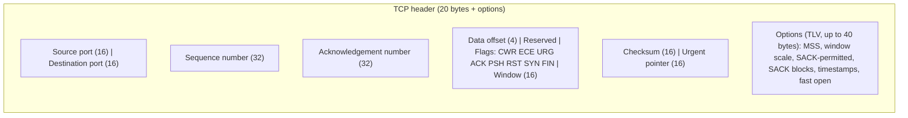
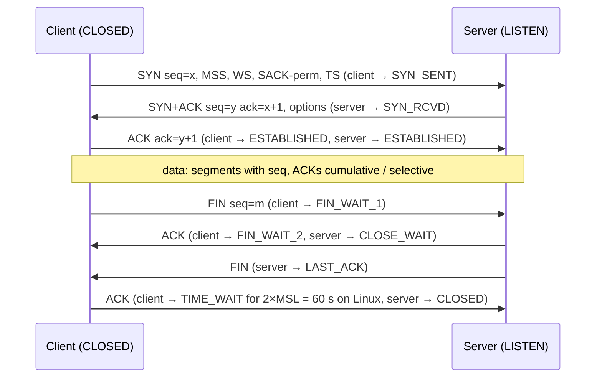
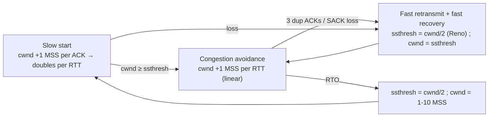
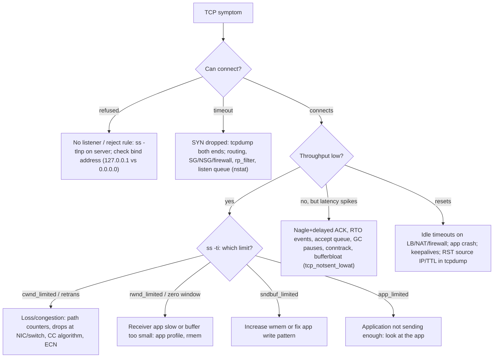

# 2.6 TCP in depth: handshake, windows, congestion control, tuning and troubleshooting

| | |
|---|---|
| Level | Beginner to intermediate |
| Priority tier | 0 |
| Lab venue | Two Linux VMs or namespaces with `tc netem` |
| Part | Part 2: Networking, from first principles to AI fabrics |
| Status | Drafted, labs **untested** |

## Why this matters for AI infrastructure

Almost everything outside the GPU fabric rides on TCP: SSH, HTTPS, the Kubernetes API, container image pulls, object-store downloads of datasets and checkpoints, NFS and many parallel filesystems' control paths, inference APIs (gRPC and HTTP), metrics scraping, and NCCL's bootstrap and fallback socket transport. Throughput on a long, fat path (a cross-region checkpoint copy) is governed by window sizes and congestion control; tail latency of an inference service by retransmissions, Nagle/delayed-ACK interactions and connection reuse; "connection refused/reset/timeout" tickets by handshake and state-machine details. RDMA fabrics (InfiniBand, RoCE) deliberately replace TCP's machinery with hardware-assisted transport, and you can only appreciate why (and what they must re-implement: reliability, flow control, congestion control) after understanding TCP properly.

This chapter builds the transport layer from first principles (what problems a transport protocol must solve), then covers TCP completely: header, state machine, handshake and teardown, sliding windows, retransmission, congestion control (Reno, CUBIC, BBR), buffers and the bandwidth-delay product, offloads, socket options, Linux tuning, and the tools to read what TCP is doing (`ss`, `tcpdump`, `nstat`). It closes with QUIC and an overview of the transport models (DoD, OSI, RINA).

## Prerequisites and outcomes

You should be comfortable with layering and IP (chapters 2.2, 2.4, 2.5).

After this chapter you can:

- State the problems a transport protocol solves (marshaling, errors, multiplexing, addressing, flow control, congestion control) and how TCP and UDP choose among them.
- Read a TCP header and trace the three-way handshake, data transfer, and four-way close in `tcpdump`, naming the state of each side.
- Explain sequence/acknowledgement numbers, the sliding window, window scaling, SACK, timestamps, RTO calculation, fast retransmit, and delayed ACK/Nagle.
- Explain slow start, congestion avoidance, Tahoe/Reno, CUBIC and BBR, ECN, and why loss-based control struggles in data centres.
- Compute the bandwidth-delay product and set buffers; explain autotuning and the Linux `tcp_*mem` sysctls.
- Diagnose retransmissions, resets, timeouts, SYN backlog overflows, TIME_WAIT pile-ups, window-limited and application-limited flows using `ss -ti`, `nstat`, `tcpdump`, and `wireshark` expert info.
- Explain TCP's role and limits for AI workloads, and how QUIC differs.

## 1. What a transport protocol must solve

Networks below the transport layer deliver packets between hosts, possibly dropped, duplicated, reordered, corrupted, delayed. Applications want something simpler: a pipe between *processes*. The transport layer adds, in varying measure:

| Problem | Mechanism | TCP | UDP |
|---|---|---|---|
| **Marshaling** (turn structures into bytes) | Fixed-length fields, type-length-value (TLV), shared dictionaries/schemas | Header uses fixed fields + options as TLV; payload is an opaque byte stream | Same: opaque datagram |
| **Error detection** | Checksums, CRCs, parity | 16-bit one's-complement checksum | 16-bit checksum (optional in IPv4, mandatory IPv6) |
| **Error correction** | Retransmission (ARQ) or forward error correction (FEC) | ARQ: ACKs, timeouts, fast retransmit, SACK | None (application's job) |
| **Multiplexing** | Port numbers to dispatch to the right process | Ports | Ports |
| **Addressing** | Host (IP) + port; unicast, multicast, anycast | Unicast (connection oriented); anycast works via routing | Unicast, multicast, broadcast |
| **Flow control** | Receiver tells sender how much it can take | Receive window | None |
| **Congestion control** | Sender infers/obtains network capacity | Congestion window, many algorithms | None (application's job, e.g. QUIC, RTP) |
| **Ordering/reliability** | Sequence numbers | Reliable, in-order byte stream | Neither |

**Digital grammars.** Marshaling formats fall into three families: *fixed-length fields* (cheap to parse, wasteful and inflexible; the IP and TCP base headers), *type-length-value* (self-describing and extensible, parsed with a length-bounded loop; TCP options, BGP attributes, LLDP, many tunnel headers), and *shared dictionaries* where both sides agree out of band on a schema (protobuf/gRPC, ASN.1, YANG-modelled data). The trade-off is always compactness and speed versus flexibility and evolvability. When you read a packet capture you are reading marshaled data; the dissector knows the grammar.

**Error detection and correction.** Detection (parity, checksum, CRC) is cheap; correction either by *asking again* (ARQ, adds latency, needs buffering and timers) or by *sending redundancy* (FEC, adds constant overhead, no round trip). Links use strong CRCs (Ethernet's 32-bit FCS), TCP and UDP a weak checksum as an end-to-end safety net (it catches bugs in routers, NICs and offload, not just noise). Checksums can be offloaded to NICs, which is why `tcpdump` on the sending host sometimes shows "bad cksum" (the capture happens before the NIC fills it in; a harmless artefact).

**Multiplexing and addressing.** Ports (16-bit) let many applications share a host address. A TCP connection is identified by the **4-tuple** (source IP, source port, destination IP, destination port) within one protocol. Well-known ports (0 to 1023) designate services (22 SSH, 53 DNS, 80 HTTP, 443 HTTPS, 6443 Kubernetes API); registered ports (1024 to 49151) are assigned by IANA; **ephemeral** ports (Linux default 32768 to 60999, `net.ipv4.ip_local_port_range`) are chosen by clients. A server socket can accept very many connections on one port because each connection has a distinct 4-tuple; exhaustion happens on the *client/source* side when one source address connects to one destination address:port (only the source port varies), limited by ~28k ports and TIME_WAIT (section 8). Delivery models: **unicast** (one-to-one), **multicast** (one-to-group; IGMP/MLD; used by some discovery protocols, market data, and by InfiniBand for collective offload), **broadcast** (IPv4 only, local), **anycast** (the same address announced from several places; routing delivers to the nearest; used by DNS roots and CDNs and for load-balanced VIPs; the catch for TCP is that a route change mid-connection sends packets to a different instance, so anycast TCP needs stateless-ish services or consistent hashing).

**Flow control** protects the receiver; **congestion control** protects the network. They are separate mechanisms with different signals and are routinely confused; TCP implements both and the sender sends no more than the *minimum* of the two windows.

## 2. Transport models: DoD, OSI, RINA, and connection-oriented versus connectionless

The **DoD (TCP/IP) model** has four layers (link, internet, transport, application) and grew out of running protocols; the **OSI model** has seven (physical, data link, network, transport, session, presentation, application) and was designed by committee; engineers use OSI numbering as vocabulary (L2 switch, L3 router, L4 load balancer, L7 proxy) while implementing the DoD stack. Session and presentation concerns (TLS, serialization, RPC framing) are handled inside applications and libraries in practice. The **Recursive Internet Architecture (RINA)** argues the layer structure should be *one* repeating layer (IPC, inter-process communication) that recurs at different scopes, with the same mechanisms (naming, error and flow control, routing) re-instantiated at each scope instead of redesigned per layer; it is a research model, but it explains why so many features (congestion control, multiplexing, addressing) appear again and again at different layers (VLAN/VXLAN tunnels, MPLS, QUIC over UDP). Practical lesson: layers are conventions; real stacks tunnel layers inside each other (IP in UDP in IP in Ethernet) and "which layer does this feature belong to" is often a design choice, not a fact.

**Connection-oriented versus connectionless.** A connection-oriented transport (TCP) sets up shared state at both ends before data flows (sequence numbers, windows, timers), so it can offer reliability and ordering at the cost of setup latency, per-connection memory, and state to be maintained by NATs and firewalls. A connectionless transport (UDP) keeps no state: each datagram stands alone, which suits DNS queries, telemetry, real-time media, and protocols building their own reliability (QUIC, RoCE v2 uses UDP as the carrier with reliability in the NIC). Layers can mix: IP is connectionless; TCP over it is connection-oriented; HTTP over TCP is stateless again by design.

## 3. The TCP header and options



- **Sequence number**: byte offset of the first payload byte in this direction's stream (SYN and FIN each consume one sequence number). **Acknowledgement number**: the next byte the receiver expects (cumulative ACK: "I have everything before this").
- **Flags**: `SYN` (open), `ACK` (ack field valid; set on all but the first SYN), `FIN` (sender finished), `RST` (abort), `PSH` (push to the application now), `URG` (urgent pointer; obsolete), `ECE`/`CWR` (ECN signalling).
- **Window**: receive window in bytes (scaled by the window-scale option).
- **Options** are TLVs negotiated in the handshake: **MSS** (maximum segment size = MTU − 40 for IPv4, − 60 for IPv6; 1460 on a 1500 MTU, 8960 on 9000), **window scale** (shift 0 to 14; allows windows up to ~1 GiB), **SACK-permitted** and **SACK blocks**, **timestamps** (RTT measurement, PAWS protection against wrapped sequence numbers), **TCP Fast Open**. Options can only be negotiated on SYN, so a middlebox that strips them cripples every connection through it (a classic source of "slow only through the firewall" tickets).

Because TCP is a **byte stream**, there are no message boundaries: one `send(100)` may arrive as two `recv`s of 50, and two sends may be coalesced. Applications must frame their own messages (length prefix, delimiter), which is the marshaling problem again.

## 4. The handshake, data transfer and teardown



**Why three packets, and why random initial sequence numbers (ISNs).** Each side must prove it can both send and receive, and agree on its starting sequence number; two messages cannot do both directions. ISNs are unpredictable (RFC 6528 hash of 4-tuple plus secret) to stop off-path attackers injecting data or forging connections, and so that stale segments from an old incarnation of the same 4-tuple are not mistaken for new data.

**Server side internals (Linux).** `listen(fd, backlog)` creates two queues: the **SYN queue** (half-open connections, sized by `tcp_max_syn_backlog`) and the **accept queue** (completed handshakes waiting for `accept()`, sized by `min(backlog, net.core.somaxconn)`). When the accept queue is full the final ACK is dropped (or the SYN ignored), the client believes it connected and then retransmits; symptoms are mysterious latency spikes of 1, 3, 7 seconds and `ListenOverflows`/`ListenDrops` counters in `nstat`. When the SYN queue floods (a SYN-flood attack or just a burst), **SYN cookies** (`net.ipv4.tcp_syncookies=1`) encode the connection state in the SYN-ACK's sequence number so no queue entry is needed, at the cost of losing some options. Tune: `somaxconn` (4096+), the application's backlog (nginx `listen ... backlog=`, Go's net.Listen uses somaxconn), and fix slow `accept()` loops.

**Failure signals at connect time.**

| What the client sees | Meaning |
|---|---|
| `Connection refused` (ECONNREFUSED) | A RST came back: host reachable, nobody listening on that port (or a firewall using `reject --tcp-reset`) |
| `Connection timed out` (ETIMEDOUT) | No reply to SYNs (retried with exponential backoff ~ 1, 2, 4... s, `tcp_syn_retries`=6 → ~127 s): dropped by a firewall/security group, wrong route, host down |
| `No route to host` / `Network is unreachable` | ICMP unreachable from a router, or no local route (chapter 2.5) |
| `Connection reset by peer` | RST during an established connection: peer crashed, app closed with unread data, firewall/NAT state expired, load balancer idle timeout |

**Teardown.** Closing is per direction (half-close: `shutdown(SHUT_WR)` sends FIN but can still read). The side that closes first (active closer) ends in **TIME_WAIT** for 2×MSL (60 s on Linux, hard-coded) to absorb delayed duplicates and to retransmit the last ACK if the peer's FIN is retransmitted. TIME_WAIT is normal and harmless in moderation; pile-ups matter only to a client making many short connections to one destination (port exhaustion) or behind NAT. **CLOSE_WAIT** accumulating on a server is an application bug (the peer closed, your code never called `close()`: a socket leak). `RST` aborts immediately, discarding unsent data.

### TCP states in the field

`ss -tan state <state>`: `LISTEN`, `SYN-SENT`, `SYN-RECV`, `ESTAB`, `FIN-WAIT-1/2`, `CLOSE-WAIT`, `LAST-ACK`, `TIME-WAIT`, `CLOSING`. Many `SYN-SENT`: you cannot reach the remote service. Many `SYN-RECV`: SYN flood or slow handshake completion. Many `CLOSE-WAIT`: leak in your application. Many `FIN-WAIT-2`: remote not closing its side. Many `TIME-WAIT`: normal churn of short connections.

## 5. Reliability: ACKs, retransmission and the RTO

TCP numbers bytes, receivers send **cumulative ACKs** (the next expected byte), and senders retransmit what is not acknowledged. Two triggers:

1. **Retransmission timeout (RTO).** The sender times each segment; if no ACK arrives within RTO, it retransmits and doubles the RTO (exponential backoff), up to `tcp_retries2` (default 15, about 15 minutes) before declaring the connection dead. RTO is derived from a smoothed RTT (SRTT) and its variance: `RTO = SRTT + 4 × RTTVAR`, with Linux's minimum **200 ms** (`TCP_RTO_MIN`) and maximum 120 s. An RTO is the *expensive* loss signal: the pipe has gone quiet, so after an RTO TCP collapses its congestion window to 1 segment (or the initial window) and restarts slow start.
2. **Fast retransmit.** If the receiver gets segments beyond a gap, it re-sends the same ACK for the last in-order byte (**duplicate ACK**). After three duplicate ACKs (or, with RACK, when a later segment is acknowledged beyond a time threshold) the sender retransmits the missing segment immediately without waiting for the timer, and enters **fast recovery** (halve the window, keep the pipe full) instead of restarting slow start. Linux uses **RACK-TLP**: time-based loss detection plus a *tail loss probe* that retransmits the last segment after ~2 RTT to avoid an RTO when the tail of a burst is lost.

**SACK** (selective acknowledgements, RFC 2018): the receiver reports the ranges it has received above the gap, so the sender retransmits only what is truly missing instead of everything after the first hole. Without SACK, a single loss in a large window can force a go-back-N style resend or multiple RTTs of recovery. Always keep SACK on (`net.ipv4.tcp_sack=1`, default). **Timestamps** (`tcp_timestamps=1`) give accurate RTT samples per ACK and PAWS, at 12 bytes per segment.

**Delayed ACK and Nagle.** To save packets, receivers often ACK every second full segment or after a short delay (up to 40 ms on Linux, `quickack` modes override it), and senders using **Nagle's algorithm** hold small writes until the previous data is acknowledged. The combination of Nagle (sender waits for an ACK) and delayed ACK (receiver waits to send the ACK) can add ~40 ms to small request/response patterns, a notorious latency bug in RPC-style protocols that do write-write-read. Fix with `TCP_NODELAY` (disable Nagle) in latency-sensitive services (gRPC, Redis clients, and NCCL's sockets set it), by coalescing writes (`writev`/`MSG_MORE`/`TCP_CORK`) rather than splitting a message across several small writes, and by `TCP_QUICKACK` where needed.

**Out-of-order versus loss.** Reordering (parallel paths, multi-queue NICs, ECMP flaps) produces duplicate ACKs that look like loss; the reordering threshold adapts in Linux, but heavy reordering depresses throughput. `nstat | grep -i reorder` and `TcpExtTCPSACKReorder` reveal it.

## 6. Flow control: the sliding window

The receiver advertises a **receive window (rwnd)**: how many more bytes it can buffer. The sender may have at most `min(rwnd, cwnd)` bytes **in flight** (sent but unacknowledged). As ACKs arrive, the window slides forward; this lets the sender keep many segments in flight instead of one-at-a-time stop-and-wait.

A worked example (using a source book's style, with numbers): the receiver advertises a window of 20 bytes; the sender sends bytes 1 to 10; the receiver acknowledges 10 and raises the window to 30; the sender may now send up to byte 40; it sends 11 to 15; the receiver acknowledges 15 and advertises 40, and so on. Acknowledging byte N implicitly acknowledges everything before it. If an acknowledgement stops short (acknowledges 30 after the sender sent 16 to 35), the sender knows bytes from 30 onward are missing and resends them. If the receiver's application reads slowly, its buffer fills and the advertised window shrinks to **zero**; the sender stops and sends periodic **window probes** until space opens (`ss` shows `rcv_space`, `Recv-Q`; a "zero window" in Wireshark means the *receiving application* is the bottleneck, not the network).

**Window scaling.** The window field is 16 bits (max 65,535 bytes), far too small for modern paths. The window-scale option (negotiated only in the SYN) multiplies the field by 2^shift. On a 100 Gb/s link with 1 ms RTT the bandwidth-delay product is 12.5 MB, which needs a scale factor of at least 8. Never disable window scaling (`tcp_window_scaling=1`), and beware middleboxes that strip it.

### Bandwidth-delay product and buffers

Maximum throughput of one connection ≈ `window / RTT`. To fill a path you need `window ≥ BDP = bandwidth × RTT`.

| Path | Bandwidth | RTT | BDP |
|---|---|---|---|
| Same rack | 100 Gb/s | 20 µs | 250 KB |
| Same DC | 100 Gb/s | 100 µs | 1.25 MB |
| Metro | 10 Gb/s | 2 ms | 2.5 MB |
| Cross-continent | 10 Gb/s | 70 ms | 87.5 MB |
| Intercontinental | 10 Gb/s | 180 ms | 225 MB |

Throughput limited by window = `window / RTT`: a 4 MB window over 70 ms gives ~457 Mb/s on a 10 Gb/s link no matter how fast the NIC. This is the most common reason cross-region dataset or checkpoint copies are "slow" (and why tools like `rclone`, `aws s3 cp` and `gsutil` use many parallel connections).

**Linux buffer sizing.** Socket buffers hold unacknowledged data (send) and data not yet read (receive). Linux **autotunes** receive and send buffers per connection within limits:

```bash
sysctl net.ipv4.tcp_rmem net.ipv4.tcp_wmem       # min default max, bytes  (e.g. 4096 131072 6291456)
sysctl net.core.rmem_max net.core.wmem_max       # cap for explicit SO_RCVBUF/SO_SNDBUF
sysctl net.ipv4.tcp_mem                          # system-wide pages: low, pressure, high
sysctl net.ipv4.tcp_moderate_rcvbuf              # receive autotuning (1)
# For 10-100 Gb/s long paths raise the maxima, e.g.
#   net.ipv4.tcp_rmem = 4096 131072 134217728
#   net.ipv4.tcp_wmem = 4096 65536 134217728
#   net.core.rmem_max = net.core.wmem_max = 134217728
sysctl net.ipv4.tcp_notsent_lowat                # limit unsent data queued in the send buffer (reduces latency/bufferbloat; e.g. 131072)
```

Setting `SO_RCVBUF` explicitly in an application **disables autotuning** for that socket, which is almost always a mistake. Huge buffers on short-RTT paths do not help and add memory pressure and queueing delay (bufferbloat); size to the paths you have. Memory: a 128 MB buffer × thousands of connections exhausts RAM, which is what `tcp_mem` guards.

## 7. Congestion control

Flow control protects the receiver, but the network between can be the bottleneck. Without a throttle, senders would collectively overload links (**congestion collapse**, observed in 1986). TCP's answer (Van Jacobson, 1988) is that each sender maintains a **congestion window (cwnd)** and probes for capacity, backing off when it infers congestion. The sender's usable window is `min(cwnd, rwnd)`; rwnd is advertised in the header while cwnd is private to the sender.

Key variables: `cwnd` (congestion window), `ssthresh` (slow-start threshold), `rwnd`, **initial window** (IW10: 10 segments on modern Linux, `initcwnd` per route), MSS.



- **Slow start** is anything but slow: the window doubles each RTT (+1 MSS for every ACK received, and each RTT you receive as many ACKs as segments sent), from IW up to `ssthresh`, probing exponentially. Short flows (a small HTTP response, an RPC) finish within slow start and never reach line rate: for them the initial window and RTT dominate completion time, which is why IW10 and handshake-avoiding tricks (QUIC, TLS 1.3 0-RTT, connection reuse) matter.
- **Congestion avoidance** grows the window by one segment per RTT (additive increase) and, on loss, cuts it (multiplicative decrease): **AIMD**, proven to converge to a fair share among competing flows.
- **Loss reaction.** *Tahoe*: on any loss set `ssthresh = cwnd/2`, `cwnd = IW`, restart slow start. *Reno*: on loss detected by duplicate ACKs, halve cwnd and continue in congestion avoidance (fast recovery); only an RTO resets to slow start. *NewReno/SACK-based recovery* handles multiple losses in one window.
- **CUBIC** (the Linux default for many years): window growth is a cubic function of time since the last loss, concave as it approaches the previous maximum `W_max` (cautious), flat near it, then convex (probing for more). It is RTT-independent in its growth, so it fills high-BDP paths far faster than Reno, which needs hundreds of RTTs to recover on a fat path. After a loss, cwnd is reduced by a factor β=0.7.
- **BBR** (Bottleneck Bandwidth and RTT, Google): model-based, not loss-based. It estimates the bottleneck bandwidth and minimum RTT, paces packets at the estimated rate, and keeps the in-flight data near the BDP, so it avoids filling buffers (low latency) and does not treat random loss as congestion (good on lossy WAN, e.g. Wi-Fi/satellite and long paths). Caveats: BBRv1 can be unfair to loss-based flows and cause high retransmits in shallow-buffered paths; BBRv2/v3 address some of that. Needs `fq` pacing qdisc on older kernels. Often used on edge/egress servers, rarely inside a DC fabric.
- **ECN** (Explicit Congestion Notification): routers mark packets (CE bit) instead of dropping when queues build; the receiver echoes `ECE` and the sender reduces cwnd without loss. Enable with `net.ipv4.tcp_ecn=1` (2 = reply to peers that request it). **DCTCP** uses the *fraction* of marked packets to scale back proportionally, giving low queueing delay in data centres; requires ECN marking in the switches. RoCE congestion control (DCQCN) uses the same ECN idea (chapter 2.20).
- **Why loss-based TCP struggles in AI data centres**: collectives produce synchronized bursts from many senders to one receiver (**incast**), overflowing shallow switch buffers; a single dropped packet can trigger a 200 ms RTO, stalling an entire all-reduce. Mitigations: DCTCP/ECN, lower `tcp_rto_min` via `ip route ... rto_min`, larger switch buffers, and avoiding TCP altogether for the collective path (RDMA with PFC/ECN and adaptive routing).

```bash
sysctl net.ipv4.tcp_congestion_control net.ipv4.tcp_available_congestion_control
sudo modprobe tcp_bbr ; sudo sysctl -w net.ipv4.tcp_congestion_control=bbr net.core.default_qdisc=fq
ss -ti dst 10.0.0.5                # per-connection: cwnd, ssthresh, rtt, rttvar, retrans, delivery_rate, pacing_rate, bytes_acked
ip route change 10.0.0.0/24 dev eth0 initcwnd 20 rto_min 20ms     # per-route tuning (use with care)
```

## 8. Linux tuning reference and what each knob is for

| Concern | Settings | Notes |
|---|---|---|
| Accept queue / connection bursts | `net.core.somaxconn`, application backlog, `net.ipv4.tcp_max_syn_backlog`, `tcp_syncookies` | Check `nstat` `ListenOverflows` |
| Ephemeral port exhaustion (client or NAT) | `net.ipv4.ip_local_port_range`, `tcp_tw_reuse=1`, connection pooling/keep-alive | `tcp_tw_reuse` safely allows reuse of TIME_WAIT for *outgoing* connections with timestamps; `tcp_tw_recycle` is removed and dangerous (broke NAT) |
| Buffers | `tcp_rmem`, `tcp_wmem`, `rmem_max`, `wmem_max`, `tcp_mem` | Section 6; leave autotuning on |
| Congestion control | `tcp_congestion_control`, `default_qdisc`, `tcp_ecn` | CUBIC default; BBR on WAN egress; DCTCP in controlled DC |
| Keepalives / dead peers | `tcp_keepalive_time` (7200 s), `_intvl` (75), `_probes` (9) | Dead-peer detection and keeping NAT/LB state alive; many LBs time out idle flows (e.g. 350 s on some clouds) so set app/`SO_KEEPALIVE` below that |
| Retries | `tcp_syn_retries`, `tcp_synack_retries`, `tcp_retries2`, `tcp_orphan_retries` | Lower for fast failover; defaults tuned for lossy WAN |
| FIN handling | `tcp_fin_timeout` (60) for orphaned FIN_WAIT_2 | Not the TIME_WAIT timer |
| Slow start after idle | `tcp_slow_start_after_idle=0` | Default 1 resets cwnd after idle; disable for long-lived bursty connections (gRPC, DB pools) |
| MTU probing | `tcp_mtu_probing=1` or 2 | Helps with PMTUD black holes (chapter 2.7) |
| Low-latency | `TCP_NODELAY`, `tcp_notsent_lowat`, busy polling (`net.core.busy_poll`) | App level |
| Offloads | `ethtool -k`: TSO/GSO/GRO/LRO, checksum offload | Disable only to debug; captures show "super-segments" up to 64 KB because of GRO/TSO |
| Conntrack (NAT/firewall hosts) | `nf_conntrack_max`, `nf_conntrack_tcp_timeout_established` | Table-full drops look like random TCP failures (chapter 2.23) |

Always change settings one at a time, with a benchmark that shows the effect (chapter 1.25), persist in `/etc/sysctl.d/`, and record the rationale.

## 9. Reading TCP in practice

### `ss`

```bash
ss -tan                         # all TCP sockets, numeric
ss -tlnp                        # listeners with owning process
ss -tn state established '( dport = :443 or sport = :443 )'
ss -ti                          # internals: rtt:12.5/3 mss:1448 cwnd:10 ssthresh:7 bytes_sent bytes_retrans retrans:0/12 delivery_rate pacing_rate send rcv_space
ss -tm                          # memory: skmem (rb, tb, f, w, o, bl, d)
ss -s                           # socket summary by state
```

Interpretations: a persistent non-zero `Send-Q` with growing `retrans` = loss or a stalled receiver; high `Recv-Q` on an established socket = the local application is not reading; `cwnd` small and `retrans` high = congestion/loss; `rcv_space` and `rwnd_limited`/`sndbuf_limited`/`cwnd_limited` (shown in newer `ss -ti` output) tell you which limit constrains the flow.

### `tcpdump`

```bash
sudo tcpdump -ni eth0 -c 20 'tcp port 443 and host 10.0.0.5'           # basic
sudo tcpdump -ni any 'tcp[tcpflags] & (tcp-syn|tcp-fin|tcp-rst) != 0'   # only connection events
sudo tcpdump -ni eth0 -w /tmp/c.pcap -s 128 'host 10.0.0.5'            # capture headers only to a file for Wireshark
sudo tcpdump -nr /tmp/c.pcap -tttt | head
```

Reading a line: `IP 10.0.0.2.51234 > 10.0.0.5.443: Flags [S], seq 1000, win 64240, options [mss 1460,sackOK,TS val 1 ecr 0,nop,wscale 7], length 0`. Flags: `S` SYN, `.` ACK, `P` PSH, `F` FIN, `R` RST. Look for: retransmitted segments (same seq seen again), duplicate ACKs, `[S]` with no `[S.]` reply (blocked or dropped), RST responses, window shrinking to 0, MSS/wscale options present in both SYNs, and the time gaps (use `-ttt`). In Wireshark use *Statistics → TCP Stream Graphs* (time-sequence, throughput, RTT) and the *Expert Information* window (retransmission, dup ACK, zero window, window full, out-of-order).

### `nstat` and `/proc/net/netstat`

```bash
nstat -az | egrep 'TcpRetransSegs|TcpExtTCPLostRetransmit|TcpExtListenOverflows|TcpExtListenDrops|TcpExtTCPTimeouts|TcpExtTCPSynRetrans|TcpExtTCPBacklogDrop|TcpExtTCPRcvCollapsed|TcpExtTCPSACKReorder|TcpExtTCPSpuriousRTOs|TcpExtTCPAbortOn'
nstat -az | egrep 'TcpExtTCPFastRetrans|TcpExtTCPSlowStartRetrans|TcpExtTCPSynRetrans|TcpExtTW'
```

Counters show cumulative rates: increments in `TCPTimeouts` mean RTOs (bad); `ListenOverflows` means accept queue overflows; `TCPBacklogDrop` and `TCPRcvQDrop` mean receive-side overload; `TCPAbortOnTimeout`/`OnData` explain resets.

### A diagnostic flow



## 10. TCP and AI workloads

- **NCCL** uses TCP sockets for its bootstrap (rank exchange) and as a fallback transport when no IB/RoCE is available; socket performance depends on `NCCL_SOCKET_IFNAME`, multiple sockets per connection (`NCCL_SOCKET_NTHREADS`, `NCCL_NSOCKS_PERTHREAD`), `TCP_NODELAY`, buffer sizes, IRQ affinity and MTU. Throughput over TCP is far below RDMA because of kernel copy and CPU cost, which motivates GPUDirect RDMA (Part 11).
- **Data loading and checkpoint I/O** over NFS/S3/HTTP is window/BDP-limited on long paths and CPU-limited on 100G+ links without offloads; use parallel streams, large MTU on internal networks, and tuned buffers.
- **Inference serving** (HTTP/2, gRPC) is sensitive to connection reuse, keepalive settings, LB idle timeouts, head-of-line blocking of HTTP/2 streams on a single TCP connection (a lost packet stalls all streams), and Nagle/delayed ACK on small messages.
- **Kubernetes**: node-to-node and pod-to-pod TCP crosses overlays (MTU shrinkage, chapter 2.7), conntrack and kube-proxy NAT (state, timeouts), and service load balancing that resets long-lived connections when endpoints change.
- **Incast and tail latency**: many-to-one bursts, synchronized all-reduce barrier waits; a single 200 ms RTO costs hundreds of milliseconds of GPU idle time per step. Capture `TCPTimeouts` and `retrans` rates during training jobs that use socket transports.

## 11. QUIC and where TCP is going

QUIC (RFC 9000), initially designed at Google and now the transport under HTTP/3, runs over **UDP** and re-implements the transport in user space with fixes for TCP's pain points:

- **Faster startup**: handshake combined with TLS 1.3 (1 RTT for a new connection, 0-RTT for resumption; replay-safe data only) versus TCP + TLS needing 2 to 3 RTTs. (An early gQUIC design used source-address tokens that, as the source book notes, could be stolen for spoofing; the standardised version authenticates differently.)
- **No head-of-line blocking across streams**: independent streams within a connection; a lost packet stalls only the stream(s) in it.
- **Connection migration**: connection IDs let a connection survive IP changes (Wi-Fi to cellular).
- **Mandatory encryption** including most of the transport header (middleboxes cannot meddle or optimise).
- **Pluggable congestion control** (CUBIC, BBR) per application, improved loss recovery (monotonic packet numbers avoid retransmission ambiguity, NACK-like ACK ranges), and early gQUIC experiments with forward error correction (dropped in the IETF version).
- Costs: more CPU (user-space crypto and packetisation, UDP GSO helps), UDP blocked or rate-limited on some networks, and difficulty for operators to observe (encrypted headers; use qlog and endpoint metrics). For AI infrastructure QUIC appears at the edge (HTTP/3 to inference APIs, CDNs) rather than inside clusters.

The ICMP companion (errors and diagnostics: unreachable, time exceeded, fragmentation needed) belongs to the network layer but TCP depends on it (PMTUD); it is covered with ping, traceroute and PMTUD in chapter 2.7.

## 12. Hands-on lab: observe TCP behaviour

First, run the self-checking Python lab (`code/part02/tcp_in_depth_lab.py`) locally. It verifies Bandwidth-Delay Product (`BDP = bandwidth * RTT`) and window-scale shift math (`12.5 MB` -> shift `8`, `87.5 MB`, `125.0 MB`), window-limited throughput (`4 MB / 70 ms ≈ 457.1 Mb/s`), Jacobson's RTO formula with Linux's `200 ms` `TCP_RTO_MIN` floor, and Tahoe vs Reno vs CUBIC (`β = 0.7`) congestion-window responses to 3 duplicate ACKs vs an RTO.

```bash
python3 code/part02/tcp_in_depth_lab.py
```

Next, on a disposable Linux VM using two network namespaces joined by a `veth` pair with `tc netem` (all interactive VM commands below are `untested here`), work through these steps:

```bash
sudo ip netns add c; sudo ip netns add s # (untested here)
sudo ip link add vc type veth peer name vs; sudo ip link set vc netns c; sudo ip link set vs netns s # (untested here)
sudo ip -n c addr add 10.9.0.1/24 dev vc; sudo ip -n s addr add 10.9.0.2/24 dev vs # (untested here)
sudo ip -n c link set vc up; sudo ip -n s link set vs up; sudo ip -n c link set lo up; sudo ip -n s link set lo up # (untested here)
sudo ip netns exec s iperf3 -s -D       # (untested here)
```

1. **Handshake and teardown**: in `s`, `tcpdump -ni vs -S` (absolute seq); in `c`, `nc 10.9.0.2 5201` then close it; label SYN, SYN-ACK, ACK, FIN, ACK; record the options (MSS, wscale, SACK, TS). Run `ss -tan` during and after the close to see TIME_WAIT on the active closer.
2. **Refused versus timeout**: connect to a closed port (RST, "refused"); then `nft` drop SYNs to the port and connect (timeout, retried SYNs at 1, 2, 4... s in tcpdump).
3. **Slow start and cwnd**: `sudo ip netns exec c iperf3 -c 10.9.0.2 -t 10 -i 1` with `ss -ti` polling in a loop: `watch -n0.2 "ip netns exec c ss -ti dst 10.9.0.2 | tail -2"`; observe cwnd growth.
4. **BDP experiment**: add `sudo ip netns exec c tc qdisc add dev vc root netem delay 50ms`; rerun iperf3 with default buffers, then with `-w 64K`, `-w 1M`, `-w 16M` and compare to `window/RTT`.
5. **Loss**: `tc qdisc change dev vc root netem delay 50ms loss 0.5%`; compare CUBIC and BBR (`sysctl net.ipv4.tcp_congestion_control`, or `iperf3 -C bbr`); read retransmit counts in `ss -ti` and `nstat`.
6. **Receiver-limited flow**: write a receiver that sleeps before reading; watch the window shrink to zero in `tcpdump` and `ss` `Recv-Q`.
7. **Nagle and delayed ACK**: write a small client that sends a 4-byte header then 100-byte body in separate `send`s with and without `TCP_NODELAY`; measure request latency (~40 ms stalls) and fix with a single write.
8. **Accept-queue overflow**: a server that listens with backlog 1 and never accepts; open many connections; watch `ss -ltn` (`Recv-Q` = queue length) and `nstat ListenOverflows` and the client retransmitted SYN/ACKs.
9. **TIME_WAIT and port exhaustion**: loop thousands of short connections; count TIME-WAIT; shrink `ip_local_port_range` to see `Cannot assign requested address`; test `tcp_tw_reuse`.
10. **Wireshark**: open a capture from step 5 and use the TCP stream graphs and expert info.
11. **Cleanup**: kill iperf3, `sudo ip netns del c; sudo ip netns del s`.

## 13. Common mistakes

- Treating throughput problems as "network" when `ss -ti` shows the flow is receiver-, application- or buffer-limited.
- Setting `SO_RCVBUF`/`SO_SNDBUF` explicitly (disables autotuning) or oversizing buffers on short paths.
- Copying "TCP tuning" sysctl lists from the internet (including removed options such as `tcp_tw_recycle`) without measuring.
- Misreading TIME_WAIT as a leak and CLOSE_WAIT as normal (the reverse is true).
- Ignoring idle timeouts of NATs, load balancers and firewalls (silent resets on long-lived connections without keepalives).
- Disabling SACK, timestamps or window scaling; running through middleboxes that strip options.
- Splitting small messages into several writes (Nagle + delayed ACK stalls).
- Capturing on a host and concluding "bad checksum = corruption" (offload artefact) or being confused by 64 KB "packets" (GRO/TSO).
- Forgetting the single loss cost: one RTO is 200 ms or more, thousands of times a typical datacenter RTT.

## 14. Interview angles

- "Walk through what happens from `connect()` to the first byte of data, at packet level." (SYN, SYN-ACK, ACK; queues; ISNs; options.)
- "A service times out only under load; connections sometimes take exactly 1 or 3 seconds. What is it?" (SYN/accept queue overflow, SYN retransmit timers.)
- "What is the difference between flow control and congestion control?"
- "Throughput over a 10 Gb/s, 80 ms path is 400 Mb/s. Why, and how do you fix it?" (Window/BDP, buffers, parallel streams, CC choice.)
- "Explain slow start, congestion avoidance, fast retransmit and what an RTO does to throughput."
- "CUBIC versus BBR: when would you choose each?"
- "What is TIME_WAIT, why does it exist and when is it a problem? What does CLOSE_WAIT indicate?"
- "Why does TCP struggle with incast and what do AI clusters do about it?"
- "What does `ss -ti` tell you? Which fields matter?"
- "Why is QUIC built on UDP? What does it fix?"

## Exercises

1. **Transport Problems, Marshaling Grammars, and Flow Control vs. Congestion Control (`CN` Chapters 2 & 3):** (a) Contrast the three digital marshaling grammars (*fixed-length fields*, *Type-Length-Value `TLV`*, and *shared schemas/dictionaries*) and identify where TCP uses the first two; (b) distinguish **flow control** (`rwnd`) from **congestion control** (`cwnd`), and state the formula for the maximum bytes a TCP sender may have in flight at any instant.
2. **TCP Handshake, Server Queues (`SYN` vs. Accept Queue), and `TIME_WAIT` vs. `CLOSE_WAIT`:** (a) Explain why TCP requires a 3-way handshake with unpredictable Initial Sequence Numbers (`RFC 6528`), and explain how Linux's two listen queues (`tcp_max_syn_backlog` / `tcp_syncookies` and `min(backlog, net.core.somaxconn)`) cause `1 s, 3 s, 7 s` connect stalls (`ListenOverflows` in `nstat`) when a server's `accept()` loop is slow; (b) contrast a server with 20,000 sockets in `TIME_WAIT` versus 20,000 sockets in `CLOSE_WAIT`.
3. **Reliability: Cumulative ACKs, `SACK`, Jacobson's `RTO`, `RACK-TLP`, and Nagle + Delayed ACK:** (a) Using `compute_jacobson_rto_ms()` in `code/part02/tcp_in_depth.py`, compute the RTO for a datacenter path (`SRTT = 0.2 ms, RTTVAR = 0.05 ms`) versus a WAN path (`SRTT = 150 ms, RTTVAR = 30 ms`), and explain how Fast Retransmit (`3` dup ACKs), `SACK` (`RFC 2018`), and `RACK-TLP` avoid the `200 ms` `TCP_RTO_MIN` penalty; (b) why does an RPC client that calls `write(header)` followed by `write(body)` suffer `~40 ms` latency spikes, and what are the two fixes?
4. **Sliding Window, Window Scaling, Bandwidth-Delay Product (`BDP`), and Linux Buffer Autotuning:** (a) Using `compute_bdp_and_window_scale()`, compute the BDP in `MB` and minimum window-scale shift for `100 Gb/s x 1 ms`, `10 Gb/s x 70 ms`, and `25 Gb/s x 40 ms`; (b) using `compute_window_limited_throughput_mbps()`, calculate the maximum single-stream throughput of a `4 MB` window over `70 ms` RTT (`~457.1 Mb/s`) and `80 ms` RTT (`400.0 Mb/s`), and explain why calling `setsockopt(SO_RCVBUF)` in application code is an anti-pattern on Linux.
5. **Congestion Control (`Tahoe`, `Reno`, `CUBIC`, `BBR`, `DCTCP`) and AI Data-Center Incast:** Using `simulate_congestion_loss_event()`, compare the new `ssthresh` and `cwnd` after 3 duplicate ACKs versus an RTO from `cwnd = 100 MSS` under Tahoe, Reno, and CUBIC (`β = 0.7`). Contrast CUBIC, BBR (`fq` pacing), and DCTCP (`ECN`), and explain why synchronized many-to-one AI collective bursts (**incast**) break loss-based TCP.
6. **Diagnosing TCP Flows with `ss -ti` / `nstat` and Comparing TCP with `QUIC` (`RFC 9000`):** (a) How do `ss -ti` (`cwnd_limited`, `rwnd_limited`, `sndbuf_limited`, `retrans`) and `tcpdump` distinguish network packet loss, a slow receiving application (`win 0`), and a small send buffer? (b) List five architectural improvements **QUIC** (`RFC 9000` over UDP) makes over TCP + TLS.

## Checkpoint questions (20)

<details>
<summary>1. What six problems must a full-featured transport protocol solve, and which ones does UDP omit?</summary>

(1) **Marshaling** (framing headers and options), (2) **Error detection** (checksums), (3) **Error correction** (ARQ retransmissions or FEC), (4) **Multiplexing** (ports), (5) **Flow control** (protecting the receiver), and (6) **Congestion control** (protecting the network) plus **in-order delivery**. UDP provides only **multiplexing** (16-bit ports) and an **error-detection checksum**, leaving reliability, ordering, flow control, and congestion control entirely to the application (or NIC hardware in RoCEv2).
</details>

<details>
<summary>2. Compare the three digital marshaling grammar families (`CN` Chapter 2) and where they appear in networking.</summary>

(1) **Fixed-length fields** (IPv4, IPv6, and base 20-byte TCP headers): fastest to parse at fixed byte offsets in hardware/software, but inflexible; (2) **Type-Length-Value (`TLV`)** (TCP options, BGP path attributes, LLDP): self-describing and extensible via a `(type, length, value)` loop, at the cost of sequential parsing; and (3) **Shared dictionaries / schemas** (`Protocol Buffers` / gRPC, `YANG`): compact and strongly typed when both endpoints share the out-of-band schema.
</details>

<details>
<summary>3. Why does TCP require a three-way handshake (`SYN`, `SYN-ACK`, `ACK`) and cryptographic random Initial Sequence Numbers (`ISN`s, RFC 6528)?</summary>

Both endpoints must prove they can send and receive and must synchronize their own starting sequence numbers (`seq = x` and `seq = y`), which requires at least three messages (`SYN x` -> `SYN y, ACK x+1` -> `ACK y+1`). Unpredictable ISNs (hashed from the 4-tuple, timestamp, and a kernel secret) prevent off-path attackers from forging connections or injecting segments and prevent delayed packets from an older connection on the same 4-tuple from corrupting a new connection.
</details>

<details>
<summary>4. What are the two server-side queues created by `listen(fd, backlog)` in Linux, and how do you diagnose an overflow?</summary>

(1) The **SYN queue** holds half-open (`SYN_RCVD`) connections waiting for the client's final `ACK` (sized by `tcp_max_syn_backlog`; defended against floods by stateless **`tcp_syncookies = 1`**); and (2) the **accept queue** holds completed (`ESTABLISHED`) connections waiting for the application thread to call `accept()` (sized by **`min(backlog, net.core.somaxconn)`**). When the accept queue fills, `nstat -az` increments **`TcpExtListenOverflows`** and **`TcpExtListenDrops`** (and `ss -ltn` shows `Recv-Q > Send-Q`), causing clients to stall for `1 s, 3 s, 7 s` on SYN-ACK/ACK retransmits.
</details>

<details>
<summary>5. Contrast `TIME_WAIT` and `CLOSE_WAIT`: which side enters each state, why, and which one indicates a bug in your server code?</summary>

The **active closer** (the side that sends the first `FIN`) enters **`TIME_WAIT`** for `2 * MSL` (`60 s` on Linux) after sending the final `ACK` to absorb delayed duplicate packets and re-ACK a lost `FIN`; `TIME_WAIT` is normal protocol hygiene. The **passive closer** (the side that *receives* the peer's `FIN` and kernel-ACKs it) enters **`CLOSE_WAIT`** while waiting for the local application process to call `close(fd)`. Thousands of sockets stuck in **`CLOSE_WAIT`** is a classic **application file-descriptor leak**.
</details>

<details>
<summary>6. How does TCP calculate the Retransmission Timeout (`RTO`), what is Linux's `TCP_RTO_MIN`, and why is an `RTO` catastrophic in a data center?</summary>

Per RFC 6298 (Jacobson/Karels), the kernel tracks smoothed RTT (`SRTT`) and mean deviation (`RTTVAR`) and sets **`RTO = SRTT + 4 * RTTVAR`**, clamped on Linux to a minimum of **`200 ms` (`TCP_RTO_MIN`)** and a maximum of `120 s` (doubling on each consecutive timeout up to `tcp_retries2 = 15`). On a `50 µs` data-center link, a single `200 ms` RTO stalls the flow for **`4,000` round trips** and collapses `cwnd` back to `1 MSS` (`ip route change ... rto_min 5ms` lowers the floor on internal subnets).
</details>

<details>
<summary>7. How do Fast Retransmit, Selective Acknowledgements (`SACK`), and `RACK-TLP` recover from packet loss without waiting for an `RTO`?</summary>

When a segment is lost but subsequent segments arrive, the receiver immediately sends **duplicate ACKs** pointing at the missing sequence number and attaches **`SACK` blocks** (RFC 2018) listing the exact out-of-order byte ranges received above the gap. After **3 duplicate ACKs**—or under Linux's **`RACK`** (*Recent ACK*, which detects loss by time order rather than packet count) and **`TLP`** (*Tail Loss Probe*, which sends a probe after `~2 RTT` when the tail of a burst is unacknowledged)—the sender retransmits **only the missing holes** in 1 RTT and enters **Fast Recovery** without collapsing `cwnd` to 1.
</details>

<details>
<summary>8. Explain the 40 ms latency trap caused by combining Nagle's algorithm with Delayed ACKs, and state how to fix it.</summary>

**Nagle's algorithm** buffers small sub-MSS writes in the sender's kernel while any prior data is unacknowledged. **Delayed ACK** holds the receiver's ACK for up to `40 ms` waiting for a second incoming segment or a piggybacked reply. When an RPC application splits a request into two small `write()` calls (`write(header)` then `write(body)`), the sender holds `body` waiting for the ACK of `header`, while the receiver holds the ACK of `header` waiting `40 ms` (`0.04 s`) for `body`. Fix it by setting **`TCP_NODELAY`** on the socket and coalescing the message into a single `write()` / `writev()`.
</details>

<details>
<summary>9. What is the difference between `rwnd` and `cwnd`, and what does a \"Zero Window\" in `tcpdump` / Wireshark mean?</summary>

**`rwnd`** (*receive window*) is advertised in every TCP header by the receiver to report how many free bytes remain in its receive socket buffer (**flow control**). **`cwnd`** (*congestion window*) is maintained privately by the sender to estimate how many bytes the network path can hold without congestion (**congestion control**). The sender may have at most **`min(cwnd, rwnd)`** bytes in flight. A **Zero Window (`win 0`)** means the **receiving application is not reading from its socket fast enough** and its receive buffer is full.
</details>

<details>
<summary>10. Why is the TCP Window Scale option (`wscale`) mandatory on modern networks, and why do middleboxes that strip SYN options break throughput?</summary>

The base TCP header's `Window` field is only 16 bits (`max 65,535 bytes`). The **Window Scale** option (`shift = 0..14`, negotiated **only during the initial `SYN` and `SYN-ACK`**) left-shifts the advertised window by `2^shift`, allowing receive windows up to **`~1 GiB`**. On a `100 Gb/s` link with `1 ms` RTT, `BDP = 12.5 MB`, which requires `shift >= 8`; if a firewall strips TCP options on `SYN`, the window is capped at `64 KiB` (`~524 Mb/s` max).
</details>

<details>
<summary>11. Define Bandwidth-Delay Product (`BDP`), calculate `BDP` for `10 Gb/s` at `70 ms` RTT, and calculate the maximum throughput of a `4 MB` window over `70 ms` RTT.</summary>

**`BDP = bandwidth * RTT`** is the volume of data that must be in flight simultaneously to keep the pipe 100% full. At `10 Gb/s` (`1,250 MB/s`) and `70 ms` (`0.070 s`) RTT, **`BDP = 1,250 MB/s * 0.070 s = 87.5 MB`**. With only a `4 MB` window over `70 ms` RTT, a single TCP connection can achieve at most **`window / RTT = 4 MB / 0.070 s = 57.14 MB/s = 457.1 Mb/s`** (`< 5%` of the `10 Gb/s` link).
</details>

<details>
<summary>12. How do `net.ipv4.tcp_rmem`, `tcp_wmem`, and `tcp_moderate_rcvbuf` work in Linux, and why shouldn't applications hardcode `SO_RCVBUF`?</summary>

`tcp_rmem` and `tcp_wmem` specify `(min, default, max)` socket buffer sizes in bytes (e.g., raising `max` from `6 MiB` to `134217728` = `128 MiB` for high-BDP WAN paths). With `tcp_moderate_rcvbuf = 1`, the kernel dynamically autotunes each connection's receive buffer up to `tcp_rmem[2]` based on measured BDP. Calling `setsockopt(SO_RCVBUF)` in application code **disables kernel autotuning** for that socket, fixing the buffer either too small (throttling high-BDP flows) or too large (wasting RAM across idle sockets).
</details>

<details>
<summary>13. Trace TCP Slow Start, Congestion Avoidance (`AIMD`), and the difference between Tahoe and Reno on loss.</summary>

In **Slow Start** (starting at `IW10 = 10 MSS`), `cwnd` increases by `+1 MSS` for every ACK received, **doubling every RTT** until `cwnd >= ssthresh` or loss occurs. Above `ssthresh`, **Congestion Avoidance** grows `cwnd` linearly by **`+1 MSS` per RTT** (*Additive Increase*) and cuts `cwnd` on loss (*Multiplicative Decrease*, `AIMD`). On 3 duplicate ACKs, **Tahoe** sets `ssthresh = cwnd / 2` and resets `cwnd = 1 MSS` (slow start), whereas **Reno** sets `cwnd = ssthresh = cwnd / 2` (**Fast Recovery**) and stays in Congestion Avoidance.
</details>

<details>
<summary>14. Why did `CUBIC` replace `Reno` as the Linux default congestion control algorithm?</summary>

On a high-BDP path (such as `10 Gb/s` at `100 ms` RTT, where `BDP ≈ 85,000` segments), Reno's linear `+1 MSS per RTT` growth after a loss takes **thousands of RTTs (minutes)** to climb back to `W_max`. **CUBIC** (RFC 8312) reduces `cwnd` by `β = 0.7` on loss (`30%` cut instead of `50%`) and grows `cwnd` as a **cubic function of elapsed wall time** since the last loss—climbing rapidly toward the previous `W_max`, flattening into a cautious plateau right at `W_max`, and then accelerating upward to probe for new bandwidth, independent of RTT.
</details>

<details>
<summary>15. How does Google's `BBR` differ from loss-based algorithms (`Reno`/`CUBIC`), and when is `BBR` used?</summary>

Loss-based algorithms (`Reno`, `CUBIC`) deliberately fill switch/router queues until packets drop, causing **bufferbloat** (high queueing latency) on deep-buffered links and collapsing throughput when random non-congestion loss occurs on WAN/wireless links. **BBR** (*Bottleneck Bandwidth and Round-trip propagation time*) is **model-based**: it continuously measures bottleneck delivery rate (`BtlBw`) and minimum RTT (`RTprop`), paces packets at `BtlBw` (with the `fq` qdisc), and caps in-flight data near `1–2 * BDP` without waiting for packet drops. It excels on WAN egress and cross-region dataset transfers.
</details>

<details>
<summary>16. How do `ECN` and `DCTCP` work inside a data center, and why does TCP struggle with AI collective incast?</summary>

With **ECN** (`net.ipv4.tcp_ecn = 1`), switches set the IP header's **Congestion Experienced (`CE = 11`)** bits as soon as a queue exceeds a shallow threshold; the receiver echoes `ECE` in the TCP header, and **DCTCP** scales the sender's `cwnd` back smoothly in proportion to the *fraction* of marked packets—keeping switch queues nearly empty. Without ECN/DCTCP, synchronized many-to-one AI bursts (**incast**) overflow shallow switch buffers and cause packet drops and `200 ms` TCP RTOs, which is why GPU clusters move collective traffic onto lossless **RDMA** (`InfiniBand` or `RoCEv2` with `PFC` + `DCQCN`).
</details>

<details>
<summary>17. How do you read `ss -ti` output to determine whether a slow TCP connection is limited by the network, the receiver, the send buffer, or the application?</summary>

Run `ss -ti dst <peer>`:
- **`cwnd_limited`** with small `cwnd` and rising **`retrans:cur/total`**: limited by **network packet loss or congestion**.
- **`rwnd_limited`** with small peer window (or `win 0` in `tcpdump` / high `Recv-Q` on the peer): limited by a **slow receiving application** or small receiver `tcp_rmem`.
- **`sndbuf_limited`** with full local `Send-Q`: limited by the **sender's socket buffer (`tcp_wmem`)**.
- **`app_limited`** with empty `Send-Q`: the **sending application** is not producing bytes fast enough.
</details>

<details>
<summary>18. Why does `tcpdump` on a sending Linux host often report `[bad tcp cksum]` and `64 KiB` segments?</summary>

Because `libpcap` (`tcpdump`) taps outgoing `sk_buff` packets in the kernel **before** they reach the NIC hardware. With **TX checksum offload** (`tx-checksumming`), the kernel leaves a partial pseudo-header seed in the checksum field and the NIC ASIC computes the real TCP checksum on the wire. With **TSO/GSO** (and **GRO** on RX), the kernel passes a single `64 KiB` super-segment to the NIC, which segments it into `1460`-byte `MSS` frames in hardware.
</details>

<details>
<summary>19. What do `net.ipv4.tcp_slow_start_after_idle = 0` and `net.ipv4.tcp_notsent_lowat` tune?</summary>

By default (`tcp_slow_start_after_idle = 1`), Linux resets a connection's `cwnd` back to the initial window if the connection sits idle for one RTO—hurting bursty long-lived connections like gRPC streams, persistent HTTP/2 pools, and storage RPCs; setting **`tcp_slow_start_after_idle = 0`** preserves `cwnd` across idle gaps. **`tcp_notsent_lowat`** (e.g., `131072` bytes) limits how many *unsent* bytes an application can queue in the kernel send buffer once `cwnd` is full, reducing sender-side bufferbloat.
</details>

<details>
<summary>20. Why was `QUIC` (`RFC 9000`) built on top of `UDP`, and what four TCP limitations does it solve?</summary>

QUIC runs over **UDP** so its encrypted transport headers can traverse existing NATs and firewalls without being ossified or stripped by middleboxes, and so the transport implementation can be updated in user-space libraries without waiting for OS kernel upgrades. It solves four TCP limitations: (1) **1-RTT (`0-RTT` resumption) combined transport + TLS 1.3 handshake** (vs 2–3 RTTs), (2) **independent multiplexed streams with no cross-stream head-of-line blocking**, (3) **connection migration** across IP/port changes via Connection IDs, and (4) **monotonic packet numbers** that eliminate retransmission RTT ambiguity.
</details>

## Sources and review notes

- **Sources read in full:**
  - `computer-networking-problems-and-solutions` — Russ White and Ethan Banks, *Computer Networking Problems and Solutions*, **Chapter 2: Data Transport** (digital grammars and marshaling fixed-length / TLV / shared dictionary, error detection and correction ARQ vs FEC, multiplexing, addressing unicast/multicast/broadcast/anycast, and flow control), **Chapter 3: Modeling Network Transport** (the DoD, OSI, and RINA models, connection-oriented vs connectionless transport), and **Chapter 5: Higher Layer Data Transports** (the Internet Protocol, TCP flow and error control, sliding window worked example, fast retransmit, SACK, port numbers, session setup, QUIC, and ICMP).
  - `how-linux-works-3rd-edition` — Brian Ward, *How Linux Works*, 3rd ed., **Chapter 9: Understanding Your Network and Its Configuration** (TCP ports and connections, three-way handshake, and characteristics of TCP).
  - `systems-performance-2nd-edition` — Brendan Gregg, *Systems Performance: Enterprise and the Cloud*, 2nd ed., **Chapter 10: Network** (TCP connection backlog queues, socket buffers and autotuning, Nagle and delayed ACK, congestion control algorithms Reno/CUBIC/BBR, and `ss -ti` / `nstat` diagnostics).
- **Run here:** `python3 code/part02/tcp_in_depth_lab.py` (14 passed, 0 failed).
- **Explicitly labelled inferences:** The BDP and window-scaling table (`25 Gb/s * 0.04 s = 125 MB`, `4 MB / 0.08 s = 50 MB/s = 400 Mb/s`), Linux `sysctl` tuning reference (`somaxconn`, `tcp_rmem`/`tcp_wmem`, `tcp_tw_reuse`, `tcp_slow_start_after_idle=0`, `tcp_notsent_lowat`), `ss -ti` diagnostic flowchart, and AI workload notes (`NCCL_SOCKET_IFNAME`, `NCCL_SOCKET_NTHREADS`, `NCCL_NSOCKS_PERTHREAD`, incast RTO penalties, and gRPC/HTTP2 head-of-line blocking) synthesize kernel documentation (`ip-sysctl`), RFCs 793, 2018, 5681, 6298, 6528, 8312 (CUBIC), and 9000 (QUIC), and `ss(8)` (cross-referenced with Chapters 1.25, 2.2, 2.4, 2.5, 2.7, 2.20, 2.22, 2.23, and Part 11, plus original study items 21, 23, 26, 27, 29, 31, 33, 34, 36, 37, 38, and 39).
- **Not verified on live hardware:** All interactive VM commands (`ip netns`, `tc qdisc netem`, `iperf3`, `ss -ti`, `tcpdump`, `nstat`, `sysctl`) are marked (untested here) and must be executed on a disposable Linux VM.
