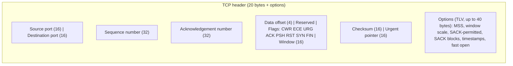
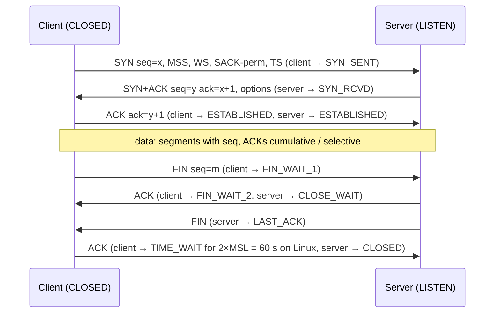
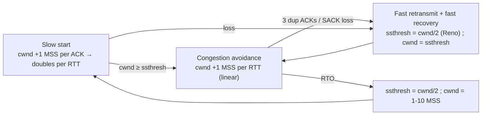
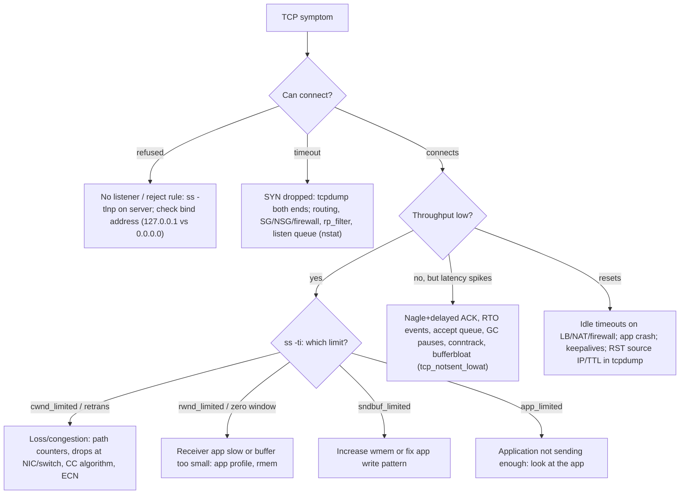

# 2.6 TCP in depth: handshake, windows, congestion control, tuning and troubleshooting

| | |
|---|---|
| Level | Beginner to intermediate |
| Priority tier | 0 |
| Lab venue | Two Linux VMs or namespaces with `tc netem` |
| Part | Part 2: Networking, from first principles to AI fabrics |
| Status | Drafted, labs **untested** |

## Why this matters for AI infrastructure

Picture a cross-region checkpoint copy that runs far slower than the link should allow. Or picture an inference API that is fast most of the time, then stalls for no obvious reason. Both problems are TCP problems, and you will meet them often.

Almost everything outside the GPU fabric rides on TCP. SSH sessions, HTTPS, the Kubernetes API and container image pulls all use it. So do object-store downloads of datasets and checkpoints, the control paths of NFS and many parallel filesystems, inference APIs over gRPC and HTTP, and metrics scraping. NCCL depends on TCP too, for its bootstrap and as a fallback socket transport.

Each kind of ticket points to a different part of TCP. Throughput on a long, fat path, such as a cross-region checkpoint copy, is governed by window sizes and congestion control. Tail latency in an inference service comes down to retransmissions, Nagle and delayed-ACK interactions, and connection reuse. A "connection refused", "reset" or "timeout" ticket is answered by handshake and state-machine details.

RDMA fabrics, InfiniBand and RoCE, take a different route. They replace TCP's machinery with hardware-assisted transport. What they must build again is reliability, flow control and congestion control. You can only judge that choice once you understand TCP properly.

This chapter starts with the problems any transport protocol must solve. You will read the header and follow the state machine through the handshake and teardown. You will work through sliding windows, retransmission and congestion control, including Reno, CUBIC and BBR. Next come buffers, the bandwidth-delay product, offloads, socket options and Linux tuning. Along the way you will meet the tools that show what TCP is doing: `ss`, `tcpdump` and `nstat`. The chapter closes with QUIC and an overview of the transport models, DoD, OSI and RINA.

## Prerequisites and outcomes

You should be comfortable with layering and IP first. Chapters 2.2, 2.4 and 2.5 cover that ground.

By the end of this chapter, you should be able to:

- Name the problems a transport protocol solves (marshaling, errors, multiplexing, addressing, flow control and congestion control). Then say how TCP and UDP each choose among them.
- Read a TCP header and trace the three-way handshake, the data transfer and the four-way close in `tcpdump`. For each step, name the state of each side.
- Explain sequence and acknowledgement numbers, the sliding window, window scaling, SACK, timestamps, the RTO calculation, fast retransmit, and delayed ACK with Nagle.
- Explain slow start, congestion avoidance, Tahoe and Reno, CUBIC and BBR, and ECN. Say why loss-based control struggles in data centres.
- Compute the bandwidth-delay product and use it to set buffers. Explain autotuning and the Linux `tcp_*mem` sysctls.
- Diagnose retransmissions, resets, timeouts, SYN backlog overflows, `TIME_WAIT` pile-ups, and window-limited or application-limited flows. Use `ss -ti`, `nstat`, `tcpdump` and Wireshark expert information to do it.
- Explain TCP's role and limits for AI workloads, and how QUIC differs.

## 1. What a transport protocol must solve

Packets cross the network with no promises. They can be dropped, duplicated, reordered, corrupted or delayed. Applications want something much simpler: a pipe between two processes. The transport layer closes that gap, to varying degrees. The table shows which problems it covers and how TCP and UDP each handle them.

| Problem | Mechanism | TCP | UDP |
|---|---|---|---|
| **Marshaling** (turn structures into bytes) | Fixed-length fields, type-length-value (TLV), shared dictionaries/schemas | Header uses fixed fields + options as TLV; payload is an opaque byte stream | Same: opaque datagram |
| **Error detection** | Checksums, CRCs, parity | 16-bit one's-complement checksum | 16-bit checksum (optional in IPv4, mandatory IPv6) |
| **Error correction** | Retransmission (ARQ) or forward error correction (FEC) | ARQ: ACKs, timeouts, fast retransmit, SACK | None (application's job) |
| **Multiplexing** | Port numbers to dispatch to the right process | Ports | Ports |
| **Addressing** | Host (IP) + port; unicast, multicast, anycast | Unicast (connection oriented); anycast works via routing | Unicast, multicast, broadcast |
| **Flow control** | Receiver tells sender how much it can take | Receive window | None |
| **Congestion control** | Sender infers/obtains network capacity | Congestion window, many algorithms | None (application's job, e.g. QUIC, RTP) |
| **Ordering/reliability** | Sequence numbers | Reliable, in-order byte stream | Neither |

Notice how much UDP leaves to the application, which means you must add it yourself. For error correction, flow control, congestion control and ordering, UDP has no entry at all. QUIC and RTP do that work in their own code.

Marshaling formats come in three families. Fixed-length fields are cheap to parse. They are also wasteful and inflexible, and the base IP and TCP headers use them. Type-length-value, or TLV, is self-describing and extensible. A parser reads it with a length-bounded loop. TCP options, BGP attributes, LLDP and many tunnel headers use TLV. Shared dictionaries let both sides agree on a schema in advance, as protobuf with gRPC, ASN.1 and YANG-modelled data do.

Every family trades compactness and speed against flexibility and the ability to evolve. When you read a packet capture, you are reading marshaled data. The dissector is the part of the tool that knows the grammar.

Detection is cheap, and parity, checksums and CRCs all do it. Correction costs more, and it comes in two forms. ARQ asks the sender to send again. That adds latency, and it needs buffers and timers. FEC sends redundancy up front. That adds constant overhead, but no round trip. Links use strong CRCs, such as Ethernet's 32-bit FCS. TCP and UDP use a weak checksum as an end-to-end safety net. It catches bugs in routers, NICs and offload engines, not only noise on the wire.

Checksums can be offloaded to NICs, and that explains a common surprise. `tcpdump` on the sending host sometimes shows `bad cksum`. The capture happens before the NIC fills in the checksum. So if you see `bad cksum` in a capture, you have not found corruption.

Ports are 16-bit numbers that let many applications share one host address. A TCP connection is identified by its **4-tuple**: source IP, source port, destination IP and destination port. Ports fall into three ranges. Well-known ports, 0 to 1023, name services. SSH uses 22, DNS 53, HTTP 80, HTTPS 443 and the Kubernetes API 6443. Registered ports, 1024 to 49151, are assigned by IANA. Ephemeral ports are chosen by clients. On Linux they default to 32768 to 60999, set by `net.ipv4.ip_local_port_range`.

A server can accept a very large number of connections on one port, because each connection has its own 4-tuple. Exhaustion happens on the client side instead. When one source address connects to one destination address and port, only the source port varies. That leaves ~28k ports, and `TIME_WAIT` drains them too, as section 8 explains. If you see ports running out, look at the client side first.

Delivery comes in four models. Unicast is one-to-one. Multicast is one-to-group, managed with IGMP and MLD. Some discovery protocols use it, as do market data feeds and InfiniBand's collective offload. Broadcast is IPv4 only and stays on the local network. Anycast announces the same address from several places, and routing delivers each packet to the nearest one. DNS roots, CDNs and load-balanced VIPs use it.

If you run a service on anycast, know the one catch with TCP. If a route changes mid-connection, packets can reach a different instance. Anycast TCP therefore needs services that hold little state, or consistent hashing.

Flow control protects the receiver. Congestion control protects the network. The two use different signals, and people often confuse them. TCP implements both, and the sender never has more in flight than the smaller of the two windows allows. When a flow is slow, first ask whether the receiver or the network is the limit. The fix differs for each.

## 2. Transport models: DoD, OSI, RINA, and connection-oriented versus connectionless

Two models describe the layers of a network stack. The DoD model, also called the TCP/IP model, has four layers: link, internet, transport and application. It grew out of running real protocols. The OSI model has seven layers, from physical to application, and it was designed by committee. Engineers still use OSI numbers as shorthand. L2 means a switch, L3 a router, L4 a load balancer and L7 a proxy. They use that vocabulary while implementing the DoD stack.

Session and presentation concerns, such as TLS, serialization and RPC framing, live inside applications and libraries in practice.

The Recursive Internet Architecture, or RINA, takes a different view. It argues that the layer structure should be one repeating layer for inter-process communication, which appears at different scopes. The same mechanisms come back at each scope: naming, error and flow control, and routing. They are not redesigned for every layer. RINA is a research model. Still, it explains why features like congestion control, multiplexing and addressing keep reappearing. You see them in VLAN and VXLAN tunnels, in MPLS and in QUIC over UDP.

The practical lesson is that layers are conventions. Real stacks tunnel one layer inside another, such as IP in UDP in IP in Ethernet. So asking which layer a feature belongs to is often a design choice, not a fact.

A **connection-oriented** transport, TCP, sets up shared state at both ends before any data flows. That state covers sequence numbers, windows and timers. It buys reliability and ordering. You pay for it with setup latency, memory for each connection, and state that NATs and firewalls must track. A connectionless transport, UDP, keeps no state. Each datagram stands alone. That suits DNS queries, telemetry, real-time media and protocols that build their own reliability. QUIC is one such protocol. RoCE v2 uses UDP as its carrier, with reliability handled in the NIC.

Layers can mix. IP is connectionless, TCP over it is connection-oriented, and HTTP over TCP is stateless again by design. When you debug a stack, read layer names as a way to talk about it, not as a fixed map of it.

## 3. The TCP header and options

Every TCP segment carries this header. The options at the end decide how the connection behaves, so read those fields closely when you debug a connection.



The **sequence number** is the byte offset of the first payload byte in this direction's stream. SYN and FIN each use up one sequence number. The **acknowledgement number** is the next byte the receiver expects. It works as a cumulative ACK, which means "I have everything before this byte."

The flags tell the other side what kind of segment this is. `SYN` opens a connection. `ACK` means the acknowledgement field is valid, and every segment except the first SYN sets it. `FIN` says the sender has finished. `RST` aborts the connection. `PSH` asks the receiver to pass the data to the application now. `URG` marks an urgent pointer, which is obsolete. `ECE` and `CWR` carry ECN signals.

The window field gives the receive window in bytes. The window-scale option multiplies that value, as a later section explains. Options are type-length-value fields that both ends agree on during the handshake. The most important is MSS, the maximum segment size. It equals the MTU minus 40 for IPv4, or minus 60 for IPv6. On a 1500 MTU link the MSS is 1460. On a 9000 MTU link it is 8960.

Window scale shifts the window by 0 to 14 bits. That allows windows up to about 1 GiB. SACK-permitted and SACK blocks support selective acknowledgements. Timestamps measure round-trip time, and they give PAWS protection against wrapped sequence numbers. TCP Fast Open is the last option. Options can only be negotiated on the SYN. A middlebox that strips them cripples every connection through it. That is a classic cause of "slow only through the firewall" tickets.

TCP is a byte stream, so it has no message boundaries. One `send(100)` can arrive as two `recv`s of 50 bytes. Two sends can also be merged into one. The application must frame its own messages, for example with a length prefix or a delimiter. That is the marshaling problem again. If a middlebox sits on the path, check that you still see these options intact. When you capture a SYN, the options are the first thing to read.

## 4. The handshake, data transfer and teardown

Every TCP connection starts with a three-packet exchange. If that exchange fails, the client sees a specific error. The error tells you where to look.



Why three packets? Each side has to prove it can both send and receive. Each side also has to agree on its starting sequence number. Two messages cannot do both things in both directions, so TCP needs three. The initial sequence numbers, or ISNs, are unpredictable. RFC 6528 describes a hash of the 4-tuple plus a secret. That stops off-path attackers from injecting data or forging connections. It also stops stale segments from an older connection on the same 4-tuple from being taken as new data.

On Linux, `listen(fd, backlog)` creates two queues. The SYN queue holds half-open connections, and `tcp_max_syn_backlog` sets its size. The accept queue holds completed handshakes that are waiting for `accept()`. Its size is `min(backlog, net.core.somaxconn)`. When the accept queue is full, the server drops the final ACK or ignores the SYN. The client believes it is connected, and then it retransmits. You see the result as latency spikes of 1, 3 and 7 seconds. The `ListenOverflows` and `ListenDrops` counters in `nstat` climb at the same time.

A SYN flood, or just a sudden burst, can fill the SYN queue. SYN cookies handle that case. Set `net.ipv4.tcp_syncookies=1`. The kernel then encodes the connection state in the sequence number of the SYN-ACK, so no queue entry is needed. The cost is that some options are lost. To tune the accept side, raise `somaxconn` to 4096 or more. Set the application's backlog too, such as nginx's `listen ... backlog=`. Go's `net.Listen` uses `somaxconn`. And fix any slow `accept()` loop, because that loop is what fills the queue.

The error the client sees tells you which of these situations you are in.

| What the client sees | Meaning |
|---|---|
| `Connection refused` (ECONNREFUSED) | A RST came back: host reachable, nobody listening on that port (or a firewall using `reject --tcp-reset`) |
| `Connection timed out` (ETIMEDOUT) | No reply to SYNs (retried with exponential backoff ~ 1, 2, 4... s, `tcp_syn_retries`=6 → ~127 s): dropped by a firewall/security group, wrong route, host down |
| `No route to host` / `Network is unreachable` | ICMP unreachable from a router, or no local route (chapter 2.5) |
| `Connection reset by peer` | RST during an established connection: peer crashed, app closed with unread data, firewall/NAT state expired, load balancer idle timeout |

A refusal means the host answered, so the listener is the place to look. A timeout means the SYNs never got a reply, so look at the route and the firewall.

Closing happens one direction at a time. This is a half-close: `shutdown(SHUT_WR)` sends a FIN, but the side can still read. The side that closes first is the active closer. It waits in `TIME_WAIT` for 2×MSL, which is 60 seconds on Linux, and that value is hard-coded. The wait absorbs delayed duplicates. It also lets the closer resend its last ACK if the peer's FIN arrives again. `TIME_WAIT` is normal in moderation. It becomes a problem only for a client that makes many short connections to one destination, which can exhaust its ports, or for clients behind NAT.

`CLOSE_WAIT` piling up on a server is a bug in your application. The peer has closed, but your code never called `close()`, so the socket leaks. A `RST` ends the connection at once and throws away any unsent data.

### TCP states in the field

Use `ss -tan state <state>` to count sockets in each state. The states are `LISTEN`, `SYN-SENT`, `SYN-RECV`, `ESTAB`, `FIN-WAIT-1/2`, `CLOSE-WAIT`, `LAST-ACK`, `TIME-WAIT` and `CLOSING`. Many sockets in `SYN-SENT` mean you cannot reach the remote service. Many in `SYN-RECV` mean a SYN flood or a slow handshake. Many in `CLOSE-WAIT` mean a leak in your application. Many in `FIN-WAIT-2` mean the remote side is not closing its end. Many in `TIME-WAIT` are normal churn from short connections. If `CLOSE_WAIT` keeps climbing, look at the application code before you touch any kernel setting.

## 5. Reliability: ACKs, retransmission and the RTO

TCP counts bytes, not packets. Receivers send cumulative ACKs that name the next byte they expect. Senders retransmit anything that is not acknowledged in time. Two events trigger a retransmission.

The first trigger is the retransmission timeout, or RTO. The sender starts a timer for each segment. If no ACK arrives before the timer runs out, the sender retransmits and doubles the RTO. That is exponential backoff. The sender keeps going up to `tcp_retries2`, whose default is 15, or about 15 minutes. Then it declares the connection dead. The RTO comes from a smoothed RTT and its variance: `RTO = SRTT + 4 × RTTVAR`. Linux sets a minimum of 200 ms, `TCP_RTO_MIN`, and a maximum of 120 s. An RTO is the expensive loss signal. The pipe has gone quiet, so TCP collapses its congestion window to one segment, or to the initial window, and restarts slow start. When you see `TCPTimeouts` rise in `nstat`, you are paying that cost.

The second trigger is fast retransmit, and it is much cheaper. When the receiver gets segments beyond a gap, it repeats the ACK for the last in-order byte. That repeat is a duplicate ACK. After three duplicate ACKs, the sender retransmits the missing segment straight away, without waiting for the timer. It then enters fast recovery. The sender halves its window and keeps the pipe full, instead of restarting slow start. RACK can also trigger a retransmit on time, when a later segment is acknowledged beyond a time threshold.

Linux uses RACK-TLP. RACK detects loss by time rather than by packet count. TLP, the tail loss probe, resends the last segment after about 2 RTT. That avoids a full RTO when the tail of a burst is lost.

SACK, the selective acknowledgement from RFC 2018, tells the sender exactly what arrived. The receiver reports the ranges it holds above the gap. The sender then retransmits only what is truly missing, not everything after the first hole. Without SACK, one loss in a large window can force a go-back-N style resend, or several RTTs of recovery. Keep SACK on with `net.ipv4.tcp_sack=1`, which is the default. Timestamps, set by `tcp_timestamps=1`, give an accurate RTT sample on every ACK. They cost 12 bytes per segment.

Receivers save packets by acknowledging every second full segment, or by waiting a short time first. On Linux that delay can reach 40 ms, and `quickack` modes override it. Senders using Nagle's algorithm hold small writes until earlier data is acknowledged. Put the two together and you get a trap. Nagle waits for an ACK, and delayed ACK waits to send one. The result can add about 40 ms to small request-response exchanges that write twice and then read. It is a notorious latency bug in RPC-style protocols.

You have three fixes. Set `TCP_NODELAY` to disable Nagle in latency-sensitive services, such as gRPC, Redis clients and NCCL's sockets, which set it. Coalesce writes with `writev`, `MSG_MORE` or `TCP_CORK`, instead of splitting a message across several small writes. Use `TCP_QUICKACK` where it is needed.

Reordering looks like loss to TCP. Parallel paths, multi-queue NICs and ECMP flaps can deliver packets out of order. That produces duplicate ACKs, which look exactly like loss. Linux adapts its reordering threshold, but heavy reordering still lowers throughput. Check with `nstat | grep -i reorder`, and watch the `TcpExtTCPSACKReorder` counter. When duplicate ACKs appear, look for reordering before you assume loss.

## 6. Flow control: the sliding window

Picture a receiver whose application is busy, with a buffer that is nearly full. The receiver cannot take much more data, so it has to say so. TCP does that with a receive window.

The receiver advertises `rwnd`, which is how many more bytes it can buffer. The sender may have at most the smaller of `rwnd` and `cwnd` in flight. `cwnd` is the congestion window, covered in section 7. "In flight" means sent but not yet acknowledged. As ACKs arrive, the window slides forward. That lets the sender keep many segments on the wire, instead of sending one and waiting for its reply.

Here is a worked example with small numbers. The receiver advertises a window of 20 bytes. The sender sends bytes 1 to 10. The receiver acknowledges 10 and raises its window to 30. The sender may now send up to byte 40, so it sends bytes 11 to 15. The receiver acknowledges 15 and advertises 40. The exchange continues the same way.

Acknowledging byte N implicitly acknowledges everything before it. Now suppose an acknowledgement stops short. The sender had sent bytes 16 to 35, but the receiver acknowledges only 30. The sender then knows that bytes from 30 onward are missing, so it resends them.

The receiving application can be the bottleneck too. If it reads slowly, its buffer fills, and the advertised window shrinks to zero. The sender then stops and sends periodic window probes until space opens. In `ss`, you can see this through `rcv_space` and `Recv-Q`. In Wireshark, a zero window means the receiving application is the bottleneck, not the network.

The window field is 16 bits, so it tops out at 65,535 bytes. That is far too small for modern paths. The window-scale option fixes this by multiplying the field by 2^shift. It is negotiated only in the SYN. Consider a 100 Gb/s link with a 1 ms RTT. Its bandwidth-delay product is 12.5 MB, which needs a scale factor of at least 8. Keep window scaling on with `tcp_window_scaling=1`, and watch for middleboxes that strip the option.

### Bandwidth-delay product and buffers

The maximum throughput of one connection is about `window / RTT`. To fill a path, the window must be at least the BDP, which is bandwidth times RTT. The table shows the BDP for five kinds of path.

| Path | Bandwidth | RTT | BDP |
|---|---|---|---|
| Same rack | 100 Gb/s | 20 µs | 250 KB |
| Same DC | 100 Gb/s | 100 µs | 1.25 MB |
| Metro | 10 Gb/s | 2 ms | 2.5 MB |
| Cross-continent | 10 Gb/s | 70 ms | 87.5 MB |
| Intercontinental | 10 Gb/s | 180 ms | 225 MB |

Notice how fast the BDP grows with distance. A window that fills a rack-local path can fall far short on a long one. This arithmetic explains most slow cross-region copies. A 4 MB window over a 70 ms RTT tops out at about 457 Mb/s on a 10 Gb/s link, no matter how fast the NIC is. That is why tools such as `rclone`, `aws s3 cp` and `gsutil` open many parallel connections.

Socket buffers hold unacknowledged data on the send side, and data the application has not read yet on the receive side. Linux autotunes both buffers for each connection, within limits. You can check the current limits with these commands.

```bash
sysctl net.ipv4.tcp_rmem net.ipv4.tcp_wmem       # min default max, bytes  (e.g. 4096 131072 6291456)
sysctl net.core.rmem_max net.core.wmem_max       # cap for explicit SO_RCVBUF/SO_SNDBUF
sysctl net.ipv4.tcp_mem                          # system-wide pages: low, pressure, high
sysctl net.ipv4.tcp_moderate_rcvbuf              # receive autotuning (1)
# For 10-100 Gb/s long paths raise the maxima, e.g.
#   net.ipv4.tcp_rmem = 4096 131072 134217728
#   net.ipv4.tcp_wmem = 4096 65536 134217728
#   net.core.rmem_max = net.core.wmem_max = 134217728
sysctl net.ipv4.tcp_notsent_lowat                # limit unsent data queued in the send buffer (reduces latency/bufferbloat; e.g. 131072)
```

The first lines show the current limits. The commented lines show the maxima to raise on long, fast paths. Setting `SO_RCVBUF` in an application disables autotuning for that socket, and that is almost always a mistake. Huge buffers on short-RTT paths do not help. They add memory pressure and queueing delay, which is bufferbloat. Size the buffers for the paths you actually have. Memory is the other limit. A 128 MB buffer on each of thousands of connections exhausts RAM, and `tcp_mem` guards against that. Choose buffer sizes from the BDP of the path you use, and leave autotuning on.

## 7. Congestion control

Flow control protects the receiver. But the network between two hosts can be the bottleneck too. Without a throttle, many senders would overload shared links together. That failure is called congestion collapse, and it was observed in 1986. Van Jacobson's answer, from 1988, is that each sender keeps a congestion window, `cwnd`, and probes for spare capacity. When it infers congestion, it backs off. The sender's usable window is the smaller of `cwnd` and `rwnd`. The `rwnd` value arrives in the header. `cwnd` stays private to the sender. If you have ever wondered why a fresh connection feels slow, slow start is the reason.

Several variables matter here. `cwnd` is the congestion window. `ssthresh` is the slow-start threshold. `rwnd` is the receive window. The initial window, IW10, is 10 segments on modern Linux, and you can set it per route with `initcwnd`. MSS is the segment size.



**Slow start** is anything but slow. The window doubles each RTT, because TCP adds one MSS for every ACK, and each RTT brings back as many ACKs as segments sent. The window keeps growing from IW up to `ssthresh`. Short flows, such as a small HTTP response or an RPC, finish inside slow start and never reach line rate. For them, the initial window and the RTT decide the completion time. That is why IW10 matters, and why tricks that skip handshakes, such as QUIC, TLS 1.3 0-RTT and connection reuse, help.

Once `cwnd` reaches `ssthresh`, congestion avoidance takes over. The window grows by one segment per RTT. That is additive increase. On loss, the window is cut, which is multiplicative decrease. Together they form AIMD, which is proven to converge to a fair share among competing flows.

Tahoe and Reno react to loss differently. On any loss, Tahoe sets `ssthresh = cwnd/2` and `cwnd = IW`, then restarts slow start. Reno handles loss found by duplicate ACKs differently. It halves `cwnd` and stays in congestion avoidance, using fast recovery. Only an RTO sends Reno back to slow start. NewReno and SACK-based recovery handle several losses within one window.

CUBIC has been the Linux default for many years. Its window growth is a cubic function of the time since the last loss. The curve is concave as it nears the previous maximum, `W_max`, so growth is cautious there. It is flat near `W_max`, and then it turns convex, probing for more. Growth depends on elapsed time, not on RTT, so CUBIC fills high-BDP paths far faster than Reno. Reno can need hundreds of RTTs to recover on a fat path. After a loss, CUBIC cuts `cwnd` by a factor of β=0.7.

BBR, from Google, works differently. It is model-based, not loss-based. BBR estimates the bottleneck bandwidth and the minimum RTT. It paces packets at the estimated rate, and it keeps in-flight data near the BDP. So it avoids filling buffers, which keeps latency low. It also does not treat random loss as congestion, which helps on lossy paths such as Wi-Fi, satellite and long WAN links. There are caveats. BBRv1 can be unfair to loss-based flows, and it can cause many retransmits on shallow-buffered paths. BBRv2 and v3 address some of that. Older kernels need the `fq` pacing qdisc. BBR is often used on edge and egress servers, and rarely inside a data-centre fabric.

ECN, Explicit Congestion Notification, lets routers mark packets instead of dropping them when queues build. The router sets the CE bit. The receiver echoes it with `ECE`, and the sender reduces `cwnd` without any loss. Enable it with `net.ipv4.tcp_ecn=1`. The value 2 means reply to peers that request ECN. DCTCP goes further. It uses the fraction of marked packets to scale back in proportion, which keeps queueing delay low in data centres. It needs ECN marking in the switches. RoCE congestion control, DCQCN, uses the same ECN idea, and chapter 2.20 covers it.

Loss-based TCP struggles in AI data centres for a specific reason. Collectives send synchronized bursts from many senders to one receiver. This pattern is called incast. It overflows shallow switch buffers. One dropped packet can trigger a 200 ms RTO, and that can stall a whole all-reduce. The mitigations include DCTCP with ECN, a lower `tcp_rto_min` set through `ip route ... rto_min`, larger switch buffers, and keeping the collective path off TCP altogether. RDMA with PFC, ECN and adaptive routing does the last one.

```bash
sysctl net.ipv4.tcp_congestion_control net.ipv4.tcp_available_congestion_control
sudo modprobe tcp_bbr ; sudo sysctl -w net.ipv4.tcp_congestion_control=bbr net.core.default_qdisc=fq
ss -ti dst 10.0.0.5                # per-connection: cwnd, ssthresh, rtt, rttvar, retrans, delivery_rate, pacing_rate, bytes_acked
ip route change 10.0.0.0/24 dev eth0 initcwnd 20 rto_min 20ms     # per-route tuning (use with care)
```

When you run them, you see the algorithms available, switch to BBR, and show the state of one connection. In the `ss -ti` output, the `cwnd` and `retrans` fields tell you which regime the connection is in. Keep CUBIC unless you have measured a reason to change. Do not expect BBR to help inside a data-centre fabric, and when you compare the two, run both on the same path.

## 8. Linux tuning reference and what each knob is for

Once you know what TCP is doing, you can adjust it. Most of the knobs below are sysctl settings in the kernel. Use the table as a map of what each setting affects, not as a list to copy.

| Concern | Settings | Notes |
|---|---|---|
| Accept queue / connection bursts | `net.core.somaxconn`, application backlog, `net.ipv4.tcp_max_syn_backlog`, `tcp_syncookies` | Check `nstat` `ListenOverflows` |
| Ephemeral port exhaustion (client or NAT) | `net.ipv4.ip_local_port_range`, `tcp_tw_reuse=1`, connection pooling/keep-alive | `tcp_tw_reuse` safely allows reuse of TIME_WAIT for *outgoing* connections with timestamps; `tcp_tw_recycle` is removed and dangerous (broke NAT) |
| Buffers | `tcp_rmem`, `tcp_wmem`, `rmem_max`, `wmem_max`, `tcp_mem` | Section 6; leave autotuning on |
| Congestion control | `tcp_congestion_control`, `default_qdisc`, `tcp_ecn` | CUBIC default; BBR on WAN egress; DCTCP in controlled DC |
| Keepalives / dead peers | `tcp_keepalive_time` (7200 s), `_intvl` (75), `_probes` (9) | Dead-peer detection and keeping NAT/LB state alive; many LBs time out idle flows (e.g. 350 s on some clouds) so set app/`SO_KEEPALIVE` below that |
| Retries | `tcp_syn_retries`, `tcp_synack_retries`, `tcp_retries2`, `tcp_orphan_retries` | Lower for fast failover; defaults tuned for lossy WAN |
| FIN handling | `tcp_fin_timeout` (60) for orphaned FIN_WAIT_2 | Not the TIME_WAIT timer |
| Slow start after idle | `tcp_slow_start_after_idle=0` | Default 1 resets cwnd after idle; disable for long-lived bursty connections (gRPC, DB pools) |
| MTU probing | `tcp_mtu_probing=1` or 2 | Helps with PMTUD black holes (chapter 2.7) |
| Low-latency | `TCP_NODELAY`, `tcp_notsent_lowat`, busy polling (`net.core.busy_poll`) | App level |
| Offloads | `ethtool -k`: TSO/GSO/GRO/LRO, checksum offload | Disable only to debug; captures show "super-segments" up to 64 KB because of GRO/TSO |
| Conntrack (NAT/firewall hosts) | `nf_conntrack_max`, `nf_conntrack_tcp_timeout_established` | Table-full drops look like random TCP failures (chapter 2.23) |

Every setting in this table has a reason behind it. Change one setting at a time, and measure its effect with a benchmark, as chapter 1.25 describes. Then persist the change in `/etc/sysctl.d/`, and write down why you made it.

## 9. Reading TCP in practice

### `ss`

Start with `ss`. It lists each socket, and with `-ti` it also shows the internals of each connection.

```bash
ss -tan                         # all TCP sockets, numeric
ss -tlnp                        # listeners with owning process
ss -tn state established '( dport = :443 or sport = :443 )'
ss -ti                          # internals: rtt:12.5/3 mss:1448 cwnd:10 ssthresh:7 bytes_sent bytes_retrans retrans:0/12 delivery_rate pacing_rate send rcv_space
ss -tm                          # memory: skmem (rb, tb, f, w, o, bl, d)
ss -s                           # socket summary by state
```

Read the output with a few patterns in mind. A persistent non-zero `Send-Q` with growing `retrans` points to loss or a stalled receiver. A high `Recv-Q` on an established socket means the local application is not reading. A small `cwnd` with high `retrans` means congestion or loss. Newer `ss -ti` output also shows `rwnd_limited`, `sndbuf_limited` and `cwnd_limited`. Together with `rcv_space`, these fields tell you which limit constrains the flow.

### `tcpdump`

Use `tcpdump` to see the packets themselves. Keep the capture narrow, so the output stays small enough to read.

```bash
sudo tcpdump -ni eth0 -c 20 'tcp port 443 and host 10.0.0.5'           # basic
sudo tcpdump -ni any 'tcp[tcpflags] & (tcp-syn|tcp-fin|tcp-rst) != 0'   # only connection events
sudo tcpdump -ni eth0 -w /tmp/c.pcap -s 128 'host 10.0.0.5'            # capture headers only to a file for Wireshark
sudo tcpdump -nr /tmp/c.pcap -tttt | head
```

Here is what one line says: `IP 10.0.0.2.51234 > 10.0.0.5.443: Flags [S], seq 1000, win 64240, options [mss 1460,sackOK,TS val 1 ecr 0,nop,wscale 7], length 0`. The flags are `S` for SYN, `.` for ACK, `P` for PSH, `F` for FIN and `R` for RST. Watch for a few patterns. A retransmitted segment shows the same sequence number twice. Duplicate ACKs, RST responses and a window that shrinks to 0 all stand out. A `[S]` with no `[S.]` reply means the SYN was blocked or dropped. Check that the MSS and wscale options appear in both SYNs. Time gaps show up when you add `-ttt`.

In Wireshark, open *Statistics → TCP Stream Graphs* for the time-sequence, throughput and RTT views. The *Expert Information* window lists retransmissions, duplicate ACKs, zero windows, window-full and out-of-order segments.

### `nstat` and `/proc/net/netstat`

`nstat` reads the kernel's TCP counters. The counters are cumulative, so what matters is how fast each one climbs.

```bash
nstat -az | egrep 'TcpRetransSegs|TcpExtTCPLostRetransmit|TcpExtListenOverflows|TcpExtListenDrops|TcpExtTCPTimeouts|TcpExtTCPSynRetrans|TcpExtTCPBacklogDrop|TcpExtTCPRcvCollapsed|TcpExtTCPSACKReorder|TcpExtTCPSpuriousRTOs|TcpExtTCPAbortOn'
nstat -az | egrep 'TcpExtTCPFastRetrans|TcpExtTCPSlowStartRetrans|TcpExtTCPSynRetrans|TcpExtTW'
```

An increase in `TCPTimeouts` means RTOs, and that is bad. `ListenOverflows` means the accept queue overflowed. `TCPBacklogDrop` and `TCPRcvQDrop` point to overload on the receive side. `TCPAbortOnTimeout` and `OnData` explain resets.

### A diagnostic flow

When a TCP symptom appears, start with whether the connection succeeds, and follow the branch that matches.



Each branch names the first place to look. Confirm the branch with the commands above before you change any setting.

## 10. TCP and AI workloads

NCCL uses TCP sockets for its bootstrap, which is the rank exchange. It also uses them as a fallback transport when no IB/RoCE is available. Socket performance depends on `NCCL_SOCKET_IFNAME`, on how many sockets you open per connection with `NCCL_SOCKET_NTHREADS` and `NCCL_NSOCKS_PERTHREAD`, and on `TCP_NODELAY`, buffer sizes, IRQ affinity and MTU. Throughput over TCP stays far below RDMA, because every byte passes through kernel copies and costs CPU. That gap is why GPUDirect RDMA exists, and Part 11 covers it.

Data loading and checkpoint I/O over NFS, S3 or HTTP is limited by the window and the BDP on long paths. On 100G+ links without offloads, it is limited by CPU instead. The usual fixes are parallel streams, a large MTU on internal networks, and tuned buffers.

Inference serving over HTTP/2 and gRPC is sensitive to several things. Connection reuse matters, and so do keepalive settings and load-balancer idle timeouts. Nagle with delayed ACK can stall small messages. HTTP/2 streams also share one TCP connection, so a lost packet stalls every stream on it. That is head-of-line blocking.

Kubernetes adds layers on top of TCP. Node-to-node and pod-to-pod traffic crosses overlays, which can shrink the MTU (chapter 2.7). It also passes through conntrack and kube-proxy NAT, which keep state and timeouts. Service load balancing can reset long-lived connections whenever endpoints change.

Incast and tail latency come from many-to-one bursts and synchronized all-reduce barrier waits. A single 200 ms RTO costs hundreds of milliseconds of GPU idle time per step. Capture the `TCPTimeouts` counter and the retransmit rates during any training job that uses socket transports. When you run such a job, you pay these costs on every step.

## 11. QUIC and where TCP is going

QUIC, defined in RFC 9000, started at Google. It is now the transport under HTTP/3. It runs over UDP and implements the transport in user space. That lets it fix several pain points of TCP.

The first fix is startup speed. QUIC combines the transport handshake with TLS 1.3. A new connection takes 1 RTT, and a resumed one can send 0-RTT data, which must be safe to replay. TCP with TLS needs 2 to 3 RTTs. An early gQUIC design used source-address tokens. As the networking textbook notes, those tokens could be stolen and used to spoof addresses. The standardised version authenticates differently.

The second fix is head-of-line blocking. Streams inside one QUIC connection are independent. A lost packet stalls only the stream or streams it carried. On a single TCP connection, one loss stalls every stream, as section 10 explains.

Connection IDs let a connection survive a change of IP address, such as moving from Wi-Fi to cellular. Encryption is mandatory, and it covers most of the transport header. Middleboxes therefore cannot meddle with the traffic or optimise it.

QUIC also lets each application pick its own congestion control, such as CUBIC or BBR. Its loss recovery is better too. Monotonic packet numbers avoid the retransmission ambiguity that TCP faces. ACK ranges resemble NACKs. Early gQUIC experiments tried forward error correction, but the IETF version dropped it.

The costs are real. QUIC uses more CPU, because crypto and packetisation run in user space, and UDP GSO helps with that. Some networks block or rate-limit UDP. Operators also find QUIC harder to observe. When you look at QUIC traffic, the encrypted headers limit what you can see, so use qlog and endpoint metrics. For AI infrastructure, QUIC mostly appears at the edge, such as HTTP/3 to inference APIs and CDNs, rather than inside clusters. If you operate an inference API at the edge, you may already be running it.

ICMP is the companion protocol that carries errors and diagnostics, such as unreachable, time exceeded and fragmentation needed. It belongs to the network layer, but TCP depends on it for PMTUD. Chapter 2.7 covers ICMP, along with ping, traceroute and PMTUD.

## 12. Hands-on lab: observe TCP behaviour

Start with the self-checking Python lab, which runs on your own machine. It verifies the bandwidth-delay product, `BDP = bandwidth * RTT`, and the window-scale shift math. For example, `12.5 MB` needs shift `8`, and the lab also checks `87.5 MB` and `125.0 MB`. It checks window-limited throughput too, where `4 MB / 70 ms ≈ 457.1 Mb/s`. It also covers Jacobson's RTO formula, with Linux's `200 ms` `TCP_RTO_MIN` floor. Last, it compares how Tahoe, Reno and CUBIC (`β = 0.7`) respond to 3 duplicate ACKs versus an RTO.

Run the lab with this command.

```bash
python3 code/part02/tcp_in_depth_lab.py
```

Next, use a disposable Linux VM. Build two network namespaces joined by a `veth` pair, and shape the link with `tc netem`. All interactive VM commands below are `untested here`, so check each result yourself before you rely on it.

```bash
sudo ip netns add c; sudo ip netns add s # (untested here)
sudo ip link add vc type veth peer name vs; sudo ip link set vc netns c; sudo ip link set vs netns s # (untested here)
sudo ip -n c addr add 10.9.0.1/24 dev vc; sudo ip -n s addr add 10.9.0.2/24 dev vs # (untested here)
sudo ip -n c link set vc up; sudo ip -n s link set vs up; sudo ip -n c link set lo up; sudo ip -n s link set lo up # (untested here)
sudo ip netns exec s iperf3 -s -D       # (untested here)
```

Then work through these 11 steps.

1. Watch the handshake and the teardown. In namespace `s`, run `tcpdump -ni vs -S` to see absolute sequence numbers. In `c`, run `nc 10.9.0.2 5201`, then close it. Label the packets SYN, SYN-ACK, ACK, FIN and ACK, and record the options: MSS, wscale, SACK and TS. Run `ss -tan` during and after the close, and you will see `TIME-WAIT` on the active closer.
2. Compare a refusal with a timeout. Connect to a closed port, and you get a RST and the error "refused". Then use `nft` to drop SYNs to that port, and connect again. This time you get a timeout, and `tcpdump` shows the SYNs retried at 1, 2, 4... s.
3. Watch slow start grow. Run `sudo ip netns exec c iperf3 -c 10.9.0.2 -t 10 -i 1` while `ss -ti` polls in a loop: `watch -n0.2 "ip netns exec c ss -ti dst 10.9.0.2 | tail -2"`. Then observe how `cwnd` grows.
4. Run the BDP experiment. Add the delay with `sudo ip netns exec c tc qdisc add dev vc root netem delay 50ms`. Run iperf3 first with the default buffers, then with `-w 64K`, `-w 1M` and `-w 16M`. Compare each result with `window/RTT`.
5. Add loss. Change the qdisc with `tc qdisc change dev vc root netem delay 50ms loss 0.5%`. Then compare CUBIC and BBR, using `sysctl net.ipv4.tcp_congestion_control` or `iperf3 -C bbr`. Read the retransmit counts in `ss -ti` and `nstat`.
6. Make the receiver the limit. Write a receiver that sleeps before it reads. Then watch the window shrink to zero in `tcpdump`, and watch `Recv-Q` grow in `ss`.
7. Reproduce the Nagle stall. Write a small client that sends a 4-byte header and then a 100-byte body, in two separate `send` calls. Run it with and without `TCP_NODELAY`, and measure the request latency. You should see stalls of about 40 ms. Then fix it with a single write.
8. Overflow the accept queue. Write a server that listens with backlog 1 and never calls `accept`. Open many connections. Watch `ss -ltn`, where `Recv-Q` shows the queue length. Watch `nstat ListenOverflows` too, along with the SYN-ACKs the client retransmits.
9. Exhaust ports on purpose. Loop over thousands of short connections, and count the `TIME-WAIT` sockets. Shrink `ip_local_port_range` until you see `Cannot assign requested address`. Then test `tcp_tw_reuse`.
10. Open the capture from step 5 in Wireshark. Use the TCP stream graphs and the expert information.
11. Clean up. Kill iperf3, then run `sudo ip netns del c; sudo ip netns del s`.

If a step does not match what you expect, check it against the formulas in the lab script before you change any setting.

## 13. Common mistakes

Many people blame the network first. But when `ss -ti` shows that the flow is limited by the receiver, the application or the buffer, the network is not the problem. Check the limit before you blame the path.

Setting `SO_RCVBUF` or `SO_SNDBUF` explicitly disables autotuning, and oversized buffers on short paths only add cost. The same goes for sysctl lists copied from the internet. Some of them include removed options, such as `tcp_tw_recycle`. Measure every setting before you keep it.

Treating `TIME_WAIT` as a leak and `CLOSE_WAIT` as normal gets it backwards. `TIME_WAIT` is protocol hygiene. `CLOSE_WAIT` that keeps growing is a leak in your application. Ignoring idle timeouts on NATs, load balancers and firewalls causes silent resets on long-lived connections, unless you use keepalives. Disabling SACK, timestamps or window scaling hurts too, and so does running through middleboxes that strip options.

Splitting a small message into several writes triggers the Nagle and delayed ACK stall. Capturing on a host can mislead you as well. A bad checksum warning is usually an offload artefact, and 64 KB "packets" come from GRO and TSO. Also remember that one RTO is 200 ms or more, which is thousands of times a typical datacenter RTT.

The fix for each of these mistakes starts with a measurement, not with a setting copied from a list.

## 14. Interview angles

- "Walk through what happens from `connect()` to the first byte of data, at packet level." Cover the SYN, SYN-ACK and ACK, the queues, the ISNs and the options.
- "A service times out only under load, and some connections take exactly 1 or 3 seconds. What is it?" Think about SYN and accept queue overflow, and the SYN retransmit timers.
- "What is the difference between flow control and congestion control?"
- "Throughput over a 10 Gb/s, 80 ms path is 400 Mb/s. Why, and how do you fix it?" Think about the window and BDP, buffers, parallel streams and the choice of congestion control.
- "Explain slow start, congestion avoidance, fast retransmit and what an RTO does to throughput."
- "CUBIC versus BBR: when would you choose each?"
- "What is `TIME_WAIT`, why does it exist and when is it a problem? What does `CLOSE_WAIT` indicate?"
- "Why does TCP struggle with incast, and what do AI clusters do about it?"
- "What does `ss -ti` tell you? Which fields matter?"
- "Why is QUIC built on UDP? What does it fix?"

## Exercises

Work through these six exercises after reading the chapter. Each one pairs a calculation with an explanation in your own words.

1. Start with transport problems and flow control. Use chapters 2 and 3 of *Computer Networking Problems and Solutions* as your reference. (a) Contrast the three digital marshaling grammars: fixed-length fields, Type-Length-Value (TLV), and shared schemas or dictionaries. Then say where TCP uses the first two. (b) Distinguish flow control (`rwnd`) from congestion control (`cwnd`). State the formula for the most bytes a TCP sender may have in flight at any instant.
2. Work through the handshake, the server queues and the close states. (a) Explain why TCP needs a three-way handshake with unpredictable Initial Sequence Numbers (`RFC 6528`). Then explain how Linux's two listen queues cause connect stalls of 1 s, 3 s and 7 s when the `accept()` loop is slow. Use `tcp_max_syn_backlog`, `tcp_syncookies` and `min(backlog, net.core.somaxconn)` in your answer, and check `ListenOverflows` in `nstat`. (b) Contrast a server with 20,000 sockets in `TIME_WAIT` with one that has 20,000 sockets in `CLOSE_WAIT`.
3. Work through reliability, Nagle and delayed ACK. (a) Use `compute_jacobson_rto_ms()` in `code/part02/tcp_in_depth.py` to compute the RTO for a datacenter path (`SRTT = 0.2 ms, RTTVAR = 0.05 ms`) and for a WAN path (`SRTT = 150 ms, RTTVAR = 30 ms`). Then explain how Fast Retransmit (`3` dup ACKs), `SACK` (`RFC 2018`) and `RACK-TLP` avoid the `200 ms` `TCP_RTO_MIN` penalty. (b) Why does an RPC client that calls `write(header)` followed by `write(body)` suffer `~40 ms` latency spikes? Name the two fixes.
4. Compute the window and the BDP. (a) Using `compute_bdp_and_window_scale()`, compute the BDP in MB and the minimum window-scale shift for `100 Gb/s x 1 ms`, `10 Gb/s x 70 ms`, and `25 Gb/s x 40 ms`. (b) Using `compute_window_limited_throughput_mbps()`, calculate the maximum single-stream throughput of a `4 MB` window over `70 ms` RTT (`~457.1 Mb/s`) and over `80 ms` RTT (`400.0 Mb/s`). Then explain why calling `setsockopt(SO_RCVBUF)` in application code is an anti-pattern on Linux.
5. Compare congestion-control algorithms and AI incast. Using `simulate_congestion_loss_event()`, compare the new `ssthresh` and `cwnd` after 3 duplicate ACKs with those after an RTO, starting from `cwnd = 100 MSS`, under Tahoe, Reno and `CUBIC` (`β = 0.7`). Then contrast `CUBIC`, BBR (`fq` pacing) and `DCTCP` (`ECN`). Finally, explain why synchronized many-to-one AI collective bursts (**incast**) break loss-based TCP.
6. Diagnose TCP flows and compare QUIC. (a) How do `ss -ti` (`cwnd_limited`, `rwnd_limited`, `sndbuf_limited`, `retrans`) and `tcpdump` tell apart network packet loss, a slow receiving application (`win 0`), and a small send buffer? (b) List five architectural improvements that `QUIC` (`RFC 9000`, over UDP) makes over TCP plus TLS.

## Checkpoint questions (20)

<details>
<summary>1. What six problems must a full-featured transport protocol solve, and which ones does UDP omit?</summary>

A full transport protocol has to solve six problems. They are marshaling, which means framing the headers and options. Error detection comes next, then error correction, which uses ARQ retransmissions or FEC. Multiplexing uses ports. Flow control protects the receiver, and congestion control protects the network. On top of these, TCP delivers data in order. UDP provides only multiplexing, through its 16-bit ports, and an error-detection checksum. It leaves reliability, ordering, flow control and congestion control to the application, or to the NIC hardware in RoCEv2.
</details>

<details>
<summary>2. Compare the three digital marshaling grammar families (from Computer Networking Problems and Solutions, chapter 2) and where they appear in networking.</summary>

The first family is fixed-length fields. IPv4, IPv6 and the base 20-byte TCP header use them. A parser reads them at fixed offsets, so they are fast, but they are inflexible. The second is Type-Length-Value, or TLV. TCP options, BGP path attributes and LLDP use it. Each item carries its own type and length, so the format can grow. A parser, though, must read the items in order. The third is shared dictionaries and schemas. Protocol Buffers with gRPC, and YANG, use them. They are compact and strongly typed, as long as both endpoints share the schema out of band.
</details>

<details>
<summary>3. Why does TCP require a three-way handshake (`SYN`, `SYN-ACK`, `ACK`) and cryptographic random Initial Sequence Numbers (`ISN`s, RFC 6528)?</summary>

Both endpoints must prove they can send and receive. Each must also synchronize its starting sequence number, `seq = x` on one side and `seq = y` on the other. That takes at least three messages: `SYN x`, then `SYN y, ACK x+1`, then `ACK y+1`. Unpredictable ISNs are hashed from the 4-tuple, a timestamp and a kernel secret. They stop off-path attackers from forging connections or injecting segments. They also stop delayed packets from an older connection on the same 4-tuple from corrupting a new one.
</details>

<details>
<summary>4. What are the two server-side queues created by `listen(fd, backlog)` in Linux, and how do you diagnose an overflow?</summary>

The SYN queue holds half-open (`SYN_RCVD`) connections that wait for the client's final ACK. Its size comes from `tcp_max_syn_backlog`, and `tcp_syncookies = 1` defends it against floods without storing state. The accept queue holds completed (`ESTABLISHED`) connections that wait for `accept()`. Its size is `min(backlog, net.core.somaxconn)`. When the accept queue fills, `nstat -az` increments `TcpExtListenOverflows` and `TcpExtListenDrops`. In `ss -ltn`, you will see `Recv-Q` above `Send-Q`. Clients then stall for 1 s, 3 s or 7 s on SYN-ACK and ACK retransmits.
</details>

<details>
<summary>5. Contrast `TIME_WAIT` and `CLOSE_WAIT`: which side enters each state, why, and which one indicates a bug in your server code?</summary>

The active closer is the side that sends the first FIN. After it sends the final ACK, it enters `TIME_WAIT` for 2 × MSL, which is 60 s on Linux. The wait absorbs delayed duplicate packets, and it lets the closer re-ACK a lost FIN. So `TIME_WAIT` is normal protocol hygiene. The passive closer is the side that receives the peer's FIN and ACKs it in the kernel. It enters `CLOSE_WAIT` while it waits for the local application to call `close(fd)`. If you see thousands of sockets in `CLOSE_WAIT`, your application has a file-descriptor leak.
</details>

<details>
<summary>6. How does TCP calculate the Retransmission Timeout (`RTO`), what is Linux's `TCP_RTO_MIN`, and why is an `RTO` catastrophic in a data center?</summary>

The kernel tracks a smoothed RTT, `SRTT`, and a mean deviation, `RTTVAR`. RFC 6298 sets `RTO = SRTT + 4 * RTTVAR`. On Linux the result is clamped to a minimum of 200 ms, `TCP_RTO_MIN`, and a maximum of 120 s. Each consecutive timeout doubles the RTO, up to `tcp_retries2 = 15`. Take a 50 µs data-center link. One 200 ms RTO stalls the flow for 4,000 round trips, and it drops `cwnd` back to 1 MSS. For example, `ip route change ... rto_min 5ms` lowers the floor on internal subnets. You can use that only with care.
</details>

<details>
<summary>7. How do Fast Retransmit, Selective Acknowledgements (`SACK`), and `RACK-TLP` recover from packet loss without waiting for an `RTO`?</summary>

When a segment is lost but later segments arrive, the receiver sends duplicate ACKs that point at the missing sequence number. It also attaches `SACK` blocks, defined in RFC 2018, which list the exact out-of-order ranges above the gap. After 3 duplicate ACKs, the sender retransmits. Linux can also decide by time. RACK, short for Recent ACK, detects loss by the time order of acknowledgements rather than by packet count. TLP, the Tail Loss Probe, sends a probe after about 2 RTT if the tail of a burst is still unacknowledged. The sender then retransmits only the missing holes, in 1 RTT. It enters Fast Recovery without collapsing `cwnd` to 1.
</details>

<details>
<summary>8. Explain the 40 ms latency trap caused by combining Nagle's algorithm with Delayed ACKs, and state how to fix it.</summary>

Nagle's algorithm holds small writes in the sender's kernel while earlier data is still unacknowledged. Delayed ACK holds the receiver's ACK for up to 40 ms, waiting for a second segment or a reply to piggyback on. Suppose an RPC application splits one request into `write(header)` and then `write(body)`. The sender holds `body` until the ACK for `header` arrives. The receiver holds that ACK for 40 ms, which is 0.04 s, while it waits for `body`. The fix is to set `TCP_NODELAY` on the socket, and to send the whole message with one `write()` or `writev()`.
</details>

<details>
<summary>9. What is the difference between `rwnd` and `cwnd`, and what does a \"Zero Window\" in `tcpdump` / Wireshark mean?</summary>

`rwnd` is the receive window. The receiver puts it in every TCP header to say how many free bytes remain in its receive buffer. That is flow control. `cwnd` is the congestion window. The sender keeps it privately, to estimate how many bytes the path can hold without congestion. That is congestion control. The sender may have at most `min(cwnd, rwnd)` bytes in flight. A zero window, `win 0`, means the receiving application is not reading fast enough, so its receive buffer is full. If you see `win 0` in a capture, look at the receiving application first.
</details>

<details>
<summary>10. Why is the TCP Window Scale option (`wscale`) mandatory on modern networks, and why do middleboxes that strip SYN options break throughput?</summary>

The base header's window field is only 16 bits. It tops out at 65,535 bytes. The window-scale option multiplies that field by `2^shift`, where the shift runs from 0 to 14. It is negotiated only in the SYN and SYN-ACK, and it allows receive windows up to about 1 GiB. Consider a 100 Gb/s link with a 1 ms RTT. Its BDP is 12.5 MB, so the shift must be at least 8. If a firewall strips TCP options on the SYN, the window is capped at 64 KiB. That limits throughput to about 524 Mb/s.
</details>

<details>
<summary>11. Define Bandwidth-Delay Product (`BDP`), calculate `BDP` for `10 Gb/s` at `70 ms` RTT, and calculate the maximum throughput of a `4 MB` window over `70 ms` RTT.</summary>

The BDP is bandwidth times RTT, `BDP = bandwidth * RTT`. It is the amount of data that must be in flight at once to keep the pipe full. Take 10 Gb/s, which is 1,250 MB/s, with an RTT of 70 ms, or 0.070 s. Then `BDP = 1,250 MB/s * 0.070 s = 87.5 MB`. A single connection with only a 4 MB window over the same 70 ms RTT can reach at most `window / RTT = 4 MB / 0.070 s = 57.14 MB/s = 457.1 Mb/s`. That is under 5% of the 10 Gb/s link.
</details>

<details>
<summary>12. How do `net.ipv4.tcp_rmem`, `tcp_wmem`, and `tcp_moderate_rcvbuf` work in Linux, and why shouldn't applications hardcode `SO_RCVBUF`?</summary>

`tcp_rmem` and `tcp_wmem` set the minimum, default and maximum socket buffer sizes, in bytes. On high-BDP WAN paths you raise the maximum. For example, you might raise it from 6 MiB to 134217728 bytes, which is 128 MiB. With `tcp_moderate_rcvbuf = 1`, the kernel autotunes each connection's receive buffer up to `tcp_rmem[2]`, based on the measured BDP. If an application calls `setsockopt(SO_RCVBUF)`, it turns autotuning off for that socket. A hard-coded size can then be too small for a high-BDP flow, or too large and waste RAM across idle sockets.
</details>

<details>
<summary>13. Trace TCP Slow Start, Congestion Avoidance (`AIMD`), and the difference between Tahoe and Reno on loss.</summary>

In slow start, which begins at IW10, or 10 MSS, `cwnd` grows by 1 MSS for every ACK. That doubles it every RTT, until `cwnd` reaches `ssthresh` or a loss happens. Above `ssthresh`, congestion avoidance adds 1 MSS per RTT. This is additive increase. On loss, it cuts `cwnd`, which is multiplicative decrease. Together they form AIMD. On 3 duplicate ACKs, Tahoe sets `ssthresh = cwnd / 2` and resets `cwnd` to 1 MSS, then restarts slow start. Reno sets `cwnd = ssthresh = cwnd / 2`, enters fast recovery and stays in congestion avoidance.
</details>

<details>
<summary>14. Why did `CUBIC` replace `Reno` as the Linux default congestion control algorithm?</summary>

Take a high-BDP path, such as 10 Gb/s at 100 ms RTT, where the BDP is about 85,000 segments. Reno adds 1 MSS per RTT after a loss. It takes thousands of RTTs, or minutes, to climb back to `W_max`. CUBIC, defined in RFC 8312, cuts `cwnd` by `β = 0.7` on loss. That is a 30% cut instead of 50%. Its window grows as a cubic function of the time since the last loss. It climbs toward the previous `W_max`, levels off cautiously there, and then speeds up to probe for more bandwidth. That growth does not depend on RTT.
</details>

<details>
<summary>15. How does Google's `BBR` differ from loss-based algorithms (`Reno`/`CUBIC`), and when is `BBR` used?</summary>

Loss-based algorithms, Reno and CUBIC, fill switch and router queues until packets drop. That causes bufferbloat, which means high queueing latency on deep-buffered links. It also collapses throughput when random loss, which is not congestion, hits a WAN or wireless link. BBR, short for Bottleneck Bandwidth and Round-trip propagation time, is model-based. It measures the bottleneck delivery rate, `BtlBw`, and the minimum RTT, `RTprop`. It paces packets at `BtlBw` with the `fq` qdisc, and it keeps in-flight data near `1–2 * BDP` without waiting for drops. BBR suits WAN egress and cross-region dataset transfers.
</details>

<details>
<summary>16. How do `ECN` and `DCTCP` work inside a data center, and why does TCP struggle with AI collective incast?</summary>

With ECN, enabled by `net.ipv4.tcp_ecn = 1`, switches set the Congestion Experienced bits, `CE = 11`, in the IP header once a queue passes a shallow threshold. The receiver echoes `ECE` in the TCP header. DCTCP scales the sender's `cwnd` back smoothly, in proportion to the fraction of marked packets. That keeps switch queues nearly empty. Without ECN or DCTCP, synchronized many-to-one bursts, called incast, overflow shallow switch buffers. The result is packet drops and 200 ms RTOs. That is why GPU clusters move collective traffic onto lossless RDMA, InfiniBand or `RoCEv2` with PFC and DCQCN.
</details>

<details>
<summary>17. How do you read `ss -ti` output to determine whether a slow TCP connection is limited by the network, the receiver, the send buffer, or the application?</summary>

Run `ss -ti dst <peer>`. Each limit leaves its own signature. `cwnd_limited` with a small `cwnd` and rising `retrans:cur/total` points to network loss or congestion. `rwnd_limited` with a small peer window, or `win 0` in `tcpdump`, points to a slow receiving application or a small receiver `tcp_rmem`. `sndbuf_limited` with a full local `Send-Q` points to the sender's buffer, set by `tcp_wmem`. `app_limited` with an empty `Send-Q` points to a sending application that is not producing bytes fast enough.
</details>

<details>
<summary>18. Why does `tcpdump` on a sending Linux host often report `[bad tcp cksum]` and `64 KiB` segments?</summary>

Because `libpcap`, which `tcpdump` uses, taps outgoing `sk_buff` packets in the kernel before they reach the NIC hardware. With TX checksum offload (`tx-checksumming`), the kernel leaves a partial checksum, and the NIC computes the real TCP checksum on the wire. So a capture on the sending host can show `[bad tcp cksum]`. With TSO and GSO, and GRO on receive, the kernel hands a single 64 KiB super-segment to the NIC. The NIC cuts it into 1460-byte MSS frames in hardware. That is why your captures show 64 KiB segments.
</details>

<details>
<summary>19. What do `net.ipv4.tcp_slow_start_after_idle = 0` and `net.ipv4.tcp_notsent_lowat` tune?</summary>

By default, `tcp_slow_start_after_idle = 1`. Linux then resets a connection's `cwnd` to the initial window after the connection has sat idle for one RTO. That hurts bursty, long-lived connections such as gRPC streams, persistent HTTP/2 pools and storage RPCs. If you run any of these, this setting matters to you. Setting `tcp_slow_start_after_idle = 0` keeps `cwnd` across idle gaps. `tcp_notsent_lowat`, for example set to 131072 bytes, limits how many unsent bytes the application can queue in the kernel send buffer once `cwnd` is full. That reduces sender-side bufferbloat.
</details>

<details>
<summary>20. Why was `QUIC` (`RFC 9000`) built on top of `UDP`, and what four TCP limitations does it solve?</summary>

QUIC runs over UDP so that its encrypted transport headers can pass through existing NATs and firewalls without being ossified or stripped by middleboxes. Running over UDP also lets the transport be updated in user-space libraries, without waiting for kernel upgrades. It fixes four TCP limits. First, it combines the transport and TLS 1.3 handshakes, taking 1 RTT, or 0-RTT on resumption, instead of 2 to 3 RTTs. Second, its streams are independent, so one stream's loss does not block another. Third, connection IDs allow migration across IP and port changes. Fourth, monotonic packet numbers remove the RTT ambiguity caused by retransmissions.
</details>

## Sources and review notes

- **Sources read in full:**
  - `computer-networking-problems-and-solutions` — Russ White and Ethan Banks, *Computer Networking Problems and Solutions*, **Chapter 2: Data Transport** (digital grammars and marshaling fixed-length / TLV / shared dictionary, error detection and correction ARQ vs FEC, multiplexing, addressing unicast/multicast/broadcast/anycast, and flow control), **Chapter 3: Modeling Network Transport** (the DoD, OSI, and RINA models, connection-oriented vs connectionless transport), and **Chapter 5: Higher Layer Data Transports** (the Internet Protocol, TCP flow and error control, sliding window worked example, fast retransmit, SACK, port numbers, session setup, QUIC, and ICMP).
  - `how-linux-works-3rd-edition` — Brian Ward, *How Linux Works*, 3rd ed., **Chapter 9: Understanding Your Network and Its Configuration** (TCP ports and connections, three-way handshake, and characteristics of TCP).
  - `systems-performance-2nd-edition` — Brendan Gregg, *Systems Performance: Enterprise and the Cloud*, 2nd ed., **Chapter 10: Network** (TCP connection backlog queues, socket buffers and autotuning, Nagle and delayed ACK, congestion control algorithms Reno/CUBIC/BBR, and `ss -ti` / `nstat` diagnostics).
- **Run here:** `python3 code/part02/tcp_in_depth_lab.py` (14 passed, 0 failed).
- **Explicitly labelled inferences:** The BDP and window-scaling table (`25 Gb/s * 0.04 s = 125 MB`, `4 MB / 0.08 s = 50 MB/s = 400 Mb/s`), Linux `sysctl` tuning reference (`somaxconn`, `tcp_rmem`/`tcp_wmem`, `tcp_tw_reuse`, `tcp_slow_start_after_idle=0`, `tcp_notsent_lowat`), `ss -ti` diagnostic flowchart, and AI workload notes (`NCCL_SOCKET_IFNAME`, `NCCL_SOCKET_NTHREADS`, `NCCL_NSOCKS_PERTHREAD`, incast RTO penalties, and gRPC/HTTP2 head-of-line blocking) synthesize kernel documentation (`ip-sysctl`), RFCs 793, 2018, 5681, 6298, 6528, 8312 (CUBIC), and 9000 (QUIC), and `ss(8)` (cross-referenced with Chapters 1.25, 2.2, 2.4, 2.5, 2.7, 2.20, 2.22, 2.23, and Part 11, plus original study items 21, 23, 26, 27, 29, 31, 33, 34, 36, 37, 38, and 39).
- **Not verified on live hardware:** All interactive VM commands (`ip netns`, `tc qdisc netem`, `iperf3`, `ss -ti`, `tcpdump`, `nstat`, `sysctl`) are marked (untested here) and must be executed on a disposable Linux VM.
