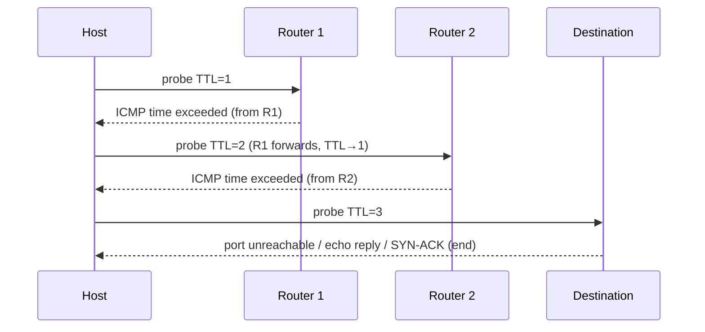
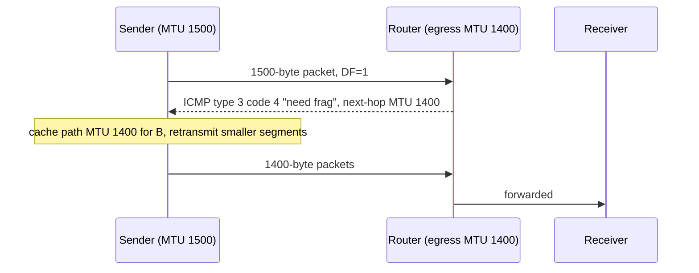

# 2.7 UDP, ICMP and the diagnostic toolkit: ping, traceroute, mtr and path MTU

| | |
|---|---|
| Level | Beginner to intermediate |
| Priority tier | 0 |
| Lab venue | Linux VM or namespaces |
| Part | Part 2: Networking, from first principles to AI fabrics |
| Status | Drafted, labs **untested** |

## Why this matters for AI infrastructure

When a training job hangs or an inference endpoint is slow, the first questions are "is the network the problem, and where?" Those are answered with a small toolkit built on UDP and ICMP: `ping` for reachability and latency, `traceroute`/`mtr` for the path and per-hop loss, `tracepath` and `ping -M do` for path MTU, `nc -u`/`iperf3 -u` for UDP behaviour. UDP is also the carrier for DNS, VXLAN/Geneve overlays, WireGuard, QUIC, and RoCE v2, so understanding it matters for the fabric. And a large share of "works for small requests, hangs for large ones" outages are **path MTU** problems in overlays, VPNs and clouds, where blocked ICMP breaks Path MTU Discovery.

## Prerequisites and outcomes

You should know IP, routing (2.5) and TCP (2.6).

After this chapter you can:

- Describe UDP's header and semantics, and when it is the right transport.
- Read ICMP and ICMPv6 types and codes, and explain which are essential and which firewalls must never block.
- Use ping, traceroute (UDP/ICMP/TCP), mtr, tracepath, hping3/nping and nc correctly, and interpret their output including the pitfalls (ICMP rate limiting, ECMP, asymmetric paths, MPLS).
- Explain MTU, MSS, fragmentation, PMTUD and PMTU black holes, and compute overlay MTUs (VXLAN, Geneve, IPsec, WireGuard, GRE).
- Diagnose "small works, large hangs" and design MTU for clusters with jumbo frames.
- Measure UDP loss, jitter and throughput with iperf3.

## 1. UDP: the minimal transport

UDP (RFC 768) adds to IP only **ports** and an optional checksum:

```text
 0      7 8     15 16    23 24    31
+--------+--------+--------+--------+
| Source port     | Destination port|
+--------+--------+--------+--------+
| Length          | Checksum        |
+--------+--------+--------+--------+
| data ...
```

The header is 8 bytes. No connection, no ordering, no retransmission, no flow or congestion control: each datagram is delivered whole or not at all (a `recvfrom` returns exactly one datagram; message boundaries are preserved, unlike TCP's byte stream). The checksum covers header, data and an IP pseudo-header; it is optional in IPv4 (0 = none) but mandatory in IPv6. Datagrams up to 65,507 bytes are possible but anything above the path MTU is fragmented at IP, and a single lost fragment loses the whole datagram, so well-behaved UDP applications keep datagrams under the MTU (DNS used 512 bytes historically; EDNS(0) negotiates larger; QUIC aims for 1200+).

**When UDP is the right choice.** Small request/response (DNS, NTP, DHCP, SNMP, syslog), latency-critical real-time media (RTP) where a late packet is useless, multicast/broadcast discovery, and as a carrier for protocols that implement their own reliability and congestion control (QUIC, RoCE v2 where the NIC implements reliability, WireGuard, VXLAN/Geneve tunnels, game networking, metrics such as StatsD). Applications using UDP must provide whatever they need: retries and timeouts, sequence numbers, rate limiting and congestion control (unbounded UDP senders can overwhelm networks; they are the reason some operators rate-limit UDP).

**UDP and the OS.** Sockets are cheap: `bind` a port, `recvfrom` any sender. A socket receive buffer overflow silently drops datagrams (`netstat -su` `receive buffer errors`, `nstat UdpRcvbufErrors`); raise `net.core.rmem_max` and set `SO_RCVBUF`, and check `ss -u -a -m`. There is no "connection refused" except via ICMP: sending to a closed UDP port makes the host reply with ICMP port unreachable, which a *connected* UDP socket reports as `ECONNREFUSED` on the next call; otherwise the sender never knows. Firewalls and NATs track UDP "flows" by timeout (typically 30 to 180 s), so long-idle UDP sessions (VPNs, QUIC) need keepalives.

```bash
nc -u -l 5000                         # UDP listener
echo hi | nc -u 10.0.0.5 5000         # send a datagram
ss -uanp                              # UDP sockets
nstat -az | egrep 'Udp(InErrors|NoPorts|RcvbufErrors|SndbufErrors)'
iperf3 -s ; iperf3 -c 10.0.0.5 -u -b 1G -l 1400 -t 10     # UDP throughput, loss %, jitter
```

`iperf3 -u` reports loss and jitter at the receiver: use it to find the rate at which a path begins to drop. A UDP test at full rate that shows 0% loss in a lab and >1% in production usually points at a policer, shallow buffer, or an unexpected bottleneck link on the path.

## 2. ICMP: the network layer's error and diagnostic channel

ICMP (RFC 792; ICMPv6 RFC 4443) rides directly on IP (protocol 1; ICMPv6 is next-header 58). It reports errors about *other* packets and carries diagnostic queries. A message has a **type** and **code** and (for errors) quotes the start of the offending packet so the sender can match it to a flow.

| IPv4 type | Meaning | Notes |
|---|---|---|
| 0 | Echo reply | `ping` response |
| 3 | Destination unreachable | Codes: 0 net, 1 host, 2 protocol, 3 **port**, **4 fragmentation needed and DF set** (PMTUD), 9/10/13 administratively prohibited |
| 5 | Redirect | Disable in production (chapter 2.5) |
| 8 | Echo request | `ping` request |
| 11 | Time exceeded | Code 0 TTL expired in transit (**traceroute**); code 1 fragment reassembly timeout |
| 12 | Parameter problem | Malformed header |

| ICMPv6 type | Meaning |
|---|---|
| 1 | Destination unreachable (codes: no route, admin prohibited, address, port) |
| 2 | **Packet Too Big** (PMTUD; *mandatory*, routers never fragment IPv6) |
| 3 | Time exceeded (hop limit) |
| 128 / 129 | Echo request / reply |
| 133 to 137 | Router solicitation/advertisement, **neighbour solicitation/advertisement** (replace ARP), redirect |

**What must never be blocked.** IPv4: type 3 code 4 (needs fragmentation), type 11, type 3 generally. IPv6: types 1, 2, 3, 4 and all neighbour discovery (133 to 137); blocking them breaks the network (no addresses, no neighbours, no PMTUD). Blanket "drop all ICMP" firewall policies are a recurring cause of mysterious large-transfer hangs. It is fine, and common, to rate-limit ICMP and to block echo *from outside*.

**Rate limiting.** Hosts and routers limit ICMP generation (Linux: `net.ipv4.icmp_ratelimit`, `icmp_ratemask`; routers deprioritise ICMP handled on the control plane). Consequence: a traceroute hop that shows `* * *` or high latency at one hop with normal latency afterwards is usually control-plane rate limiting, not a real problem.

## 3. ping

`ping` sends ICMP echo requests (type 8) and reports echo replies (type 0): reachability, round-trip time, and loss.

```bash
ping -c 4 10.0.0.5                       # 4 probes
ping -c 100 -i 0.2 host                  # faster interval (root may use smaller); summarises min/avg/max/mdev
ping -s 1472 -M do 10.0.0.5              # payload 1472 + 8 ICMP + 20 IP = 1500; -M do sets DF: MTU test
ping -I eth1 10.0.0.5                    # force source interface/address (-I 10.0.0.45)
ping -6 2001:db8::5 ; ping -6 -I eth0 fe80::1     # IPv6, link-local needs the interface
ping -f -c 100000 host                   # flood (root, lab only)
ping -D -O 10.0.0.5                      # timestamps; report outstanding replies
```

Reading output: `64 bytes from 10.0.0.5: icmp_seq=1 ttl=62 time=0.31 ms`. TTL tells you roughly how many hops away the target is (initial 64 on Linux, 128 Windows, 255 network gear; 64 − 62 = 2 routers). Round-trip variation ("mdev") hints at queueing. **Interpreting failures**: `Destination Host Unreachable` from your own address = ARP/NDP failed on the local subnet; from a router = no route; `Destination Net Unreachable`, `Packet filtered` (admin prohibited); `Request timeout`/no output = dropped silently somewhere. **Limits of ping**: ICMP can be treated differently from your real traffic (low priority, blocked, rate-limited, processed by different paths and different ECMP hashing), so a ping success does not prove an application can connect (always test the real port with `nc -zv host 443` or `curl -v`), and a ping failure does not prove the host is down.

Practical uses on a cluster: `fping -a -g 10.0.0.0/24` or `fping -f hosts` to sweep nodes quickly; `ping -c 3 <peer rail IP> -I <rail NIC>` to prove each rail works; `ping -M do -s 8972 <peer>` to verify 9000-byte jumbo paths end to end.

## 4. traceroute, tracepath and mtr

`traceroute` discovers the routers along a path by sending probes with increasing TTL (IPv4) or hop limit (IPv6); each router that decrements the TTL to 0 returns ICMP time exceeded (type 11), revealing its address; the destination answers differently (ICMP port unreachable for UDP probes, echo reply for ICMP probes, SYN-ACK/RST for TCP probes).



```bash
traceroute -n 8.8.8.8                    # default: UDP probes to high ports, 3 per hop
sudo traceroute -I -n 8.8.8.8            # ICMP echo probes
sudo traceroute -T -p 443 -n example.com # TCP SYN probes: passes firewalls that allow 443
traceroute -6 -n 2001:4860:4860::8888
traceroute -n -q 1 -w 1 -m 20 host       # one probe per hop, 1 s wait, max 20 hops
tracepath -n 10.0.0.5                    # no root; also reports path MTU (pmtu) per hop
mtr -n -r -c 100 8.8.8.8                 # report mode: per-hop loss%, last/avg/best/worst/stdev
mtr -n -r -c 100 -T -P 443 host          # TCP mode
sudo mtr -n -r -c 100 -u host            # UDP
```

**Reading traceroute/mtr correctly.**

- `* * *` at a hop only: that router doesn't send TTL-exceeded or rate-limits it; irrelevant if later hops respond.
- Latency high at one hop but low afterwards: control-plane deprioritisation of ICMP at that hop. Only a latency/loss that **persists to the destination** is real.
- Loss at an intermediate hop that does not continue to the final hop is rate limiting; loss that starts at hop N and continues to all later hops is genuine (at or after hop N).
- **Asymmetric paths**: traceroute shows the forward path only; the return path can differ and the reported RTT includes it. For serious analysis run mtr from both ends.
- **ECMP and load balancers**: different probes may take different equal-cost paths, producing hops listed from multiple routers or "inconsistent" paths; use flow-aware tools (`paris-traceroute`, `dublin-traceroute`, `mtr` with fixed ports) which keep the 5-tuple constant.
- **MPLS** and tunnels may hide hops (TTL not propagated) or show label stacks; **NAT** and cloud networks often hide intermediate hops entirely (virtual routers do not decrement TTL or respond); a cloud VPC trace typically shows only the first and last hops.
- Packet size: probes are small (60 bytes). Problems that only affect large packets (MTU) will not show; use `tracepath` or `ping -M do -s`.

## 5. MTU, MSS, fragmentation and Path MTU Discovery

**MTU** is the largest IP packet a link carries (Ethernet default 1500; jumbo 9000, often 9216 on switches to cover headers). **MSS** is the largest TCP *payload* per segment, negotiated from the MTU: `MSS = MTU − IP header − TCP header = 1500 − 20 − 20 = 1460` (IPv6: 1440; with timestamps 12 bytes less).

**Fragmentation (IPv4).** If a packet exceeds the egress MTU and the DF (Don't Fragment) bit is clear, the router splits it into fragments (offset and More-Fragments fields), which the **destination** reassembles; one lost fragment loses the packet; fragments cause problems with firewalls/NAT/ECMP (later fragments lack ports) and performance, so modern practice is to avoid them. IPv6 routers never fragment; only the source may (fragment extension header).

**Path MTU Discovery (PMTUD, RFC 1191/8201).** Senders set DF; a router that cannot forward replies with ICMP "fragmentation needed" (IPv4 type 3 code 4, carrying the next-hop MTU) or ICMPv6 Packet Too Big; the sender lowers its path-MTU estimate (cached per destination: `ip route get` shows `cache expires ... mtu 1400`) and re-segments. TCP also clamps via MSS negotiation at connect time.



### The PMTU black hole

If something blocks the ICMP error, the sender never learns the limit: the TCP handshake (tiny packets) succeeds, small requests work, but any packet that exceeds the path MTU is silently dropped and retransmitted forever, so large transfers, TLS handshakes with big certificates (the ServerHello flight), SSH key exchange or `scp` of big files **hang**. Classic symptoms: `ssh` connects but hangs after "SSH2_MSG_KEXINIT"; `curl https://...` hangs after `Connected`; website loads partially; `git clone` stalls; small `ping` works while `ping -s 1472 -M do` fails. Where it hits: VPNs, GRE/IPsec/WireGuard tunnels, VXLAN/Geneve overlays (Kubernetes CNIs), cloud interconnects (GCP default VPC MTU 1460), PPPoE, firewalls dropping ICMP.

**Detect:**

```bash
ping -M do -s 1472 host && echo ok              # step down: 1472, 1452, 1432, 1400 ... find the largest that passes
tracepath -n host                                # shows pmtu changes per hop
ip route get host                                # cached PMTU if learned
tcpdump -ni any 'icmp[icmptype]==3 and icmp[icmpcode]==4'    # are "need frag" messages arriving?
sysctl net.ipv4.tcp_mtu_probing                  # 0 off, 1 on after black hole detected, 2 always
```

**Fix, in order of preference:** (1) make the MTUs consistent end to end (set the same MTU on all hops in a segment; set the overlay MTU = underlay MTU − encapsulation overhead); (2) allow ICMP type 3 code 4 / ICMPv6 type 2 through every firewall; (3) **MSS clamping** at the tunnel/NAT gateway (`iptables -t mangle -A FORWARD -p tcp --tcp-flags SYN,RST SYN -j TCPMSS --clamp-mss-to-pmtu`, or nftables `tcp option maxseg size set rt mtu`); (4) enable `tcp_mtu_probing=1` as a client-side safety net (Packetization-Layer PMTUD, RFC 4821); (5) as a last resort lower the interface MTU.

### Encapsulation overhead (compute, don't guess)

| Encapsulation | Added bytes (IPv4 underlay) | Overlay MTU on a 1500 underlay | On a 9000 underlay |
|---|---|---|---|
| VXLAN | 50 (outer Ethernet 14 [often not counted] + IP 20 + UDP 8 + VXLAN 8) | 1450 | 8950 |
| Geneve (no options) | 50 (variable with options) | ~1450 | ~8950 |
| GRE | 24 (IP 20 + GRE 4) | 1476 | 8976 |
| IPIP | 20 | 1480 | 8980 |
| WireGuard | 60 (IPv4) / 80 (IPv6) | 1420 / 1400 | 8940 / 8920 |
| IPsec ESP tunnel | ~50 to 73 (varies with cipher, NAT-T adds 8) | ~1400 to 1430 | ~8930 |
| MPLS | 4 per label | 1496 per label | |

Verify the numbers with `ip -d link show` (`mtu` and the encapsulation device) and test with `ping -M do`. Kubernetes CNIs (Calico VXLAN/IPIP, Flannel, Cilium) set the pod MTU from the underlay MTU and the overlay; mismatches are a top cause of "services work for tiny requests only" in clusters (chapter 2.25 and Part 5). GCP VPC defaults to MTU 1460 (configurable up to 8896 for VPC), AWS supports 9001 inside a VPC but 1500 across the Internet and many inter-region/VPN paths, so jumbo-frame designs must be validated per path.

### Jumbo frames for AI clusters

Larger MTUs reduce per-packet CPU cost and header overhead (9000-byte MTU: ~0.9% overhead versus ~3.5% at 1500 for TCP/IP) and improve throughput for storage and bulk transfers; RoCE v2 typically runs at the NIC's MTU of 4096 (IB MTU values 256/512/1024/2048/4096) inside an Ethernet MTU of 9000 or so. Rules: configure end to end consistently (hosts, switch ports, VLAN interfaces, bond members, overlay), never mix MTUs within an L2 domain, set switches to at least `host MTU + headers` (9216), and test every pair of nodes (`ping -M do -s 8972`, `nccl-tests`).

## 6. More tools

```bash
sudo hping3 -S -p 443 -c 5 host                 # TCP SYN probes, shows RTT and flags, bypasses ICMP blocks
sudo nping --tcp -p 443 --flags syn host         # nmap's packet crafter
nc -zv host 22 443 ; nc -zvu host 53             # port checks (TCP/UDP)
curl -v --connect-timeout 3 https://host/        # full-stack check (DNS, TCP, TLS, HTTP)
arping -I eth0 10.0.0.5                           # layer-2 reachability (ARP), chapter 2.3
fping -c3 -g 10.0.0.0/24                          # parallel sweep
sudo tcpdump -ni any icmp or icmp6               # watch ICMP
ip -s -s neigh ; nstat -az | grep -i icmp         # ICMP counters: InDestUnreachs, OutTimeExcds, InEchoReps, etc.
```

`hping3`/`nping` are useful for testing a specific TCP/UDP port path with custom flags and TTLs (firewall debugging, traceroute through ICMP-blocking firewalls); use only on networks you own or are authorised to test.

## 7. A layered reachability checklist

When "A cannot reach B":

1. **A's own interface and address**: `ip -br addr`, link up?
2. **Local subnet / gateway**: `ping <gateway>`; `ip neigh` (REACHABLE/STALE vs FAILED/INCOMPLETE).
3. **Route**: `ip route get <B>`.
4. **ICMP to B**: `ping -c3 B`; then `traceroute -n B` / `mtr` to find where it stops.
5. **Port**: `nc -zv B 443` (TCP) - refused (RST) vs timeout (drop) tells where to look.
6. **Large packets**: `ping -M do -s 1472 B`, `tracepath B`.
7. **Application**: `curl -v`, TLS, auth.
8. **At the other end**: `tcpdump` on B: do packets arrive? Are replies sent? On which interface?

Each step isolates a layer; skipping to step 7 wastes time.

## 8. Lab: UDP, ICMP, traceroute and an MTU black hole (untested)

Use the three-namespace topology from chapter 2.5 (hA - r - hB, forwarding on in r, default routes set).

1. **UDP basics**: `ip netns exec hB nc -u -l 5000`; send from hA; capture with tcpdump; show that there is no handshake. Send to a closed port and capture ICMP port unreachable (type 3 code 3); show the connected-socket error (`nc -u` after a first send).
2. **iperf3 UDP**: server in hB; client in hA at `-b 100M -l 1400`; add `tc qdisc add dev rB root tbf rate 50mbit burst 32kbit latency 50ms` in r and observe loss and jitter; repeat with `netem loss 1%`.
3. **ICMP types**: capture `icmp` while pinging, pinging a non-existent address on a connected subnet (ARP failure → host unreachable from your own address), and sending to a blackhole/unreachable route (chapter 2.5).
4. **traceroute**: add a second router `r2` in a chain hA - r - r2 - hB; run `traceroute -n`, `-I`, `-T -p 22`; watch TTL-exceeded in tcpdump; add `iptables -A INPUT -p icmp --icmp-type time-exceeded` rate limits or drop ICMP output on r2 to produce `* * *` and see that later hops still respond.
5. **MTU black hole**: set `ip -n r link set rB mtu 1400` and `ip -n hB link set vB mtu 1500`; `ip netns exec hA ping -M do -s 1472 10.2.0.2` and see the ICMP "need frag" (mtu 1400) message and `ip route get` cached PMTU. Now drop ICMP type 3 on r (`ip netns exec r iptables -A OUTPUT -p icmp --icmp-type fragmentation-needed -j DROP`) and demonstrate the hang with `curl` or `nc` sending a large payload (start a TCP server on hB, send 10 KB from hA), watching retransmissions in tcpdump. Fix with MSS clamping on r, then with `tcp_mtu_probing=1`, then by allowing ICMP.
6. **Overlay MTU**: create a VXLAN (`ip link add vx0 type vxlan id 42 remote ... dstport 4789 dev vA`) between hA and hB, compute the overlay MTU, show that a 1500 overlay breaks with 1500 underlay, and set it correctly.
7. **Clean up** namespaces.

Mark tested only after running.

## 9. Common mistakes

- Treating a failed ping as proof of an outage (ICMP filtered) or a successful ping as proof the service works.
- Believing `* * *` or one hot hop in traceroute means a fault.
- Blocking all ICMP/ICMPv6, then chasing PMTU black holes and IPv6 neighbour failures.
- Debugging an MTU problem with a default-size ping.
- Mixed MTUs on the same L2 segment or in a bond; jumbo frames on hosts but not on every switch port.
- Not subtracting encapsulation overhead for overlays and VPNs.
- Assuming UDP is "faster" without accounting for loss handling, buffer drops and rate limiting.

## 10. Interview angles

- "Explain how traceroute works. Why might a hop be missing or show high latency?"
- "Large file transfers hang but small requests work. What do you check?" (PMTUD, MSS clamping.)
- "What ICMP messages should a firewall allow, and why?"
- "How is UDP different from TCP; give three protocols using UDP and why."
- "How do you test jumbo frames end to end?"
- "What is the MTU inside a VXLAN overlay on a 1500 underlay? On 9000?"
- "How does mtr help versus traceroute? How do you read loss in it?"

## 11. Checkpoint questions (25)

1. How big is the UDP header and what fields? **A:** 8 bytes: source port, destination port, length, checksum.
2. Is the UDP checksum mandatory in IPv6? **A:** Yes.
3. Does UDP preserve message boundaries? **A:** Yes, one datagram per read.
4. How does a sender learn that a UDP port is closed? **A:** ICMP port unreachable (reported on connected sockets).
5. Why do long-idle UDP flows break through NAT? **A:** Flow state times out; use keepalives.
6. Which ICMP type is echo request/reply? **A:** 8 / 0 (ICMPv6: 128 / 129).
7. Which ICMP message drives PMTUD in IPv4? **A:** Type 3 code 4.
8. And in IPv6? **A:** Type 2 Packet Too Big.
9. Why must ICMPv6 neighbour discovery not be blocked? **A:** It replaces ARP and RAs provide routes.
10. What does TTL 62 in a ping reply from a Linux host tell you? **A:** Initial 64, so two routers decremented it.
11. How does traceroute discover routers? **A:** Increasing TTL probes and ICMP time-exceeded replies.
12. What does it mean when only one hop shows 100% loss but later hops are fine? **A:** ICMP rate limiting/control-plane filtering at that hop.
13. How do you traceroute through a firewall that only allows port 443? **A:** `traceroute -T -p 443`.
14. What problem does `paris-traceroute` solve? **A:** Inconsistent paths due to ECMP by holding the flow tuple constant.
15. What does `tracepath` add over traceroute? **A:** Path MTU discovery, no root needed.
16. MSS for MTU 1500 over IPv4? **A:** 1460.
17. What is the DF bit? **A:** Don't Fragment: routers must drop and signal instead of fragmenting.
18. Describe a PMTU black hole. **A:** Large packets silently dropped because the ICMP signal is blocked; small ones work.
19. Name two fixes. **A:** Allow ICMP; MSS clamp; fix MTU; tcp_mtu_probing.
20. Overlay MTU for VXLAN on a 1500 underlay? **A:** 1450.
21. WireGuard overhead over IPv4? **A:** 60 bytes (MTU 1420 on 1500).
22. How do you test a 9000-byte path? **A:** `ping -M do -s 8972 host`.
23. What does `tcp_mtu_probing=1` do? **A:** Enables packetization-layer probing after a suspected black hole.
24. Why can ping succeed while the application fails? **A:** Different protocol/port/size; ICMP handled differently.
25. What does `iperf3 -u` report that TCP mode does not? **A:** Loss percentage and jitter at the receiver.

## 12. Sources and review notes

**Written in original words.** Principal sources:

- Brian Ward, *How Linux Works*, 3rd ed., chapter 9: basic ICMP and DNS tools, `ping`, the Internet layer and addresses, subnets, routes, IPv6 and dual-stack configuration, kernel network interfaces and basic configuration.
- Russ White and Jeff Tantsura (with co-authors), *Computer Networking Problems and Solutions*, chapter 5: the Internet Protocol (fragmentation, TTL), transport and marshaling, multiplexing, and ICMP.
- Tool behaviour, PMTUD details, overlay overheads and cloud MTU notes are the author's synthesis from RFCs 768, 792, 1191, 4443, 4821, 8201 and the `ping(8)`, `traceroute(8)`, `tracepath(8)`, `mtr(8)` manuals.

**Flagged for verification before publishing:** cloud default MTUs (GCP, AWS), exact encapsulation overheads for your CNI/VPN versions, option names of `traceroute`/`mtr` per distribution, and the nftables MSS-clamp syntax; all labs are **untested**.
