# 2.7 UDP, ICMP and the diagnostic toolkit: ping, traceroute, mtr and path MTU

| | |
|---|---|
| Level | Beginner to intermediate |
| Priority tier | 0 |
| Lab venue | Linux VM or namespaces |
| Part | Part 2: Networking, from first principles to AI fabrics |
| Status | Drafted, labs **untested** |

## Why this matters for AI infrastructure

A training job has hung, or an inference endpoint has suddenly slowed down. People are asking in the channel, and the first question is whether the network is the problem, and if it is, where. You need an answer in minutes, not hours. A small toolkit built on UDP and ICMP gives you that. You use `ping` to check reachability and latency. You use `traceroute` or `mtr` to see the path and the loss at each hop. For path MTU, `tracepath` and `ping -M do` do the work, and for UDP behaviour you reach for `nc -u` and `iperf3 -u`.

UDP also carries traffic you depend on every day, even when you never think about it. It is the carrier for DNS, VXLAN and Geneve overlays, WireGuard, QUIC and RoCE v2, so understanding it helps when you debug the fabric. A large share of outages look the same way: small requests work, but large ones hang. Many of those are **path MTU** problems in overlays, VPNs and clouds, where blocked ICMP stops Path MTU Discovery from working. When a slow job lands on your desk, decide early whether you are looking at reachability, the path or packet size, because each has its own tool.

## Prerequisites and outcomes

Before you start, you should be comfortable with IP, routing (chapter 2.5) and TCP (chapter 2.6). New terms such as datagram, hop and path MTU are explained where they first appear.

When you finish, check yourself against this list. Each line is something you should be able to do.

- Describe UDP's header and semantics, and say when UDP is the right transport.
- Read ICMP and ICMPv6 types and codes, and explain which are essential and which firewalls must never block.
- Use `ping`, `traceroute` in its UDP, ICMP and TCP modes, `mtr`, `tracepath`, `hping3`, `nping` and `nc` correctly, and interpret their output. That includes the pitfalls: ICMP rate limiting, ECMP, asymmetric paths and MPLS.
- Explain MTU, MSS, fragmentation, PMTUD and PMTU black holes, and compute overlay MTUs for VXLAN, Geneve, IPsec, WireGuard and GRE.
- Diagnose "small works, large hangs" and design MTU for clusters with jumbo frames.
- Measure UDP loss, jitter and throughput with `iperf3`.

Treat that list as the test you should be able to pass once you have read the chapter and done the lab.

## 1. UDP: the minimal transport

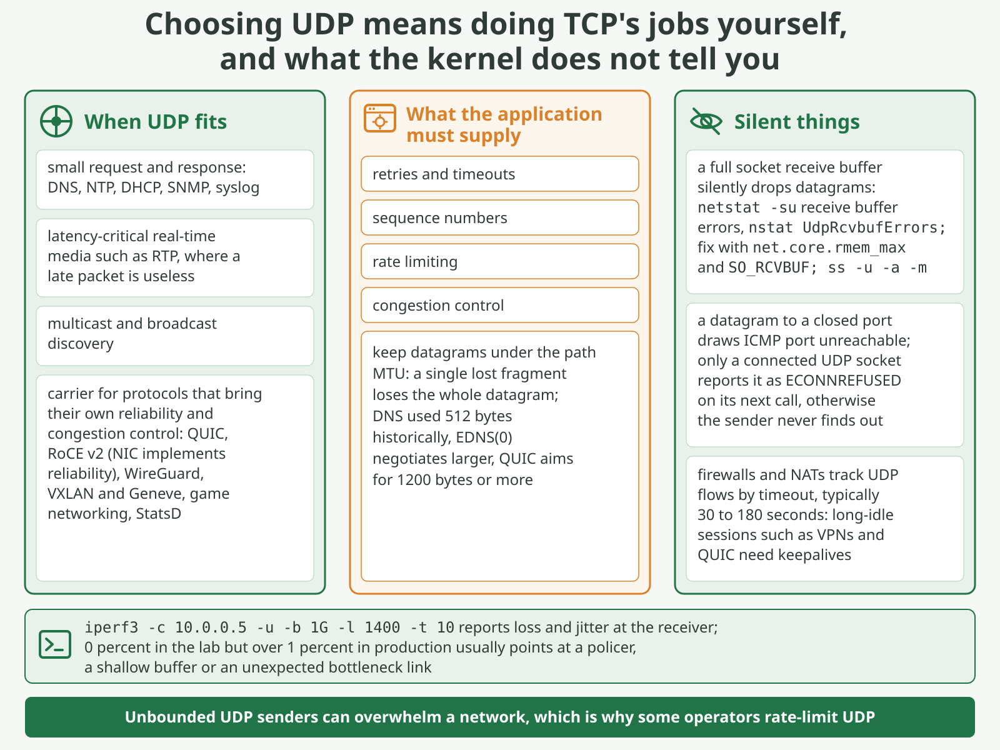

*Figure 2.7.1. Choosing UDP means supplying retries, ordering and congestion control yourself, and the kernel drops overflowing datagrams without telling you.*

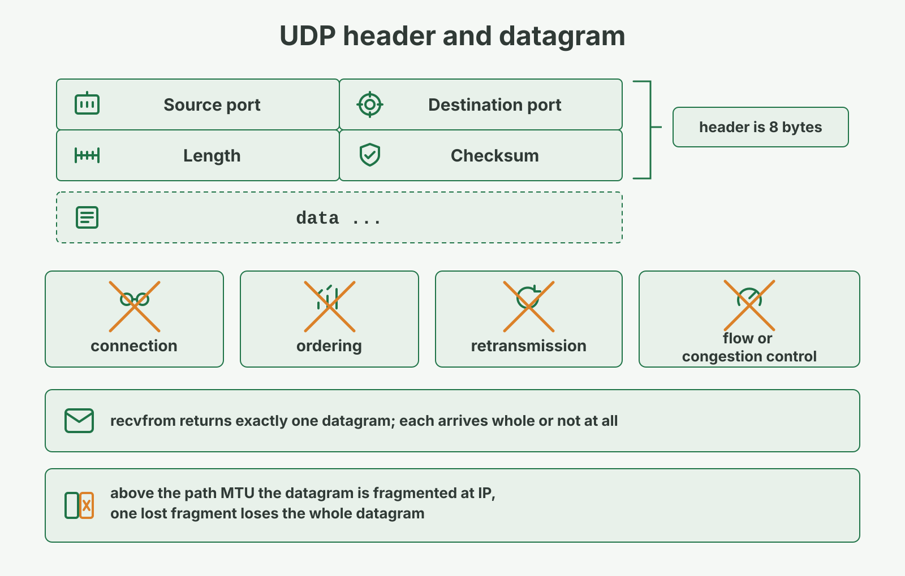

*Figure 2.7.2. UDP is an 8-byte header with no connection, ordering or retransmission.*

Imagine sending a short metrics datagram, the kind StatsD uses, to a collector on another host. You want the packet to leave now, and you do not want a handshake in front of it. A handshake would take longer than the message is worth. UDP, defined in RFC 768, was built for that kind of message. It adds only two things to IP: ports and an optional checksum. A **datagram** is simply one self-contained message that travels alone, like a postcard.

```text
 0      7 8     15 16    23 24    31
+--------+--------+--------+--------+
| Source port     | Destination port|
+--------+--------+--------+--------+
| Length          | Checksum        |
+--------+--------+--------+--------+
| data ...
```

The header is 8 bytes. There is no connection, no ordering, no retransmission, and no flow or congestion control. Each datagram arrives whole or not at all. A `recvfrom` call returns exactly one datagram, so message boundaries survive. TCP's byte stream does not keep them. The checksum covers the header, the data and an IP pseudo-header. It is optional in IPv4, where 0 means no checksum, and mandatory in IPv6.

Datagrams up to 65,507 bytes are possible, but anything above the path MTU gets fragmented at IP. A single lost fragment loses the whole datagram, which is like a postcard torn in pieces where one missing piece makes the rest useless. Well-behaved UDP applications therefore keep datagrams under the MTU. DNS used 512 bytes historically, EDNS(0) negotiates larger sizes, and QUIC aims for 1200 bytes or more.

**When should you pick UDP?** UDP fits small request and response traffic, such as DNS, NTP, DHCP, SNMP and syslog. It also fits latency-critical real-time media such as RTP, where a late packet is useless. Multicast and broadcast discovery use it too. UDP is also the carrier for protocols that bring their own reliability and congestion control: QUIC, RoCE v2 (where the NIC implements reliability), WireGuard, VXLAN and Geneve tunnels, game networking and metrics such as StatsD.

The catch is that the application has to supply what TCP would have supplied. That means retries and timeouts, sequence numbers, rate limiting and congestion control. If you choose UDP, you accept the job of building those parts yourself, or of picking a protocol such as QUIC that already did. Unbounded UDP senders can overwhelm a network, which is why some operators rate-limit UDP.

**UDP sockets are cheap, but the kernel can drop datagrams without telling you.** You `bind` a port and `recvfrom` from any sender. When a socket's receive buffer overflows, the kernel silently drops datagrams. Picture a postbox that is full: the postman simply throws away the next letters. You can see that in `netstat -su` as `receive buffer errors`, or in `nstat` as `UdpRcvbufErrors`. The fix is to raise `net.core.rmem_max` and set `SO_RCVBUF`. You can inspect the sockets with `ss -u -a -m`.

UDP has no "connection refused" of its own. A datagram sent to a closed port makes the host reply with ICMP port unreachable. A *connected* UDP socket reports that reply as `ECONNREFUSED` on its next call. Otherwise the sender never finds out. Firewalls and NATs track UDP flows by timeout, typically 30 to 180 seconds. Long-idle UDP sessions, such as VPNs and QUIC, therefore need keepalives, small messages that keep the firewall from forgetting the flow.

The commands below cover the common checks, from sending a single datagram by hand to measuring loss at a chosen rate.

```bash
nc -u -l 5000                         # UDP listener
echo hi | nc -u 10.0.0.5 5000         # send a datagram
ss -uanp                              # UDP sockets
nstat -az | egrep 'Udp(InErrors|NoPorts|RcvbufErrors|SndbufErrors)'
iperf3 -s ; iperf3 -c 10.0.0.5 -u -b 1G -l 1400 -t 10     # UDP throughput, loss %, jitter
```

`iperf3 -u` reports loss and jitter at the receiver, so it shows you the rate at which a path starts to drop. Jitter is the variation in delay between packets. Run the test at the rate your application really uses, or the loss you measure will not mean much. A full-rate UDP test that shows 0% loss in a lab but more than 1% in production usually points at a policer, a shallow buffer or an unexpected bottleneck link on the path.

## 2. ICMP: the network layer's error and diagnostic channel

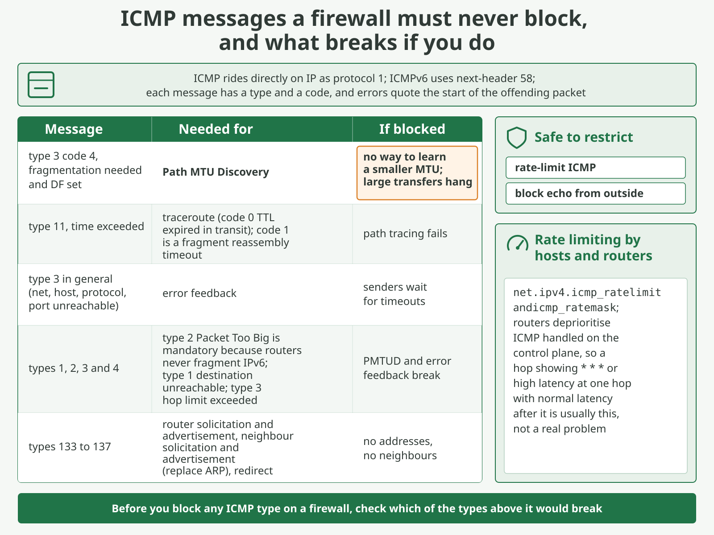

*Figure 2.7.3. Blocking type 3 code 4, time exceeded or ICMPv6 types 1 to 4 and 133 to 137 breaks path MTU discovery, traceroute, addressing and neighbour discovery.*

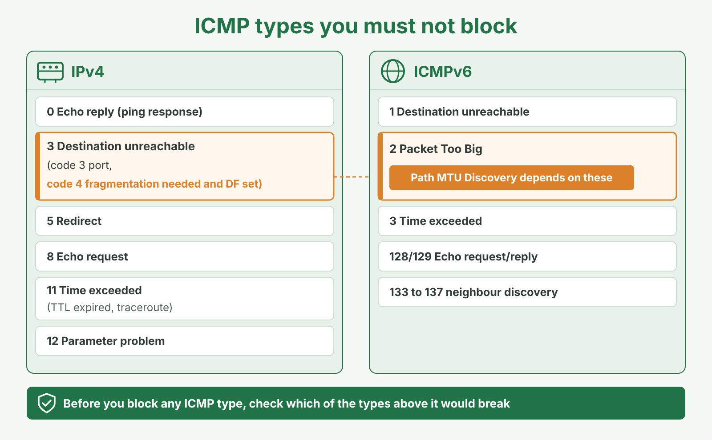

*Figure 2.7.4. Some ICMP messages such as fragmentation needed and Packet Too Big are required for the network to work.*

Suppose a firewall team wants to block "all ICMP" to tighten things up. It sounds sensible, because ping is the thing people associate with ICMP. Before you agree, you need to know what ICMP is for. ICMP (RFC 792; ICMPv6 RFC 4443) rides directly on IP as protocol 1, and ICMPv6 uses next-header 58. It reports errors about *other* packets, and it carries diagnostic queries. Each message has a type and a code. For errors, it quotes the start of the offending packet, so the sender can match the error to a flow. Think of it as the network's way of returning a letter marked "undeliverable, and here is why".

The two tables below list the types you will meet most often. The IPv4 table comes first.

| IPv4 type | Meaning | Notes |
|---|---|---|
| 0 | Echo reply | `ping` response |
| 3 | Destination unreachable | Codes: 0 net, 1 host, 2 protocol, 3 **port**, **4 fragmentation needed and DF set** (PMTUD), 9/10/13 administratively prohibited |
| 5 | Redirect | Disable in production (chapter 2.5) |
| 8 | Echo request | `ping` request |
| 11 | Time exceeded | Code 0 TTL expired in transit (**traceroute**); code 1 fragment reassembly timeout |
| 12 | Parameter problem | Malformed header |

| ICMPv6 type | Meaning |
|---|---|
| 1 | Destination unreachable (codes: no route, admin prohibited, address, port) |
| 2 | **Packet Too Big** (PMTUD; *mandatory*, routers never fragment IPv6) |
| 3 | Time exceeded (hop limit) |
| 128 / 129 | Echo request / reply |
| 133 to 137 | Router solicitation/advertisement, **neighbour solicitation/advertisement** (replace ARP), redirect |

Notice that type 3 code 4 is the one that makes Path MTU Discovery work. Without it, a sender has no way to learn a smaller MTU. That one small message is the reason a blanket block is dangerous.

**Some ICMP messages must never be blocked.** In IPv4, that means type 3 code 4, which fragmentation needs, along with type 11 and type 3 in general. In IPv6, it means types 1, 2, 3 and 4. It also means all neighbour discovery. Neighbour discovery is types 133 to 137. Block these and the network breaks. You get no addresses, no neighbours and no PMTUD. Blanket "drop all ICMP" firewall policies are a recurring cause of mysterious large-transfer hangs. It is fine, and common, to rate-limit ICMP and to block echo from outside.

Hosts and routers also limit how fast they generate ICMP, because an unlimited flood of error messages could itself cause trouble. On Linux, that is controlled by `net.ipv4.icmp_ratelimit` and `icmp_ratemask`. Routers deprioritise ICMP that they handle on the control plane. This changes how you read a traceroute. A hop that shows `* * *`, or high latency at one hop with normal latency after it, is usually control-plane rate limiting. It is not a real problem. The router is busy forwarding real traffic and treats your probe as low priority.

Before you block any ICMP type on a firewall, check which of the types above it would break.

## 3. ping

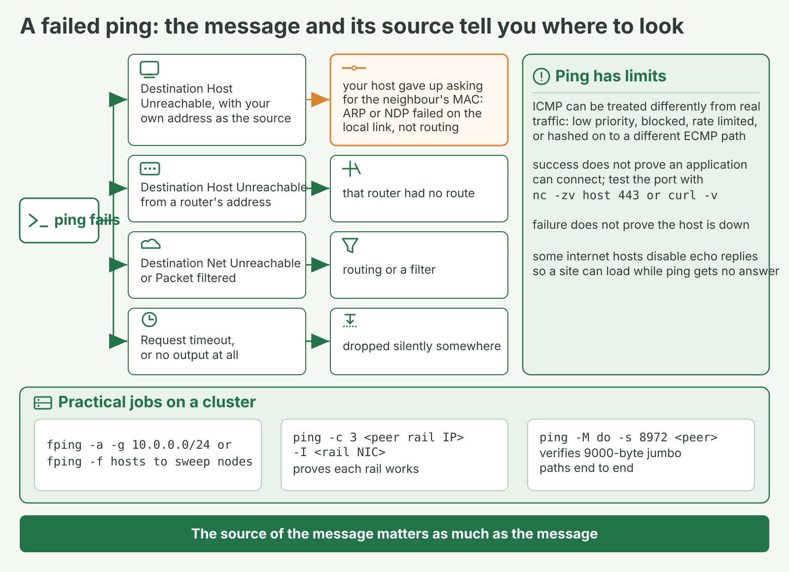

*Figure 2.7.5. Host Unreachable from your own address points at ARP or NDP on the local link, while the same words from a router point at a missing route.*

Your first instinct, when a node stops answering, is to run `ping`. It sends ICMP echo requests (type 8) and reports the echo replies (type 0). It is the network equivalent of calling out "are you there?" From that exchange you learn three things: whether the target is reachable, how long a round trip takes, and whether any packets are lost.

```bash
ping -c 4 10.0.0.5                       # 4 probes
ping -c 100 -i 0.2 host                  # faster interval (root may use smaller); summarises min/avg/max/mdev
ping -s 1472 -M do 10.0.0.5              # payload 1472 + 8 ICMP + 20 IP = 1500; -M do sets DF: MTU test
ping -I eth1 10.0.0.5                    # force source interface/address (-I 10.0.0.45)
ping -6 2001:db8::5 ; ping -6 -I eth0 fe80::1     # IPv6, link-local needs the interface
ping -f -c 100000 host                   # flood (root, lab only)
ping -D -O 10.0.0.5                      # timestamps; report outstanding replies
```

The reply line `64 bytes from 10.0.0.5: icmp_seq=1 ttl=62 time=0.31 ms` tells you more than it seems to. The TTL shows roughly how many hops away the target is. Linux starts packets at 64, Windows starts at 128, and network gear starts at 255. A TTL of 62 on a Linux host means 64 minus 62, which is 2 routers. Variation in round-trip time, shown as `mdev`, hints at queueing, which is packets waiting in line inside a device.

When `ping` fails, the message tells you where to look, if you read it carefully. `Destination Host Unreachable` from your own address means ARP or NDP failed on the local subnet. The same message coming from a router means that router had no route. `Destination Net Unreachable` and `Packet filtered` point to routing or to a filter. `Request timeout`, or no output at all, means the packet was dropped silently somewhere.

Think of a concrete case. You ping a server on your own subnet and get `Destination Host Unreachable` with your own address as the source. The reply came from yourself, not from a router, so your host gave up asking for the neighbour's MAC address. That points at ARP or NDP on the local link, not at routing. The same words from a router's address would point somewhere else entirely, which is why the source of the message matters as much as the message.

Ping has limits you need to keep in mind. ICMP can be treated differently from your real traffic. It may get low priority, be blocked, be rate limited, or take different paths with different ECMP hashing. So a successful ping does not prove that an application can connect. Test the real port with `nc -zv host 443` or `curl -v`. A failed ping does not prove the host is down either. Ping answers only one narrow question, whether ICMP echo gets through.

On a cluster, `ping` has a few practical jobs. Use `fping -a -g 10.0.0.0/24` or `fping -f hosts` to sweep nodes quickly. Run `ping -c 3 <peer rail IP> -I <rail NIC>` to prove that each rail works. And `ping -M do -s 8972 <peer>` verifies 9000-byte jumbo paths end to end.

Before you call a node down, ping it, and then test the port your application actually uses.

### Reading ping output

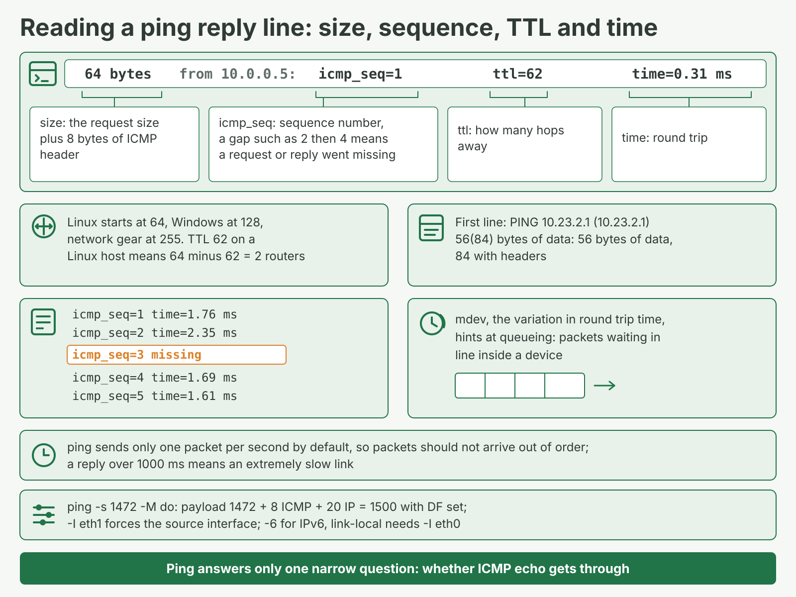

*Figure 2.7.6. The TTL in a ping reply shows roughly how many hops away the target is, and a gap in the sequence numbers means a request or reply went missing.*

`ping` is often the first tool to reach for when a host seems dead. It sends ICMP echo requests, and a host set to reply sends back an echo response. By default, it sends one packet per second. A closer reading of one real output shows how much it can say.

Run `ping 10.23.2.1` and you see lines like these, from a wireless network:

```
PING 10.23.2.1 (10.23.2.1) 56(84) bytes of data.
64 bytes from 10.23.2.1: icmp_req=1 ttl=64 time=1.76 ms
64 bytes from 10.23.2.1: icmp_req=2 ttl=64 time=2.35 ms
64 bytes from 10.23.2.1: icmp_req=4 ttl=64 time=1.69 ms
64 bytes from 10.23.2.1: icmp_req=5 ttl=64 time=1.61 ms
```

The first line means 56 bytes of data, or 84 bytes with headers. Each reply carries a sequence number (`icmp_req`) and a round-trip time (`time`). The returned size is the request size plus 8 bytes. The packet contents do not matter for diagnosis.

Watch the sequence numbers. A gap, such as the jump from 2 to 4, usually means a connectivity problem, because one request or reply went missing. Packets should not arrive out of order, because `ping` sends only one a second. A reply taking more than 1,000 ms means the link is extremely slow. If the destination cannot be reached, the last router that sees the packet returns an ICMP "host unreachable" message.

On a wired LAN you should see no loss and very low round-trip times. Some internet hosts disable echo replies for security, so a site can load while `ping` gets no answer. Use `-4` or `-6` to force IPv4 or IPv6.

## 4. traceroute, tracepath and mtr

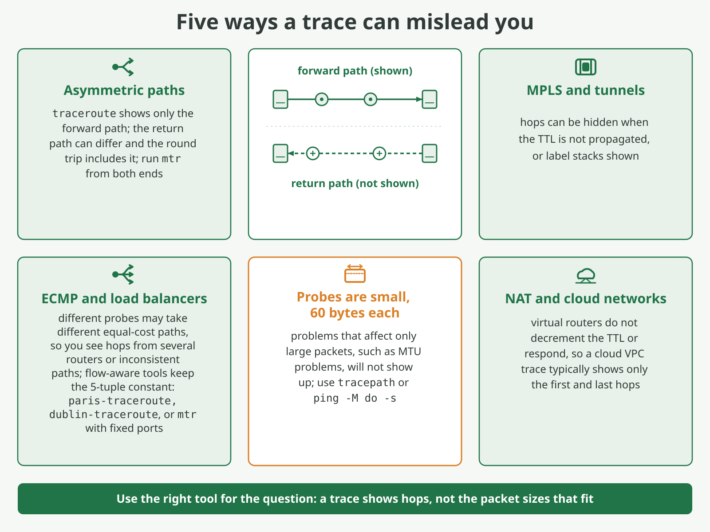

*Figure 2.7.7. Traceroute shows only the forward path, can be confused by ECMP, tunnels and NAT, and its small probes never reveal MTU problems.*

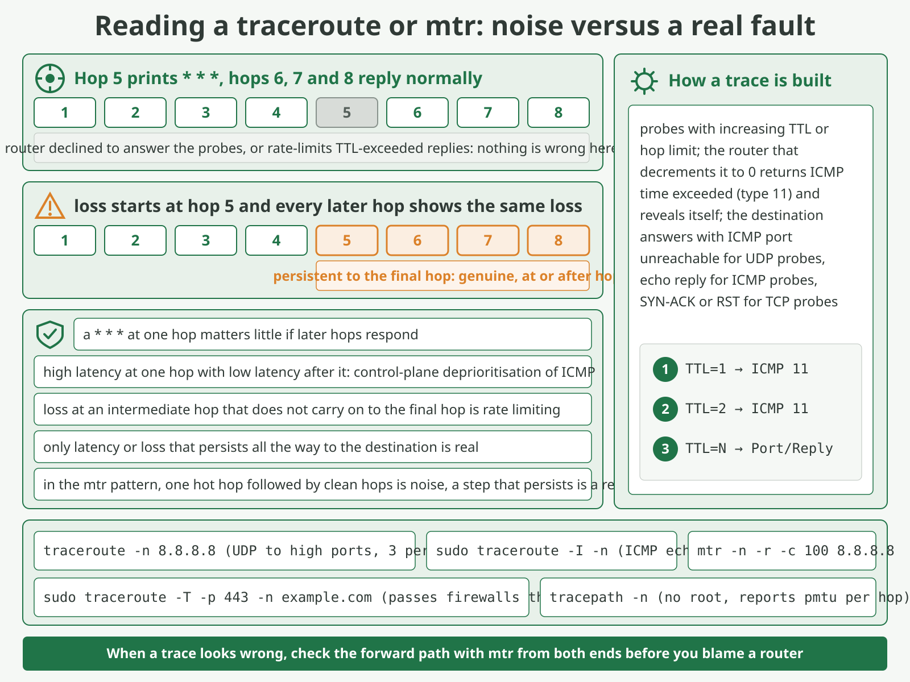

*Figure 2.7.8. A silent or lossy hop that clears at later hops is control-plane rate limiting, while loss that persists to the destination is real.*

A user says the service is slow, and you suspect a router somewhere along the path. `traceroute` finds that path for you, one router at a time. It uses an old trick: it sends probes with an increasing TTL (IPv4) or hop limit (IPv6). Each router that decrements the TTL to 0 returns ICMP time exceeded (type 11), and that reply reveals the router's address. The first probe dies at the first router, the second at the second router, and so on, so each router introduces itself in turn. The destination answers in its own way. It sends ICMP port unreachable for UDP probes, an echo reply for ICMP probes, and SYN-ACK or RST for TCP probes.

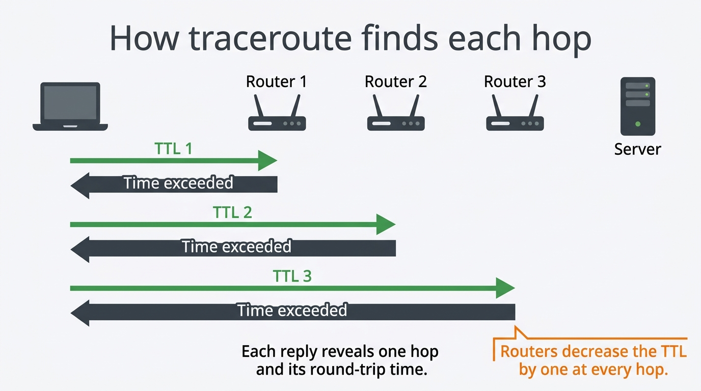

*Figure 2.7.9. Each probe has a larger TTL; the router where it expires replies with Time exceeded.*

The diagram below shows three probes, one TTL at a time.

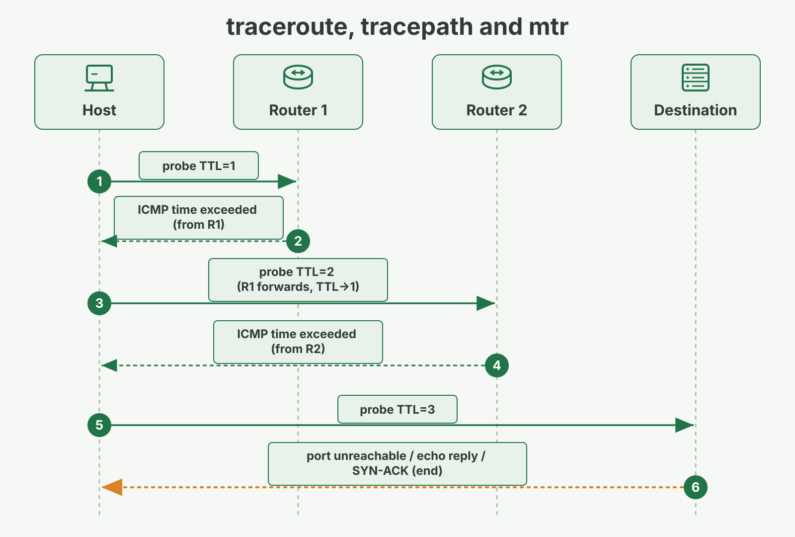

*Figure 2.7.10. traceroute, tracepath and mtr, as a diagram.*

These are the variants you will use most. Each one sends a different kind of probe, and that matters when a firewall treats the probes differently.

```bash
traceroute -n 8.8.8.8                    # default: UDP probes to high ports, 3 per hop
sudo traceroute -I -n 8.8.8.8            # ICMP echo probes
sudo traceroute -T -p 443 -n example.com # TCP SYN probes: passes firewalls that allow 443
traceroute -6 -n 2001:4860:4860::8888
traceroute -n -q 1 -w 1 -m 20 host       # one probe per hop, 1 s wait, max 20 hops
tracepath -n 10.0.0.5                    # no root; also reports path MTU (pmtu) per hop
mtr -n -r -c 100 8.8.8.8                 # report mode: per-hop loss%, last/avg/best/worst/stdev
mtr -n -r -c 100 -T -P 443 host          # TCP mode
sudo mtr -n -r -c 100 -u host            # UDP
```

Reading the output correctly takes a few rules, and they save you from false alarms. A `* * *` at one hop only means that router does not send TTL-exceeded replies, or it rate-limits them. That matters little if the later hops respond. High latency at one hop, with low latency after it, is control-plane deprioritisation of ICMP at that hop. Only a latency or loss that persists all the way to the destination is real.

A short example shows the rules at work. Suppose a trace shows eight hops. Hop five prints `* * *`, but hops six, seven and eight reply normally. Nothing is wrong at hop five. That router simply declined to answer the probes. Now suppose hop five shows a sudden jump in loss and every later hop shows the same loss. That pattern is real, and the trouble begins at hop five or just after it.

Loss at an intermediate hop is rate limiting if the loss does not carry on to the final hop. Loss that starts at hop N and continues to every later hop is genuine. It sits at or after hop N. In the `mtr` pattern from exercise 3, one hot hop followed by clean hops is noise, while a step that persists is a real fault.

Asymmetric paths can mislead you. Traceroute shows only the forward path. The return path can differ, and the reported round-trip time includes it. For serious analysis, run `mtr` from both ends, so you see both directions.

ECMP and load balancers can make a trace look wrong. Different probes may take different equal-cost paths, so you see hops from several routers or inconsistent paths. Flow-aware tools fix this by keeping the 5-tuple constant. Use `paris-traceroute`, `dublin-traceroute`, or `mtr` with fixed ports.

MPLS and tunnels can hide hops when the TTL is not propagated, or they can show label stacks. NAT and cloud networks often hide intermediate hops entirely, because virtual routers do not decrement the TTL or respond. A cloud VPC trace typically shows only the first and last hops.

Probes are small, at 60 bytes each. Problems that affect only large packets, such as MTU problems, will not show up in them. The probe passes through a link that would reject a bigger packet. For those, use `tracepath` or `ping -M do -s`.

When a trace looks wrong, check the forward path with `mtr` from both ends before you blame a router.

## 5. MTU, MSS, fragmentation and Path MTU Discovery

A file copy starts, and then it stalls. The small requests all work, and the big transfer goes nowhere. The cause is often a size limit somewhere on the path, like a narrow doorway that a small box fits through and a big one does not. **MTU** is the largest IP packet a link carries. Ethernet's default is 1500. Jumbo frames go to 9000, and switches often run at 9216 to leave room for headers. **MSS** is the largest TCP payload per segment, and TCP negotiates it from the MTU.

Here is the arithmetic, so you can check it yourself. Start with an MTU of 1500. Subtract the 20-byte IP header and the 20-byte TCP header. The result is an MSS of 1460. On IPv6 the MSS is 1440. If timestamps are on, it is 12 bytes less.

Sometimes a packet is larger than the next link's MTU. For IPv4, if the DF (Don't Fragment) bit is clear, the router splits the packet into fragments, and the destination reassembles them. Lose one fragment and you lose the whole packet. Fragments also cause trouble with firewalls, NAT and ECMP, because later fragments carry no ports. That, along with the performance cost, is why modern practice avoids fragmentation. IPv6 routers never fragment. Only the source can, through a fragment extension header.

**Path MTU Discovery (PMTUD, RFC 1191/8201)** avoids fragmentation altogether. Instead of cutting packets up on the way, the sender finds out the smallest size the whole path allows and sends only packets that fit. The sender sets DF on its packets. When a router cannot forward a packet, it replies with ICMP "fragmentation needed" (IPv4 type 3 code 4), and that reply carries the next-hop MTU. IPv6 uses ICMPv6 Packet Too Big instead. The sender lowers its path MTU estimate and caches it per destination. You can see the cache with `ip route get`, which shows `cache expires ... mtu 1400`. The sender then re-segments its data. TCP also limits the segment size through MSS negotiation at connect time.

The diagram below shows the exchange when a router has a 1400-byte egress link.

Follow the story in the diagram step by step. The sender builds a 1500-byte packet with DF set and sends it. The router sees that its next link carries only 1400 bytes, so it cannot forward the packet and must not split it. It discards the packet and sends back a small ICMP message that says "too big, the limit here is 1400". The sender reads that message, remembers 1400 for this destination, and sends the data again in smaller pieces. The whole exchange costs one lost packet and one round trip, after which the transfer runs normally.

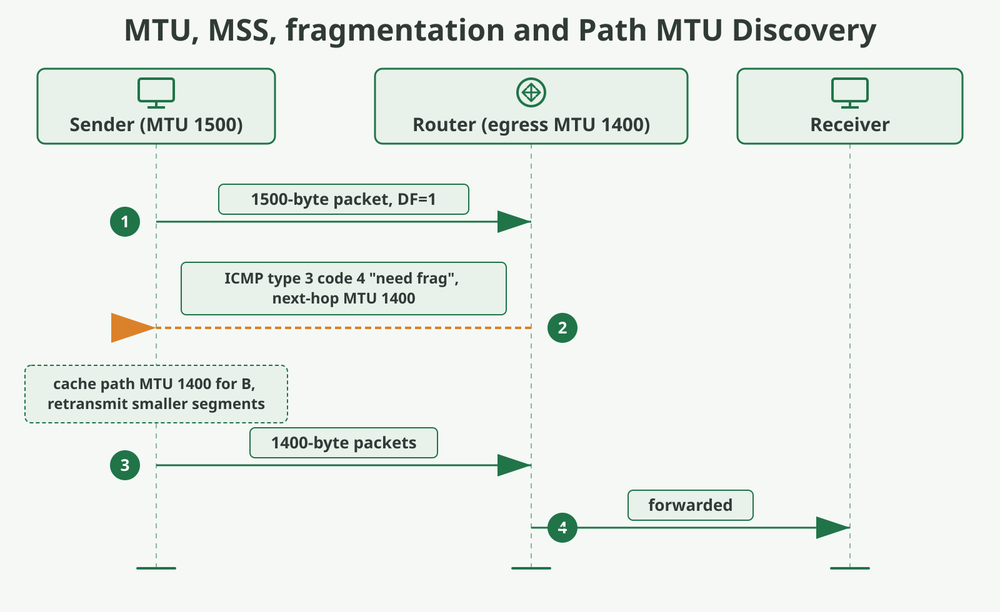

*Figure 2.7.11. MTU, MSS, fragmentation and Path MTU Discovery, as a diagram.*

### The PMTU black hole

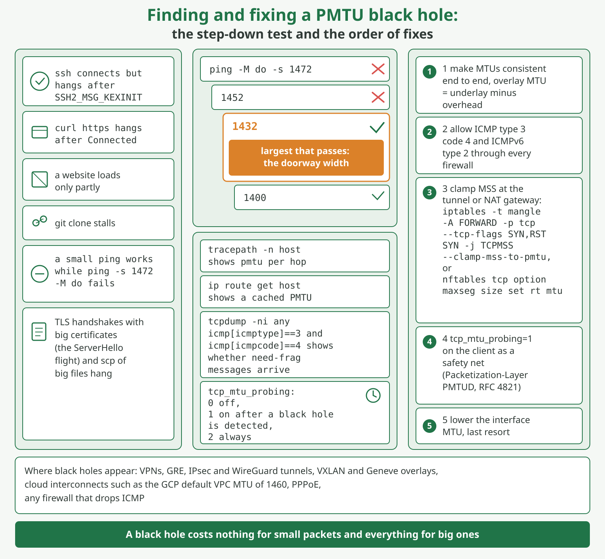

*Figure 2.7.12. Step down the ping -M do size to find the largest packet that passes, then fix by consistent MTUs, allowed ICMP, MSS clamping or probing.*

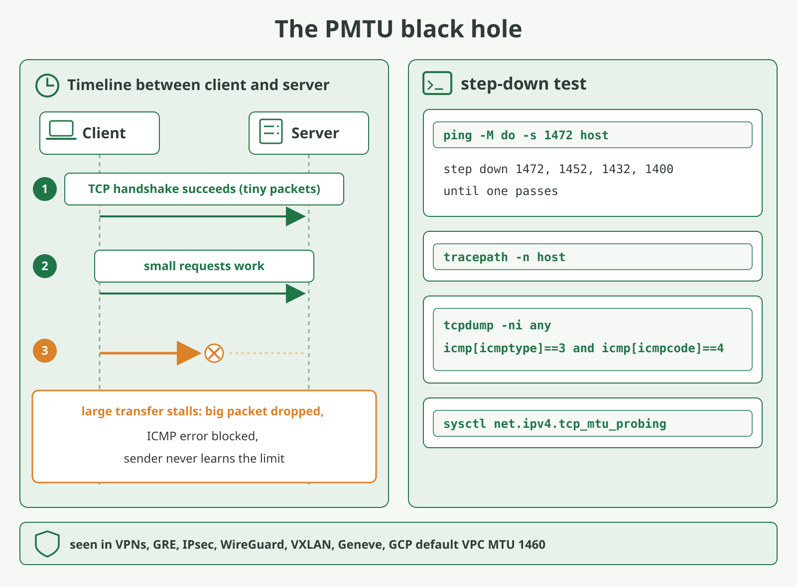

*Figure 2.7.13. With the ICMP error blocked, the handshake and small requests work but large transfers hang.*

Now suppose the ICMP error is blocked. The sender never learns the limit, like a driver who is never told the bridge ahead is too low. The TCP handshake still succeeds, because its packets are tiny, and small requests pass as well. But any packet above the path MTU is dropped silently and retransmitted forever. So large transfers hang. TLS handshakes with big certificates (the ServerHello flight), SSH key exchange and `scp` of big files hang the same way. Watch for these symptoms: `ssh` connects but hangs after `SSH2_MSG_KEXINIT`, `curl https://...` hangs after `Connected`, a website loads only partly, `git clone` stalls, or a small `ping` works while `ping -s 1472 -M do` fails.

Black holes show up in VPNs, GRE, IPsec and WireGuard tunnels, VXLAN and Geneve overlays (Kubernetes CNIs), cloud interconnects such as the GCP default VPC MTU of 1460, PPPoE links and any firewall that drops ICMP.

To detect a black hole, start with a step-down test. It is the same trick as finding the widest doorway by trying smaller and smaller boxes. Try `ping -M do -s 1472 host && echo ok`. Then step down through 1452, 1432, 1400 and so on until you find the largest size that passes.

```bash
ping -M do -s 1472 host && echo ok              # step down: 1472, 1452, 1432, 1400 ... find the largest that passes
tracepath -n host                                # shows pmtu changes per hop
ip route get host                                # cached PMTU if learned
tcpdump -ni any 'icmp[icmptype]==3 and icmp[icmpcode]==4'    # are "need frag" messages arriving?
sysctl net.ipv4.tcp_mtu_probing                  # 0 off, 1 on after black hole detected, 2 always
```

`tracepath` shows the PMTU changes at each hop. `ip route get` shows any cached PMTU. `tcpdump` tells you whether the "need frag" messages arrive at all. The `tcp_mtu_probing` setting controls the fallback: 0 is off, 1 turns probing on after a black hole is detected, and 2 keeps it always on.

Fix black holes in this order of preference, from the cleanest cure to the roughest. First, make the MTUs consistent end to end. Set the same MTU on all hops in a segment, and set the overlay MTU to the underlay MTU minus the encapsulation overhead. Second, allow ICMP type 3 code 4 and ICMPv6 type 2 through every firewall. Third, clamp MSS at the tunnel or NAT gateway. You can use `iptables -t mangle -A FORWARD -p tcp --tcp-flags SYN,RST SYN -j TCPMSS --clamp-mss-to-pmtu`, or the nftables rule `tcp option maxseg size set rt mtu`. Fourth, enable `tcp_mtu_probing=1` on the client as a safety net. This is Packetization-Layer PMTUD, defined in RFC 4821. Last, and only as a last resort, lower the interface MTU.

### Encapsulation overhead (compute, don't guess)

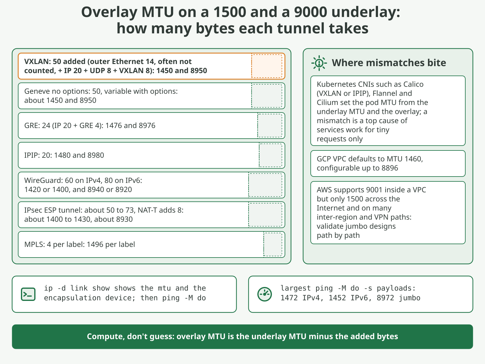

*Figure 2.7.14. Each tunnel subtracts its added bytes from the underlay MTU, leaving 1450 for VXLAN and 1480 for IPIP on a 1500 underlay.*

Each encapsulation adds bytes to the packet, and the overlay MTU has to shrink by the same amount. It is the same logic as putting a parcel inside a bigger parcel: the outer wrapper takes up room. The table below does that arithmetic for the common cases.

| Encapsulation | Added bytes (IPv4 underlay) | Overlay MTU on a 1500 underlay | On a 9000 underlay |
|---|---|---|---|
| VXLAN | 50 (outer Ethernet 14 [often not counted] + IP 20 + UDP 8 + VXLAN 8) | 1450 | 8950 |
| Geneve (no options) | 50 (variable with options) | ~1450 | ~8950 |
| GRE | 24 (IP 20 + GRE 4) | 1476 | 8976 |
| IPIP | 20 | 1480 | 8980 |
| WireGuard | 60 (IPv4) / 80 (IPv6) | 1420 / 1400 | 8940 / 8920 |
| IPsec ESP tunnel | ~50 to 73 (varies with cipher, NAT-T adds 8) | ~1400 to 1430 | ~8930 |
| MPLS | 4 per label | 1496 per label | |

Read each row as the underlay MTU minus the added bytes. VXLAN adds 50 bytes. On a 1500 underlay that leaves 1450, and on a 9000 underlay it leaves 8950. Verify these numbers yourself with `ip -d link show`, which shows the `mtu` and the encapsulation device. Then test with `ping -M do`.

Kubernetes CNIs such as Calico (VXLAN or IPIP), Flannel and Cilium set the pod MTU from the underlay MTU and the overlay. A mismatch there is a top cause of "services work for tiny requests only" in clusters, covered in chapter 2.25 and Part 5. Cloud networks differ too. GCP VPC defaults to MTU 1460, and it can be configured up to 8896 for VPC. AWS supports 9001 inside a VPC, but only 1500 across the Internet and on many inter-region and VPN paths. Jumbo-frame designs therefore have to be validated path by path.

### Jumbo frames for AI clusters

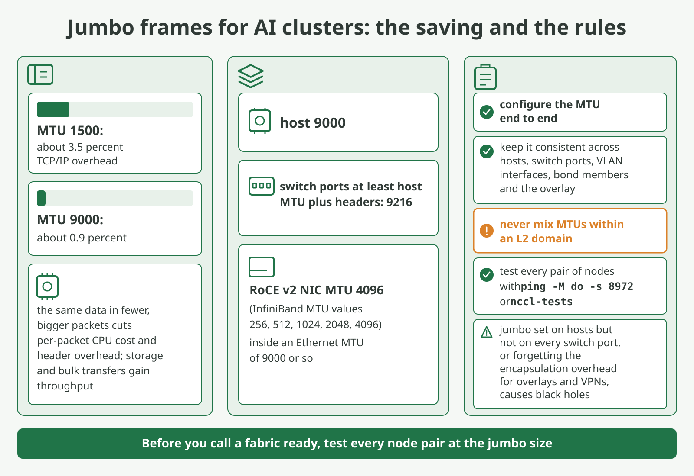

*Figure 2.7.15. Jumbo frames cut header overhead from about 3.5 to 0.9 percent, but only if every host, switch port and overlay uses the same MTU.*

Larger MTUs cut the per-packet CPU cost and the header overhead, because the same amount of data travels in fewer, bigger packets. At a 9000-byte MTU, TCP/IP overhead is about 0.9%. At 1500 it is about 3.5%. Storage and bulk transfers gain throughput as a result. RoCE v2 typically runs at the NIC's MTU of 4096. The InfiniBand MTU values are 256, 512, 1024, 2048 and 4096. RoCE v2 then runs inside an Ethernet MTU of 9000 or so.

The rules are simple, and the trouble comes from forgetting one of them. Configure the MTU end to end, and keep it consistent across hosts, switch ports, VLAN interfaces, bond members and the overlay. Never mix MTUs within an L2 domain. Set the switches to at least the host MTU plus headers, which is 9216. Then test every pair of nodes with `ping -M do -s 8972` or `nccl-tests`.

Before you call a fabric ready, test every node pair at the jumbo size.

## 6. More tools

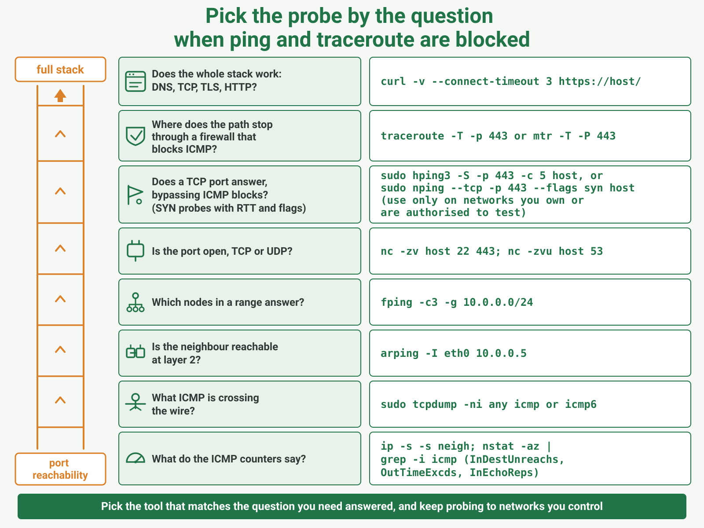

*Figure 2.7.16. Each probe answers a different question, from TCP port reachability up to the full DNS, TCP, TLS and HTTP stack.*

Sometimes `ping` and `traceroute` are blocked, and you still need to know whether a port answers. Firewalls often allow the traffic that matters and block the probes you would normally use. The commands below probe TCP, check ports and watch packets. Each one answers a different question, from port reachability up to the full stack.

```bash
sudo hping3 -S -p 443 -c 5 host                 # TCP SYN probes, shows RTT and flags, bypasses ICMP blocks
sudo nping --tcp -p 443 --flags syn host         # nmap's packet crafter
nc -zv host 22 443 ; nc -zvu host 53             # port checks (TCP/UDP)
curl -v --connect-timeout 3 https://host/        # full-stack check (DNS, TCP, TLS, HTTP)
arping -I eth0 10.0.0.5                           # layer-2 reachability (ARP), chapter 2.3
fping -c3 -g 10.0.0.0/24                          # parallel sweep
sudo tcpdump -ni any icmp or icmp6               # watch ICMP
ip -s -s neigh ; nstat -az | grep -i icmp         # ICMP counters: InDestUnreachs, OutTimeExcds, InEchoReps, etc.
```

`hping3` and `nping` let you test one specific TCP or UDP port path with custom flags and TTLs. They help with firewall debugging, and with traceroute through firewalls that block ICMP. Use them only on networks you own or are authorised to test.

Pick the tool that matches the question you need answered, and keep probing to networks you control.

## 7. A layered reachability checklist

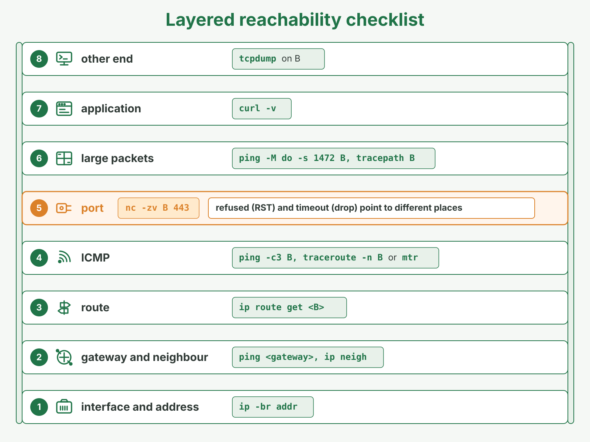

*Figure 2.7.17. Test one layer at a time from the interface up to the application, then look at the far end.*

Picture a node that cannot reach a service on another subnet. The temptation is to jump straight to the application logs. Work through the layers in order instead. Each step isolates one layer, and skipping ahead wastes your time. The list is the whole chapter in the order you would use it on a bad day.

1. Check A's own interface and address with `ip -br addr`. Confirm the link is up.
2. Check the local subnet and gateway. Run `ping <gateway>`, then `ip neigh`. REACHABLE or STALE, set against FAILED or INCOMPLETE, shows whether neighbour resolution worked.
3. Check the route with `ip route get <B>`.
4. Test ICMP to B with `ping -c3 B`. If that fails, run `traceroute -n B` or `mtr` to find where the packets stop.
5. Test the port with `nc -zv B 443`. A refused connection (RST) and a timeout (drop) point to different places.
6. Test large packets with `ping -M do -s 1472 B` and `tracepath B`.
7. Test the application with `curl -v`, including TLS and authentication.
8. Look at the other end. Run `tcpdump` on B and ask whether the packets arrive, whether replies go out, and on which interface.

## 8. Hands-on lab: UDP, ICMP, traceroute, and an MTU black hole

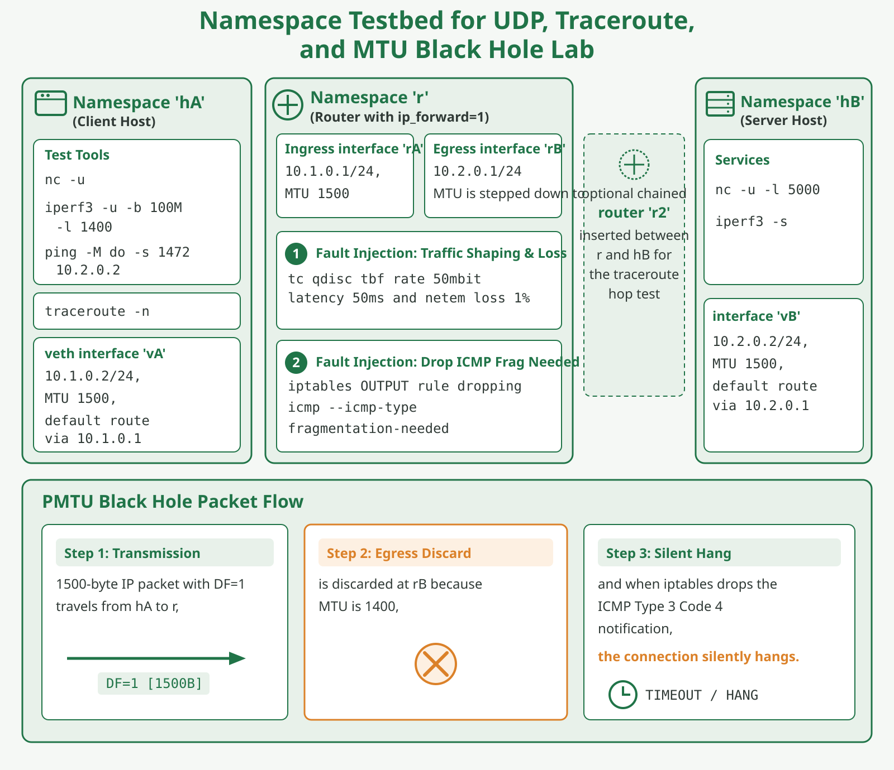

*Figure 2.7.18. Figure 2.7.18. The three-namespace lab topology implements an MTU mismatch and ICMP filter on router r to recreate and fix a Path MTU black hole.*

A word on status first. The Python lab below has been run, while the VM steps that follow have not been run for this chapter, so treat those results as something you still need to confirm. Start with the self-checking Python lab. Run it on your own machine with `python3 code/part02/udp_icmp_pmtu_lab.py`. It checks the overlay and tunnel MTU values and the inner TCP MSS calculations. The expected values are `VXLAN` `1450`/`8950`, `WireGuard` `1420`/`1400`, `GRE` `1476` and `IPIP` `1480`. It also checks the largest `ping -M do -s` payloads, which are `1472` for IPv4, `1452` for IPv6 and `8972` for jumbo frames. Finally, it classifies `mtr` hop loss, so you can tell control-plane ICMP rate limiting from genuine forwarding loss.

```bash
python3 code/part02/udp_icmp_pmtu_lab.py
```

The rest of the lab runs on a disposable Linux VM. It uses the three-namespace topology from chapter 2.5: `hA - r - hB`, with forwarding on in `r` and default routes set. Run the steps in order, and keep a `tcpdump` capture open while you work.

1. Start with UDP basics. Run `ip netns exec hB nc -u -l 5000`, send from hA, and capture the traffic with tcpdump. Show that there is no handshake. Then send to a closed port and capture the ICMP port unreachable message (type 3 code 3). Finally, show the connected-socket error by using `nc -u` after a first send.
2. Run an iperf3 UDP test. Start the server in hB, and run the client in hA at `-b 100M -l 1400`. Next, add `tc qdisc add dev rB root tbf rate 50mbit burst 32kbit latency 50ms` in r, and watch the loss and jitter. Then repeat the test with `netem loss 1%`.
3. Look at ICMP types. Capture `icmp` while you ping. Ping a non-existent address on a connected subnet, which shows an ARP failure as host unreachable from your own address. Then send to a blackhole or unreachable route, which chapter 2.5 covers.
4. Build a traceroute chain. Add a second router, `r2`, so the path is hA - r - r2 - hB. Run `traceroute -n`, then `-I`, then `-T -p 22`. Watch the TTL-exceeded messages in tcpdump. Next, add `iptables -A INPUT -p icmp --icmp-type time-exceeded` rate limits, or drop ICMP output on r2, to produce `* * *`. Check that the later hops still respond.
5. Create an MTU black hole. Set `ip -n r link set rB mtu 1400` and `ip -n hB link set vB mtu 1500`. Run `ip netns exec hA ping -M do -s 1472 10.2.0.2`, and look for the ICMP "need frag" message with mtu 1400. Then check the cached PMTU with `ip route get`. Now drop ICMP type 3 on r with `ip netns exec r iptables -A OUTPUT -p icmp --icmp-type fragmentation-needed -j DROP`. Demonstrate the hang with `curl` or `nc`: start a TCP server on hB, send 10 KB from hA, and watch the retransmissions in tcpdump. Then fix it three ways in turn: MSS clamping on r, then `tcp_mtu_probing=1`, then allowing ICMP.
6. Work out the overlay MTU. Create a VXLAN between hA and hB with `ip link add vx0 type vxlan id 42 remote ... dstport 4789 dev vA`. Compute the overlay MTU, and show that a 1500 overlay breaks on a 1500 underlay. Then set it correctly.
7. Clean up the namespaces when you are done.

## 9. Common mistakes

Most of these mistakes come from reading one signal too literally. A single ping, a single hop or a single counter can mislead, and the cure is to cross-check.

- Treating a failed ping as proof of an outage, when ICMP may simply be filtered. The reverse is just as wrong: a successful ping does not prove the service works.
- Believing that `* * *` or one hot hop in a traceroute means a fault.
- Blocking all ICMP and ICMPv6, then chasing PMTU black holes and IPv6 neighbour failures. The same goes for debugging an MTU problem with a default-size ping.
- Mixing MTUs on the same L2 segment or in a bond, or setting jumbo frames on hosts but not on every switch port. Forgetting to subtract the encapsulation overhead for overlays and VPNs is the same class of error.
- Assuming UDP is "faster" without accounting for loss handling, buffer drops and rate limiting.

When you catch yourself taking one of these shortcuts, go back to the checklist in section 7.

## 10. Interview angles

Use these questions to test your own understanding. Each one has a mechanism behind it, so aim to explain the mechanism and not just name the tool. A calm explanation of what the packet does at each step beats a list of commands.

- "Explain how traceroute works. Why might a hop be missing or show high latency?"
- "Large file transfers hang but small requests work. What do you check?" (PMTUD, MSS clamping.)
- "What ICMP messages should a firewall allow, and why?"
- "How is UDP different from TCP; give three protocols using UDP and why."
- "How do you test jumbo frames end to end?"
- "What is the MTU inside a VXLAN overlay on a 1500 underlay? On 9000?"
- "How does mtr help versus traceroute? How do you read loss in it?"

## Exercises

These exercises check the ideas in the chapter. Some ask for a calculation, and others ask you to explain a failure in your own words. Picture the failing path as you answer, because most of them describe something you could really meet on a cluster.

1. Start with UDP semantics. State the size of the UDP header, `8` bytes, and name its four fields (RFC 768). Explain how UDP keeps message boundaries, unlike TCP. Then name the `nstat` counter that goes up when a receiver's UDP socket buffer overflows. Finally, explain how a sender learns that a remote UDP port has no listener, and list the metrics `iperf3 -u` reports at the receiver that TCP `iperf3` does not.
2. List the essential ICMPv4 types and codes: `0`, `3/3`, `3/4`, `8` and `11/0`. Then list the essential ICMPv6 types: `1`, `2`, `3`, `128` and `129`, and `133` to `137`. Explain the exact failure modes that a blanket "drop all ICMP/ICMPv6" firewall policy causes.
3. Use `classify_mtr_hop_loss()` in `code/part02/udp_icmp_pmtu.py` to compare two `mtr` reports. One shows hop losses of `[0.0, 0.0, 45.0, 0.0, 0.0]`, and the other shows `[0.0, 0.0, 5.2, 5.1, 5.3]`. Say what each pattern tells you. Then explain how you would traceroute through a firewall that blocks UDP high ports and ICMP echo, using `traceroute -T -p 443`. Finally, say what problem `paris-traceroute` or `dublin-traceroute` solves on ECMP fabrics.
4. Explain why a Path MTU (`PMTU`) black hole lets `ssh` or `curl https://...` finish the TCP three-way handshake and then hang on `SSH2_MSG_KEXINIT` or `ServerHello`. Using `compute_max_ping_df_payload()`, write the exact `ping` commands that test a `1500`-byte IPv4 path, a `1500`-byte IPv6 path and a `9000`-byte jumbo path. Then state the five ordered fixes for a Path MTU black hole.
5. Use `compute_overlay_mtu_and_mss()` to work out the maximum inner MTU and the inner IPv4 TCP `MSS` on a `1500`-byte underlay, and then on a `9000`-byte underlay. Cover `VXLAN` (`50` B), `Geneve` (`50` B), `GRE` (`24` B), `IPIP` (`20` B) and `WireGuard` (`60` B for IPv4, `80` B for IPv6).
6. Answer two parts. (a) Why do AI fabrics set host NICs to MTU 9000 and switch ports to MTU 9216, and how does that relate to RoCEv2's 4096-byte InfiniBand MTU? (b) Walk through the 8-step layered reachability checklist from section 7 when Node A cannot reach Node B.

## Checkpoint questions (20)

<details>
<summary>1. What are the size and fields of the UDP header, and why is the UDP checksum mandatory in IPv6?</summary>

The UDP header (RFC 768) is **8 bytes** long. It has four 16-bit fields: Source Port, Destination Port, Length and Checksum. In IPv4 the checksum is optional, and `0` means it is not computed, because the IPv4 header already has its own header checksum. In **IPv6**, the base header has no header checksum. So the UDP checksum is mandatory there. It covers the IPv6 pseudo-header, the UDP header and the payload, and it confirms the packet was not corrupted in transit.
</details>

<details>
<summary>2. How does `recvfrom()` on a UDP socket differ from `recv()` on a TCP socket, and why should UDP applications avoid datagrams larger than the Path MTU?</summary>

UDP **preserves message boundaries**. Each `recvfrom()` returns exactly one complete datagram, as sent by `sendto()`. TCP is an unstructured byte stream by comparison. An IPv4 UDP datagram can theoretically reach `65,507` bytes, which is `65535 - 20 IP - 8 UDP`. But any datagram larger than the Path MTU is fragmented at the IP layer. If **any single IP fragment** is lost, the whole UDP datagram is discarded at reassembly.
</details>

<details>
<summary>3. Name six protocols in an AI/cloud data center that run over UDP and explain why each uses UDP instead of TCP.</summary>

- **DNS** (`port 53`): a single-packet query and reply, with no three-way handshake delay.
- **NTP** (`port 123`): time synchronization, without the retransmission buffering that adds jitter.
- **DHCP** (`ports 67/68`): a broadcast bootstrap that runs before an IP address exists.
- **VXLAN** (`port 4789`) and **Geneve** (`port 6081`): they encapsulate L2 and L3 packets. The outer UDP source port gives ECMP hashing entropy, and UDP avoids TCP-over-TCP meltdown.
- **QUIC / HTTP/3** (`port 443`) and **WireGuard** (`port 51820`): modern encrypted transports, with QUIC running in user space.
- **RoCE v2** (`port 4791`): carries InfiniBand RDMA transport headers across L3 Ethernet fabrics, where reliability is implemented in NIC hardware.
</details>

<details>
<summary>4. How does a sender learn that a remote UDP port is closed, and what happens when a receiver's UDP socket buffer overflows?</summary>

A datagram that reaches a host with no socket bound to its destination port gets an **ICMP Destination Unreachable, Port Unreachable** reply. That is IPv4 type `3` code `3`, or ICMPv6 type `1` code `4`. The sender's kernel turns this into `ECONNREFUSED` only if the sender called `connect()` on its UDP socket. The `nstat` counter for this case is `UdpNoPorts`. If the receiving application reads too slowly and its socket receive buffer fills, the kernel silently drops incoming datagrams. It increments **`UdpRcvbufErrors`**, which you see in `nstat -az`. The fix is to raise `net.core.rmem_max` and `SO_RCVBUF`.
</details>

<details>
<summary>5. Why do idle UDP sessions (WireGuard, QUIC, long-running RPCs) drop through firewalls and NAT gateways, and what is the fix?</summary>

UDP has no `SYN` or `FIN` state machine. So stateful firewalls and NAT gateways track UDP flows with a **conntrack inactivity timer**, typically `30` to `180` seconds. If no packet flows inside that window, the NAT mapping expires, and later packets from the peer are dropped. The fix is for applications to send periodic **UDP keepalives**, for example every `25` seconds.
</details>

<details>
<summary>6. What extra metrics does `iperf3 -u` report that TCP `iperf3` does not?</summary>

In UDP mode (`iperf3 -c host -u -b 1G -l 1400`), the sender transmits at the target bitrate set by `-b`, with no congestion control. The receiver reports the **lost datagram count and loss percentage**. It also reports **inter-arrival jitter in ms**, computed the way RFC 3550 RTP jitter is computed. TCP mode does not give you either of these.
</details>

<details>
<summary>7. Match the key IPv4 ICMP types (`0`, `3`, `5`, `8`, `11`) and codes (`3/0`, `3/1`, `3/3`, `3/4`, `3/13`, `11/0`) to their meanings.</summary>

- Type `0`: **Echo Reply** (the `ping` response)
- Type `8`: **Echo Request** (the `ping` request)
- Type `3`: **Destination Unreachable**, with these codes:
  - Code `0`: Net Unreachable
  - Code `1`: Host Unreachable
  - Code `3`: **Port Unreachable** (a closed UDP port)
  - Code `4`: **Fragmentation Needed and DF Set** (carries the next-hop MTU for PMTUD)
  - Code `13`: Communication Administratively Prohibited (a firewall reject)
- Type `5`: **Redirect**
- Type `11` code `0`: **Time Exceeded, TTL expired in transit** (what `traceroute` relies on)
</details>

<details>
<summary>8. Which ICMPv4 and ICMPv6 messages must NEVER be blocked by a firewall?</summary>

In IPv4, **type `3` code `4`** (Fragmentation Needed and DF Set) must never be blocked. Type `3` and type `11` in general should not be blocked either. In IPv6, **type `2`** (Packet Too Big) must not be blocked. Types `1`, `3` and `4` must not be blocked either. Neither should **types `133` to `137`** (Neighbor Discovery: RS, RA, NS, NA and Redirect). Blocking `3/4` or ICMPv6 type `2` causes silent Path MTU black holes. Blocking ICMPv6 types `133` to `137` breaks IPv6 neighbor resolution, which replaces ARP. It also stops SLAAC and default-router discovery completely.
</details>

<details>
<summary>9. In `ping` output `64 bytes from 10.0.0.5: icmp_seq=1 ttl=62 time=0.31 ms`, what does `ttl=62` tell you, and what is the difference between `Destination Host Unreachable` from your own IP versus from a router?</summary>

Linux starts outgoing IPv4 packets at `TTL = 64`. Windows starts at `128`, and network gear often starts at `255`. When you see `ttl=62` in a reply, it means `64 - 62 = 2` routers decremented the TTL along the return path. If `ping` prints `From 10.0.0.15 ... Destination Host Unreachable` with your **own** local IP, then ARP or NDP failed for the target or gateway on your local link. If it prints `From 10.0.0.1 ...` with a **router's** IP, that router had no route, or it failed ARP on the remote link.
</details>

<details>
<summary>10. Why does a successful `ping` not prove an application can connect, and why does a failed `ping` not prove a host is down?</summary>

Many firewalls drop ICMP Echo (`Type 8`) while they allow TCP/443. So `ping` can fail while the service is healthy. The opposite also happens. The kernel can answer ICMP Echo in the interrupt handler, so a ping succeeds even when the application daemon has crashed. It also succeeds when a firewall blocks the TCP port. And it succeeds when the path has an MTU black hole that drops `1500`-byte TCP segments while passing `84`-byte pings. Always test the actual application protocol and port with `nc -zv` or `curl -v`, and test the full MTU with `ping -M do -s 1472`.
</details>

<details>
<summary>11. How does `traceroute` work across UDP, ICMP (`-I`), and TCP (`-T -p 443`) modes?</summary>

In every mode, `traceroute` sends probes with `TTL = 1, 2, 3` and so on. Each intermediate router decrements the TTL to `0` and replies with **ICMP Time Exceeded (Type 11 Code 0)**. By default on Linux, the probes are **UDP datagrams to high ports, starting at `33434`**. The final host replies with ICMP Port Unreachable (`3/3`). `-I` sends **ICMP Echo Requests**, and the final host replies with Echo Reply (`0`). `-T -p 443` sends **TCP `SYN` packets to port 443**. That passes firewalls that drop UDP and ICMP, and the final host answers with `SYN-ACK` or `RST`.
</details>

<details>
<summary>12. In `mtr` or `traceroute`, how do you distinguish harmless control-plane ICMP rate limiting from genuine packet loss?</summary>

Routers forward transit traffic in the ASIC data plane, and they give it priority there. They strictly rate-limit or deprioritise the ICMP Time Exceeded packets that the router CPU has to generate. So suppose hop 3 shows **`50%` loss** (or `* * *`, or high latency), while hop 4 and every hop after it show `0%` loss and normal latency. Then the loss is control-plane ICMP rate limiting at hop 3 only. Genuine forwarding loss starts at hop `N` and **persists through every later hop** to the final destination.
</details>

<details>
<summary>13. Why can traditional `traceroute` report false loops or shifting routers across an ECMP leaf-spine fabric, and how does `paris-traceroute` (or `dublin-traceroute`) fix it?</summary>

Traditional `traceroute` changes the UDP destination port on every probe. That changes the packet's **5-tuple**, so ECMP switches hash each probe onto a **different** spine or leaf path. `paris-traceroute` and `dublin-traceroute` keep the flow's 5-tuple header fields constant. They vary the UDP checksum or payload instead, so every TTL probe follows the exact same ECMP path.
</details>

<details>
<summary>14. How does `tracepath` differ from `traceroute`?</summary>

`tracepath` runs without `root` privileges, and it uses UDP probes. It sets the **Don't Fragment (`DF`)** bit on full-MTU packets. That lets you discover both the hop-by-hop router path and the **Path MTU (`pmtu`)** along the route.
</details>

<details>
<summary>15. Explain how Path MTU Discovery (`PMTUD`, RFC 1191 / RFC 8201) works and what causes a PMTU black hole.</summary>

With PMTUD, the sender sets `DF = 1` (Don't Fragment) on its outgoing packets. When a router has an egress link with a smaller MTU, such as `1400` bytes, it drops the oversized packet. It then returns **ICMP Type 3 Code 4 (`Fragmentation Needed`)**, or **ICMPv6 Type 2 `Packet Too Big`**. That message carries the next-hop MTU of `1400`. The sender caches it in the route cache, which `ip route get` shows, and uses it to re-segment. If a firewall blocks that ICMP message, the sender never learns the smaller MTU. It keeps retransmitting full-size packets that are dropped. That is a **PMTU black hole**.
</details>

<details>
<summary>16. What are the classic user-visible symptoms of a Path MTU black hole?</summary>

Small packets pass, while full-MTU packets vanish. The symptoms are these:

- TCP three-way handshakes succeed immediately, as `nc -zv` or `curl` showing `Connected to...` will show.
- Interactive `ssh` connects, but it **hangs right after `SSH2_MSG_KEXINIT`**, when the large key-exchange packets are sent.
- TLS handshakes with large certificate chains hang, and HTTP or S3 downloads hang too.
- A default 56-byte `ping` succeeds, while **`ping -M do -s 1472`** times out completely.
</details>

<details>
<summary>17. List the five ways to fix a Path MTU black hole in order of preference.</summary>

Work through these in order:

- (1) **Match MTUs end to end**, by setting overlay and tunnel interfaces to `underlay_mtu - encapsulation_overhead`.
- (2) **Permit ICMP Type 3 Code 4 and ICMPv6 Type 2** across all firewalls and security groups.
- (3) **Clamp TCP MSS at the tunnel or edge router**, with `iptables -t mangle -A FORWARD -p tcp --tcp-flags SYN,RST SYN -j TCPMSS --clamp-mss-to-pmtu`, or with the `nftables` rule `tcp option maxseg size set rt mtu`.
- (4) Enable **Packetization-Layer PMTUD**, with `sysctl net.ipv4.tcp_mtu_probing = 1`. It is defined in RFC 4821.
- (5) As a last resort, lower the endpoint interface MTU.
</details>

<details>
<summary>18. State the encapsulation overhead and resulting inner MTU on a `1500`-byte IPv4 underlay for `VXLAN`, `Geneve`, `GRE`, `IPIP`, and `WireGuard`.</summary>

If you are on a 1500-byte IPv4 underlay:

- **`VXLAN`**: `50` bytes of overhead gives an inner MTU of **`1450`**, or `8950` on a `9000` underlay.
- **`Geneve` (no options)**: `50` bytes of overhead gives an inner MTU of **`1450`**.
- **`GRE`**: `24` bytes of overhead gives an inner MTU of **`1476`**.
- **`IPIP`**: `20` bytes of overhead gives an inner MTU of **`1480`**.
- **`WireGuard`**: `60` bytes (IPv4) or `80` bytes (IPv6) of overhead gives an inner MTU of **`1420`** or **`1400`**.
</details>

<details>
<summary>19. How do you test a `1500`-byte MTU path and a `9000`-byte jumbo MTU path using `ping`, and why do switches use `9216`?</summary>

Subtract the header sizes from the MTU before you pick a payload. For IPv4, subtract `28` bytes, which is the `20`-byte IPv4 header plus the `8`-byte ICMP header. For IPv6, subtract `48` bytes, which is the `40`-byte IPv6 header plus the `8`-byte ICMPv6 header.

- `1500` IPv4: **`ping -M do -s 1472 <host>`**, or **`-s 1452`** for IPv6.
- `9000` IPv4: **`ping -M do -s 8972 <host>`**.

Switches are configured to **`MTU 9216`**, so that `9000`-byte host packets wrapped in Ethernet, VLAN (`802.1Q`) or VXLAN headers never exceed the switch port limit.
</details>

<details>
<summary>20. State the 8-step layered reachability checklist when Host A cannot reach Service B.</summary>

Work through these eight steps, in order:

- (1) Local link and IP: `ip -br link`, then `ip -br addr`.
- (2) Local gateway ARP or NDP: `ping <gw>`, then `ip neigh`.
- (3) Route lookup: `ip route get <B>`.
- (4) L3 reachability and path: `ping -c 3 <B>`, then `mtr -n <B>`.
- (5) L4 port: `nc -zv <B> <port>`, or `traceroute -T -p <port>`.
- (6) Path MTU: `ping -M do -s 1472 <B>`, then `tracepath -n <B>`.
- (7) L7 and TLS: `curl -v https://<B>/`.
- (8) Packet capture at both ends: `sudo tcpdump -ni any host <A>`.
</details>

## Sources and review notes

- **Sources read in full:**
  - `how-linux-works-3rd-edition` — Brian Ward, *How Linux Works*, 3rd ed., **Chapter 9: Understanding Your Network and Its Configuration** (basic ICMP and DNS tools, `ping`, the Internet layer and addresses, subnets, routes, IPv6 and dual-stack configuration, and kernel network interfaces).
  - `computer-networking-problems-and-solutions` — Russ White and Ethan Banks, *Computer Networking Problems and Solutions*, **Chapter 5: Higher Layer Data Transports** (the Internet Protocol fragmentation and TTL, UDP transport and marshaling, multiplexing, and ICMP).
  - `systems-performance-2nd-edition` — Brendan Gregg, *Systems Performance: Enterprise and the Cloud*, 2nd ed., **Chapter 10: Network** (`ping`, `traceroute`, path MTU discovery, and UDP socket buffer error counters `UdpRcvbufErrors`).
- **Run here:** `python3 code/part02/udp_icmp_pmtu_lab.py` (15 passed, 0 failed).
- **Explicitly labelled inferences:** The encapsulation-overhead table (`VXLAN`, `Geneve`, `GRE`, `IPIP`, `WireGuard`, `IPsec ESP`, `MPLS`), PMTU black-hole troubleshooting workflow (`TCPMSS --clamp-mss-to-pmtu`, `tcp_mtu_probing=1`), RoCEv2 `4096` IB MTU / `9000` Ethernet jumbo-frame rules, and 8-step layered reachability checklist synthesize RFCs 768, 792, 1191, 4443, 4821, and 8201 and the `ping(8)`, `traceroute(8)`, `tracepath(8)`, and `mtr(8)` manual pages (cross-referenced with Chapters 2.3, 2.5, 2.6, and 2.25, plus original study items 21–25).
- **Not verified on live hardware:** All interactive VM commands (`nc -u`, `iperf3 -u`, `ping -M do`, `traceroute`, `tracepath`, `mtr`, `hping3`, `nping`, `fping`, `tcpdump`, `iptables`) are marked and must be executed on a disposable Linux VM.

