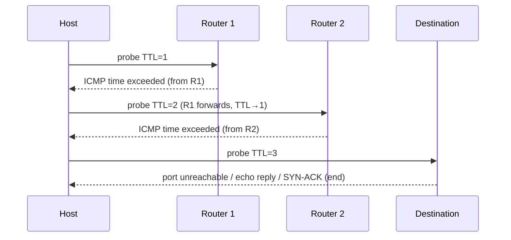
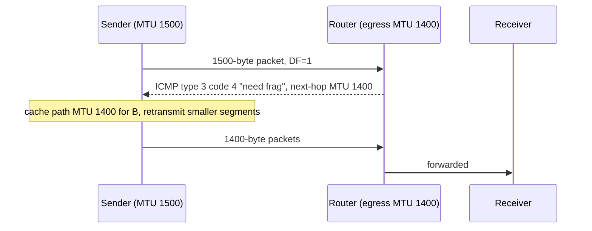

# 2.7 UDP, ICMP and the diagnostic toolkit: ping, traceroute, mtr and path MTU

| | |
|---|---|
| Level | Beginner to intermediate |
| Priority tier | 0 |
| Lab venue | Linux VM or namespaces |
| Part | Part 2: Networking, from first principles to AI fabrics |
| Status | Drafted, labs **untested** |

## Why this matters for AI infrastructure

When a training job hangs or an inference endpoint is slow, the first questions are "is the network the problem, and where?" Those are answered with a small toolkit built on UDP and ICMP: `ping` for reachability and latency, `traceroute`/`mtr` for the path and per-hop loss, `tracepath` and `ping -M do` for path MTU, `nc -u`/`iperf3 -u` for UDP behaviour. UDP is also the carrier for DNS, VXLAN/Geneve overlays, WireGuard, QUIC, and RoCE v2, so understanding it matters for the fabric. And a large share of "works for small requests, hangs for large ones" outages are **path MTU** problems in overlays, VPNs and clouds, where blocked ICMP breaks Path MTU Discovery.

## Prerequisites and outcomes

You should know IP, routing (2.5) and TCP (2.6).

After this chapter you can:

- Describe UDP's header and semantics, and when it is the right transport.
- Read ICMP and ICMPv6 types and codes, and explain which are essential and which firewalls must never block.
- Use ping, traceroute (UDP/ICMP/TCP), mtr, tracepath, hping3/nping and nc correctly, and interpret their output including the pitfalls (ICMP rate limiting, ECMP, asymmetric paths, MPLS).
- Explain MTU, MSS, fragmentation, PMTUD and PMTU black holes, and compute overlay MTUs (VXLAN, Geneve, IPsec, WireGuard, GRE).
- Diagnose "small works, large hangs" and design MTU for clusters with jumbo frames.
- Measure UDP loss, jitter and throughput with iperf3.

## 1. UDP: the minimal transport

UDP (RFC 768) adds to IP only **ports** and an optional checksum:

```text
 0      7 8     15 16    23 24    31
+--------+--------+--------+--------+
| Source port     | Destination port|
+--------+--------+--------+--------+
| Length          | Checksum        |
+--------+--------+--------+--------+
| data ...
```

The header is 8 bytes. No connection, no ordering, no retransmission, no flow or congestion control: each datagram is delivered whole or not at all (a `recvfrom` returns exactly one datagram; message boundaries are preserved, unlike TCP's byte stream). The checksum covers header, data and an IP pseudo-header; it is optional in IPv4 (0 = none) but mandatory in IPv6. Datagrams up to 65,507 bytes are possible but anything above the path MTU is fragmented at IP, and a single lost fragment loses the whole datagram, so well-behaved UDP applications keep datagrams under the MTU (DNS used 512 bytes historically; EDNS(0) negotiates larger; QUIC aims for 1200+).

**When UDP is the right choice.** Small request/response (DNS, NTP, DHCP, SNMP, syslog), latency-critical real-time media (RTP) where a late packet is useless, multicast/broadcast discovery, and as a carrier for protocols that implement their own reliability and congestion control (QUIC, RoCE v2 where the NIC implements reliability, WireGuard, VXLAN/Geneve tunnels, game networking, metrics such as StatsD). Applications using UDP must provide whatever they need: retries and timeouts, sequence numbers, rate limiting and congestion control (unbounded UDP senders can overwhelm networks; they are the reason some operators rate-limit UDP).

**UDP and the OS.** Sockets are cheap: `bind` a port, `recvfrom` any sender. A socket receive buffer overflow silently drops datagrams (`netstat -su` `receive buffer errors`, `nstat UdpRcvbufErrors`); raise `net.core.rmem_max` and set `SO_RCVBUF`, and check `ss -u -a -m`. There is no "connection refused" except via ICMP: sending to a closed UDP port makes the host reply with ICMP port unreachable, which a *connected* UDP socket reports as `ECONNREFUSED` on the next call; otherwise the sender never knows. Firewalls and NATs track UDP "flows" by timeout (typically 30 to 180 s), so long-idle UDP sessions (VPNs, QUIC) need keepalives.

```bash
nc -u -l 5000                         # UDP listener
echo hi | nc -u 10.0.0.5 5000         # send a datagram
ss -uanp                              # UDP sockets
nstat -az | egrep 'Udp(InErrors|NoPorts|RcvbufErrors|SndbufErrors)'
iperf3 -s ; iperf3 -c 10.0.0.5 -u -b 1G -l 1400 -t 10     # UDP throughput, loss %, jitter
```

`iperf3 -u` reports loss and jitter at the receiver: use it to find the rate at which a path begins to drop. A UDP test at full rate that shows 0% loss in a lab and >1% in production usually points at a policer, shallow buffer, or an unexpected bottleneck link on the path.

## 2. ICMP: the network layer's error and diagnostic channel

ICMP (RFC 792; ICMPv6 RFC 4443) rides directly on IP (protocol 1; ICMPv6 is next-header 58). It reports errors about *other* packets and carries diagnostic queries. A message has a **type** and **code** and (for errors) quotes the start of the offending packet so the sender can match it to a flow.

| IPv4 type | Meaning | Notes |
|---|---|---|
| 0 | Echo reply | `ping` response |
| 3 | Destination unreachable | Codes: 0 net, 1 host, 2 protocol, 3 **port**, **4 fragmentation needed and DF set** (PMTUD), 9/10/13 administratively prohibited |
| 5 | Redirect | Disable in production (chapter 2.5) |
| 8 | Echo request | `ping` request |
| 11 | Time exceeded | Code 0 TTL expired in transit (**traceroute**); code 1 fragment reassembly timeout |
| 12 | Parameter problem | Malformed header |

| ICMPv6 type | Meaning |
|---|---|
| 1 | Destination unreachable (codes: no route, admin prohibited, address, port) |
| 2 | **Packet Too Big** (PMTUD; *mandatory*, routers never fragment IPv6) |
| 3 | Time exceeded (hop limit) |
| 128 / 129 | Echo request / reply |
| 133 to 137 | Router solicitation/advertisement, **neighbour solicitation/advertisement** (replace ARP), redirect |

**What must never be blocked.** IPv4: type 3 code 4 (needs fragmentation), type 11, type 3 generally. IPv6: types 1, 2, 3, 4 and all neighbour discovery (133 to 137); blocking them breaks the network (no addresses, no neighbours, no PMTUD). Blanket "drop all ICMP" firewall policies are a recurring cause of mysterious large-transfer hangs. It is fine, and common, to rate-limit ICMP and to block echo *from outside*.

**Rate limiting.** Hosts and routers limit ICMP generation (Linux: `net.ipv4.icmp_ratelimit`, `icmp_ratemask`; routers deprioritise ICMP handled on the control plane). Consequence: a traceroute hop that shows `* * *` or high latency at one hop with normal latency afterwards is usually control-plane rate limiting, not a real problem.

## 3. ping

`ping` sends ICMP echo requests (type 8) and reports echo replies (type 0): reachability, round-trip time, and loss.

```bash
ping -c 4 10.0.0.5                       # 4 probes
ping -c 100 -i 0.2 host                  # faster interval (root may use smaller); summarises min/avg/max/mdev
ping -s 1472 -M do 10.0.0.5              # payload 1472 + 8 ICMP + 20 IP = 1500; -M do sets DF: MTU test
ping -I eth1 10.0.0.5                    # force source interface/address (-I 10.0.0.45)
ping -6 2001:db8::5 ; ping -6 -I eth0 fe80::1     # IPv6, link-local needs the interface
ping -f -c 100000 host                   # flood (root, lab only)
ping -D -O 10.0.0.5                      # timestamps; report outstanding replies
```

Reading output: `64 bytes from 10.0.0.5: icmp_seq=1 ttl=62 time=0.31 ms`. TTL tells you roughly how many hops away the target is (initial 64 on Linux, 128 Windows, 255 network gear; 64 − 62 = 2 routers). Round-trip variation ("mdev") hints at queueing. **Interpreting failures**: `Destination Host Unreachable` from your own address = ARP/NDP failed on the local subnet; from a router = no route; `Destination Net Unreachable`, `Packet filtered` (admin prohibited); `Request timeout`/no output = dropped silently somewhere. **Limits of ping**: ICMP can be treated differently from your real traffic (low priority, blocked, rate-limited, processed by different paths and different ECMP hashing), so a ping success does not prove an application can connect (always test the real port with `nc -zv host 443` or `curl -v`), and a ping failure does not prove the host is down.

Practical uses on a cluster: `fping -a -g 10.0.0.0/24` or `fping -f hosts` to sweep nodes quickly; `ping -c 3 <peer rail IP> -I <rail NIC>` to prove each rail works; `ping -M do -s 8972 <peer>` to verify 9000-byte jumbo paths end to end.

## 4. traceroute, tracepath and mtr

`traceroute` discovers the routers along a path by sending probes with increasing TTL (IPv4) or hop limit (IPv6); each router that decrements the TTL to 0 returns ICMP time exceeded (type 11), revealing its address; the destination answers differently (ICMP port unreachable for UDP probes, echo reply for ICMP probes, SYN-ACK/RST for TCP probes).



```bash
traceroute -n 8.8.8.8                    # default: UDP probes to high ports, 3 per hop
sudo traceroute -I -n 8.8.8.8            # ICMP echo probes
sudo traceroute -T -p 443 -n example.com # TCP SYN probes: passes firewalls that allow 443
traceroute -6 -n 2001:4860:4860::8888
traceroute -n -q 1 -w 1 -m 20 host       # one probe per hop, 1 s wait, max 20 hops
tracepath -n 10.0.0.5                    # no root; also reports path MTU (pmtu) per hop
mtr -n -r -c 100 8.8.8.8                 # report mode: per-hop loss%, last/avg/best/worst/stdev
mtr -n -r -c 100 -T -P 443 host          # TCP mode
sudo mtr -n -r -c 100 -u host            # UDP
```

**Reading traceroute/mtr correctly.**

- `* * *` at a hop only: that router doesn't send TTL-exceeded or rate-limits it; irrelevant if later hops respond.
- Latency high at one hop but low afterwards: control-plane deprioritisation of ICMP at that hop. Only a latency/loss that **persists to the destination** is real.
- Loss at an intermediate hop that does not continue to the final hop is rate limiting; loss that starts at hop N and continues to all later hops is genuine (at or after hop N).
- **Asymmetric paths**: traceroute shows the forward path only; the return path can differ and the reported RTT includes it. For serious analysis run mtr from both ends.
- **ECMP and load balancers**: different probes may take different equal-cost paths, producing hops listed from multiple routers or "inconsistent" paths; use flow-aware tools (`paris-traceroute`, `dublin-traceroute`, `mtr` with fixed ports) which keep the 5-tuple constant.
- **MPLS** and tunnels may hide hops (TTL not propagated) or show label stacks; **NAT** and cloud networks often hide intermediate hops entirely (virtual routers do not decrement TTL or respond); a cloud VPC trace typically shows only the first and last hops.
- Packet size: probes are small (60 bytes). Problems that only affect large packets (MTU) will not show; use `tracepath` or `ping -M do -s`.

## 5. MTU, MSS, fragmentation and Path MTU Discovery

**MTU** is the largest IP packet a link carries (Ethernet default 1500; jumbo 9000, often 9216 on switches to cover headers). **MSS** is the largest TCP *payload* per segment, negotiated from the MTU: `MSS = MTU − IP header − TCP header = 1500 − 20 − 20 = 1460` (IPv6: 1440; with timestamps 12 bytes less).

**Fragmentation (IPv4).** If a packet exceeds the egress MTU and the DF (Don't Fragment) bit is clear, the router splits it into fragments (offset and More-Fragments fields), which the **destination** reassembles; one lost fragment loses the packet; fragments cause problems with firewalls/NAT/ECMP (later fragments lack ports) and performance, so modern practice is to avoid them. IPv6 routers never fragment; only the source may (fragment extension header).

**Path MTU Discovery (PMTUD, RFC 1191/8201).** Senders set DF; a router that cannot forward replies with ICMP "fragmentation needed" (IPv4 type 3 code 4, carrying the next-hop MTU) or ICMPv6 Packet Too Big; the sender lowers its path-MTU estimate (cached per destination: `ip route get` shows `cache expires ... mtu 1400`) and re-segments. TCP also clamps via MSS negotiation at connect time.



### The PMTU black hole

If something blocks the ICMP error, the sender never learns the limit: the TCP handshake (tiny packets) succeeds, small requests work, but any packet that exceeds the path MTU is silently dropped and retransmitted forever, so large transfers, TLS handshakes with big certificates (the ServerHello flight), SSH key exchange or `scp` of big files **hang**. Classic symptoms: `ssh` connects but hangs after "SSH2_MSG_KEXINIT"; `curl https://...` hangs after `Connected`; website loads partially; `git clone` stalls; small `ping` works while `ping -s 1472 -M do` fails. Where it hits: VPNs, GRE/IPsec/WireGuard tunnels, VXLAN/Geneve overlays (Kubernetes CNIs), cloud interconnects (GCP default VPC MTU 1460), PPPoE, firewalls dropping ICMP.

**Detect:**

```bash
ping -M do -s 1472 host && echo ok              # step down: 1472, 1452, 1432, 1400 ... find the largest that passes
tracepath -n host                                # shows pmtu changes per hop
ip route get host                                # cached PMTU if learned
tcpdump -ni any 'icmp[icmptype]==3 and icmp[icmpcode]==4'    # are "need frag" messages arriving?
sysctl net.ipv4.tcp_mtu_probing                  # 0 off, 1 on after black hole detected, 2 always
```

**Fix, in order of preference:** (1) make the MTUs consistent end to end (set the same MTU on all hops in a segment; set the overlay MTU = underlay MTU − encapsulation overhead); (2) allow ICMP type 3 code 4 / ICMPv6 type 2 through every firewall; (3) **MSS clamping** at the tunnel/NAT gateway (`iptables -t mangle -A FORWARD -p tcp --tcp-flags SYN,RST SYN -j TCPMSS --clamp-mss-to-pmtu`, or nftables `tcp option maxseg size set rt mtu`); (4) enable `tcp_mtu_probing=1` as a client-side safety net (Packetization-Layer PMTUD, RFC 4821); (5) as a last resort lower the interface MTU.

### Encapsulation overhead (compute, don't guess)

| Encapsulation | Added bytes (IPv4 underlay) | Overlay MTU on a 1500 underlay | On a 9000 underlay |
|---|---|---|---|
| VXLAN | 50 (outer Ethernet 14 [often not counted] + IP 20 + UDP 8 + VXLAN 8) | 1450 | 8950 |
| Geneve (no options) | 50 (variable with options) | ~1450 | ~8950 |
| GRE | 24 (IP 20 + GRE 4) | 1476 | 8976 |
| IPIP | 20 | 1480 | 8980 |
| WireGuard | 60 (IPv4) / 80 (IPv6) | 1420 / 1400 | 8940 / 8920 |
| IPsec ESP tunnel | ~50 to 73 (varies with cipher, NAT-T adds 8) | ~1400 to 1430 | ~8930 |
| MPLS | 4 per label | 1496 per label | |

Verify the numbers with `ip -d link show` (`mtu` and the encapsulation device) and test with `ping -M do`. Kubernetes CNIs (Calico VXLAN/IPIP, Flannel, Cilium) set the pod MTU from the underlay MTU and the overlay; mismatches are a top cause of "services work for tiny requests only" in clusters (chapter 2.25 and Part 5). GCP VPC defaults to MTU 1460 (configurable up to 8896 for VPC), AWS supports 9001 inside a VPC but 1500 across the Internet and many inter-region/VPN paths, so jumbo-frame designs must be validated per path.

### Jumbo frames for AI clusters

Larger MTUs reduce per-packet CPU cost and header overhead (9000-byte MTU: ~0.9% overhead versus ~3.5% at 1500 for TCP/IP) and improve throughput for storage and bulk transfers; RoCE v2 typically runs at the NIC's MTU of 4096 (IB MTU values 256/512/1024/2048/4096) inside an Ethernet MTU of 9000 or so. Rules: configure end to end consistently (hosts, switch ports, VLAN interfaces, bond members, overlay), never mix MTUs within an L2 domain, set switches to at least `host MTU + headers` (9216), and test every pair of nodes (`ping -M do -s 8972`, `nccl-tests`).

## 6. More tools

```bash
sudo hping3 -S -p 443 -c 5 host                 # TCP SYN probes, shows RTT and flags, bypasses ICMP blocks
sudo nping --tcp -p 443 --flags syn host         # nmap's packet crafter
nc -zv host 22 443 ; nc -zvu host 53             # port checks (TCP/UDP)
curl -v --connect-timeout 3 https://host/        # full-stack check (DNS, TCP, TLS, HTTP)
arping -I eth0 10.0.0.5                           # layer-2 reachability (ARP), chapter 2.3
fping -c3 -g 10.0.0.0/24                          # parallel sweep
sudo tcpdump -ni any icmp or icmp6               # watch ICMP
ip -s -s neigh ; nstat -az | grep -i icmp         # ICMP counters: InDestUnreachs, OutTimeExcds, InEchoReps, etc.
```

`hping3`/`nping` are useful for testing a specific TCP/UDP port path with custom flags and TTLs (firewall debugging, traceroute through ICMP-blocking firewalls); use only on networks you own or are authorised to test.

## 7. A layered reachability checklist

When "A cannot reach B":

1. **A's own interface and address**: `ip -br addr`, link up?
2. **Local subnet / gateway**: `ping <gateway>`; `ip neigh` (REACHABLE/STALE vs FAILED/INCOMPLETE).
3. **Route**: `ip route get <B>`.
4. **ICMP to B**: `ping -c3 B`; then `traceroute -n B` / `mtr` to find where it stops.
5. **Port**: `nc -zv B 443` (TCP) - refused (RST) vs timeout (drop) tells where to look.
6. **Large packets**: `ping -M do -s 1472 B`, `tracepath B`.
7. **Application**: `curl -v`, TLS, auth.
8. **At the other end**: `tcpdump` on B: do packets arrive? Are replies sent? On which interface?

Each step isolates a layer; skipping to step 7 wastes time.

## 8. Hands-on lab: UDP, ICMP, traceroute, and an MTU black hole

First, run the self-checking Python lab (`code/part02/udp_icmp_pmtu_lab.py`) locally. It verifies overlay/tunnel MTU and inner TCP MSS calculations (`VXLAN` `1450`/`8950`, `WireGuard` `1420`/`1400`, `GRE` `1476`, `IPIP` `1480`), maximum `ping -M do -s` payload sizes (`1472` IPv4, `1452` IPv6, `8972` jumbo), and `mtr` hop-loss classification (control-plane ICMP rate limiting vs genuine forwarding loss).

```bash
python3 code/part02/udp_icmp_pmtu_lab.py
```

Next, on a disposable Linux VM using the three-namespace topology from Chapter 2.5 (`hA - r - hB`, forwarding on in `r`, default routes set; all interactive VM commands below are `untested here`), work through these steps:

1. **UDP basics**: `ip netns exec hB nc -u -l 5000`; send from hA; capture with tcpdump; show that there is no handshake. Send to a closed port and capture ICMP port unreachable (type 3 code 3); show the connected-socket error (`nc -u` after a first send).
2. **iperf3 UDP**: server in hB; client in hA at `-b 100M -l 1400`; add `tc qdisc add dev rB root tbf rate 50mbit burst 32kbit latency 50ms` in r and observe loss and jitter; repeat with `netem loss 1%`.
3. **ICMP types**: capture `icmp` while pinging, pinging a non-existent address on a connected subnet (ARP failure → host unreachable from your own address), and sending to a blackhole/unreachable route (chapter 2.5).
4. **traceroute**: add a second router `r2` in a chain hA - r - r2 - hB; run `traceroute -n`, `-I`, `-T -p 22`; watch TTL-exceeded in tcpdump; add `iptables -A INPUT -p icmp --icmp-type time-exceeded` rate limits or drop ICMP output on r2 to produce `* * *` and see that later hops still respond.
5. **MTU black hole**: set `ip -n r link set rB mtu 1400` and `ip -n hB link set vB mtu 1500`; `ip netns exec hA ping -M do -s 1472 10.2.0.2` and see the ICMP "need frag" (mtu 1400) message and `ip route get` cached PMTU. Now drop ICMP type 3 on r (`ip netns exec r iptables -A OUTPUT -p icmp --icmp-type fragmentation-needed -j DROP`) and demonstrate the hang with `curl` or `nc` sending a large payload (start a TCP server on hB, send 10 KB from hA), watching retransmissions in tcpdump. Fix with MSS clamping on r, then with `tcp_mtu_probing=1`, then by allowing ICMP.
6. **Overlay MTU**: create a VXLAN (`ip link add vx0 type vxlan id 42 remote ... dstport 4789 dev vA`) between hA and hB, compute the overlay MTU, show that a 1500 overlay breaks with 1500 underlay, and set it correctly.
7. **Clean up** namespaces.

## 9. Common mistakes

- Treating a failed ping as proof of an outage (ICMP filtered) or a successful ping as proof the service works.
- Believing `* * *` or one hot hop in traceroute means a fault.
- Blocking all ICMP/ICMPv6, then chasing PMTU black holes and IPv6 neighbour failures.
- Debugging an MTU problem with a default-size ping.
- Mixed MTUs on the same L2 segment or in a bond; jumbo frames on hosts but not on every switch port.
- Not subtracting encapsulation overhead for overlays and VPNs.
- Assuming UDP is "faster" without accounting for loss handling, buffer drops and rate limiting.

## 10. Interview angles

- "Explain how traceroute works. Why might a hop be missing or show high latency?"
- "Large file transfers hang but small requests work. What do you check?" (PMTUD, MSS clamping.)
- "What ICMP messages should a firewall allow, and why?"
- "How is UDP different from TCP; give three protocols using UDP and why."
- "How do you test jumbo frames end to end?"
- "What is the MTU inside a VXLAN overlay on a 1500 underlay? On 9000?"
- "How does mtr help versus traceroute? How do you read loss in it?"

## Exercises

1. **UDP Semantics, Buffer Overflows, Connected UDP Sockets, and `iperf3 -u`:** (a) State the size and four fields of the UDP header (`RFC 768`), explain how UDP preserves message boundaries unlike TCP, and state which `nstat` counter increments when a receiver's UDP socket buffer overflows; (b) how does a sender learn that a remote UDP port has no listener, and what metrics does `iperf3 -u` report at the receiver that TCP `iperf3` does not?
2. **ICMPv4 and ICMPv6 Types/Codes and Firewall Rules:** List the essential ICMPv4 types/codes (`0`, `3/3`, `3/4`, `8`, `11/0`) and ICMPv6 types (`1`, `2`, `3`, `128`/`129`, `133`–`137`), and explain the exact failure modes caused by a blanket "drop all ICMP/ICMPv6" firewall policy.
3. **Reading `ping`, `traceroute`, and `mtr`: Control-Plane Rate Limiting vs. Genuine Loss:** Using `classify_mtr_hop_loss()` in `code/part02/udp_icmp_pmtu.py`, compare an `mtr` report showing hop losses `[0.0, 0.0, 45.0, 0.0, 0.0]` against `[0.0, 0.0, 5.2, 5.1, 5.3]`. How do you traceroute through a firewall that blocks UDP high ports and ICMP Echo (`traceroute -T -p 443`), and what problem does `paris-traceroute` / `dublin-traceroute` solve on ECMP fabrics?
4. **Diagnosing and Fixing Path MTU (`PMTU`) Black Holes:** Explain why an MTU black hole allows `ssh` or `curl https://...` to complete its TCP 3-way handshake and then hang indefinitely on `SSH2_MSG_KEXINIT` or `ServerHello`. Using `compute_max_ping_df_payload()`, write the exact `ping` commands to test a `1500`-byte IPv4 path, a `1500`-byte IPv6 path, and a `9000`-byte jumbo path, and state the five ordered fixes for a PMTU black hole.
5. **Computing Overlay MTUs and Inner TCP MSS:** Using `compute_overlay_mtu_and_mss()`, calculate the maximum inner MTU and inner IPv4 TCP `MSS` on a `1500`-byte underlay (and on a `9000`-byte underlay) for `VXLAN` (`50` B), `Geneve` (`50` B), `GRE` (`24` B), `IPIP` (`20` B), and `WireGuard` (`60` B IPv4 / `80` B IPv6).
6. **Jumbo Frames, RoCEv2 `4096` IB MTU, and the 8-Step Layered Reachability Checklist:** (a) Why do AI fabrics configure host NICs to `MTU 9000` and switch ports to `MTU 9216`, and how does that relate to RoCEv2's `4096`-byte InfiniBand MTU? (b) Walk through the 8-step layered reachability checklist from Section 7 when Node A cannot reach Node B.

## Checkpoint questions (20)

<details>
<summary>1. What are the size and fields of the UDP header, and why is the UDP checksum mandatory in IPv6?</summary>

The UDP header (`RFC 768`) is **8 bytes**: 16-bit Source Port, 16-bit Destination Port, 16-bit Length, and 16-bit Checksum. In IPv4, the UDP checksum is optional (`0` = not computed) because the IPv4 header has its own header checksum; in **IPv6**, the IPv6 base header has **no header checksum**, so the UDP checksum (covering the IPv6 pseudo-header, UDP header, and payload) is mandatory to verify that packet delivery was not corrupted in transit.
</details>

<details>
<summary>2. How does `recvfrom()` on a UDP socket differ from `recv()` on a TCP socket, and why should UDP applications avoid datagrams larger than the Path MTU?</summary>

UDP **preserves message boundaries**: each `recvfrom()` returns exactly one complete datagram as sent by `sendto()`, whereas TCP is an unstructured byte stream. Although an IPv4 UDP datagram can theoretically be up to `65,507` bytes (`65535 - 20 IP - 8 UDP`), any datagram larger than the Path MTU is fragmented at the IP layer—and if **any single IP fragment** is lost, the entire UDP datagram is discarded at reassembly.
</details>

<details>
<summary>3. Name six protocols in an AI/cloud data center that run over UDP and explain why each uses UDP instead of TCP.</summary>

(1) **DNS** (`port 53`: single-packet query/reply without 3-way handshake delay); (2) **NTP** (`port 123`: time synchronization without retransmission buffering jitter); (3) **DHCP** (`ports 67/68`: broadcast bootstrap before an IP exists); (4) **VXLAN** (`port 4789`) and **Geneve** (`port 6081`): encapsulating L2/L3 packets with outer UDP source-port entropy for ECMP hashing without TCP-over-TCP meltdown; (5) **QUIC / HTTP/3** (`port 443`) and **WireGuard** (`port 51820`): user-space/modern encrypted transports; and (6) **RoCE v2** (`port 4791`): carrying InfiniBand RDMA transport headers across L3 Ethernet fabrics where reliability is implemented in NIC hardware.
</details>

<details>
<summary>4. How does a sender learn that a remote UDP port is closed, and what happens when a receiver's UDP socket buffer overflows?</summary>

When a UDP datagram arrives at a host with no socket bound to that destination port, the host replies with **ICMP Destination Unreachable — Port Unreachable** (IPv4 Type `3` Code `3`, ICMPv6 Type `1` Code `4`), which the sender's kernel delivers as `ECONNREFUSED` **only if the sender called `connect()` on its UDP socket** (`nstat` increments `UdpNoPorts`). If the receiving application reads too slowly and its socket receive buffer fills, the kernel silently drops incoming datagrams and increments **`UdpRcvbufErrors`** in `nstat -az` (fix by raising `net.core.rmem_max` and `SO_RCVBUF`).
</details>

<details>
<summary>5. Why do idle UDP sessions (WireGuard, QUIC, long-running RPCs) drop through firewalls and NAT gateways, and what is the fix?</summary>

Because UDP has no `SYN` or `FIN` state machine, stateful firewalls and NAT gateways track UDP flows using a **conntrack inactivity timer** (typically `30` to `180` seconds). If no packet flows within that window, the NAT mapping expires and subsequent packets from the peer are dropped; applications must send periodic **UDP keepalives** (e.g., every `25` seconds).
</details>

<details>
<summary>6. What extra metrics does `iperf3 -u` report that TCP `iperf3` does not?</summary>

In UDP mode (`iperf3 -c host -u -b 1G -l 1400`), the sender transmits at the requested target bitrate `-b` without congestion control, and the receiver reports **lost datagram count / loss percentage** and **inter-arrival jitter (ms)** (computed per RFC 3550 RTP jitter).
</details>

<details>
<summary>7. Match the key IPv4 ICMP types (`0`, `3`, `5`, `8`, `11`) and codes (`3/0`, `3/1`, `3/3`, `3/4`, `3/13`, `11/0`) to their meanings.</summary>

- Type `0`: **Echo Reply** (`ping` response)\n- Type `8`: **Echo Request** (`ping` request)\n- Type `3`: **Destination Unreachable**:\n  - Code `0`: Net Unreachable\n  - Code `1`: Host Unreachable\n  - Code `3`: **Port Unreachable** (closed UDP port)\n  - Code `4`: **Fragmentation Needed and DF Set** (carries next-hop MTU for PMTUD)\n  - Code `13`: Communication Administratively Prohibited (firewall reject)\n- Type `5`: **Redirect**\n- Type `11` Code `0`: **Time Exceeded — TTL expired in transit** (`traceroute`).
</details>

<details>
<summary>8. Which ICMPv4 and ICMPv6 messages must NEVER be blocked by a firewall?</summary>

In IPv4: **Type `3` Code `4` (`Fragmentation Needed and DF Set`)** (and Type `3` / Type `11` generally). In IPv6: **Type `2` (`Packet Too Big`)**, Types `1`, `3`, `4`, and **Types `133`–`137` (`Neighbor Discovery`: RS, RA, NS, NA, Redirect)**. Blocking `3/4` or ICMPv6 Type `2` causes silent Path MTU black holes; blocking ICMPv6 `133`–`137` breaks IPv6 neighbor resolution (ARP replacement) and SLAAC/default-router discovery completely.
</details>

<details>
<summary>9. In `ping` output `64 bytes from 10.0.0.5: icmp_seq=1 ttl=62 time=0.31 ms`, what does `ttl=62` tell you, and what is the difference between `Destination Host Unreachable` from your own IP versus from a router?</summary>

Linux initializes outgoing IPv4 packets with `TTL = 64` (Windows uses `128`, network gear often `255`); receiving `ttl=62` implies `64 - 62 = 2` routers decremented the TTL along the return path. If `ping` prints `From 10.0.0.15 ... Destination Host Unreachable` (your **own** local IP), **ARP/NDP failed** for the target or gateway on your local link; if it prints `From 10.0.0.1 ...` (a **router's** IP), that router had no route or failed ARP on the remote link.
</details>

<details>
<summary>10. Why does a successful `ping` not prove an application can connect, and why does a failed `ping` not prove a host is down?</summary>

Many firewalls drop ICMP Echo (`Type 8`) while allowing TCP/443 (so `ping` fails while the service is healthy). Conversely, a host's kernel walks `ICMP Echo Reply` in the interrupt handler even when the user-space application daemon has crashed, the TCP port is blocked by a firewall, or the path has an MTU black hole that drops `1500`-byte TCP segments while passing `84`-byte pings. Always test the actual application protocol/port (`nc -zv`, `curl -v`) and full MTU (`ping -M do -s 1472`).
</details>

<details>
<summary>11. How does `traceroute` work across UDP, ICMP (`-I`), and TCP (`-T -p 443`) modes?</summary>

In all modes, `traceroute` sends probes with `TTL = 1, 2, 3, ...` so each intermediate router decrements `TTL` to `0` and replies with **ICMP Time Exceeded (Type 11 Code 0)**. By default on Linux, probes are **UDP datagrams to high ports (`33434+`)** (the final host replies with ICMP Port Unreachable `3/3`); `-I` sends **ICMP Echo Requests** (final host replies with Echo Reply `0`); and `-T -p 443` sends **TCP `SYN` packets to port 443** (passing through firewalls that drop UDP/ICMP, with the final host replying `SYN-ACK` or `RST`).
</details>

<details>
<summary>12. In `mtr` or `traceroute`, how do you distinguish harmless control-plane ICMP rate limiting from genuine packet loss?</summary>

Routers prioritize hardware-forwarded transit traffic in the ASIC data plane and strictly rate-limit or deprioritize generating ICMP `Time Exceeded` packets on the router CPU. Therefore, if Hop 3 shows **`50%` loss (or `* * *` / high latency) while Hop 4 through the final destination show `0%` loss and normal latency**, the loss is **control-plane ICMP rate limiting at Hop 3 only**. Genuine forwarding packet loss starts at Hop `N` and **persists across all subsequent hops to the final destination**.
</details>

<details>
<summary>13. Why can traditional `traceroute` report false loops or shifting routers across an ECMP leaf-spine fabric, and how does `paris-traceroute` (or `dublin-traceroute`) fix it?</summary>

Traditional `traceroute` increments the UDP destination port on every probe, changing the packet's **5-tuple** so ECMP switches hash each probe onto a **different** spine/leaf path. **`paris-traceroute`** and **`dublin-traceroute`** hold the flow's 5-tuple header fields constant (varying the UDP checksum/payload instead) so every TTL probe follows the exact same ECMP path.
</details>

<details>
<summary>14. How does `tracepath` differ from `traceroute`?</summary>

`tracepath` runs without `root` privileges using UDP probes and sets the **Don't Fragment (`DF`)** bit with full-MTU packets, discovering both the **hop-by-hop router path** and the **Path MTU (`pmtu`)** along the route.
</details>

<details>
<summary>15. Explain how Path MTU Discovery (`PMTUD`, RFC 1191 / RFC 8201) works and what causes a PMTU black hole.</summary>

With PMTUD, the sender sets `DF = 1` (Don't Fragment) on all outgoing packets. When a router along the path has an egress link with a smaller MTU (e.g., `1400` bytes), it drops the oversized packet and returns **ICMP Type 3 Code 4 (`Fragmentation Needed`)** (or **ICMPv6 Type 2 `Packet Too Big`**) containing the next-hop MTU (`1400`), which the sender caches in its route cache (`ip route get`) and uses to re-segment. If a firewall blocks that ICMP message, the sender never learns the smaller MTU and endlessly retransmits full-size packets that are dropped (**PMTU black hole**).
</details>

<details>
<summary>16. What are the classic user-visible symptoms of a Path MTU black hole?</summary>

Small packets pass while full-MTU packets vanish: (1) TCP 3-way handshakes (`nc -zv`, `curl` `Connected to...`) succeed immediately, (2) interactive `ssh` connects but **hangs right after `SSH2_MSG_KEXINIT`** (when large key-exchange packets are sent), (3) TLS handshakes with large certificate chains or HTTP/S3 downloads **hang**, and (4) default 56-byte `ping` succeeds while **`ping -M do -s 1472`** times out completely.
</details>

<details>
<summary>17. List the five ways to fix a Path MTU black hole in order of preference.</summary>

(1) **Match MTUs end-to-end** (configure overlay/tunnel interfaces to `underlay_mtu - encapsulation_overhead`); (2) **Permit ICMP Type 3 Code 4 and ICMPv6 Type 2** across all firewalls and security groups; (3) **Clamp TCP MSS at the tunnel/edge router** (`iptables -t mangle -A FORWARD -p tcp --tcp-flags SYN,RST SYN -j TCPMSS --clamp-mss-to-pmtu` or `nftables` `tcp option maxseg size set rt mtu`); (4) enable **Packetization-Layer PMTUD** (`sysctl net.ipv4.tcp_mtu_probing = 1`, RFC 4821); and (5) lower the endpoint interface MTU.
</details>

<details>
<summary>18. State the encapsulation overhead and resulting inner MTU on a `1500`-byte IPv4 underlay for `VXLAN`, `Geneve`, `GRE`, `IPIP`, and `WireGuard`.</summary>

- **`VXLAN`**: `50` bytes overhead -> inner MTU **`1450`** (`8950` on `9000` underlay)\n- **`Geneve` (no options)**: `50` bytes -> inner MTU **`1450`**\n- **`GRE`**: `24` bytes -> inner MTU **`1476`**\n- **`IPIP`**: `20` bytes -> inner MTU **`1480`**\n- **`WireGuard`**: `60` bytes (IPv4) / `80` bytes (IPv6) -> inner MTU **`1420`** / **`1400`**.
</details>

<details>
<summary>19. How do you test a `1500`-byte MTU path and a `9000`-byte jumbo MTU path using `ping`, and why do switches use `9216`?</summary>

Subtract `28` bytes (`20`B IPv4 header + `8`B ICMP header) for IPv4 or `48` bytes (`40`B IPv6 + `8`B ICMPv6) for IPv6:\n- `1500` IPv4: **`ping -M do -s 1472 <host>`** (`-s 1452` for IPv6)\n- `9000` IPv4: **`ping -M do -s 8972 <host>`**\nSwitches are configured to **`MTU 9216`** so `9000`-byte host packets wrapped in Ethernet, VLAN (`802.1Q`), or VXLAN headers never exceed the switch port limit.
</details>

<details>
<summary>20. State the 8-step layered reachability checklist when Host A cannot reach Service B.</summary>

(1) Local link & IP (`ip -br link`, `ip -br addr`), (2) Local gateway ARP/NDP (`ping <gw>`, `ip neigh`), (3) Route lookup (`ip route get <B>`), (4) L3 reachability & path (`ping -c 3 <B>`, `mtr -n <B>`), (5) L4 port (`nc -zv <B> <port>` / `traceroute -T -p <port>`), (6) Path MTU (`ping -M do -s 1472 <B>`, `tracepath -n <B>`), (7) L7/TLS (`curl -v https://<B>/`), and (8) Packet capture at both ends (`sudo tcpdump -ni any host <A>`).
</details>

## Sources and review notes

- **Sources read in full:**
  - `how-linux-works-3rd-edition` — Brian Ward, *How Linux Works*, 3rd ed., **Chapter 9: Understanding Your Network and Its Configuration** (basic ICMP and DNS tools, `ping`, the Internet layer and addresses, subnets, routes, IPv6 and dual-stack configuration, and kernel network interfaces).
  - `computer-networking-problems-and-solutions` — Russ White and Ethan Banks, *Computer Networking Problems and Solutions*, **Chapter 5: Higher Layer Data Transports** (the Internet Protocol fragmentation and TTL, UDP transport and marshaling, multiplexing, and ICMP).
  - `systems-performance-2nd-edition` — Brendan Gregg, *Systems Performance: Enterprise and the Cloud*, 2nd ed., **Chapter 10: Network** (`ping`, `traceroute`, path MTU discovery, and UDP socket buffer error counters `UdpRcvbufErrors`).
- **Run here:** `python3 code/part02/udp_icmp_pmtu_lab.py` (15 passed, 0 failed).
- **Explicitly labelled inferences:** The encapsulation-overhead table (`VXLAN`, `Geneve`, `GRE`, `IPIP`, `WireGuard`, `IPsec ESP`, `MPLS`), PMTU black-hole troubleshooting workflow (`TCPMSS --clamp-mss-to-pmtu`, `tcp_mtu_probing=1`), RoCEv2 `4096` IB MTU / `9000` Ethernet jumbo-frame rules, and 8-step layered reachability checklist synthesize RFCs 768, 792, 1191, 4443, 4821, and 8201 and the `ping(8)`, `traceroute(8)`, `tracepath(8)`, and `mtr(8)` manual pages (cross-referenced with Chapters 2.3, 2.5, 2.6, and 2.25, plus original study items 21–25).
- **Not verified on live hardware:** All interactive VM commands (`nc -u`, `iperf3 -u`, `ping -M do`, `traceroute`, `tracepath`, `mtr`, `hping3`, `nping`, `fping`, `tcpdump`, `iptables`) are marked (untested here) and must be executed on a disposable Linux VM.
