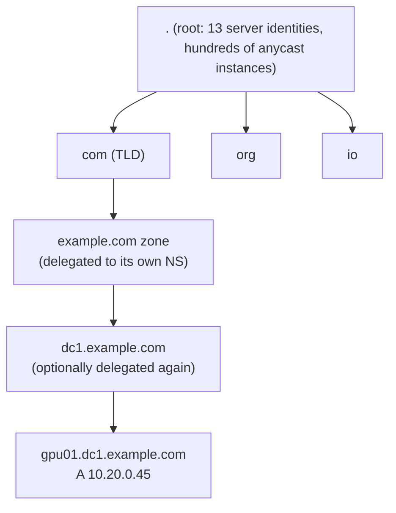
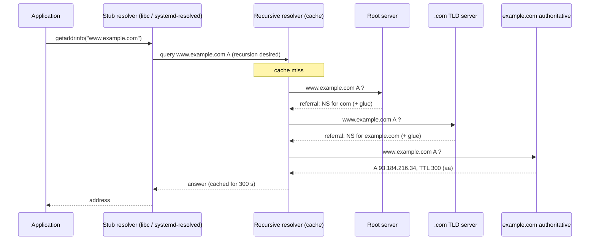
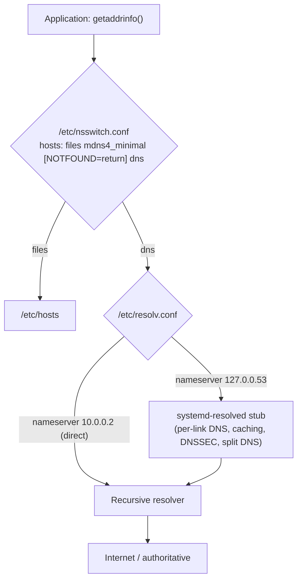
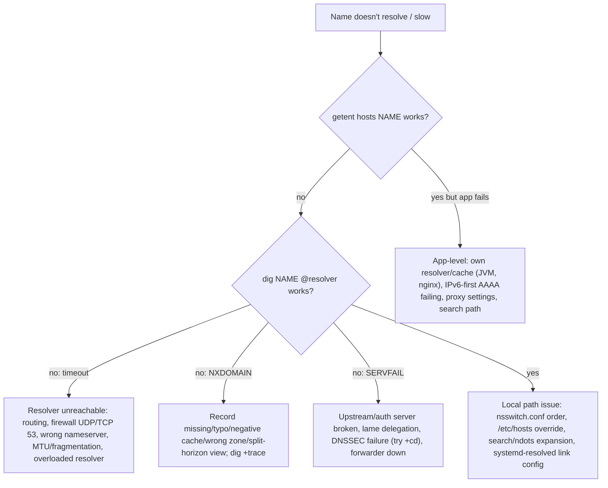

# 2.8 DNS in depth: resolution, records, resolvers and caching

| | |
|---|---|
| Level | Beginner to intermediate |
| Priority tier | 0 |
| Lab venue | Linux VM; optional local BIND/CoreDNS/dnsmasq |
| Part | Part 2: Networking, from first principles to AI fabrics |
| Status | Drafted, labs **untested** |

## Why this matters for AI infrastructure

DNS is the first dependency of nearly everything and the most common hidden cause of outages: "the cluster is slow" turns out to be a 5-second DNS timeout per call; "pods cannot reach the registry" is CoreDNS overloaded or `ndots:5` expanding every lookup into six queries; a multi-node job fails to start because node names do not resolve or resolve to the management NIC rather than the fabric NIC; a cloud endpoint's IP changes and a long-lived process keeps the stale one. DNS also underpins service discovery (Kubernetes services, headless services for StatefulSets, Slurm node names, NCCL/MPI hostfiles), certificate validation (names), and traffic steering (GeoDNS, weighted records, anycast resolvers).

## Prerequisites and outcomes

You should know UDP/TCP (2.6, 2.7) and IP addressing (2.4).

After this chapter you can:

- Explain the DNS hierarchy, zones, delegation, authoritative versus recursive servers, and trace a full resolution (root, TLD, authoritative) including caching and TTLs.
- Read and write the main record types (A, AAAA, CNAME, NS, SOA, MX, TXT, SRV, PTR, CAA, SVCB/HTTPS) and a zone file.
- Use `dig`, `host`, `nslookup`, `getent`, `resolvectl` and know which one tests which resolution path.
- Explain how a Linux host resolves names: `nsswitch.conf`, `/etc/hosts`, `/etc/resolv.conf`, systemd-resolved, stub resolvers, search domains and `ndots`.
- Explain DNS over UDP/TCP, EDNS(0), truncation, DNSSEC, DoT/DoH, negative caching, and common failure modes.
- Debug DNS in Kubernetes (CoreDNS, `ndots`, search path, NodeLocal DNSCache) and in HPC clusters (hostnames, reverse lookups, split horizon).
- Design DNS for a GPU cluster (forward and reverse zones, per-NIC names, service discovery).

## 1. The structure of DNS

DNS maps **names to data** (mostly addresses) using a distributed, hierarchical, replicated database. The namespace is a tree: the root (`.`), top-level domains (`com`, `org`, `io`, country codes), then second-level domains (`example.com`), subdomains (`gpu01.dc1.example.com`). A **fully qualified domain name (FQDN)** ends with a dot (`gpu01.dc1.example.com.`), which marks it as absolute; without it, resolvers may append **search domains**.



- A **zone** is an administrative portion of the tree served by a set of authoritative servers (`example.com` may contain subdomains inside the same zone or delegate them to other zones with NS records). A **domain** is a position in the tree; a zone is a unit of management.
- **Delegation**: a parent zone holds NS records (and glue A/AAAA records when the name servers live inside the delegated zone) that point to the child zone's servers.
- **Authoritative servers** hold the zone data and answer for it (flag `aa`); **recursive resolvers** (caching resolvers, "DNS servers" in `resolv.conf`) do the work of walking the tree on behalf of clients and cache the answers; **stub resolvers** (the libc/systemd-resolved code in each host) just ask a recursive resolver. Keep the roles separate: a server that is both authoritative and open-recursive is a security problem (reflection/amplification).
- **Replication**: a primary (master) holds the editable zone; secondaries (slaves) copy it by **zone transfer** (AXFR full, IXFR incremental) triggered by NOTIFY and governed by the SOA serial number. Modern setups often use API-driven zone management with a provider (Route 53, Cloud DNS) instead.

## 2. How a lookup actually works



Key facts:

- **Iterative vs recursive.** The stub sends one *recursive* query (RD bit); the recursive resolver performs *iterative* queries, following **referrals** down the tree, using its cache of NS records and answers (the root and TLD NS sets are almost always cached, so a typical lookup costs 0 to 1 upstream queries).
- **TTL.** Every record has a time-to-live in seconds; caches may reuse it until it expires. Low TTLs enable fast failover and cost more queries; high TTLs reduce load and delay changes. Plan DNS changes by lowering TTL *before* the change (at least one old-TTL interval earlier).
- **Negative caching**: NXDOMAIN and NODATA answers are cached for the SOA's `minimum`/negative TTL (RFC 2308). A name that was queried before creation can keep failing for minutes after you create it.
- **Transport.** UDP port 53 by default; TCP port 53 for large answers (truncation `TC` bit), zone transfers, and DoT/DoH variants; **EDNS(0)** advertises larger UDP payloads (commonly 1232 bytes recommended to avoid fragmentation) and carries DNSSEC flags. Firewalls that block TCP/53 or fragments break big answers (e.g. DNSSEC, long TXT).
- **Response codes**: `NOERROR` (with or without data), `NXDOMAIN` (name does not exist), `SERVFAIL` (resolver could not get an answer: upstream timeout, DNSSEC failure, lame delegation), `REFUSED` (policy), `FORMERR`.
- **Anycast and latency.** Public resolvers and root servers are anycast; the nearest instance answers. Your latency to your resolver (typically cloud-provided at 169.254.169.254 or the VPC resolver) dominates user-visible DNS cost.

## 3. Resource records

| Type | Purpose | Example |
|---|---|---|
| **A** | IPv4 address | `gpu01  IN A 10.20.0.45` |
| **AAAA** | IPv6 address | `gpu01  IN AAAA 2001:db8::45` |
| **CNAME** | Alias to another name (no other records may coexist at the same name; not allowed at the zone apex) | `www IN CNAME lb.example.com.` |
| **NS** | Name servers for a zone/delegation | `example.com. IN NS ns1.example.com.` |
| **SOA** | Start of authority: primary NS, admin mailbox, serial, refresh, retry, expire, negative TTL | one per zone |
| **MX** | Mail exchanger (priority, host) | `IN MX 10 mail.example.com.` |
| **TXT** | Free text: SPF, DKIM, DMARC, domain verification, ACME challenges | `_acme-challenge IN TXT "..."` |
| **SRV** | Service location: priority, weight, port, target | `_etcd-server-ssl._tcp IN SRV 0 5 2380 etcd1` |
| **PTR** | Reverse mapping (address to name) in `in-addr.arpa` / `ip6.arpa` | `45.0.20.10.in-addr.arpa. IN PTR gpu01.example.com.` |
| **CAA** | Which CAs may issue certificates | `IN CAA 0 issue "letsencrypt.org"` |
| **SVCB / HTTPS** | Service binding: ALPN (h2, h3), ports, IP hints | newer, used by browsers for HTTP/3 |
| **DS / DNSKEY / RRSIG / NSEC(3)** | DNSSEC chain-of-trust material | section 8 |
| **ALIAS/ANAME** | Provider-specific "CNAME at the apex" | Route 53 alias, Cloudflare flattening |

A minimal zone file:

```text
$ORIGIN dc1.example.com.
$TTL 300
@        IN SOA ns1.dc1.example.com. hostmaster.example.com. (
                2026102301 ; serial (YYYYMMDDnn)
                3600       ; refresh
                600        ; retry
                1209600    ; expire
                300 )      ; negative TTL
         IN NS  ns1
         IN NS  ns2
ns1      IN A   10.20.0.10
ns2      IN A   10.20.0.11
gpu01    IN A   10.20.0.45
gpu01-ib IN A   10.100.0.45      ; per-NIC names for fabric interfaces
gpu01    IN AAAA 2001:db8:20::45
login    IN CNAME gpu-login01
_slurmctld._tcp IN SRV 0 0 6817 slurm-ctl
```

**Round-robin DNS.** Multiple A records for the same name are returned in rotating order; clients typically try the first. It is crude load distribution without health checks. Production uses health-checked records (cloud DNS routing policies), anycast, or a load balancer instead (chapter 2.20).

**Reverse DNS** maps an address to a name. It matters more than people expect: SSH and mail servers may do reverse lookups, MPI/Slurm/Kerberos/NFS sometimes require forward and reverse to agree (**forward-confirmed reverse DNS**), logs are friendlier with names, and timeouts in reverse lookups cause slow logins (`UseDNS` in sshd, `UseDNS no`). Reverse zones follow the octet-reversed form (`0.20.10.in-addr.arpa`); delegation is on prefix boundaries (/8, /16, /24; classless delegation for smaller via CNAME tricks).

## 4. Tools: `dig` and friends

```bash
dig www.example.com                      # A record via the resolver in /etc/resolv.conf; shows the full response
dig +short www.example.com AAAA
dig @8.8.8.8 www.example.com             # ask a specific server
dig +trace www.example.com               # follow the delegation chain from the root yourself (bypass caches)
dig +norecurse @a.root-servers.net com NS   # act like a resolver
dig -x 10.20.0.45                        # reverse lookup
dig example.com SOA +multi ; dig example.com NS ; dig example.com ANY    # ANY is often refused today
dig +tcp example.com TXT                 # force TCP
dig +dnssec example.com                  # request DNSSEC records (look for ad flag for validated)
dig +noall +answer +stats www.example.com   # compact with query time and server
dig +nsid @resolver name                 # identify which anycast instance answered
dig AXFR example.com @ns1                # zone transfer (only if allowed)
host www.example.com ; nslookup www.example.com                # simpler tools
getent hosts www.example.com             # what applications get: follows nsswitch.conf (files, dns, mdns...)
resolvectl query www.example.com         # systemd-resolved's view, per-link DNS, shows which interface/server answered
resolvectl status                        # per-interface DNS servers and search domains
```

Reading `dig` output: the **header** (`status: NOERROR`, flags `qr rd ra aa tc ad`, counts), the **question**, **answer** (name, TTL remaining, class IN, type, data), **authority** and **additional** sections, and the footer (query time, server, message size). Flags: `aa` authoritative answer, `ra` recursion available, `tc` truncated (retry over TCP), `ad` authenticated data (DNSSEC validated by the resolver). A **repeated query's TTL counts down** if served from a cache, which is a quick way to tell cached versus fresh.

**Important distinction**: `dig` and `nslookup` talk DNS directly to the server you specify (or the first in `resolv.conf`) and **bypass `/etc/hosts`, nsswitch, the search path logic of libc, and NSS modules**; `getent hosts` and `ping`/`curl` go through the C library the way your application does. When "dig works but the application fails" (or vice versa), compare `dig` with `getent hosts`, and check `nsswitch.conf`, search domains, and which resolver the app uses (Go, Java and musl-based images have their own behaviour).

## 5. How a Linux host resolves names



- **`/etc/nsswitch.conf`**: order of sources for `hosts:` (`files` = `/etc/hosts`, `dns`, `myhostname`, `resolve` for systemd-resolved, `mdns4_minimal` multicast DNS for `.local`). Changing it affects every libc-based program.
- **`/etc/hosts`**: static mappings, first match wins per line; use for loopback (`127.0.0.1 localhost`), the host's own name, and a few bootstrap entries; do not use it as a cluster-wide database (use DNS or configuration management). A classic Debian quirk: `127.0.1.1 hostname` makes the host resolve its own name to loopback, breaking MPI and Kerberos assumptions.
- **`/etc/resolv.conf`**: `nameserver` (up to 3 used), `search` (domains appended to unqualified names), `domain`, and `options` (`ndots:N`, `timeout:`, `attempts:`, `rotate`, `edns0`). Often a symlink managed by systemd-resolved (`/run/systemd/resolve/stub-resolv.conf`), NetworkManager, `resolvconf` or cloud-init; hand edits are overwritten, so configure the manager instead (netplan `nameservers`, `nmcli`, `resolved.conf`).
- **systemd-resolved** provides a local stub at 127.0.0.53 with a cache, per-interface DNS servers and routing domains (**split DNS**: send `corp.example.com` to the VPN's resolver and the rest to the default), LLMNR/mDNS, and DNSSEC/DoT support. `resolvectl status/query/statistics/flush-caches` inspect it; `/etc/systemd/resolved.conf` configures it.
- **Search domains and `ndots`.** With `search dc1.example.com example.com` and `ndots:1` (glibc default), the name `gpu01` is tried as `gpu01.dc1.example.com`, then `gpu01.example.com`, then `gpu01.`; names with at least `ndots` dots are tried as absolute names *first*. A trailing dot (`gpu01.dc1.example.com.`) always means absolute and skips the search list. Each failed expansion costs a query and its latency.
- **Timeouts**: the glibc default is 5 s per attempt, 2 attempts, per nameserver: one dead resolver at the front of the list yields 5 to 10 s stalls for every lookup. Mitigate with `options timeout:1 attempts:2 rotate`, or a local caching resolver (systemd-resolved, dnsmasq, unbound) which fails over quickly.
- **Caching**: glibc does **not** cache (unless `nscd`/`nscd`-like or `systemd-resolved`); long-running programs may cache themselves (JVM caches positive lookups per `networkaddress.cache.ttl`, forever by default under a security manager; Go caches nothing but resolves per call; nginx resolves upstream names **only at startup** unless you use a variable plus `resolver`). Know your application's behaviour before relying on DNS failover.

### Hostnames

The system hostname is stored in `/etc/hostname` (set with `hostnamectl set-hostname`); the FQDN should resolve (`hostname -f`) to the host's primary address. Cloud images (GCP) set names via DHCP/metadata and an internal DNS zone (`<instance>.<zone>.c.<project>.internal`). Clusters should have predictable names (`gpu-rack03-node07`) because Slurm node definitions, MPI hostfiles, monitoring labels and certificates depend on them.

## 6. DNS in Kubernetes and containers

Inside a pod, `/etc/resolv.conf` is generated by the kubelet:

```text
search my-ns.svc.cluster.local svc.cluster.local cluster.local dc1.example.com
nameserver 10.96.0.10
options ndots:5
```

- The nameserver is the **CoreDNS** service (`kube-dns`), which resolves `<service>.<namespace>.svc.cluster.local` to ClusterIPs (or pod IPs for **headless** services, used by StatefulSets and distributed training frameworks: `worker-0.trainer.ns.svc.cluster.local`), and forwards everything else to the node's upstream resolvers.
- **`ndots:5`** means any name with fewer than five dots is first tried through every search domain: a lookup for `api.example.com` (2 dots) generates `api.example.com.my-ns.svc.cluster.local`, `...svc.cluster.local`, `...cluster.local`, `...dc1.example.com` (each NXDOMAIN) *before* the real query: 5 queries (times A and AAAA), which overloads CoreDNS and adds latency (plus conntrack/UDP races leading to the infamous 5-second delays on older kernels). Fixes: use FQDNs with a trailing dot in hot paths, set `dnsConfig.options: ndots: 1` or 2 per pod, deploy **NodeLocal DNSCache** (a per-node cache on a link-local IP, avoiding conntrack and cross-node hops), scale CoreDNS (autoscaler, more replicas), and tune the `cache` and `forward` plugins.
- Debugging: `kubectl exec pod -- cat /etc/resolv.conf`; `kubectl run -it --rm dnsutils --image=registry.k8s.io/e2e-test-images/jessie-dnsutils -- sh` then `dig`/`nslookup`; `kubectl logs -n kube-system -l k8s-app=kube-dns`; check CoreDNS `Corefile` (`kubectl -n kube-system get cm coredns -o yaml`), its metrics (`coredns_dns_requests_total`, `coredns_dns_responses_total{rcode}`, latency histograms), and that the nodes' own resolvers work.
- **Docker/Podman** containers copy or proxy the host's resolvers; custom networks have an embedded DNS at 127.0.0.11 that resolves container names.
- **Alpine/musl** historically did not support search lists and TCP fallback the same way as glibc and had different `ndots`/parallel behaviour; behaviour differs by image and version, so test inside the actual image.

## 7. DNS in HPC and AI clusters

- Slurm resolves node names (NodeName/NodeAddr in `slurm.conf`) and, by default, requires forward lookups to match (`SlurmctldHost`, `NodeHostname`); use `NodeAddr` to bind jobs to a specific interface (e.g. the fabric network) and keep a consistent naming scheme with per-NIC names (`gpu01`, `gpu01-ib0`, `gpu01-mgmt`).
- MPI/NCCL launchers resolve hostnames from a hostfile; if a name resolves to the management NIC while the data should use the fabric NIC, bootstrap traffic uses the wrong network; set `NCCL_SOCKET_IFNAME`/`NCCL_IB_HCA` explicitly rather than relying on names.
- Reverse DNS for all node IPs (management and, where used, fabric); missing PTR records cause multi-second stalls in tools that do reverse lookups (`sshd` `UseDNS`, NFS exports with hostnames, Kerberos).
- Split-horizon DNS: internal names resolve to private addresses internally and to public addresses externally (separate views/zones), common for cloud and VPN setups.
- Use **configuration management** (Ansible, chapters Part 4) to generate `/etc/hosts` for tiny bootstrap sets and to render zone files or cloud DNS records from inventory so DNS never drifts from reality.
- Cloud DNS integrations: GCP Cloud DNS (public/private zones, forwarding, peering, response policies) and the metadata-server resolver 169.254.169.254; AWS Route 53 Resolver; in Kubernetes **ExternalDNS** syncs service/ingress hostnames to a DNS provider.

## 8. Security: DNSSEC, DoT/DoH, and abuse

- **DNSSEC** adds origin authentication and integrity: zones are signed (RRSIG over each RRset using the zone's DNSKEY), parents publish a **DS** record for the child's key, forming a chain of trust to the root's trust anchor. A validating resolver sets the `ad` flag on verified answers or returns SERVFAIL on failures. It does not encrypt, and operational mistakes (expired signatures, DS/key mismatches during rollover) cause outages for validating users: automate signing and rollovers.
- **DoT/DoH** encrypt the stub-to-resolver hop (TCP/853 and HTTPS). Useful on untrusted networks; inside a data centre mostly unnecessary but supported by systemd-resolved (`DNSOverTLS=`).
- **Abuse**: cache poisoning (mitigated by source-port and query-ID randomisation, DNSSEC), open resolvers for **amplification** DDoS (restrict recursion to your networks, rate-limit responses), DNS tunnelling for exfiltration (monitor volume, long labels, TXT), dangling CNAMEs enabling subdomain takeover, and DNS rebinding (resolvers can filter private answers). Use response policy zones (RPZ) or provider threat-blocking where appropriate.
- Protect zone data: restrict AXFR to secondaries (TSIG-authenticated), separate authoritative and recursive roles, and keep software patched (BIND, Unbound, CoreDNS).

## 9. Running your own DNS

Typical choices: **BIND 9** (authoritative + recursive, views, DNSSEC, the reference), **Unbound** (validating recursive resolver, small and secure), **dnsmasq** (small DNS forwarder + DHCP for labs), **CoreDNS** (plugin-based, Kubernetes default), **PowerDNS** (authoritative with SQL backends and API), cloud-managed (Route 53, Cloud DNS). A recursive caching resolver per site/rack, with forwarders to the corporate or cloud resolvers, reduces latency and shields upstreams. Operate them like any service: redundancy (at least two, on different failure domains), monitoring (query rate, latency, SERVFAIL ratio, cache hit rate), logging policy (privacy), and a tested change process.

Example `dnsmasq` for a lab/cluster:

```text
# /etc/dnsmasq.d/cluster.conf
domain=cluster.lab
local=/cluster.lab/
expand-hosts
no-resolv
server=8.8.8.8
address=/gpu01.cluster.lab/10.20.0.45
host-record=gpu02.cluster.lab,10.20.0.46
ptr-record=45.0.20.10.in-addr.arpa,gpu01.cluster.lab
```

## 10. Diagnosing DNS problems



Practical routine:

1. `getent hosts NAME` vs `dig NAME` vs `resolvectl query NAME`: which agree?
2. `dig +trace NAME` to test the authoritative chain independent of caches; `dig @auth-ns NAME` to test each authoritative server (inconsistent answers mean a broken secondary: compare SOA serials).
3. `dig +tcp`, check EDNS size issues (`+bufsize=512` vs `1232`, `+ignore`), firewall allows UDP and TCP 53 and fragments.
4. Check latency: `dig +stats`, `resolvectl statistics`, repeat to see cache effect; `tcpdump -ni any port 53` shows retries, timeouts, and search-domain expansion.
5. Kubernetes: pod `resolv.conf`, CoreDNS logs/metrics, NodeLocal DNSCache, ndots.
6. Time-related: expired DNSSEC signatures, TTL not yet expired, negative caching; `rndc flush`/`resolvectl flush-caches`/`unbound-control flush` only after you know why.

## 11. Case study: "random 5-second delays" in a GPU inference cluster

An inference service calling `https://models.internal.example.com` from pods occasionally stalled for exactly 5 s. `tcpdump` on the node showed two UDP queries (A and AAAA) sent from the same source port within microseconds; the AAAA query was lost in the node's conntrack because of a race on parallel same-5-tuple UDP flows through NAT (a known kernel behaviour fixed in newer kernels), and the stub retried after the default 5 s timeout. Remediation: `dnsConfig.options: [{name: single-request-reopen}]` (or `use-vc`) as a short-term fix; NodeLocal DNSCache to bypass conntrack for DNS; upgrade the kernel; reduce `ndots`; and add a dashboard on `coredns` latency and the node's `nf_conntrack` insert-failed counters. The lesson: DNS problems often appear as "exactly N seconds" delays: the number is a resolver timeout (5 s glibc) multiplied by retries; match the number to a timer to find the layer.

## 12. Hands-on lab: DNS from both sides

First, run the self-checking Python lab (`code/part02/dns_in_depth_lab.py`) locally. It verifies `resolv.conf` search-domain and `ndots` (`ndots=5` vs `ndots=2` vs trailing dot `.`) query expansion, IPv4 `in-addr.arpa` reverse-DNS name construction (`45.0.20.10.in-addr.arpa.`), glibc dead-nameserver failover delay (`5 s` / `10 s`), and RFC 1034 `CNAME` apex/coexistence rules.

```bash
python3 code/part02/dns_in_depth_lab.py
```

Next, on a disposable Linux VM (all interactive VM commands below are `untested here`), work through these steps:

1. **Observe a full resolution**: `dig +trace www.example.com`; label each referral; then `dig www.example.com` twice and watch the TTL decrease (cache); `dig +norecurse` against your resolver.
2. **Tool differences**: add a bogus entry to `/etc/hosts` for a real name; compare `dig`, `getent hosts`, `ping`, `curl`; change `nsswitch.conf` order temporarily (in a VM) and re-test.
3. **Search domains/ndots**: set `search` and `ndots` options in a test `resolv.conf` (using `RES_OPTIONS` or a namespace with its own `/etc/netns/<ns>/resolv.conf`); watch the queries with `tcpdump port 53` for `curl http://short-name` and for an FQDN with and without a trailing dot.
4. **Timeouts**: put a dead nameserver first; time `getent hosts`; use `options timeout:1 attempts:1`; compare with systemd-resolved.
5. **Local authoritative server**: install BIND or dnsmasq in a namespace/VM; create the zone above; serve forward and reverse; test with `dig @server`; add a secondary and observe AXFR/NOTIFY and serial behaviour.
6. **TTL and negative caching**: query a missing name, create it, query again before/after the negative TTL.
7. **Truncation**: create a TXT record > 512 bytes; query with `+bufsize=512 +ignore` and `+tcp`; see the `tc` flag.
8. **Kubernetes** (kind/minikube): inspect pod `resolv.conf`; measure query counts for an external name with ndots 5 vs 2; deploy NodeLocal DNSCache or compare using FQDN with trailing dot; read CoreDNS metrics.
9. **systemd-resolved split DNS**: `resolvectl dns eth0 ...`, `resolvectl domain eth0 ~corp.example.com`, verify routing with `resolvectl query`.
10. **DNSSEC**: `dig +dnssec +multi example.com DNSKEY`; query a deliberately broken signed domain (e.g. a public test domain you trust) with `+cd` and without to see SERVFAIL vs answer.
11. **Clean up**.

## 13. Common mistakes

- Testing only with `dig` (bypasses `/etc/hosts`, nsswitch, search path) and concluding DNS is fine.
- Editing a managed `/etc/resolv.conf` by hand; running two managers fighting over it.
- A dead first nameserver (multi-second delays on every lookup); too many search domains; ignoring `ndots` in Kubernetes.
- Forgetting negative caching and long TTLs when changing records; not lowering TTL before migrations.
- CNAME at the apex or alongside other records; trailing-dot mistakes in zone files (`ns1.example.com` without a dot becomes `ns1.example.com.example.com.`).
- Forgetting to increment the SOA serial so secondaries never update.
- Blocking TCP/53 or fragments; MTU and EDNS size issues causing intermittent failures for big answers.
- Missing reverse records for nodes; hostnames resolving to loopback or the wrong NIC.
- Caches in applications (JVM, nginx upstream) making DNS failover ineffective.
- Running an open recursive resolver on the Internet.

## 14. Interview angles

- "What happens when you type a URL in the browser? Focus on DNS." (Stub, recursive, root/TLD/auth, caching, TTL.)
- "Difference between recursive and authoritative servers? Between a zone and a domain?"
- "Why can't you put a CNAME at the zone apex?" (SOA/NS must coexist; CNAME excludes other records; use ALIAS/ANAME.)
- "A Kubernetes pod resolves slowly. What are the usual causes?" (ndots, CoreDNS load, conntrack race, NodeLocal DNSCache.)
- "`dig` works, but `curl` fails by name. Why?" (nsswitch/hosts/search/IPv6/proxy.)
- "How do you migrate a service to a new IP with minimal downtime?" (Lower TTL ahead, switch, wait, restore TTL.)
- "What does `SERVFAIL` mean? How do you find the cause?" (+trace, check DNSSEC, lame delegation.)
- "Explain DNSSEC in two minutes."
- "How would you design DNS for a 1,000-GPU cluster with several networks per node?"

## Exercises

1. **DNS Hierarchy, Zone vs. Domain, Delegation + Glue, and Iterative vs. Recursive Lookup:** (a) Distinguish a DNS **domain** from a DNS **zone**, and explain why a parent zone must include **glue** `A`/`AAAA` records when delegating `example.com.` to `ns1.example.com.`; (b) trace the messages exchanged between an application, its local **stub resolver**, a **recursive resolver**, and the `.` (root), `.com` (TLD), and `example.com` **authoritative** servers on a cold cache.
2. **Resource Records, the `CNAME` Apex Rule, and Reverse `PTR` Lookups:** (a) Using `validate_cname_placement()` in `code/part02/dns_in_depth.py`, explain why a `CNAME` record is illegal at the zone apex (`@`) and cannot coexist with `SOA`, `NS`, `MX`, or `TXT` records at the same owner name; (b) using `ipv4_to_in_addr_arpa()`, construct the reverse `PTR` owner name for `10.20.0.45`, and list four cluster services that stall or fail when reverse DNS is broken.
3. **`dig` vs. `getent hosts` vs. `resolvectl` and the Linux Host Resolution Path:** Explain why `dig www.example.com` can return the right IP immediately while `curl https://www.example.com/` on the same host connects to the wrong IP or stalls for 5 seconds. Trace the exact files and daemons consulted by `getaddrinfo()`.
4. **Search Domains, `ndots:5` Query Multiplication, and Trailing Dots:** Given `search my-ns.svc.cluster.local svc.cluster.local cluster.local dc1.example.com`, use `expand_dns_search_candidates()` to list the exact sequence of names queried for `api.example.com` when `ndots:5` (Kubernetes default) versus `ndots:2`, and when a trailing dot (`api.example.com.`) is used.
5. **The 5-Second DNS Delay Case Study, Conntrack UDP Races, and `NodeLocal DNSCache`:** Walk through the root cause of the "random 5-second delays" in Section 11 (`A` and `AAAA` UDP queries from the same socket source port racing in `nf_conntrack` DNAT + glibc's `5 s` `timeout` from `compute_resolver_failover_delay_sec()`), and state four concrete mitigations (`NodeLocal DNSCache`, `single-request-reopen` / `use-vc`, `ndots`, kernel upgrade).
6. **Designing Cluster DNS for 1,000 Multi-NIC GPU Nodes and Zero-Downtime Migrations:** (a) Design the forward and reverse naming convention for a GPU node with management (`10.20.0.45`), storage (`10.30.0.45`), and 8 InfiniBand/RoCE interfaces (`10.100.0..7.45`), explaining why Debian's `127.0.1.1 hostname` line in `/etc/hosts` breaks MPI and Slurm; (b) write the 4-step procedure to migrate a production endpoint IP with minimal downtime when its current `TTL` is `3600` seconds.

## Checkpoint questions (20)

<details>
<summary>1. What is the difference between a DNS domain and a DNS zone, and what is a Fully Qualified Domain Name (`FQDN`)?</summary>
A **domain** is any complete subtree of the global DNS namespace (e.g., everything under `example.com`), whereas a **zone** is a specific administrative slice of that tree hosted on a set of authoritative nameservers (for example, `dc1.example.com` may be delegated into its own separate zone). An **FQDN** ends with a trailing dot (`gpu01.dc1.example.com.`), marking it as an absolute path to the DNS root (`.`) and preventing resolvers from appending `search` suffixes.
</details>

<details>
<summary>2. What are `NS` delegation records and \"glue\" records, and why are glue records necessary?</summary>
A parent zone (such as `.com`) delegates authority for a child zone (`example.com.`) by publishing `NS` records pointing to the child's authoritative nameservers (`ns1.example.com.`). When a nameserver's own hostname sits **inside the zone it serves** (*in-bailiwick*), a resolver would face a circular dependency trying to resolve `ns1.example.com.`; **glue records** are the `A`/`AAAA` addresses for `ns1.example.com.` returned directly by the parent zone in the referral's Additional section.
</details>

<details>
<summary>3. Contrast a Stub Resolver, a Recursive Resolver, and an Authoritative Nameserver.</summary>
- **Stub resolver**: the lightweight client library inside each OS (`glibc` `getaddrinfo()` / `systemd-resolved` at `127.0.0.53`) that forwards recursive queries (`RD` bit set) to a configured nameserver.\n- **Recursive (caching) resolver**: the workhorse server (`Unbound`, `CoreDNS`, `BIND`, cloud VPC resolver) that walks the DNS tree iteratively from root -> TLD -> authoritative server on the client's behalf and caches answers for their `TTL`.\n- **Authoritative nameserver**: holds the ground-truth zone records and answers queries for its zones with the **`aa`** (*Authoritative Answer*) flag set.
</details>

<details>
<summary>4. How do positive `TTL` caching and negative caching (`RFC 2308`) work, and how do you migrate a service IP cleanly?</summary>
Every resource record carries a **TTL** in seconds telling recursive resolvers how long they may serve the cached record. Under **RFC 2308 negative caching**, `NXDOMAIN` (name does not exist) and `NODATA` responses are also cached for the duration of the zone `SOA` record's **negative TTL (`minimum`)** field—so querying a hostname *before* creating its DNS record will cache the failure for minutes. Before migrating an IP, lower the record's TTL (e.g., from `3600 s` to `60 s`) **at least one full old-TTL (`3600 s`) in advance**, switch the IP, verify, and raise the TTL back.
</details>

<details>
<summary>5. Why does DNS use both UDP port 53 and TCP port 53, and what does `EDNS(0)` (`1232` bytes) do?</summary>
Standard DNS queries use **UDP port 53** for single-RTT low overhead. Classic DNS capped UDP responses at **`512` bytes**; **`EDNS(0)`** (`RFC 6891`) lets the client advertise a larger UDP buffer (commonly **`1232` bytes** to stay safely below IPv6/tunnel fragmentation limits) and carries DNSSEC flags. If a response still exceeds the UDP limit, the server sets the **`TC` (*Truncated*) flag**, and the client automatically retries the query over **TCP port 53** (which is also used for `AXFR`/`IXFR` zone transfers). Blocking `TCP/53` in a firewall breaks large TXT, SRV, and DNSSEC responses.
</details>

<details>
<summary>6. Match the DNS response codes `NOERROR`, `NXDOMAIN`, `SERVFAIL`, and `REFUSED` to their meanings.</summary>
- **`NOERROR`**: query succeeded (either returning matching records in the Answer section, or `0` answers = **NODATA** when the name exists for other record types).\n- **`NXDOMAIN`**: the queried domain name does not exist in the zone.\n- **`SERVFAIL`**: the recursive resolver failed to obtain a valid answer (all authoritative servers timed out, lame delegation, or **DNSSEC signature validation failed**).\n- **`REFUSED`**: the server refused the query by policy (e.g., querying a non-recursive authoritative server for an outside domain, or unauthorized `AXFR`).
</details>

<details>
<summary>7. Why is a `CNAME` record forbidden at the zone apex (`@`), and how do cloud DNS providers work around it?</summary>
Per RFC 1034 / RFC 2181, a **`CNAME` record cannot coexist with any other record type at the same owner name** (except DNSSEC `RRSIG`/`NSEC`). Because the zone apex (`example.com.`) **must** contain `SOA` and `NS` records, placing a `CNAME` at `@` is illegal and breaks zone delegation/mail. Cloud providers work around this with synthetic records (**`ALIAS`**, **`ANAME`**, or **CNAME flattening**) or standardized **`SVCB` / `HTTPS`** records that resolve the target's `A`/`AAAA` addresses at the authoritative server.
</details>

<details>
<summary>8. Explain the fields of an `SOA` record and an `SRV` record (`_slurmctld._tcp IN SRV 0 0 6817 slurm-ctl`).</summary>
An **`SOA`** (*Start of Authority*) record contains: primary master NS, admin email (`@` written as `.`), **serial number** (e.g., `2026102301`, which **must be incremented** on every edit so secondaries know to transfer the updated zone via `AXFR`/`IXFR`), refresh timer, retry timer, expire timer, and negative-caching TTL. An **`SRV`** record (`_service._proto.name`) specifies `priority`, `weight`, **`port` (`6817`)**, and **`target` hostname (`slurm-ctl`)**, allowing clients like Slurm or `etcd` to discover both host and port via DNS.
</details>

<details>
<summary>9. How is IPv4 and IPv6 Reverse DNS structured (`in-addr.arpa` and `ip6.arpa`), and why does missing Reverse DNS cause slow SSH or job startup?</summary>
Reverse DNS maps an IP address back to a canonical hostname using **`PTR`** records stored under the reversed-octet tree **`in-addr.arpa`** for IPv4 (`10.20.0.45` -> **`45.0.20.10.in-addr.arpa.`**) and nibble-reversed **`ip6.arpa`** for IPv6. Services that perform reverse or forward-confirmed reverse lookups on incoming connections (`sshd` when `UseDNS yes`, NFS hostname exports, Kerberos, Slurm/MPI) stall for 5–10 seconds waiting for `PTR` queries to time out if reverse zones are unconfigured.
</details>

<details>
<summary>10. Why can `dig www.example.com` succeed while `curl https://www.example.com/` or `ping` fails to resolve on the same Linux machine?</summary>
`dig` (and `nslookup` / `host`) speaks the DNS wire protocol directly to the nameserver in `/etc/resolv.conf`, **completely bypassing the C library (`getaddrinfo`), `/etc/nsswitch.conf`, `/etc/hosts`, `systemd-resolved` D-Bus APIs, and `search`/`ndots` rules**. Always test the actual application resolution path using **`getent hosts <name>`** (or `getent ahosts <name>`).
</details>

<details>
<summary>11. Trace how `/etc/nsswitch.conf`, `/etc/hosts`, `/etc/resolv.conf`, and `systemd-resolved` (`127.0.0.53`) work together on Ubuntu/RHEL.</summary>
When an application calls `getaddrinfo()`, `glibc` reads the `hosts:` line in `/etc/nsswitch.conf` (`files mdns4_minimal [NOTFOUND=return] resolve [UNAVAIL=return] dns`). It checks `/etc/hosts` (`files`) first, then queries **`systemd-resolved`** (via NSS `resolve` or the local stub listener at **`127.0.0.53`** in `/etc/resolv.conf`), which checks its local cache and routes the query to the appropriate per-interface upstream DNS server (**split DNS**).
</details>

<details>
<summary>12. How do `search` domains and `ndots` in `/etc/resolv.conf` interact, and what happens if the first `nameserver` in `/etc/resolv.conf` is dead?</summary>
If a queried name without a trailing dot contains **fewer than `ndots` dots**, the stub resolver appends each domain in `search` one by one before trying the bare name; if it has **`>= ndots` dots**, it tries the bare name first. Because `glibc`'s default timeout is **`5` seconds per attempt** (`options timeout:5 attempts:2`), a dead first `nameserver` in `/etc/resolv.conf` adds a **`5` to `10` second delay** to every uncached lookup before failing over to the second `nameserver` (mitigate with `options timeout:1 attempts:2 rotate` or a local caching stub).
</details>

<details>
<summary>13. How do `glibc`, the JVM, Go, and `nginx` differ in how they cache DNS lookups in user space?</summary>
- **`glibc`**: performs **zero caching** inside the process (every `getaddrinfo()` call asks the OS stub/files).
- **JVM (Java)**: caches positive lookups internally per `networkaddress.cache.ttl` (historically caching forever under a SecurityManager if not configured).
- **Go**: resolves per connection attempt without an internal cache.
- **Open-source `nginx`**: resolves upstream hostnames in `proxy_pass http://backend;` **only once at startup/reload** unless configured with a `resolver` directive and a variable.
</details>

<details>
<summary>14. Why does Kubernetes default Pod `/etc/resolv.conf` to `ndots:5`, and how does that overload CoreDNS?</summary>
Kubernetes sets `ndots:5` so multi-segment in-cluster service names like `svc.namespace` or `pod.svc.namespace.svc` (`1` to `3` dots `< 5`) match the pod's `search` list (`<ns>.svc.cluster.local svc.cluster.local cluster.local`). The side effect is that every external lookup like `s3.us-west-2.amazonaws.com` (`3` dots `< 5`) generates **4 search-domain expansions x 2 (`A` + `AAAA`) = 8 `NXDOMAIN` queries** to CoreDNS before the real query is sent.
</details>

<details>
<summary>15. What is a Kubernetes Headless Service (`clusterIP: None`), and how do distributed PyTorch / StatefulSet jobs use it?</summary>
A normal Kubernetes `Service` allocates a single virtual `ClusterIP` and load-balances connections across pods. A **Headless Service (`clusterIP: None`)** allocates no VIP; instead, CoreDNS returns the individual Pod IPs directly and creates a deterministic **`A`/`AAAA` record for each Pod**: **`<pod-name>.<service-name>.<namespace>.svc.cluster.local`** (e.g., `worker-0.pytorch-job.train.svc.cluster.local`), which `torchrun` and MPI use for rank-0 rendezvous and peer discovery.
</details>

<details>
<summary>16. Explain the Linux conntrack UDP race that caused \"random 5-second DNS delays\" in Kubernetes Pods and how `NodeLocal DNSCache` fixes it.</summary>
When a Pod sent parallel `A` and `AAAA` UDP queries from the **same socket (same 5-tuple)** at the exact same microsecond to the `kube-dns` Service `ClusterIP` (`10.96.0.10`), both packets raced in `nf_conntrack` DNAT table insertion; the losing packet was dropped, forcing the stub resolver to wait **`5.0` seconds** before retrying. **`NodeLocal DNSCache`** runs a lightweight caching agent on every node bound to a link-local IP with `NOTRACK` iptables rules—serving cache hits locally in sub-millisecond time, bypassing `conntrack`/DNAT, and upgrading upstream misses to TCP.
</details>

<details>
<summary>17. Why is Debian/Ubuntu's `/etc/hosts` entry `127.0.1.1 <hostname>` a trap on HPC and GPU clusters?</summary>
When a node resolves its own hostname via `getaddrinfo()` and gets `127.0.1.1` (loopback) instead of its real cluster/fabric IP, distributed launchers (`Slurm`, `OpenMPI`, `NCCL`, `Ray`, `Gloo`) advertise `127.0.1.1` to peer nodes—which then try to connect to *themselves* on loopback and fail. Always map the node's hostname to its real management IP and provide explicit per-network hostnames (`gpu01-mgmt`, `gpu01-ib0`).
</details>

<details>
<summary>18. How does `DNSSEC` verify record authenticity (`DNSKEY`, `RRSIG`, `DS`, `ad` flag), and why does a broken DNSSEC config return `SERVFAIL`?</summary>
In **DNSSEC**, each zone signs its resource record sets (`RRset`s) with a private key, publishing the signature in an **`RRSIG`** record and the public key in a **`DNSKEY`** record; the parent zone publishes a cryptographic hash of the child's key in a **`DS` (*Delegation Signer*)** record, chaining trust up to the root (`.`). When a validating resolver verifies the chain, it sets the **`ad` (*Authenticated Data*)** flag; if a signature is expired or tampered with, the validating resolver refuses to return the unverified data and returns **`SERVFAIL`** (bypass validation during debugging with **`dig +cd`** *Checking Disabled*).
</details>

<details>
<summary>19. Compare `DNSSEC` with `DoT` (*DNS over TLS*) and `DoH` (*DNS over HTTPS*).</summary>
**`DNSSEC`** provides **origin authentication and data integrity** (proving records were not forged), but **does not encrypt** queries (anyone on the wire can read what name you asked for). **`DoT`** (`TCP port 853`) and **`DoH`** (`HTTPS port 443`, `RFC 8484`) **encrypt the transport channel** between the stub resolver and the recursive resolver for privacy against on-path eavesdroppers, but do not by themselves prove that the upstream zone data was signed unless combined with DNSSEC.
</details>

<details>
<summary>20. How do you verify whether all authoritative nameservers for a zone are synchronized?</summary>
First list the zone's authoritative nameservers with `dig +short example.com NS`, then query the **`SOA` record** directly from each authoritative server (`dig +norecurse @ns1.example.com example.com SOA` and `dig +norecurse @ns2.example.com example.com SOA`) and verify that their **SOA serial numbers** match.
</details>

## Sources and review notes

- **Sources read in full:**
  - `how-linux-works-3rd-edition` — Brian Ward, *How Linux Works*, 3rd ed., **Chapter 9: Understanding Your Network and Its Configuration** (section *Resolving Hostnames*: `/etc/hosts`, `resolv.conf`, caching and zero-configuration DNS, `/etc/nsswitch.conf`, and the `host` tool) and **Chapter 10: Network Applications and Services**.
  - `computer-networking-problems-and-solutions` — Russ White and Ethan Banks, *Computer Networking Problems and Solutions*, **Chapter 5: Higher Layer Data Transports** (addressing, multiplexing, and transport considerations for name resolution) and **Chapter 6: Interlayer Discovery** (DNS centralized mapping database).
  - `networking-and-kubernetes` — James Strong and Vallery Lancey, *Networking and Kubernetes*, **Chapters 1, 2, and 4** (DNS walkthrough, `dig` EDNS, CoreDNS, `ndots:5` search path, and headless services).
- **Run here:** `python3 code/part02/dns_in_depth_lab.py` (14 passed, 0 failed).
- **Explicitly labelled inferences:** The Section 3 `dc1.example.com` GPU cluster zone file (`gpu01-ib`, `_slurmctld._tcp` SRV), Section 9 `dnsmasq` cluster snippet, Section 10 diagnostic flowchart, and Section 11 5-second Kubernetes conntrack DNS race case study synthesize RFCs 1034, 1035, 2308, 4034, 6891, 7766, and 8484 (DoH) and the documentation of BIND, Unbound, CoreDNS, and `systemd-resolved` (cross-referenced with Chapters 2.1, 2.4, 2.6, 2.7, and 2.20, plus original study items 21, 22, 23, 24, 25, 26, 27, 28, 29, 30, 31, 32, 33, 34, and 35).
- **Not verified on live hardware:** All interactive VM and Kubernetes commands (`dig`, `host`, `nslookup`, `getent`, `resolvectl`, `tcpdump port 53`, `kubectl`) are marked (untested here) and must be executed on a disposable Linux VM or test cluster.
