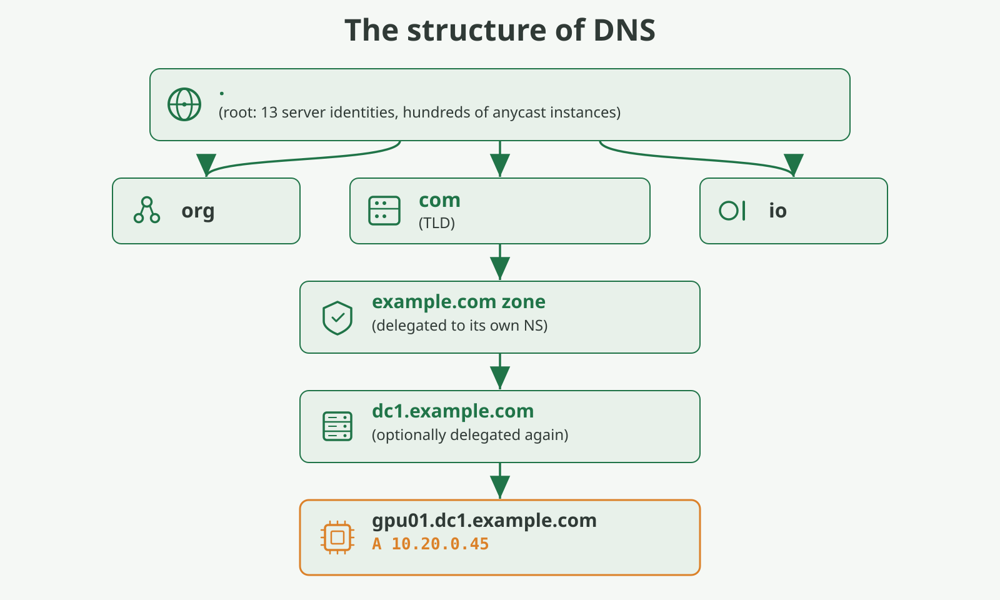
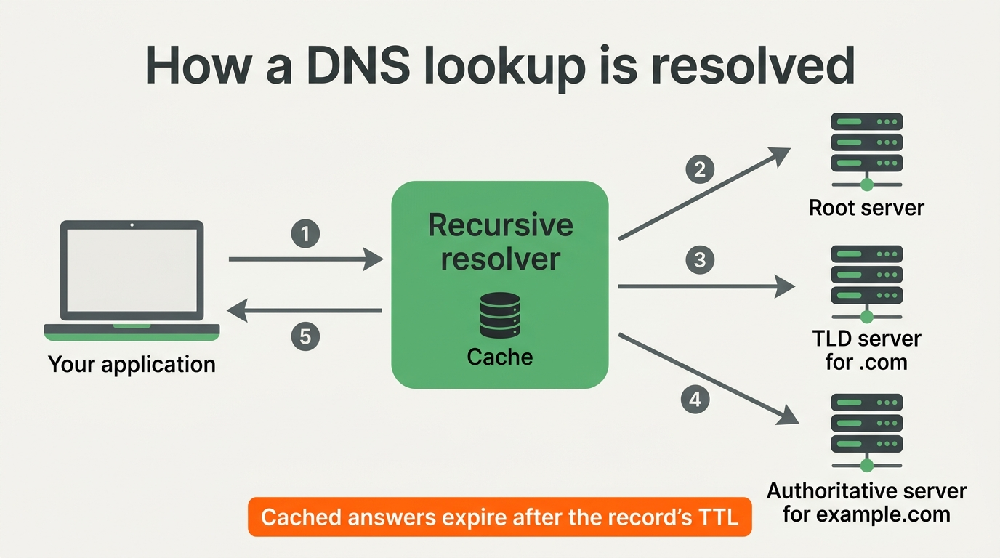
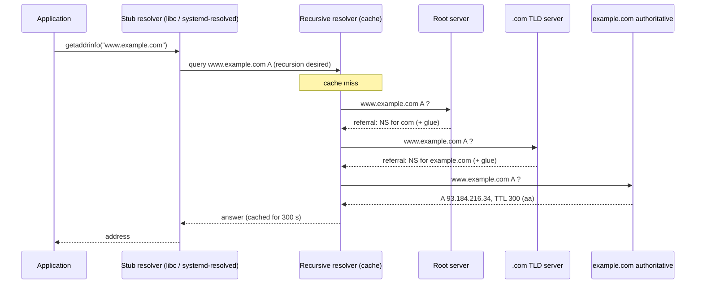
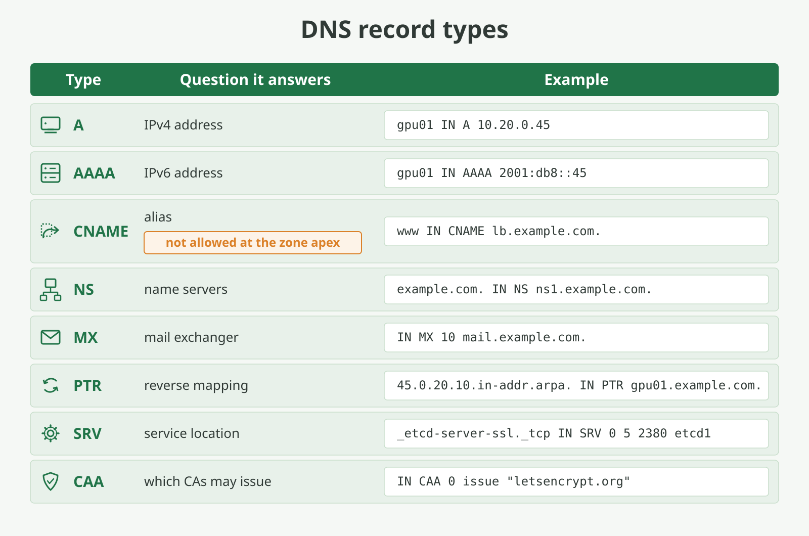
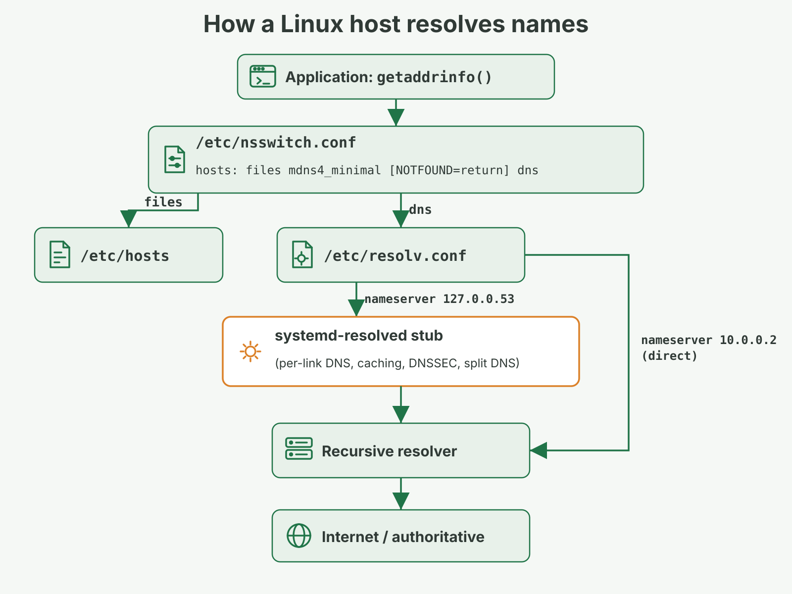
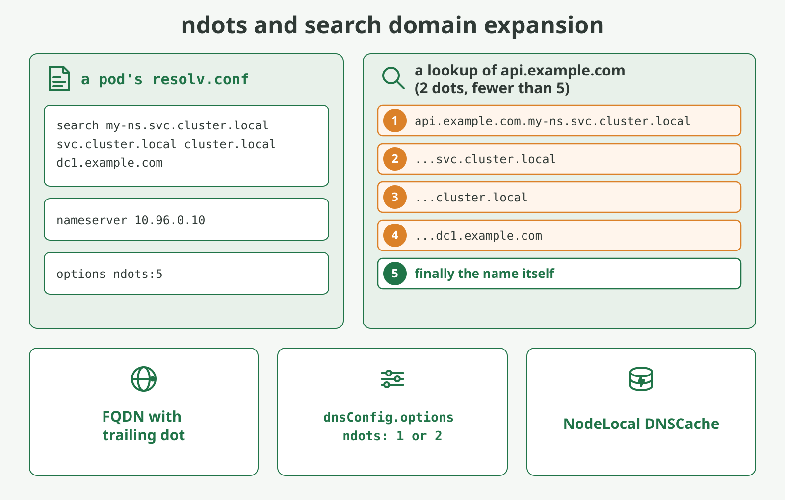
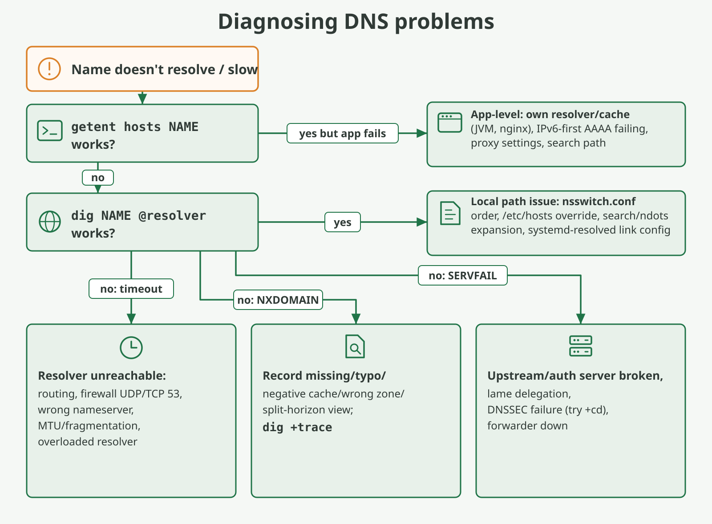
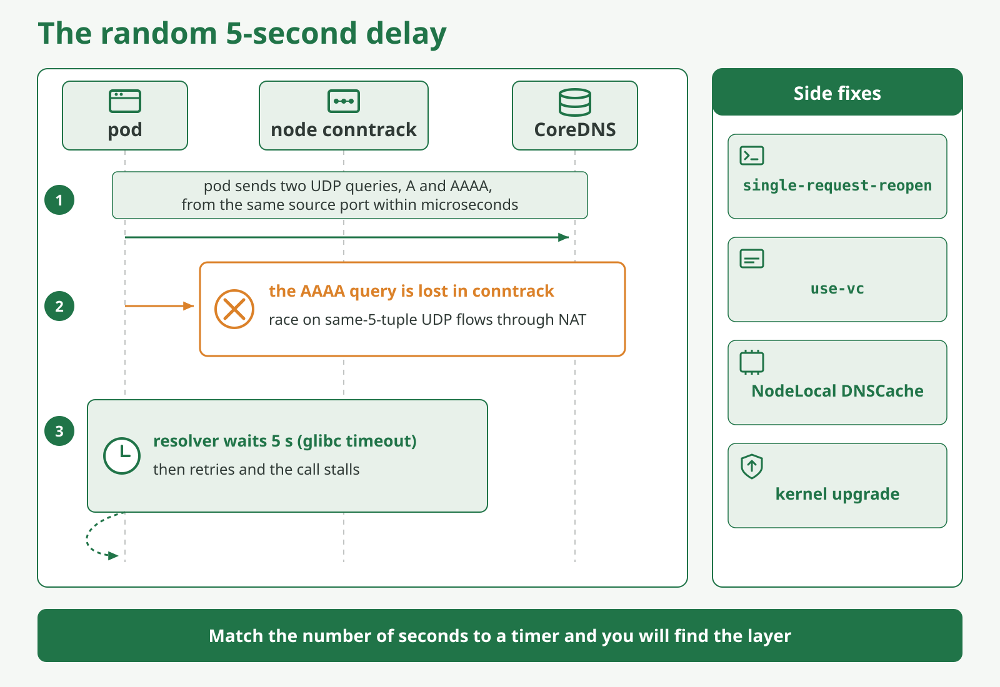

# 2.8 DNS in depth: resolution, records, resolvers and caching

| | |
|---|---|
| Level | Beginner to intermediate |
| Priority tier | 0 |
| Lab venue | Linux VM; optional local BIND/CoreDNS/dnsmasq |
| Part | Part 2: Networking, from first principles to AI fabrics |
| Status | Drafted, labs **untested** |

## Why this matters for AI infrastructure

When you face a cluster that is slow for no obvious reason, check DNS first. It is often the cause. DNS is the first dependency of nearly everything, and it is one of the most common hidden causes of outages, because every connection begins with a name lookup that nobody thinks about. "The cluster is slow" can turn out to be a 5-second DNS timeout on every call. "Pods cannot reach the registry" can mean CoreDNS is overloaded, or that `ndots:5` expands every lookup into six queries.

A multi-node job may fail to start because its node names do not resolve, or resolve to the management NIC rather than the fabric NIC. A cloud endpoint may change its IP while a long-lived process keeps the old one. DNS also underpins service discovery, including Kubernetes services, headless services for StatefulSets, Slurm node names and NCCL/MPI hostfiles. It supports certificate validation, which relies on names, and traffic steering with GeoDNS, weighted records and anycast resolvers. In short, the phone book of the network turns out to hold much more than phone numbers.

## Prerequisites and outcomes

Before you start, you should know UDP and TCP from chapters 2.6 and 2.7, and IP addressing from chapter 2.4. Every DNS term is explained the first time it appears.

When you have finished, use this list as a self-check. Each line is something you should now be able to do.

- Explain the DNS hierarchy, zones, delegation, and the difference between authoritative and recursive servers. Trace a full resolution through the root, the TLD and the authoritative server, including caching and TTLs.
- Read and write the main record types (`A`, `AAAA`, `CNAME`, `NS`, `SOA`, `MX`, `TXT`, `SRV`, `PTR`, `CAA`, `SVCB/HTTPS`) and a zone file.
- Use `dig`, `host`, `nslookup`, `getent` and `resolvectl`, and know which one tests which resolution path.
- Explain how a Linux host resolves names through `nsswitch.conf`, `/etc/hosts`, `/etc/resolv.conf`, systemd-resolved, stub resolvers, search domains and `ndots`.
- Explain DNS over UDP and TCP, EDNS(0), truncation, DNSSEC, DoT and DoH, negative caching, and the common failure modes.
- Debug DNS in Kubernetes (CoreDNS, `ndots`, the search path, NodeLocal DNSCache) and in HPC clusters (hostnames, reverse lookups, split horizon).
- Design DNS for a GPU cluster, with forward and reverse zones, per-NIC names and service discovery.

## 1. The structure of DNS

When a name does not resolve, you first need a picture of what DNS stores. Think of a phone book that has been split across thousands of offices, each responsible for its own pages, with a clear rule for finding the right office. DNS maps **names to data**, mostly addresses. It is a distributed, hierarchical, replicated database, and its namespace is a tree. At the top sits the root (`.`). Below it come top-level domains such as `com`, `org`, `io` and country codes, then second-level domains such as `example.com`, then subdomains such as `gpu01.dc1.example.com`.

A **fully qualified domain name (FQDN)** ends with a dot, as in `gpu01.dc1.example.com.`. The trailing dot marks the name as absolute, which means "start from the root, do not guess". Without it, a resolver may append **search domains** to the name.



*Figure 2.8.1. The structure of DNS, as a diagram.*

The rest of the section explains the terms that describe this tree. A **zone** is an administrative portion of the tree, served by a set of authoritative servers. `example.com` can hold its subdomains inside the same zone, or delegate them to other zones with NS records. A **domain** is a position in the tree, while a zone is a unit of management. A useful way to keep them apart is that a domain is a place on the map and a zone is the area one office looks after.

**Delegation** runs through the parent zone, the way a head office hands a branch its own phone book. The parent holds NS records, plus glue `A` and `AAAA` records when the name servers sit inside the delegated zone. Those records point to the child zone's servers. Glue exists because of a chicken-and-egg problem: to find the server for `example.com`, you would otherwise have to resolve a name inside `example.com` first.

**Authoritative servers** hold the zone data and answer for it, with the `aa` flag set. They are the source of truth. **Recursive resolvers** are the caching "DNS servers" listed in `resolv.conf`. They walk the tree for clients and cache the answers. **Stub resolvers**, the libc or systemd-resolved code on each host, simply ask a recursive resolver. Keep these roles separate. A server that is both authoritative and open-recursive is a security problem, because it allows reflection and amplification.

**Replication** works through a primary, also called the master, which holds the editable zone. Secondaries, also called slaves, copy it by **zone transfer**. They use AXFR for a full copy or IXFR for an incremental one. A NOTIFY message triggers the copy, and the SOA serial number governs it. In plain words, the secondary asks "has the version number gone up?" and copies only when it has. Modern setups often use API-driven zone management with a provider such as Route 53 or Cloud DNS instead.

When you set up replication, decide early which server holds the editable copy of each zone, because every other copy depends on it.

## 2. How a lookup actually works

Suppose a service calls a hostname and the answer is slow or wrong. To find the cause, you need to know which server walks the tree and how long each answer is kept. The diagram follows one lookup from the application to the authoritative server.



*Figure 2.8.2. The resolver asks root, TLD and authoritative servers in turn and caches the answer.*



Read the diagram from the top. The stub asks once, and the recursive resolver does the rest of the work, like an assistant who is sent to ask several offices on your behalf while you wait at your desk.

**Iterative versus recursive.** The stub sends one *recursive* query, with the RD bit set. That is a request that says "please get me the final answer". The recursive resolver then makes *iterative* queries of its own, following **referrals** down the tree. A referral is a server saying "I do not know, but ask that server". It relies on its cache of NS records and answers. The root and TLD NS sets are almost always cached, so a typical lookup costs 0 to 1 upstream queries.

Walk through a cold-cache lookup of `www.example.com` to see the pieces move. The stub asks the recursive resolver. The resolver has never heard of the name, so it asks a root server, which answers "I do not know, but the `com` servers do". It asks a `com` server, which answers "I do not know, but these are the servers for `example.com`". It asks one of those, which is authoritative and finally returns the address. The resolver hands the address to the stub and keeps a copy for the length of the TTL. The next person who asks within that time gets the answer immediately, with no upstream trip at all.

**TTL.** Every record has a time-to-live in seconds, and caches may reuse it until it expires. Low TTLs allow fast failover but cost more queries. High TTLs reduce load but delay changes. To plan a change, lower the TTL *before* you make it, at least one old-TTL interval earlier. The reason is that caches around the world are still holding the old answer for up to the old TTL, so you must give them time to forget.

**Negative caching.** NXDOMAIN and NODATA answers are cached for the negative TTL, which is the `minimum` field of the SOA record, as defined in RFC 2308. In other words, "that name does not exist" is remembered too. A name queried before it was created can keep failing for minutes after you create it.

**Transport.** DNS uses UDP port 53 by default, because most questions and answers are tiny. It switches to TCP port 53 for large answers, which the `TC` (truncation) bit signals, for zone transfers, and for the DoT and DoH variants. **EDNS(0)** advertises larger UDP payloads, commonly 1232 bytes, to avoid fragmentation, and it carries DNSSEC flags. Firewalls that block TCP/53 or fragments break big answers, such as DNSSEC responses and long TXT records.

**Response codes.** `NOERROR` means the query succeeded, with or without data. `NXDOMAIN` means the name does not exist. `SERVFAIL` means the resolver could not get an answer, for example because of an upstream timeout, a DNSSEC failure or a lame delegation. `REFUSED` means the server refused for policy reasons. `FORMERR` is the last code in this set.

**Anycast and latency.** Public resolvers and root servers are anycast, so the nearest instance answers. Your latency to your own resolver, usually the cloud-provided resolver at 169.254.169.254 or the VPC resolver, dominates the DNS cost your users see. A resolver that is one millisecond away adds almost nothing, and one that is far away adds a delay to every uncached lookup.

Check the latency to your own resolver first, because it usually decides how fast DNS feels.

## 3. Resource records



*Figure 2.8.3. Each record type answers a different question about a name.*

Each record type answers a different question, so know which one you need before you edit a zone. If you think of the zone as a table of facts about names, each record type is one kind of fact. The table lists the types you will meet most often.

| Type | Purpose | Example |
|---|---|---|
| **A** | IPv4 address | `gpu01  IN A 10.20.0.45` |
| **AAAA** | IPv6 address | `gpu01  IN AAAA 2001:db8::45` |
| **CNAME** | Alias to another name (no other records may coexist at the same name; not allowed at the zone apex) | `www IN CNAME lb.example.com.` |
| **NS** | Name servers for a zone/delegation | `example.com. IN NS ns1.example.com.` |
| **SOA** | Start of authority: primary NS, admin mailbox, serial, refresh, retry, expire, negative TTL | one per zone |
| **MX** | Mail exchanger (priority, host) | `IN MX 10 mail.example.com.` |
| **TXT** | Free text: SPF, DKIM, DMARC, domain verification, ACME challenges | `_acme-challenge IN TXT "..."` |
| **SRV** | Service location: priority, weight, port, target | `_etcd-server-ssl._tcp IN SRV 0 5 2380 etcd1` |
| **PTR** | Reverse mapping (address to name) in `in-addr.arpa` / `ip6.arpa` | `45.0.20.10.in-addr.arpa. IN PTR gpu01.example.com.` |
| **CAA** | Which CAs may issue certificates | `IN CAA 0 issue "letsencrypt.org"` |
| **SVCB / HTTPS** | Service binding: ALPN (h2, h3), ports, IP hints | newer, used by browsers for HTTP/3 |
| **DS / DNSKEY / RRSIG / NSEC(3)** | DNSSEC chain-of-trust material | section 8 |
| **ALIAS/ANAME** | Provider-specific "CNAME at the apex" | Route 53 alias, Cloudflare flattening |

A minimal zone file shows how these records sit together. It is the written-down version of everything above. Notice the per-NIC names, such as `gpu01-ib`, which give the fabric interface its own name.

```text
$ORIGIN dc1.example.com.
$TTL 300
@        IN SOA ns1.dc1.example.com. hostmaster.example.com. (
                2026102301 ; serial (YYYYMMDDnn)
                3600       ; refresh
                600        ; retry
                1209600    ; expire
                300 )      ; negative TTL
         IN NS  ns1
         IN NS  ns2
ns1      IN A   10.20.0.10
ns2      IN A   10.20.0.11
gpu01    IN A   10.20.0.45
gpu01-ib IN A   10.100.0.45      ; per-NIC names for fabric interfaces
gpu01    IN AAAA 2001:db8:20::45
login    IN CNAME gpu-login01
_slurmctld._tcp IN SRV 0 0 6817 slurm-ctl
```

**Round-robin DNS** returns several A records for one name in rotating order, and clients usually try the first one. It is like a receptionist who gives out the three desk numbers in turn. It is a crude way to spread load, because it has no health checks, and it keeps sending people to a desk that has closed. Production setups use health-checked records from cloud DNS routing policies, anycast or a load balancer instead. See chapter 2.20 for the load balancer option.

**Reverse DNS** maps an address back to a name, and it matters more than people expect. It is the question asked the other way round: "who lives at this address?" SSH and mail servers may do reverse lookups. MPI, Slurm, Kerberos and NFS sometimes require forward and reverse lookups to agree, which is called **forward-confirmed reverse DNS**. Logs are easier to read with names. Slow reverse lookups also cause slow logins, through the `UseDNS` setting in sshd, where `UseDNS no` turns it off. Reverse zones follow the octet-reversed form, such as `0.20.10.in-addr.arpa`. Delegation falls on prefix boundaries such as /8, /16 and /24. Smaller blocks need classless delegation, which is done with CNAME tricks.

The octet reversal looks odd until you see the reason. An address is most specific at its right end, but DNS names are most specific at their left end, so the octets are flipped to line the two up. The address `10.20.0.45` therefore becomes the name `45.0.20.10.in-addr.arpa.`, and the delegation can follow the same boundaries as the address blocks.

When you add a node, create its forward and reverse records together, because some services check that the two agree.

## 4. Tools: `dig` and friends

When a name misbehaves, start with these commands. Each one asks a different layer, so their answers can disagree, and the disagreement is itself the clue.

```bash
dig www.example.com                      # A record via the resolver in /etc/resolv.conf; shows the full response
dig +short www.example.com AAAA
dig @8.8.8.8 www.example.com             # ask a specific server
dig +trace www.example.com               # follow the delegation chain from the root yourself (bypass caches)
dig +norecurse @a.root-servers.net com NS   # act like a resolver
dig -x 10.20.0.45                        # reverse lookup
dig example.com SOA +multi ; dig example.com NS ; dig example.com ANY    # ANY is often refused today
dig +tcp example.com TXT                 # force TCP
dig +dnssec example.com                  # request DNSSEC records (look for ad flag for validated)
dig +noall +answer +stats www.example.com   # compact with query time and server
dig +nsid @resolver name                 # identify which anycast instance answered
dig AXFR example.com @ns1                # zone transfer (only if allowed)
host www.example.com ; nslookup www.example.com                # simpler tools
getent hosts www.example.com             # what applications get: follows nsswitch.conf (files, dns, mdns...)
resolvectl query www.example.com         # systemd-resolved's view, per-link DNS, shows which interface/server answered
resolvectl status                        # per-interface DNS servers and search domains
```

A `dig` answer has several parts, and it is worth learning to read them in order. The **header** shows the status, such as `status: NOERROR`, the flags `qr rd ra aa tc ad`, and the counts. Next come the **question** and the **answer**, which gives the name, the remaining TTL, class IN, the type and the data. The **authority** and **additional** sections follow, and the footer shows the query time, the server and the message size.

The flags tell you the most. `aa` means an authoritative answer. `ra` means recursion is available. `tc` means the answer was truncated, so retry over TCP. `ad` means the resolver validated the data with DNSSEC. If a repeated query is served from a cache, its TTL counts down. That makes the TTL a quick way to tell a cached answer from a fresh one. Ask twice, a few seconds apart. If the number has dropped, you were talking to a cache.

**There is an important distinction here.** `dig` and `nslookup` talk DNS straight to the server you name, or to the first server in `resolv.conf`. They skip `/etc/hosts`, nsswitch, the search path logic of libc and the NSS modules. `getent hosts`, `ping` and `curl` go through the C library, just as your application does. When `dig` works but the application fails, or the other way round, compare `dig` with `getent hosts`. Then check `nsswitch.conf`, the search domains, and which resolver the application uses, because Go, Java and musl-based images each have their own behaviour.

Run `getent hosts` on the failing machine before you blame the DNS server.

## 5. How a Linux host resolves names

When a name lookup hangs on one host and not another, the cause is often the local path rather than the server. Before a question ever leaves the machine, it passes through several local files and helpers. The diagram shows the path a `getaddrinfo()` call takes on a host.



*Figure 2.8.4. How a Linux host resolves names, as a diagram.*

Each file in this path has its own job, and the order matters.

`/etc/nsswitch.conf` sets the order of sources for `hosts:`. The sources include `files`, which means `/etc/hosts`, `dns`, `myhostname`, `resolve` for systemd-resolved, and `mdns4_minimal`, which is multicast DNS for `.local` names. Changing this file affects every libc-based program.

`/etc/hosts` holds static mappings, and on each line the first match wins. Use it for the loopback entry `127.0.0.1 localhost`, the host's own name and a few bootstrap entries. Do not use it as a cluster-wide database. Use DNS or configuration management instead. A classic Debian quirk makes it worse. The line `127.0.1.1 hostname` makes the host resolve its own name to loopback, which breaks MPI and Kerberos assumptions. Every other machine then hears "I am at 127.0.0.1", which is no address at all from their point of view.

`/etc/resolv.conf` holds `nameserver` lines, of which up to 3 are used. It also holds `search` domains for unqualified names, the `domain` line, and `options` such as `ndots:N`, `timeout:`, `attempts:`, `rotate` and `edns0`. The file is often a symlink managed by systemd-resolved (`/run/systemd/resolve/stub-resolv.conf`), NetworkManager, `resolvconf` or cloud-init. Hand edits are overwritten, so configure the manager instead, through netplan `nameservers`, `nmcli` or `resolved.conf`.

systemd-resolved provides a local stub at 127.0.0.53, with a cache, per-interface DNS servers and routing domains. Routing domains give you **split DNS**: you can send `corp.example.com` to the VPN's resolver and everything else to the default. systemd-resolved also handles LLMNR and mDNS, and it supports DNSSEC and DoT. Inspect it with `resolvectl status/query/statistics/flush-caches`, and configure it in `/etc/systemd/resolved.conf`.

Search domains and `ndots` work together, and a worked example makes them easy. Suppose `search dc1.example.com example.com` and `ndots:1` are set, where `ndots:1` is the glibc default. The name `gpu01` is tried as `gpu01.dc1.example.com`, then as `gpu01.example.com`, and last as `gpu01.`. A name with at least `ndots` dots is tried as an absolute name *first*. A trailing dot, as in `gpu01.dc1.example.com.`, always means absolute and skips the search list. Every failed expansion costs a query and its latency.

Now compare that with the same machine looking up a name that already has a trailing dot. The resolver sees the dot, treats the name as complete and sends exactly one query, with no search list applied. That single character is why FQDNs with a trailing dot are the first fix for slow lookups in a busy cluster.

Timeouts can add the most delay, because a resolver that waits for a dead server does nothing useful while it waits. The glibc default is 5 s per attempt, with 2 attempts per nameserver. One dead resolver at the front of the list therefore stalls every lookup for 5 to 10 s. You can mitigate this with `options timeout:1 attempts:2 rotate`, or with a local caching resolver such as systemd-resolved, dnsmasq or unbound, which fails over quickly.

Caching depends on the program, and that surprises people who assume DNS is always cached the same way. glibc does **not** cache, unless `nscd` or systemd-resolved does it for it. Long-running programs may cache on their own. The JVM caches positive lookups per `networkaddress.cache.ttl`, and forever by default under a security manager. Go caches nothing and resolves on each call. nginx resolves upstream names **only at startup**, unless you use a variable plus a `resolver`. Know your application's behaviour before you rely on DNS failover.

### Hostnames

The system hostname lives in `/etc/hostname`, and `hostnamectl set-hostname` sets it. The FQDN should resolve, which `hostname -f` shows, to the host's primary address. Cloud images on GCP set names through DHCP, the metadata server and an internal DNS zone, `<instance>.<zone>.c.<project>.internal`. Give clusters predictable names such as `gpu-rack03-node07`. Slurm node definitions, MPI hostfiles, monitoring labels and certificates all depend on those names, so a naming scheme chosen carelessly on day one is expensive to change later.

Check the order in `nsswitch.conf` first, because it decides which source answers every lookup on the host.

### Following one lookup, step by step

DNS is an application-layer service, and it runs entirely in user space. It sits a little outside the internet and physical-layer story. Still, a connection is nearly useless without it. Nobody publishes raw IP addresses for websites and mail servers, because addresses change and numbers are hard to remember.

Most programs never talk to DNS directly. They ask a shared library to look up a name. The simplified path looks like this:

1. The application calls a library function to get the IP address for a hostname. It does not need to know how the lookup works, so the details can change without breaking it.
2. The library follows the rules in `/etc/nsswitch.conf`. Those rules usually say to check `/etc/hosts` before anything else.
3. If the library chooses DNS, it reads a configuration file to find a name server, given as an IP address.
4. It sends a DNS request over the network to that server.
5. The server replies with the address, and the library returns it to the application.

Real systems add helpers to speed things up. The simple path is still the right model to learn, because every helper is a shortcut on that same road. When names resolve slowly or wrongly, start at `/etc/nsswitch.conf` and trace downward.

### The hosts file and its limits

On most systems, `/etc/hosts` can override a lookup. A small one looks like this:

```
127.0.0.1 localhost
10.23.2.3 atlantic.aem7.net atlantic
10.23.2.4 pacific.aem7.net pacific
::1 localhost ip6-localhost
```

You will nearly always see the localhost entries. The other lines show a simple way to add hosts on a small local subnet. Keep the file short. If a host has a DNS entry, it does not belong here. The file is also useful early in boot, before the network is up. In the past, one central hosts file was copied to every machine. As the internet grew, that approach fell apart, because no one could keep thousands of copies current.

### Caching daemons and the resolv.conf file

The traditional `/etc/resolv.conf` has two problems. The local machine does not cache replies, so repeated lookups hit the name server every time. The file is also inflexible for local names. A typical file looks like this:

```
search mydomain.example.com example.com
nameserver 10.32.45.23
nameserver 10.3.2.3
```

The `search` line tells the resolver which suffixes to try for a short name. With that line, `myserver` is tried as `myserver.mydomain.example.com`, then as `myserver.example.com`.

Many systems run a caching daemon between programs and the name server. The most common is systemd-resolved. You may also see dnsmasq, nscd or BIND set up as a cache. A clue is `127.0.0.53` or `127.0.0.1` in `/etc/resolv.conf`. With systemd-resolved, `/etc/resolv.conf` is often a link to a generated file under `/run`.

Zero-configuration name systems fill the local-name gap. Multicast DNS (mDNS) and Link-Local Multicast Name Resolution (LLMNR) broadcast a request for a name. If the target host exists, it replies with its address. These protocols can also share information about services.

Check the current settings with `resolvectl status`. It lists global settings, then one block per interface. Older systems call the tool `systemd-resolve`. To change settings, edit `/etc/systemd/resolved.conf`, and read the resolved.conf(5) manual page first. DNS is a large topic, so plan to study it further.

## 6. DNS in Kubernetes and containers



*Figure 2.8.5. A name with fewer dots than ndots is tried through every search domain before the real name.*

When a pod resolves names slowly, look at its resolver settings first. A pod is just a process in its own small network world, and its resolver settings are different from the node's. Inside a pod, the kubelet generates `/etc/resolv.conf`:

```text
search my-ns.svc.cluster.local svc.cluster.local cluster.local dc1.example.com
nameserver 10.96.0.10
options ndots:5
```

The nameserver is the **CoreDNS** service, called `kube-dns`. It resolves `<service>.<namespace>.svc.cluster.local` to ClusterIPs. For **headless** services, which StatefulSets and distributed training frameworks use, it returns pod IPs instead, such as `worker-0.trainer.ns.svc.cluster.local`. It forwards everything else to the node's upstream resolvers.

**`ndots:5`** means any name with fewer than five dots is first tried through every search domain. Take a lookup for `api.example.com`, which has 2 dots. It produces `api.example.com.my-ns.svc.cluster.local`, then `...svc.cluster.local`, then `...cluster.local`, then `...dc1.example.com`. Each of those returns NXDOMAIN, and they all come before the real query. That is 5 queries for each of `A` and `AAAA`. Imagine a receptionist who tries four wrong extensions before dialling the right one, and does it for every call. The extra load overloads CoreDNS and adds latency. Conntrack and UDP races can also cause the infamous 5-second delays on older kernels.

There are several fixes you can make, and you can combine them. Use FQDNs with a trailing dot in hot paths. Set `dnsConfig.options: ndots: 1` or `2` on each pod. Deploy NodeLocal DNSCache, a per-node cache on a link-local IP that avoids conntrack and cross-node hops. Scale CoreDNS with an autoscaler or more replicas, and tune its `cache` and `forward` plugins.

To debug, you can begin by reading the pod's resolver file with `kubectl exec pod -- cat /etc/resolv.conf`. Next, start a helper pod with `kubectl run -it --rm dnsutils --image=registry.k8s.io/e2e-test-images/jessie-dnsutils -- sh`, and run `dig` or `nslookup` inside it. Read the CoreDNS logs with `kubectl logs -n kube-system -l k8s-app=kube-dns`. Check the `Corefile` with `kubectl -n kube-system get cm coredns -o yaml`. Its metrics show the load: `coredns_dns_requests_total`, `coredns_dns_responses_total{rcode}` and the latency histograms. Also confirm that the nodes' own resolvers work.

Docker and Podman containers copy or proxy the host's resolvers. Custom networks have an embedded DNS at 127.0.0.11, which resolves container names.

Alpine and musl have historically handled search lists and TCP fallback differently from glibc. Their `ndots` and parallel behaviour has also differed. Behaviour changes by image and version, so run your DNS tests inside the same image the pod uses.

## 7. DNS in HPC and AI clusters

Suppose a launcher reads a hostfile, and one node name points at the management NIC instead of the fabric NIC. The bootstrap traffic then takes the wrong network, and the job crawls or fails with no obvious error. Names in a cluster decide which network a job uses, so get them right before you tune anything else.

Slurm resolves node names from `NodeName` and `NodeAddr` in `slurm.conf`. By default it requires forward lookups to match, through `SlurmctldHost` and `NodeHostname`. Use `NodeAddr` to bind jobs to a specific interface, such as the fabric network. Keep one naming scheme with per-NIC names, such as `gpu01`, `gpu01-ib0` and `gpu01-mgmt`.

MPI and NCCL launchers resolve hostnames from a hostfile. If a name resolves to the management NIC while the data should use the fabric NIC, the bootstrap traffic uses the wrong network. Set `NCCL_SOCKET_IFNAME` and `NCCL_IB_HCA` explicitly, rather than relying on names.

Reverse DNS must exist for all node IPs, on the management network and, where used, on the fabric. Missing PTR records cause multi-second stalls in tools that do reverse lookups. Examples are `sshd` with `UseDNS`, NFS exports that use hostnames, and Kerberos.

Split-horizon DNS returns internal names as private addresses inside the network, and as public addresses outside it. It uses separate views or zones, and it is common in cloud and VPN setups.

Use configuration management, such as Ansible from the Part 4 chapters, to generate `/etc/hosts` for tiny bootstrap sets. The same tool can render zone files or cloud DNS records from inventory, so DNS never drifts from reality.

Cloud DNS integrations differ by provider. GCP Cloud DNS offers public and private zones, forwarding, peering and response policies, and its metadata-server resolver is 169.254.169.254. AWS offers Route 53 Resolver. In Kubernetes, **ExternalDNS** syncs service and ingress hostnames to a DNS provider.

Generate every record from one naming scheme, so the names in Slurm, MPI and DNS always agree.

## 8. Security: DNSSEC, DoT/DoH, and abuse

Suppose a resolver accepts a forged answer, and traffic goes to the wrong server. The user sees the right name in the address bar and the wrong machine behind it. DNSSEC protects against that, and it is the first thing this section covers.

**DNSSEC** adds origin authentication and integrity. It works like a signature on a letter, so the reader can check that it came from the stated sender and was not altered. Zones are signed. Each RRset is covered by an RRSIG, made with the zone's DNSKEY. The parent publishes a DS record for the child's key, which forms a chain of trust up to the root's trust anchor. A validating resolver sets the `ad` flag on verified answers, and it returns SERVFAIL on failures. DNSSEC does not encrypt anything. Expired signatures, or DS and key mismatches during a rollover, cause outages for validating users, so automate signing and rollovers.

**DoT and DoH** encrypt the hop between the stub and the resolver, over TCP/853 and HTTPS. They help on untrusted networks. Inside a data centre they are mostly unnecessary, although systemd-resolved supports them through `DNSOverTLS=`.

**Abuse** takes several forms. Cache poisoning is mitigated by source-port and query-ID randomisation, and by DNSSEC. Open resolvers enable amplification DDoS, so restrict recursion to your own networks and rate-limit responses. DNS tunnelling can exfiltrate data, so monitor volume, long labels and TXT records. Dangling CNAMEs enable subdomain takeover. Resolvers can filter private answers against DNS rebinding. Use response policy zones (RPZ) or provider threat-blocking where they fit.

Protect the zone data itself. Restrict AXFR to secondaries, and authenticate them with TSIG. Keep the authoritative and recursive roles on separate servers, and keep the software patched.

Restrict who can use each resolver before you open it to a network.

## 9. Running your own DNS

A recursive caching resolver in each site or rack reduces latency and shields the upstream resolvers. It is a local shortcut that most lookups never need to leave.

BIND 9 is the reference server, and it covers authoritative and recursive work, with views and DNSSEC. Unbound is a small, secure validating recursive resolver. dnsmasq is a small forwarder with DHCP, which suits labs. CoreDNS is plugin-based and is the Kubernetes default. PowerDNS is an authoritative server with SQL backends and an API. Cloud-managed options include Route 53 and Cloud DNS.

Operate these servers like any service, because a DNS server that nobody monitors is a future outage. Consider redundancy, with at least two on different failure domains. Monitor the query rate, latency, SERVFAIL ratio and cache hit rate. Set a privacy-friendly logging policy, and keep a tested change process.

Here is an example dnsmasq setup for a lab cluster.

```text
# /etc/dnsmasq.d/cluster.conf
domain=cluster.lab
local=/cluster.lab/
expand-hosts
no-resolv
server=8.8.8.8
address=/gpu01.cluster.lab/10.20.0.45
host-record=gpu02.cluster.lab,10.20.0.46
ptr-record=45.0.20.10.in-addr.arpa,gpu01.cluster.lab
```

The file sets the domain, the local zone and an upstream server. It also gives two hosts their addresses, and it adds one reverse record for `gpu01`. Test a file like this first, if you can.

## 10. Diagnosing DNS problems

A name that will not resolve can fail at any layer, so the way to stay calm is to test one layer at a time. The flowchart sorts the symptoms, and the routine below tests each layer in turn.



*Figure 2.8.6. Diagnosing DNS problems, as a diagram.*

Work through the routine in order.

1. Compare `getent hosts NAME`, `dig NAME` and `resolvectl query NAME`. Do they agree?
2. Run `dig +trace NAME` to test the authoritative chain without the caches. Then run `dig @auth-ns NAME` against each authoritative server. Inconsistent answers mean a broken secondary, so compare the SOA serials.
3. Check EDNS size issues with `dig +tcp`, with `+bufsize=512` against `1232`, and with `+ignore`. Confirm that the firewall allows UDP and TCP 53, and fragments.
4. Measure latency with `dig +stats` and `resolvectl statistics`, then repeat the query to see the cache effect. `tcpdump -ni any port 53` shows retries, timeouts and search-domain expansion.
5. In Kubernetes, check the pod `resolv.conf`, the CoreDNS logs and metrics, NodeLocal DNSCache, and `ndots`.
6. Check the time-related causes: expired DNSSEC signatures, TTLs that have not yet expired, and negative caching. Use `rndc flush`, `resolvectl flush-caches` or `unbound-control flush` only after you know the cause.

Start with step 1 every time, because it tells you which layer to test next.

## 11. Case study: "random 5-second delays" in a GPU inference cluster



*Figure 2.8.7. Two parallel UDP queries can race in conntrack, so one is lost and the resolver waits for its 5 second timeout.*

An inference service in a GPU cluster calls `https://models.internal.example.com` from its pods. Now and then, a call stalls for exactly 5 s. Nothing is broken, and nothing logs an error, which is what makes it so annoying. A `tcpdump` on the node showed two UDP queries, `A` and `AAAA`, sent from the same source port within microseconds. The AAAA query was lost in the node's conntrack. The cause was a race on parallel same-5-tuple UDP flows through NAT, a known kernel behaviour that newer kernels fix. The stub then retried after its default 5 s timeout.

Several fixes address this. As a short-term fix, add `dnsConfig.options: [{name: single-request-reopen}]`, or use `use-vc`. NodeLocal DNSCache bypasses conntrack for DNS. A kernel upgrade also helps. Reduce `ndots`, and add a dashboard on CoreDNS latency and the node's `nf_conntrack` insert-failed counters. If you see the same stall, check those counters first.

The lesson is that DNS problems often show up as delays of exactly one fixed number of seconds. That number is a resolver timeout, here 5 s from glibc, multiplied by retries. Match the number to a timer, and you will find the layer that caused it.

## 12. Hands-on lab: DNS from both sides

A word on status first. The Python lab below has been run, while the interactive VM commands after it have not been run for this chapter, so confirm each result yourself. Start with the self-checking Python lab in `code/part02/dns_in_depth_lab.py`, which you can run on your own machine.

```bash
python3 code/part02/dns_in_depth_lab.py
```

The script checks four things. It verifies the search-domain and `ndots` expansion in `resolv.conf`, with `ndots=5`, `ndots=2` and a trailing dot `.`. It builds the IPv4 reverse name for `10.20.0.45` as `45.0.20.10.in-addr.arpa.`. It measures the glibc failover delay for a dead nameserver, `5 s` and `10 s`. It also applies the RFC 1034 rules for `CNAME` at the apex and for coexistence with other records.

Next, on a disposable Linux VM, work through the steps below.

1. Start by watching a full resolution. Run `dig +trace www.example.com` and label each referral. Then run `dig www.example.com` twice and watch the TTL decrease, which shows the cache at work. Finally, run `dig +norecurse` against your resolver.
2. Compare the tools. Add a bogus entry to `/etc/hosts` for a real name, then compare `dig`, `getent hosts`, `ping` and `curl`. Change the `nsswitch.conf` order temporarily, inside the VM, and test again.
3. Test the search domains and `ndots`. Set the `search` and `ndots` options in a test `resolv.conf`, using `RES_OPTIONS` or a namespace with its own `/etc/netns/<ns>/resolv.conf`. Watch the queries with `tcpdump port 53` for `curl http://short-name`, and for an FQDN with and without a trailing dot.
4. Time the timeouts. Put a dead nameserver first, and time `getent hosts`. Then try `options timeout:1 attempts:1`, and compare the result with systemd-resolved.
5. Run a local authoritative server. Install BIND or dnsmasq in a namespace or VM, and create the zone above. Serve forward and reverse records, and test with `dig @server`. Add a secondary, then observe AXFR, NOTIFY and serial behaviour.
6. Check TTLs and negative caching. Query a missing name, create it, and query again before and after the negative TTL.
7. Test truncation. Create a TXT record larger than 512 bytes, then query it with `+bufsize=512 +ignore` and with `+tcp`. Look for the `tc` flag.
8. Work in Kubernetes with kind or minikube. Inspect a pod's `resolv.conf`, and measure the query counts for an external name with `ndots:5` and with `ndots:2`. Deploy NodeLocal DNSCache, or compare with an FQDN that has a trailing dot. Then read the CoreDNS metrics.
9. Test systemd-resolved split DNS. Set the servers with `resolvectl dns eth0 ...`, route the domain with `resolvectl domain eth0 ~corp.example.com`, and verify the routing with `resolvectl query`.
10. Check DNSSEC. Run `dig +dnssec +multi example.com DNSKEY`. Then query a deliberately broken signed domain, such as a public test domain you trust, once with `+cd` and once without it, to see SERVFAIL against an answer.
11. Clean up when you finish.

## 13. Common mistakes

These mistakes come up again and again, so check for them before you blame the server. Many of them come from looking at only one layer of the lookup path.

Testing only with `dig` bypasses `/etc/hosts`, nsswitch and the search path, so a clean `dig` does not prove that DNS is fine. Editing a managed `/etc/resolv.conf` by hand is another trap, and running two managers that fight over the file is worse.

A dead first nameserver adds multi-second delays to every lookup. Too many search domains, and ignoring `ndots` in Kubernetes, add more queries on top of that.

Forgetting negative caching and long TTLs can make a change look broken. Not lowering the TTL before a migration causes the same trouble. Forgetting to increment the SOA serial means secondaries never update.

A CNAME at the apex, or alongside other records, is illegal. Trailing-dot mistakes are also common. A name like `ns1.example.com` without the dot becomes `ns1.example.com.example.com.`.

Blocking TCP/53 or fragments causes intermittent failures for big answers, and so do MTU and EDNS size issues. Missing reverse records for nodes cause trouble too, and so do hostnames that resolve to loopback or to the wrong NIC.

Application caches, such as the JVM or nginx upstreams, can make DNS failover ineffective. Running an open recursive resolver on the Internet is a mistake of its own.

Before you call a record change finished, confirm that the SOA serial moved and that the secondaries picked it up.

## 14. Interview angles

If you are preparing for an interview, these questions test whether you can follow a lookup from the stub resolver to the authoritative server. Tell the story out loud, one server at a time, and name the cache at each step.

- "What happens when you type a URL in the browser? Focus on DNS." Cover the stub, the recursive resolver, the root, TLD and authoritative servers, caching and TTL.
- "Difference between recursive and authoritative servers? Between a zone and a domain?"
- "Why can't you put a CNAME at the zone apex?" The SOA and NS records must coexist with it, and a CNAME excludes other records. ALIAS or ANAME can replace it.
- "A Kubernetes pod resolves slowly. What are the usual causes?" Think about `ndots`, CoreDNS load, the conntrack race and NodeLocal DNSCache.
- "`dig` works, but `curl` fails by name. Why?" Look at nsswitch, the hosts file, the search path, IPv6 and proxy settings.
- "How do you migrate a service to a new IP with minimal downtime?" Lower the TTL ahead of time, switch the IP, wait, then restore the TTL.
- "What does `SERVFAIL` mean? How do you find the cause?" Use `dig +trace`, check DNSSEC, and look for a lame delegation.
- "Explain DNSSEC in two minutes."
- "How would you design DNS for a 1,000-GPU cluster with several networks per node?"

## Exercises

1. Start with the hierarchy. First, explain the difference between a DNS domain and a DNS zone. Then explain why a parent zone must include glue `A` and `AAAA` records when it delegates `example.com.` to `ns1.example.com.`. Last, trace the messages exchanged between an application, its local stub resolver, a recursive resolver, and the `.` (root), `.com` (TLD) and `example.com` authoritative servers on a cold cache.
2. Work through the record rules with the code in `code/part02/dns_in_depth.py`. Use `validate_cname_placement()` to explain why a `CNAME` is illegal at the zone apex, `@`, and why it cannot share an owner name with SOA, NS, MX or TXT records. Then use `ipv4_to_in_addr_arpa()` to build the reverse PTR owner name for `10.20.0.45`. Finally, name four cluster services that stall or fail when reverse DNS is broken.
3. Explain why `dig www.example.com` can return the right IP at once, while `curl https://www.example.com/` on the same host connects to the wrong IP or stalls for 5 seconds. Then trace the exact files and daemons that `getaddrinfo()` consults.
4. Take the search line `search my-ns.svc.cluster.local svc.cluster.local cluster.local dc1.example.com`. Use `expand_dns_search_candidates()` to list the exact names queried for `api.example.com` with `ndots:5`, the Kubernetes default, and then with `ndots:2`. Repeat the exercise for a trailing dot, `api.example.com.`.
5. Walk through the root cause of the random 5-second delays in section 11. Cover the `A` and `AAAA` UDP queries from the same socket source port, which race in `nf_conntrack` DNAT, and glibc's 5 s timeout from `compute_resolver_failover_delay_sec()`. Then state four concrete mitigations you would apply: NodeLocal DNSCache, `single-request-reopen` or `use-vc`, `ndots`, and a kernel upgrade.
6. Plan cluster DNS for 1,000 multi-NIC GPU nodes, and then plan a zero-downtime migration. The first part asks you to design the forward and reverse naming for a GPU node with a management address (`10.20.0.45`), a storage address (`10.30.0.45`) and 8 InfiniBand or RoCE interfaces (`10.100.0..7.45`). Explain why Debian's `127.0.1.1 hostname` line in `/etc/hosts` breaks MPI and Slurm. The second part asks you to write the 4-step procedure for moving a production endpoint's IP with minimal downtime, when its current TTL is `3600` seconds.

## Checkpoint questions (20)

<details>
<summary>1. What is the difference between a DNS domain and a DNS zone, and what is a Fully Qualified Domain Name (`FQDN`)?</summary>

A **domain** is any complete subtree of the DNS namespace, such as everything under `example.com`. A **zone** is a specific administrative slice of that tree, hosted on a set of authoritative nameservers. For example, `dc1.example.com` can be delegated into its own zone. When you write an **FQDN**, it ends with a trailing dot, as in `gpu01.dc1.example.com.`. That dot marks the name as absolute, starting from the DNS root (`.`), so resolvers do not append `search` suffixes.
</details>

<details>
<summary>2. What are `NS` delegation records and \"glue\" records, and why are glue records necessary?</summary>

A parent zone, such as `.com`, delegates a child zone, such as `example.com.`, by publishing `NS` records. Those records point to the child's authoritative nameservers, such as `ns1.example.com.`. Suppose that nameserver's own name sits inside the zone it serves. This is called *in-bailiwick*. The resolver would then face a circular dependency, because it needs the address of `ns1.example.com.` before it can ask for `example.com.`. Glue records solve this. They are the `A` and `AAAA` addresses for `ns1.example.com.`, and the parent returns them directly in the Additional section of the referral.
</details>

<details>
<summary>3. Contrast a Stub Resolver, a Recursive Resolver, and an Authoritative Nameserver.</summary>

- **Stub resolver**: the lightweight client library in each OS, such as glibc `getaddrinfo()` or `systemd-resolved` at `127.0.0.53`. It forwards recursive queries, with the `RD` bit set, to a configured nameserver.
- **Recursive (caching) resolver**: the workhorse server, such as Unbound, CoreDNS, BIND or the cloud VPC resolver. It walks the tree from root to TLD to authoritative server on the client's behalf, and it caches the answers for their `TTL`.
- **Authoritative nameserver**: holds the ground-truth zone records. It answers for its zones with the `aa` (*Authoritative Answer*) flag set.
</details>

<details>
<summary>4. How do positive `TTL` caching and negative caching (`RFC 2308`) work, and how do you migrate a service IP cleanly?</summary>

Every resource record has a **TTL**, in seconds, that tells recursive resolvers how long they may serve it from cache. With **negative caching** under RFC 2308, `NXDOMAIN` (the name does not exist) and `NODATA` responses are cached too. They are cached for the zone's `SOA` negative TTL, which is its `minimum` field. So if you query a hostname before you create its record, the failure can stay cached for minutes. To migrate an IP, lower the record's TTL first, for example from `3600 s` to `60 s`. Do this at least one full old TTL, `3600 s`, in advance. Then switch the IP, verify it, and raise the TTL back.
</details>

<details>
<summary>5. Why does DNS use both UDP port 53 and TCP port 53, and what does `EDNS(0)` (`1232` bytes) do?</summary>

Standard DNS queries use **UDP port 53**, because you get one round trip with low overhead. Classic DNS capped UDP responses at `512` bytes. **EDNS(0)**, defined in RFC 6891, lets the client advertise a larger UDP buffer. The usual choice is `1232` bytes, which keeps the packet safely below IPv6 and tunnel fragmentation limits. EDNS(0) also carries DNSSEC flags. When a response still exceeds the UDP limit, the server sets the **`TC` (*Truncated*) flag**. The client then retries over **TCP port 53**, which zone transfers with `AXFR` and `IXFR` also use. Blocking TCP/53 in a firewall breaks large TXT, SRV and DNSSEC responses.
</details>

<details>
<summary>6. Match the DNS response codes `NOERROR`, `NXDOMAIN`, `SERVFAIL`, and `REFUSED` to their meanings.</summary>

- **`NOERROR`**: the query succeeded. Either the Answer section holds matching records, or it has zero answers. Zero answers is NODATA, which means the name exists but has no records of that type.
- **`NXDOMAIN`**: the queried name does not exist in the zone.
- **`SERVFAIL`**: the recursive resolver could not get a valid answer. The causes are that all authoritative servers timed out, a lame delegation, or a failed DNSSEC signature check.
- **`REFUSED`**: the server refused for policy reasons. For example, a non-recursive authoritative server gets a query for an outside domain, or an unauthorized `AXFR` request.
</details>

<details>
<summary>7. Why is a `CNAME` record forbidden at the zone apex (`@`), and how do cloud DNS providers work around it?</summary>

A **`CNAME` record cannot share its owner name with any other record type**, except DNSSEC `RRSIG` and `NSEC` records (RFC 1034 and RFC 2181). The zone apex, `example.com.`, must hold `SOA` and `NS` records. A CNAME at `@` is therefore illegal, and it breaks delegation and mail. Cloud providers work around this with synthetic records, which are called **`ALIAS`**, **`ANAME`** or CNAME flattening. Standardized **`SVCB` / `HTTPS`** records also work, because they resolve the target's `A` and `AAAA` addresses at the authoritative server.
</details>

<details>
<summary>8. Explain the fields of an `SOA` record and an `SRV` record (`_slurmctld._tcp IN SRV 0 0 6817 slurm-ctl`).</summary>

An **`SOA`** (*Start of Authority*) record holds the primary master NS, the admin email with `@` written as `.`, the serial number, and the refresh, retry and expire timers. It also holds the negative-caching TTL. The serial, such as `2026102301`, **must go up on every edit**. Secondaries compare it to decide whether to fetch the zone with `AXFR` or `IXFR`. An **`SRV`** record has the form `_service._proto.name`, and it holds `priority`, `weight`, the **`port` (`6817`)** and the **`target` hostname (`slurm-ctl`)**. Clients such as Slurm or `etcd` use it to find both the host and the port through DNS.
</details>

<details>
<summary>9. How is IPv4 and IPv6 Reverse DNS structured (`in-addr.arpa` and `ip6.arpa`), and why does missing Reverse DNS cause slow SSH or job startup?</summary>

Reverse DNS maps an IP address back to a canonical hostname, using **`PTR`** records. For IPv4, the records sit under the octet-reversed **`in-addr.arpa`** tree. So `10.20.0.45` becomes **`45.0.20.10.in-addr.arpa.`**. For IPv6, the tree is **`ip6.arpa`**, with nibbles reversed. Services that do reverse or forward-confirmed reverse lookups on incoming connections stall when the reverse zones are missing. Examples are `sshd` with `UseDNS yes`, NFS hostname exports, Kerberos, and Slurm or MPI. Each one waits 5 to 10 seconds for PTR queries to time out.
</details>

<details>
<summary>10. Why can `dig www.example.com` succeed while `curl https://www.example.com/` or `ping` fails to resolve on the same Linux machine?</summary>

`dig`, `nslookup` and `host` speak the DNS protocol directly to the nameserver in `/etc/resolv.conf`. That bypasses the C library (`getaddrinfo`) completely. It also skips `/etc/nsswitch.conf`, `/etc/hosts`, systemd-resolved's D-Bus APIs, and the `search` and `ndots` rules. To test what an application really sees, use `getent hosts <name>` or `getent ahosts <name>`.
</details>

<details>
<summary>11. Trace how `/etc/nsswitch.conf`, `/etc/hosts`, `/etc/resolv.conf`, and `systemd-resolved` (`127.0.0.53`) work together on Ubuntu/RHEL.</summary>

When an application calls `getaddrinfo()`, glibc reads the `hosts:` line in `/etc/nsswitch.conf`, which might read `files mdns4_minimal [NOTFOUND=return] resolve [UNAVAIL=return] dns`. It checks `/etc/hosts` first, through `files`. Then it queries **systemd-resolved**. It can do this through the NSS `resolve` module, or through the local stub at `127.0.0.53` named in `/etc/resolv.conf`. systemd-resolved checks its cache, then sends the query to the right upstream DNS server for each interface. That routing is called **split DNS**.
</details>

<details>
<summary>12. How do `search` domains and `ndots` in `/etc/resolv.conf` interact, and what happens if the first `nameserver` in `/etc/resolv.conf` is dead?</summary>

The stub resolver checks `ndots` against the name it was given. If a name without a trailing dot has fewer than `ndots` dots, the resolver appends each `search` domain before it tries the bare name. If the name has `ndots` dots or more, it tries the bare name first. glibc's default timeout is `5` seconds per attempt, which is `options timeout:5 attempts:2`. So a dead first `nameserver` adds a `5` to `10` second delay to every uncached lookup, until the resolver fails over to the second `nameserver`. You can reduce that with `options timeout:1 attempts:2 rotate`, or with a local caching stub.
</details>

<details>
<summary>13. How do `glibc`, the JVM, Go, and `nginx` differ in how they cache DNS lookups in user space?</summary>

- **`glibc`** does no caching inside the process. Each time you call `getaddrinfo()`, it asks the OS stub or the files.
- **JVM (Java)** caches positive lookups per `networkaddress.cache.ttl`. Historically, it cached forever under a SecurityManager when that was not configured.
- **Go** resolves on every connection attempt, with no internal cache.
- **Open-source `nginx`** resolves upstream names in `proxy_pass http://backend;` only once, at startup or reload. The exception is a `resolver` directive used with a variable.
</details>

<details>
<summary>14. Why does Kubernetes default Pod `/etc/resolv.conf` to `ndots:5`, and how does that overload CoreDNS?</summary>

Kubernetes sets `ndots:5` so that multi-segment in-cluster names, such as `svc.namespace` or `pod.svc.namespace.svc`, match the pod's search list, `<ns>.svc.cluster.local svc.cluster.local cluster.local`. Those names have 1 to 3 dots, which is fewer than 5. The side effect hits external names. When you query a name like `s3.us-west-2.amazonaws.com`, it has 3 dots, so it gets 4 search-domain expansions. Each expansion is queried for `A` and `AAAA`, which makes 8 NXDOMAIN queries to CoreDNS before the real query goes out.
</details>

<details>
<summary>15. What is a Kubernetes Headless Service (`clusterIP: None`), and how do distributed PyTorch / StatefulSet jobs use it?</summary>

A normal Kubernetes `Service` gets one virtual `ClusterIP` and load-balances connections across pods. A **Headless Service**, with `clusterIP: None`, gets no virtual IP. CoreDNS returns each pod IP directly, and it creates a predictable `A` and `AAAA` record for each pod. The record name is **`<pod-name>.<service-name>.<namespace>.svc.cluster.local`**, such as `worker-0.pytorch-job.train.svc.cluster.local`. `torchrun` and MPI use these names for rank-0 rendezvous and peer discovery.
</details>

<details>
<summary>16. Explain the Linux conntrack UDP race that caused \"random 5-second DNS delays\" in Kubernetes Pods and how `NodeLocal DNSCache` fixes it.</summary>

A Pod sent parallel `A` and `AAAA` UDP queries from the same socket, which means the same 5-tuple. Both went to the `kube-dns` Service ClusterIP, `10.96.0.10`, at the exact same microsecond. The two packets raced in the `nf_conntrack` DNAT table. The losing packet was dropped, so the stub resolver waited `5.0` seconds before it retried. **NodeLocal DNSCache** runs a caching agent on every node. The agent is bound to a link-local IP and uses `NOTRACK` iptables rules. Cache hits are served locally in sub-millisecond time. The agent bypasses `conntrack` and DNAT, and it upgrades upstream misses to TCP.
</details>

<details>
<summary>17. Why is Debian/Ubuntu's `/etc/hosts` entry `127.0.1.1 <hostname>` a trap on HPC and GPU clusters?</summary>

When a node resolves its own hostname to `127.0.1.1`, the loopback address, instead of its real cluster or fabric IP, the trouble starts. Distributed launchers such as Slurm, OpenMPI, NCCL, Ray and Gloo advertise `127.0.1.1` to peer nodes. Those peers then try to connect to themselves on loopback and fail. You should map the node's hostname to its real management IP, and give each network an explicit hostname, such as `gpu01-mgmt` and `gpu01-ib0`.
</details>

<details>
<summary>18. How does `DNSSEC` verify record authenticity (`DNSKEY`, `RRSIG`, `DS`, `ad` flag), and why does a broken DNSSEC config return `SERVFAIL`?</summary>

In DNSSEC, each zone signs its RRsets with a private key. The signature is published in an **`RRSIG`** record, and the public key is in a **`DNSKEY`** record. The parent zone publishes a hash of the child's key in a **`DS` (*Delegation Signer*)** record, which chains trust up to the root (`.`). When the chain checks out, a validating resolver sets the **`ad` (*Authenticated Data*)** flag. If a signature has expired or was tampered with, the resolver refuses to return the data and returns **`SERVFAIL`**. To debug, you can bypass validation with **`dig +cd`** (*Checking Disabled*).
</details>

<details>
<summary>19. Compare `DNSSEC` with `DoT` (*DNS over TLS*) and `DoH` (*DNS over HTTPS*).</summary>

**`DNSSEC`** gives origin authentication and data integrity. It proves that records were not forged, but it does not encrypt queries, so anyone on the wire can read the name you asked for. **`DoT`** (`TCP port 853`) and **`DoH`** (`HTTPS port 443`, `RFC 8484`) encrypt the channel between the stub resolver and the recursive resolver. That protects against on-path eavesdroppers. Neither one proves by itself that the upstream zone data was signed, unless you combine it with DNSSEC.
</details>

<details>
<summary>20. How do you verify whether all authoritative nameservers for a zone are synchronized?</summary>

First list the zone's authoritative nameservers with `dig +short example.com NS`. Then query the **`SOA` record** straight from each one, with `dig +norecurse @ns1.example.com example.com SOA` and `dig +norecurse @ns2.example.com example.com SOA`. If their **SOA serial numbers** match, the servers are in sync.
</details>

## Sources and review notes

- **Sources read in full:**
  - `how-linux-works-3rd-edition` — Brian Ward, *How Linux Works*, 3rd ed., **Chapter 9: Understanding Your Network and Its Configuration** (section *Resolving Hostnames*: `/etc/hosts`, `resolv.conf`, caching and zero-configuration DNS, `/etc/nsswitch.conf`, and the `host` tool) and **Chapter 10: Network Applications and Services**.
  - `computer-networking-problems-and-solutions` — Russ White and Ethan Banks, *Computer Networking Problems and Solutions*, **Chapter 5: Higher Layer Data Transports** (addressing, multiplexing, and transport considerations for name resolution) and **Chapter 6: Interlayer Discovery** (DNS centralized mapping database).
  - `networking-and-kubernetes` — James Strong and Vallery Lancey, *Networking and Kubernetes*, **Chapters 1, 2, and 4** (DNS walkthrough, `dig` EDNS, CoreDNS, `ndots:5` search path, and headless services).
- **Run here:** `python3 code/part02/dns_in_depth_lab.py` (14 passed, 0 failed).
- **Explicitly labelled inferences:** The Section 3 `dc1.example.com` GPU cluster zone file (`gpu01-ib`, `_slurmctld._tcp` SRV), Section 9 `dnsmasq` cluster snippet, Section 10 diagnostic flowchart, and Section 11 5-second Kubernetes conntrack DNS race case study synthesize RFCs 1034, 1035, 2308, 4034, 6891, 7766, and 8484 (DoH) and the documentation of BIND, Unbound, CoreDNS, and `systemd-resolved` (cross-referenced with Chapters 2.1, 2.4, 2.6, 2.7, and 2.20, plus original study items 21, 22, 23, 24, 25, 26, 27, 28, 29, 30, 31, 32, 33, 34, and 35).
- **Not verified on live hardware:** All interactive VM and Kubernetes commands (`dig`, `host`, `nslookup`, `getent`, `resolvectl`, `tcpdump port 53`, `kubectl`) are marked and must be executed on a disposable Linux VM or test cluster.

