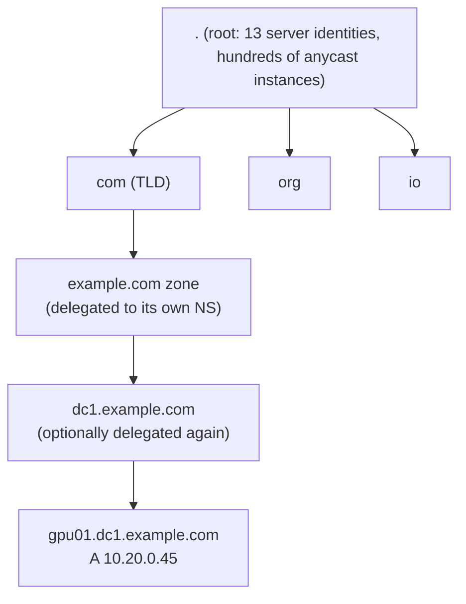
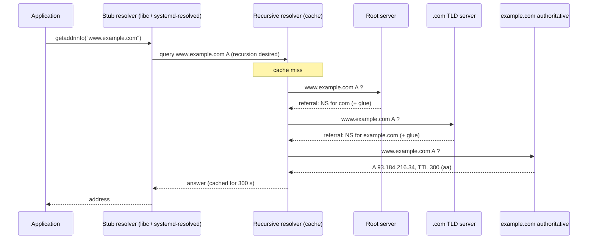
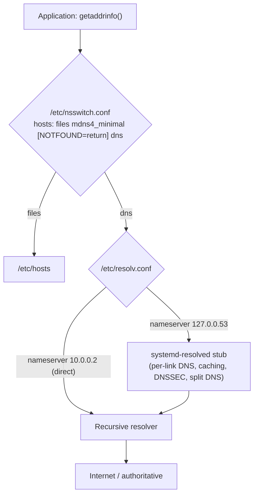
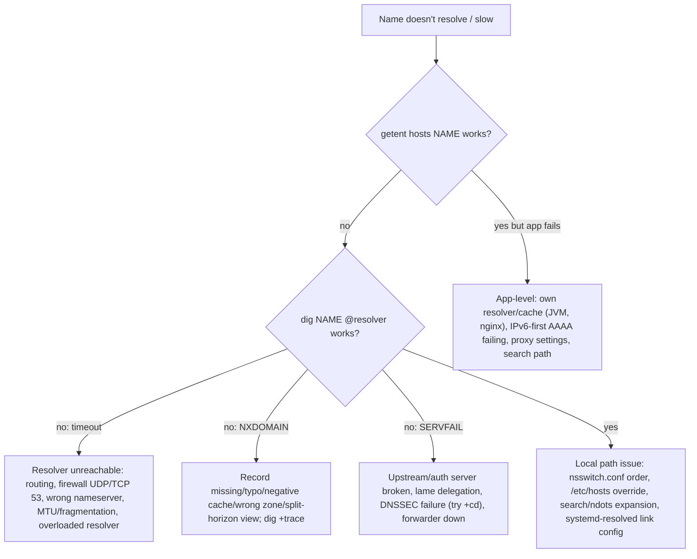

# 2.8 DNS in depth: resolution, records, resolvers and caching

| | |
|---|---|
| Level | Beginner to intermediate |
| Priority tier | 0 |
| Lab venue | Linux VM; optional local BIND/CoreDNS/dnsmasq |
| Part | Part 2: Networking, from first principles to AI fabrics |
| Status | Drafted, labs **untested** |

## Why this matters for AI infrastructure

DNS is the first dependency of nearly everything and the most common hidden cause of outages: "the cluster is slow" turns out to be a 5-second DNS timeout per call; "pods cannot reach the registry" is CoreDNS overloaded or `ndots:5` expanding every lookup into six queries; a multi-node job fails to start because node names do not resolve or resolve to the management NIC rather than the fabric NIC; a cloud endpoint's IP changes and a long-lived process keeps the stale one. DNS also underpins service discovery (Kubernetes services, headless services for StatefulSets, Slurm node names, NCCL/MPI hostfiles), certificate validation (names), and traffic steering (GeoDNS, weighted records, anycast resolvers).

## Prerequisites and outcomes

You should know UDP/TCP (2.6, 2.7) and IP addressing (2.4).

After this chapter you can:

- Explain the DNS hierarchy, zones, delegation, authoritative versus recursive servers, and trace a full resolution (root, TLD, authoritative) including caching and TTLs.
- Read and write the main record types (A, AAAA, CNAME, NS, SOA, MX, TXT, SRV, PTR, CAA, SVCB/HTTPS) and a zone file.
- Use `dig`, `host`, `nslookup`, `getent`, `resolvectl` and know which one tests which resolution path.
- Explain how a Linux host resolves names: `nsswitch.conf`, `/etc/hosts`, `/etc/resolv.conf`, systemd-resolved, stub resolvers, search domains and `ndots`.
- Explain DNS over UDP/TCP, EDNS(0), truncation, DNSSEC, DoT/DoH, negative caching, and common failure modes.
- Debug DNS in Kubernetes (CoreDNS, `ndots`, search path, NodeLocal DNSCache) and in HPC clusters (hostnames, reverse lookups, split horizon).
- Design DNS for a GPU cluster (forward and reverse zones, per-NIC names, service discovery).

## 1. The structure of DNS

DNS maps **names to data** (mostly addresses) using a distributed, hierarchical, replicated database. The namespace is a tree: the root (`.`), top-level domains (`com`, `org`, `io`, country codes), then second-level domains (`example.com`), subdomains (`gpu01.dc1.example.com`). A **fully qualified domain name (FQDN)** ends with a dot (`gpu01.dc1.example.com.`), which marks it as absolute; without it, resolvers may append **search domains**.



- A **zone** is an administrative portion of the tree served by a set of authoritative servers (`example.com` may contain subdomains inside the same zone or delegate them to other zones with NS records). A **domain** is a position in the tree; a zone is a unit of management.
- **Delegation**: a parent zone holds NS records (and glue A/AAAA records when the name servers live inside the delegated zone) that point to the child zone's servers.
- **Authoritative servers** hold the zone data and answer for it (flag `aa`); **recursive resolvers** (caching resolvers, "DNS servers" in `resolv.conf`) do the work of walking the tree on behalf of clients and cache the answers; **stub resolvers** (the libc/systemd-resolved code in each host) just ask a recursive resolver. Keep the roles separate: a server that is both authoritative and open-recursive is a security problem (reflection/amplification).
- **Replication**: a primary (master) holds the editable zone; secondaries (slaves) copy it by **zone transfer** (AXFR full, IXFR incremental) triggered by NOTIFY and governed by the SOA serial number. Modern setups often use API-driven zone management with a provider (Route 53, Cloud DNS) instead.

## 2. How a lookup actually works



Key facts:

- **Iterative vs recursive.** The stub sends one *recursive* query (RD bit); the recursive resolver performs *iterative* queries, following **referrals** down the tree, using its cache of NS records and answers (the root and TLD NS sets are almost always cached, so a typical lookup costs 0 to 1 upstream queries).
- **TTL.** Every record has a time-to-live in seconds; caches may reuse it until it expires. Low TTLs enable fast failover and cost more queries; high TTLs reduce load and delay changes. Plan DNS changes by lowering TTL *before* the change (at least one old-TTL interval earlier).
- **Negative caching**: NXDOMAIN and NODATA answers are cached for the SOA's `minimum`/negative TTL (RFC 2308). A name that was queried before creation can keep failing for minutes after you create it.
- **Transport.** UDP port 53 by default; TCP port 53 for large answers (truncation `TC` bit), zone transfers, and DoT/DoH variants; **EDNS(0)** advertises larger UDP payloads (commonly 1232 bytes recommended to avoid fragmentation) and carries DNSSEC flags. Firewalls that block TCP/53 or fragments break big answers (e.g. DNSSEC, long TXT).
- **Response codes**: `NOERROR` (with or without data), `NXDOMAIN` (name does not exist), `SERVFAIL` (resolver could not get an answer: upstream timeout, DNSSEC failure, lame delegation), `REFUSED` (policy), `FORMERR`.
- **Anycast and latency.** Public resolvers and root servers are anycast; the nearest instance answers. Your latency to your resolver (typically cloud-provided at 169.254.169.254 or the VPC resolver) dominates user-visible DNS cost.

## 3. Resource records

| Type | Purpose | Example |
|---|---|---|
| **A** | IPv4 address | `gpu01  IN A 10.20.0.45` |
| **AAAA** | IPv6 address | `gpu01  IN AAAA 2001:db8::45` |
| **CNAME** | Alias to another name (no other records may coexist at the same name; not allowed at the zone apex) | `www IN CNAME lb.example.com.` |
| **NS** | Name servers for a zone/delegation | `example.com. IN NS ns1.example.com.` |
| **SOA** | Start of authority: primary NS, admin mailbox, serial, refresh, retry, expire, negative TTL | one per zone |
| **MX** | Mail exchanger (priority, host) | `IN MX 10 mail.example.com.` |
| **TXT** | Free text: SPF, DKIM, DMARC, domain verification, ACME challenges | `_acme-challenge IN TXT "..."` |
| **SRV** | Service location: priority, weight, port, target | `_etcd-server-ssl._tcp IN SRV 0 5 2380 etcd1` |
| **PTR** | Reverse mapping (address to name) in `in-addr.arpa` / `ip6.arpa` | `45.0.20.10.in-addr.arpa. IN PTR gpu01.example.com.` |
| **CAA** | Which CAs may issue certificates | `IN CAA 0 issue "letsencrypt.org"` |
| **SVCB / HTTPS** | Service binding: ALPN (h2, h3), ports, IP hints | newer, used by browsers for HTTP/3 |
| **DS / DNSKEY / RRSIG / NSEC(3)** | DNSSEC chain-of-trust material | section 8 |
| **ALIAS/ANAME** | Provider-specific "CNAME at the apex" | Route 53 alias, Cloudflare flattening |

A minimal zone file:

```text
$ORIGIN dc1.example.com.
$TTL 300
@        IN SOA ns1.dc1.example.com. hostmaster.example.com. (
                2026102301 ; serial (YYYYMMDDnn)
                3600       ; refresh
                600        ; retry
                1209600    ; expire
                300 )      ; negative TTL
         IN NS  ns1
         IN NS  ns2
ns1      IN A   10.20.0.10
ns2      IN A   10.20.0.11
gpu01    IN A   10.20.0.45
gpu01-ib IN A   10.100.0.45      ; per-NIC names for fabric interfaces
gpu01    IN AAAA 2001:db8:20::45
login    IN CNAME gpu-login01
_slurmctld._tcp IN SRV 0 0 6817 slurm-ctl
```

**Round-robin DNS.** Multiple A records for the same name are returned in rotating order; clients typically try the first. It is crude load distribution without health checks. Production uses health-checked records (cloud DNS routing policies), anycast, or a load balancer instead (chapter 2.20).

**Reverse DNS** maps an address to a name. It matters more than people expect: SSH and mail servers may do reverse lookups, MPI/Slurm/Kerberos/NFS sometimes require forward and reverse to agree (**forward-confirmed reverse DNS**), logs are friendlier with names, and timeouts in reverse lookups cause slow logins (`UseDNS` in sshd, `UseDNS no`). Reverse zones follow the octet-reversed form (`0.20.10.in-addr.arpa`); delegation is on prefix boundaries (/8, /16, /24; classless delegation for smaller via CNAME tricks).

## 4. Tools: `dig` and friends

```bash
dig www.example.com                      # A record via the resolver in /etc/resolv.conf; shows the full response
dig +short www.example.com AAAA
dig @8.8.8.8 www.example.com             # ask a specific server
dig +trace www.example.com               # follow the delegation chain from the root yourself (bypass caches)
dig +norecurse @a.root-servers.net com NS   # act like a resolver
dig -x 10.20.0.45                        # reverse lookup
dig example.com SOA +multi ; dig example.com NS ; dig example.com ANY    # ANY is often refused today
dig +tcp example.com TXT                 # force TCP
dig +dnssec example.com                  # request DNSSEC records (look for ad flag for validated)
dig +noall +answer +stats www.example.com   # compact with query time and server
dig +nsid @resolver name                 # identify which anycast instance answered
dig AXFR example.com @ns1                # zone transfer (only if allowed)
host www.example.com ; nslookup www.example.com                # simpler tools
getent hosts www.example.com             # what applications get: follows nsswitch.conf (files, dns, mdns...)
resolvectl query www.example.com         # systemd-resolved's view, per-link DNS, shows which interface/server answered
resolvectl status                        # per-interface DNS servers and search domains
```

Reading `dig` output: the **header** (`status: NOERROR`, flags `qr rd ra aa tc ad`, counts), the **question**, **answer** (name, TTL remaining, class IN, type, data), **authority** and **additional** sections, and the footer (query time, server, message size). Flags: `aa` authoritative answer, `ra` recursion available, `tc` truncated (retry over TCP), `ad` authenticated data (DNSSEC validated by the resolver). A **repeated query's TTL counts down** if served from a cache, which is a quick way to tell cached versus fresh.

**Important distinction**: `dig` and `nslookup` talk DNS directly to the server you specify (or the first in `resolv.conf`) and **bypass `/etc/hosts`, nsswitch, the search path logic of libc, and NSS modules**; `getent hosts` and `ping`/`curl` go through the C library the way your application does. When "dig works but the application fails" (or vice versa), compare `dig` with `getent hosts`, and check `nsswitch.conf`, search domains, and which resolver the app uses (Go, Java and musl-based images have their own behaviour).

## 5. How a Linux host resolves names



- **`/etc/nsswitch.conf`**: order of sources for `hosts:` (`files` = `/etc/hosts`, `dns`, `myhostname`, `resolve` for systemd-resolved, `mdns4_minimal` multicast DNS for `.local`). Changing it affects every libc-based program.
- **`/etc/hosts`**: static mappings, first match wins per line; use for loopback (`127.0.0.1 localhost`), the host's own name, and a few bootstrap entries; do not use it as a cluster-wide database (use DNS or configuration management). A classic Debian quirk: `127.0.1.1 hostname` makes the host resolve its own name to loopback, breaking MPI and Kerberos assumptions.
- **`/etc/resolv.conf`**: `nameserver` (up to 3 used), `search` (domains appended to unqualified names), `domain`, and `options` (`ndots:N`, `timeout:`, `attempts:`, `rotate`, `edns0`). Often a symlink managed by systemd-resolved (`/run/systemd/resolve/stub-resolv.conf`), NetworkManager, `resolvconf` or cloud-init; hand edits are overwritten, so configure the manager instead (netplan `nameservers`, `nmcli`, `resolved.conf`).
- **systemd-resolved** provides a local stub at 127.0.0.53 with a cache, per-interface DNS servers and routing domains (**split DNS**: send `corp.example.com` to the VPN's resolver and the rest to the default), LLMNR/mDNS, and DNSSEC/DoT support. `resolvectl status/query/statistics/flush-caches` inspect it; `/etc/systemd/resolved.conf` configures it.
- **Search domains and `ndots`.** With `search dc1.example.com example.com` and `ndots:1` (glibc default), the name `gpu01` is tried as `gpu01.dc1.example.com`, then `gpu01.example.com`, then `gpu01.`; names with at least `ndots` dots are tried as absolute names *first*. A trailing dot (`gpu01.dc1.example.com.`) always means absolute and skips the search list. Each failed expansion costs a query and its latency.
- **Timeouts**: the glibc default is 5 s per attempt, 2 attempts, per nameserver: one dead resolver at the front of the list yields 5 to 10 s stalls for every lookup. Mitigate with `options timeout:1 attempts:2 rotate`, or a local caching resolver (systemd-resolved, dnsmasq, unbound) which fails over quickly.
- **Caching**: glibc does **not** cache (unless `nscd`/`nscd`-like or `systemd-resolved`); long-running programs may cache themselves (JVM caches positive lookups per `networkaddress.cache.ttl`, forever by default under a security manager; Go caches nothing but resolves per call; nginx resolves upstream names **only at startup** unless you use a variable plus `resolver`). Know your application's behaviour before relying on DNS failover.

### Hostnames

The system hostname is stored in `/etc/hostname` (set with `hostnamectl set-hostname`); the FQDN should resolve (`hostname -f`) to the host's primary address. Cloud images (GCP) set names via DHCP/metadata and an internal DNS zone (`<instance>.<zone>.c.<project>.internal`). Clusters should have predictable names (`gpu-rack03-node07`) because Slurm node definitions, MPI hostfiles, monitoring labels and certificates depend on them.

## 6. DNS in Kubernetes and containers

Inside a pod, `/etc/resolv.conf` is generated by the kubelet:

```text
search my-ns.svc.cluster.local svc.cluster.local cluster.local dc1.example.com
nameserver 10.96.0.10
options ndots:5
```

- The nameserver is the **CoreDNS** service (`kube-dns`), which resolves `<service>.<namespace>.svc.cluster.local` to ClusterIPs (or pod IPs for **headless** services, used by StatefulSets and distributed training frameworks: `worker-0.trainer.ns.svc.cluster.local`), and forwards everything else to the node's upstream resolvers.
- **`ndots:5`** means any name with fewer than five dots is first tried through every search domain: a lookup for `api.example.com` (2 dots) generates `api.example.com.my-ns.svc.cluster.local`, `...svc.cluster.local`, `...cluster.local`, `...dc1.example.com` (each NXDOMAIN) *before* the real query: 5 queries (times A and AAAA), which overloads CoreDNS and adds latency (plus conntrack/UDP races leading to the infamous 5-second delays on older kernels). Fixes: use FQDNs with a trailing dot in hot paths, set `dnsConfig.options: ndots: 1` or 2 per pod, deploy **NodeLocal DNSCache** (a per-node cache on a link-local IP, avoiding conntrack and cross-node hops), scale CoreDNS (autoscaler, more replicas), and tune the `cache` and `forward` plugins.
- Debugging: `kubectl exec pod -- cat /etc/resolv.conf`; `kubectl run -it --rm dnsutils --image=registry.k8s.io/e2e-test-images/jessie-dnsutils -- sh` then `dig`/`nslookup`; `kubectl logs -n kube-system -l k8s-app=kube-dns`; check CoreDNS `Corefile` (`kubectl -n kube-system get cm coredns -o yaml`), its metrics (`coredns_dns_requests_total`, `coredns_dns_responses_total{rcode}`, latency histograms), and that the nodes' own resolvers work.
- **Docker/Podman** containers copy or proxy the host's resolvers; custom networks have an embedded DNS at 127.0.0.11 that resolves container names.
- **Alpine/musl** historically did not support search lists and TCP fallback the same way as glibc and had different `ndots`/parallel behaviour; behaviour differs by image and version, so test inside the actual image.

## 7. DNS in HPC and AI clusters

- Slurm resolves node names (NodeName/NodeAddr in `slurm.conf`) and, by default, requires forward lookups to match (`SlurmctldHost`, `NodeHostname`); use `NodeAddr` to bind jobs to a specific interface (e.g. the fabric network) and keep a consistent naming scheme with per-NIC names (`gpu01`, `gpu01-ib0`, `gpu01-mgmt`).
- MPI/NCCL launchers resolve hostnames from a hostfile; if a name resolves to the management NIC while the data should use the fabric NIC, bootstrap traffic uses the wrong network; set `NCCL_SOCKET_IFNAME`/`NCCL_IB_HCA` explicitly rather than relying on names.
- Reverse DNS for all node IPs (management and, where used, fabric); missing PTR records cause multi-second stalls in tools that do reverse lookups (`sshd` `UseDNS`, NFS exports with hostnames, Kerberos).
- Split-horizon DNS: internal names resolve to private addresses internally and to public addresses externally (separate views/zones), common for cloud and VPN setups.
- Use **configuration management** (Ansible, chapters Part 4) to generate `/etc/hosts` for tiny bootstrap sets and to render zone files or cloud DNS records from inventory so DNS never drifts from reality.
- Cloud DNS integrations: GCP Cloud DNS (public/private zones, forwarding, peering, response policies) and the metadata-server resolver 169.254.169.254; AWS Route 53 Resolver; in Kubernetes **ExternalDNS** syncs service/ingress hostnames to a DNS provider.

## 8. Security: DNSSEC, DoT/DoH, and abuse

- **DNSSEC** adds origin authentication and integrity: zones are signed (RRSIG over each RRset using the zone's DNSKEY), parents publish a **DS** record for the child's key, forming a chain of trust to the root's trust anchor. A validating resolver sets the `ad` flag on verified answers or returns SERVFAIL on failures. It does not encrypt, and operational mistakes (expired signatures, DS/key mismatches during rollover) cause outages for validating users: automate signing and rollovers.
- **DoT/DoH** encrypt the stub-to-resolver hop (TCP/853 and HTTPS). Useful on untrusted networks; inside a data centre mostly unnecessary but supported by systemd-resolved (`DNSOverTLS=`).
- **Abuse**: cache poisoning (mitigated by source-port and query-ID randomisation, DNSSEC), open resolvers for **amplification** DDoS (restrict recursion to your networks, rate-limit responses), DNS tunnelling for exfiltration (monitor volume, long labels, TXT), dangling CNAMEs enabling subdomain takeover, and DNS rebinding (resolvers can filter private answers). Use response policy zones (RPZ) or provider threat-blocking where appropriate.
- Protect zone data: restrict AXFR to secondaries (TSIG-authenticated), separate authoritative and recursive roles, and keep software patched (BIND, Unbound, CoreDNS).

## 9. Running your own DNS

Typical choices: **BIND 9** (authoritative + recursive, views, DNSSEC, the reference), **Unbound** (validating recursive resolver, small and secure), **dnsmasq** (small DNS forwarder + DHCP for labs), **CoreDNS** (plugin-based, Kubernetes default), **PowerDNS** (authoritative with SQL backends and API), cloud-managed (Route 53, Cloud DNS). A recursive caching resolver per site/rack, with forwarders to the corporate or cloud resolvers, reduces latency and shields upstreams. Operate them like any service: redundancy (at least two, on different failure domains), monitoring (query rate, latency, SERVFAIL ratio, cache hit rate), logging policy (privacy), and a tested change process.

Example `dnsmasq` for a lab/cluster:

```text
# /etc/dnsmasq.d/cluster.conf
domain=cluster.lab
local=/cluster.lab/
expand-hosts
no-resolv
server=8.8.8.8
address=/gpu01.cluster.lab/10.20.0.45
host-record=gpu02.cluster.lab,10.20.0.46
ptr-record=45.0.20.10.in-addr.arpa,gpu01.cluster.lab
```

## 10. Diagnosing DNS problems



Practical routine:

1. `getent hosts NAME` vs `dig NAME` vs `resolvectl query NAME`: which agree?
2. `dig +trace NAME` to test the authoritative chain independent of caches; `dig @auth-ns NAME` to test each authoritative server (inconsistent answers mean a broken secondary: compare SOA serials).
3. `dig +tcp`, check EDNS size issues (`+bufsize=512` vs `1232`, `+ignore`), firewall allows UDP and TCP 53 and fragments.
4. Check latency: `dig +stats`, `resolvectl statistics`, repeat to see cache effect; `tcpdump -ni any port 53` shows retries, timeouts, and search-domain expansion.
5. Kubernetes: pod `resolv.conf`, CoreDNS logs/metrics, NodeLocal DNSCache, ndots.
6. Time-related: expired DNSSEC signatures, TTL not yet expired, negative caching; `rndc flush`/`resolvectl flush-caches`/`unbound-control flush` only after you know why.

## 11. Case study: "random 5-second delays" in a GPU inference cluster

An inference service calling `https://models.internal.example.com` from pods occasionally stalled for exactly 5 s. `tcpdump` on the node showed two UDP queries (A and AAAA) sent from the same source port within microseconds; the AAAA query was lost in the node's conntrack because of a race on parallel same-5-tuple UDP flows through NAT (a known kernel behaviour fixed in newer kernels), and the stub retried after the default 5 s timeout. Remediation: `dnsConfig.options: [{name: single-request-reopen}]` (or `use-vc`) as a short-term fix; NodeLocal DNSCache to bypass conntrack for DNS; upgrade the kernel; reduce `ndots`; and add a dashboard on `coredns` latency and the node's `nf_conntrack` insert-failed counters. The lesson: DNS problems often appear as "exactly N seconds" delays: the number is a resolver timeout (5 s glibc) multiplied by retries; match the number to a timer to find the layer.

## 12. Lab: DNS from both sides (untested)

1. **Observe a full resolution**: `dig +trace www.example.com`; label each referral; then `dig www.example.com` twice and watch the TTL decrease (cache); `dig +norecurse` against your resolver.
2. **Tool differences**: add a bogus entry to `/etc/hosts` for a real name; compare `dig`, `getent hosts`, `ping`, `curl`; change `nsswitch.conf` order temporarily (in a VM) and re-test.
3. **Search domains/ndots**: set `search` and `ndots` options in a test `resolv.conf` (using `RES_OPTIONS` or a namespace with its own `/etc/netns/<ns>/resolv.conf`); watch the queries with `tcpdump port 53` for `curl http://short-name` and for an FQDN with and without a trailing dot.
4. **Timeouts**: put a dead nameserver first; time `getent hosts`; use `options timeout:1 attempts:1`; compare with systemd-resolved.
5. **Local authoritative server**: install BIND or dnsmasq in a namespace/VM; create the zone above; serve forward and reverse; test with `dig @server`; add a secondary and observe AXFR/NOTIFY and serial behaviour.
6. **TTL and negative caching**: query a missing name, create it, query again before/after the negative TTL.
7. **Truncation**: create a TXT record > 512 bytes; query with `+bufsize=512 +ignore` and `+tcp`; see the `tc` flag.
8. **Kubernetes** (kind/minikube): inspect pod `resolv.conf`; measure query counts for an external name with ndots 5 vs 2; deploy NodeLocal DNSCache or compare using FQDN with trailing dot; read CoreDNS metrics.
9. **systemd-resolved split DNS**: `resolvectl dns eth0 ...`, `resolvectl domain eth0 ~corp.example.com`, verify routing with `resolvectl query`.
10. **DNSSEC**: `dig +dnssec +multi example.com DNSKEY`; query a deliberately broken signed domain (e.g. a public test domain you trust) with `+cd` and without to see SERVFAIL vs answer.
11. **Clean up**.

Mark tested only after running.

## 13. Common mistakes

- Testing only with `dig` (bypasses `/etc/hosts`, nsswitch, search path) and concluding DNS is fine.
- Editing a managed `/etc/resolv.conf` by hand; running two managers fighting over it.
- A dead first nameserver (multi-second delays on every lookup); too many search domains; ignoring `ndots` in Kubernetes.
- Forgetting negative caching and long TTLs when changing records; not lowering TTL before migrations.
- CNAME at the apex or alongside other records; trailing-dot mistakes in zone files (`ns1.example.com` without a dot becomes `ns1.example.com.example.com.`).
- Forgetting to increment the SOA serial so secondaries never update.
- Blocking TCP/53 or fragments; MTU and EDNS size issues causing intermittent failures for big answers.
- Missing reverse records for nodes; hostnames resolving to loopback or the wrong NIC.
- Caches in applications (JVM, nginx upstream) making DNS failover ineffective.
- Running an open recursive resolver on the Internet.

## 14. Interview angles

- "What happens when you type a URL in the browser? Focus on DNS." (Stub, recursive, root/TLD/auth, caching, TTL.)
- "Difference between recursive and authoritative servers? Between a zone and a domain?"
- "Why can't you put a CNAME at the zone apex?" (SOA/NS must coexist; CNAME excludes other records; use ALIAS/ANAME.)
- "A Kubernetes pod resolves slowly. What are the usual causes?" (ndots, CoreDNS load, conntrack race, NodeLocal DNSCache.)
- "`dig` works, but `curl` fails by name. Why?" (nsswitch/hosts/search/IPv6/proxy.)
- "How do you migrate a service to a new IP with minimal downtime?" (Lower TTL ahead, switch, wait, restore TTL.)
- "What does `SERVFAIL` mean? How do you find the cause?" (+trace, check DNSSEC, lame delegation.)
- "Explain DNSSEC in two minutes."
- "How would you design DNS for a 1,000-GPU cluster with several networks per node?"

## 15. Checkpoint questions (35)

1. What is the root of the DNS tree written as? **A:** A single dot.
2. What is an FQDN? **A:** An absolute name ending in a dot.
3. Zone versus domain? **A:** A zone is an administrative unit of data served by authoritative servers; a domain is a subtree position.
4. What is delegation? **A:** NS records in the parent pointing to the child zone's servers (plus glue).
5. What is glue? **A:** A/AAAA records for name servers inside the delegated zone, provided by the parent.
6. Authoritative versus recursive? **A:** Authoritative holds zone data; recursive resolves for clients and caches.
7. What is a stub resolver? **A:** The client-side resolver library that asks a recursive resolver.
8. What does TTL control? **A:** How long caches may reuse a record.
9. What is negative caching? **A:** Caching NXDOMAIN/NODATA for the SOA's negative TTL.
10. When is TCP used for DNS? **A:** Truncated responses, zone transfers, DoT, large answers.
11. What does EDNS(0) provide? **A:** Larger UDP sizes and extensions like DNSSEC flags.
12. List four record types and uses. **A:** A (IPv4), AAAA (IPv6), CNAME (alias), MX (mail), TXT, SRV, PTR, NS, SOA.
13. Why no CNAME at the apex? **A:** CNAME cannot coexist with other records and the apex must have SOA/NS.
14. What does the SOA serial do? **A:** Tells secondaries when the zone changed.
15. What is AXFR versus IXFR? **A:** Full versus incremental zone transfer.
16. How is reverse DNS organised? **A:** PTR records in `in-addr.arpa`/`ip6.arpa` with reversed labels.
17. What does `dig +trace` do? **A:** Walks the delegation from the root without using the resolver cache.
18. Difference between `dig` and `getent hosts`? **A:** `dig` queries DNS directly; `getent` uses nsswitch (hosts file, DNS, etc.).
19. What file orders resolution sources? **A:** `/etc/nsswitch.conf`.
20. What does `ndots:5` do? **A:** Names with fewer than 5 dots are first tried with search domains.
21. What does a trailing dot do? **A:** Marks the name absolute; skips the search list.
22. What is systemd-resolved's stub address? **A:** 127.0.0.53.
23. What is split DNS? **A:** Different resolvers or answers by domain/interface or client view.
24. Why can one dead nameserver cause 5-second delays? **A:** The resolver waits for its timeout before trying the next.
25. Which Kubernetes component serves cluster DNS? **A:** CoreDNS.
26. What name does a headless service pod get? **A:** `<pod>.<service>.<ns>.svc.cluster.local`.
27. What does NodeLocal DNSCache do? **A:** Runs a per-node cache to cut latency and avoid conntrack issues.
28. What does `ad` in a dig response mean? **A:** The resolver validated the answer with DNSSEC.
29. What does DNSSEC not provide? **A:** Confidentiality.
30. What is a DS record? **A:** Hash of the child's key published in the parent to form the chain of trust.
31. Why are open resolvers dangerous? **A:** Reflection/amplification DDoS and cache probing.
32. What causes SERVFAIL? **A:** Upstream failure, lame delegation, DNSSEC validation failure, broken forwarders.
33. How to migrate an IP safely? **A:** Lower TTL in advance, change, wait, restore.
34. Why do JVM apps need attention with DNS? **A:** They cache lookups, possibly forever.
35. Why keep per-NIC names for GPU nodes? **A:** To select the right interface for each traffic class deterministically.

## 16. Sources and review notes

**Written in original words.** Principal sources:

- Brian Ward, *How Linux Works*, 3rd ed., chapter 9, section "Resolving Hostnames": `/etc/hosts`, `resolv.conf`, caching and zero-configuration DNS, `/etc/nsswitch.conf`, and the `host` tool; and chapter 10 (network applications and services) for the surrounding service-diagnostics context.
- Russ White and Jeff Tantsura (with co-authors), *Computer Networking Problems and Solutions*, chapter 5: addressing, multiplexing and transport considerations relevant to name resolution traffic.
- DNS protocol details, record types, DNSSEC, Kubernetes and HPC notes are the author's synthesis from RFCs 1034, 1035, 2308, 4034, 6891, 7766, 8484 (DoH), and the documentation of BIND, Unbound, CoreDNS and systemd-resolved.

**Flagged for verification before publishing:** CoreDNS plugin names and metrics in your version, the `single-request-reopen` conntrack-race behaviour and kernel versions where fixed, JVM/Go/nginx caching defaults, Slurm DNS requirements, and cloud resolver specifics; all labs are **untested**.
