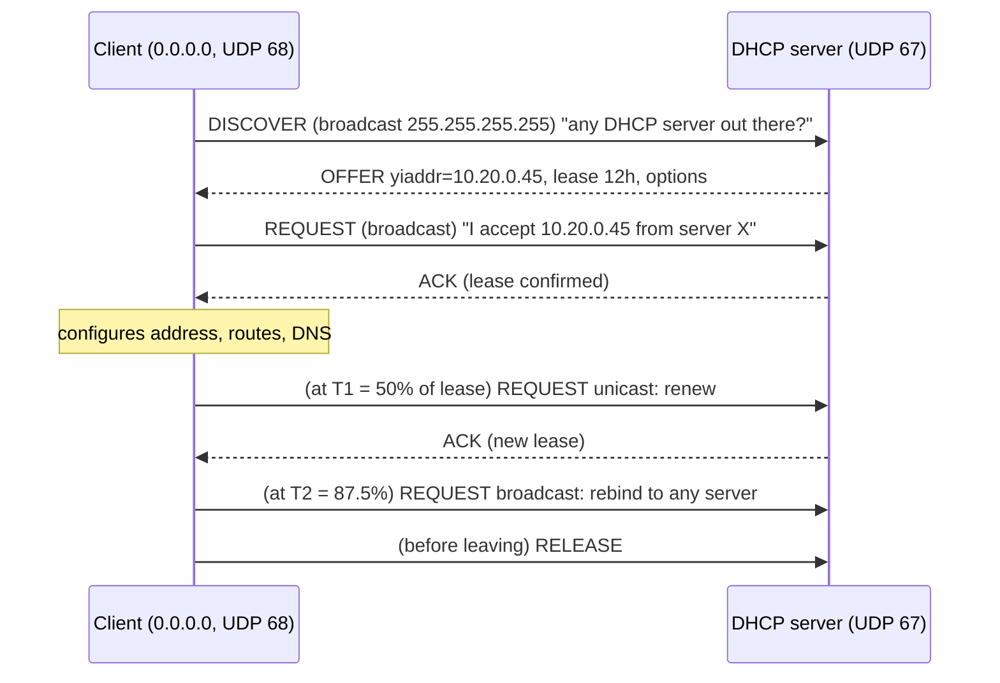
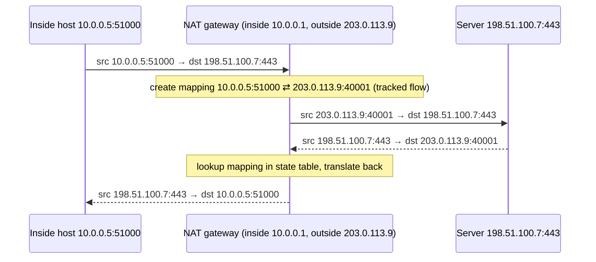
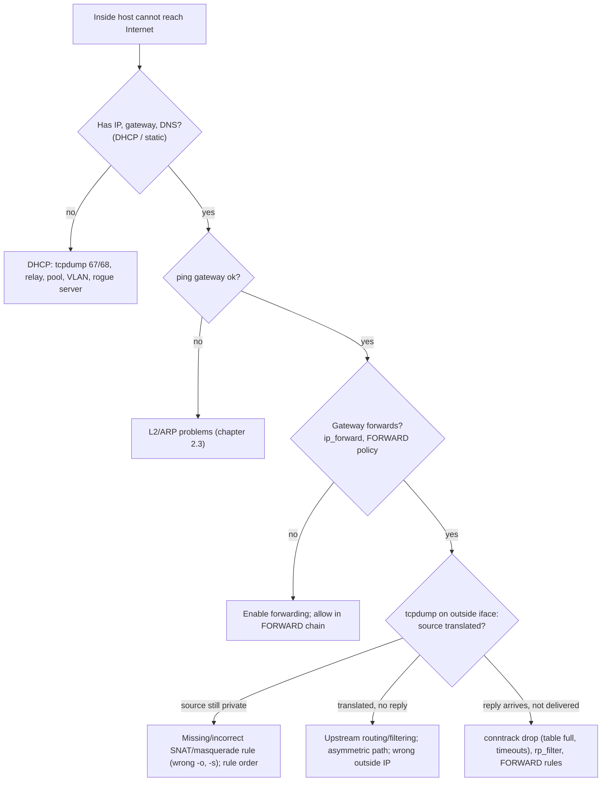

# 2.9 DHCP, NAT and PAT

| | |
|---|---|
| Level | Beginner to intermediate |
| Priority tier | 0 |
| Lab venue | Linux VM with network namespaces |
| Part | Part 2: Networking, from first principles to AI fabrics |
| Status | Drafted, labs **untested** |

## Why this matters for AI infrastructure

Bare-metal GPU nodes are provisioned by network boot: the node's BMC and NIC send DHCP requests, a provisioning server (Base Command Manager, MAAS, Foreman, Ironic) answers with an address plus PXE/iPXE boot options, and the whole fleet comes up from a DHCP/TFTP/HTTP chain. NAT is how private cluster nodes reach package mirrors and registries through a gateway, how cloud VMs with no public IP get outbound access (Cloud NAT, NAT gateway), and how Kubernetes services and Docker publish ports (iptables DNAT and masquerade). Both are also classic sources of confusing failures: DHCP leases that expire during a long job, rogue DHCP servers, NAT tables that fill, conntrack drops, hairpin NAT surprises, port exhaustion on a shared egress address, and "works from my laptop but not from the node" asymmetries.

## Prerequisites and outcomes

You should know IP addressing (2.4), routing and forwarding (2.5), UDP (2.7).

After this chapter you can:

- Walk through DHCPv4 (DORA), renewals, relays, options (router, DNS, domain, NTP, classless routes, PXE), and DHCPv6/SLAAC.
- Configure ISC Kea/dnsmasq/dhcpd for static reservations and PXE; read client leases; troubleshoot with `tcpdump`.
- Explain private address space, NAT motivations and types: static NAT, dynamic NAT, PAT (NAPT/masquerade), SNAT, DNAT/port forwarding, hairpin NAT, CGNAT, NAT64.
- Explain how a NAT device keeps state (translation table / conntrack), what breaks (protocols with embedded addresses, inbound connections, UDP timeouts, fragmentation), and port exhaustion.
- Configure Linux NAT with nftables/iptables; understand Kubernetes and Docker NAT; and cloud NAT variants.
- Debug DHCP and NAT problems and choose when not to use NAT (IPv6, RDMA fabrics).

## 1. DHCP: automatic configuration

The **Dynamic Host Configuration Protocol** (RFC 2131 for IPv4) gives a host the settings it needs to participate in a network: an IP address and mask, default gateway, DNS servers, search domain, NTP servers, lease time and any vendor options (PXE boot file, MTU, classless static routes). Without DHCP an administrator configures each host by hand; with it, hosts are configured centrally and addresses are **leased** (reused after expiry).

### DORA



- Messages are UDP: client port 68, server port 67, using broadcasts initially because the client has no address and does not know the server. The client identifies itself by its MAC (chaddr) and optionally a **client identifier** (option 61); servers may give the same address for the same client ID (static reservation).
- The REQUEST is broadcast so that other servers that made offers learn the client chose a different one. After an ACK, the client may do an **ARP probe** to check the address is unused (decline if there is a conflict).
- **Lease timers**: T1 (renew, default 50%), T2 (rebind, 87.5%), expiry. On expiry the client must stop using the address and restart. Long-running jobs on nodes with short leases and an unreachable DHCP server are a failure mode; use long leases or static addressing for servers.
- **INFORM** asks for options without an address (for statically configured hosts); **NAK** tells the client its requested address is not valid here (it moved networks) and it must restart.

### Relays, scopes and options

A broadcast does not cross routers. A **DHCP relay agent** (the `ip helper-address` on a switch SVI or router interface, `dhcrelay`, `dnsmasq --dhcp-relay`) listens for broadcasts on a subnet, adds the interface address into the `giaddr` field, and unicasts the request to the central DHCP server; the server uses `giaddr` to pick the **scope** (subnet pool) for the answer. Option 82 (relay agent information) can carry circuit ID/remote ID identifying the switch port, enabling port-based address assignment in data centres.

Common options:

| Option | Meaning |
|---|---|
| 1 | Subnet mask |
| 3 | Router(s) (default gateway) |
| 6 | DNS servers |
| 12 | Hostname |
| 15 | Domain name; 119 domain search list |
| 26 | Interface MTU |
| 42 | NTP servers |
| 51 | Lease time |
| 53 | Message type (Discover, Offer, Request, ACK, NAK, Decline, Release, Inform) |
| 54 | Server identifier |
| 66 / 67 | TFTP server name / boot file name (PXE) |
| 121 / 249 | Classless static routes |
| 60 / 77 / 93 | Vendor class (e.g. `PXEClient`), user class, client architecture (BIOS vs UEFI) |

### PXE boot of bare-metal GPU nodes

1. NIC firmware (PXE ROM or UEFI HTTP boot) sends DHCP DISCOVER with vendor class `PXEClient` and architecture (option 93).
2. The server replies with an address plus `next-server` (TFTP) and `filename` (e.g. `ipxe.efi` for UEFI x86-64) - or an HTTP URL for HTTP boot.
3. The firmware downloads the bootloader (iPXE), which may chain-load a script via HTTP, which fetches the kernel and initrd (and a kickstart/autoinstall/cloud-init seed).
4. The OS installer or image-based provisioner (BCM, MAAS, Ironic) configures the node; the node's own DHCP client then runs under the OS.

Provisioning systems pair a DHCP/TFTP/HTTP service with an inventory (MAC to hostname/address/profile). Troubleshoot by capturing DHCP on the provisioning VLAN (`tcpdump -ni eth0 -vv port 67 or port 68`), checking firmware boot mode (UEFI vs legacy), architecture matching, TFTP firewall rules (UDP 69 plus ephemeral ports) and that DHCP replies reach the node (relay and VLAN configuration). **Only one DHCP server may answer a subnet** (or they must be a coordinated failover pair); a rogue server (a forgotten lab router) hands out wrong gateways, and switches mitigate with **DHCP snooping**.

### Linux clients and servers

- Clients: `dhclient` (legacy), `systemd-networkd` (built-in DHCP), NetworkManager (`internal` or `dhclient`), `dhcpcd`, cloud-init + netplan. Inspect: `ip addr` (`dynamic`, `valid_lft`), `networkctl status eth0`, `nmcli device show eth0`, lease files (`/var/lib/dhcp/dhclient.leases`, `/run/systemd/netif/leases/`), logs `journalctl -u systemd-networkd`.
- Force a renewal: `sudo networkctl renew eth0`, `sudo dhclient -r eth0 && sudo dhclient eth0`, `nmcli device reapply eth0`.
- Servers: **ISC dhcpd** (end-of-life, widely deployed), **ISC Kea** (modern, JSON config, REST API, HA hooks, database backends), **dnsmasq** (small DHCP+DNS+TFTP for labs and appliances), cloud-provided DHCP (VPC metadata services), router/BMC built-ins.

```text
# dnsmasq: DHCP + PXE for a provisioning VLAN
interface=eno2
dhcp-range=10.50.0.100,10.50.0.200,255.255.255.0,12h
dhcp-option=option:router,10.50.0.1
dhcp-option=option:dns-server,10.50.0.10
dhcp-host=aa:bb:cc:dd:ee:01,gpu01,10.50.0.11,infinite      # static reservation by MAC
dhcp-match=set:efi64,option:client-arch,7
dhcp-boot=tag:efi64,ipxe.efi,boot-server,10.50.0.10        # UEFI x86-64 PXE
enable-tftp
tftp-root=/srv/tftp
```

```json
// Kea DHCPv4 fragment: subnet with pool and a reservation
{ "subnet4": [{ "subnet": "10.50.0.0/24",
   "pools": [{ "pool": "10.50.0.100 - 10.50.0.200" }],
   "option-data": [{ "name": "routers", "data": "10.50.0.1" }],
   "reservations": [{ "hw-address": "aa:bb:cc:dd:ee:01", "ip-address": "10.50.0.11", "hostname": "gpu01" }] }] }
```

### DHCPv6, SLAAC and IPv6

IPv6 hosts can configure themselves in several ways. **SLAAC** (stateless address autoconfiguration): the router advertises the prefix (RA, ICMPv6 type 134) and the host builds its own interface ID (EUI-64 or randomised, stable-privacy). **DHCPv6**: *stateful* (assigns addresses, M flag) or *stateless* (only other config, O flag, e.g. DNS). **Prefix delegation** (IA_PD) gives a router a whole prefix to carve up. DHCPv6 does not carry the default gateway: it comes only from RAs. DHCPv6 uses UDP 546 (client) and 547 (server) and a **DUID** to identify the client rather than the MAC. Most data-centre fabrics use static or SLAAC/BGP-unnumbered designs rather than DHCP for the fabric itself; DHCP is for management and provisioning networks.

### Hardening and diagnostics

- DHCP snooping + dynamic ARP inspection on switches; restrict which ports may reply as DHCP servers.
- Reserve addresses for infrastructure by MAC or client ID instead of leaving them in the pool; keep pools separate from static ranges.
- Capture: `sudo tcpdump -ni eno2 -vvv 'port 67 or port 68'` (show options). `dhcping`/`nmap --script broadcast-dhcp-discover` probe servers (authorised networks only). On the server: lease database, logs, pool utilisation (alert before exhaustion).
- Typical symptoms: node gets 169.254.x.x (link-local fallback: no DHCP reply: VLAN, relay, server down, pool exhausted), wrong gateway (rogue server), duplicate IPs (static address inside the pool), PXE hangs at "TFTP" (firewall/MTU), PXE loops (boot order, UEFI/BIOS mismatch).

## 2. Private addressing and why NAT exists

IPv4's 32 bits are not enough for every device to have a unique public address. RFC 1918 reserved **private** blocks that are not routed on the public Internet: `10.0.0.0/8`, `172.16.0.0/12`, `192.168.0.0/16`; plus `100.64.0.0/10` (carrier-grade NAT shared space, RFC 6598) and link-local `169.254.0.0/16`. Many networks reuse the same private ranges, so a **Network Address Translator** at the boundary rewrites addresses (and ports) in packets so that private hosts can reach public ones through one or few public addresses. NAT also became an accidental security boundary (inbound connections are not forwarded without explicit mapping), though it is **not** a firewall and gives no real security by itself.

## 3. Types of NAT

| Type | What changes | Typical use |
|---|---|---|
| **Static NAT (1:1)** | A fixed inside address ↔ fixed outside address | Publish a server on a public IP; elastic IPs in the cloud |
| **Dynamic NAT** | Inside addresses mapped to a pool of outside addresses on demand | Rare today |
| **PAT / NAPT / masquerade** | Many inside hosts share one outside address, distinguished by translated **source port** | Home routers, NAT gateways, Cloud NAT, `iptables -j MASQUERADE` |
| **SNAT** | Rewrite the **source** address (the outbound direction) | Egress to the Internet, forcing a known source IP |
| **DNAT** | Rewrite the **destination** (inbound) | Port forwarding, load balancing (Kubernetes Services, Docker `-p`) |
| **Hairpin / NAT loopback** | Inside client reaches an inside server via its public address | Needs SNAT as well, or the reply bypasses the NAT and the client rejects it |
| **CGNAT / LSN** | Provider-level NAT44 shared by many subscribers (100.64/10) | ISPs |
| **NAT64 / DNS64, 464XLAT** | Translate IPv6 clients to IPv4 servers | IPv6-only networks reaching IPv4 content |
| **NAT66 / NPTv6** | Stateless prefix translation for IPv6 | Rare; multihoming |

### How PAT works



The gateway keeps a **translation table** (on Linux, the **conntrack** table, chapter 2.23) keyed by the flow 5-tuple; the first outbound packet creates an entry; replies match it and are rewritten back; entries expire on timers (TCP established: hours; TCP after FIN: seconds; UDP: 30 to 120 s; ICMP: 30 s). NAT also fixes up the IP and TCP/UDP checksums and ICMP error payloads.

**Consequences and limits.**

- **No unsolicited inbound**: with PAT, external hosts cannot initiate connections to inside hosts unless a DNAT/static mapping exists (port forwarding, UPnP/NAT-PMP, STUN/ICE hole punching for peer-to-peer).
- **State**: NAT is stateful; state is a failure domain (gateway reboot drops all connections; HA pairs must sync state; asymmetric routing around a NAT breaks flows), consumes memory, and can be exhausted (`nf_conntrack: table full, dropping packet`).
- **Port exhaustion**: one outside address has about 64k ports *per destination 3-tuple*; many clients connecting to the same destination (a package mirror, an API endpoint, an object store) can exhaust the mapping space (cloud NAT gateways document this: allocate more addresses or ports per VM, reuse connections, shorten TCP time-wait on the gateway, spread across destinations).
- **Embedded addresses**: protocols that carry IPs/ports inside the payload (active FTP, SIP, H.323, IRC DCC, some RPC) need an ALG (application-level gateway) helper, or fail; modern protocols avoid this (TLS, HTTP).
- **End-to-end breakage**: IPsec AH is incompatible with NAT; ESP needs NAT-T (UDP 4500 encapsulation); peer-to-peer needs STUN/TURN/ICE; logging/auditing requires correlating the NAT mapping log with the original address (CGNAT logs).
- **MTU/fragmentation**: later fragments have no ports and may not be matched; PMTUD still needed (chapter 2.7).
- **Why IPv6**: with ample addresses, end-to-end addressing returns; use a stateful firewall for policy rather than NAT.

## 4. NAT on Linux

NAT is implemented by **netfilter** with **conntrack** (stateful flow tracking). Packets traverse hooks: PREROUTING (DNAT happens here, before routing), INPUT/FORWARD/OUTPUT, POSTROUTING (SNAT/masquerade happens here, after routing). Only the **first packet of a flow** goes through the NAT chains; later packets of the flow are translated automatically by the conntrack entry. Details and the full ruleset model are in chapter 2.23; the essentials:

```bash
# Prerequisites: forwarding on (chapter 2.5)
sudo sysctl -w net.ipv4.ip_forward=1

# --- iptables (legacy / iptables-nft) ---
sudo iptables -t nat -A POSTROUTING -s 10.0.0.0/24 -o eth0 -j MASQUERADE           # PAT, uses the outgoing interface's current address
sudo iptables -t nat -A POSTROUTING -s 10.0.0.0/24 -o eth0 -j SNAT --to-source 203.0.113.9   # PAT with a fixed address (faster, for static IPs)
sudo iptables -t nat -A PREROUTING -i eth0 -p tcp --dport 8443 -j DNAT --to-destination 10.0.0.20:443   # port forward
sudo iptables -A FORWARD -p tcp -d 10.0.0.20 --dport 443 -j ACCEPT                 # the filter still has to allow it
sudo iptables -t nat -L -n -v --line-numbers

# --- nftables equivalent ---
sudo nft add table ip nat
sudo nft 'add chain ip nat prerouting  { type nat hook prerouting  priority dstnat ; }'
sudo nft 'add chain ip nat postrouting { type nat hook postrouting priority srcnat ; }'
sudo nft add rule ip nat postrouting ip saddr 10.0.0.0/24 oifname "eth0" masquerade
sudo nft add rule ip nat prerouting  iifname "eth0" tcp dport 8443 dnat to 10.0.0.20:443
sudo nft list ruleset

# --- inspect translations ---
sudo conntrack -L | head            # entries show original and reply tuples
sudo conntrack -L -p tcp --dport 443
sudo conntrack -C ; sysctl net.netfilter.nf_conntrack_max net.netfilter.nf_conntrack_count
sudo conntrack -E                   # live events (NEW, UPDATE, DESTROY)
```

Reading a conntrack entry: `tcp 6 431999 ESTABLISHED src=10.0.0.5 dst=198.51.100.7 sport=51000 dport=443 src=198.51.100.7 dst=203.0.113.9 sport=443 dport=40001 [ASSURED]`. The first tuple is the original direction (inside address), the second is the *expected reply* tuple (reply destination is the translated address and port); the difference shows the NAT mapping.

**Masquerade vs SNAT.** `MASQUERADE` looks up the outgoing interface address for every new flow and flushes mappings when the interface goes down; ideal for dynamic addresses (DHCP, PPP). `SNAT --to-source` uses a fixed address and is slightly cheaper and does not drop conntrack entries on link flaps; use it with static public IPs.

**Hairpin NAT** (an inside client reaching a DNAT-published inside server via the public address): the DNAT rewrite delivers the packet to the server with the client's inside source address, so the server replies directly to the client, bypassing the NAT, and the client sees a reply from an unexpected address and drops it. Fix by also SNATing (masquerading) such traffic on the way (`-s 10.0.0.0/24 -d 10.0.0.20 -j MASQUERADE`), or use split DNS so inside clients resolve the server's inside address (usually better).

### Container and Kubernetes NAT

- **Docker** `bridge` network: containers get addresses from 172.17.0.0/16 on `docker0`; outbound traffic is masqueraded (`POSTROUTING ... MASQUERADE`); published ports (`-p 8080:80`) add DNAT rules in a `DOCKER` chain, and Docker manipulates iptables (it also sets the FORWARD policy). Inspect: `iptables -t nat -S`, `docker network inspect`.
- **Kubernetes**: Services of type ClusterIP/NodePort/LoadBalancer are implemented by kube-proxy as DNAT rules (iptables mode: chains `KUBE-SERVICES`, `KUBE-SVC-*`, `KUBE-SEP-*` with probabilistic load balancing; IPVS mode: virtual servers with DNAT; or eBPF replacement in Cilium). Pod egress to the Internet is typically SNATed to the node address (masquerade) unless the CNI uses routable pod IPs; `externalTrafficPolicy: Local` preserves client IPs; NAT adds conntrack load, which matters at high connection rates. Inspect with `iptables-save | grep KUBE-`, `ipvsadm -Ln`, `conntrack -L`.
- Because connections through kube-proxy depend on conntrack, node conntrack tuning (`nf_conntrack_max`, hash size, timeouts) and UDP/DNS behaviour (chapter 2.8) are part of cluster operations.

### Cloud NAT

Instances without external IPs egress through a managed **NAT gateway** (GCP Cloud NAT, AWS NAT Gateway, Azure NAT Gateway) configured per subnet or region with allocated external IPs and port allocation limits (minimum ports per VM, dynamic allocation). Characteristics: outbound only (no unsolicited inbound), logging of translations, quotas, per-destination port limits, cost per GB. For AI clusters pulling from public registries or Hugging Face, plan NAT address/port capacity (hundreds of nodes starting at once can exhaust ports), or use private access paths (Private Google Access, VPC endpoints, internal mirrors/registries) to avoid NAT altogether (chapter 2.32).

## 5. NAT and the fabric: where NAT does not belong

Inside AI back-end fabrics (InfiniBand, RoCE v2) you do not NAT: RDMA verbs exchange queue-pair numbers and GIDs/addresses in connection setup, endpoints must see each other's true addresses, and NAT state would sit in the way of line-rate transport. Design each fabric as a routed (or L2) private network with its own addressing plan (chapter 2.4), and use NAT only at the edges (management/front-end internet access). Overlapping private ranges between clusters (every cluster uses 10.0.0.0/8) cause trouble when networks are later connected; allocate non-overlapping blocks from the start.

## 6. Troubleshooting



Counting checks: `conntrack -S` (insert_failed, drop, early_drop), `dmesg | grep conntrack`, `ss -s`, `iptables -t nat -L -v -n` (packet counters on each rule), `nft list ruleset` with counters, `tcpdump -ni any host X` on both interfaces. For inbound DNAT: does the reply leave through the same gateway (asymmetric routing)? Is the server's default gateway the NAT box? Is there a conflicting firewall in the FORWARD chain? Check `sysctl net.ipv4.conf.*.rp_filter`.

## 7. Lab: DHCP server and NAT gateway with namespaces (untested)

1. Reuse the three-namespace topology (hA - r - hB) from chapter 2.5. Make `r` the gateway with an "outside" interface (a veth to the host's bridge or a dummy "Internet" namespace `inet` holding 198.51.100.7).
2. **DHCP**: run dnsmasq in `r` on the inside interface (`ip netns exec r dnsmasq --no-daemon --interface=rA --dhcp-range=10.1.0.50,10.1.0.60,12h --dhcp-option=option:router,10.1.0.1 --log-dhcp`); in `hA` run `dhclient -v vA` (without an address configured); capture DORA with tcpdump; inspect the lease; kill the server and watch renewal attempts at T1/T2 (use a 60 s lease for the experiment); add a MAC reservation; try a second rogue dnsmasq and observe which wins.
3. **PAT**: give `inet` a server (`nc -l 80`), add masquerade on r's outside interface; connect from hA and hB; compare source addresses at the server, inspect `conntrack -L`, see both inside hosts sharing the outside address with distinct source ports.
4. **Port forward**: DNAT outside:8080 → hA:80 with a FORWARD allow rule; test from `inet`; remove the allow rule and see the failure; show the packet counters.
5. **Hairpin**: connect from hB to the outside address:8080; show it fails; add the hairpin masquerade rule; discuss the split-DNS alternative.
6. **Port exhaustion**: restrict the NAT port range (`--to-ports 40000-40010` on a SNAT rule), open 20 connections to the same destination from different inside ports, and observe failures and `conntrack -S` counters.
7. **Timeouts**: observe UDP entries expiring (`sysctl net.netfilter.nf_conntrack_udp_timeout`), and a long-idle TCP connection surviving; discuss keepalives.
8. **PXE (optional)**: a QEMU VM with network boot against dnsmasq's `enable-tftp`/`dhcp-boot` to boot iPXE.
9. **Clean up**.

Mark tested only after execution.

## 8. Common mistakes

- Two DHCP servers on one segment (or a lab router left on); pools that overlap static addresses.
- DHCP leases too short for servers, or servers depending on a single DHCP instance.
- Forgetting a DHCP relay (`helper-address`) on a routed VLAN; relay pointing at the wrong server.
- Masquerade rule with the wrong interface/source; forgetting `ip_forward` or the FORWARD allow for DNAT traffic.
- Treating NAT as a firewall; leaving the FORWARD policy accept on a gateway.
- Ignoring conntrack capacity and timeouts; port exhaustion on shared egress addresses.
- Overlapping private ranges between sites or clusters.
- Using NAT inside an RDMA fabric.

## 9. Interview angles

- "Walk through DHCP DORA; what if there is a relay?"
- "A node PXE boots but hangs after getting an IP. What do you check?" (TFTP/HTTP boot server, filename option, firewall, UEFI/BIOS arch.)
- "What is the difference between SNAT, DNAT, masquerade and PAT?"
- "Explain what a conntrack entry shows." 
- "Pods can't reach the Internet but nodes can. Where would you look?" (Masquerade rule, CNI egress, NetworkPolicy, MTU, DNS.)
- "What breaks with NAT?" (Inbound, embedded addresses, IPsec AH, P2P; state and port exhaustion.)
- "Why don't we NAT RoCE traffic?"
- "How do cloud NAT gateways run out of ports and how do you avoid it?"

## 10. Checkpoint questions (25)

1. What does DORA stand for? **A:** Discover, Offer, Request, Acknowledge.
2. Which UDP ports does DHCPv4 use? **A:** Client 68, server 67.
3. Why are DISCOVER and REQUEST broadcast? **A:** The client has no address and doesn't know the server; REQUEST informs other servers.
4. What are T1 and T2? **A:** Renewal (50%) and rebinding (87.5%) timers.
5. What does a DHCP relay do? **A:** Forwards broadcast requests to a server as unicast, setting `giaddr`.
6. What does option 82 carry? **A:** Relay agent information such as circuit/remote ID.
7. Which options configure PXE? **A:** next-server/66, boot file/67, plus vendor class 60 and architecture 93.
8. What is DHCP snooping? **A:** Switch feature that blocks unauthorised DHCP servers and builds a binding table.
9. What does a 169.254.x.x address mean? **A:** DHCP failed; link-local fallback.
10. What does DHCPv6 not provide? **A:** The default gateway (RAs do).
11. What is SLAAC? **A:** Hosts form addresses from advertised prefixes.
12. Name the RFC 1918 blocks. **A:** 10/8, 172.16/12, 192.168/16.
13. What is 100.64.0.0/10? **A:** Shared address space for CGNAT.
14. What is PAT? **A:** Many hosts share one address using translated ports.
15. SNAT versus DNAT? **A:** Rewrite source (outbound) versus destination (inbound).
16. Where do SNAT and DNAT occur in netfilter? **A:** POSTROUTING and PREROUTING respectively.
17. What does masquerade do differently from SNAT? **A:** Uses the interface's current address and flushes on link changes.
18. What state does NAT keep on Linux? **A:** conntrack entries.
19. How does a conntrack entry show the mapping? **A:** The reply tuple has the translated address/port.
20. What is hairpin NAT? **A:** Inside clients reaching an inside server via its public address; needs SNAT or split DNS.
21. Why does NAT break active FTP? **A:** Addresses are embedded in the payload; needs an ALG.
22. What is port exhaustion? **A:** No free source ports left for new mappings to the same destination.
23. How do Kubernetes Services use NAT? **A:** kube-proxy DNATs ClusterIP/NodePort to pod endpoints.
24. Why avoid NAT in RDMA fabrics? **A:** Endpoint addresses are exchanged in setup and state/latency is unwanted.
25. Is NAT a firewall? **A:** No; it provides no policy by itself.

## 11. Sources and review notes

**Written in original words.** Principal sources:

- Brian Ward, *How Linux Works*, 3rd ed., chapter 9: network configuration managers, boot-activated configuration, NAT (IP masquerading), firewalls and routers, and the DHCP/NetworkManager discussion.
- Russ White and Jeff Tantsura (with co-authors), *Computer Networking Problems and Solutions*, chapter 5 and addressing chapters for address-translation context.
- DHCP/PXE details, NAT behaviour, conntrack, Kubernetes and cloud NAT notes are the author's synthesis from RFCs 2131, 2132, 3315/8415 (DHCPv6), 1918, 3022, 6598, 6146, and the dnsmasq, Kea, nftables, and conntrack-tools documentation.

**Flagged for verification before publishing:** dnsmasq/Kea syntax per version, UEFI PXE option values, conntrack timeouts and defaults per kernel, kube-proxy chain names, and cloud NAT limits (GCP/AWS/Azure); all labs are **untested**.
