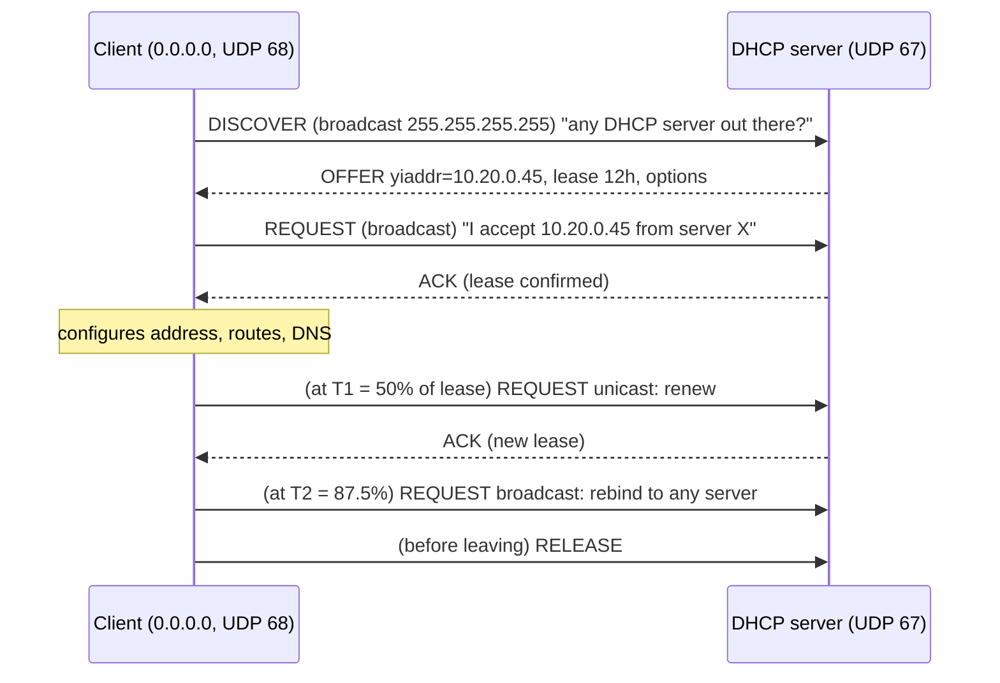
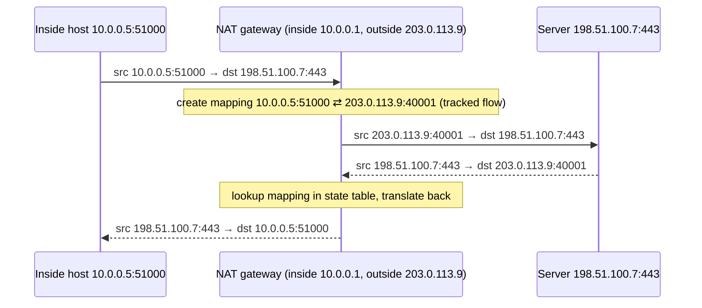
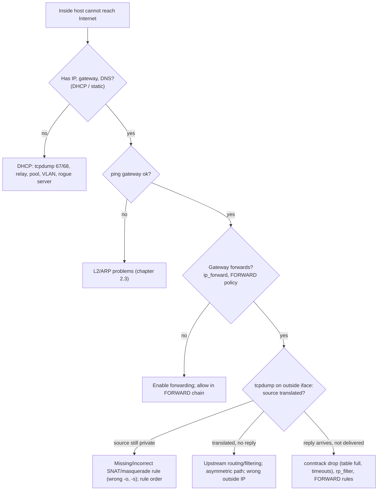

# 2.9 DHCP, NAT and PAT

| | |
|---|---|
| Level | Beginner to intermediate |
| Priority tier | 0 |
| Lab venue | Linux VM with network namespaces |
| Part | Part 2: Networking, from first principles to AI fabrics |
| Status | Drafted, labs **untested** |

## Why this matters for AI infrastructure

Bare-metal GPU nodes are provisioned by network boot: the node's BMC and NIC send DHCP requests, a provisioning server (Base Command Manager, MAAS, Foreman, Ironic) answers with an address plus PXE/iPXE boot options, and the whole fleet comes up from a DHCP/TFTP/HTTP chain. NAT is how private cluster nodes reach package mirrors and registries through a gateway, how cloud VMs with no public IP get outbound access (Cloud NAT, NAT gateway), and how Kubernetes services and Docker publish ports (iptables DNAT and masquerade). Both are also classic sources of confusing failures: DHCP leases that expire during a long job, rogue DHCP servers, NAT tables that fill, conntrack drops, hairpin NAT surprises, port exhaustion on a shared egress address, and "works from my laptop but not from the node" asymmetries.

## Prerequisites and outcomes

You should know IP addressing (2.4), routing and forwarding (2.5), UDP (2.7).

After this chapter you can:

- Walk through DHCPv4 (DORA), renewals, relays, options (router, DNS, domain, NTP, classless routes, PXE), and DHCPv6/SLAAC.
- Configure ISC Kea/dnsmasq/dhcpd for static reservations and PXE; read client leases; troubleshoot with `tcpdump`.
- Explain private address space, NAT motivations and types: static NAT, dynamic NAT, PAT (NAPT/masquerade), SNAT, DNAT/port forwarding, hairpin NAT, CGNAT, NAT64.
- Explain how a NAT device keeps state (translation table / conntrack), what breaks (protocols with embedded addresses, inbound connections, UDP timeouts, fragmentation), and port exhaustion.
- Configure Linux NAT with nftables/iptables; understand Kubernetes and Docker NAT; and cloud NAT variants.
- Debug DHCP and NAT problems and choose when not to use NAT (IPv6, RDMA fabrics).

## 1. DHCP: automatic configuration

The **Dynamic Host Configuration Protocol** (RFC 2131 for IPv4) gives a host the settings it needs to participate in a network: an IP address and mask, default gateway, DNS servers, search domain, NTP servers, lease time and any vendor options (PXE boot file, MTU, classless static routes). Without DHCP an administrator configures each host by hand; with it, hosts are configured centrally and addresses are **leased** (reused after expiry).

### DORA



- Messages are UDP: client port 68, server port 67, using broadcasts initially because the client has no address and does not know the server. The client identifies itself by its MAC (chaddr) and optionally a **client identifier** (option 61); servers may give the same address for the same client ID (static reservation).
- The REQUEST is broadcast so that other servers that made offers learn the client chose a different one. After an ACK, the client may do an **ARP probe** to check the address is unused (decline if there is a conflict).
- **Lease timers**: T1 (renew, default 50%), T2 (rebind, 87.5%), expiry. On expiry the client must stop using the address and restart. Long-running jobs on nodes with short leases and an unreachable DHCP server are a failure mode; use long leases or static addressing for servers.
- **INFORM** asks for options without an address (for statically configured hosts); **NAK** tells the client its requested address is not valid here (it moved networks) and it must restart.

### Relays, scopes and options

A broadcast does not cross routers. A **DHCP relay agent** (the `ip helper-address` on a switch SVI or router interface, `dhcrelay`, `dnsmasq --dhcp-relay`) listens for broadcasts on a subnet, adds the interface address into the `giaddr` field, and unicasts the request to the central DHCP server; the server uses `giaddr` to pick the **scope** (subnet pool) for the answer. Option 82 (relay agent information) can carry circuit ID/remote ID identifying the switch port, enabling port-based address assignment in data centres.

Common options:

| Option | Meaning |
|---|---|
| 1 | Subnet mask |
| 3 | Router(s) (default gateway) |
| 6 | DNS servers |
| 12 | Hostname |
| 15 | Domain name; 119 domain search list |
| 26 | Interface MTU |
| 42 | NTP servers |
| 51 | Lease time |
| 53 | Message type (Discover, Offer, Request, ACK, NAK, Decline, Release, Inform) |
| 54 | Server identifier |
| 66 / 67 | TFTP server name / boot file name (PXE) |
| 121 / 249 | Classless static routes |
| 60 / 77 / 93 | Vendor class (e.g. `PXEClient`), user class, client architecture (BIOS vs UEFI) |

### PXE boot of bare-metal GPU nodes

1. NIC firmware (PXE ROM or UEFI HTTP boot) sends DHCP DISCOVER with vendor class `PXEClient` and architecture (option 93).
2. The server replies with an address plus `next-server` (TFTP) and `filename` (e.g. `ipxe.efi` for UEFI x86-64) - or an HTTP URL for HTTP boot.
3. The firmware downloads the bootloader (iPXE), which may chain-load a script via HTTP, which fetches the kernel and initrd (and a kickstart/autoinstall/cloud-init seed).
4. The OS installer or image-based provisioner (BCM, MAAS, Ironic) configures the node; the node's own DHCP client then runs under the OS.

Provisioning systems pair a DHCP/TFTP/HTTP service with an inventory (MAC to hostname/address/profile). Troubleshoot by capturing DHCP on the provisioning VLAN (`tcpdump -ni eth0 -vv port 67 or port 68`), checking firmware boot mode (UEFI vs legacy), architecture matching, TFTP firewall rules (UDP 69 plus ephemeral ports) and that DHCP replies reach the node (relay and VLAN configuration). **Only one DHCP server may answer a subnet** (or they must be a coordinated failover pair); a rogue server (a forgotten lab router) hands out wrong gateways, and switches mitigate with **DHCP snooping**.

### Linux clients and servers

- Clients: `dhclient` (legacy), `systemd-networkd` (built-in DHCP), NetworkManager (`internal` or `dhclient`), `dhcpcd`, cloud-init + netplan. Inspect: `ip addr` (`dynamic`, `valid_lft`), `networkctl status eth0`, `nmcli device show eth0`, lease files (`/var/lib/dhcp/dhclient.leases`, `/run/systemd/netif/leases/`), logs `journalctl -u systemd-networkd`.
- Force a renewal: `sudo networkctl renew eth0`, `sudo dhclient -r eth0 && sudo dhclient eth0`, `nmcli device reapply eth0`.
- Servers: **ISC dhcpd** (end-of-life, widely deployed), **ISC Kea** (modern, JSON config, REST API, HA hooks, database backends), **dnsmasq** (small DHCP+DNS+TFTP for labs and appliances), cloud-provided DHCP (VPC metadata services), router/BMC built-ins.

```text
# dnsmasq: DHCP + PXE for a provisioning VLAN
interface=eno2
dhcp-range=10.50.0.100,10.50.0.200,255.255.255.0,12h
dhcp-option=option:router,10.50.0.1
dhcp-option=option:dns-server,10.50.0.10
dhcp-host=aa:bb:cc:dd:ee:01,gpu01,10.50.0.11,infinite      # static reservation by MAC
dhcp-match=set:efi64,option:client-arch,7
dhcp-boot=tag:efi64,ipxe.efi,boot-server,10.50.0.10        # UEFI x86-64 PXE
enable-tftp
tftp-root=/srv/tftp
```

```json
// Kea DHCPv4 fragment: subnet with pool and a reservation
{ "subnet4": [{ "subnet": "10.50.0.0/24",
   "pools": [{ "pool": "10.50.0.100 - 10.50.0.200" }],
   "option-data": [{ "name": "routers", "data": "10.50.0.1" }],
   "reservations": [{ "hw-address": "aa:bb:cc:dd:ee:01", "ip-address": "10.50.0.11", "hostname": "gpu01" }] }] }
```

### DHCPv6, SLAAC and IPv6

IPv6 hosts can configure themselves in several ways. **SLAAC** (stateless address autoconfiguration): the router advertises the prefix (RA, ICMPv6 type 134) and the host builds its own interface ID (EUI-64 or randomised, stable-privacy). **DHCPv6**: *stateful* (assigns addresses, M flag) or *stateless* (only other config, O flag, e.g. DNS). **Prefix delegation** (IA_PD) gives a router a whole prefix to carve up. DHCPv6 does not carry the default gateway: it comes only from RAs. DHCPv6 uses UDP 546 (client) and 547 (server) and a **DUID** to identify the client rather than the MAC. Most data-centre fabrics use static or SLAAC/BGP-unnumbered designs rather than DHCP for the fabric itself; DHCP is for management and provisioning networks.

### Hardening and diagnostics

- DHCP snooping + dynamic ARP inspection on switches; restrict which ports may reply as DHCP servers.
- Reserve addresses for infrastructure by MAC or client ID instead of leaving them in the pool; keep pools separate from static ranges.
- Capture: `sudo tcpdump -ni eno2 -vvv 'port 67 or port 68'` (show options). `dhcping`/`nmap --script broadcast-dhcp-discover` probe servers (authorised networks only). On the server: lease database, logs, pool utilisation (alert before exhaustion).
- Typical symptoms: node gets 169.254.x.x (link-local fallback: no DHCP reply: VLAN, relay, server down, pool exhausted), wrong gateway (rogue server), duplicate IPs (static address inside the pool), PXE hangs at "TFTP" (firewall/MTU), PXE loops (boot order, UEFI/BIOS mismatch).

## 2. Private addressing and why NAT exists

IPv4's 32 bits are not enough for every device to have a unique public address. RFC 1918 reserved **private** blocks that are not routed on the public Internet: `10.0.0.0/8`, `172.16.0.0/12`, `192.168.0.0/16`; plus `100.64.0.0/10` (carrier-grade NAT shared space, RFC 6598) and link-local `169.254.0.0/16`. Many networks reuse the same private ranges, so a **Network Address Translator** at the boundary rewrites addresses (and ports) in packets so that private hosts can reach public ones through one or few public addresses. NAT also became an accidental security boundary (inbound connections are not forwarded without explicit mapping), though it is **not** a firewall and gives no real security by itself.

## 3. Types of NAT

| Type | What changes | Typical use |
|---|---|---|
| **Static NAT (1:1)** | A fixed inside address ↔ fixed outside address | Publish a server on a public IP; elastic IPs in the cloud |
| **Dynamic NAT** | Inside addresses mapped to a pool of outside addresses on demand | Rare today |
| **PAT / NAPT / masquerade** | Many inside hosts share one outside address, distinguished by translated **source port** | Home routers, NAT gateways, Cloud NAT, `iptables -j MASQUERADE` |
| **SNAT** | Rewrite the **source** address (the outbound direction) | Egress to the Internet, forcing a known source IP |
| **DNAT** | Rewrite the **destination** (inbound) | Port forwarding, load balancing (Kubernetes Services, Docker `-p`) |
| **Hairpin / NAT loopback** | Inside client reaches an inside server via its public address | Needs SNAT as well, or the reply bypasses the NAT and the client rejects it |
| **CGNAT / LSN** | Provider-level NAT44 shared by many subscribers (100.64/10) | ISPs |
| **NAT64 / DNS64, 464XLAT** | Translate IPv6 clients to IPv4 servers | IPv6-only networks reaching IPv4 content |
| **NAT66 / NPTv6** | Stateless prefix translation for IPv6 | Rare; multihoming |

### How PAT works



The gateway keeps a **translation table** (on Linux, the **conntrack** table, chapter 2.23) keyed by the flow 5-tuple; the first outbound packet creates an entry; replies match it and are rewritten back; entries expire on timers (TCP established: hours; TCP after FIN: seconds; UDP: 30 to 120 s; ICMP: 30 s). NAT also fixes up the IP and TCP/UDP checksums and ICMP error payloads.

**Consequences and limits.**

- **No unsolicited inbound**: with PAT, external hosts cannot initiate connections to inside hosts unless a DNAT/static mapping exists (port forwarding, UPnP/NAT-PMP, STUN/ICE hole punching for peer-to-peer).
- **State**: NAT is stateful; state is a failure domain (gateway reboot drops all connections; HA pairs must sync state; asymmetric routing around a NAT breaks flows), consumes memory, and can be exhausted (`nf_conntrack: table full, dropping packet`).
- **Port exhaustion**: one outside address has about 64k ports *per destination 3-tuple*; many clients connecting to the same destination (a package mirror, an API endpoint, an object store) can exhaust the mapping space (cloud NAT gateways document this: allocate more addresses or ports per VM, reuse connections, shorten TCP time-wait on the gateway, spread across destinations).
- **Embedded addresses**: protocols that carry IPs/ports inside the payload (active FTP, SIP, H.323, IRC DCC, some RPC) need an ALG (application-level gateway) helper, or fail; modern protocols avoid this (TLS, HTTP).
- **End-to-end breakage**: IPsec AH is incompatible with NAT; ESP needs NAT-T (UDP 4500 encapsulation); peer-to-peer needs STUN/TURN/ICE; logging/auditing requires correlating the NAT mapping log with the original address (CGNAT logs).
- **MTU/fragmentation**: later fragments have no ports and may not be matched; PMTUD still needed (chapter 2.7).
- **Why IPv6**: with ample addresses, end-to-end addressing returns; use a stateful firewall for policy rather than NAT.

## 4. NAT on Linux

NAT is implemented by **netfilter** with **conntrack** (stateful flow tracking). Packets traverse hooks: PREROUTING (DNAT happens here, before routing), INPUT/FORWARD/OUTPUT, POSTROUTING (SNAT/masquerade happens here, after routing). Only the **first packet of a flow** goes through the NAT chains; later packets of the flow are translated automatically by the conntrack entry. Details and the full ruleset model are in chapter 2.23; the essentials:

```bash
# Prerequisites: forwarding on (chapter 2.5)
sudo sysctl -w net.ipv4.ip_forward=1

# --- iptables (legacy / iptables-nft) ---
sudo iptables -t nat -A POSTROUTING -s 10.0.0.0/24 -o eth0 -j MASQUERADE           # PAT, uses the outgoing interface's current address
sudo iptables -t nat -A POSTROUTING -s 10.0.0.0/24 -o eth0 -j SNAT --to-source 203.0.113.9   # PAT with a fixed address (faster, for static IPs)
sudo iptables -t nat -A PREROUTING -i eth0 -p tcp --dport 8443 -j DNAT --to-destination 10.0.0.20:443   # port forward
sudo iptables -A FORWARD -p tcp -d 10.0.0.20 --dport 443 -j ACCEPT                 # the filter still has to allow it
sudo iptables -t nat -L -n -v --line-numbers

# --- nftables equivalent ---
sudo nft add table ip nat
sudo nft 'add chain ip nat prerouting  { type nat hook prerouting  priority dstnat ; }'
sudo nft 'add chain ip nat postrouting { type nat hook postrouting priority srcnat ; }'
sudo nft add rule ip nat postrouting ip saddr 10.0.0.0/24 oifname "eth0" masquerade
sudo nft add rule ip nat prerouting  iifname "eth0" tcp dport 8443 dnat to 10.0.0.20:443
sudo nft list ruleset

# --- inspect translations ---
sudo conntrack -L | head            # entries show original and reply tuples
sudo conntrack -L -p tcp --dport 443
sudo conntrack -C ; sysctl net.netfilter.nf_conntrack_max net.netfilter.nf_conntrack_count
sudo conntrack -E                   # live events (NEW, UPDATE, DESTROY)
```

Reading a conntrack entry: `tcp 6 431999 ESTABLISHED src=10.0.0.5 dst=198.51.100.7 sport=51000 dport=443 src=198.51.100.7 dst=203.0.113.9 sport=443 dport=40001 [ASSURED]`. The first tuple is the original direction (inside address), the second is the *expected reply* tuple (reply destination is the translated address and port); the difference shows the NAT mapping.

**Masquerade vs SNAT.** `MASQUERADE` looks up the outgoing interface address for every new flow and flushes mappings when the interface goes down; ideal for dynamic addresses (DHCP, PPP). `SNAT --to-source` uses a fixed address and is slightly cheaper and does not drop conntrack entries on link flaps; use it with static public IPs.

**Hairpin NAT** (an inside client reaching a DNAT-published inside server via the public address): the DNAT rewrite delivers the packet to the server with the client's inside source address, so the server replies directly to the client, bypassing the NAT, and the client sees a reply from an unexpected address and drops it. Fix by also SNATing (masquerading) such traffic on the way (`-s 10.0.0.0/24 -d 10.0.0.20 -j MASQUERADE`), or use split DNS so inside clients resolve the server's inside address (usually better).

### Container and Kubernetes NAT

- **Docker** `bridge` network: containers get addresses from 172.17.0.0/16 on `docker0`; outbound traffic is masqueraded (`POSTROUTING ... MASQUERADE`); published ports (`-p 8080:80`) add DNAT rules in a `DOCKER` chain, and Docker manipulates iptables (it also sets the FORWARD policy). Inspect: `iptables -t nat -S`, `docker network inspect`.
- **Kubernetes**: Services of type ClusterIP/NodePort/LoadBalancer are implemented by kube-proxy as DNAT rules (iptables mode: chains `KUBE-SERVICES`, `KUBE-SVC-*`, `KUBE-SEP-*` with probabilistic load balancing; IPVS mode: virtual servers with DNAT; or eBPF replacement in Cilium). Pod egress to the Internet is typically SNATed to the node address (masquerade) unless the CNI uses routable pod IPs; `externalTrafficPolicy: Local` preserves client IPs; NAT adds conntrack load, which matters at high connection rates. Inspect with `iptables-save | grep KUBE-`, `ipvsadm -Ln`, `conntrack -L`.
- Because connections through kube-proxy depend on conntrack, node conntrack tuning (`nf_conntrack_max`, hash size, timeouts) and UDP/DNS behaviour (chapter 2.8) are part of cluster operations.

### Cloud NAT

Instances without external IPs egress through a managed **NAT gateway** (GCP Cloud NAT, AWS NAT Gateway, Azure NAT Gateway) configured per subnet or region with allocated external IPs and port allocation limits (minimum ports per VM, dynamic allocation). Characteristics: outbound only (no unsolicited inbound), logging of translations, quotas, per-destination port limits, cost per GB. For AI clusters pulling from public registries or Hugging Face, plan NAT address/port capacity (hundreds of nodes starting at once can exhaust ports), or use private access paths (Private Google Access, VPC endpoints, internal mirrors/registries) to avoid NAT altogether (chapter 2.32).

## 5. NAT and the fabric: where NAT does not belong

Inside AI back-end fabrics (InfiniBand, RoCE v2) you do not NAT: RDMA verbs exchange queue-pair numbers and GIDs/addresses in connection setup, endpoints must see each other's true addresses, and NAT state would sit in the way of line-rate transport. Design each fabric as a routed (or L2) private network with its own addressing plan (chapter 2.4), and use NAT only at the edges (management/front-end internet access). Overlapping private ranges between clusters (every cluster uses 10.0.0.0/8) cause trouble when networks are later connected; allocate non-overlapping blocks from the start.

## 6. Troubleshooting



Counting checks: `conntrack -S` (insert_failed, drop, early_drop), `dmesg | grep conntrack`, `ss -s`, `iptables -t nat -L -v -n` (packet counters on each rule), `nft list ruleset` with counters, `tcpdump -ni any host X` on both interfaces. For inbound DNAT: does the reply leave through the same gateway (asymmetric routing)? Is the server's default gateway the NAT box? Is there a conflicting firewall in the FORWARD chain? Check `sysctl net.ipv4.conf.*.rp_filter`.

## 7. Hands-on lab: DHCP server and NAT gateway with namespaces

First, run the self-checking Python lab (`code/part02/dhcp_nat_pat_lab.py`) locally. It verifies DHCP lease timer calculation (`T1 = 50%` renew, `T2 = 87.5%` rebind), `conntrack` SNAT/PAT tuple parsing (`10.0.0.5:51000` -> `203.0.113.9:40001`), NAT gateway source-port exhaustion toward a single destination, and Hairpin NAT loopback flow behavior.

```bash
python3 code/part02/dhcp_nat_pat_lab.py
```

Next, on a disposable Linux VM with `root` (all interactive VM commands below are `untested here`), work through these steps:

1. Reuse the three-namespace topology (hA - r - hB) from chapter 2.5. Make `r` the gateway with an "outside" interface (a veth to the host's bridge or a dummy "Internet" namespace `inet` holding 198.51.100.7).
2. **DHCP**: run dnsmasq in `r` on the inside interface (`ip netns exec r dnsmasq --no-daemon --interface=rA --dhcp-range=10.1.0.50,10.1.0.60,12h --dhcp-option=option:router,10.1.0.1 --log-dhcp`); in `hA` run `dhclient -v vA` (without an address configured); capture DORA with tcpdump; inspect the lease; kill the server and watch renewal attempts at T1/T2 (use a 60 s lease for the experiment); add a MAC reservation; try a second rogue dnsmasq and observe which wins.
3. **PAT**: give `inet` a server (`nc -l 80`), add masquerade on r's outside interface; connect from hA and hB; compare source addresses at the server, inspect `conntrack -L`, see both inside hosts sharing the outside address with distinct source ports.
4. **Port forward**: DNAT outside:8080 → hA:80 with a FORWARD allow rule; test from `inet`; remove the allow rule and see the failure; show the packet counters.
5. **Hairpin**: connect from hB to the outside address:8080; show it fails; add the hairpin masquerade rule; discuss the split-DNS alternative.
6. **Port exhaustion**: restrict the NAT port range (`--to-ports 40000-40010` on a SNAT rule), open 20 connections to the same destination from different inside ports, and observe failures and `conntrack -S` counters.
7. **Timeouts**: observe UDP entries expiring (`sysctl net.netfilter.nf_conntrack_udp_timeout`), and a long-idle TCP connection surviving; discuss keepalives.
8. **PXE (optional)**: a QEMU VM with network boot against dnsmasq's `enable-tftp`/`dhcp-boot` to boot iPXE.
9. **Clean up**.

## 8. Common mistakes

- Two DHCP servers on one segment (or a lab router left on); pools that overlap static addresses.
- DHCP leases too short for servers, or servers depending on a single DHCP instance.
- Forgetting a DHCP relay (`helper-address`) on a routed VLAN; relay pointing at the wrong server.
- Masquerade rule with the wrong interface/source; forgetting `ip_forward` or the FORWARD allow for DNAT traffic.
- Treating NAT as a firewall; leaving the FORWARD policy accept on a gateway.
- Ignoring conntrack capacity and timeouts; port exhaustion on shared egress addresses.
- Overlapping private ranges between sites or clusters.
- Using NAT inside an RDMA fabric.

## 9. Interview angles

- "Walk through DHCP DORA; what if there is a relay?"
- "A node PXE boots but hangs after getting an IP. What do you check?" (TFTP/HTTP boot server, filename option, firewall, UEFI/BIOS arch.)
- "What is the difference between SNAT, DNAT, masquerade and PAT?"
- "Explain what a conntrack entry shows."
- "Pods can't reach the Internet but nodes can. Where would you look?" (Masquerade rule, CNI egress, NetworkPolicy, MTU, DNS.)
- "What breaks with NAT?" (Inbound, embedded addresses, IPsec AH, P2P; state and port exhaustion.)
- "Why don't we NAT RoCE traffic?"
- "How do cloud NAT gateways run out of ports and how do you avoid it?"

## Exercises

1. **DHCPv4 `DORA`, Lease Timers (`T1`/`T2`), Relays (`giaddr`), and Option `82`:** (a) Trace the four DHCPv4 `DORA` messages (`UDP 68 -> 67`), explaining why `DISCOVER` and `REQUEST` are broadcast (`255.255.255.255`) even after the client receives an `OFFER`; (b) using `compute_dhcp_lease_timers_sec()` in `code/part02/dhcp_nat_pat.py`, compute `T1` (`50%`) and `T2` (`87.5%`) for a `12-hour` (`43,200 s`) lease, and explain how a router **DHCP relay** (`ip helper-address`, `giaddr`, and Option `82`) allows one central DHCP server to serve dozens of routed rack VLANs.
2. **Bare-Metal GPU Node PXE / UEFI HTTP Boot and DHCP Snooping:** Walk through the 4-stage PXE / iPXE network boot sequence of a bare-metal GPU node (DHCP Options `60`, `93` `arch=7`, `66` `next-server`, and `67` `filename` `ipxe.efi`), and explain what happens when a rogue DHCP server appears on the provisioning VLAN and how switch **DHCP snooping** stops it.
3. **DHCPv6 vs. SLAAC (`M` and `O` Flags) and `169.254.0.0/16` Fallback:** Compare IPv6 `SLAAC` and stateful/stateless `DHCPv6` (`UDP 546/547`, `DUID`), state where an IPv6 host *always* learns its default gateway, and explain what it means when an IPv4 server configures itself with `169.254.x.x`.
4. **NAT Types (`SNAT`, `DNAT`, `MASQUERADE`, `PAT`) and Reading `conntrack -L`:** (a) Contrast `SNAT --to-source`, `MASQUERADE`, and `DNAT --to-destination`, and state which `netfilter` hook (`PREROUTING` vs `POSTROUTING`) executes each; (b) using `parse_conntrack_nat_entry()`, decode `tcp 6 431999 ESTABLISHED src=10.0.0.5 dst=198.51.100.7 sport=51000 dport=443 src=198.51.100.7 dst=203.0.113.9 sport=443 dport=40001 [ASSURED]`.
5. **Hairpin NAT Loopback and Cloud NAT Port Exhaustion:** (a) Using `check_hairpin_nat_flow()`, explain why an inside client (`10.0.0.5`) connecting to a sibling server (`10.0.0.20`) via the NAT gateway's public IP (`203.0.113.9:8443`) fails unless a hairpin `MASQUERADE` rule or split DNS is configured; (b) using `evaluate_nat_port_exhaustion()`, evaluate whether 1 public NAT IP (`64,000` ports) can sustain `80,000` simultaneous connections from a 500-node GPU cluster to a single container registry IP, and give four production fixes.
6. **Kubernetes / Docker NAT vs. No-NAT AI Back-End Fabrics:** Explain how Docker (`docker0`) and Kubernetes (`kube-proxy` `KUBE-SERVICES` `DNAT` and egress `MASQUERADE`) use Linux `netfilter` and `conntrack`, and explain why NAT is never used inside InfiniBand or RoCEv2 GPU back-end fabrics.

## Checkpoint questions (20)

<details>
<summary>1. What do the four letters of `DORA` stand for, which UDP ports do they use, and why is `REQUEST` broadcast even after the client knows the server's IP?</summary>

**`DORA`** stands for **Discover, Offer, Request, Acknowledge** over **UDP port `68` (client)** and **UDP port `67` (server)**. Both `DISCOVER` and `REQUEST` are sent to the broadcast address (`255.255.255.255`): `REQUEST` is broadcast so that if multiple DHCP servers answered the `DISCOVER` with competing `OFFER`s, all of them see which server's offer the client accepted (Option `54`) and can immediately return their unaccepted offered IPs back to their pools.
</details>

<details>
<summary>2. What happens at DHCP lease timers `T1` (`50%`), `T2` (`87.5%`), and `100%` expiry, and why are short leases dangerous on compute nodes?</summary>

At **`T1` (`50%` of the lease)**, the client sends a **unicast** `REQUEST` directly to the original DHCP server to renew its lease. If the server does not respond by **`T2` (`87.5%` of the lease)**, the client broadcasts a `REQUEST` to **any** reachable DHCP server to rebind. At **`100%` expiry**, the client must **immediately remove its IP address** and restart `DORA`—which kills active TCP/MPI/NCCL connections if the provisioning DHCP server was down during a maintenance window.
</details>

<details>
<summary>3. How does a DHCP Relay Agent (`ip helper-address` / `dhcrelay`) allow one central DHCP server to serve multiple routed rack subnets?</summary>

Because local broadcast `DISCOVER` packets (`255.255.255.255`) do not cross L3 routers, the Top-of-Rack switch SVI or router runs a **DHCP relay agent**: it intercepts the broadcast on the rack VLAN, writes its own rack-interface IP into the DHCP packet's **`giaddr` (*gateway IP address*)** field (and optionally inserts switch-port circuit ID in **Option `82`**), and forwards the packet as a **unicast** to the central DHCP server. The server reads `giaddr` to know which subnet pool to allocate from.
</details>

<details>
<summary>4. Match the key DHCPv4 option numbers (`1`, `3`, `6`, `12`, `15`/`119`, `26`, `42`, `51`, `60`, `66`/`67`, `82`, `93`, `121`) to their meanings.</summary>

- `1`: Subnet mask; `3`: Default router(s); `6`: DNS servers; `12`: Hostname; `15` / `119`: Domain name / Domain search list; `26`: Interface MTU; `42`: NTP servers; `51`: Lease time; `60`: Vendor class identifier (`PXEClient`); `66` / `67`: TFTP `next-server` / boot `filename`; `82`: Relay Agent Information (switch port circuit ID); `93`: Client system architecture (`7` = UEFI x86-64); `121`: Classless static routes.
</details>

<details>
<summary>5. Trace the 4-step PXE / iPXE network boot chain used to provision bare-metal GPU nodes.</summary>

(1) The NIC's UEFI PXE ROM broadcasts a DHCP `DISCOVER` containing Option `60` (`PXEClient`) and Option `93` (architecture `7` for UEFI x86-64); (2) the provisioning server (BCM, MAAS, Ironic, `dnsmasq`, or Kea) replies with an IP address plus `next-server` (Option `66`) and boot `filename` (`ipxe.efi`, Option `67`, or an UEFI HTTP Boot URL); (3) the firmware downloads and executes `ipxe.efi` (via TFTP `UDP 69` or HTTP), which fetches the Linux kernel (`vmlinuz`), `initrd`, and installer/image profile over HTTP; and (4) the booted OS installer writes the golden image to NVMe and reboots.
</details>

<details>
<summary>6. What is a rogue DHCP server, what symptom does it cause, and how does switch DHCP Snooping prevent it?</summary>

A **rogue DHCP server** is an unauthorized device (such as a misconfigured container, VM, or lab router) answering `DISCOVER` broadcasts on a VLAN. If it answers faster than the real server, nodes receive wrong IPs, gateways, or DNS servers. **DHCP Snooping** on the switch marks all server/downlink ports as **untrusted** (dropping any `OFFER` or `ACK` packets coming from them) and allows DHCP server replies **only on trusted uplink ports**, while recording valid `(MAC, IP, VLAN, port)` bindings for Dynamic ARP Inspection (`DAI`).
</details>

<details>
<summary>7. What does it mean when a host configures itself with a `169.254.x.x/16` IPv4 address?</summary>

`169.254.0.0/16` is the IPv4 **link-local (`APIPA`, RFC 3927)** range. When a DHCP client sends `DISCOVER` retries and receives **zero `OFFER` replies**, it falls back to assigning itself a `169.254.x.x` address—indicating a wrong switch VLAN, a missing `ip helper-address` relay, an exhausted DHCP pool, or a down DHCP server.
</details>

<details>
<summary>8. How does `DHCPv6` (`UDP 546/547`) interact with ICMPv6 Router Advertisements (`M` and `O` flags), and why does `DHCPv6` never supply the default gateway?</summary>

In IPv6, **Router Advertisements (`RA`, ICMPv6 Type 134)** **always** supply the **default gateway** (the router's `fe80::` link-local address) and prefix info. Inside the `RA`, the **`A` (*Autonomous*) flag** tells hosts to use **SLAAC**; the **`O` (*Other*) flag** tells hosts to use **stateless DHCPv6** for non-address options (DNS/NTP); and the **`M` (*Managed*) flag** tells hosts to request a **stateful IPv6 address lease from a DHCPv6 server** (`UDP 546` client / `547` server, identified by a client **`DUID`**).
</details>

<details>
<summary>9. Contrast Static NAT (1:1), Dynamic NAT, PAT / NAPT (`MASQUERADE`), `SNAT`, and `DNAT`.</summary>

- **Static NAT (1:1)**: maps one private IP to one dedicated public IP in both directions (cloud Elastic IP).\n- **Dynamic NAT**: maps private IPs to a pool of public IPs 1:1 on demand.\n- **PAT / NAPT (*Port Address Translation* / IP masquerading)**: maps **many** private hosts onto **one** (or a few) public IP addresses by rewriting both the **source IP and the source TCP/UDP port**.\n- **`SNAT`**: rewrites the **source** address/port on outbound packets (`POSTROUTING`).\n- **`DNAT`**: rewrites the **destination** address/port on inbound packets (`PREROUTING`, used for port forwarding and Kubernetes Service VIPs).
</details>

<details>
<summary>10. Why do `DNAT` and `SNAT` attach to `PREROUTING` and `POSTROUTING` respectively in Linux `netfilter`?</summary>

**`DNAT`** must run in **`PREROUTING`** (**before** the kernel routing lookup) so that changing the packet's destination IP causes the routing decision to forward the packet to the real backend server rather than delivering it locally. **`SNAT` / `MASQUERADE`** must run in **`POSTROUTING`** (**after** the routing lookup has chosen the outgoing interface) so the packet's source IP is rewritten to match the chosen egress interface.
</details>

<details>
<summary>11. What is the difference between `iptables -j MASQUERADE` and `iptables -j SNAT --to-source <IP>`?</summary>

**`MASQUERADE`** dynamically looks up the outgoing interface's IP address on every new flow and automatically purges its `conntrack` entries if the interface goes down—designed for interfaces with dynamic/DHCP IPs. **`SNAT --to-source <IP>`** uses a fixed configured IP address, avoids the per-flow interface lookup, and preserves `conntrack` state across brief link flaps—preferred on production gateways with static IPs.
</details>

<details>
<summary>12. Decode the `conntrack -L` entry: `tcp 6 431999 ESTABLISHED src=10.0.0.5 dst=198.51.100.7 sport=51000 dport=443 src=198.51.100.7 dst=203.0.113.9 sport=443 dport=40001 [ASSURED]`.</summary>

`conntrack` prints two 5-tuples per flow: the **original direction** (`10.0.0.5:51000 -> 198.51.100.7:443`) and the **expected reply direction** (`198.51.100.7:443 -> 203.0.113.9:40001`). Because the reply's destination (`203.0.113.9:40001`) differs from the original source (`10.0.0.5:51000`), this entry represents an outbound **SNAT / PAT** translation where `10.0.0.5:51000` was rewritten to `203.0.113.9:40001` with `431,999` seconds remaining on the established TCP timer.
</details>

<details>
<summary>13. Why does Linux `netfilter` evaluate `nat` table chains only on the FIRST packet (`NEW`) of a connection?</summary>

The `nat` table chains (`PREROUTING`, `OUTPUT`, `POSTROUTING`) are consulted **only on the initial `NEW` packet** of a flow to decide the translation and record it inside the **`conntrack` entry**. Every subsequent packet in both directions (`ESTABLISHED` / `RELATED`) is translated automatically by the `conntrack` state machine at the hook without re-walking the `nat` rule chains. (Consequently, adding a new `nat` rule does not affect already-open connections until their `conntrack` entry is flushed.)
</details>

<details>
<summary>14. What is Hairpin NAT (NAT Loopback), why does it fail by default on the same L2 subnet, and what are the two fixes?</summary>

**Hairpin NAT** occurs when an internal host (`10.0.0.5`) connects to an internal server (`10.0.0.20`) using the NAT gateway's **public IP** (`203.0.113.9:8443`). The gateway `DNAT`s the destination to `10.0.0.20:443` while leaving the source IP as `10.0.0.5`. Because `10.0.0.20` is on the same `/24` L2 subnet as `10.0.0.5`, the server sends its `SYN-ACK` **directly to `10.0.0.5` on the LAN** with source `10.0.0.20`; the client (which expected a reply from `203.0.113.9`) rejects it with `RST`. Fix it with **split-horizon DNS** (so internal clients resolve `10.0.0.20` directly) or by adding an inside-to-inside **`MASQUERADE` rule**.
</details>

<details>
<summary>15. How does a NAT gateway suffer Port Exhaustion when 500 GPU nodes pull containers from the same registry simultaneously, and how do you prevent it?</summary>

A single public IP on a NAT gateway has at most **`~64,000` ephemeral source ports per remote `(destination IP, destination port)` pair**. If 500 nodes open hundreds of parallel HTTPS (`:443`) streams to the same registry VIP (plus sockets lingering in `TIME_WAIT`), all 64,000 ports for that destination are consumed and new connections fail. Prevent it by: (1) attaching **multiple public IPs** to the Cloud NAT / SNAT pool, (2) using **Private Google Access / VPC Endpoints** or an internal registry mirror (`Harbor`/`Dragonfly`) that bypasses NAT completely, and (3) pooling HTTP/2 connections.
</details>

<details>
<summary>16. List five protocol behaviors or features that NAT breaks or complicates.</summary>

(1) **Unsolicited inbound connections** (require explicit `DNAT` or `STUN`/`ICE`/`TURN` hole punching); (2) **Protocols embedding IP addresses/ports in application payloads** (active FTP, SIP, H.323, requiring ALGs); (3) **IPsec Authentication Header (`AH`)** (which hashes the outer IP header, broken by NAT; **IPsec `ESP`** requires **NAT-T** encapsulation inside **`UDP port 4500`**); (4) **IP fragmentation** (non-first fragments lack TCP/UDP port headers); and (5) **Stateful single point of failure / `nf_conntrack: table full` packet drops**.
</details>

<details>
<summary>17. Why is NAT NOT a substitute for a stateful firewall?</summary>

NAT is purely an address-rewriting mechanism. If routing directs traffic to an inside address, or if `DNAT` rules exist, NAT applies **zero security policy** unless paired with explicit **`FORWARD` chain filter rules** (`default drop`, allow only established/related and authorized flows).
</details>

<details>
<summary>18. How does `kube-proxy` implement Kubernetes `ClusterIP` Services using NAT?</summary>

When a Pod connects to a virtual `ClusterIP:port`, `kube-proxy` intercepts the packet in `PREROUTING` / `OUTPUT` (`KUBE-SERVICES` -> `KUBE-SVC-*` -> `KUBE-SEP-*` in `iptables` mode, or via **IPVS** / **Cilium eBPF** socket-level translation) and **`DNAT`s the destination IP and port** to one of the healthy backing Pod `EndpointSlice` IPs, recording the mapping in `conntrack` so return packets from the Pod are rewritten back to the `ClusterIP`.
</details>

<details>
<summary>19. Why must NAT never be used inside an InfiniBand or RoCE v2 GPU back-end fabric?</summary>

During RDMA Queue Pair (`QP`) connection establishment, ranks exchange their local IP/GID addresses and QP numbers inside control messages and program them directly into NIC hardware work queues. Any middlebox rewriting IP addresses or ports in flight invalidates the RDMA QP state, breaks hardware offloads, and introduces stateful bottleneck latency.
</details>

<details>
<summary>20. Walk through the command checklist when an inside cluster node cannot reach the Internet through a Linux NAT gateway.</summary>

(1) On the node, verify IP, default route, and ARP to the gateway (`ip -br addr`, `ip route`, `ping <gw>`); (2) on the gateway, verify `sysctl net.ipv4.ip_forward` is `1` and check `FORWARD` chain drop counters (`nft list ruleset` / `iptables -L FORWARD -v -n`); (3) run `sudo tcpdump -ni <outside_if> icmp or port 443` while testing from the node to verify whether packets leave the outside interface **with their source IP translated** (if still private, fix the `POSTROUTING` `MASQUERADE`/`SNAT` rule); and (4) check `conntrack -S` and `dmesg | grep conntrack` for `table full` or `insert_failed` drops.
</details>

## Sources and review notes

- **Sources read in full:**
  - `how-linux-works-3rd-edition` — Brian Ward, *How Linux Works*, 3rd ed., **Chapter 9: Understanding Your Network and Its Configuration** (network configuration managers, boot-activated configuration, NAT / IP masquerading, firewalls and routers, and DHCP/NetworkManager) and **Chapter 10: Network Applications and Services**.
  - `computer-networking-problems-and-solutions` — Russ White and Ethan Banks, *Computer Networking Problems and Solutions*, **Chapter 5: Higher Layer Data Transports** and **Chapter 6: Interlayer Discovery** (DHCPv4/DHCPv6 and SLAAC).
  - `networking-and-kubernetes` — James Strong and Vallery Lancey, *Networking and Kubernetes*, **Chapters 2, 4, and 6** (`conntrack`, `kube-proxy` `DNAT`/`MASQUERADE`, and Cloud NAT).
- **Run here:** `python3 code/part02/dhcp_nat_pat_lab.py` (13 passed, 0 failed).
- **Explicitly labelled inferences:** The `dnsmasq` and ISC Kea PXE provisioning snippets (`ipxe.efi`, `client-arch 7`), `conntrack` tuple walkthrough, Hairpin NAT diagram, and Cloud NAT / RoCEv2 non-NAT design rules synthesize RFCs 1918, 2131, 2132, 3022, 3315/8415 (DHCPv6), 6146 (NAT64), and 6598 (CGNAT) and the `dnsmasq`, Kea, `nftables`, and `conntrack-tools` documentation (cross-referenced with Chapters 2.3, 2.4, 2.5, 2.7, 2.8, 2.23, and 2.32, plus original study items 21, 22, 23, 24, and 25).
- **Not verified on live hardware:** All interactive VM commands (`dnsmasq`, `dhclient`, `networkctl`, `nmcli`, `iptables`, `nft`, `conntrack`, `tcpdump`) are marked (untested here) and must be executed on a disposable Linux VM.
