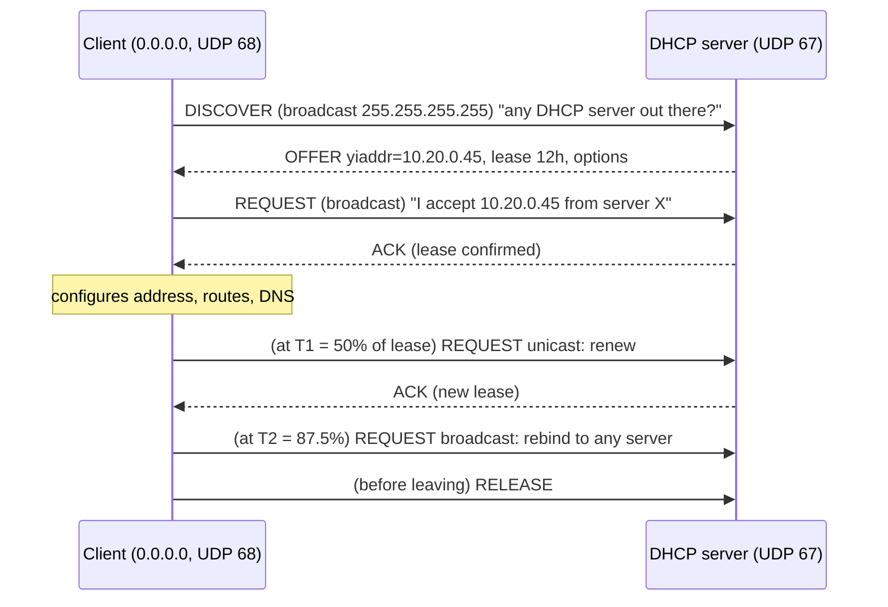
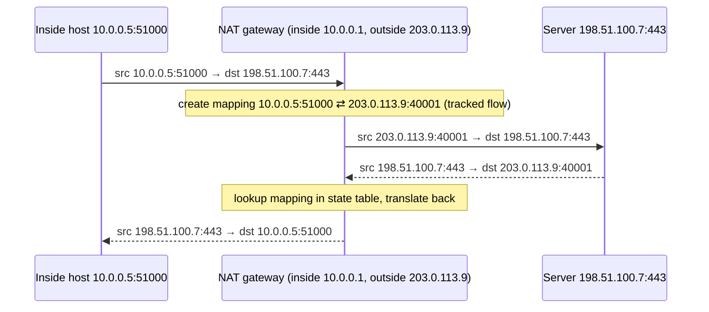
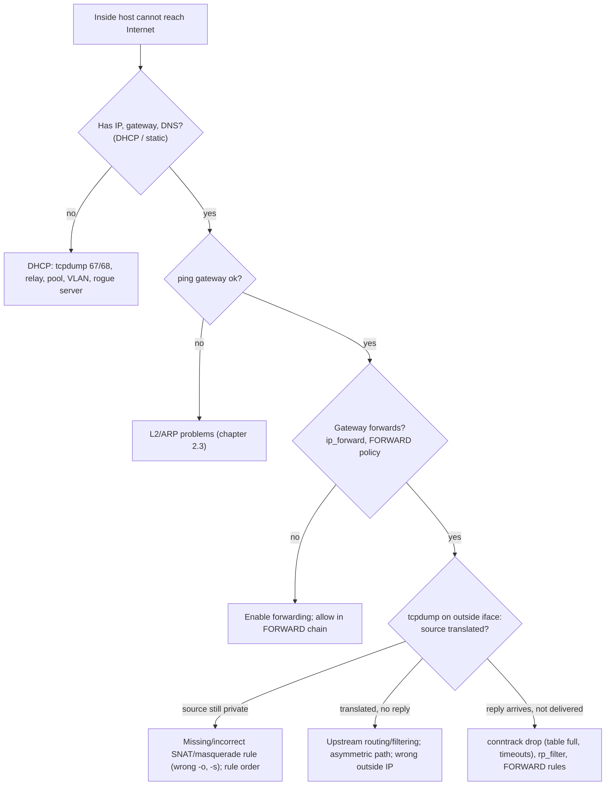

# 2.9 DHCP, NAT and PAT

| | |
|---|---|
| Level | Beginner to intermediate |
| Priority tier | 0 |
| Lab venue | Linux VM with network namespaces |
| Part | Part 2: Networking, from first principles to AI fabrics |
| Status | Drafted, labs **untested** |

## Why this matters for AI infrastructure

Picture a GPU node that will not boot after its rack is re-cabled. Before it can load anything, it has to ask the network for help. Bare-metal GPU nodes are provisioned by network boot. The node's BMC and NIC send DHCP requests, and a provisioning server (Base Command Manager, MAAS, Foreman or Ironic) answers with an address plus PXE/iPXE boot options. The whole fleet comes up through a DHCP/TFTP/HTTP chain, so one broken link stalls every node that depends on it.

NAT is the other half of the story. It is how private cluster nodes reach package mirrors and registries through a gateway. It is how cloud VMs with no public IP get outbound access (Cloud NAT, NAT gateway). It is also how Kubernetes services and Docker publish ports, using iptables DNAT and masquerade.

Both technologies cause confusing failures. You will meet DHCP leases that expire during a long job, rogue DHCP servers, NAT tables that fill up, conntrack drops, hairpin NAT surprises, and port exhaustion on a shared egress address. You will also meet the classic "it works from my laptop but not from the node" problem.

## Prerequisites and outcomes

Before you start, you should already know IP addressing (2.4), routing and forwarding (2.5), and UDP (2.7). This chapter builds on all three.

When you finish, you will be able to:

- Walk through DHCPv4 (DORA), renewals, relays, options (router, DNS, domain, NTP, classless routes, PXE), and DHCPv6/SLAAC.
- Configure ISC Kea, dnsmasq or dhcpd for static reservations and PXE, read client leases, and troubleshoot with `tcpdump`.
- Explain private address space and the NAT types (static NAT, dynamic NAT, PAT/NAPT, SNAT, DNAT/port forwarding, hairpin NAT, CGNAT, NAT64), and why each exists.
- Explain how a NAT device keeps state in a translation table (conntrack), what breaks, and how port exhaustion happens.
- Configure Linux NAT with nftables or iptables, understand Kubernetes and Docker NAT, and compare the cloud NAT variants.
- Debug DHCP and NAT problems, and decide when not to use NAT (IPv6, RDMA fabrics).

## 1. DHCP: automatic configuration

Picture a new GPU node with no address, no gateway and no DNS server. Something has to hand it those settings, or it cannot talk to anyone. That job belongs to the Dynamic Host Configuration Protocol (RFC 2131 for IPv4). DHCP gives a host what it needs to join a network: an IP address and mask, a default gateway, DNS servers, a search domain, NTP servers, a lease time, and vendor options such as the PXE boot file, the MTU or classless static routes.

Without DHCP, an administrator configures each host by hand. With DHCP, hosts are configured from one place. Addresses are leased, which means they are handed out for a fixed time and reused after they expire.

### DORA

The exchange between client and server has four messages. Read the diagram from top to bottom, because the first two messages are broadcasts. The client has no address yet and does not know where the server is.



The messages travel over UDP. If you capture this traffic, you will see these ports on every packet. The client uses port 68 and the server uses port 67. The client identifies itself by its MAC address (chaddr), and it can also send a client identifier (option 61). A server that sees the same client ID again can give it the same address, which is how a static reservation works.

The REQUEST is broadcast so that every other server that made an offer learns that the client chose a different one. After the ACK, the client may run an ARP probe to check that the address is unused. If it finds a conflict, it sends a decline.

When you troubleshoot a lease, start with these timers. They control renewal. T1 is the renewal point, at 50 percent of the lease. T2 is the rebind point, at 87.5 percent. Take a 12-hour lease from the dnsmasq example later in this section. The client tries to renew 6 hours in. If the server never answers, rebinding starts at 10.5 hours. When the lease runs out, the client has to stop using the address and start over. A long job on a node with a short lease and an unreachable DHCP server is a failure waiting to happen. For servers, use long leases or static addressing.

Two less common messages matter too. INFORM asks for options only, which suits a host that already has a static address. A NAK tells a client that the address it requested is not valid here, usually because it moved networks, so the client must restart.

### Relays, scopes and options

A broadcast does not cross routers. That is why a central DHCP server cannot hear a request from a rack VLAN by default. A DHCP relay agent fixes this. It runs on the switch or router, listens for the broadcast, and forwards it on. You will see it configured with `ip helper-address` on a switch SVI or router interface, with `dhcrelay`, or with `dnsmasq --dhcp-relay`.

The relay adds its interface address to the `giaddr` field and unicasts the request to the central DHCP server. The server reads `giaddr` to pick the scope, meaning the subnet pool, for the answer. Option 82 (relay agent information) can carry a circuit ID or remote ID that identifies the switch port. That lets data centres assign addresses based on the port a server is plugged into.

The table below lists the options a DHCP server commonly sends. Look for options 66 and 67 when you troubleshoot PXE, because they carry the boot server and the boot file.

| Option | Meaning |
|---|---|
| 1 | Subnet mask |
| 3 | Router(s) (default gateway) |
| 6 | DNS servers |
| 12 | Hostname |
| 15 | Domain name; 119 domain search list |
| 26 | Interface MTU |
| 42 | NTP servers |
| 51 | Lease time |
| 53 | Message type (Discover, Offer, Request, ACK, NAK, Decline, Release, Inform) |
| 54 | Server identifier |
| 66 / 67 | TFTP server name / boot file name (PXE) |
| 121 / 249 | Classless static routes |
| 60 / 77 / 93 | Vendor class (e.g. `PXEClient`), user class, client architecture (BIOS vs UEFI) |

### PXE boot of bare-metal GPU nodes

A bare-metal GPU node is provisioned by network boot, and the steps run in a fixed order. Each step hands the node a little more of what it needs.

1. The NIC firmware (PXE ROM or UEFI HTTP boot) sends a DHCP DISCOVER with vendor class `PXEClient` and its architecture (option 93).
2. The server replies with an address, plus `next-server` (TFTP) and `filename` (for example `ipxe.efi` for UEFI x86-64). For HTTP boot, it sends an HTTP URL instead.
3. The firmware downloads the bootloader (iPXE). iPXE may chain-load a script over HTTP, and that script fetches the kernel and initrd, plus a kickstart, autoinstall or cloud-init seed.
4. The OS installer or image-based provisioner (BCM, MAAS, Ironic) configures the node. After that, the node's own DHCP client runs under the OS.

Provisioning systems pair a DHCP, TFTP and HTTP service with an inventory that maps each MAC address to a hostname, an address and a profile. When a node stalls during boot, capture DHCP traffic on the provisioning VLAN first, with `tcpdump -ni eth0 -vv port 67 or port 68`. Then check the firmware boot mode (UEFI or legacy), the architecture match, the TFTP firewall rules (UDP 69 plus ephemeral ports), and whether DHCP replies reach the node through the relay and VLAN configuration.

Only one DHCP server may answer a subnet, unless the servers form a coordinated failover pair. A rogue server, such as a forgotten lab router, hands out wrong gateways. Switches guard against this with DHCP snooping.

### Linux clients and servers

On a Linux host, several DHCP clients can do the work: `dhclient` (legacy), `systemd-networkd` (built in), NetworkManager (`internal` or `dhclient`), `dhcpcd`, and cloud-init with netplan. To see what a host received, check `ip addr` (look for `dynamic` and `valid_lft`), `networkctl status eth0`, `nmcli device show eth0`, and the lease files, such as `/var/lib/dhcp/dhclient.leases` or `/run/systemd/netif/leases/`. The logs from `journalctl -u systemd-networkd` show what the client did.

To force a renewal, run `sudo networkctl renew eth0`, `sudo dhclient -r eth0 && sudo dhclient eth0`, or `nmcli device reapply eth0`.

On the server side, you have several choices. ISC dhcpd is end-of-life but still widely deployed. ISC Kea is the modern option, with JSON configuration, a REST API, HA hooks and database backends. dnsmasq is a small DHCP, DNS and TFTP server that suits labs and appliances. Cloud-provided DHCP (VPC metadata services) and the built-in DHCP in routers and BMCs are the other options.

A small dnsmasq file is enough for a provisioning VLAN. It hands out addresses, pins one node to a fixed address, and points UEFI clients at iPXE.

```text
# dnsmasq: DHCP + PXE for a provisioning VLAN
interface=eno2
dhcp-range=10.50.0.100,10.50.0.200,255.255.255.0,12h
dhcp-option=option:router,10.50.0.1
dhcp-option=option:dns-server,10.50.0.10
dhcp-host=aa:bb:cc:dd:ee:01,gpu01,10.50.0.11,infinite      # static reservation by MAC
dhcp-match=set:efi64,option:client-arch,7
dhcp-boot=tag:efi64,ipxe.efi,boot-server,10.50.0.10        # UEFI x86-64 PXE
enable-tftp
tftp-root=/srv/tftp
```

The `dhcp-match` line picks out UEFI x86-64 clients, and only those clients receive `ipxe.efi`. The Kea fragment below does the same job with a JSON structure.

```json
// Kea DHCPv4 fragment: subnet with pool and a reservation
{ "subnet4": [{ "subnet": "10.50.0.0/24",
   "pools": [{ "pool": "10.50.0.100 - 10.50.0.200" }],
   "option-data": [{ "name": "routers", "data": "10.50.0.1" }],
   "reservations": [{ "hw-address": "aa:bb:cc:dd:ee:01", "ip-address": "10.50.0.11", "hostname": "gpu01" }] }] }
```

### DHCPv6, SLAAC and IPv6

IPv6 hosts can configure themselves in several ways. With SLAAC (stateless address autoconfiguration), the router advertises the prefix in a Router Advertisement (RA, ICMPv6 type 134). The host then builds its own interface ID, either EUI-64 or randomised with stable privacy.

DHCPv6 works in one of two modes. In stateful mode, it assigns addresses, and the M flag asks for that. In stateless mode, it supplies only other configuration, such as DNS, and the O flag asks for that. Prefix delegation (IA_PD) gives a router a whole prefix to carve up.

DHCPv6 does not carry the default gateway. The gateway comes only from RAs. DHCPv6 uses UDP 546 for the client and 547 for the server. It identifies the client by a DUID rather than by its MAC address. Most data-centre fabrics use static addressing, SLAAC or BGP-unnumbered designs for the fabric itself. DHCP is for management and provisioning networks.

### Hardening and diagnostics

On switches, turn on DHCP snooping and dynamic ARP inspection, and restrict which ports may answer as DHCP servers. Reserve infrastructure addresses by MAC or client ID instead of leaving them in the pool. Keep pools separate from static ranges, because a static address inside the pool can produce duplicate IPs.

To capture DHCP traffic, run `sudo tcpdump -ni eno2 -vvv 'port 67 or port 68'` and read the options. The tools `dhcping` and `nmap --script broadcast-dhcp-discover` can probe servers, but only on networks you are authorised to test. On the server, check the lease database and logs, and watch pool utilisation so you can alert before the pool runs out.

Several symptoms point to specific causes. A node that gets a 169.254.x.x address has fallen back to link-local, which means no DHCP reply arrived. Check the VLAN, the relay, the server and the pool. A wrong gateway points to a rogue server. Duplicate IPs mean a static address sits inside the pool. A PXE boot that hangs at "TFTP" suggests a firewall or MTU problem, and a PXE loop suggests a boot order or UEFI/BIOS mismatch.

Decide on lease lengths and pool sizes before you add the next rack, not after a node stops booting.

## 2. Private addressing and why NAT exists

Picture a site with far more devices than public addresses. IPv4 has only 32 bits of address space, which is not enough for every device to have a unique public address. To cope, RFC 1918 reserved private blocks that are not routed on the public Internet: `10.0.0.0/8`, `172.16.0.0/12` and `192.168.0.0/16`.

Two more ranges matter here. `100.64.0.0/10` is the carrier-grade NAT shared space from RFC 6598. `169.254.0.0/16` is the link-local range.

Many networks reuse the same private ranges. A Network Address Translator at the boundary therefore rewrites addresses and ports in packets. That lets private hosts reach public ones through one or a few public addresses.

NAT also became an accidental security boundary, because inbound connections are not forwarded without an explicit mapping. It is not a firewall, though, and by itself it gives no real security.

## 3. Types of NAT

NAT comes in several forms, and each one rewrites a different part of the packet. When you choose a type, ask which side of the connection needs the address, and whether many hosts must share it. The table lists each type with its typical use.

| Type | What changes | Typical use |
|---|---|---|
| **Static NAT (1:1)** | A fixed inside address ↔ fixed outside address | Publish a server on a public IP; elastic IPs in the cloud |
| **Dynamic NAT** | Inside addresses mapped to a pool of outside addresses on demand | Rare today |
| **PAT / NAPT / masquerade** | Many inside hosts share one outside address, distinguished by translated **source port** | Home routers, NAT gateways, Cloud NAT, `iptables -j MASQUERADE` |
| **SNAT** | Rewrite the **source** address (the outbound direction) | Egress to the Internet, forcing a known source IP |
| **DNAT** | Rewrite the **destination** (inbound) | Port forwarding, load balancing (Kubernetes Services, Docker `-p`) |
| **Hairpin / NAT loopback** | Inside client reaches an inside server via its public address | Needs SNAT as well, or the reply bypasses the NAT and the client rejects it |
| **CGNAT / LSN** | Provider-level NAT44 shared by many subscribers (100.64/10) | ISPs |
| **NAT64 / DNS64, 464XLAT** | Translate IPv6 clients to IPv4 servers | IPv6-only networks reaching IPv4 content |
| **NAT66 / NPTv6** | Stateless prefix translation for IPv6 | Rare; multihoming |

PAT is the type you will meet most often, because it lets many hosts share one address. If you see `MASQUERADE` in a rule, you are looking at PAT. The rest are narrower tools for specific jobs.

### How PAT works

Follow one connection through the gateway in the diagram. The inside host sends from `10.0.0.5:51000`, and the gateway rewrites that source to its own outside address and a new port.



The gateway keeps a translation table. On Linux, this is the conntrack table, which chapter 2.23 covers in detail. The table is keyed by the flow's 5-tuple. The first outbound packet creates an entry, and replies match that entry and are rewritten back. Entries expire on timers. A TCP connection in the established state lasts hours, a TCP connection after FIN lasts seconds, UDP lasts 30 to 120 s, and ICMP lasts 30 s. NAT also fixes up the IP and TCP/UDP checksums and the payloads of ICMP errors.

NAT has consequences you have to plan for. The first is that inbound connections are blocked. With PAT, outside hosts cannot start a connection to an inside host unless a DNAT or static mapping exists. Port forwarding, UPnP or NAT-PMP, and STUN or ICE hole punching for peer-to-peer traffic are the usual ways around this.

The second consequence is that NAT is stateful, so its state becomes a failure domain. A gateway reboot drops every connection. HA pairs must sync their state, and asymmetric routing around a NAT breaks flows. The table also consumes memory, and it can fill up. When it does, Linux logs `nf_conntrack: table full, dropping packet`.

Port exhaustion is the quieter problem. One outside address has about 64k ports per destination 3-tuple. When many clients connect to the same destination, such as a package mirror, an API endpoint or an object store, they can use up the mapping space. Cloud NAT gateways document this problem. The fixes are to allocate more addresses or ports per VM, reuse connections, shorten TCP time-wait on the gateway, and spread traffic across destinations.

Some protocols carry IP addresses and ports inside their payload. Active FTP, SIP, H.323 and IRC DCC do this, and some RPC protocols do too. These need an application-level gateway (ALG) helper, or they fail. Modern protocols such as TLS and HTTP avoid the problem.

NAT also gets in the way of some end-to-end traffic. IPsec AH is incompatible with NAT. ESP needs NAT-T, which wraps it in UDP port 4500. Peer-to-peer traffic needs STUN, TURN or ICE. Logging gets harder too. Auditing requires matching the NAT mapping log back to the original address, as CGNAT logs require.

Fragmentation is another trap. Later fragments carry no ports, so they may not match an entry. Path MTU discovery is still needed, as chapter 2.7 explains.

With IPv6 there are enough addresses for end-to-end addressing again. Use a stateful firewall for policy instead of NAT.

Before you put a NAT gateway in front of a service, decide which inbound paths it needs and how many ports the destination will use.

## 4. NAT on Linux

On Linux, NAT is done by netfilter, and conntrack tracks each flow. Packets pass through hooks along the way. DNAT happens at PREROUTING, before routing. SNAT and masquerade happen at POSTROUTING, after routing. Only the first packet of a flow walks the NAT chains. Later packets are translated by the conntrack entry that the first packet created. Chapter 2.23 covers the full ruleset model. The essentials are below.

The block below sets up a gateway. Forwarding must be on first, as chapter 2.5 explains.

```bash
# Prerequisites: forwarding on (chapter 2.5)
sudo sysctl -w net.ipv4.ip_forward=1

# --- iptables (legacy / iptables-nft) ---
sudo iptables -t nat -A POSTROUTING -s 10.0.0.0/24 -o eth0 -j MASQUERADE           # PAT, uses the outgoing interface's current address
sudo iptables -t nat -A POSTROUTING -s 10.0.0.0/24 -o eth0 -j SNAT --to-source 203.0.113.9   # PAT with a fixed address (faster, for static IPs)
sudo iptables -t nat -A PREROUTING -i eth0 -p tcp --dport 8443 -j DNAT --to-destination 10.0.0.20:443   # port forward
sudo iptables -A FORWARD -p tcp -d 10.0.0.20 --dport 443 -j ACCEPT                 # the filter still has to allow it
sudo iptables -t nat -L -n -v --line-numbers

# --- nftables equivalent ---
sudo nft add table ip nat
sudo nft 'add chain ip nat prerouting  { type nat hook prerouting  priority dstnat ; }'
sudo nft 'add chain ip nat postrouting { type nat hook postrouting priority srcnat ; }'
sudo nft add rule ip nat postrouting ip saddr 10.0.0.0/24 oifname "eth0" masquerade
sudo nft add rule ip nat prerouting  iifname "eth0" tcp dport 8443 dnat to 10.0.0.20:443
sudo nft list ruleset

# --- inspect translations ---
sudo conntrack -L | head            # entries show original and reply tuples
sudo conntrack -L -p tcp --dport 443
sudo conntrack -C ; sysctl net.netfilter.nf_conntrack_max net.netfilter.nf_conntrack_count
sudo conntrack -E                   # live events (NEW, UPDATE, DESTROY)
```

The last four lines show you what the gateway is doing. Use them to confirm that a rule works, rather than assuming it does.

Reading a conntrack entry takes some practice. Here is one: `tcp 6 431999 ESTABLISHED src=10.0.0.5 dst=198.51.100.7 sport=51000 dport=443 src=198.51.100.7 dst=203.0.113.9 sport=443 dport=40001 [ASSURED]`. The first tuple is the original direction, with the inside address. The second is the expected reply tuple, whose destination is the translated address and port. The difference between the two tuples shows the NAT mapping.

Masquerade and SNAT do the same job in different ways. `MASQUERADE` looks up the outgoing interface address for every new flow, and it flushes mappings when the interface goes down. That suits dynamic addresses from DHCP or PPP. `SNAT --to-source` uses a fixed address. It is slightly cheaper, and it does not drop conntrack entries on link flaps. Use it with static public IPs.

Hairpin NAT happens when an inside client reaches a DNAT-published inside server through the public address. Trace the packet to see the problem. DNAT delivers it to the server with the client's inside source address. The server then replies directly to the client, bypassing the NAT. The client sees a reply from an unexpected address and drops it.

You have two fixes. You can also SNAT, or masquerade, such traffic on the way, using `-s 10.0.0.0/24 -d 10.0.0.20 -j MASQUERADE`. Or you can use split DNS, so inside clients resolve the server's inside address. Split DNS is usually the better choice.

### Container and Kubernetes NAT

Docker's default `bridge` network gives containers addresses from 172.17.0.0/16 on `docker0`. Outbound traffic is masqueraded with a `POSTROUTING ... MASQUERADE` rule. Published ports, such as `-p 8080:80`, add DNAT rules in a `DOCKER` chain. Docker also changes iptables itself, including the FORWARD policy. To inspect this, run `iptables -t nat -S` and `docker network inspect`.

Kubernetes Services of type ClusterIP, NodePort and LoadBalancer are built from DNAT rules that kube-proxy installs. In iptables mode, the chains are `KUBE-SERVICES`, `KUBE-SVC-*` and `KUBE-SEP-*`, and they balance load with probabilities. IPVS mode uses virtual servers with DNAT. Cilium offers an eBPF replacement for kube-proxy. Pod egress to the Internet is usually SNATed to the node address through masquerade, unless the CNI uses routable pod IPs. `externalTrafficPolicy: Local` preserves client IPs. NAT adds conntrack load, which matters at high connection rates. Inspect these rules with `iptables-save | grep KUBE-`, `ipvsadm -Ln` and `conntrack -L`.

Connections through kube-proxy depend on conntrack. That makes node conntrack tuning (`nf_conntrack_max`, hash size and timeouts) and UDP/DNS behaviour (chapter 2.8) part of running the cluster.

### Cloud NAT

Instances without external IPs go out through a managed NAT gateway: GCP Cloud NAT, AWS NAT Gateway or Azure NAT Gateway. You configure it per subnet or per region. You set the allocated external IPs and the port allocation limits, which include a minimum number of ports per VM and dynamic allocation.

A cloud NAT is outbound only, so nothing can start a connection inward. It logs translations, enforces quotas and per-destination port limits, and charges per GB.

For AI clusters that pull from public registries or Hugging Face, plan the NAT address and port capacity. Hundreds of nodes starting at once can exhaust the ports. The alternative is a private access path, such as Private Google Access, VPC endpoints, or internal mirrors and registries. That avoids NAT altogether (chapter 2.32).

Before a large cluster starts, check how many public IPs and ports the NAT gateway can offer.

### Routers that run Linux: OpenWRT and BusyBox

Many home routers run Linux inside. Manufacturers added the kernel features they needed, stripped the user-space tools and built a web interface on top. Some users wanted to go deeper. Linksys had to release its source code under the license of one component, and that opened the door to distributions such as OpenWRT. The "WRT" in the name comes from the Linksys model number.

Installing OpenWRT can be worth the effort. It is often more stable than factory firmware, especially on older hardware, and it adds features. For example, it can bridge a wireless link with hardware from different makers. The operating system does not care what hardware you use, as long as that hardware is supported.

Most of what you learn here applies to these systems, with some changes. Embedded firmware usually uses BusyBox, a single program that offers limited versions of many Unix commands, such as the shell, `ls`, `grep`, `cat` and `more`. BusyBox saves memory. Its boot-time init is also simpler. In practice, custom firmware usually includes a web administration page, so you may rarely use the command line.

## 5. NAT and the fabric: where NAT does not belong

Inside AI back-end fabrics, such as InfiniBand or RoCE v2, you do not use NAT. RDMA verbs exchange queue-pair numbers and GIDs or addresses during connection setup, so each endpoint must see the other's true address. NAT state would also get in the way of line-rate transport.

Design each fabric as a routed or L2 private network with its own addressing plan (chapter 2.4). Use NAT only at the edges, such as management or front-end internet access.

Overlapping private ranges cause trouble later. If every cluster uses 10.0.0.0/8, the clusters cannot be connected cleanly when their networks join. Allocate non-overlapping blocks from the start.

## 6. Troubleshooting

When an inside host cannot reach the Internet, work through the flowchart from the top. Each question rules out one layer, so you never have to guess which layer failed.



Counters tell you what the gateway actually did. Run `conntrack -S` to see the insert_failed, drop and early_drop counters, and `dmesg | grep conntrack` for kernel messages. `ss -s` gives a summary of sockets. `iptables -t nat -L -v -n` shows packet counters on each rule, and `nft list ruleset` shows counters too. Run `tcpdump -ni any host X` on both interfaces to compare what goes in and what comes out.

For inbound DNAT, ask three questions. Does the reply leave through the same gateway? Is the server's default gateway the NAT box? Is a conflicting firewall sitting in the FORWARD chain? Also check `sysctl net.ipv4.conf.*.rp_filter`.

Work through the flowchart in order, because each check depends on the one above it.

## 7. Hands-on lab: DHCP server and NAT gateway with namespaces

Start with the self-checking Python lab, which you can run on your own machine. It checks four things. It verifies the DHCP lease timers, where T1 is 50% for renewal and T2 is 87.5% for rebind. It parses a conntrack SNAT/PAT tuple, from `10.0.0.5:51000` to `203.0.113.9:40001`. It tests NAT gateway source-port exhaustion toward a single destination, and it checks the hairpin NAT loopback flow.

```bash
python3 code/part02/dhcp_nat_pat_lab.py
```

Next, on a disposable Linux VM with `root` access, work through the steps below. Every interactive VM command in them is `untested here`.

1. Reuse the three-namespace topology (hA - r - hB) from chapter 2.5. Make `r` the gateway with an "outside" interface. That can be a veth to the host's bridge, or a dummy "Internet" namespace `inet` that holds 198.51.100.7.
2. Run dnsmasq in `r` on the inside interface: `ip netns exec r dnsmasq --no-daemon --interface=rA --dhcp-range=10.1.0.50,10.1.0.60,12h --dhcp-option=option:router,10.1.0.1 --log-dhcp`. In `hA`, run `dhclient -v vA` without an address configured. Capture the DORA exchange with tcpdump and inspect the lease. Then kill the server and watch the renewal attempts at T1 and T2, using a 60 s lease for the experiment. Add a MAC reservation. Last, start a second, rogue dnsmasq and see which one wins.
3. Give `inet` a server with `nc -l 80`, and add masquerade on r's outside interface. Connect from `hA` and from `hB`. Compare the source addresses the server sees, and inspect the table with `conntrack -L`. Both inside hosts share the outside address, each with its own source port.
4. Forward outside:8080 to hA:80 with DNAT and a FORWARD allow rule, and test from `inet`. Then remove the allow rule and watch the connection fail. Show the packet counters for both runs.
5. From `hB`, connect to the outside address on port 8080, and show that it fails. Add the hairpin masquerade rule and try again. Finish by discussing the split-DNS alternative.
6. Restrict the NAT port range with `--to-ports 40000-40010` on a SNAT rule. Open 20 connections to the same destination from different inside ports. Observe the failures, and read the `conntrack -S` counters.
7. Watch UDP entries expire, using `sysctl net.netfilter.nf_conntrack_udp_timeout` as your guide. Then confirm that a long-idle TCP connection survives, and discuss why keepalives matter.
8. If you have time, boot a QEMU VM over the network against dnsmasq's `enable-tftp` and `dhcp-boot` settings, so that it loads iPXE.
9. Clean up, so the next run starts from a clean VM.

## 8. Common mistakes

The first group of mistakes you will meet is about DHCP. Two DHCP servers on one segment, or a lab router left on, cause trouble. So do pools that overlap static addresses. Short leases for servers and reliance on one DHCP instance are mistakes too. A routed VLAN without a relay (`helper-address`), or a relay that points at the wrong server, leaves clients with no answer.

Gateway mistakes come next. A masquerade rule with the wrong interface or source does nothing useful. Forgetting `ip_forward`, or the FORWARD allow for DNAT traffic, breaks forwarding. Treating NAT as a firewall is a mistake, and so is leaving the FORWARD policy at accept.

The last group is about capacity. Ignoring conntrack capacity and timeouts leads to port exhaustion on shared egress addresses. Overlapping private ranges cause trouble when sites or clusters connect. And NAT has no place inside an RDMA fabric.

Check each of these before you bring up a new gateway or subnet.

## 9. Interview angles

These questions ask you to follow a lease or a packet through the network. The hints in brackets show where a good answer starts.

- "Walk through DHCP DORA; what if there is a relay?"
- "A node PXE boots but hangs after getting an IP. What do you check?" (TFTP/HTTP boot server, filename option, firewall, UEFI/BIOS arch.)
- "What is the difference between SNAT, DNAT, masquerade and PAT?"
- "Explain what a conntrack entry shows."
- "Pods can't reach the Internet but nodes can. Where would you look?" (Masquerade rule, CNI egress, NetworkPolicy, MTU, DNS.)
- "What breaks with NAT?" (Inbound, embedded addresses, IPsec AH, P2P; state and port exhaustion.)
- "Why don't we NAT RoCE traffic?"
- "How do cloud NAT gateways run out of ports and how do you avoid it?"

## Exercises

1. Start with DHCPv4 lease timers (T1/T2), relays and Option 82. If you are new to DHCP, read the DORA exchange first. (a) Trace the four DHCPv4 DORA messages (UDP 68 -> 67). Explain why DISCOVER and REQUEST stay broadcast (255.255.255.255) even after the client receives an OFFER. (b) Use `compute_dhcp_lease_timers_sec()` in `code/part02/dhcp_nat_pat.py` to compute T1 (50%) and T2 (87.5%) for a 12-hour (43,200 s) lease. Then explain how a router DHCP relay (`ip helper-address`, `giaddr` and Option 82) lets one central DHCP server serve dozens of routed rack VLANs.
2. Imagine you are provisioning a rack. Walk through a bare-metal GPU node's 4-stage PXE and iPXE network boot. Use DHCP Options 60, 93 (`arch=7`), 66 (`next-server`) and 67 (`filename` `ipxe.efi`) to show what each stage carries. Then explain what happens when a rogue DHCP server appears on the provisioning VLAN, and how switch DHCP snooping stops it.
3. You should compare IPv6 SLAAC with stateful and stateless DHCPv6 (UDP 546/547, DUID), using the M and O flags as your guide. State where an IPv6 host always learns its default gateway. Then explain what it means when an IPv4 host configures itself with a `169.254.0.0/16` address (`169.254.x.x`).
4. Look at the NAT types, then read a conntrack entry that you may see on a gateway. (a) Contrast `SNAT --to-source`, `MASQUERADE` and `DNAT --to-destination`, and name the netfilter hook (PREROUTING or POSTROUTING) that runs each one. (b) Use `parse_conntrack_nat_entry()` to decode `tcp 6 431999 ESTABLISHED src=10.0.0.5 dst=198.51.100.7 sport=51000 dport=443 src=198.51.100.7 dst=203.0.113.9 sport=443 dport=40001 [ASSURED]`.
5. Work through hairpin NAT and cloud NAT port exhaustion. (a) Use `check_hairpin_nat_flow()` to explain why an inside client (`10.0.0.5`) that connects to a sibling server (`10.0.0.20`) through the NAT gateway's public IP (`203.0.113.9:8443`) fails unless a hairpin `MASQUERADE` rule or split DNS is configured. (b) Use `evaluate_nat_port_exhaustion()` to decide whether one public NAT IP (`64,000` ports) can sustain `80,000` simultaneous connections from a 500-node GPU cluster to a single container registry IP. Then give four production fixes.
6. Explain how Docker (`docker0`) and Kubernetes (kube-proxy `KUBE-SERVICES` DNAT and egress `MASQUERADE`) use Linux netfilter and conntrack. Then explain why NAT is never used inside InfiniBand or RoCEv2 GPU back-end fabrics.

## Checkpoint questions (20)

<details>
<summary>1. What do the four letters of `DORA` stand for, which UDP ports do they use, and why is `REQUEST` broadcast even after the client knows the server's IP?</summary>

You can read DORA as Discover, Offer, Request and Acknowledge. It runs over UDP port `68` for the client and UDP port `67` for the server. Both DISCOVER and REQUEST go to the broadcast address (`255.255.255.255`). REQUEST is broadcast so that every server that made an offer sees which one the client accepted (Option `54`). Those servers can then return their unaccepted offered IPs to their pools right away.
</details>

<details>
<summary>2. What happens at DHCP lease timers `T1` (`50%`), `T2` (`87.5%`), and `100%` expiry, and why are short leases dangerous on compute nodes?</summary>

At T1, which is 50% of the lease, the client sends a unicast REQUEST straight to the original DHCP server to renew. If the server has not answered by T2, which is 87.5% of the lease, the client broadcasts a REQUEST to any reachable DHCP server to rebind. At 100% expiry, the client must remove its IP address and restart DORA. That kills active TCP, MPI and NCCL connections if the provisioning DHCP server was down during a maintenance window.
</details>

<details>
<summary>3. How does a DHCP Relay Agent (`ip helper-address` / `dhcrelay`) allow one central DHCP server to serve multiple routed rack subnets?</summary>

As you design a routed network, remember that broadcast DISCOVER packets (`255.255.255.255`) do not cross L3 routers. So the top-of-rack switch SVI or router runs a DHCP relay agent. It catches the broadcast on the rack VLAN and writes its own rack-interface IP into the `giaddr` (gateway IP address) field. It can also insert the switch-port circuit ID into Option `82`. Then it forwards the packet as a unicast to the central server, which reads `giaddr` to know which subnet pool to allocate from.
</details>

<details>
<summary>4. Match the key DHCPv4 option numbers (`1`, `3`, `6`, `12`, `15`/`119`, `26`, `42`, `51`, `60`, `66`/`67`, `82`, `93`, `121`) to their meanings.</summary>

Option `1` is the subnet mask, and option `3` is the default router. Option `6` gives the DNS servers, and option `12` the hostname. Options `15` and `119` carry the domain name and the domain search list. Option `26` sets the interface MTU, and option `42` the NTP servers. Option `51` is the lease time. Option `60` is the vendor class identifier, which for PXE is `PXEClient`. Options `66` and `67` carry the TFTP `next-server` and the boot `filename`. Option `82` is Relay Agent Information, which holds the switch-port circuit ID. Option `93` gives the client system architecture, where `7` means UEFI x86-64. Option `121` carries classless static routes.
</details>

<details>
<summary>5. Trace the 4-step PXE / iPXE network boot chain used to provision bare-metal GPU nodes.</summary>

First, the NIC's UEFI PXE ROM broadcasts a DHCP DISCOVER with Option `60` (`PXEClient`) and Option `93` (architecture `7`, UEFI x86-64). Second, the provisioning server (BCM, MAAS, Ironic, dnsmasq or Kea) replies with an address, plus `next-server` (Option `66`) and the boot `filename` (`ipxe.efi`, Option `67`), or a UEFI HTTP Boot URL. Third, the firmware downloads and runs `ipxe.efi` over TFTP (`UDP 69`) or HTTP, and that fetches the Linux kernel (`vmlinuz`), `initrd` and the installer or image profile over HTTP. Last, the booted installer writes the golden image to NVMe and reboots.
</details>

<details>
<summary>6. What is a rogue DHCP server, what symptom does it cause, and how does switch DHCP Snooping prevent it?</summary>

A rogue DHCP server is an unauthorised device, such as a misconfigured container, a VM or a lab router, that answers DISCOVER broadcasts on a VLAN. If it answers faster than the real server, nodes receive wrong IPs, gateways or DNS servers. DHCP Snooping on the switch marks server and downlink ports as untrusted, so it drops any OFFER or ACK coming from them. It allows DHCP server replies only on trusted uplink ports. It also records valid bindings of MAC, IP, VLAN and port for Dynamic ARP Inspection (`DAI`).
</details>

<details>
<summary>7. What does it mean when a host configures itself with a `169.254.x.x/16` IPv4 address?</summary>

`169.254.0.0/16` is the IPv4 link-local range, also called APIPA, defined in RFC 3927. A DHCP client sends DISCOVER and retries. If it still gets zero OFFER replies, it gives itself a `169.254.x.x` address. That points to one of four causes: a wrong switch VLAN, a missing `ip helper-address` relay, an exhausted DHCP pool, or a DHCP server that is down.
</details>

<details>
<summary>8. How does `DHCPv6` (`UDP 546/547`) interact with ICMPv6 Router Advertisements (`M` and `O` flags), and why does `DHCPv6` never supply the default gateway?</summary>

Router Advertisements (`RA`, ICMPv6 Type `134`) always supply the default gateway, which is the router's `fe80::` link-local address, along with the prefix. The `A` (Autonomous) flag tells hosts to use SLAAC. The `O` (Other) flag tells hosts to use stateless DHCPv6 for options such as DNS and NTP. The `M` (Managed) flag tells hosts to request a stateful address lease from a DHCPv6 server. That server listens on UDP `546` for clients and `547` for servers, and it identifies the client by its `DUID`. DHCPv6 does not carry the default gateway, because it comes only from RAs.
</details>

<details>
<summary>9. Contrast Static NAT (1:1), Dynamic NAT, PAT / NAPT (`MASQUERADE`), `SNAT`, and `DNAT`.</summary>

Static NAT (1:1) maps one private IP to one dedicated public IP in both directions, as a cloud Elastic IP does. Dynamic NAT maps private IPs to a pool of public IPs, one to one, on demand. PAT, or NAPT (Port Address Translation, also called IP masquerading), maps many private hosts onto one or a few public addresses by rewriting both the source IP and the source TCP or UDP port. SNAT rewrites the source address and port on outbound packets, at POSTROUTING. DNAT rewrites the destination address and port on inbound packets, at PREROUTING. It is used for port forwarding and Kubernetes Service VIPs.
</details>

<details>
<summary>10. Why do `DNAT` and `SNAT` attach to `PREROUTING` and `POSTROUTING` respectively in Linux `netfilter`?</summary>

DNAT must run in PREROUTING, before the kernel's routing lookup. Changing the destination IP there lets routing forward the packet to the real backend server instead of delivering it locally. SNAT and MASQUERADE run in POSTROUTING, after the routing lookup has chosen the outgoing interface. That lets the source IP be rewritten to match the chosen egress interface.
</details>

<details>
<summary>11. What is the difference between `iptables -j MASQUERADE` and `iptables -j SNAT --to-source <IP>`?</summary>

MASQUERADE looks up the outgoing interface's IP on every new flow. If that interface goes down, it purges its conntrack entries. It suits interfaces with dynamic or DHCP addresses. SNAT `--to-source <IP>` uses a fixed IP. It skips the per-flow interface lookup and keeps conntrack state across brief link flaps. That makes it the usual choice on production gateways with static IPs.
</details>

<details>
<summary>12. Decode the `conntrack -L` entry: `tcp 6 431999 ESTABLISHED src=10.0.0.5 dst=198.51.100.7 sport=51000 dport=443 src=198.51.100.7 dst=203.0.113.9 sport=443 dport=40001 [ASSURED]`.</summary>

conntrack prints two 5-tuples for each flow. The first is the original direction, `10.0.0.5:51000` to `198.51.100.7:443`. The second is the expected reply direction, `198.51.100.7:443` to `203.0.113.9:40001`. The reply goes to `203.0.113.9:40001`, not to the original source `10.0.0.5:51000`. So this entry shows an outbound SNAT or PAT translation, with 431,999 seconds left on the established TCP timer.
</details>

<details>
<summary>13. Why does Linux `netfilter` evaluate `nat` table chains only on the FIRST packet (`NEW`) of a connection?</summary>

The `nat` table chains (PREROUTING, OUTPUT and POSTROUTING) are checked only on the first `NEW` packet of a flow. That packet sets the translation, which conntrack records in its entry. Every later packet in both directions (`ESTABLISHED` or `RELATED`) is translated by the conntrack state machine at the hook. It does not walk the `nat` rules again. So a new `nat` rule does not affect connections that are already open, until their conntrack entry is flushed.
</details>

<details>
<summary>14. What is Hairpin NAT (NAT Loopback), why does it fail by default on the same L2 subnet, and what are the two fixes?</summary>

Hairpin NAT happens when an inside host (`10.0.0.5`) connects to an inside server (`10.0.0.20`) using the gateway's public IP (`203.0.113.9:8443`). The gateway DNATs the destination to `10.0.0.20:443` and leaves the source as `10.0.0.5`. Both hosts sit on the same `/24` L2 subnet, so the server sends its `SYN-ACK` straight to `10.0.0.5` on the LAN, with source `10.0.0.20`. The client expected the reply from `203.0.113.9`, so it rejects it with `RST`. You can fix this with split-horizon DNS, so that inside clients resolve `10.0.0.20` directly. Or you can add an inside-to-inside `MASQUERADE` rule.
</details>

<details>
<summary>15. How does a NAT gateway suffer Port Exhaustion when 500 GPU nodes pull containers from the same registry simultaneously, and how do you prevent it?</summary>

A single public IP on a NAT gateway has at most about `64,000` ephemeral source ports for each remote destination (IP and port pair). If 500 nodes open hundreds of parallel HTTPS (`:443`) streams to the same registry VIP, the ports for that destination run out. Sockets lingering in `TIME_WAIT` make it worse, and new connections then fail. Three fixes help. Attach multiple public IPs to the Cloud NAT or SNAT pool. Use Private Google Access, VPC endpoints or an internal registry mirror (Harbor or Dragonfly) that bypasses NAT. And pool HTTP/2 connections.
</details>

<details>
<summary>16. List five protocol behaviors or features that NAT breaks or complicates.</summary>

First, NAT breaks unsolicited inbound connections, which need an explicit `DNAT` or `STUN`, `ICE` or `TURN` hole punching. Second, it complicates protocols that embed IP addresses and ports in the payload, such as active FTP, SIP and H.323, which need ALGs. Third, IPsec Authentication Header (`AH`) hashes the outer IP header, so NAT breaks it. IPsec `ESP` needs NAT-T encapsulation inside `UDP port 4500`. Fourth, IP fragmentation complicates things, because non-first fragments lack TCP or UDP port headers. Fifth, NAT creates a stateful single point of failure, and a full table causes `nf_conntrack: table full` packet drops.
</details>

<details>
<summary>17. Why is NAT NOT a substitute for a stateful firewall?</summary>

Remember that NAT only rewrites addresses. It applies zero security policy by itself. If routing sends traffic to an inside address, or if DNAT rules exist, NAT does nothing to stop it. You need explicit `FORWARD` chain filter rules, usually a `default drop` policy that allows only established or related flows and authorized traffic.
</details>

<details>
<summary>18. How does `kube-proxy` implement Kubernetes `ClusterIP` Services using NAT?</summary>

When a Pod connects to a virtual `ClusterIP:port`, kube-proxy catches the packet in PREROUTING or OUTPUT. In iptables mode, the path runs through `KUBE-SERVICES`, then `KUBE-SVC-*`, then `KUBE-SEP-*`. IPVS, or Cilium's eBPF socket-level translation, can do the same job. The packet's destination IP and port are DNATed to one healthy backing Pod IP from the `EndpointSlice`. The mapping goes into conntrack, so return packets from the Pod are rewritten back to the ClusterIP.
</details>

<details>
<summary>19. Why must NAT never be used inside an InfiniBand or RoCE v2 GPU back-end fabric?</summary>

During RDMA Queue Pair (`QP`) connection setup, ranks exchange their local IP or GID addresses and QP numbers in control messages. They program those values straight into NIC hardware work queues. If a middlebox rewrites IP addresses or ports in flight, the RDMA QP state becomes invalid. That breaks hardware offloads and adds latency at a stateful bottleneck.
</details>

<details>
<summary>20. Walk through the command checklist when an inside cluster node cannot reach the Internet through a Linux NAT gateway.</summary>

Start on the node. Check the IP, the default route and ARP to the gateway with `ip -br addr`, `ip route` and `ping <gw>`. Then, on the gateway, confirm that `sysctl net.ipv4.ip_forward` is `1`, and check the FORWARD chain drop counters with `nft list ruleset` or `iptables -L FORWARD -v -n`. Next, run `sudo tcpdump -ni <outside_if> icmp or port 443` while you test from the node. If the source is still private on the outside interface, the POSTROUTING `MASQUERADE` or `SNAT` rule is wrong. Last, check `conntrack -S` and `dmesg | grep conntrack` for `table full` or `insert_failed` drops.
</details>

## Sources and review notes

- **Sources read in full:**
  - `how-linux-works-3rd-edition` — Brian Ward, *How Linux Works*, 3rd ed., **Chapter 9: Understanding Your Network and Its Configuration** (network configuration managers, boot-activated configuration, NAT / IP masquerading, firewalls and routers, and DHCP/NetworkManager) and **Chapter 10: Network Applications and Services**.
  - `computer-networking-problems-and-solutions` — Russ White and Ethan Banks, *Computer Networking Problems and Solutions*, **Chapter 5: Higher Layer Data Transports** and **Chapter 6: Interlayer Discovery** (DHCPv4/DHCPv6 and SLAAC).
  - `networking-and-kubernetes` — James Strong and Vallery Lancey, *Networking and Kubernetes*, **Chapters 2, 4, and 6** (`conntrack`, `kube-proxy` `DNAT`/`MASQUERADE`, and Cloud NAT).
- **Run here:** `python3 code/part02/dhcp_nat_pat_lab.py` (13 passed, 0 failed).
- **Explicitly labelled inferences:** The `dnsmasq` and ISC Kea PXE provisioning snippets (`ipxe.efi`, `client-arch 7`), `conntrack` tuple walkthrough, Hairpin NAT diagram, and Cloud NAT / RoCEv2 non-NAT design rules synthesize RFCs 1918, 2131, 2132, 3022, 3315/8415 (DHCPv6), 6146 (NAT64), and 6598 (CGNAT) and the `dnsmasq`, Kea, `nftables`, and `conntrack-tools` documentation (cross-referenced with Chapters 2.3, 2.4, 2.5, 2.7, 2.8, 2.23, and 2.32, plus original study items 21, 22, 23, 24, and 25).
- **Not verified on live hardware:** All interactive VM commands (`dnsmasq`, `dhclient`, `networkctl`, `nmcli`, `iptables`, `nft`, `conntrack`, `tcpdump`) are marked (untested here) and must be executed on a disposable Linux VM.
