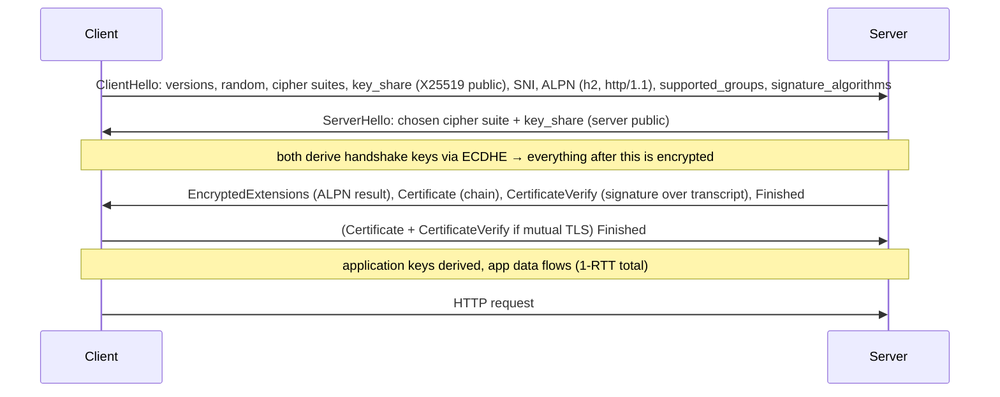
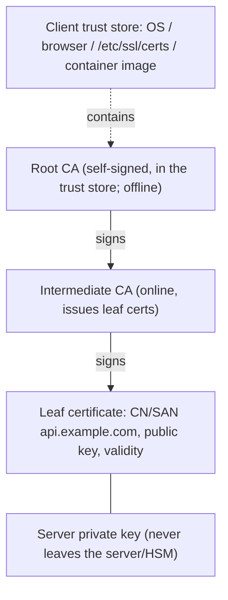

# 2.10 HTTP, TLS and PKI basics

| | |
|---|---|
| Level | Beginner to intermediate |
| Priority tier | 0 |
| Lab venue | Linux VM with openssl, curl, nginx or Caddy |
| Part | Part 2: Networking, from first principles to AI fabrics |
| Status | Drafted, labs **untested** |

## Why this matters for AI infrastructure

Picture an inference endpoint that goes down at 3 a.m. because its certificate has expired. That is a common page, because nearly every control-plane and serving interaction in an AI platform runs as HTTP over TLS. Model-serving endpoints (REST and gRPC over HTTP/2), the Kubernetes API server, container registries, artifact and dataset stores, MLflow and experiment trackers, NGC and Hugging Face downloads, webhooks, Prometheus scrapes and Redfish BMC APIs all work this way.

Other failures in this layer are just as familiar. A kubelet cannot join the cluster when its client certificate rotated incorrectly. Behind a corporate proxy, `x509: certificate signed by unknown authority` can block image pulls. HTTP/2 head-of-line blocking or keepalive timeouts can degrade token streaming. An mTLS mesh can reject calls because of clock skew.

This chapter gives you the practical model for all of it. It covers HTTP semantics and versions, the TLS handshake, certificates and public-key infrastructure, and the tools you use to inspect and debug each part.

## Prerequisites and outcomes

Before you start, you should know TCP (2.6), DNS (2.8) and basic Linux tooling.

After this chapter, you should be able to do the following.

- Explain HTTP requests and responses, including methods, status codes, headers, caching and connection reuse. You should also be able to tell HTTP/1.1, HTTP/2 and HTTP/3 apart.
- Explain the security goals of confidentiality, integrity and authentication, and the building blocks behind them: symmetric encryption, key exchange, public-key signatures, hashes and MACs. Say why TLS combines them.
- Walk through the TLS 1.3 handshake, and contrast it with TLS 1.2. Cover SNI, ALPN, session resumption, forward secrecy and mutual TLS.
- Explain certificates, chains of trust, root and intermediate CAs, trust stores, revocation (CRL, OCSP and short-lived certificates), Certificate Transparency, ACME and private CAs.
- Use `curl`, `openssl s_client`, `openssl x509`, `openssl req`, and `step`, `cfssl`, `certbot` or `cert-manager` to inspect, issue and debug certificates.
- Diagnose expiry, chain, name-mismatch, protocol, cipher and clock problems. Then design certificate management for a GPU and Kubernetes platform, covering cert-manager, mTLS and rotation.

If TCP or DNS is unfamiliar, read chapters 2.6 and 2.8 before you continue.

## 1. HTTP in practice

When your API call fails, the answer is often in the HTTP exchange itself. HTTP is a request and response protocol that works at the application layer. The client sends a request with a method, a target, headers and an optional body. The server returns a response with a status, headers and an optional body. HTTP is stateless by design, so state has to travel in cookies, tokens or application sessions.

```text
GET /v1/models HTTP/1.1
Host: api.example.com
Accept: application/json
Authorization: Bearer eyJ...

HTTP/1.1 200 OK
Content-Type: application/json
Content-Length: 142
Cache-Control: max-age=60
```

The first line of each message matters most, so read it first when you debug. It holds the method and target in a request, and the status in a response. The table below lists the parts of a message. Methods matter most when you retry a call, because `GET`, `PUT` and `DELETE` are idempotent and `POST` is not.

| Part | Notes |
|---|---|
| Methods | `GET` (read, safe, idempotent), `HEAD`, `POST` (create/process, not idempotent), `PUT` (replace, idempotent), `PATCH`, `DELETE` (idempotent), `OPTIONS` (CORS preflight, capabilities) |
| Status codes | 1xx informational, 2xx success (200, 201, 204), 3xx redirection (301/302/307/308, 304 Not Modified), 4xx client error (400, 401 unauthenticated, 403 forbidden, 404, 408, 409, 413, 429 rate limited), 5xx server error (500, 502 bad gateway, 503 unavailable, 504 gateway timeout) |
| Headers | `Host`, `Content-Type/Length`, `Authorization`, `Cookie/Set-Cookie`, `Cache-Control`, `ETag`/`If-None-Match`, `Accept-*`, `User-Agent`, `X-Forwarded-For`/`Forwarded`, `Retry-After`, `Upgrade` (WebSocket) |
| Bodies | JSON, form data, multipart, binary; streaming via chunked transfer encoding or SSE for token streams; large uploads via multipart or presigned URLs |

Status codes also point to where a failure happened. A 502, 503 or 504 from a load balancer or ingress points to the upstream, not to the client. A 504 is an upstream timeout. The model server may be slow, or the proxy timeout may be shorter than the inference time. A 499 from nginx means the client went away. A 429 means rate limiting. A 413 means the body is larger than a proxy limit, which is common with big prompts or uploads. A 401 means the caller is unauthenticated, while a 403 means the caller is unauthorised.

### Connections and versions

HTTP/1.0 opened one TCP connection per request. HTTP/1.1 added persistent connections, called keep-alive, along with the `Host` header for virtual hosting, chunked encoding and caching controls. It still handles only one request in flight per connection, because pipelining is not used in practice. So browsers open several connections, and head-of-line blocking still happens at the HTTP layer.

HTTP/2 (RFC 9113) multiplexes many streams over one TCP connection, using binary frames. It compresses headers with HPACK, and it applies flow control to each stream. Server push exists, but it has largely been abandoned. Browsers require TLS for HTTP/2, negotiated through the ALPN value `h2`. gRPC runs on HTTP/2. Its weakness is that a single lost TCP packet stalls all streams. That is TCP-level head-of-line blocking, covered in chapter 2.6.

HTTP/3 (RFC 9114) runs on QUIC over UDP. Its streams are independent, so a lost packet on one stream does not block the others. Handshakes are faster, connections can migrate, and TLS 1.3 is built in. Clients discover it through the `Alt-Svc` header or `HTTPS` DNS records. It is useful at the edge and in CDNs. Inside data centres, HTTP/2 over TCP remains the standard.

Reusing a connection saves the TCP and TLS handshake costs, which are 1 RTT + 1 RTT (chapter 2.6). Your clients must therefore reuse sessions through connection pools, `requests.Session` or gRPC channels. Servers and middleboxes also have idle timeouts. Examples are nginx `keepalive_timeout` at 75 s, and cloud load balancers at 60 to 350 s. The timing has to line up, so that stale connections are not reused. The server's idle timeout must be longer than the client's idle period, or shorter than the client's pool lifetime. Here is the arithmetic with numbers from this chapter. A load balancer that closes idle connections after 60 s, paired with a client pool that keeps them for 120 s, hands the client connections that are already closed. The next request then fails with a connection reset.

Long-lived connections, such as WebSocket, Server-Sent Events (SSE) and token streams, need care. Proxies must not buffer the stream, and their read timeouts must be raised. Heartbeats keep the connection alive between messages.

Caching reuses responses. `Cache-Control`, `ETag`, `Last-Modified` and validators let clients and CDNs reuse what they already hold. Container registries and model hubs depend on content-addressed, immutable URLs.

Proxies sit in the path. Forward proxies, set with `HTTP_PROXY` or `HTTPS_PROXY`, use `CONNECT` tunnels for HTTPS. Reverse proxies and ingress controllers (nginx, Envoy, HAProxy, Traefik) are discussed in chapter 2.20. API gateways and service meshes add TLS termination, routing, retries, rate limiting and observability.

### `curl` as a diagnostic tool

`curl` shows each stage of a request, so you can see which stage is slow or failing. The commands below show headers, timing, a DNS bypass, a verification skip for testing, mTLS and proxies.

```bash
curl -v https://api.example.com/v1/models                  # request/response headers, TLS handshake summary
curl -sS -o /dev/null -w 'dns=%{time_namelookup} tcp=%{time_connect} tls=%{time_appconnect} ttfb=%{time_starttransfer} total=%{time_total} code=%{http_code}\n' https://api.example.com/
curl --resolve api.example.com:443:10.0.0.5 https://api.example.com/    # bypass DNS (test a specific backend with correct SNI/Host)
curl -k https://10.0.0.5/ -H 'Host: api.example.com'                   # skip verification (testing only)
curl --cacert /etc/ssl/internal-ca.pem --cert client.pem --key client.key https://mesh.internal/   # mTLS
curl --http2 -I https://example.com ; curl --http3 -I https://example.com
curl -x http://proxy:3128 https://example.com               # via proxy
curl --connect-timeout 3 --max-time 10 --retry 2 URL
```

The `-w` timing output shows where the time goes. A long `time_namelookup` points to DNS. A long gap between `time_connect` and `time_appconnect` is the TLS handshake. A long gap before `time_starttransfer` is server processing, and for inference that means model latency. Start with this breakdown, because it shows which stage holds the delay for your request.

### Reading a protocol trace

A summary can hide the detail you need, so sometimes you must see the bytes. `curl --trace-ascii` writes a full log of the conversation to a file:

```bash
$ curl --trace-ascii trace_file http://www.example.org/
```

Open the file and read it from the top. The `==` lines are curl's own notes, and the first ones show the TCP connection being set up. Next comes the request, marked `=>` because curl sends it. The server's reply comes back marked `<=`:

```text
== Info: Trying 93.184.216.34...
== Info: TCP_NODELAY set
== Info: Connected to www.example.org (93.184.216.34) port 80 (#0)
=> Send header, 79 bytes (0x4f)
0000: GET / HTTP/1.1
0010: Host: www.example.org
0027: User-Agent: curl/7.58.0
0040: Accept: */*
004d:
<= Recv header, 17 bytes (0x11)
0000: HTTP/1.1 200 OK
<= Recv header, 22 bytes (0x16)
0000: Accept-Ranges: bytes
<= Recv header, 12 bytes (0xc)
0000: Age: 17629
...
<= Recv header, 22 bytes (0x16)
0000: Content-Length: 1256
<= Recv header, 2 bytes (0x2)
0000:
<= Recv data, 1256 bytes (0x4e8)
0000: <!doctype html>.<html>.<head>. <title>Example Domain</title>.
0040: . <meta charset="utf-8" />. <meta http-equiv="Content-type
...
```

The hexadecimal numbers such as `0000:` are offsets that curl adds to track how many bytes moved. They are not part of the data. curl does not count headers toward the offsets, which is why the offsets restart at zero after the headers. A blank line marks the end of the headers in HTTP. When curl reads that blank line, it knows that everything after it is the requested document.

This split tells you something important about the application layer. The operating system and the network handle the headers and the document in exactly the same way. The difference exists only inside the user-space `curl` program. The server works the same way in reverse: its kernel does not separate headers from document data.

## 2. Security goals and cryptographic building blocks

Suppose an attacker controls the Wi-Fi network your client uses. Transport security is the set of protections that keeps your traffic safe on a network like that. It addresses four problems. It proves that data was not altered in transit. It stops others from reading the data. It proves who you are talking to. It also protects users' privacy from traffic analysis, sometimes called data exhaust.

The building blocks are in the table below. Each one covers a different part of the job, and TLS combines them.

| Primitive | Purpose | Examples |
|---|---|---|
| **Symmetric encryption** | Fast bulk confidentiality with one shared secret key; modern **AEAD** modes also provide integrity | AES-128/256-GCM, ChaCha20-Poly1305 |
| **Key exchange** | Two parties agree a shared secret over an insecure channel without sending it | (EC)DHE: X25519, P-256 |
| **Public-key signatures** | Prove possession of a private key; verify with the public key; bind identity to a key | RSA, ECDSA, Ed25519 |
| **Cryptographic hashes** | Fixed-size fingerprint, collision/second-preimage resistant; integrity checks | SHA-256, SHA-384 |
| **MAC / HMAC** | Authenticate a message with a shared key | HMAC-SHA256 (GCM and Poly1305 embed their own) |
| **Key derivation** | Turn shared secrets into session keys | HKDF |

Encryption works like a substitution whose table depends on the key. Plaintext and a key go in, and ciphertext comes out. A 128-bit key, for example, selects one of `2^128` possible substitution tables. Only the key holder can reverse the process. Symmetric keys are fast, but they must somehow be shared. Public-key schemes solve the sharing problem, but they are slow. So protocols use public-key methods to agree on a session key, then switch to symmetric encryption for the data itself.

Forward secrecy comes from ephemeral Diffie-Hellman. Session keys cannot be derived from the server's long-term key. So if that key leaks later, recorded traffic still cannot be decrypted.

Cryptographic hashes map any input to a fixed-length digest, and they resist collisions. The birthday paradox sets the strength you need. You may remember it from chapter 10 of Computer Networking Problems and Solutions. It takes only 23 people in a room for a probability above 50% that two of them share a birthday. So an `n`-bit hash gives `2^(n/2)` collision resistance. For a 256-bit hash, n/2 is 128, which gives `2^128`. That reasoning motivates the 256-bit and 384-bit SHA-2 and SHA-3 hashes. A hash alone gives integrity only against accidental change. Against an active attacker, you need a MAC or a signature.

A man-in-the-middle (MitM) attack starts when an attacker can redirect traffic. Common routes include DNS spoofing, ARP spoofing, rogue Wi-Fi, a BGP hijack and a compromised proxy. The attacker can then hold one encrypted session with the client and another with the server. The attacker can read everything in between, if the client cannot tell that the server's key is not the real one. Encryption alone is therefore not enough. You need to authenticate the peer's key. Hierarchical PKI does this, through the certificates and CA system described in section 4. A decentralized web of trust, as in PGP, works differently, because users vouch for each other's keys directly. Pre-shared or pinned keys also work, as in SSH `known_hosts` and WireGuard keys.

Even encrypted traffic leaks metadata. An observer can see who talks to whom, when, and how much, which is traffic analysis. Destination names leak as well, through SNI and DNS. Mitigations include encrypted SNI and ECH, along with DoT and DoH. MAC-address randomisation on Wi-Fi clients defeats location tracking across access points, though timing, sequence-number and capability fingerprints can partly re-identify devices. Onion routing builds nested encrypted hops. The entry node knows the source but not the destination, and the exit node knows the reverse.

In a data-centre setting, treat metadata exposure in multi-tenant networks and logs as the practical privacy concern.

## 3. TLS

TLS, short for Transport Layer Security, sits between the application and TCP, or inside QUIC. It gives you an authenticated, encrypted, integrity-protected byte stream. SSL is its obsolete predecessor. TLS has three parts: the handshake protocol, which negotiates parameters, authenticates the peer and derives keys; the record protocol, which fragments and protects each record; and alerts. HTTPS is HTTP over TLS on port 443. Other protocols use STARTTLS upgrades, as SMTP and IMAP do, or implicit TLS on a different port.

### The handshake (TLS 1.3)

The diagram follows the TLS 1.3 handshake from the first client message to the first request.



Notice where encryption starts. After the `ServerHello`, both sides hold handshake keys, so everything else is encrypted.

TLS 1.3 needs one round trip instead of two. Both sides send their key shares immediately. Only forward-secret key exchange is allowed, so static-RSA key transport is gone. The certificate and handshake messages are encrypted. The cipher suites come from a reduced set of strong AEAD options, such as AES-GCM and ChaCha20-Poly1305. Compression and renegotiation are removed. 0-RTT resumption allows early data, but that data can be replayed, so use it only for idempotent requests.

Count the round trips to see the difference. TCP setup takes 1 RTT, and TCP plus TLS 1.2 takes `3` RTTs. TLS 1.3 adds only 1 RTT, so TCP plus TLS 1.3 takes `2` RTTs.

In TLS 1.2, the handshake had client hello, server hello, certificate, server key exchange, client key exchange, change cipher spec and finished messages. In older RSA key transport, the client encrypted a random pre-master secret under the server's public key. Stealing the server key later could then decrypt recorded sessions. Forward secrecy fixes exactly that. The change cipher spec and finished messages still do their jobs. One signals that encryption starts. The other authenticates the whole handshake transcript to detect tampering.

Several extensions matter in practice. SNI (Server Name Indication) lets the client name the host in `ClientHello`. One IP address can then serve many certificates, which is virtual hosting, and load balancers route on that name. Encrypted ClientHello can hide it. If you test an IP address directly, without SNI, you often get a default certificate. Use `--resolve` with `curl`, or `-servername` with `openssl`, to send the right name.

ALPN negotiates the application protocol inside the handshake, such as `h2`, `http/1.1` or `h3`. Session tickets or PSKs let a returning client skip the full handshake, which lowers latency and CPU use. With OCSP stapling, the server attaches a signed, recent revocation status to the handshake.

Mutual TLS (mTLS) goes one step further. The server also requests and verifies a client certificate. Service meshes, the Kubernetes API and kubelet, etcd and Prometheus targets use it for service-to-service identity. That way, every workload proves its identity cryptographically.

TLS costs CPU mainly at the handshake, where public-key operations run. Per byte, the cost is small, because AES-NI makes it cheap. Terminating at load balancers or ingress concentrates those handshakes in one place. Disable TLS 1.0, TLS 1.1 and SSLv3, and prefer TLS 1.3 with a TLS 1.2 fallback. Use modern cipher suites, such as the Mozilla "intermediate" profile, and enable HSTS for browsers. Re-check the configuration with `testssl.sh` or `nmap --script ssl-enum-ciphers`.

### Inspecting TLS with openssl

The commands below show the handshake, the chain, the verify result and the certificate fields.

```bash
openssl s_client -connect api.example.com:443 -servername api.example.com -showcerts </dev/null    # handshake, chain, verify result
openssl s_client -connect host:443 -servername host -tls1_3 -alpn h2 </dev/null 2>&1 | egrep 'Protocol|Cipher|ALPN|Verify|subject|issuer'
openssl s_client -connect host:443 -servername host </dev/null 2>/dev/null | openssl x509 -noout -subject -issuer -dates -ext subjectAltName,basicConstraints,keyUsage,extendedKeyUsage
openssl x509 -in cert.pem -noout -text                  # everything in a certificate
openssl x509 -in cert.pem -noout -checkend 2592000      # exit non-zero if it expires within 30 days
openssl verify -CAfile ca.pem -untrusted intermediate.pem leaf.pem
openssl s_client -connect host:443 -servername host -status </dev/null | grep -A5 'OCSP'      # stapled OCSP
echo | openssl s_client -connect host:443 2>/dev/null | openssl x509 -noout -fingerprint -sha256
```

Start with the first command against your own endpoint, and compare its output with the handshake diagram above.

## 4. Certificates and public-key infrastructure

A client that refuses to connect is often reacting to a certificate. To read the error, you need to know what a certificate contains. A **certificate** (X.509) binds a public key to an identity, and a certificate authority (CA) signs it. The important fields are the subject, the issuer, the validity dates (notBefore and notAfter), the public key, and the Subject Alternative Names (SAN). The SAN lists the DNS names or IPs the certificate is valid for. Browsers and modern libraries ignore the old CN field. The remaining fields are key usage and extended key usage (serverAuth, clientAuth), basic constraints (whether this is a CA), authority and subject key identifiers, CRL and OCSP URLs, and the issuer's signature.

The diagram shows how trust flows down from a root.



A client validates a certificate in several steps. It builds a chain from the leaf to a trusted root, using the intermediates the server presents. It checks each signature, the validity dates against its own clock, the key usage and basic constraints, the name against the SAN, and the revocation status if revocation checking is enabled.

Who is trusted depends on the trust store. OS bundles live at `/etc/ssl/certs/ca-certificates.crt`. Others include Java `cacerts`, Python `certifi`, language-specific bundles, the Kubernetes service-account CA, and container images, which use `update-ca-certificates`. An "unknown authority" error usually means that a private CA is missing from the relevant store, or that the server left out its intermediate. Servers must send the full chain except the root. Missing intermediates work in browsers, which fetch them through Authority Information Access (AIA). The same gap makes curl, Java and Go fail.

### Certificate authorities

Public CAs, such as Let's Encrypt, DigiCert and Google Trust Services, issue certificates for names that the Internet can reach. They check control of the domain, using DV (domain validation) through a DNS or HTTP challenge. OV and EV certificates add organisation checks. ACME (RFC 8555) automates issuance and renewal. Tools include certbot, acme.sh, Caddy and cert-manager. Let's Encrypt certificates last 90 days, and the industry is moving toward even shorter lifetimes. Automation is therefore mandatory.

Private or internal CAs cover internal names, mTLS and cluster components. Options include HashiCorp Vault PKI, step-ca from Smallstep, cfssl and EJBCA. Cloud services include GCP CA Service and AWS Private CA. Others include Active Directory Certificate Services, Kubernetes' built-in cluster CA from kubeadm, and the service-mesh CAs in Istio and Linkerd. Keep the root offline, and issue certificates from intermediates. Also use name constraints, short lifetimes and automated rotation. Distribute the root to all trust stores through configuration management.

Certificate Transparency (CT) requires public CAs to log every issued certificate in append-only public logs. Monitor those logs for unexpected certificates issued for your domains. CAA DNS records restrict which CAs may issue certificates for a domain.

### Revocation and lifetimes

Revocation is hard. CRLs are large lists, and OCSP offers online status checks, but it raises privacy and availability problems. Stapling helps with those. Browsers can also use pushed sets, such as CRLite. The modern answer is short-lived certificates with automated renewal, so revocation matters less. Always monitor expiry. Prometheus `x509-certificate-exporter` and the blackbox exporter's `probe_ssl_earliest_cert_expiry` both help. Alert at 21, 7 and 3 days. The first alert at 21 days leaves three weeks to renew.

### Generating certificates (labs and private CAs)

The commands below build a private CA and a server certificate with a SAN. They are meant for labs. For real use, prefer step-ca or Vault, as the code comment notes.

```bash
# Private CA + server cert with SAN (OpenSSL; for real use prefer step-ca/Vault)
openssl req -x509 -newkey ec -pkeyopt ec_paramgen_curve:P-256 -nodes -days 3650 -subj "/CN=Lab Root CA" \
    -addext "basicConstraints=critical,CA:TRUE" -addext "keyUsage=critical,keyCertSign,cRLSign" -keyout ca.key -out ca.pem
openssl req -newkey ec -pkeyopt ec_paramgen_curve:P-256 -nodes -subj "/CN=api.lab.internal" -keyout srv.key -out srv.csr
cat > srv.ext <<'EOF'
subjectAltName=DNS:api.lab.internal,DNS:*.lab.internal,IP:10.0.0.5
extendedKeyUsage=serverAuth
basicConstraints=CA:FALSE
EOF
openssl x509 -req -in srv.csr -CA ca.pem -CAkey ca.key -CAcreateserial -days 90 -extfile srv.ext -out srv.pem
openssl verify -CAfile ca.pem srv.pem
# trust the CA on Debian/Ubuntu
sudo cp ca.pem /usr/local/share/ca-certificates/lab-root.crt && sudo update-ca-certificates
# RHEL family: /etc/pki/ca-trust/source/anchors/ + update-ca-trust
```

Generate private keys on the server, or in an HSM, TPM or KMS, and never email them. Give them mode 0600. A CSR, or certificate signing request, carries only the public key and the requested names. A client certificate for mTLS is built the same way, but with `extendedKeyUsage=clientAuth`. Keep each private key on the machine that uses it.

## 5. TLS and PKI in Kubernetes and AI platforms

On the cluster itself, kubeadm creates a cluster CA, the API server serving certificate, kubelet client and serving certificates, and an etcd CA with peer certificates. They live in `/etc/kubernetes/pki`. Most of them expire after 1 year and must be rotated. Check them with `kubeadm certs check-expiration`, and renew them with `kubeadm certs renew all`. Kubelet client certificates rotate automatically if `rotateCertificates` is enabled and CSRs are approved. Expiry of these certificates is a classic cluster outage, so monitor it.

cert-manager is a controller that issues and renews certificates from `Issuer` or `ClusterIssuer` resources. It supports ACME with Let's Encrypt through HTTP-01 or DNS-01, Vault, a private CA and self-signed certificates. It stores the results in `Secret` objects, which Ingress, Gateway or pods consume. `Certificate` objects declare the names and renewal windows. DNS-01 is needed for wildcards and for clusters that the Internet cannot reach.

Ingress and Gateway controllers, such as nginx, Envoy and cloud load balancers, can handle TLS in three ways. Terminating at the edge is simple, but the traffic is plaintext inside. You can re-encrypt to the backends. Or you can pass TLS through at layer 4, so the backend terminates it. Passthrough is needed for end-to-end mTLS.

Service meshes such as Istio, Linkerd and Cilium enforce mTLS. Sidecars or per-node proxies issue short-lived workload certificates, using SPIFFE identities, and they enforce mTLS and authorization policies. Watch the CPU overhead and the latency, especially for token streaming and large payloads.

For inference endpoints, terminate TLS at the gateway. Keep HTTP/2 or gRPC connections warm, and align idle timeouts with the rest of the path. Set generous read timeouts, and disable response buffering for streaming. Protect the model APIs with authentication, such as API keys or JWT and OIDC, in addition to TLS.

Private CAs must be installed on every node's container runtime and in CI images. For containerd, that means `/etc/containerd/certs.d/<registry>/hosts.toml`. For Docker, it means `/etc/docker/certs.d/<registry>/ca.crt`. A missing CA shows up as `x509: certificate signed by unknown authority` in `ctr`, `crictl` and kubelet events.

Certificate validity depends on the clock. Install and monitor NTP or chrony (chapter 1.x). Skew produces "not yet valid" or "expired" errors across the cluster. It also breaks Kerberos and token expiry.

BMC, Redfish and switch certificates often ship self-signed. Replace them with CA-issued certificates where possible, or pin their fingerprints in automation. Avoid blanket `verify=False`.

Keys in Kubernetes Secrets are only base64-encoded. Use encryption at rest, external secret stores such as Vault or cloud KMS and Secret Manager, short lifetimes, and RBAC.

Check the expiry dates of the cluster certificates now, because cluster certificates are easy to forget for a year.

## 6. Troubleshooting TLS and HTTP

A TLS or HTTP failure usually comes down to one short error message. The table below maps common messages to their likely causes and to the check that confirms each one. Use it as a lookup when you see one of these messages.

| Symptom (typical message) | Likely cause | Check |
|---|---|---|
| `certificate has expired` / `not yet valid` | Expired cert, or clock skew | `openssl x509 -dates`, `date`, `chronyc tracking` |
| `unable to get local issuer certificate` / `unknown authority` | Missing intermediate on server, or CA not in trust store | `s_client -showcerts`, `openssl verify`, `update-ca-certificates` |
| `hostname mismatch` / `no alternative certificate subject name matches` | Name not in SAN; connecting by IP or by an alias; wrong default cert (no SNI) | `x509 -ext subjectAltName`, `-servername`, `--resolve` |
| `self-signed certificate in chain` | Private CA not trusted by this client | Install the CA; do not disable verification |
| `handshake failure` / `no shared cipher` / `protocol version` | TLS version/cipher policy mismatch (old client, FIPS profile) | `s_client -tls1_2/-tls1_3`, `nmap --script ssl-enum-ciphers`, server config |
| `bad certificate` / `certificate required` (mTLS) | Client cert missing/invalid/not signed by the expected CA, wrong EKU | server logs, `s_client -cert -key` |
| Intermittent `connection reset` after idle | Idle timeouts differ across client, LB, server | `curl -v` timing, LB settings, keepalive/pool lifetimes |
| Works with `curl -k` only | Verification problem (see above); never leave `-k` in production | |
| `502`/`503`/`504` | Upstream down / slow / unhealthy / wrong port / protocol (HTTP vs HTTPS to backend) | proxy and upstream logs, `curl --resolve` direct to backend |
| Large uploads fail | Body size limits (`client_max_body_size`), timeouts, MTU/MSS (chapter 2.7) | proxy config, `413` |
| HTTP/2 stalls | Single TCP loss affects all streams; GOAWAY on max-age; proxy buffering | `curl --http2 -v`, tcpdump, `nstat` |

Several rows come down to a missing CA, a name missing from the SAN, or a clock that has drifted. When you cannot tell which layer fails, work up the stack. Use `dig` for DNS, `nc -zv` or `ss` for TCP, `openssl s_client -servername` for TLS, and `curl -v` for HTTP. Only then look at the application. Compare against a known-good client, and capture the traffic with `tcpdump` and Wireshark. The TLS 1.3 handshake is encrypted after the ServerHello, so export `SSLKEYLOGFILE` to decrypt it in Wireshark in labs.

Work through the layers in order, rather than guessing at the application you run.

## 7. Hands-on lab: build a CA, serve HTTPS with mTLS, and break it on purpose

Start with the self-checking Python lab in `code/part02/http_tls_pki_lab.py`, and run it on your own machine first. It checks RFC 6125 SAN wildcard matching, using `*.lab.internal`. It checks X.509 chain, validity and SAN validation, including `missing_intermediate`, `certificate_has_expired` and `unknown_authority`. It also checks connection setup RTTs: `TCP+TLS 1.2` takes `3` RTTs, `TCP+TLS 1.3` takes `2` RTTs, and `QUIC` takes `1` or `0` RTTs. Finally, it classifies HTTP status codes, including `401`, `403`, `413`, `429`, `499`, `502`, `503` and `504`.

```bash
python3 code/part02/http_tls_pki_lab.py
```

Next, use a disposable Linux VM with `openssl`, `curl`, and `nginx` or `Caddy`. Every interactive VM command below is marked `untested here`. Work through these steps in order.

1. Observe a live site. Run `curl -v https://example.com`, then the timing format string, then `openssl s_client -showcerts`. Identify the chain, SAN, validity, ALPN and negotiated TLS version. Try `-tls1_2` and `-tls1_3`.
2. Build a private CA. Generate the CA and server certificate as shown above, for `api.lab.internal`. Add the name to `/etc/hosts`. Then serve it with nginx, setting `ssl_certificate`, `ssl_certificate_key`, `ssl_protocols TLSv1.2 TLSv1.3` and `http2 on`, or serve it with `openssl s_server -www`.
3. Establish trust. Run `curl https://api.lab.internal`, which fails with an unknown authority error. Fix that with `--cacert`, then install the CA system-wide. Confirm the result with `openssl verify`.
4. Break it on purpose. Remove the SAN entry to cause a name mismatch. Issue a certificate valid for 1 day, then advance the clock in a VM, or use `faketime`, to expire it. Omit the intermediate by creating a two-level CA, and compare curl with browser behaviour. Finally, you connect by IP without SNI.
5. Test mTLS. Require client certificates in nginx with `ssl_client_certificate` and `ssl_verify_client on`. Issue a client certificate, then test with and without it. Inspect the handshake in Wireshark, using `SSLKEYLOGFILE`.
6. Check resumption and versions. Run `openssl s_client -reconnect`, and check whether each connection shows `Reused` or `New`. Capture a full handshake and a resumed one, then compare their sizes.
7. Measure timing. Use curl's timing variables with and without keep-alive. `curl URL URL` reuses a connection, which shows the handshake cost.
8. Try ACME or cert-manager, which is optional. Get a certificate from the Let's Encrypt staging environment with certbot. Or run cert-manager with a self-signed ClusterIssuer in kind, and inspect the generated Secret.
9. Monitor expiry. Run the blackbox exporter, or a shell loop with `openssl x509 -checkend` and an alert threshold.
10. Clean up keys and test CAs as the last step, so you never reuse a lab root outside the lab.

## 8. Common mistakes

The first mistake is turning off verification. Teams add `-k`, `verify=False` or `InsecureSkipVerify` to make an error go away, then leave it in production. Another is treating HTTPS as proof of a trustworthy site, or treating encryption as authentication.

Expiry is the next group. If you have no expiry monitoring or automated renewal, cluster certificates are forgotten for a year. Servers that omit the intermediate certificate break many clients, and certificates without a SAN fail name checks. Wildcard certificates copied everywhere have a large blast radius.

Keys and trust come next. Private keys that are world-readable, committed to Git, or shared across environments are a serious risk. A private root trusted on only some nodes, images or runtimes causes errors that appear in some places and not others.

Finally, protocol and operations choices matter. Terminating TLS everywhere without a plan for mTLS, idle timeouts and buffering of streaming responses causes trouble. So does ignoring clock synchronisation, or leaving old protocol versions and weak ciphers enabled for convenience.

Use this list as a checklist for your own certificate setup.

## 9. Interview angles

These questions come up when the topic is interviewed. Each one points back to a part of this chapter.

- What happens in a TLS handshake, and how is TLS 1.3 different from 1.2?
- How does a client decide to trust a server certificate? Think about the chain, the trust store, SAN, validity and revocation.
- What is the difference between a CA, an intermediate and a leaf, and why keep the root offline?
- What are SNI, ALPN, mTLS and forward secrecy?
- A service works by IP but fails by name with TLS errors, or the other way round. Why? Think about SAN, SNI and the default certificate.
- Your cluster's API server certificate expired. What happens, and how do you recover and prevent it?
- How would you issue and rotate certificates for thousands of pods? Consider cert-manager, a mesh CA, SPIFFE and short lifetimes.
- What changes between HTTP/1.1, HTTP/2 and HTTP/3, and what are the trade-offs?
- Why do you get 504s from an inference endpoint on long generations? Think about proxy timeouts and streaming or buffering.

## Exercises

1. If you run an LLM inference gateway, start with status codes and protocol versions. Using `classify_http_status_code()` in `code/part02/http_tls_pki.py`, tell apart `401` from `403`, `413` from `429` from `499`, and `502` from `503` from `504`. Then use `compute_connection_setup_rtts()` to compare the cold-start RTTs before the first HTTP request byte. Cover HTTP/1.1 or HTTP/2 over `TCP + TLS 1.2` (`3` RTTs), over `TCP + TLS 1.3` (`2` RTTs), and HTTP/3 over `QUIC` (`1` RTT, or `0-RTT` resumption). Finally, explain why connection keep-alive pools must align with load-balancer idle timeouts (`60–350 s`).
2. Work through cryptographic building blocks, forward secrecy, web of trust versus hierarchical PKI, and data-exhaust privacy, using chapter 10 of Computer Networking Problems and Solutions as the reference. First, explain why TLS combines asymmetric key exchange (`X25519` or `P-256` ECDHE), public-key signatures (`ECDSA`, `Ed25519` or `RSA`) and symmetric AEAD ciphers (`AES-GCM` or `ChaCha20-Poly1305`). Then explain how forward secrecy protects recorded sessions if a server's private key is stolen later. Next, contrast a decentralized Web of Trust with a hierarchical CA PKI. Finally, explain what metadata, or data exhaust, TLS still leaks, and how ECH, MAC randomization and onion routing mitigate it.
3. Trace the messages of a TLS 1.3 handshake, from `ClientHello` through `ServerHello`, then the encrypted `EncryptedExtensions`, `Certificate`, `CertificateVerify` and `Finished`. Along the way, note where SNI and ALPN fit. Then state five improvements that TLS 1.3 makes over TLS 1.2. Finally, explain why `0-RTT` early data must only be used for idempotent requests.
4. Using `match_san_dns_pattern()` and `validate_x509_leaf_certificate()`, decide whether a certificate with `SAN = DNS:*.lab.internal` matches `api.lab.internal`, `a.b.lab.internal` or `lab.internal`. Then explain why omitting the Intermediate CA from the server's TLS configuration makes `curl`, Python and Go fail with `unable to get local issuer certificate`, while Chrome and Firefox succeed.
5. Write the exact commands for three tasks, and you can run each one from a shell. First, test the backend `10.0.0.5:443` directly with `curl`, sending SNI and `Host: api.example.com`, without editing `/etc/hosts` and without `-k`. Second, use `openssl s_client` to inspect the full certificate chain that `api.example.com:443` presents. Third, write a monitoring check that fails if `cert.pem` expires within `30` days (`2,592,000` seconds).
6. Describe how you would manage and monitor PKI on Kubernetes and in AI platforms, covering four areas. First, the control-plane certificates in `/etc/kubernetes/pki`, checked with `kubeadm certs check-expiration`. Second, automated Ingress and internal certificates with cert-manager, comparing `HTTP-01` and `DNS-01` ACME challenges. Third, trust for a private container registry in containerd, through `/etc/containerd/certs.d/<registry>/hosts.toml`. Fourth, service-to-service mTLS, covering SPIFFE identities and preventing clock skew with `chrony`.

## Checkpoint questions (20)

<details>
<summary>1. Which HTTP methods are idempotent, how do `401` and `403` differ, and how do `502`, `503` and `504` differ?</summary>

`GET`, `HEAD`, `PUT`, `DELETE` and `OPTIONS` are idempotent. If you repeat an identical request, its intended effect on state is the same as sending it once. `POST` is not idempotent. For status codes, `401 Unauthorized` means the caller is unauthenticated, so the credentials or token are missing or invalid. `403 Forbidden` means the caller is authenticated but not allowed by the access policy. At a reverse proxy or load balancer, `502 Bad Gateway` means the upstream server reset the connection or sent an invalid response. `503 Service Unavailable` means no healthy upstream endpoint is in the pool. `504 Gateway Timeout` means the upstream server, such as a slow LLM inference call, did not respond before the proxy's read timeout expired.
</details>

<details>
<summary>2. Compare `HTTP/1.1`, `HTTP/2` (`RFC 9113`), and `HTTP/3` (`RFC 9114`).</summary>

- `HTTP/1.1`: text-based framing over TCP. It supports keep-alive connection reuse, `Host:` virtual hosting and chunked streaming. In practice, though, it allows only one request in flight per TCP connection, which is HTTP-layer head-of-line blocking.
- `HTTP/2`: binary framing over a single TCP and TLS connection (`ALPN: h2`), used by gRPC. It multiplexes many concurrent request and response streams, with `HPACK` header compression and per-stream flow control. A single lost TCP packet still stalls all streams on that connection, which is TCP-level head-of-line blocking.
- `HTTP/3`: runs over QUIC, which uses UDP with built-in TLS 1.3 (`ALPN: h3`). Each stream recovers from loss on its own, so there is no cross-stream head-of-line blocking. Connection setup takes `1-RTT` or `0-RTT`.
</details>

<details>
<summary>3. Why do long-lived HTTP/gRPC connection pools occasionally fail with `Connection reset by peer` on the first request after an idle gap, and how do you fix it?</summary>

The cause is an idle timeout on a middlebox. A reverse proxy, cloud load balancer or NAT gateway may have an idle timeout, such as `60 s`, that is shorter than the client pool's keep-alive lifetime, such as `120 s`. The middlebox then closes or drops the idle connection, while the client still believes the socket in its pool is open. Then your client's next write triggers a `RST`. To fix it, you set the server or load balancer `keepalive_timeout` longer than the client pool's maximum idle time, and enable TCP or HTTP/2 keepalive pings.
</details>

<details>
<summary>4. What four security properties does transport security address in chapter 10 of Computer Networking Problems and Solutions, and why does TLS combine public-key and symmetric cryptography?</summary>

Transport security addresses four properties. Confidentiality stops eavesdroppers from reading data. Integrity proves that data was not altered in transit. Authentication proves the peer's identity, which prevents man-in-the-middle attacks. Privacy from traffic analysis limits metadata, or data exhaust. Public-key algorithms solve key exchange and identity checks over an untrusted network, but they are expensive to compute. Symmetric AEAD ciphers, such as `AES-GCM` and `ChaCha20-Poly1305`, are orders of magnitude faster, especially with the `AES-NI` instructions on a CPU. They encrypt the bulk of the session data.
</details>

<details>
<summary>5. What is Forward Secrecy (PFS), how is it achieved in TLS, and why was static-RSA key exchange removed in TLS 1.3?</summary>

Forward secrecy guarantees that even if a server's long-term private key is stolen years later, an attacker who recorded past encrypted traffic still cannot decrypt those sessions. TLS achieves this by agreeing a fresh shared secret for each session, using ephemeral Diffie-Hellman (`ECDHE`) with curves such as `X25519` or `P-256`. The ephemeral private keys are destroyed as soon as the session ends. Static-RSA key transport lacked forward secrecy. In it, the client encrypted the pre-master secret directly with the server's long-term RSA public key. TLS 1.3 removed it completely.
</details>

<details>
<summary>6. What is an AEAD cipher, and why is an unkeyed cryptographic hash (`SHA-256`) alone insufficient to authenticate a message?</summary>

An AEAD (Authenticated Encryption with Associated Data) cipher, such as `AES-128-GCM`, `AES-256-GCM` or `ChaCha20-Poly1305`, encrypts the payload and computes a keyed authentication tag in one operation. That gives both confidentiality and integrity. An unkeyed hash such as `SHA-256` only detects accidental corruption. An active attacker who changes a message in transit can trivially recompute a new valid `SHA-256` hash, unless the message also uses a keyed MAC (`HMAC`) or a digital signature.
</details>

<details>
<summary>7. Trace the 1-RTT TLS 1.3 handshake (`RFC 8446`) and list five ways it improves upon TLS 1.2 (`RFC 5246`).</summary>

In TLS 1.3, `ClientHello` carries the supported cipher suites, SNI, ALPN and an ephemeral `key_share` using `X25519` right away. The server replies with `ServerHello` and its own `key_share`. Both sides can then derive handshake keys in 1 RTT. Here are five improvements over TLS 1.2. The first is 1 RTT instead of two. The second is mandatory forward secrecy with `ECDHE`. The third is that only modern AEAD ciphers remain, which removes CBC, RC4, 3DES, MD5, SHA-1, compression and renegotiation. The fourth is that every handshake message after `ServerHello`, including the server's `Certificate`, is encrypted. The fifth is optional `0-RTT` resumption.
</details>

<details>
<summary>8. What is the security risk of TLS 1.3 `0-RTT` early data, and when is it safe to use?</summary>

With `0-RTT` resumption, the client sends application data in its very first packet, alongside `ClientHello`. That data is encrypted under a pre-shared resumption key (`PSK`). If you allow a network middlebox or an attacker to replay that packet, the server could run the request twice. This is a replay attack. So `0-RTT` is safe only for idempotent requests, such as `GET`, that have no state-changing side effects.
</details>

<details>
<summary>9. What do SNI (*Server Name Indication*) and ALPN (*Application-Layer Protocol Negotiation*) do in `ClientHello`?</summary>

SNI sends the target DNS hostname, such as `api.example.com`, inside `ClientHello`. An ingress controller, load balancer or server hosting several domains on one IP address uses it to choose the X.509 certificate to present. It also decides where TLS passthrough traffic goes. ALPN negotiates the inner application protocol during the TLS handshake, such as `h2` for HTTP/2 or `http/1.1`, without an extra round trip.
</details>

<details>
<summary>10. What is Mutual TLS (`mTLS`), and how is it used in Kubernetes and service meshes?</summary>

In standard TLS, only the server presents a certificate, with `extendedKeyUsage = serverAuth`. In mutual TLS, the server also sends a `CertificateRequest` during the handshake. The client then presents its own X.509 certificate, with `extendedKeyUsage = clientAuth`, and signs the transcript with `CertificateVerify`. Kubernetes uses this between the kubelet and the kube-apiserver, and between etcd peers. Service meshes such as Istio, Linkerd and Cilium use short-lived SPIFFE workload identities for zero-trust service authentication.
</details>

<details>
<summary>11. Contrast the Root CA, Intermediate CA, and Leaf Certificate in a Hierarchical PKI, and explain why the Root CA must stay offline.</summary>

- The root CA is a self-signed trust anchor stored in client trust stores, such as `/etc/ssl/certs/ca-certificates.crt`. It is kept completely offline in an air-gapped HSM. If a root CA is compromised, every system that trusts it is compromised too, and every trust store must be replaced.
- An intermediate CA is signed by the root, with `basicConstraints = critical, CA:TRUE`. It stays online, in Vault, step-ca or CA infrastructure, to sign day-to-day leaf certificates. It can be revoked if it is compromised.
- A leaf, or end-entity, certificate is signed by an intermediate CA, with `basicConstraints = CA:FALSE`. It is deployed on a server or client together with its private key.
</details>

<details>
<summary>12. Why do modern TLS clients ignore the Subject `CN` (*Common Name*), and what are the RFC 6125 rules for `SAN` (*Subject Alternative Name*) wildcards?</summary>

Per RFC 6125 and the CA/Browser Forum baseline requirements, TLS clients check the hostname or IP address exclusively against the Subject Alternative Name (SAN) extension, which holds `DNS:...` and `IP:...` entries. The CN is not used for this. A wildcard SAN, for example `*.lab.internal`, matches only one leftmost DNS label, so it matches `api.lab.internal`. It never matches several labels, such as `a.b.lab.internal`, or the bare zone apex, `lab.internal`.
</details>

<details>
<summary>13. Which certificates must a server send during the TLS handshake, and why does omitting the Intermediate CA break `curl` and Go while working in Chrome?</summary>

The server must send its leaf certificate, followed by all the required intermediate CA certificates. The root CA is omitted, because the client already holds it in its trust store. Desktop browsers work around a missing intermediate. They download it from the Authority Information Access (AIA) URL in the leaf certificate, or they use their cache. CLI and API clients such as `curl`, Go, Python, Java and `containerd` do not chase AIA. They fail at once with `unable to get local issuer certificate` or `x509: certificate signed by unknown authority`.
</details>

<details>
<summary>14. How does the `ACME` protocol (`RFC 8555`) automate certificate issuance, and when must you use `DNS-01` instead of `HTTP-01`?</summary>

An ACME client, such as cert-manager, certbot or Caddy, generates a keypair and a CSR. It then asks the CA, such as Let's Encrypt with its 90-day lifetime, for a certificate. To prove domain control, the client completes an automated challenge. `HTTP-01` serves a token file at `http://<domain>/.well-known/acme-challenge/<token>`. It needs port 80 reachable from the CA, and it cannot issue wildcards. `DNS-01` creates a signed `_acme-challenge.<domain>` `TXT` record through a DNS API. You must use it for wildcard certificates, such as `*.example.com`, and for internal or private clusters that are not exposed to the public Internet.
</details>

<details>
<summary>15. Compare `CRL`s, `OCSP`, `OCSP Stapling`, and Short-Lived Certificates for handling certificate revocation.</summary>

CRLs (Certificate Revocation Lists) grow large to download. Live OCSP queries add handshake latency. They also reveal to the CA which site the client visits, and they fail open if the OCSP responder is down. For example, with OCSP stapling, the server periodically fetches a signed, timestamped OCSP response from the CA, and attaches it to the handshake. Modern infrastructure increasingly uses short-lived automated certificates, lasting days or hours, through cert-manager or SPIFFE. A compromised credential then expires on its own, without relying on revocation checks.
</details>

<details>
<summary>16. How do you test a specific backend server IP (`10.0.0.5`) with `curl` while still sending the right `SNI` and verifying the `api.example.com` certificate?</summary>

Run `curl --resolve api.example.com:443:10.0.0.5 https://api.example.com/`. If you compare that with `curl https://10.0.0.5/ -H 'Host: api.example.com'`. The second form omits the DNS name from the TLS SNI, so it fails SAN verification unless you add `-k`. `--resolve` overrides only the IP lookup. It keeps SNI, SAN verification and the HTTP `Host:` header set to `api.example.com`.
</details>

<details>
<summary>17. How do you install a private Root CA on Ubuntu/Debian, RHEL/Rocky, and `containerd` for a private container registry?</summary>

- Ubuntu or Debian: copy `ca.crt` to `/usr/local/share/ca-certificates/my-ca.crt`, then run `sudo update-ca-certificates`.
- RHEL or Rocky: copy `ca.crt` to `/etc/pki/ca-trust/source/anchors/`, then run `sudo update-ca-trust`.
- `containerd`: configure `/etc/containerd/certs.d/<registry-host>/hosts.toml` with `ca = "/path/to/ca.crt"`. Minimal containers, such as distroless images, and Python `certifi` or Java `cacerts` bundles inside pods may need the CA mounted through a ConfigMap or Secret.
</details>

<details>
<summary>18. Where do `kubeadm` Kubernetes cluster certificates live, when do they expire, and how do you check and renew them?</summary>

`kubeadm` stores its cluster CAs, `ca.crt`, `etcd/ca.crt` and `front-proxy-ca.crt`, which are valid for 10 years. It also stores leaf component certificates, such as `apiserver.crt`, `apiserver-kubelet-client.crt` and `etcd/server.crt`, which are valid for **1 year**. All of them live in `/etc/kubernetes/pki/`. You check expiration dates with `sudo kubeadm certs check-expiration`. You renew them with `sudo kubeadm certs renew all`, then restart the control-plane static pods.
</details>

<details>
<summary>19. Compare edge TLS termination, TLS re-encryption, and TLS passthrough on a Kubernetes Ingress or Gateway, according to chapter 6 of Production Kubernetes.</summary>

- Edge termination: the Ingress or Gateway decrypts TLS at the cluster edge, then forwards plain HTTP to the pod over the CNI network. It is the simplest option, and it takes the TLS work off the application.
- Re-encryption: the Ingress terminates the external TLS, reads the L7 HTTP headers to route, and opens a new internal TLS or mTLS connection to the pod.
- Passthrough: the Ingress or load balancer reads only the unencrypted SNI hostname in `ClientHello`. It forwards the raw TCP and TLS stream to the pod, which terminates TLS itself. You need this when the backend must verify end-to-end client mTLS certificates.
</details>

<details>
<summary>20. What proxy settings must be tuned when serving streaming LLM token responses (`Server-Sent Events` / chunked HTTP or gRPC) behind an Ingress/reverse proxy?</summary>

You turn off response buffering, so generated tokens reach the client at once instead of waiting for a buffer to fill. In nginx, set `proxy_buffering off;`, or send `X-Accel-Buffering: no`. Raise the upstream read and send timeouts above the longest multi-minute reasoning generation, for example with `proxy_read_timeout 600s;`. Otherwise the proxy aborts with `504 Gateway Timeout`. Last, turn on HTTP/2 or gRPC keepalive pings.
</details>

## Sources and review notes

- **Sources read in full:**
  - `computer-networking-problems-and-solutions` — Russ White and Ethan Banks, *Computer Networking Problems and Solutions*, **Chapter 10: Transport Security** (the problem space validating data / protecting data from examination / protecting user privacy, the solution space symmetric encryption `2^128` substitution tables / key exchange / cryptographic hashes birthday paradox `23` people / Web of Trust vs Hierarchical CA PKI / MAC-address randomization / onion routing / man-in-the-middle attacks, and the TLS overview).
  - `how-linux-works-3rd-edition` — Brian Ward, *How Linux Works*, 3rd ed., **Chapter 10: Network Applications and Services** (network servers, Secure Shell, public-key cryptography, and host keys).
  - `production-kubernetes` — Josh Rosso, Rich Lander, Alexander Brand, and John Harris, *Production Kubernetes*, **Chapter 6: Service Routing** (Ingress controllers, TLS termination vs passthrough, and `cert-manager`).
- **Run here:** `python3 code/part02/http_tls_pki_lab.py` (13 passed, 0 failed).
- **Explicitly labelled inferences:** The `openssl req`/`x509` EC P-256 SAN certificate generation workflow, Kubernetes PKI (`/etc/kubernetes/pki`, `cert-manager`, `containerd` `certs.d`), and LLM inference gateway troubleshooting table (`502`/`503`/`504`, `413`, `499`, streaming buffering) synthesize RFCs 5246 (TLS 1.2), 5280 (X.509), 8446 (TLS 1.3), 8555 (ACME), and 9113/9114/9000 (HTTP/2, HTTP/3, QUIC) and the OpenSSL, `cert-manager`, and Kubernetes documentation (cross-referenced with Chapters 1.16, 1.21, 2.6, 2.7, 2.8, 2.20, and 2.21, plus original study items 22, 24, 25, 26, 27, 28, 29, 31, 32, 33, 34, and 35).
- **Not verified on live hardware:** All interactive VM commands (`curl`, `openssl s_client`, `openssl req`, `openssl x509`, `openssl verify`, `update-ca-certificates`, `kubeadm certs`) are marked (untested here) and must be executed on a disposable Linux VM.
