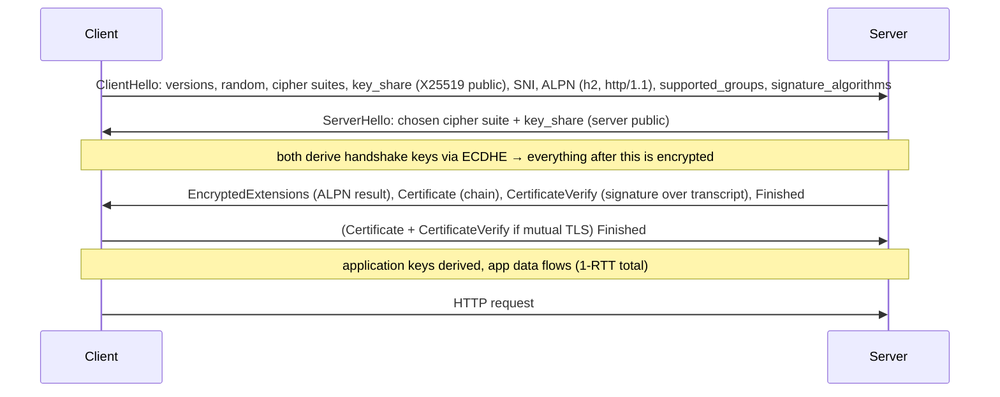
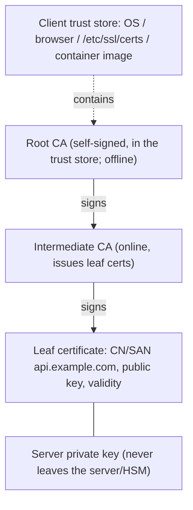

# 2.10 HTTP, TLS and PKI basics

| | |
|---|---|
| Level | Beginner to intermediate |
| Priority tier | 0 |
| Lab venue | Linux VM with openssl, curl, nginx or Caddy |
| Part | Part 2: Networking, from first principles to AI fabrics |
| Status | Drafted, labs **untested** |

## Why this matters for AI infrastructure

Almost every control-plane and serving interaction in an AI platform is HTTP over TLS: model-serving endpoints (REST and gRPC over HTTP/2), the Kubernetes API server, container registries, artifact and dataset stores, MLflow and experiment trackers, NGC and Hugging Face downloads, webhooks, Prometheus scrapes, Redfish BMC APIs. Failures in this layer are some of the most common pages: an expired certificate takes down an inference endpoint at 3 a.m.; a kubelet cannot join because its client certificate rotated incorrectly; `x509: certificate signed by unknown authority` blocks image pulls behind a corporate proxy; HTTP/2 head-of-line blocking or keepalive timeouts degrade token streaming; an mTLS mesh rejects calls because of clock skew. This chapter gives the practical model: HTTP semantics and versions, the TLS handshake, certificates and public-key infrastructure, and the tools to inspect and debug all of it.

## Prerequisites and outcomes

You should know TCP (2.6), DNS (2.8) and basic Linux tooling.

After this chapter you can:

- Explain HTTP requests/responses, methods, status codes, headers, caching, connection reuse, and the differences among HTTP/1.1, HTTP/2 and HTTP/3.
- Explain the security goals (confidentiality, integrity, authentication) and the crypto building blocks: symmetric encryption, key exchange, public-key signatures, hashes and MACs, and why TLS combines them.
- Walk through the TLS 1.3 handshake (and contrast it with TLS 1.2), SNI, ALPN, session resumption, forward secrecy, and mutual TLS.
- Explain certificates, chains of trust, root/intermediate CAs, trust stores, revocation (CRL, OCSP, short-lived certs), Certificate Transparency, ACME, and private CAs.
- Use `curl`, `openssl s_client`, `openssl x509`, `openssl req` and `step`/`cfssl`/`certbot`/`cert-manager` to inspect, issue and debug certificates.
- Diagnose expiry, chain, name-mismatch, protocol/cipher and clock problems, and design certificate management for a GPU/Kubernetes platform (cert-manager, mTLS, rotation).

## 1. HTTP in practice

HTTP is an application-layer, request/response protocol: a client sends a **request** (method, target, headers, optional body); the server returns a **response** (status, headers, optional body). It is **stateless** by design; state is carried by cookies, tokens or application sessions.

```text
GET /v1/models HTTP/1.1
Host: api.example.com
Accept: application/json
Authorization: Bearer eyJ...

HTTP/1.1 200 OK
Content-Type: application/json
Content-Length: 142
Cache-Control: max-age=60
```

| Part | Notes |
|---|---|
| Methods | `GET` (read, safe, idempotent), `HEAD`, `POST` (create/process, not idempotent), `PUT` (replace, idempotent), `PATCH`, `DELETE` (idempotent), `OPTIONS` (CORS preflight, capabilities) |
| Status codes | 1xx informational, 2xx success (200, 201, 204), 3xx redirection (301/302/307/308, 304 Not Modified), 4xx client error (400, 401 unauthenticated, 403 forbidden, 404, 408, 409, 413, 429 rate limited), 5xx server error (500, 502 bad gateway, 503 unavailable, 504 gateway timeout) |
| Headers | `Host`, `Content-Type/Length`, `Authorization`, `Cookie/Set-Cookie`, `Cache-Control`, `ETag`/`If-None-Match`, `Accept-*`, `User-Agent`, `X-Forwarded-For`/`Forwarded`, `Retry-After`, `Upgrade` (WebSocket) |
| Bodies | JSON, form data, multipart, binary; streaming via chunked transfer encoding or SSE for token streams; large uploads via multipart or presigned URLs |

**Reading status codes as signals.** 502/503/504 from a load balancer or ingress point to the upstream (not the client); 504 is an upstream *timeout* (often the model server is slow, or the proxy timeout is shorter than the inference time); 499 (nginx) means the client went away; 429 means rate limiting; 413 body too large for a proxy limit (common for big prompts/uploads); 401 vs 403 distinguishes unauthenticated from unauthorised.

### Connections and versions

- **HTTP/1.0** opened one TCP connection per request. **HTTP/1.1** added persistent connections (keep-alive), the `Host` header (virtual hosting), chunked encoding, and caching controls, but only one request in flight per connection (pipelining is not used in practice), so browsers open several connections (head-of-line blocking at the HTTP layer).
- **HTTP/2** (RFC 9113) multiplexes many **streams** over one TCP connection in binary frames, compresses headers (HPACK), allows server push (largely abandoned) and flow control per stream; it requires TLS in browsers (via ALPN `h2`). gRPC runs on HTTP/2. Its weakness: a single lost TCP packet stalls *all* streams (TCP-level head-of-line blocking, chapter 2.6).
- **HTTP/3** (RFC 9114) runs on QUIC over UDP: independent streams (no cross-stream blocking), faster handshakes, connection migration, TLS 1.3 built in. Discovered via `Alt-Svc` header or `HTTPS` DNS records. Useful at the edge/CDN; inside data centres HTTP/2 over TCP remains standard.
- **Persistent connections and pooling**: reusing connections avoids the TCP and TLS handshake costs (1 RTT + 1 RTT, chapter 2.6). Clients must reuse sessions (HTTP clients' connection pools, `requests.Session`, gRPC channels); servers and middleboxes have **idle timeouts** (nginx `keepalive_timeout` 75 s, cloud LBs 60 to 350 s) that must be longer than the client's idle period or shorter than the client's pool lifetime so stale connections are not reused ("connection reset" on the first request after idle).
- **WebSocket/SSE/streaming**: long-lived connections for token streaming and notifications need proxy settings (disable buffering, raise read timeouts) and heartbeats.
- **Caching**: `Cache-Control`, `ETag`, `Last-Modified` and validators let clients/CDNs reuse responses; container registries and model hubs rely on content-addressed immutable URLs.
- **Proxies**: forward proxies (`HTTP_PROXY`/`HTTPS_PROXY`, `CONNECT` tunnels for HTTPS), reverse proxies/ingress (nginx, Envoy, HAProxy, Traefik; chapter 2.20), API gateways and service meshes add TLS termination, routing, retries, rate limiting and observability.

### `curl` as a diagnostic tool

```bash
curl -v https://api.example.com/v1/models                  # request/response headers, TLS handshake summary
curl -sS -o /dev/null -w 'dns=%{time_namelookup} tcp=%{time_connect} tls=%{time_appconnect} ttfb=%{time_starttransfer} total=%{time_total} code=%{http_code}\n' https://api.example.com/
curl --resolve api.example.com:443:10.0.0.5 https://api.example.com/    # bypass DNS (test a specific backend with correct SNI/Host)
curl -k https://10.0.0.5/ -H 'Host: api.example.com'                   # skip verification (testing only!)
curl --cacert /etc/ssl/internal-ca.pem --cert client.pem --key client.key https://mesh.internal/   # mTLS
curl --http2 -I https://example.com ; curl --http3 -I https://example.com
curl -x http://proxy:3128 https://example.com               # via proxy
curl --connect-timeout 3 --max-time 10 --retry 2 URL
```

The `-w` timing breakdown localises latency: a long `time_namelookup` is DNS; a long gap between `time_connect` and `time_appconnect` is the TLS handshake; a long gap before `time_starttransfer` is server processing (for inference: model latency).

## 2. Security goals and cryptographic building blocks

Transport security addresses four problems: proving data has not been altered in transit (**integrity**), preventing others from reading it (**confidentiality**), proving who you are talking to (**authentication**), and protecting users' privacy from traffic analysis ("data exhaust"). The building blocks:

| Primitive | Purpose | Examples |
|---|---|---|
| **Symmetric encryption** | Fast bulk confidentiality with one shared secret key; modern **AEAD** modes also provide integrity | AES-128/256-GCM, ChaCha20-Poly1305 |
| **Key exchange** | Two parties agree a shared secret over an insecure channel without sending it | (EC)DHE: X25519, P-256 |
| **Public-key signatures** | Prove possession of a private key; verify with the public key; bind identity to a key | RSA, ECDSA, Ed25519 |
| **Cryptographic hashes** | Fixed-size fingerprint, collision/second-preimage resistant; integrity checks | SHA-256, SHA-384 |
| **MAC / HMAC** | Authenticate a message with a shared key | HMAC-SHA256 (GCM and Poly1305 embed their own) |
| **Key derivation** | Turn shared secrets into session keys | HKDF |

Encryption is conceptually a substitution whose table depends on the key: plaintext + key → ciphertext; only the key holder reverses it. Symmetric keys are fast but must somehow be shared; public-key (asymmetric) schemes solve key distribution but are slow, so protocols use public-key methods to establish a symmetric session key and then switch to symmetric encryption for the data. **Forward secrecy** (ephemeral Diffie-Hellman) means session keys are not derivable from the server's long-term key, so recorded traffic cannot be decrypted later if the key leaks. A hash alone gives integrity only against accidental change; against an active attacker you need a MAC or signature.

**Man-in-the-middle (MitM).** An attacker who can redirect traffic (DNS spoofing, ARP spoofing, rogue Wi-Fi, BGP hijack, compromised proxy) can complete one encrypted session with the client and another with the server and read everything in between, if the client cannot tell the server's key is not the real one. Encryption alone is not enough: **authentication of the peer's key** is what defeats MitM, and that is the role of certificates and the CA system (section 4), or pre-shared/pinned keys (SSH known_hosts, WireGuard keys).

**Privacy beyond content.** Even encrypted traffic leaks metadata: who talks to whom, when, how much (traffic analysis), destination names (SNI, DNS). Mitigations include encrypted SNI/ECH, DoT/DoH, MAC-address randomisation on Wi-Fi clients (defeats location tracking across access points, though timing, sequence-number and capability fingerprints can partially re-identify devices), and onion routing, where a client builds nested encrypted hops so the entry node knows the source but not the destination and the exit node the reverse. In a data-centre context the practical privacy concern is mostly metadata exposure in multi-tenant networks and logs.

## 3. TLS

TLS (Transport Layer Security; SSL is its obsolete predecessor) sits between the application and TCP (or inside QUIC), providing an authenticated, encrypted, integrity-protected byte stream. Components: the **handshake** protocol (negotiate parameters, authenticate, derive keys), the **record** protocol (fragment, authenticate-and-encrypt each record), and alerts. HTTPS is HTTP over TLS on port 443; other protocols use "STARTTLS" upgrades (SMTP, IMAP) or implicit TLS on a different port.

### The handshake (TLS 1.3)



Why this is better than TLS 1.2: **one round trip** instead of two (both sides send key shares immediately), **only forward-secret key exchange** (static-RSA key transport removed), **encrypted certificate** and handshake messages, a reduced set of strong AEAD cipher suites (AES-GCM, ChaCha20-Poly1305), no compression or renegotiation, and **0-RTT resumption** (early data, replayable, so only for idempotent requests). In TLS 1.2 the handshake had client hello/server hello/certificate/server key exchange/client key exchange/change cipher spec/finished messages; in older RSA key transport the client encrypted a random pre-master secret under the server's public key, so a later theft of the server key could decrypt recorded sessions, which is exactly what forward secrecy fixes. The change-cipher-spec and finished messages in the older description serve the same purposes (signal encryption starts, and authenticate the whole handshake transcript to detect tampering).

Key extensions:

- **SNI** (Server Name Indication): the client states the hostname in the ClientHello so one IP address can host many certificates (virtual hosting); load balancers route on it. (Encrypted ClientHello hides it.) Testing an IP directly without SNI often returns a default certificate: use `--resolve`/`-servername`.
- **ALPN**: negotiates the application protocol inside the handshake (`h2`, `http/1.1`, `h3`).
- **Session resumption**: session tickets / PSKs let a returning client skip the full handshake (lower latency and CPU).
- **OCSP stapling**: the server attaches a signed recent revocation status to the handshake.
- **Mutual TLS (mTLS)**: the server also requests and verifies a client certificate; used for service-to-service identity (service meshes, Kubernetes API/kubelet, etcd, Prometheus targets) so every workload proves its identity cryptographically.

Operationally: TLS costs CPU only at handshake (public-key operations) and a little per byte (AES-NI makes it cheap); termination at load balancers/ingress concentrates handshakes; protocols versions: disable TLS 1.0/1.1 (and SSLv3), prefer 1.3 with 1.2 fallback; use modern cipher suites (Mozilla "intermediate" profile), HSTS for browsers, and re-check configurations with `testssl.sh` or `nmap --script ssl-enum-ciphers`.

### Inspecting TLS with openssl

```bash
openssl s_client -connect api.example.com:443 -servername api.example.com -showcerts </dev/null    # handshake, chain, verify result
openssl s_client -connect host:443 -servername host -tls1_3 -alpn h2 </dev/null 2>&1 | egrep 'Protocol|Cipher|ALPN|Verify|subject|issuer'
openssl s_client -connect host:443 -servername host </dev/null 2>/dev/null | openssl x509 -noout -subject -issuer -dates -ext subjectAltName,basicConstraints,keyUsage,extendedKeyUsage
openssl x509 -in cert.pem -noout -text                  # everything in a certificate
openssl x509 -in cert.pem -noout -checkend 2592000      # exit non-zero if it expires within 30 days
openssl verify -CAfile ca.pem -untrusted intermediate.pem leaf.pem
openssl s_client -connect host:443 -servername host -status </dev/null | grep -A5 'OCSP'      # stapled OCSP
echo | openssl s_client -connect host:443 2>/dev/null | openssl x509 -noout -fingerprint -sha256
```

## 4. Certificates and public-key infrastructure

A **certificate** (X.509) binds a public key to an identity and is signed by a **certificate authority (CA)**. Important fields: subject, **issuer**, validity (notBefore/notAfter), public key, **Subject Alternative Names (SAN)** (the DNS names/IPs the certificate is valid for; browsers and modern libraries ignore the old CN), key usage / extended key usage (serverAuth, clientAuth), basic constraints (is this a CA?), authority/subject key identifiers, CRL/OCSP URLs, and the issuer's signature.



**Validation** by the client: build a chain from the leaf to a trusted root using the intermediates the server presents; check each signature, validity dates (against the client's clock), key usage and basic constraints, name match against SAN, and revocation status (if enabled). **Trust store** contents decide who is trusted: OS bundles (`/etc/ssl/certs/ca-certificates.crt`), Java `cacerts`, Python `certifi`, language-specific bundles, Kubernetes service-account CA, and container images (`update-ca-certificates`); "unknown authority" errors usually mean a private CA is missing from the relevant store or the server omitted its intermediate. **Servers must send the full chain except the root**; missing intermediates work in browsers (they fetch via AIA) but fail in curl/Java/Go.

### Certificate authorities

- **Public CAs** (Let's Encrypt, DigiCert, Google Trust Services...) issue certificates for Internet-reachable names after validating control (**DV** domain validation via DNS or HTTP challenge; OV/EV add organisation checks). **ACME** (RFC 8555) automates issuance and renewal (certbot, acme.sh, Caddy, cert-manager); Let's Encrypt certificates last 90 days (the industry is moving to shorter lifetimes), so automation is mandatory.
- **Private/internal CAs** for internal names, mTLS and cluster components: HashiCorp Vault PKI, step-ca (Smallstep), cfssl, EJBCA, cloud private CA services (GCP CA Service, AWS Private CA), Active Directory Certificate Services, Kubernetes' built-in cluster CA (kubeadm), and service-mesh CAs (Istio, Linkerd). Keep the **root offline**, issue from **intermediates**, use name constraints, short lifetimes and automated rotation; distribute the root to all trust stores via configuration management.
- **Certificate Transparency (CT)**: public CAs log every issued certificate in append-only public logs; monitor them for unexpected issuance for your domains.
- **CAA DNS records** restrict which CAs may issue for a domain.

### Revocation and lifetimes

Revocation is hard: **CRLs** (large lists), **OCSP** (online status checks, privacy and availability problems; **stapling** helps), and browser-pushed sets (CRLite). The modern answer is *short-lived certificates with automated renewal*, so that revocation matters less. Always monitor expiry (Prometheus `x509-certificate-exporter`/blackbox exporter `probe_ssl_earliest_cert_expiry`) and alert at 21, 7 and 3 days.

### Generating certificates (labs and private CAs)

```bash
# Private CA + server cert with SAN (OpenSSL; for real use prefer step-ca/Vault)
openssl req -x509 -newkey ec -pkeyopt ec_paramgen_curve:P-256 -nodes -days 3650 -subj "/CN=Lab Root CA" \
    -addext "basicConstraints=critical,CA:TRUE" -addext "keyUsage=critical,keyCertSign,cRLSign" -keyout ca.key -out ca.pem
openssl req -newkey ec -pkeyopt ec_paramgen_curve:P-256 -nodes -subj "/CN=api.lab.internal" -keyout srv.key -out srv.csr
cat > srv.ext <<'EOF'
subjectAltName=DNS:api.lab.internal,DNS:*.lab.internal,IP:10.0.0.5
extendedKeyUsage=serverAuth
basicConstraints=CA:FALSE
EOF
openssl x509 -req -in srv.csr -CA ca.pem -CAkey ca.key -CAcreateserial -days 90 -extfile srv.ext -out srv.pem
openssl verify -CAfile ca.pem srv.pem
# trust the CA on Debian/Ubuntu
sudo cp ca.pem /usr/local/share/ca-certificates/lab-root.crt && sudo update-ca-certificates
# RHEL family: /etc/pki/ca-trust/source/anchors/ + update-ca-trust
```

Private keys must be generated on the server (or in an HSM/TPM/KMS), never emailed, with mode 0600; CSRs (certificate signing requests) carry only the public key and the requested names. A client certificate for mTLS is identical but with `extendedKeyUsage=clientAuth`.

## 5. TLS and PKI in Kubernetes and AI platforms

- **Cluster PKI**: kubeadm creates a cluster CA, API server serving cert, kubelet client/serving certificates, etcd CA and peer certs (`/etc/kubernetes/pki`); most expire after 1 year and must be rotated (`kubeadm certs check-expiration`, `kubeadm certs renew all`); kubelet client certificates auto-rotate if enabled (`rotateCertificates`, CSR approval). Expiry of these certificates is a classic cluster outage; monitor it.
- **cert-manager**: a controller that issues/renews certificates from `Issuer`/`ClusterIssuer` resources (ACME/Let's Encrypt via HTTP-01 or DNS-01, Vault, private CA, self-signed) into `Secret`s consumed by Ingress/Gateway or pods; `Certificate` objects declare names and renewal windows. DNS-01 is needed for wildcards and clusters not reachable from the Internet.
- **Ingress/Gateway TLS termination** (nginx, Envoy, cloud LBs): choose between terminating at the edge (simple, plaintext inside), re-encrypting to backends, or passing TLS through (L4) so the backend terminates (needed for end-to-end mTLS).
- **Service mesh mTLS** (Istio, Linkerd, Cilium service mesh): sidecars or per-node proxies automatically issue short-lived workload certificates (SPIFFE identities) and enforce mTLS/authorization policies; consider CPU overhead and latency for token streaming and large payloads.
- **Inference endpoints**: terminate TLS at the gateway; keep HTTP/2 or gRPC connections warm; align idle timeouts; set generous read timeouts and disable response buffering for streaming; protect model APIs with authentication (API keys, JWT/OIDC) in addition to TLS.
- **Registries and artifact stores**: private CAs must be installed on every node's container runtime (`/etc/containerd/certs.d/<registry>/hosts.toml` or `/etc/docker/certs.d/<registry>/ca.crt`) and in CI images; failures show as `x509: certificate signed by unknown authority` in `ctr`/`crictl`/kubelet events.
- **Time**: certificate validity depends on the clock; install and monitor NTP/chrony (chapter 1.x) because skew produces "not yet valid"/"expired" errors cluster-wide and breaks Kerberos and token expiry.
- **BMC/Redfish and switches** often ship self-signed certificates: replace them with CA-issued certificates where possible, or pin fingerprints in automation; avoid blanket `verify=False`.
- **Secrets hygiene**: keys in Kubernetes Secrets are only base64-encoded; use encryption at rest, external secret stores (Vault, cloud KMS/Secret Manager), short lifetimes, and RBAC.

## 6. Troubleshooting TLS and HTTP

| Symptom (typical message) | Likely cause | Check |
|---|---|---|
| `certificate has expired` / `not yet valid` | Expired cert, or clock skew | `openssl x509 -dates`, `date`, `chronyc tracking` |
| `unable to get local issuer certificate` / `unknown authority` | Missing intermediate on server, or CA not in trust store | `s_client -showcerts`, `openssl verify`, `update-ca-certificates` |
| `hostname mismatch` / `no alternative certificate subject name matches` | Name not in SAN; connecting by IP or by an alias; wrong default cert (no SNI) | `x509 -ext subjectAltName`, `-servername`, `--resolve` |
| `self-signed certificate in chain` | Private CA not trusted by this client | Install the CA; do not disable verification |
| `handshake failure` / `no shared cipher` / `protocol version` | TLS version/cipher policy mismatch (old client, FIPS profile) | `s_client -tls1_2/-tls1_3`, `nmap --script ssl-enum-ciphers`, server config |
| `bad certificate` / `certificate required` (mTLS) | Client cert missing/invalid/not signed by the expected CA, wrong EKU | server logs, `s_client -cert -key` |
| Intermittent `connection reset` after idle | Idle timeouts differ across client, LB, server | `curl -v` timing, LB settings, keepalive/pool lifetimes |
| Works with `curl -k` only | Verification problem (see above); never leave `-k` in production | |
| `502`/`503`/`504` | Upstream down / slow / unhealthy / wrong port / protocol (HTTP vs HTTPS to backend) | proxy and upstream logs, `curl --resolve` direct to backend |
| Large uploads fail | Body size limits (`client_max_body_size`), timeouts, MTU/MSS (chapter 2.7) | proxy config, `413` |
| HTTP/2 stalls | Single TCP loss affects all streams; GOAWAY on max-age; proxy buffering | `curl --http2 -v`, tcpdump, `nstat` |

A systematic path: DNS (`dig`), TCP (`nc -zv`, `ss`), TLS (`openssl s_client -servername`), HTTP (`curl -v`), application. Compare against a known-good client and capture with `tcpdump` + Wireshark (TLS 1.3 handshake after ServerHello is encrypted; export `SSLKEYLOGFILE` to decrypt in Wireshark in labs).

## 7. Lab: build a CA, serve HTTPS with mTLS, break it on purpose (untested)

1. **Observe**: `curl -v https://example.com`, the timing format string, `openssl s_client -showcerts`; identify the chain, SAN, validity, ALPN and negotiated TLS version; try `-tls1_2` and `-tls1_3`.
2. **Private CA**: generate the CA and server certificate as above for `api.lab.internal`; add the name to `/etc/hosts`; serve with nginx (`ssl_certificate`, `ssl_certificate_key`, `ssl_protocols TLSv1.2 TLSv1.3`, `http2 on`) or `openssl s_server -www`.
3. **Trust**: `curl https://api.lab.internal` fails (unknown authority); fix with `--cacert`, then by installing the CA system-wide; confirm with `openssl verify`.
4. **Break it**: (a) remove the SAN entry (name mismatch); (b) issue a certificate valid for 1 day and advance the clock in a VM (or `faketime`) to expire it; (c) omit the intermediate (create a two-level CA) and compare curl vs browser behaviour; (d) connect by IP without SNI.
5. **mTLS**: require client certs in nginx (`ssl_client_certificate`, `ssl_verify_client on`); issue a client certificate; test with and without; inspect the handshake in Wireshark (use `SSLKEYLOGFILE`).
6. **Resumption and versions**: `openssl s_client -reconnect`, check `Reused` vs `New`; capture a full vs resumed handshake and compare sizes.
7. **Timing**: use curl's timing variables with and without keep-alive (`curl URL URL` reuses a connection) to show handshake cost.
8. **ACME/cert-manager (optional)**: obtain a certificate from Let's Encrypt staging with certbot or run cert-manager with a self-signed ClusterIssuer in kind and inspect the generated Secret.
9. **Expiry monitoring**: run the blackbox exporter or a shell loop with `openssl x509 -checkend` and an alert threshold.
10. **Clean up** keys and test CAs (never reuse a lab root outside the lab).

Mark tested only after execution.

## 8. Common mistakes

- Disabling verification (`-k`, `verify=False`, `InsecureSkipVerify`) to "fix" errors and leaving it in production.
- No expiry monitoring or automated renewal; cluster certificates forgotten for a year.
- Servers that omit the intermediate certificate; certificates without SAN; wildcard certificates copied everywhere (large blast radius).
- Private keys world-readable, committed to Git, or shared across environments.
- Trusting a private root only on some nodes/images/runtimes.
- TLS termination everywhere without a plan for mTLS, idle timeouts and buffering of streaming responses.
- Ignoring clock synchronisation.
- Treating "HTTPS" as proof of a trustworthy site or encryption as authentication.
- Leaving old protocol versions and weak ciphers enabled for convenience.

## 9. Interview angles

- "What happens in a TLS handshake? How is TLS 1.3 different from 1.2?"
- "How does a client decide to trust a server certificate?" (Chain, trust store, SAN, validity, revocation.)
- "What is the difference between a CA, an intermediate and a leaf; why keep the root offline?"
- "What is SNI/ALPN/mTLS/forward secrecy?"
- "A service works by IP but fails by name with TLS errors (or vice versa). Why?" (SAN, SNI, default cert.)
- "Your cluster's API server certificate expired. What happens and how do you recover and prevent it?"
- "How would you issue and rotate certificates for thousands of pods?" (cert-manager, mesh CA, SPIFFE, short lifetimes.)
- "HTTP/1.1 vs HTTP/2 vs HTTP/3: what changes and what are the trade-offs?"
- "Why do you get 504s from an inference endpoint on long generations?" (Proxy timeouts, streaming/buffering.)

## 10. Checkpoint questions (35)

1. Name three properties TLS provides. **A:** Confidentiality, integrity, authentication of the server (optionally client).
2. Why combine public-key and symmetric crypto? **A:** Public-key solves key agreement/authentication; symmetric is fast for bulk data.
3. What is forward secrecy and how is it achieved? **A:** Past sessions stay secret after key compromise, via ephemeral (EC)DHE key exchange.
4. What is an AEAD cipher? **A:** Authenticated encryption with associated data (AES-GCM, ChaCha20-Poly1305).
5. What is a MAC for? **A:** To authenticate a message using a shared key.
6. Why isn't encryption alone enough against MitM? **A:** The peer's key must be authenticated.
7. How many round trips does a TLS 1.3 full handshake take? **A:** One (plus TCP handshake).
8. What does SNI do? **A:** Names the requested host in the ClientHello so the server can pick a certificate.
9. What does ALPN negotiate? **A:** The application protocol (h2, http/1.1, h3).
10. What is 0-RTT and its risk? **A:** Early data on resumption; replayable, so only idempotent requests.
11. What is mTLS? **A:** Both sides authenticate with certificates.
12. What fields matter in an X.509 certificate? **A:** Subject, issuer, SAN, validity, key usage/EKU, basic constraints, public key, signature.
13. Why do modern clients ignore CN? **A:** SAN is the authoritative list of names.
14. What is a chain of trust? **A:** Leaf → intermediate(s) → root in the trust store.
15. What must a server send in its chain? **A:** The leaf and intermediates (not the root).
16. Why keep a root CA offline? **A:** Compromise would invalidate all trust; intermediates issue day-to-day.
17. What is ACME? **A:** Protocol for automated certificate issuance and renewal.
18. DNS-01 vs HTTP-01 challenge? **A:** DNS TXT proof (wildcards, no inbound access) versus a file served over HTTP.
19. What is Certificate Transparency? **A:** Public append-only logs of issued certificates for detection of misissuance.
20. What is OCSP stapling? **A:** Server attaches a signed revocation status to the handshake.
21. Why prefer short-lived certificates? **A:** Reduces dependence on revocation.
22. What does `unable to get local issuer certificate` mean? **A:** The chain cannot be built to a trusted root (missing intermediate or CA).
23. What causes `not yet valid` errors? **A:** Client or server clock skew.
24. How do you test a specific backend with the right SNI? **A:** `curl --resolve name:443:IP https://name/`.
25. How do you check expiry in a script? **A:** `openssl x509 -checkend N` or exporter metrics.
26. What are HTTP/2's main improvements? **A:** Multiplexing, header compression, binary framing, per-stream flow control.
27. What is TCP head-of-line blocking in HTTP/2? **A:** One lost packet stalls all multiplexed streams.
28. What does HTTP/3 change? **A:** Uses QUIC/UDP with independent streams and integrated TLS 1.3.
29. 502 vs 504? **A:** Bad response from upstream versus upstream timeout.
30. Why would a streaming LLM response be truncated at a proxy? **A:** Buffering/read timeouts/idle timeouts.
31. What is cert-manager? **A:** A Kubernetes controller that issues and renews certificates.
32. Where do kubeadm certificates live and when do they expire? **A:** `/etc/kubernetes/pki`; typically 1 year.
33. How do private CAs get trusted by containerd? **A:** Registry certs dir (`certs.d`) or the node trust store.
34. Why is `-k` dangerous? **A:** Disables authentication, allowing MitM.
35. What metadata does TLS still leak? **A:** IP addresses, SNI (unless ECH), sizes and timing.

## 11. Sources and review notes

**Written in original words.** Principal sources:

- Russ White and Jeff Tantsura (with co-authors), *Computer Networking Problems and Solutions*, chapter 10 (transport security): the problem space (validating data, protecting data from examination, protecting user privacy), the solution space (encryption, key exchange, cryptographic hashes, MAC-address randomisation, onion routing, man-in-the-middle attacks) and the TLS overview (components and the older handshake). The handshake here is updated to TLS 1.3 with the older flow explained for contrast.
- Brian Ward, *How Linux Works*, 3rd ed., chapter 10: network servers and Secure Shell, public-key cryptography, host keys (the same trust-on-first-use and key-authentication ideas apply to TLS; the SSH-specific material is covered in chapters 1.21 and 2.21).
- Certificate/PKI practice, Kubernetes PKI, cert-manager and troubleshooting tables are the author's synthesis from RFCs 8446 (TLS 1.3), 5246 (TLS 1.2), 5280 (X.509), 8555 (ACME), 9113/9114/9000 (HTTP/2, HTTP/3, QUIC), the OpenSSL, cert-manager and Kubernetes documentation.

**Flagged for verification before publishing:** Let's Encrypt and CA/Browser Forum certificate lifetime policy (shortening schedules), nginx directive names for your version (`http2 on`), kubeadm certificate defaults, containerd registry config paths, and cloud load-balancer idle timeouts; all labs are **untested**.
