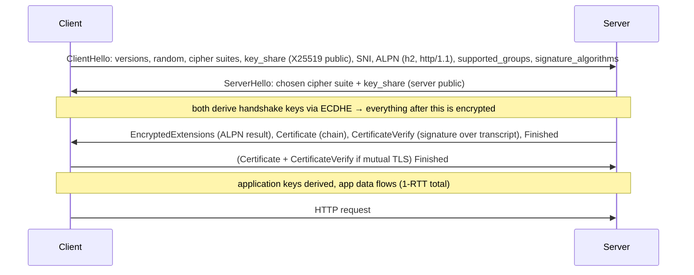
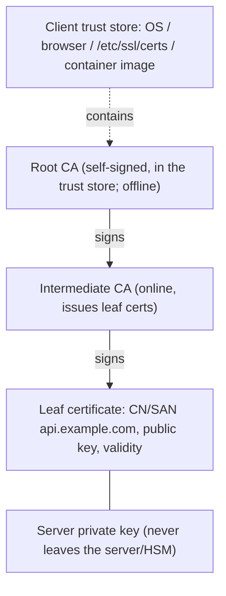

# 2.10 HTTP, TLS and PKI basics

| | |
|---|---|
| Level | Beginner to intermediate |
| Priority tier | 0 |
| Lab venue | Linux VM with openssl, curl, nginx or Caddy |
| Part | Part 2: Networking, from first principles to AI fabrics |
| Status | Drafted, labs **untested** |

## Why this matters for AI infrastructure

Almost every control-plane and serving interaction in an AI platform is HTTP over TLS: model-serving endpoints (REST and gRPC over HTTP/2), the Kubernetes API server, container registries, artifact and dataset stores, MLflow and experiment trackers, NGC and Hugging Face downloads, webhooks, Prometheus scrapes, Redfish BMC APIs. Failures in this layer are some of the most common pages: an expired certificate takes down an inference endpoint at 3 a.m.; a kubelet cannot join because its client certificate rotated incorrectly; `x509: certificate signed by unknown authority` blocks image pulls behind a corporate proxy; HTTP/2 head-of-line blocking or keepalive timeouts degrade token streaming; an mTLS mesh rejects calls because of clock skew. This chapter gives the practical model: HTTP semantics and versions, the TLS handshake, certificates and public-key infrastructure, and the tools to inspect and debug all of it.

## Prerequisites and outcomes

You should know TCP (2.6), DNS (2.8) and basic Linux tooling.

After this chapter you can:

- Explain HTTP requests/responses, methods, status codes, headers, caching, connection reuse, and the differences among HTTP/1.1, HTTP/2 and HTTP/3.
- Explain the security goals (confidentiality, integrity, authentication) and the crypto building blocks: symmetric encryption, key exchange, public-key signatures, hashes and MACs, and why TLS combines them.
- Walk through the TLS 1.3 handshake (and contrast it with TLS 1.2), SNI, ALPN, session resumption, forward secrecy, and mutual TLS.
- Explain certificates, chains of trust, root/intermediate CAs, trust stores, revocation (CRL, OCSP, short-lived certs), Certificate Transparency, ACME, and private CAs.
- Use `curl`, `openssl s_client`, `openssl x509`, `openssl req` and `step`/`cfssl`/`certbot`/`cert-manager` to inspect, issue and debug certificates.
- Diagnose expiry, chain, name-mismatch, protocol/cipher and clock problems, and design certificate management for a GPU/Kubernetes platform (cert-manager, mTLS, rotation).

## 1. HTTP in practice

HTTP is an application-layer, request/response protocol: a client sends a **request** (method, target, headers, optional body); the server returns a **response** (status, headers, optional body). It is **stateless** by design; state is carried by cookies, tokens or application sessions.

```text
GET /v1/models HTTP/1.1
Host: api.example.com
Accept: application/json
Authorization: Bearer eyJ...

HTTP/1.1 200 OK
Content-Type: application/json
Content-Length: 142
Cache-Control: max-age=60
```

| Part | Notes |
|---|---|
| Methods | `GET` (read, safe, idempotent), `HEAD`, `POST` (create/process, not idempotent), `PUT` (replace, idempotent), `PATCH`, `DELETE` (idempotent), `OPTIONS` (CORS preflight, capabilities) |
| Status codes | 1xx informational, 2xx success (200, 201, 204), 3xx redirection (301/302/307/308, 304 Not Modified), 4xx client error (400, 401 unauthenticated, 403 forbidden, 404, 408, 409, 413, 429 rate limited), 5xx server error (500, 502 bad gateway, 503 unavailable, 504 gateway timeout) |
| Headers | `Host`, `Content-Type/Length`, `Authorization`, `Cookie/Set-Cookie`, `Cache-Control`, `ETag`/`If-None-Match`, `Accept-*`, `User-Agent`, `X-Forwarded-For`/`Forwarded`, `Retry-After`, `Upgrade` (WebSocket) |
| Bodies | JSON, form data, multipart, binary; streaming via chunked transfer encoding or SSE for token streams; large uploads via multipart or presigned URLs |

**Reading status codes as signals.** 502/503/504 from a load balancer or ingress point to the upstream (not the client); 504 is an upstream *timeout* (often the model server is slow, or the proxy timeout is shorter than the inference time); 499 (nginx) means the client went away; 429 means rate limiting; 413 body too large for a proxy limit (common for big prompts/uploads); 401 vs 403 distinguishes unauthenticated from unauthorised.

### Connections and versions

- **HTTP/1.0** opened one TCP connection per request. **HTTP/1.1** added persistent connections (keep-alive), the `Host` header (virtual hosting), chunked encoding, and caching controls, but only one request in flight per connection (pipelining is not used in practice), so browsers open several connections (head-of-line blocking at the HTTP layer).
- **HTTP/2** (RFC 9113) multiplexes many **streams** over one TCP connection in binary frames, compresses headers (HPACK), allows server push (largely abandoned) and flow control per stream; it requires TLS in browsers (via ALPN `h2`). gRPC runs on HTTP/2. Its weakness: a single lost TCP packet stalls *all* streams (TCP-level head-of-line blocking, chapter 2.6).
- **HTTP/3** (RFC 9114) runs on QUIC over UDP: independent streams (no cross-stream blocking), faster handshakes, connection migration, TLS 1.3 built in. Discovered via `Alt-Svc` header or `HTTPS` DNS records. Useful at the edge/CDN; inside data centres HTTP/2 over TCP remains standard.
- **Persistent connections and pooling**: reusing connections avoids the TCP and TLS handshake costs (1 RTT + 1 RTT, chapter 2.6). Clients must reuse sessions (HTTP clients' connection pools, `requests.Session`, gRPC channels); servers and middleboxes have **idle timeouts** (nginx `keepalive_timeout` 75 s, cloud LBs 60 to 350 s) that must be longer than the client's idle period or shorter than the client's pool lifetime so stale connections are not reused ("connection reset" on the first request after idle).
- **WebSocket/SSE/streaming**: long-lived connections for token streaming and notifications need proxy settings (disable buffering, raise read timeouts) and heartbeats.
- **Caching**: `Cache-Control`, `ETag`, `Last-Modified` and validators let clients/CDNs reuse responses; container registries and model hubs rely on content-addressed immutable URLs.
- **Proxies**: forward proxies (`HTTP_PROXY`/`HTTPS_PROXY`, `CONNECT` tunnels for HTTPS), reverse proxies/ingress (nginx, Envoy, HAProxy, Traefik; chapter 2.20), API gateways and service meshes add TLS termination, routing, retries, rate limiting and observability.

### `curl` as a diagnostic tool

```bash
curl -v https://api.example.com/v1/models                  # request/response headers, TLS handshake summary
curl -sS -o /dev/null -w 'dns=%{time_namelookup} tcp=%{time_connect} tls=%{time_appconnect} ttfb=%{time_starttransfer} total=%{time_total} code=%{http_code}\n' https://api.example.com/
curl --resolve api.example.com:443:10.0.0.5 https://api.example.com/    # bypass DNS (test a specific backend with correct SNI/Host)
curl -k https://10.0.0.5/ -H 'Host: api.example.com'                   # skip verification (testing only)
curl --cacert /etc/ssl/internal-ca.pem --cert client.pem --key client.key https://mesh.internal/   # mTLS
curl --http2 -I https://example.com ; curl --http3 -I https://example.com
curl -x http://proxy:3128 https://example.com               # via proxy
curl --connect-timeout 3 --max-time 10 --retry 2 URL
```

The `-w` timing breakdown localises latency: a long `time_namelookup` is DNS; a long gap between `time_connect` and `time_appconnect` is the TLS handshake; a long gap before `time_starttransfer` is server processing (for inference: model latency).

## 2. Security goals and cryptographic building blocks

Transport security addresses four problems: proving data has not been altered in transit (**integrity**), preventing others from reading it (**confidentiality**), proving who you are talking to (**authentication**), and protecting users' privacy from traffic analysis ("data exhaust"). The building blocks:

| Primitive | Purpose | Examples |
|---|---|---|
| **Symmetric encryption** | Fast bulk confidentiality with one shared secret key; modern **AEAD** modes also provide integrity | AES-128/256-GCM, ChaCha20-Poly1305 |
| **Key exchange** | Two parties agree a shared secret over an insecure channel without sending it | (EC)DHE: X25519, P-256 |
| **Public-key signatures** | Prove possession of a private key; verify with the public key; bind identity to a key | RSA, ECDSA, Ed25519 |
| **Cryptographic hashes** | Fixed-size fingerprint, collision/second-preimage resistant; integrity checks | SHA-256, SHA-384 |
| **MAC / HMAC** | Authenticate a message with a shared key | HMAC-SHA256 (GCM and Poly1305 embed their own) |
| **Key derivation** | Turn shared secrets into session keys | HKDF |

Encryption is conceptually a substitution whose table depends on the key: plaintext + key → ciphertext (for example, a 128-bit key selects among `2^128` possible substitution tables); only the key holder reverses it. Symmetric keys are fast but must somehow be shared; public-key (asymmetric) schemes solve key distribution but are slow, so protocols use public-key methods to establish a symmetric session key and then switch to symmetric encryption for the data. **Forward secrecy** (ephemeral Diffie-Hellman) means session keys are not derivable from the server's long-term key, so recorded traffic cannot be decrypted later if the key leaks. Cryptographic hashes map arbitrary inputs to fixed-length digests while resisting collisions (remember the **birthday paradox** from `CN` Chapter 10: it takes only **23 people** in a room to have a >50% probability that two share a birthday, so an `n`-bit hash provides `2^(n/2)` collision resistance, motivating 256-bit and 384-bit SHA-2/SHA-3 hashes). A hash alone gives integrity only against accidental change; against an active attacker you need a MAC or signature.

**Man-in-the-middle (MitM).** An attacker who can redirect traffic (DNS spoofing, ARP spoofing, rogue Wi-Fi, BGP hijack, compromised proxy) can complete one encrypted session with the client and another with the server and read everything in between, if the client cannot tell the server's key is not the real one. Encryption alone is not enough: **authentication of the peer's key** is what defeats MitM, and that is the role of **hierarchical PKI** (certificates and the CA system in section 4, as opposed to decentralized **web of trust** PGP models where users vouch for friends' keys directly), or pre-shared/pinned keys (SSH known_hosts, WireGuard keys).

**Privacy beyond content.** Even encrypted traffic leaks metadata: who talks to whom, when, how much (traffic analysis), destination names (SNI, DNS). Mitigations include encrypted SNI/ECH, DoT/DoH, MAC-address randomisation on Wi-Fi clients (defeats location tracking across access points, though timing, sequence-number and capability fingerprints can partially re-identify devices), and onion routing, where a client builds nested encrypted hops so the entry node knows the source but not the destination and the exit node the reverse. In a data-centre context the practical privacy concern is mostly metadata exposure in multi-tenant networks and logs.

## 3. TLS

TLS (Transport Layer Security; SSL is its obsolete predecessor) sits between the application and TCP (or inside QUIC), providing an authenticated, encrypted, integrity-protected byte stream. Components: the **handshake** protocol (negotiate parameters, authenticate, derive keys), the **record** protocol (fragment, authenticate-and-encrypt each record), and alerts. HTTPS is HTTP over TLS on port 443; other protocols use "STARTTLS" upgrades (SMTP, IMAP) or implicit TLS on a different port.

### The handshake (TLS 1.3)



Why this is better than TLS 1.2: **one round trip** instead of two (both sides send key shares immediately), **only forward-secret key exchange** (static-RSA key transport removed), **encrypted certificate** and handshake messages, a reduced set of strong AEAD cipher suites (AES-GCM, ChaCha20-Poly1305), no compression or renegotiation, and **0-RTT resumption** (early data, replayable, so only for idempotent requests). In TLS 1.2 the handshake had client hello/server hello/certificate/server key exchange/client key exchange/change cipher spec/finished messages; in older RSA key transport the client encrypted a random pre-master secret under the server's public key, so a later theft of the server key could decrypt recorded sessions, which is exactly what forward secrecy fixes. The change-cipher-spec and finished messages in the older description serve the same purposes (signal encryption starts, and authenticate the whole handshake transcript to detect tampering).

Key extensions:

- **SNI** (Server Name Indication): the client states the hostname in the ClientHello so one IP address can host many certificates (virtual hosting); load balancers route on it. (Encrypted ClientHello hides it.) Testing an IP directly without SNI often returns a default certificate: use `--resolve`/`-servername`.
- **ALPN**: negotiates the application protocol inside the handshake (`h2`, `http/1.1`, `h3`).
- **Session resumption**: session tickets / PSKs let a returning client skip the full handshake (lower latency and CPU).
- **OCSP stapling**: the server attaches a signed recent revocation status to the handshake.
- **Mutual TLS (mTLS)**: the server also requests and verifies a client certificate; used for service-to-service identity (service meshes, Kubernetes API/kubelet, etcd, Prometheus targets) so every workload proves its identity cryptographically.

Operationally: TLS costs CPU only at handshake (public-key operations) and a little per byte (AES-NI makes it cheap); termination at load balancers/ingress concentrates handshakes; protocols versions: disable TLS 1.0/1.1 (and SSLv3), prefer 1.3 with 1.2 fallback; use modern cipher suites (Mozilla "intermediate" profile), HSTS for browsers, and re-check configurations with `testssl.sh` or `nmap --script ssl-enum-ciphers`.

### Inspecting TLS with openssl

```bash
openssl s_client -connect api.example.com:443 -servername api.example.com -showcerts </dev/null    # handshake, chain, verify result
openssl s_client -connect host:443 -servername host -tls1_3 -alpn h2 </dev/null 2>&1 | egrep 'Protocol|Cipher|ALPN|Verify|subject|issuer'
openssl s_client -connect host:443 -servername host </dev/null 2>/dev/null | openssl x509 -noout -subject -issuer -dates -ext subjectAltName,basicConstraints,keyUsage,extendedKeyUsage
openssl x509 -in cert.pem -noout -text                  # everything in a certificate
openssl x509 -in cert.pem -noout -checkend 2592000      # exit non-zero if it expires within 30 days
openssl verify -CAfile ca.pem -untrusted intermediate.pem leaf.pem
openssl s_client -connect host:443 -servername host -status </dev/null | grep -A5 'OCSP'      # stapled OCSP
echo | openssl s_client -connect host:443 2>/dev/null | openssl x509 -noout -fingerprint -sha256
```

## 4. Certificates and public-key infrastructure

A **certificate** (X.509) binds a public key to an identity and is signed by a **certificate authority (CA)**. Important fields: subject, **issuer**, validity (notBefore/notAfter), public key, **Subject Alternative Names (SAN)** (the DNS names/IPs the certificate is valid for; browsers and modern libraries ignore the old CN), key usage / extended key usage (serverAuth, clientAuth), basic constraints (is this a CA?), authority/subject key identifiers, CRL/OCSP URLs, and the issuer's signature.



**Validation** by the client: build a chain from the leaf to a trusted root using the intermediates the server presents; check each signature, validity dates (against the client's clock), key usage and basic constraints, name match against SAN, and revocation status (if enabled). **Trust store** contents decide who is trusted: OS bundles (`/etc/ssl/certs/ca-certificates.crt`), Java `cacerts`, Python `certifi`, language-specific bundles, Kubernetes service-account CA, and container images (`update-ca-certificates`); "unknown authority" errors usually mean a private CA is missing from the relevant store or the server omitted its intermediate. **Servers must send the full chain except the root**; missing intermediates work in browsers (they fetch via AIA) but fail in curl/Java/Go.

### Certificate authorities

- **Public CAs** (Let's Encrypt, DigiCert, Google Trust Services...) issue certificates for Internet-reachable names after validating control (**DV** domain validation via DNS or HTTP challenge; OV/EV add organisation checks). **ACME** (RFC 8555) automates issuance and renewal (certbot, acme.sh, Caddy, cert-manager); Let's Encrypt certificates last 90 days (the industry is moving to shorter lifetimes), so automation is mandatory.
- **Private/internal CAs** for internal names, mTLS and cluster components: HashiCorp Vault PKI, step-ca (Smallstep), cfssl, EJBCA, cloud private CA services (GCP CA Service, AWS Private CA), Active Directory Certificate Services, Kubernetes' built-in cluster CA (kubeadm), and service-mesh CAs (Istio, Linkerd). Keep the **root offline**, issue from **intermediates**, use name constraints, short lifetimes and automated rotation; distribute the root to all trust stores via configuration management.
- **Certificate Transparency (CT)**: public CAs log every issued certificate in append-only public logs; monitor them for unexpected issuance for your domains.
- **CAA DNS records** restrict which CAs may issue for a domain.

### Revocation and lifetimes

Revocation is hard: **CRLs** (large lists), **OCSP** (online status checks, privacy and availability problems; **stapling** helps), and browser-pushed sets (CRLite). The modern answer is *short-lived certificates with automated renewal*, so that revocation matters less. Always monitor expiry (Prometheus `x509-certificate-exporter`/blackbox exporter `probe_ssl_earliest_cert_expiry`) and alert at 21, 7 and 3 days.

### Generating certificates (labs and private CAs)

```bash
# Private CA + server cert with SAN (OpenSSL; for real use prefer step-ca/Vault)
openssl req -x509 -newkey ec -pkeyopt ec_paramgen_curve:P-256 -nodes -days 3650 -subj "/CN=Lab Root CA" \
    -addext "basicConstraints=critical,CA:TRUE" -addext "keyUsage=critical,keyCertSign,cRLSign" -keyout ca.key -out ca.pem
openssl req -newkey ec -pkeyopt ec_paramgen_curve:P-256 -nodes -subj "/CN=api.lab.internal" -keyout srv.key -out srv.csr
cat > srv.ext <<'EOF'
subjectAltName=DNS:api.lab.internal,DNS:*.lab.internal,IP:10.0.0.5
extendedKeyUsage=serverAuth
basicConstraints=CA:FALSE
EOF
openssl x509 -req -in srv.csr -CA ca.pem -CAkey ca.key -CAcreateserial -days 90 -extfile srv.ext -out srv.pem
openssl verify -CAfile ca.pem srv.pem
# trust the CA on Debian/Ubuntu
sudo cp ca.pem /usr/local/share/ca-certificates/lab-root.crt && sudo update-ca-certificates
# RHEL family: /etc/pki/ca-trust/source/anchors/ + update-ca-trust
```

Private keys must be generated on the server (or in an HSM/TPM/KMS), never emailed, with mode 0600; CSRs (certificate signing requests) carry only the public key and the requested names. A client certificate for mTLS is identical but with `extendedKeyUsage=clientAuth`.

## 5. TLS and PKI in Kubernetes and AI platforms

- **Cluster PKI**: kubeadm creates a cluster CA, API server serving cert, kubelet client/serving certificates, etcd CA and peer certs (`/etc/kubernetes/pki`); most expire after 1 year and must be rotated (`kubeadm certs check-expiration`, `kubeadm certs renew all`); kubelet client certificates auto-rotate if enabled (`rotateCertificates`, CSR approval). Expiry of these certificates is a classic cluster outage; monitor it.
- **cert-manager**: a controller that issues/renews certificates from `Issuer`/`ClusterIssuer` resources (ACME/Let's Encrypt via HTTP-01 or DNS-01, Vault, private CA, self-signed) into `Secret`s consumed by Ingress/Gateway or pods; `Certificate` objects declare names and renewal windows. DNS-01 is needed for wildcards and clusters not reachable from the Internet.
- **Ingress/Gateway TLS termination** (nginx, Envoy, cloud LBs): choose between terminating at the edge (simple, plaintext inside), re-encrypting to backends, or passing TLS through (L4) so the backend terminates (needed for end-to-end mTLS).
- **Service mesh mTLS** (Istio, Linkerd, Cilium service mesh): sidecars or per-node proxies automatically issue short-lived workload certificates (SPIFFE identities) and enforce mTLS/authorization policies; consider CPU overhead and latency for token streaming and large payloads.
- **Inference endpoints**: terminate TLS at the gateway; keep HTTP/2 or gRPC connections warm; align idle timeouts; set generous read timeouts and disable response buffering for streaming; protect model APIs with authentication (API keys, JWT/OIDC) in addition to TLS.
- **Registries and artifact stores**: private CAs must be installed on every node's container runtime (`/etc/containerd/certs.d/<registry>/hosts.toml` or `/etc/docker/certs.d/<registry>/ca.crt`) and in CI images; failures show as `x509: certificate signed by unknown authority` in `ctr`/`crictl`/kubelet events.
- **Time**: certificate validity depends on the clock; install and monitor NTP/chrony (chapter 1.x) because skew produces "not yet valid"/"expired" errors cluster-wide and breaks Kerberos and token expiry.
- **BMC/Redfish and switches** often ship self-signed certificates: replace them with CA-issued certificates where possible, or pin fingerprints in automation; avoid blanket `verify=False`.
- **Secrets hygiene**: keys in Kubernetes Secrets are only base64-encoded; use encryption at rest, external secret stores (Vault, cloud KMS/Secret Manager), short lifetimes, and RBAC.

## 6. Troubleshooting TLS and HTTP

| Symptom (typical message) | Likely cause | Check |
|---|---|---|
| `certificate has expired` / `not yet valid` | Expired cert, or clock skew | `openssl x509 -dates`, `date`, `chronyc tracking` |
| `unable to get local issuer certificate` / `unknown authority` | Missing intermediate on server, or CA not in trust store | `s_client -showcerts`, `openssl verify`, `update-ca-certificates` |
| `hostname mismatch` / `no alternative certificate subject name matches` | Name not in SAN; connecting by IP or by an alias; wrong default cert (no SNI) | `x509 -ext subjectAltName`, `-servername`, `--resolve` |
| `self-signed certificate in chain` | Private CA not trusted by this client | Install the CA; do not disable verification |
| `handshake failure` / `no shared cipher` / `protocol version` | TLS version/cipher policy mismatch (old client, FIPS profile) | `s_client -tls1_2/-tls1_3`, `nmap --script ssl-enum-ciphers`, server config |
| `bad certificate` / `certificate required` (mTLS) | Client cert missing/invalid/not signed by the expected CA, wrong EKU | server logs, `s_client -cert -key` |
| Intermittent `connection reset` after idle | Idle timeouts differ across client, LB, server | `curl -v` timing, LB settings, keepalive/pool lifetimes |
| Works with `curl -k` only | Verification problem (see above); never leave `-k` in production | |
| `502`/`503`/`504` | Upstream down / slow / unhealthy / wrong port / protocol (HTTP vs HTTPS to backend) | proxy and upstream logs, `curl --resolve` direct to backend |
| Large uploads fail | Body size limits (`client_max_body_size`), timeouts, MTU/MSS (chapter 2.7) | proxy config, `413` |
| HTTP/2 stalls | Single TCP loss affects all streams; GOAWAY on max-age; proxy buffering | `curl --http2 -v`, tcpdump, `nstat` |

A systematic path: DNS (`dig`), TCP (`nc -zv`, `ss`), TLS (`openssl s_client -servername`), HTTP (`curl -v`), application. Compare against a known-good client and capture with `tcpdump` + Wireshark (TLS 1.3 handshake after ServerHello is encrypted; export `SSLKEYLOGFILE` to decrypt in Wireshark in labs).

## 7. Hands-on lab: build a CA, serve HTTPS with mTLS, and break it on purpose

First, run the self-checking Python lab (`code/part02/http_tls_pki_lab.py`) locally. It verifies RFC 6125 `SAN` wildcard matching (`*.lab.internal`), X.509 certificate chain/validity/SAN validation (`missing_intermediate`, `certificate_has_expired`, `unknown_authority`), connection setup RTTs (`TCP+TLS 1.2` `3` RTTs vs `TCP+TLS 1.3` `2` RTTs vs `QUIC` `1`/`0` RTTs), and HTTP status-code classification (`401`/`403`/`413`/`429`/`499`/`502`/`503`/`504`).

```bash
python3 code/part02/http_tls_pki_lab.py
```

Next, on a disposable Linux VM with `openssl`, `curl`, and `nginx` or `Caddy` (all interactive VM commands below are `untested here`), work through these steps:

1. **Observe**: `curl -v https://example.com`, the timing format string, `openssl s_client -showcerts`; identify the chain, SAN, validity, ALPN and negotiated TLS version; try `-tls1_2` and `-tls1_3`.
2. **Private CA**: generate the CA and server certificate as above for `api.lab.internal`; add the name to `/etc/hosts`; serve with nginx (`ssl_certificate`, `ssl_certificate_key`, `ssl_protocols TLSv1.2 TLSv1.3`, `http2 on`) or `openssl s_server -www`.
3. **Trust**: `curl https://api.lab.internal` fails (unknown authority); fix with `--cacert`, then by installing the CA system-wide; confirm with `openssl verify`.
4. **Break it**: (a) remove the SAN entry (name mismatch); (b) issue a certificate valid for 1 day and advance the clock in a VM (or `faketime`) to expire it; (c) omit the intermediate (create a two-level CA) and compare curl vs browser behaviour; (d) connect by IP without SNI.
5. **mTLS**: require client certs in nginx (`ssl_client_certificate`, `ssl_verify_client on`); issue a client certificate; test with and without; inspect the handshake in Wireshark (use `SSLKEYLOGFILE`).
6. **Resumption and versions**: `openssl s_client -reconnect`, check `Reused` vs `New`; capture a full vs resumed handshake and compare sizes.
7. **Timing**: use curl's timing variables with and without keep-alive (`curl URL URL` reuses a connection) to show handshake cost.
8. **ACME/cert-manager (optional)**: obtain a certificate from Let's Encrypt staging with certbot or run cert-manager with a self-signed ClusterIssuer in kind and inspect the generated Secret.
9. **Expiry monitoring**: run the blackbox exporter or a shell loop with `openssl x509 -checkend` and an alert threshold.
10. **Clean up** keys and test CAs (never reuse a lab root outside the lab).

## 8. Common mistakes

- Disabling verification (`-k`, `verify=False`, `InsecureSkipVerify`) to "fix" errors and leaving it in production.
- No expiry monitoring or automated renewal; cluster certificates forgotten for a year.
- Servers that omit the intermediate certificate; certificates without SAN; wildcard certificates copied everywhere (large blast radius).
- Private keys world-readable, committed to Git, or shared across environments.
- Trusting a private root only on some nodes/images/runtimes.
- TLS termination everywhere without a plan for mTLS, idle timeouts and buffering of streaming responses.
- Ignoring clock synchronisation.
- Treating "HTTPS" as proof of a trustworthy site or encryption as authentication.
- Leaving old protocol versions and weak ciphers enabled for convenience.

## 9. Interview angles

- "What happens in a TLS handshake? How is TLS 1.3 different from 1.2?"
- "How does a client decide to trust a server certificate?" (Chain, trust store, SAN, validity, revocation.)
- "What is the difference between a CA, an intermediate and a leaf; why keep the root offline?"
- "What is SNI/ALPN/mTLS/forward secrecy?"
- "A service works by IP but fails by name with TLS errors (or vice versa). Why?" (SAN, SNI, default cert.)
- "Your cluster's API server certificate expired. What happens and how do you recover and prevent it?"
- "How would you issue and rotate certificates for thousands of pods?" (cert-manager, mesh CA, SPIFFE, short lifetimes.)
- "HTTP/1.1 vs HTTP/2 vs HTTP/3: what changes and what are the trade-offs?"
- "Why do you get 504s from an inference endpoint on long generations?" (Proxy timeouts, streaming/buffering.)

## Exercises

1. **HTTP Semantics, Status Codes (`401`/`403`/`413`/`429`/`499`/`502`/`503`/`504`), and `HTTP/1.1` vs. `HTTP/2` vs. `HTTP/3`:** (a) Using `classify_http_status_code()` in `code/part02/http_tls_pki.py`, distinguish `401` vs `403`, `413` vs `429` vs `499`, and `502` vs `503` vs `504` on an LLM inference gateway; (b) using `compute_connection_setup_rtts()`, compare the cold-start RTTs before the first HTTP request byte for `HTTP/1.1` or `HTTP/2` over `TCP + TLS 1.2` (`3` RTTs), `TCP + TLS 1.3` (`2` RTTs), and `HTTP/3` over `QUIC` (`1` RTT / `0-RTT` resumption), and explain why connection keep-alive pools must align with load-balancer idle timeouts (`60–350 s`).
2. **Cryptographic Building Blocks, Forward Secrecy, Web of Trust vs. Hierarchical PKI, and Data-Exhaust Privacy (`CN` Chapter 10):** (a) Explain why TLS combines asymmetric key exchange (`X25519` / `P-256` ECDHE), public-key signatures (`ECDSA` / `Ed25519` / `RSA`), and symmetric **AEAD** ciphers (`AES-GCM`, `ChaCha20-Poly1305`), and explain how **forward secrecy** protects recorded sessions if a server's private key is stolen later; (b) contrast a decentralized *Web of Trust* with a **Hierarchical CA PKI**, and explain what metadata ("data exhaust") TLS still leaks and how ECH, MAC randomization, and onion routing mitigate it.
3. **The TLS 1.3 1-RTT Handshake, `SNI`, `ALPN`, and `0-RTT` Replay Risk:** Trace the messages of a TLS 1.3 handshake (`ClientHello` -> `ServerHello` -> encrypted `EncryptedExtensions`, `Certificate`, `CertificateVerify`, `Finished`), state five improvements TLS 1.3 makes over TLS 1.2, and explain why `0-RTT` early data must only be used for idempotent requests.
4. **X.509 Certificate Validation, `SAN` Wildcards, Missing Intermediates, and Trust Stores:** (a) Using `match_san_dns_pattern()` and `validate_x509_leaf_certificate()`, determine whether a certificate with `SAN = DNS:*.lab.internal` matches `api.lab.internal`, `a.b.lab.internal`, or `lab.internal`; (b) why does omitting the **Intermediate CA** from the server's TLS configuration cause `curl`, Python, and Go clients to fail with `unable to get local issuer certificate` even though Chrome/Firefox succeed?
5. **`curl` and `openssl s_client` / `x509` Diagnostics:** Write the exact commands to: (a) test backend `10.0.0.5:443` directly with `curl` while sending `SNI` and `Host: api.example.com` without modifying `/etc/hosts` or using `-k`; (b) inspect the full certificate chain presented by `api.example.com:443` with `openssl s_client`; and (c) fail in a monitoring script if `cert.pem` expires within `30` days (`2,592,000` seconds).
6. **PKI in Kubernetes and AI Platforms (`kubeadm`, `cert-manager`, Containerd Private CAs, and mTLS):** Describe how to manage and monitor: (a) Kubernetes control-plane certificates in `/etc/kubernetes/pki` (`kubeadm certs check-expiration`), (b) automated Ingress and internal certificates with **`cert-manager`** (`HTTP-01` vs `DNS-01` ACME challenges), (c) private container registry CA trust in `containerd` (`/etc/containerd/certs.d/<registry>/hosts.toml`), and (d) service-to-service **mTLS** (`SPIFFE` identities and `chrony` clock-skew prevention).

## Checkpoint questions (20)

<details>
<summary>1. Which HTTP methods are idempotent, and what is the difference between HTTP status codes `401` and `403`, and among `502`, `503`, and `504`?</summary>

`GET`, `HEAD`, `PUT`, `DELETE`, and `OPTIONS` are **idempotent** (repeating the identical request has the same intended state effect as sending it once), whereas `POST` is **not idempotent**. For status codes: **`401 Unauthorized`** means **unauthenticated** (missing or invalid credentials/token); **`403 Forbidden`** means **authenticated, but unauthorized** by access policy. At a reverse proxy or load balancer: **`502 Bad Gateway`** means the upstream server reset the connection or returned an invalid response; **`503 Service Unavailable`** means no healthy upstream endpoints are available in the pool; and **`504 Gateway Timeout`** means the upstream server (e.g., a slow LLM inference call) did not respond before the proxy's read timeout expired.
</details>

<details>
<summary>2. Compare `HTTP/1.1`, `HTTP/2` (`RFC 9113`), and `HTTP/3` (`RFC 9114`).</summary>

- **`HTTP/1.1`**: text-based framing over TCP; supports `keep-alive` connection reuse, `Host:` virtual hosting, and chunked streaming, but allows only **one request in flight per TCP connection** in practice (HTTP-layer head-of-line blocking).\n- **`HTTP/2`**: binary framing over a single TCP + TLS connection (`ALPN: h2`, used by **gRPC**); multiplexes many concurrent request/response **streams** with `HPACK` header compression and per-stream flow control, but a single lost TCP packet stalls **all** streams on that connection (**TCP-level head-of-line blocking**).\n- **`HTTP/3`**: runs over **QUIC (UDP + built-in TLS 1.3)** (`ALPN: h3`), providing per-stream loss recovery without cross-stream head-of-line blocking and `1-RTT` / `0-RTT` connection setup.
</details>

<details>
<summary>3. Why do long-lived HTTP/gRPC connection pools occasionally fail with `Connection reset by peer` on the first request after an idle gap, and how do you fix it?</summary>

If a reverse proxy, cloud load balancer, or NAT gateway has an **idle timeout** (e.g., `60 s`) that is **shorter** than the client connection pool's idle keep-alive lifetime (e.g., `120 s`), the middlebox closes or drops the idle connection state while the client still thinks the socket in its pool is open; the client's next write triggers a `RST`. Always configure the server/LB `keepalive_timeout` **longer** than the client pool's max idle time (and enable TCP/HTTP2 keepalive pings).
</details>

<details>
<summary>4. What four security properties does transport security address (`CN` Chapter 10), and why does TLS combine public-key and symmetric cryptography?</summary>

(1) **Confidentiality** (preventing eavesdroppers from reading data), (2) **Integrity** (proving data was not altered in transit), (3) **Authentication** (proving the peer's identity to prevent Man-in-the-Middle attacks), and (4) **Privacy from traffic analysis** (limiting metadata / "data exhaust"). Public-key (asymmetric) algorithms solve key exchange and identity verification over an untrusted network but are computationally expensive; symmetric **AEAD** ciphers (`AES-GCM`, `ChaCha20-Poly1305`) are orders of magnitude faster (especially with CPU `AES-NI` instructions) and encrypt the bulk session data.
</details>

<details>
<summary>5. What is Forward Secrecy (PFS), how is it achieved in TLS, and why was static-RSA key exchange removed in TLS 1.3?</summary>

**Forward Secrecy** guarantees that even if a server's long-term private certificate key is stolen years later, an attacker who recorded past encrypted traffic **cannot decrypt those past sessions**. It is achieved by negotiating a fresh, per-session shared secret using **ephemeral Diffie-Hellman (`ECDHE`**, such as `X25519` or `P-256`) and destroying the ephemeral private keys as soon as the session ends. Legacy static-RSA key transport (where the client encrypted the pre-master secret directly with the server's long-term RSA public key) lacked forward secrecy and was removed completely in TLS 1.3.
</details>

<details>
<summary>6. What is an AEAD cipher, and why is an unkeyed cryptographic hash (`SHA-256`) alone insufficient to authenticate a message?</summary>

An **AEAD** (*Authenticated Encryption with Associated Data*) cipher—such as **`AES-128-GCM`**, **`AES-256-GCM`**, or **`ChaCha20-Poly1305`**—encrypts the payload and computes a keyed authentication tag in a single integrated operation, providing both confidentiality and integrity. An unkeyed hash (`SHA-256`) only detects accidental corruption; an active attacker who modifies a message in transit can trivially recompute a new valid `SHA-256` hash unless a keyed **MAC (`HMAC`)** or **digital signature** is used.
</details>

<details>
<summary>7. Trace the 1-RTT TLS 1.3 handshake (`RFC 8446`) and list five ways it improves upon TLS 1.2 (`RFC 5246`).</summary>

In TLS 1.3, `ClientHello` immediately carries the client's supported cipher suites, `SNI`, `ALPN`, and its **ephemeral `key_share` (`X25519`)**; the server responds with `ServerHello` + its `key_share`, allowing both sides to derive handshake encryption keys in **1 RTT**. Five improvements over TLS 1.2: (1) **1 RTT** instead of 2 RTTs, (2) **mandatory Forward Secrecy (`ECDHE`)**, (3) **only modern AEAD ciphers** (removing CBC, RC4, 3DES, MD5, SHA-1, compression, and renegotiation), (4) **all handshake messages after `ServerHello` (including the server's `Certificate`) are encrypted**, and (5) optional **`0-RTT` resumption**.
</details>

<details>
<summary>8. What is the security risk of TLS 1.3 `0-RTT` early data, and when is it safe to use?</summary>

In `0-RTT` resumption, the client sends application data in its very first packet alongside `ClientHello` encrypted under a pre-shared resumption key (`PSK`). If a network middlebox or attacker replays that packet, the server could execute the request twice (**replay attack**); therefore `0-RTT` is safe **only for idempotent requests** (`GET`) with no state-mutating side effects.
</details>

<details>
<summary>9. What do `SNI` (*Server Name Indication*) and `ALPN` (*Application-Layer Protocol Negotiation*) do in `ClientHello`?</summary>

**`SNI`** sends the target DNS hostname (e.g., `api.example.com`) inside `ClientHello` so an ingress controller, load balancer, or server hosting multiple domains on a single IP knows which X.509 certificate to present (and where to route TLS passthrough traffic). **`ALPN`** negotiates the inner application protocol (`h2` for HTTP/2 vs `http/1.1`) during the TLS handshake without an extra round trip.
</details>

<details>
<summary>10. What is Mutual TLS (`mTLS`), and how is it used in Kubernetes and service meshes?</summary>

In standard TLS, only the server presents a certificate (`extendedKeyUsage = serverAuth`). In **Mutual TLS (`mTLS`)**, the server sends a `CertificateRequest` during the handshake and the **client also presents an X.509 certificate** (`extendedKeyUsage = clientAuth`) and signs the transcript (`CertificateVerify`). It is used by `kubelet` `&lt;->` `kube-apiserver`, `etcd` peers, and service meshes (`Istio`, `Linkerd`, `Cilium` using short-lived **SPIFFE** workload identities) for cryptographic zero-trust service authentication.
</details>

<details>
<summary>11. Contrast the Root CA, Intermediate CA, and Leaf Certificate in a Hierarchical PKI, and explain why the Root CA must stay offline.</summary>

- **Root CA**: self-signed trust anchor stored inside client **trust stores** (`/etc/ssl/certs/ca-certificates.crt`). Kept **completely offline** in an air-gapped HSM because compromising a Root CA compromises every system that trusts it and requires replacing trust stores across every device.
- **Intermediate CA**: signed by the Root CA (`basicConstraints = critical, CA:TRUE`); stays online in Vault/step-ca/CA infrastructure to sign day-to-day leaf certificates and can be revoked if compromised.
- **Leaf (end-entity) certificate**: signed by an Intermediate CA (`basicConstraints = CA:FALSE`), deployed on the server/client with its private key.
</details>

<details>
<summary>12. Why do modern TLS clients ignore the Subject `CN` (*Common Name*), and what are the RFC 6125 rules for `SAN` (*Subject Alternative Name*) wildcards?</summary>

Per RFC 6125 and CA/Browser Forum baseline requirements, TLS clients validate the requested hostname or IP address **exclusively against the `Subject Alternative Name` (`SAN`: `DNS:...`, `IP:...`) extension**. A wildcard `SAN` such as **`*.lab.internal`** matches **only a single leftmost DNS label** (`api.lab.internal`), and **never** matches multiple labels (`a.b.lab.internal`) or the bare zone apex (`lab.internal`).
</details>

<details>
<summary>13. Which certificates must a server send during the TLS handshake, and why does omitting the Intermediate CA break `curl` and Go while working in Chrome?</summary>

The server must send its **leaf certificate followed by all required Intermediate CA certificates** (omitting the Root CA, which the client already has in its trust store). Desktop browsers work around a missing intermediate by downloading it on the fly from the leaf certificate's `Authority Information Access` (`AIA`) URL or browser cache, whereas CLI/API clients (`curl`, Go, Python, Java, `containerd`) do not perform `AIA` chasing and fail immediately with **`unable to get local issuer certificate`** / **`x509: certificate signed by unknown authority`**.
</details>

<details>
<summary>14. How does the `ACME` protocol (`RFC 8555`) automate certificate issuance, and when must you use `DNS-01` instead of `HTTP-01`?</summary>

An ACME client (`cert-manager`, `certbot`, `Caddy`) generates a keypair and CSR, requests a certificate from the CA (such as Let's Encrypt, `90`-day lifetime), and proves domain control by completing an automated challenge. **`HTTP-01`** serves a token file at `http://<domain>/.well-known/acme-challenge/<token>` (requires port 80 reachable from the CA and cannot issue wildcards). **`DNS-01`** creates a signed `_acme-challenge.<domain>` `TXT` record via DNS API—required for **wildcard certificates (`*.example.com`)** and for **internal/private clusters** not exposed to the public Internet.
</details>

<details>
<summary>15. Compare `CRL`s, `OCSP`, `OCSP Stapling`, and Short-Lived Certificates for handling certificate revocation.</summary>

**`CRL`s** (*Certificate Revocation Lists*) grow large to download; live **`OCSP`** queries add handshake latency, leak which site the client is visiting to the CA, and fail open if the OCSP responder is down. **`OCSP Stapling`** has the **server** periodically fetch a signed timestamped OCSP response from the CA and attach ("staple") it directly inside the TLS handshake. Modern infrastructure increasingly favors **short-lived automated certificates** (days or hours via `cert-manager` / SPIFFE) so compromised credentials expire naturally without relying on revocation checks.
</details>

<details>
<summary>16. How do you test a specific backend server IP (`10.0.0.5`) with `curl` while still sending the right `SNI` and verifying the `api.example.com` certificate?</summary>

Run **`curl --resolve api.example.com:443:10.0.0.5 https://api.example.com/`**. Unlike `curl https://10.0.0.5/ -H 'Host: api.example.com'` (which omits the DNS name from TLS `SNI` and fails SAN verification unless `-k` is used), `--resolve` overrides only the IP lookup while keeping `SNI`, `SAN` verification, and the HTTP `Host:` header set to `api.example.com`.
</details>

<details>
<summary>17. How do you install a private Root CA on Ubuntu/Debian, RHEL/Rocky, and `containerd` for a private container registry?</summary>

- **Ubuntu/Debian**: copy `ca.crt` to `/usr/local/share/ca-certificates/my-ca.crt` and run `sudo update-ca-certificates`.\n- **RHEL/Rocky**: copy `ca.crt` to `/etc/pki/ca-trust/source/anchors/` and run `sudo update-ca-trust`.\n- **`containerd`**: configure `/etc/containerd/certs.d/<registry-host>/hosts.toml` pointing `ca = "/path/to/ca.crt"` (and remember that distroless/minimal containers or Python `certifi` / Java `cacerts` bundles inside pods may need the CA mounted via a ConfigMap/Secret).
</details>

<details>
<summary>18. Where do `kubeadm` Kubernetes cluster certificates live, when do they expire, and how do you check and renew them?</summary>

`kubeadm` stores cluster CAs (`ca.crt`, `etcd/ca.crt`, `front-proxy-ca.crt`, valid for 10 years) and leaf component certificates (`apiserver.crt`, `apiserver-kubelet-client.crt`, `etcd/server.crt`, valid for **1 year**) in **`/etc/kubernetes/pki/`**. Check expiration dates with **`sudo kubeadm certs check-expiration`** and renew them with **`sudo kubeadm certs renew all`** (followed by restarting the control-plane static pods).
</details>

<details>
<summary>19. Compare Edge TLS Termination, TLS Re-Encryption, and TLS Passthrough on a Kubernetes Ingress / Gateway (`PK` Chapter 6).</summary>

- **Edge Termination**: the Ingress/Gateway decrypts TLS at the cluster edge and forwards plain HTTP to the Pod over the CNI network (simplest, offloads TLS from the app).\n- **Re-Encryption**: the Ingress terminates external TLS, inspects L7 HTTP headers for routing, and opens a new internal TLS/mTLS connection to the Pod.\n- **TLS Passthrough**: the Ingress/LB inspects only the unencrypted **`SNI` hostname** in `ClientHello` and forwards the raw TCP/TLS stream directly to the Pod, which terminates TLS itself (required when the backend itself must verify end-to-end client mTLS certificates).
</details>

<details>
<summary>20. What proxy settings must be tuned when serving streaming LLM token responses (`Server-Sent Events` / chunked HTTP or gRPC) behind an Ingress/reverse proxy?</summary>

Disable response buffering (`proxy_buffering off;` in nginx or `X-Accel-Buffering: no`) so generated tokens are flushed to the client immediately rather than held until a buffer fills; raise upstream read/send timeouts (`proxy_read_timeout 600s;`) above the longest multi-minute reasoning generation so the proxy does not abort with **`504 Gateway Timeout`**; and enable HTTP/2 / gRPC keepalive pings.
</details>

## Sources and review notes

- **Sources read in full:**
  - `computer-networking-problems-and-solutions` — Russ White and Ethan Banks, *Computer Networking Problems and Solutions*, **Chapter 10: Transport Security** (the problem space validating data / protecting data from examination / protecting user privacy, the solution space symmetric encryption `2^128` substitution tables / key exchange / cryptographic hashes birthday paradox `23` people / Web of Trust vs Hierarchical CA PKI / MAC-address randomization / onion routing / man-in-the-middle attacks, and the TLS overview).
  - `how-linux-works-3rd-edition` — Brian Ward, *How Linux Works*, 3rd ed., **Chapter 10: Network Applications and Services** (network servers, Secure Shell, public-key cryptography, and host keys).
  - `production-kubernetes` — Josh Rosso, Rich Lander, Alexander Brand, and John Harris, *Production Kubernetes*, **Chapter 6: Service Routing** (Ingress controllers, TLS termination vs passthrough, and `cert-manager`).
- **Run here:** `python3 code/part02/http_tls_pki_lab.py` (13 passed, 0 failed).
- **Explicitly labelled inferences:** The `openssl req`/`x509` EC P-256 SAN certificate generation workflow, Kubernetes PKI (`/etc/kubernetes/pki`, `cert-manager`, `containerd` `certs.d`), and LLM inference gateway troubleshooting table (`502`/`503`/`504`, `413`, `499`, streaming buffering) synthesize RFCs 5246 (TLS 1.2), 5280 (X.509), 8446 (TLS 1.3), 8555 (ACME), and 9113/9114/9000 (HTTP/2, HTTP/3, QUIC) and the OpenSSL, `cert-manager`, and Kubernetes documentation (cross-referenced with Chapters 1.16, 1.21, 2.6, 2.7, 2.8, 2.20, and 2.21, plus original study items 22, 24, 25, 26, 27, 28, 29, 31, 32, 33, 34, and 35).
- **Not verified on live hardware:** All interactive VM commands (`curl`, `openssl s_client`, `openssl req`, `openssl x509`, `openssl verify`, `update-ca-certificates`, `kubeadm certs`) are marked (untested here) and must be executed on a disposable Linux VM.
