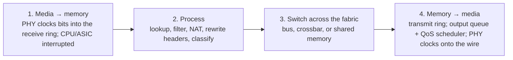

# 2.11 Switching internals, VLANs, trunking and spanning tree

| | |
|---|---|
| Level | Beginner to intermediate |
| Priority tier | 0 |
| Lab venue | Linux VM (bridges, VLANs), optional containerlab |
| Part | Part 2: Networking, from first principles to AI fabrics |
| Status | Drafted, labs **untested** |

## Why this matters for AI infrastructure

A GPU cluster is mostly switches. You need to know how a switch moves a frame (so you can reason about latency, buffering, drops and microbursts), how VLANs divide one physical network into several logical ones (management, storage, provisioning, tenant networks all share the same cabling), how trunks carry them to servers (the server NIC often carries tagged traffic to a bridge or to Kubernetes CNIs), and how Spanning Tree prevents a miswired cable from melting the network with a broadcast storm. It also explains why modern fabrics avoid large layer-2 domains altogether and route at the leaf (chapters 2.16 to 2.18). And topology discovery (LLDP, hello protocols, bidirectional-forwarding detection) is how cabling is verified and failures are detected quickly.

## Prerequisites and outcomes

You should know Ethernet framing, MAC learning and ARP (chapter 2.3), and routing basics (chapter 2.5).

After this chapter you can:

- Describe the four steps by which a network device moves a packet (media to memory, processing, switching across the fabric, memory to media), including rings, queues, shared memory, buses and crossbars, and the three software/hardware switching paths (process, fast/interrupt, ASIC).
- Explain switching versus routing, why we route, store-and-forward versus cut-through, buffering and why microbursts cause drops.
- Configure and verify VLANs, access/trunk ports, native VLAN, 802.1Q tags, QinQ, inter-VLAN routing, and Linux VLAN/bridge devices (`ip link add ... type vlan`, `bridge vlan`).
- Explain STP, RSTP and MSTP: root election, port roles and states, BPDUs, PortFast/BPDU guard, root guard, loop symptoms and recovery.
- Explain how devices discover neighbours and detect two-way connectivity (LLDP, hellos, dead timers, BFD) and how a control plane learns nodes, edges and reachable destinations.
- Design L2 domains for AI clusters and know when to avoid L2 altogether.

## 1. How a network device moves a packet

Every switch and router, from a Linux box to a 51.2 Tb/s ASIC, does the same four things:



- **Receive ring**: a circular set of preallocated packet buffers. The NIC/PHY writes arriving frames into the next free buffer and interrupts a processor (or the ASIC). The device swaps in an empty buffer and moves a *pointer* to the filled buffer to an **input queue**. Moving pointers instead of copying packets is the central optimisation: copying data is the most expensive thing a forwarding path can do. (Linux NIC drivers do exactly this with RX descriptor rings and `sk_buff`/page-pool buffers; `ethtool -g` shows ring sizes and `ethtool -S` shows per-queue drops.)
- **Processing** is a chain of optional stages: destination-based filtering, stateful packet filtering, deep packet inspection, NAT, the switching/routing decision itself, and post-switch work (egress ACLs, marking, mirroring). Operations that change the packet's addressing, such as NAT, must run *before* the lookup that uses those addresses.
- **Switching (layer 2)**: look up the destination MAC in the bridge/forwarding table (filled by learning, chapter 2.3, or by a control plane), find the egress port, and move the packet from the input queue to that port's output queue *unmodified*. **Routing (layer 3)**: strip or ignore the old L2 header, look up the destination IP in the forwarding table to find the next hop and egress interface, consult the ARP/ND table for the next hop's MAC, **rewrite the MAC header** (new source and destination MAC, TTL decrement, checksum update), then enqueue. A modern "layer-3 switch" is a router whose lookup and rewrite happen in hardware; most data-centre "switches" route.
- **Why route at all** when switching is cheaper: (1) to join different media with different headers and addressing without header translation, (2) to scale: a switched network needs every device to know every host's MAC (state grows with the number of hosts) whereas routing aggregates by topology-assigned prefixes, and (3) to contain broadcasts, which are inherent to protocols like ARP and DHCP but do not scale in large flat domains.
- **Transmit**: the packet is placed directly on the **transmit ring** if there is room; otherwise it waits in an **output queue**, drained by a scheduler according to QoS configuration (chapter 2.19). The PHY then encodes bits for the medium.

### Three forwarding paths

| Path | Where the packet is handled | Speed | Example |
|---|---|---|---|
| **Process switching ("slow path")** | An interrupt schedules a software process on a general-purpose CPU | Slowest; fine for control traffic | Packets punted to the router's CPU (ARP, routing protocols, ICMP generation, unknown features) |
| **Interrupt-context ("fast") switching** | The interrupt handler itself forwards the packet using optimised code | Moderate | Linux kernel forwarding through NAPI softirq; DPDK/XDP raise this further |
| **ASIC / NPU forwarding** | A dedicated packet-processing chip with TCAM/SRAM tables and fixed pipelines | Line rate at Tb/s | Merchant silicon (Broadcom Tomahawk/Trident, NVIDIA Spectrum), Cisco/Juniper custom ASICs |

ASICs have registers shaped for MAC/IP lookups, special instruction sets for rewriting headers and looking inside tunnels, large exact-match and ternary (TCAM) memories for routes and ACLs, and the ability to *recycle* a packet through the pipeline for operations needing more than one pass. The practical consequences: features not supported in the pipeline are "punted" to the CPU and become the slow path (a classic reason a switch handles 10 Gb/s fine but chokes on a particular ACL or ICMP flood); the **control-plane policing** (CoPP) protects the CPU; table sizes (routes, MACs, ACL entries) are hardware limits that bound the design.

### Across the fabric: shared memory, bus, crossbar

Small switches use a single shared packet memory so moving a packet from input to output is only moving a pointer. Larger devices (chassis, high-radix ASICs) need an internal **fabric** connecting ingress and egress engines: a bus (shared, limited) or a **crossbar** (a grid in which each input can connect to one output at a time, so many inputs and outputs can be active in parallel). Crossbars suffer **contention**: if two inputs both want the same output in the same cycle, one must wait. A simple *input-queued* crossbar also has **head-of-line blocking**: a packet at the head of an input queue destined for a busy output blocks packets behind it that could have gone to idle outputs. Remedies: **virtual output queues** (a separate queue per output at each input), speed-up (fabric faster than ports), and scheduling algorithms that match inputs to outputs each cycle; many crossbars also offer output queuing. Because the same contention logic applies to a whole leaf-spine network (chapter 2.18), these ideas return at fabric scale.

### Cut-through versus store-and-forward, and buffers

- **Store-and-forward**: receive the whole frame, verify the FCS, then forward. Latency grows with frame size (a 9000-byte jumbo frame needs 7.2 µs just to serialise on 10 Gb/s) but corrupt frames are never forwarded.
- **Cut-through**: start forwarding once the destination header is read; latency is roughly constant (hundreds of nanoseconds) regardless of frame size; corrupt frames may be forwarded (the last hop's FCS check drops them). Low-latency AI/HPC fabrics are cut-through. Cut-through requires equal or faster ingress/egress speeds (otherwise the egress cannot keep up and the switch falls back to store-and-forward).
- **Serialization delay** = frame bits / link rate; **port-to-port latency** is typically 300 ns to 1 µs in modern switches; propagation in fibre is ~5 ns/m.
- **Buffers.** When two inputs send to one output (incast) the output queue grows; shallow-buffer switches drop packets, deep-buffer switches add queuing delay. **Microbursts** (traffic exceeding line rate for microseconds) are invisible to 1-minute interface counters but cause drops and retransmits; look at queue-depth/drop counters and high-resolution telemetry (chapter 2.31). All-reduce collectives generate synchronous incast, which is why AI fabrics use ECN/PFC and carefully dimensioned buffers (chapter 2.19).

Troubleshooting insight: when "ingress exceeds egress" (a device appears to lose packets), understanding the path tells you where to look: receive ring overruns (CPU can't keep up), input-queue drops, ACL/policer drops, crossbar/VOQ congestion, output-queue tail drops, or transmit-side errors. Linux equivalents: `ethtool -S` (rx_missed, rx_no_buffer), `/proc/net/softnet_stat`, `tc -s qdisc`, `ip -s link`.

## 2. VLANs and trunks

A **VLAN** (virtual LAN, IEEE 802.1Q) splits one physical switched network into multiple independent broadcast domains. Hosts in different VLANs cannot exchange frames at layer 2; to communicate they must pass through a router (or an L3 switch) which applies policy. VLANs give isolation, smaller broadcast domains, and logical grouping independent of physical location.

### The 802.1Q tag

A trunk link carries frames of many VLANs by inserting a 4-byte tag after the source MAC:

```text
| Dst MAC | Src MAC | 0x8100 (TPID) | PCP(3) DEI(1) VID(12) | EtherType | payload | FCS |
```

- **VID** (VLAN ID): 12 bits, 1 to 4094 usable (0 and 4095 reserved); **PCP** (priority code point): 3 bits of 802.1p class of service (used by QoS, chapter 2.19); **DEI**: drop eligibility.
- The tag raises the maximum frame size by 4 bytes (1522 bytes for a 1500 MTU payload); switch ports and NICs must allow it; MTU on the VLAN subinterface is the usual 1500 (or 9000 with jumbo).
- **QinQ (802.1ad)** stacks two tags (outer service tag, inner customer tag) for provider networks; it increases the frame by another 4 bytes. VXLAN (chapter 2.17) replaces VLAN limits (4094) with a 24-bit VNI (16 million).

### Port types

| Port mode | Behaviour |
|---|---|
| **Access** | Belongs to exactly one VLAN; frames leave untagged; untagged frames received are assigned to the port's VLAN. Used for hosts. |
| **Trunk** | Carries multiple VLANs with 802.1Q tags (an allowed list); used between switches and to hypervisors/servers/routers. |
| **Native (untagged) VLAN** on a trunk | The VLAN whose frames are sent untagged on the trunk (default VLAN 1 on many vendors). Mismatched native VLANs between two switches leak traffic across VLANs and trigger STP warnings; best practice is to set an unused VLAN as native or tag everything. |
| **Hybrid/general** (some vendors, Linux bridge) | Port with a PVID (untagged VLAN) plus a set of tagged VLANs |

Best practices: don't use VLAN 1 for anything; prune trunks to only the VLANs needed (limits broadcast domains and blast radius); disable unused ports and put them in a black-hole VLAN; disable DTP/auto-trunking negotiation; document VLAN IDs and subnets in the address plan (chapter 2.4).

### Inter-VLAN routing

Hosts in different VLANs reach each other via a layer-3 gateway:

- **Router-on-a-stick**: one trunk to a router with a sub-interface per VLAN (`eth0.10`, `eth0.20`), each with the VLAN's gateway IP.
- **SVI (switch virtual interface) / IRB**: an L3 switch holds an interface per VLAN (`interface vlan 10`, `ip address 10.10.0.1/24`) and routes in hardware.
- **Linux as router**: VLAN sub-interfaces plus `ip_forward=1` (chapter 2.5).

In data centres, the VLAN's gateway is moved to the leaf switch, and VLANs rarely extend beyond a rack or pair of leaves; where L2 must be stretched, EVPN/VXLAN overlays are used (chapter 2.17).

### VLANs in a GPU cluster

Typical segmentation of one node: **management** (BMC/IPMI/Redfish, out-of-band), **provisioning/PXE**, **in-band management and SSH**, **storage** (NFS, Lustre, object, with jumbo MTU), **front-end** (client/inference traffic), and the **compute fabric** (InfiniBand or RoCE rails, usually separate physical switches or VRFs, not VLAN-shared with the rest). Hypervisor and Kubernetes nodes receive a trunk and map VLANs to bridges or macvlan/ipvlan/SR-IOV interfaces for pods (Multus secondary networks). Multi-tenant clusters use VLAN/VRF/VXLAN per tenant to isolate traffic.

### Linux VLANs and bridges

```bash
# 802.1Q sub-interface on a trunk NIC
sudo ip link add link eth0 name eth0.100 type vlan id 100
sudo ip addr add 10.100.0.45/24 dev eth0.100 ; sudo ip link set eth0.100 up
ip -d link show eth0.100                                  # shows "vlan protocol 802.1Q id 100"
cat /proc/net/vlan/config

# Linux bridge with VLAN filtering (a software switch)
sudo ip link add br0 type bridge vlan_filtering 1
sudo ip link set eth1 master br0 ; sudo ip link set eth2 master br0
sudo bridge vlan add dev eth1 vid 100 pvid untagged         # access port in VLAN 100
sudo bridge vlan add dev eth2 vid 100 ; sudo bridge vlan add dev eth2 vid 200    # trunk (tagged) carrying 100, 200
sudo bridge vlan add dev br0 vid 100 self                   # let the bridge itself be in VLAN 100 (for an SVI: br0.100)
sudo ip link set br0 up
bridge vlan show ; bridge fdb show br br0 ; bridge link
sudo tcpdump -ni eth0 -e vlan                                # see the 802.1Q tags in captures (-e prints the L2 header)
```

NIC offloads can hide tags from captures (`ethtool -K eth0 rxvlan off txvlan off` for debugging). Netplan/NetworkManager/systemd-networkd have VLAN stanzas for persistence. Containers and VMs usually attach to bridges or macvlan/ipvlan devices on VLAN sub-interfaces.

## 3. Loops and the Spanning Tree Protocol

Ethernet has no TTL. If two switches are connected by two links (or a cable is mistakenly looped), a broadcast frame circulates forever, multiplying at each switch: a **broadcast storm** saturates all links and the switch CPUs in seconds; MAC tables flap (the same source MAC appears on alternating ports), unicast frames are flooded. Yet redundant links are desirable for resilience. The **Spanning Tree Protocol** (STP, IEEE 802.1D) lets switches logically block redundant paths to form a loop-free tree, and unblock them when an active path fails.

### How STP works

1. **Root bridge election.** Each switch has a bridge ID (priority, default 32768, plus MAC; with VLAN extension in per-VLAN STP). Switches exchange **BPDUs** (bridge protocol data units, multicast 01:80:C2:00:00:00) advertising the best root they know. The lowest bridge ID becomes root. Set the priority deliberately on the core/spine switch (and a secondary) so the root is predictable instead of the oldest MAC.
2. **Root ports**: each non-root switch picks the one port with the lowest path cost to the root (cost depends on link speed: 10G = 2, 1G = 4, 100M = 19 in short mode; long mode for >10G), tie-broken by sender bridge ID and port ID.
3. **Designated ports**: for each segment, one port (closest to root) forwards toward the segment. All other ports are **blocked** (alternate/backup).
4. Ports transition through states (classic STP): blocking → listening → learning → forwarding, taking up to ~30 to 50 seconds to converge after a topology change (max age 20 s + forward delay 2×15 s).

### RSTP and MSTP

- **RSTP (802.1w, now part of 802.1D-2004)** converges in about a second via a proposal/agreement handshake on point-to-point links and defines roles *root, designated, alternate, backup* and states *discarding, learning, forwarding*; edge ports (to hosts) go straight to forwarding. Cisco "Rapid PVST+" runs RSTP per VLAN.
- **MSTP (802.1s)** maps groups of VLANs to a small number of spanning-tree instances, balancing load over redundant links without a tree per VLAN; requires consistent region name/revision/mapping on all switches.
- **PVST+/Rapid-PVST+** (Cisco) run one instance per VLAN; **vendor variants** exist; mixing them requires care.

### Protection features (use them)

| Feature | Purpose |
|---|---|
| **PortFast / edge port** | Host-facing ports forward immediately and do not generate topology changes |
| **BPDU guard** | If a BPDU arrives on an edge port, shut the port (err-disable): stops accidental switches/loops |
| **Root guard** | Prevents a port from becoming a root port (stops a rogue switch with lower priority from taking over the root) |
| **Loop guard / UDLD** | Detect unidirectional links that would otherwise cause loops |
| **Storm control** | Rate-limit broadcast/multicast/unknown-unicast on a port |
| **BPDU filter** | Suppress BPDUs on a port (dangerous; use sparingly) |

### Diagnosing loops

Symptoms: network-wide slowness, 100% utilisation on many links, high switch CPU, MAC flapping log messages, unreachable management. Triage: identify the ports with the highest broadcast/multicast counters; check `show spanning-tree` for recent topology changes and root location; unplug suspect links or shut them; find the loop (a cable, a hypervisor bridge, a misconfigured Linux bridge without STP, an unmanaged switch under a desk). Prevention: BPDU guard, storm control, port-security limits, and avoiding unnecessary L2 domains.

Linux bridges support STP (`ip link set br0 type bridge stp_state 1`, `brctl showstp`/`bridge -d link`); by default it is off, and VM/container bridges are a known source of accidental loops when two bridge ports connect to the same upstream segment.

### Modern designs avoid STP

Large STP domains waste half the links (blocked) and have slow, disruptive failure behaviour. Alternatives: **MLAG/vPC** (two switches present as one logical switch; links bundled with LACP, chapter 2.12), **routed access / leaf-spine with L3 to the leaf** (every link active via ECMP, no L2 loops across the fabric), **EVPN-VXLAN** for stretching L2 over an L3 underlay (chapter 2.17), **TRILL/SPB** (legacy). AI back-end fabrics are routed or InfiniBand; STP remains relevant in campus, management and storage networks, in hypervisor bridges, and in any brownfield environment.

## 4. How devices discover the network: neighbours, links and reachability

All control planes must answer: what is the topology, who are my neighbours, and what is reachable through whom?

**Nodes, edges, reachable destinations.** A *transit node* (router/switch) forwards packets between interfaces; a *leaf node/host* originates and terminates traffic; an *edge* is a connection over which packets are forwarded (point-to-point links, but also multipoint segments modelled as sets of point-to-point links); a **reachable destination** can be a host, a node, a service (possibly anycast, on several hosts), a link and all hosts attached to it (a prefix), or an aggregate of several prefixes. The **topology** is the graph of nodes and edges; it can be summarised by hiding detail behind an aggregate. Network diagrams hide information: bundles drawn as one line, multiplexed links, service complexity; control planes cannot hide it.

### Detecting neighbours

Interfaces do not equal neighbours: one multi-access segment interface may have several neighbours, so the control plane needs an explicit mechanism:

- **Manual configuration**: simple, robust, works across multiple hops (BGP peers, tunnels, overlay control planes).
- **Inferring neighbours from routing advertisements**: a neighbour exists while it keeps advertising; a **hold/dead timer** (typically 3× the update timer) expires to declare failure.
- **Explicit hellos** (OSPF, IS-IS, EIGRP, LDP, LLDP, LACP): periodic multicast hello packets carry capabilities and identifiers; the neighbour is declared dead when no hello is heard within the dead interval.
- **Centralised registration**: devices register with a controller/service that tells others (SDN controllers, service registries, Kubernetes API for nodes); the service itself must be discoverable.

**Two-way connectivity.** A unidirectional link (A hears B but B doesn't hear A, from a half-failed fibre or filter) must not become a forwarding path. Methods: ignore the problem (assume reachability if you hear them), or carry a **list of neighbours heard** in each hello: A's hello lists no neighbours; B hears A and includes A in its next hello; A sees itself listed and knows B hears it, so both declare two-way adjacency (OSPF's 2-Way state works this way). UDLD and BFD also detect one-way failures.

**Link-layer discovery on servers.** LLDP (IEEE 802.1AB) and Cisco CDP advertise device name, port ID, capabilities, VLANs and MTU. On Linux: `lldpd`/`lldpcli show neighbors` or `lldptool`, NIC firmware LLDP agents (`ethtool --show-priv-flags`), to verify cabling (which switch port is this NIC plugged into?), which is invaluable when commissioning hundreds of GPU servers; compare discovered topology with the intended wiring plan automatically (also see `ibnetdiscover` for InfiniBand, Part 11).

**Detecting path MTU/capabilities.** Control planes learn the maximum frame size via hello contents (OSPF MTU mismatch prevents adjacency), padding hellos to the interface MTU (IS-IS), or MTU fields in LLDP; mismatches are classic adjacency-down bugs (chapter 2.7).

**Fast failure detection: BFD.** Hello/dead timers in routing protocols are seconds; **Bidirectional Forwarding Detection** (RFC 5880) sends lightweight UDP/hardware-assisted probes every 50 to 300 ms so failures are detected in under a second independent of the routing protocol, then notifies BGP/OSPF/static routes (`bfd` in FRR). Pair BFD with ECMP so traffic shifts within milliseconds of a link or switch failure; on host side, `ethtool` link-state, `ip monitor`, and bond `miimon`/ARP monitoring (chapter 2.12) play the same role.

The remaining parts of control-plane learning (learning reachability **reactively**—waiting until a data packet arrives to resolve state on demand, like ARP or MAC learning, which reduces standing control-plane state at the cost of first-packet latency—versus **proactively** pre-distributing all reachability via a routing database; advertising and redistributing routes; and tagging routes with administrative numbers at redistribution boundaries to prevent routing loops, `CN` Chapter 11) belong with routing protocols in chapter 2.13.

## 5. Designing L2 domains for AI infrastructure

- **Keep L2 small.** One rack or a leaf pair per VLAN; route everything above that. Use EVPN-VXLAN only when workloads truly need L2 adjacency across racks (live migration, legacy clustering).
- **Management/provisioning VLANs** can be larger but should have BPDU guard, storm control, DHCP snooping and port security; keep BMC networks isolated from tenant traffic.
- **Server attachment**: dual-homed servers with LACP to an MLAG pair (chapter 2.12), or two independent routed uplinks (BGP to the host / ECMP) for modern designs.
- **Back-end fabrics**: IB or routed Ethernet with PFC/ECN (chapter 2.19); do not rely on STP anywhere in them; ensure the lossless classes are consistent end to end.
- **Naming and documentation**: a VLAN/subnet plan, switch-port-to-NIC mapping from LLDP, and automated drift checks (chapters 2.28, 2.29).

## 6. Hands-on lab: VLANs, bridges, and a deliberate loop

First, run the self-checking Python lab (`code/part02/vlans_stp_switching_lab.py`) locally. It verifies IEEE `802.1Q` 16-bit `TCI` (`PCP | DEI | VID`) encoding/decoding (`0x6064` for `PCP=3, VID=100`), Spanning Tree Root Bridge election (`priority + MAC`), and 2-Way bidirectional hello + MTU adjacency checks (`CN` Chapter 11).

```bash
python3 code/part02/vlans_stp_switching_lab.py
```

Next, on a disposable Linux VM using network namespaces and bridges (all interactive VM commands below are `untested here`), work through these steps:

1. **Software switch**: create bridge `sw1` and three namespaces `h1,h2,h3` connected with veth pairs; assign 10.0.0.1/2/3 /24; ping across; inspect `bridge fdb show`; watch MAC learning by flushing (`bridge fdb flush`) and re-pinging with `tcpdump` on a third port to see the first flooded ARP.
2. **VLANs**: enable `vlan_filtering`; put h1,h2 in VLAN 10 (access) and h3 in VLAN 20; show h3 cannot reach h1; add a router namespace `r` on a trunk port with sub-interfaces for VLAN 10/20 (router-on-a-stick) and `ip_forward=1`; verify inter-VLAN ping, inspect tags with `tcpdump -e -ni <trunk>`; compare with an SVI on the bridge.
3. **Native VLAN mismatch**: configure two bridges joined by a trunk with different native VLANs; observe leakage between VLANs.
4. **Loop**: connect two bridges with two veth links with STP off; send a broadcast (`arping`) and watch the packet counters explode (`ip -s link`) and CPU rise, then recover by deleting a link. Turn on STP (`ip link set sw1 type bridge stp_state 1`) and see one port go to blocking (`bridge link`); then fail the active link and time the reconvergence; try RSTP-capable software (e.g. `mstpd`) if available.
5. **BPDU guard analogue**: attach a bridge to an access port and observe the BPDUs (`tcpdump -ni port stp`).
6. **LLDP**: run `lldpd` in two namespaces connected by a veth, view `lldpcli show neighbors`; change the system name and see the update; remove one direction (`tc` filter dropping packets in one direction) to emulate a unidirectional link and observe the one-way adjacency symptoms; add BFD in FRR (chapter 2.27) and measure detection time.
7. **Latency/serialisation**: use `ping -s` sizes through two bridges with `tc netem rate 1gbit` to show serialisation delay growth.
8. **Clean up** namespaces and bridges.

## 7. Common mistakes

- Mismatched native VLANs; leaving VLAN 1 in use; trunks carrying all VLANs.
- Running without BPDU guard/storm control on access ports; hypervisor bridges plugged into two ports.
- Extending a single big L2 domain across the cluster "for convenience".
- Believing a "switch" never routes (L3 switch) or that a single large buffer solves incast.
- Ignoring MTU on trunks and VLAN sub-interfaces; forgetting the 4-byte tag in frame-size limits.
- Expecting a spanning-tree blocked link to carry traffic; not setting root priorities.
- Reading only average interface utilisation; missing microbursts and queue drops.
- Verifying cabling by trust rather than LLDP.

## 8. Interview angles

- "Describe what a switch does when a frame arrives. How is that different from a router?"
- "What is a VLAN? Access versus trunk? What's the native VLAN issue?"
- "How does STP choose the root and block ports? What is RSTP's improvement? Why BPDU guard?"
- "Your whole network slowed down and switch CPUs spiked. What happened and what do you do?" (Loop/broadcast storm.)
- "Why do data centres avoid STP? What do they use instead?"
- "Store-and-forward versus cut-through; where does each matter?"
- "How would you verify that 512 servers are cabled to the right leaf ports?" (LLDP + inventory compare.)
- "What is head-of-line blocking in a switch and how do VOQs fix it?"

## Exercises

1. **The Four Packet-Movement Steps, Three Forwarding Paths, and Crossbar `VOQ`s (`CN` Chapter 7):** (a) Explain the four internal steps by which any switch or router moves a packet (`Media -> RX ring -> Processing -> Fabric -> TX ring -> Media`) and why passing buffer pointers instead of copying packet bytes is critical; (b) compare **process switching** ("punted to CPU"), **interrupt-context fast switching**, and **ASIC/NPU forwarding** (`TCAM`/`SRAM`), and calculate the serialization delay of a `9000`-byte jumbo frame on a `10 Gb/s` link (`7.2 µs`).
2. **IEEE `802.1Q` Tag Anatomy, Access vs. Trunk vs. Native VLAN, and Linux `bridge vlan`:** (a) Using `encode_decode_8021q_tci()` in `code/part02/vlans_stp_switching.py`, encode `PCP = 3` (RoCE priority), `DEI = 0`, and `VID = 100` into its 16-bit `TCI` integer (`0x6064`), and explain why `VID 0` and `VID 4095` are reserved; (b) write the Linux `ip link` and `bridge vlan` commands to create a VLAN-filtering bridge `br0` where `eth1` is an untagged access port in VLAN `100` and `eth2` is a tagged trunk carrying VLANs `100` and `200`.
3. **Spanning Tree (`STP` vs. `RSTP` vs. `MSTP`) and Port Protection (`PortFast`, `BPDU Guard`, `Root Guard`):** (a) Using `elect_stp_root_bridge()`, explain why leaving all switches at the default STP priority (`32768`) risks electing the oldest closet switch in the building as the Root Bridge, and trace how STP selects **Root Ports**, **Designated Ports**, and **Blocked Ports**; (b) contrast classic `802.1D` STP (`30–50 s` convergence) with `802.1w` **RSTP** (`~1 s` proposal/agreement convergence), and state what **PortFast**, **BPDU Guard**, and **Root Guard** protect against.
4. **Why Modern Data Centers and AI Fabrics Avoid Spanning Tree:** Give three reasons large L2 Spanning Tree domains are avoided in modern data-center fabrics, and name the three architectures (**MLAG/vPC**, **L3 routed leaf-spine with ECMP**, and **EVPN-VXLAN**) that replace them.
5. **Control-Plane Topology Discovery, Two-Way Connectivity, and Reactive vs. Proactive Learning (`CN` Chapter 11):** Using `check_two_way_hello_adjacency()`, explain how routing protocols (`OSPF`, `IS-IS`) use neighbor lists inside multicast **hello** packets to prove **two-way (bidirectional) connectivity** and verify matching link **MTU** before forming an adjacency. Contrast **reactive** and **proactive** control planes.
6. **Automated Cabling Verification with `LLDP` (`802.1AB`) and Sub-Second Failure Detection with `BFD` (`RFC 5880`):** Design a commissioning check for a 512-node GPU cluster using `lldpcli show neighbors` to catch swapped leaf-switch cables before running workloads, and explain why routing protocols pair with **BFD** (`50–300 ms` intervals) instead of relying on multi-second hello/dead timers.

## Checkpoint questions (20)

<details>
<summary>1. What are the four steps by which a switch or router moves a packet internally (`CN` Chapter 7), and why does it move pointers instead of copying bytes?</summary>

(1) **Media to memory**: the PHY clocks incoming bits into a preallocated buffer in the circular **receive (`RX`) ring**; (2) **Processing**: header lookup (`FDB` or `FIB`), ACL/firewall filtering, NAT, and header rewrite; (3) **Switching across the internal fabric**: moving the packet from ingress to egress via shared memory, a bus, or a crossbar; and (4) **Memory to media**: queuing in an output QoS queue, placing on the **transmit (`TX`) ring**, and clocking bits onto the wire. Copying packet payload bytes in memory is the most expensive operation on a forwarding path, so high-speed devices keep the packet in one buffer and pass only a **pointer/descriptor** from ring to queue.
</details>

<details>
<summary>2. What changes in a packet when it is L2-switched versus L3-routed, and what are the three fundamental reasons we route instead of switching the entire world?</summary>

An **L2 switch** forwards the Ethernet frame **unmodified** based on its destination MAC address. An **L3 router** (or L3 switch SVI) strips the incoming Ethernet header, looks up the destination IP in its FIB, decrements the IP **`TTL` / `Hop Limit`** (updating the IPv4 header checksum), and encapsulates the packet in a **brand-new Ethernet header** (`src MAC` = router egress port, `dst MAC` = next-hop MAC). We route for three reasons (`CN` Ch. 7): (1) to interconnect dissimilar physical/link media, (2) to **scale reachability state via hierarchical prefix aggregation** (switches must store every individual host MAC, whereas routers summarize thousands of hosts into one `/20` prefix), and (3) to **contain broadcast domains** (`ARP`, `DHCP`, unknown unicast).
</details>

<details>
<summary>3. Compare the three packet forwarding paths inside network devices: Process Switching, Interrupt-Context Fast Switching, and ASIC/NPU Forwarding.</summary>

- **Process switching ("slow path")**: the packet is **punted to the general-purpose CPU** and scheduled into a user/kernel process (used for control-plane protocols like BGP/OSPF, ARP generation, TTL-expired ICMP replies, or unsupported hardware options; protected by **Control-Plane Policing `CoPP`**).\n- **Interrupt-context ("fast") switching**: forwarded directly inside the kernel interrupt/softirq handler (`Linux NAPI`, or bypassed via `XDP`/`DPDK`).\n- **ASIC / NPU hardware forwarding**: fixed or programmable silicon pipelines (`Broadcom Tomahawk/Trident`, `NVIDIA Spectrum`) with `SRAM` exact-match and `TCAM` ternary tables forwarding at `12.8` to `51.2 Tb/s` line rate.
</details>

<details>
<summary>4. What is Head-of-Line (`HOL`) blocking in an input-queued crossbar switch, and how do Virtual Output Queues (`VOQ`s) solve it?</summary>

In a crossbar switch with a single FIFO queue per input port, if the packet at the head of Input 1 is destined for a congested Output 3, it blocks all packets sitting behind it in Input 1's queue—even if those packets are destined for completely idle Output 2 (**HOL blocking**). **Virtual Output Queues (`VOQ`s)** maintain `N` separate queues at every input port (one queue per destination output port), allowing the crossbar arbiter (`iSLIP`) to schedule packets to idle outputs without being stalled by a congested output.
</details>

<details>
<summary>5. Compare Cut-Through and Store-and-Forward switching, calculate the serialization delay of a `9000`-byte frame at `10 Gb/s`, and define a Microburst.</summary>

**Store-and-forward** buffers the entire frame and verifies the trailing `FCS` CRC before forwarding (dropping corrupt frames, but adding full serialization delay). **Cut-through** starts forwarding as soon as the first `14–24` bytes (destination address) are read (`~300 ns–1 µs` latency independent of frame size, used in AI/HPC fabrics). A `9000`-byte frame (`72,000` bits) takes **`72,000 / 10e9 = 7.2 µs`** to serialize at `10 Gb/s` (`180 ns` at `400 Gb/s`). A **microburst** is a sub-millisecond synchronized burst (such as an `AllReduce` barrier) that overflows switch output buffers and drops packets while 1-minute average utilization counters look low (`< 20%`).
</details>

<details>
<summary>6. Describe the 4-byte IEEE `802.1Q` VLAN tag (`TPID`, `PCP`, `DEI`, `VID`) and the usable VLAN ID range.</summary>

Inserted immediately after the 6-byte Source MAC address, the `4`-byte `802.1Q` tag consists of:\n- **`16`-bit `TPID` (*Tag Protocol Identifier*)**: `0x8100` (or `0x88A8` for outer `802.1ad` QinQ tags)\n- **`3`-bit `PCP` (*Priority Code Point*, `802.1p`)**: `0..7` Class-of-Service priority (used by lossless RoCEv2 `PFC`, typically priority `3`)\n- **`1`-bit `DEI` (*Drop Eligible Indicator*)**\n- **`12`-bit `VID` (*VLAN Identifier*)**: **`1` to `4094` usable** (`0` is reserved for priority-only tagging and `4095` is reserved). It increases standard max frame size from `1518` to **`1522` bytes**.
</details>

<details>
<summary>7. Contrast an Access port, a Trunk port, and the Native VLAN, and explain the security/operational hazard of a Native VLAN mismatch.</summary>

An **Access port** belongs to a single VLAN and sends/receives frames **untagged** (used for end hosts). A **Trunk port** carries frames for multiple allowed VLANs using **`802.1Q` tags** (used between switches and hypervisors/Kubernetes nodes). The **Native VLAN** (default `VLAN 1`) is the single VLAN whose frames are transmitted **untagged** across a trunk. If Switch A sets `native vlan 10` and Switch B sets `native vlan 20` on the same trunk, untagged frames sent from VLAN 10 silently hop into VLAN 20 on Switch B—leaking traffic across broadcast domains and breaking Spanning Tree.
</details>

<details>
<summary>8. Compare \"Router-on-a-Stick\" with an L3 Switch `SVI` (*Switch Virtual Interface* / `IRB`) for inter-VLAN routing.</summary>

In **Router-on-a-Stick**, a switch sends inter-VLAN traffic over a trunk link to an external router configured with `802.1Q` sub-interfaces (`eth0.10`, `eth0.20`), which routes the packet and sends it back down the same trunk (hairpinning the link). With an **L3 Switch `SVI`** (`interface Vlan10`, `interface Vlan20`), the switch ASIC itself holds the default gateway IP for each VLAN and routes between VLANs at hardware line rate internally.
</details>

<details>
<summary>9. How do you configure an `802.1Q` VLAN sub-interface and a VLAN-filtering software bridge on Linux?</summary>

- **VLAN sub-interface**: `sudo ip link add link eth0 name eth0.100 type vlan id 100 && sudo ip link set eth0.100 up`.\n- **VLAN-filtering bridge**: `sudo ip link add br0 type bridge vlan_filtering 1`, attach ports (`ip link set eth1 master br0`), configure an untagged access port (`sudo bridge vlan add dev eth1 vid 100 pvid untagged`), configure a tagged trunk port (`sudo bridge vlan add dev eth2 vid 100` and `vid 200`), and inspect with `bridge vlan show`.
</details>

<details>
<summary>10. Why do Layer 2 loops cause catastrophic broadcast storms and MAC table flapping within seconds?</summary>

Because Ethernet headers contain **no `TTL` (Time To Live) field**, any broadcast (`ARP`, `DHCP`), multicast, or unknown-unicast frame entering a loop is flooded out all ports, returns to the switches on alternate links, and is flooded again—multiplying exponentially until 100% of link bandwidth and switch CPU cycles are consumed, while the switches' MAC tables (`FDB`) constantly overwrite each host's source MAC port back and forth (**MAC flapping**).
</details>

<details>
<summary>11. Trace the 3-step Spanning Tree Protocol (`STP`) calculation: Root Bridge election, Root Port selection, and Designated vs. Blocked Ports.</summary>

(1) **Elect the Root Bridge**: switches exchange **BPDUs** (`01:80:C2:00:00:00`) containing their 8-byte **Bridge ID (`2-byte Priority + 6-byte MAC`)**; the switch with the **lowest numerical Bridge ID** wins (default priority is `32768`, so you must set the spine/core switch to e.g. `4096` so an old closet switch with a low MAC doesn't win!). (2) **Select Root Ports**: every non-root switch selects its single port with the **lowest cumulative path cost to the Root Bridge** as its `Root Port`. (3) **Select Designated and Blocked Ports**: on every link segment, the switch port with the lower cost to the Root becomes the forwarding `Designated Port`, and the other end is placed in **`Blocking` (`Alternate`)** state to break the loop.
</details>

<details>
<summary>12. Compare classic `802.1D` STP, `802.1w` RSTP, and `802.1s` MSTP.</summary>

- **Classic `802.1D` STP**: timer-driven (`Blocking -> Listening 15s -> Learning 15s -> Forwarding`, plus `20s Max Age` = **`30 to 50 seconds`** convergence) with a single tree for all VLANs.\n- **`802.1w` RSTP (*Rapid STP*)**: uses an active **proposal/agreement handshake** on point-to-point full-duplex links and designates host ports as `Edge` ports, converging in **`~1 second`** (`Discarding -> Learning -> Forwarding`; roles: `Root`, `Designated`, `Alternate`, `Backup`).\n- **`802.1s` MSTP (*Multiple STP*)**: maps hundreds of VLANs into a few spanning-tree instances (`MSTI`s) so different VLAN groups can use different uplinks without running a separate CPU-heavy STP instance per VLAN.
</details>

<details>
<summary>13. State the purpose of the five essential STP protection mechanisms: `PortFast` (`Edge`), `BPDU Guard`, `Root Guard`, `Loop Guard` / `UDLD`, and `Storm Control`.</summary>

- **`PortFast` (`Edge port`)**: transitions server/host access ports immediately to `Forwarding` on link-up without waiting `30 s` and suppresses Topology Change Notifications (`TCN`s) when servers reboot.\n- **`BPDU Guard`**: immediately shuts down (`err-disable`s) a `PortFast` edge port if a **BPDU** ever arrives on it (stopping accidental loops from someone plugging in a switch or unconfigured bridge).\n- **`Root Guard`**: blocks an interface if a superior BPDU arrives on it, preventing an access/tenant switch from hijacking the Root Bridge role.\n- **`Loop Guard` / `UDLD`**: prevents an alternate port from moving to `Forwarding` if unidirectional fiber failure stops BPDUs in one direction.\n- **`Storm Control`**: rate-limits broadcast, multicast, and unknown-unicast traffic on a port.
</details>

<details>
<summary>14. Why do modern data-center and AI fabrics avoid Spanning Tree on the data path, and what do they use instead?</summary>

Spanning Tree **blocks half of your expensive parallel uplinks** (leaving 50% of bandwidth idle), cannot do active-active multipathing within one tree, and suffers blast-radius reconvergence on topology changes. Modern data centers keep L2 confined to a single rack (using **MLAG/vPC** with **LACP** for dual-homed L2 servers) and use **L3 routed leaf-spine fabrics with ECMP** (plus **EVPN-VXLAN** if L2 must be stretched over L3) so **100% of links forward actively** with no L2 loops.
</details>

<details>
<summary>15. In control-plane graph theory (`CN` Chapter 11), define a Transit Node, a Leaf Node, an Edge, and a Reachable Destination.</summary>

A **transit node** (router/switch) forwards packets between interfaces; a **leaf node** (host) originates and terminates traffic; an **edge** is a link connecting nodes over which packets can be forwarded; and a **reachable destination** is a named endpoint attached to the graph—a single host (`/32`), a service (possibly anycast across multiple nodes), a subnet prefix (`/24`), or a summarized aggregate (`/16`).
</details>

<details>
<summary>16. What are the four ways a network device detects its neighbors (`CN` Chapter 11)?</summary>

(1) **Manual configuration** (explicitly configuring neighbor IP addresses, as in classic eBGP/iBGP); (2) **Inferring neighbors from routing advertisements** (RIP, holding state until a `3x` dead/hold timer expires); (3) **Explicit periodic Hello messages** (`OSPF`, `IS-IS`, `EIGRP`, `LLDP`, `LACP`); and (4) **Centralized registration** with a controller or directory (`SDN` controllers, InfiniBand Subnet Manager, Kubernetes API server).
</details>

<details>
<summary>17. How do hello-based protocols (`OSPF`, `IS-IS`) verify Two-Way (bidirectional) connectivity and matching link `MTU` before forming an adjacency?</summary>

A broken fiber strand or filter can create a **unidirectional link** where Router B hears Router A's hellos, but Router A cannot hear Router B. To prove **two-way connectivity**, every hello packet includes the **list of neighbor Router IDs recently heard on that interface**: Router B hears A and adds `A` to its outgoing hello; when Router A receives B's hello and **sees its own ID (`A`) listed inside it**, both sides know the link is bidirectional (`2-Way` state). Similarly, OSPF carries the interface `MTU` in Database Description packets and IS-IS pads hellos to the full interface `MTU` so mismatched MTUs (`9000` vs `1500`) fail adjacency immediately rather than blackholing data later.
</details>

<details>
<summary>18. Contrast Reactive and Proactive control-plane learning (`CN` Chapter 11).</summary>

**Proactive control planes** (`OSPF`, `IS-IS`, `BGP`) discover the entire topology and populate forwarding tables **before** data traffic arrives—giving instant first-packet forwarding at the cost of standing control-plane state and background traffic. **Reactive systems** (`ARP`, `NDP`, Ethernet MAC learning, on-demand tunnels) wait until a data packet arrives for an unknown destination and then query/learn on demand—reducing standing state for idle endpoints at the cost of first-packet latency and broadcast/flooding overhead.
</details>

<details>
<summary>19. How does `LLDP` (`IEEE 802.1AB`) work on Linux servers, and how is it used when commissioning a 512-node GPU cluster?</summary>

`lldpd` (`sudo lldpcli show neighbors`) exchanges link-local multicast frames (`01:80:C2:00:00:0E`) with the directly attached switch port (never forwarded by switches), advertising system hostname, port name/description, management IP, VLANs, and MTU. During cluster bring-up, an automated script queries `lldpcli -f json show neighbors` across all 512 GPU nodes and diffs the actual `(node, NIC) <-> (leaf switch, port)` cabling against the rack design spreadsheet—catching miswired rails before a single job runs.
</details>

<details>
<summary>20. Why do routing protocols pair with `BFD` (*Bidirectional Forwarding Detection*, RFC 5880)?</summary>

Routing protocol hello/dead timers default to seconds (`10 s / 40 s` in OSPF, `3 s / 9 s` or `60 s / 180 s` in BGP), which is far too slow for 400 Gb/s AI fabrics. **BFD** runs a lightweight, protocol-independent heartbeat session (for example, UDP probes every **`50 ms` with a `3x` multiplier = `150 ms` detection**) and immediately notifies `BGP`, `OSPF`, or static routes to withdraw the failed next hop from the ECMP group in milliseconds.
</details>

## Sources and review notes

- **Sources read in full:**
  - `computer-networking-problems-and-solutions` — Russ White and Ethan Banks, *Computer Networking Problems and Solutions*, **Chapter 7: Packet Switching** (media to memory RX ring pointers, processing, switching vs routing, why route, the 3 forwarding paths process / interrupt / ASIC TCAM/SRAM, shared memory vs bus vs crossbar fabrics, VOQs and iSLIP, store-and-forward vs cut-through, memory to media TX ring and output queues; ECMP and link aggregation are covered in Chapter 2.12) and **Chapter 11: Topology Discovery** (nodes, edges, and reachable destinations, detecting neighbors, two-way connectivity, MTU detection, reactive vs proactive control planes, and route tagging).
- **Run here:** `python3 code/part02/vlans_stp_switching_lab.py` (12 passed, 0 failed).
- **Explicitly labelled inferences:** The IEEE `802.1Q` (`TPID 0x8100`, `PCP`, `DEI`, `VID`) and Linux `bridge vlan` configuration commands, STP/RSTP/MSTP protection table (`PortFast`, `BPDU Guard`, `Root Guard`), `lldpcli` cluster cabling verification, and `BFD` (`RFC 5880`) notes synthesize IEEE 802.1Q, 802.1D, 802.1w, 802.1s, and 802.1AB, RFC 5880, and the `iproute2` `bridge(8)` / `ip-link(8)` documentation (cross-referenced with Chapters 2.3, 2.4, 2.5, 2.7, 2.12, 2.13, 2.16–2.19, 2.27–2.29, and 2.31, plus original study items 21, 22, 23, 25, 26, 27, 28, 29, 31, 33, 34, and 35).
- **Not verified on live hardware:** All interactive VM and switch commands (`ip link add type vlan`, `bridge vlan`, `brctl`, `tcpdump -e vlan`, `lldpd`, `lldpcli`) are marked (untested here) and must be executed on a disposable Linux VM or containerlab topology.
