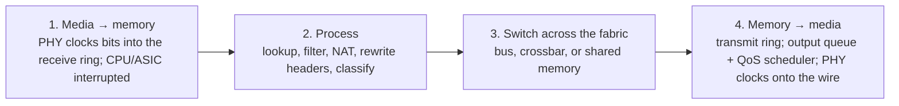

# 2.11 Switching internals, VLANs, trunking and spanning tree

| | |
|---|---|
| Level | Beginner to intermediate |
| Priority tier | 0 |
| Lab venue | Linux VM (bridges, VLANs), optional containerlab |
| Part | Part 2: Networking, from first principles to AI fabrics |
| Status | Drafted, labs **untested** |

## Why this matters for AI infrastructure

A GPU cluster is mostly switches. You need to know how a switch moves a frame (so you can reason about latency, buffering, drops and microbursts), how VLANs divide one physical network into several logical ones (management, storage, provisioning, tenant networks all share the same cabling), how trunks carry them to servers (the server NIC often carries tagged traffic to a bridge or to Kubernetes CNIs), and how Spanning Tree prevents a miswired cable from melting the network with a broadcast storm. It also explains why modern fabrics avoid large layer-2 domains altogether and route at the leaf (chapters 2.16 to 2.18). And topology discovery (LLDP, hello protocols, bidirectional-forwarding detection) is how cabling is verified and failures are detected quickly.

## Prerequisites and outcomes

You should know Ethernet framing, MAC learning and ARP (chapter 2.3), and routing basics (chapter 2.5).

After this chapter you can:

- Describe the four steps by which a network device moves a packet (media to memory, processing, switching across the fabric, memory to media), including rings, queues, shared memory, buses and crossbars, and the three software/hardware switching paths (process, fast/interrupt, ASIC).
- Explain switching versus routing, why we route, store-and-forward versus cut-through, buffering and why microbursts cause drops.
- Configure and verify VLANs, access/trunk ports, native VLAN, 802.1Q tags, QinQ, inter-VLAN routing, and Linux VLAN/bridge devices (`ip link add ... type vlan`, `bridge vlan`).
- Explain STP, RSTP and MSTP: root election, port roles and states, BPDUs, PortFast/BPDU guard, root guard, loop symptoms and recovery.
- Explain how devices discover neighbours and detect two-way connectivity (LLDP, hellos, dead timers, BFD) and how a control plane learns nodes, edges and reachable destinations.
- Design L2 domains for AI clusters and know when to avoid L2 altogether.

## 1. How a network device moves a packet

Every switch and router, from a Linux box to a 51.2 Tb/s ASIC, does the same four things:



- **Receive ring**: a circular set of preallocated packet buffers. The NIC/PHY writes arriving frames into the next free buffer and interrupts a processor (or the ASIC). The device swaps in an empty buffer and moves a *pointer* to the filled buffer to an **input queue**. Moving pointers instead of copying packets is the central optimisation: copying data is the most expensive thing a forwarding path can do. (Linux NIC drivers do exactly this with RX descriptor rings and `sk_buff`/page-pool buffers; `ethtool -g` shows ring sizes and `ethtool -S` shows per-queue drops.)
- **Processing** is a chain of optional stages: destination-based filtering, stateful packet filtering, deep packet inspection, NAT, the switching/routing decision itself, and post-switch work (egress ACLs, marking, mirroring). Operations that change the packet's addressing, such as NAT, must run *before* the lookup that uses those addresses.
- **Switching (layer 2)**: look up the destination MAC in the bridge/forwarding table (filled by learning, chapter 2.3, or by a control plane), find the egress port, and move the packet from the input queue to that port's output queue *unmodified*. **Routing (layer 3)**: strip or ignore the old L2 header, look up the destination IP in the forwarding table to find the next hop and egress interface, consult the ARP/ND table for the next hop's MAC, **rewrite the MAC header** (new source and destination MAC, TTL decrement, checksum update), then enqueue. A modern "layer-3 switch" is a router whose lookup and rewrite happen in hardware; most data-centre "switches" route.
- **Why route at all** when switching is cheaper: (1) to join different media with different headers and addressing without header translation, (2) to scale: a switched network needs every device to know every host's MAC (state grows with the number of hosts) whereas routing aggregates by topology-assigned prefixes, and (3) to contain broadcasts, which are inherent to protocols like ARP and DHCP but do not scale in large flat domains.
- **Transmit**: the packet is placed directly on the **transmit ring** if there is room; otherwise it waits in an **output queue**, drained by a scheduler according to QoS configuration (chapter 2.19). The PHY then encodes bits for the medium.

### Three forwarding paths

| Path | Where the packet is handled | Speed | Example |
|---|---|---|---|
| **Process switching ("slow path")** | An interrupt schedules a software process on a general-purpose CPU | Slowest; fine for control traffic | Packets punted to the router's CPU (ARP, routing protocols, ICMP generation, unknown features) |
| **Interrupt-context ("fast") switching** | The interrupt handler itself forwards the packet using optimised code | Moderate | Linux kernel forwarding through NAPI softirq; DPDK/XDP raise this further |
| **ASIC / NPU forwarding** | A dedicated packet-processing chip with TCAM/SRAM tables and fixed pipelines | Line rate at Tb/s | Merchant silicon (Broadcom Tomahawk/Trident, NVIDIA Spectrum), Cisco/Juniper custom ASICs |

ASICs have registers shaped for MAC/IP lookups, special instruction sets for rewriting headers and looking inside tunnels, large exact-match and ternary (TCAM) memories for routes and ACLs, and the ability to *recycle* a packet through the pipeline for operations needing more than one pass. The practical consequences: features not supported in the pipeline are "punted" to the CPU and become the slow path (a classic reason a switch handles 10 Gb/s fine but chokes on a particular ACL or ICMP flood); the **control-plane policing** (CoPP) protects the CPU; table sizes (routes, MACs, ACL entries) are hardware limits that bound the design.

### Across the fabric: shared memory, bus, crossbar

Small switches use a single shared packet memory so moving a packet from input to output is only moving a pointer. Larger devices (chassis, high-radix ASICs) need an internal **fabric** connecting ingress and egress engines: a bus (shared, limited) or a **crossbar** (a grid in which each input can connect to one output at a time, so many inputs and outputs can be active in parallel). Crossbars suffer **contention**: if two inputs both want the same output in the same cycle, one must wait. A simple *input-queued* crossbar also has **head-of-line blocking**: a packet at the head of an input queue destined for a busy output blocks packets behind it that could have gone to idle outputs. Remedies: **virtual output queues** (a separate queue per output at each input), speed-up (fabric faster than ports), and scheduling algorithms that match inputs to outputs each cycle; many crossbars also offer output queuing. Because the same contention logic applies to a whole leaf-spine network (chapter 2.18), these ideas return at fabric scale.

### Cut-through versus store-and-forward, and buffers

- **Store-and-forward**: receive the whole frame, verify the FCS, then forward. Latency grows with frame size (a 9000-byte jumbo frame needs 7.2 µs just to serialise on 10 Gb/s) but corrupt frames are never forwarded.
- **Cut-through**: start forwarding once the destination header is read; latency is roughly constant (hundreds of nanoseconds) regardless of frame size; corrupt frames may be forwarded (the last hop's FCS check drops them). Low-latency AI/HPC fabrics are cut-through. Cut-through requires equal or faster ingress/egress speeds (otherwise the egress cannot keep up and the switch falls back to store-and-forward).
- **Serialization delay** = frame bits / link rate; **port-to-port latency** is typically 300 ns to 1 µs in modern switches; propagation in fibre is ~5 ns/m.
- **Buffers.** When two inputs send to one output (incast) the output queue grows; shallow-buffer switches drop packets, deep-buffer switches add queuing delay. **Microbursts** (traffic exceeding line rate for microseconds) are invisible to 1-minute interface counters but cause drops and retransmits; look at queue-depth/drop counters and high-resolution telemetry (chapter 2.31). All-reduce collectives generate synchronous incast, which is why AI fabrics use ECN/PFC and carefully dimensioned buffers (chapter 2.19).

Troubleshooting insight: when "ingress exceeds egress" (a device appears to lose packets), understanding the path tells you where to look: receive ring overruns (CPU can't keep up), input-queue drops, ACL/policer drops, crossbar/VOQ congestion, output-queue tail drops, or transmit-side errors. Linux equivalents: `ethtool -S` (rx_missed, rx_no_buffer), `/proc/net/softnet_stat`, `tc -s qdisc`, `ip -s link`.

## 2. VLANs and trunks

A **VLAN** (virtual LAN, IEEE 802.1Q) splits one physical switched network into multiple independent broadcast domains. Hosts in different VLANs cannot exchange frames at layer 2; to communicate they must pass through a router (or an L3 switch) which applies policy. VLANs give isolation, smaller broadcast domains, and logical grouping independent of physical location.

### The 802.1Q tag

A trunk link carries frames of many VLANs by inserting a 4-byte tag after the source MAC:

```text
| Dst MAC | Src MAC | 0x8100 (TPID) | PCP(3) DEI(1) VID(12) | EtherType | payload | FCS |
```

- **VID** (VLAN ID): 12 bits, 1 to 4094 usable (0 and 4095 reserved); **PCP** (priority code point): 3 bits of 802.1p class of service (used by QoS, chapter 2.19); **DEI**: drop eligibility.
- The tag raises the maximum frame size by 4 bytes (1522 bytes for a 1500 MTU payload); switch ports and NICs must allow it; MTU on the VLAN subinterface is the usual 1500 (or 9000 with jumbo).
- **QinQ (802.1ad)** stacks two tags (outer service tag, inner customer tag) for provider networks; it increases the frame by another 4 bytes. VXLAN (chapter 2.17) replaces VLAN limits (4094) with a 24-bit VNI (16 million).

### Port types

| Port mode | Behaviour |
|---|---|
| **Access** | Belongs to exactly one VLAN; frames leave untagged; untagged frames received are assigned to the port's VLAN. Used for hosts. |
| **Trunk** | Carries multiple VLANs with 802.1Q tags (an allowed list); used between switches and to hypervisors/servers/routers. |
| **Native (untagged) VLAN** on a trunk | The VLAN whose frames are sent untagged on the trunk (default VLAN 1 on many vendors). Mismatched native VLANs between two switches leak traffic across VLANs and trigger STP warnings; best practice is to set an unused VLAN as native or tag everything. |
| **Hybrid/general** (some vendors, Linux bridge) | Port with a PVID (untagged VLAN) plus a set of tagged VLANs |

Best practices: don't use VLAN 1 for anything; prune trunks to only the VLANs needed (limits broadcast domains and blast radius); disable unused ports and put them in a black-hole VLAN; disable DTP/auto-trunking negotiation; document VLAN IDs and subnets in the address plan (chapter 2.4).

### Inter-VLAN routing

Hosts in different VLANs reach each other via a layer-3 gateway:

- **Router-on-a-stick**: one trunk to a router with a sub-interface per VLAN (`eth0.10`, `eth0.20`), each with the VLAN's gateway IP.
- **SVI (switch virtual interface) / IRB**: an L3 switch holds an interface per VLAN (`interface vlan 10`, `ip address 10.10.0.1/24`) and routes in hardware.
- **Linux as router**: VLAN sub-interfaces plus `ip_forward=1` (chapter 2.5).

In data centres, the VLAN's gateway is moved to the leaf switch, and VLANs rarely extend beyond a rack or pair of leaves; where L2 must be stretched, EVPN/VXLAN overlays are used (chapter 2.17).

### VLANs in a GPU cluster

Typical segmentation of one node: **management** (BMC/IPMI/Redfish, out-of-band), **provisioning/PXE**, **in-band management and SSH**, **storage** (NFS, Lustre, object, with jumbo MTU), **front-end** (client/inference traffic), and the **compute fabric** (InfiniBand or RoCE rails, usually separate physical switches or VRFs, not VLAN-shared with the rest). Hypervisor and Kubernetes nodes receive a trunk and map VLANs to bridges or macvlan/ipvlan/SR-IOV interfaces for pods (Multus secondary networks). Multi-tenant clusters use VLAN/VRF/VXLAN per tenant to isolate traffic.

### Linux VLANs and bridges

```bash
# 802.1Q sub-interface on a trunk NIC
sudo ip link add link eth0 name eth0.100 type vlan id 100
sudo ip addr add 10.100.0.45/24 dev eth0.100 ; sudo ip link set eth0.100 up
ip -d link show eth0.100                                  # shows "vlan protocol 802.1Q id 100"
cat /proc/net/vlan/config

# Linux bridge with VLAN filtering (a software switch)
sudo ip link add br0 type bridge vlan_filtering 1
sudo ip link set eth1 master br0 ; sudo ip link set eth2 master br0
sudo bridge vlan add dev eth1 vid 100 pvid untagged         # access port in VLAN 100
sudo bridge vlan add dev eth2 vid 100 ; sudo bridge vlan add dev eth2 vid 200    # trunk (tagged) carrying 100, 200
sudo bridge vlan add dev br0 vid 100 self                   # let the bridge itself be in VLAN 100 (for an SVI: br0.100)
sudo ip link set br0 up
bridge vlan show ; bridge fdb show br br0 ; bridge link
sudo tcpdump -ni eth0 -e vlan                                # see the 802.1Q tags in captures (-e prints the L2 header)
```

NIC offloads can hide tags from captures (`ethtool -K eth0 rxvlan off txvlan off` for debugging). Netplan/NetworkManager/systemd-networkd have VLAN stanzas for persistence. Containers and VMs usually attach to bridges or macvlan/ipvlan devices on VLAN sub-interfaces.

## 3. Loops and the Spanning Tree Protocol

Ethernet has no TTL. If two switches are connected by two links (or a cable is mistakenly looped), a broadcast frame circulates forever, multiplying at each switch: a **broadcast storm** saturates all links and the switch CPUs in seconds; MAC tables flap (the same source MAC appears on alternating ports), unicast frames are flooded. Yet redundant links are desirable for resilience. The **Spanning Tree Protocol** (STP, IEEE 802.1D) lets switches logically block redundant paths to form a loop-free tree, and unblock them when an active path fails.

### How STP works

1. **Root bridge election.** Each switch has a bridge ID (priority, default 32768, plus MAC; with VLAN extension in per-VLAN STP). Switches exchange **BPDUs** (bridge protocol data units, multicast 01:80:C2:00:00:00) advertising the best root they know. The lowest bridge ID becomes root. Set the priority deliberately on the core/spine switch (and a secondary) so the root is predictable instead of the oldest MAC.
2. **Root ports**: each non-root switch picks the one port with the lowest path cost to the root (cost depends on link speed: 10G = 2, 1G = 4, 100M = 19 in short mode; long mode for >10G), tie-broken by sender bridge ID and port ID.
3. **Designated ports**: for each segment, one port (closest to root) forwards toward the segment. All other ports are **blocked** (alternate/backup).
4. Ports transition through states (classic STP): blocking → listening → learning → forwarding, taking up to ~30 to 50 seconds to converge after a topology change (max age 20 s + forward delay 2×15 s).

### RSTP and MSTP

- **RSTP (802.1w, now part of 802.1D-2004)** converges in about a second via a proposal/agreement handshake on point-to-point links and defines roles *root, designated, alternate, backup* and states *discarding, learning, forwarding*; edge ports (to hosts) go straight to forwarding. Cisco "Rapid PVST+" runs RSTP per VLAN.
- **MSTP (802.1s)** maps groups of VLANs to a small number of spanning-tree instances, balancing load over redundant links without a tree per VLAN; requires consistent region name/revision/mapping on all switches.
- **PVST+/Rapid-PVST+** (Cisco) run one instance per VLAN; **vendor variants** exist; mixing them requires care.

### Protection features (use them)

| Feature | Purpose |
|---|---|
| **PortFast / edge port** | Host-facing ports forward immediately and do not generate topology changes |
| **BPDU guard** | If a BPDU arrives on an edge port, shut the port (err-disable): stops accidental switches/loops |
| **Root guard** | Prevents a port from becoming a root port (stops a rogue switch with lower priority from taking over the root) |
| **Loop guard / UDLD** | Detect unidirectional links that would otherwise cause loops |
| **Storm control** | Rate-limit broadcast/multicast/unknown-unicast on a port |
| **BPDU filter** | Suppress BPDUs on a port (dangerous; use sparingly) |

### Diagnosing loops

Symptoms: network-wide slowness, 100% utilisation on many links, high switch CPU, MAC flapping log messages, unreachable management. Triage: identify the ports with the highest broadcast/multicast counters; check `show spanning-tree` for recent topology changes and root location; unplug suspect links or shut them; find the loop (a cable, a hypervisor bridge, a misconfigured Linux bridge without STP, an unmanaged switch under a desk). Prevention: BPDU guard, storm control, port-security limits, and avoiding unnecessary L2 domains.

Linux bridges support STP (`ip link set br0 type bridge stp_state 1`, `brctl showstp`/`bridge -d link`); by default it is off, and VM/container bridges are a known source of accidental loops when two bridge ports connect to the same upstream segment.

### Modern designs avoid STP

Large STP domains waste half the links (blocked) and have slow, disruptive failure behaviour. Alternatives: **MLAG/vPC** (two switches present as one logical switch; links bundled with LACP, chapter 2.12), **routed access / leaf-spine with L3 to the leaf** (every link active via ECMP, no L2 loops across the fabric), **EVPN-VXLAN** for stretching L2 over an L3 underlay (chapter 2.17), **TRILL/SPB** (legacy). AI back-end fabrics are routed or InfiniBand; STP remains relevant in campus, management and storage networks, in hypervisor bridges, and in any brownfield environment.

## 4. How devices discover the network: neighbours, links and reachability

All control planes must answer: what is the topology, who are my neighbours, and what is reachable through whom?

**Nodes, edges, reachable destinations.** A *transit node* (router/switch) forwards packets between interfaces; a *leaf node/host* originates and terminates traffic; an *edge* is a connection over which packets are forwarded (point-to-point links, but also multipoint segments modelled as sets of point-to-point links); a **reachable destination** can be a host, a node, a service (possibly anycast, on several hosts), a link and all hosts attached to it (a prefix), or an aggregate of several prefixes. The **topology** is the graph of nodes and edges; it can be summarised by hiding detail behind an aggregate. Network diagrams hide information: bundles drawn as one line, multiplexed links, service complexity; control planes cannot hide it.

### Detecting neighbours

Interfaces do not equal neighbours: one multi-access segment interface may have several neighbours, so the control plane needs an explicit mechanism:

- **Manual configuration**: simple, robust, works across multiple hops (BGP peers, tunnels, overlay control planes).
- **Inferring neighbours from routing advertisements**: a neighbour exists while it keeps advertising; a **hold/dead timer** (typically 3× the update timer) expires to declare failure.
- **Explicit hellos** (OSPF, IS-IS, EIGRP, LDP, LLDP, LACP): periodic multicast hello packets carry capabilities and identifiers; the neighbour is declared dead when no hello is heard within the dead interval.
- **Centralised registration**: devices register with a controller/service that tells others (SDN controllers, service registries, Kubernetes API for nodes); the service itself must be discoverable.

**Two-way connectivity.** A unidirectional link (A hears B but B doesn't hear A, from a half-failed fibre or filter) must not become a forwarding path. Methods: ignore the problem (assume reachability if you hear them), or carry a **list of neighbours heard** in each hello: A's hello lists no neighbours; B hears A and includes A in its next hello; A sees itself listed and knows B hears it, so both declare two-way adjacency (OSPF's 2-Way state works this way). UDLD and BFD also detect one-way failures.

**Link-layer discovery on servers.** LLDP (IEEE 802.1AB) and Cisco CDP advertise device name, port ID, capabilities, VLANs and MTU. On Linux: `lldpd`/`lldpcli show neighbors` or `lldptool`, NIC firmware LLDP agents (`ethtool --show-priv-flags`), to verify cabling (which switch port is this NIC plugged into?), which is invaluable when commissioning hundreds of GPU servers; compare discovered topology with the intended wiring plan automatically (also see `ibnetdiscover` for InfiniBand, Part 11).

**Detecting path MTU/capabilities.** Control planes learn the maximum frame size via hello contents (OSPF MTU mismatch prevents adjacency), padding hellos to the interface MTU (IS-IS), or MTU fields in LLDP; mismatches are classic adjacency-down bugs (chapter 2.7).

**Fast failure detection: BFD.** Hello/dead timers in routing protocols are seconds; **Bidirectional Forwarding Detection** (RFC 5880) sends lightweight UDP/hardware-assisted probes every 50 to 300 ms so failures are detected in under a second independent of the routing protocol, then notifies BGP/OSPF/static routes (`bfd` in FRR). Pair BFD with ECMP so traffic shifts within milliseconds of a link or switch failure; on host side, `ethtool` link-state, `ip monitor`, and bond `miimon`/ARP monitoring (chapter 2.12) play the same role.

The remaining parts of control-plane learning (learning reachability reactively or proactively, advertising and redistributing it, avoiding loops when redistributing between protocols) belong with routing protocols in chapter 2.13.

## 5. Designing L2 domains for AI infrastructure

- **Keep L2 small.** One rack or a leaf pair per VLAN; route everything above that. Use EVPN-VXLAN only when workloads truly need L2 adjacency across racks (live migration, legacy clustering).
- **Management/provisioning VLANs** can be larger but should have BPDU guard, storm control, DHCP snooping and port security; keep BMC networks isolated from tenant traffic.
- **Server attachment**: dual-homed servers with LACP to an MLAG pair (chapter 2.12), or two independent routed uplinks (BGP to the host / ECMP) for modern designs.
- **Back-end fabrics**: IB or routed Ethernet with PFC/ECN (chapter 2.19); do not rely on STP anywhere in them; ensure the lossless classes are consistent end to end.
- **Naming and documentation**: a VLAN/subnet plan, switch-port-to-NIC mapping from LLDP, and automated drift checks (chapters 2.28, 2.29).

## 6. Lab: VLANs, bridges and a deliberate loop (untested)

Use Linux network namespaces and bridges (or containerlab, chapter 2.27) on one VM.

1. **Software switch**: create bridge `sw1` and three namespaces `h1,h2,h3` connected with veth pairs; assign 10.0.0.1/2/3 /24; ping across; inspect `bridge fdb show`; watch MAC learning by flushing (`bridge fdb flush`) and re-pinging with `tcpdump` on a third port to see the first flooded ARP.
2. **VLANs**: enable `vlan_filtering`; put h1,h2 in VLAN 10 (access) and h3 in VLAN 20; show h3 cannot reach h1; add a router namespace `r` on a trunk port with sub-interfaces for VLAN 10/20 (router-on-a-stick) and `ip_forward=1`; verify inter-VLAN ping, inspect tags with `tcpdump -e -ni <trunk>`; compare with an SVI on the bridge.
3. **Native VLAN mismatch**: configure two bridges joined by a trunk with different native VLANs; observe leakage between VLANs.
4. **Loop**: connect two bridges with two veth links with STP off; send a broadcast (`arping`) and watch the packet counters explode (`ip -s link`) and CPU rise, then recover by deleting a link. Turn on STP (`ip link set sw1 type bridge stp_state 1`) and see one port go to blocking (`bridge link`); then fail the active link and time the reconvergence; try RSTP-capable software (e.g. `mstpd`) if available.
5. **BPDU guard analogue**: attach a bridge to an access port and observe the BPDUs (`tcpdump -ni port stp`).
6. **LLDP**: run `lldpd` in two namespaces connected by a veth, view `lldpcli show neighbors`; change the system name and see the update; remove one direction (`tc` filter dropping packets in one direction) to emulate a unidirectional link and observe the one-way adjacency symptoms; add BFD in FRR (chapter 2.27) and measure detection time.
7. **Latency/serialisation**: use `ping -s` sizes through two bridges with `tc netem rate 1gbit` to show serialisation delay growth.
8. **Clean up** namespaces and bridges.

Mark tested only after execution.

## 7. Common mistakes

- Mismatched native VLANs; leaving VLAN 1 in use; trunks carrying all VLANs.
- Running without BPDU guard/storm control on access ports; hypervisor bridges plugged into two ports.
- Extending a single big L2 domain across the cluster "for convenience".
- Believing a "switch" never routes (L3 switch) or that a single large buffer solves incast.
- Ignoring MTU on trunks and VLAN sub-interfaces; forgetting the 4-byte tag in frame-size limits.
- Expecting a spanning-tree blocked link to carry traffic; not setting root priorities.
- Reading only average interface utilisation; missing microbursts and queue drops.
- Verifying cabling by trust rather than LLDP.

## 8. Interview angles

- "Describe what a switch does when a frame arrives. How is that different from a router?"
- "What is a VLAN? Access versus trunk? What's the native VLAN issue?"
- "How does STP choose the root and block ports? What is RSTP's improvement? Why BPDU guard?"
- "Your whole network slowed down and switch CPUs spiked. What happened and what do you do?" (Loop/broadcast storm.)
- "Why do data centres avoid STP? What do they use instead?"
- "Store-and-forward versus cut-through; where does each matter?"
- "How would you verify that 512 servers are cabled to the right leaf ports?" (LLDP + inventory compare.)
- "What is head-of-line blocking in a switch and how do VOQs fix it?"

## 9. Checkpoint questions (35)

1. What are the four steps of moving a packet through a device? **A:** Media to memory, processing, switching across the fabric, memory to media.
2. What is a receive ring? **A:** A circular set of preallocated buffers the PHY writes into.
3. Why use pointers rather than copying? **A:** Copying packets is the most expensive operation.
4. What changes when a packet is routed but not when it is switched? **A:** The L2 header is rewritten (and TTL decremented).
5. Three reasons to route? **A:** Join different media, scale reachability state by aggregation, contain broadcasts.
6. What are the three forwarding paths? **A:** Process switching, interrupt-context (fast), ASIC.
7. What does "punted to the CPU" mean? **A:** The hardware can't handle it and software forwards it, slowly.
8. What is a crossbar and its main issue? **A:** A grid connecting inputs to outputs; contention and HOL blocking.
9. What do VOQs fix? **A:** Head-of-line blocking in input-queued fabrics.
10. Cut-through vs store-and-forward? **A:** Forward after the header versus after the whole frame and FCS check.
11. Serialisation delay of 9000 bytes on 10G? **A:** 72,000 bits / 10e9 = 7.2 µs.
12. What is a microburst? **A:** A very short burst exceeding link rate that overflows queues but not averages.
13. How large is a VLAN ID and what range is usable? **A:** 12 bits; 1 to 4094.
14. How many bytes does an 802.1Q tag add? **A:** 4.
15. What is PCP? **A:** 802.1p priority bits in the tag.
16. Access vs trunk port? **A:** Single untagged VLAN versus multiple tagged VLANs.
17. What is the native VLAN? **A:** The VLAN sent untagged on a trunk.
18. What is QinQ? **A:** Double VLAN tagging (802.1ad).
19. What is router-on-a-stick? **A:** One trunk to a router with subinterfaces per VLAN.
20. What is an SVI? **A:** A routed VLAN interface on an L3 switch.
21. How do you create an 802.1Q interface in Linux? **A:** `ip link add link eth0 name eth0.100 type vlan id 100`.
22. How do you make a Linux bridge VLAN-aware? **A:** `vlan_filtering 1` and `bridge vlan add`.
23. Why do L2 loops cause storms? **A:** Ethernet frames have no TTL and broadcasts replicate.
24. What does STP elect first? **A:** The root bridge (lowest bridge ID).
25. What is a BPDU? **A:** Bridge protocol data unit exchanged by STP.
26. What are STP port roles in RSTP? **A:** Root, designated, alternate, backup.
27. How fast does RSTP converge versus STP? **A:** About a second versus 30 to 50 seconds.
28. What does PortFast do? **A:** Edge ports forward immediately.
29. What does BPDU guard do? **A:** Err-disables an edge port that receives a BPDU.
30. What does root guard do? **A:** Prevents a port from becoming a root port.
31. Why do modern DCs avoid STP? **A:** Blocked links waste capacity; slow, disruptive convergence; L3 ECMP is better.
32. How do hello-based protocols detect a dead neighbour? **A:** Dead timer expiry without hellos (typically 3× hello interval).
33. How does two-way connectivity get detected? **A:** Hellos list neighbours heard; a router seeing itself listed knows the link is bidirectional.
34. What is BFD for? **A:** Sub-second failure detection independent of the protocol.
35. How to verify server-to-switch cabling at scale? **A:** LLDP neighbour data compared with the wiring plan.

## 10. Sources and review notes

**Written in original words.** Principal sources:

- Russ White and Jeff Tantsura (with co-authors), *Computer Networking Problems and Solutions*, chapter 7 (packet switching: media to memory, processing, switching versus routing, why route, packet processing engines, bus and crossbar fabrics, memory to media; the ECMP and link aggregation parts are developed in chapter 2.12) and chapter 11 (topology discovery: nodes, edges and reachable destinations, detecting neighbours, two-way connectivity, MTU detection).
- VLAN, trunk, STP, LLDP, BFD, Linux bridge and ASIC notes are the author's synthesis from IEEE 802.1Q/802.1D/802.1w/802.1s/802.1AB, RFC 5880, and the iproute2 `bridge`/`ip-link` documentation.

**Flagged for verification before publishing:** STP default costs and timers per vendor, switch latency figures, `bridge vlan` syntax in your iproute2 version, mstpd availability, and vendor feature names; all labs are **untested**.
