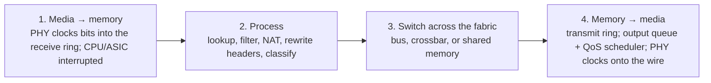

# 2.11 Switching internals, VLANs, trunking and spanning tree

| | |
|---|---|
| Level | Beginner to intermediate |
| Priority tier | 0 |
| Lab venue | Linux VM (bridges, VLANs), optional containerlab |
| Part | Part 2: Networking, from first principles to AI fabrics |
| Status | Drafted, labs **untested** |

## Why this matters for AI infrastructure

Suppose a GPU cluster runs slowly while the servers look healthy. CPU is idle, GPUs are waiting, and nobody can point at a broken machine. The problem may sit in the network, because a GPU cluster is mostly switches. To reason about latency, buffering, drops and microbursts, you need to know how a switch moves a frame.

VLANs divide one physical network into several logical ones. It is like running several separate offices out of a single building, each with its own corridor, though the walls and wires are shared. Management, storage, provisioning and tenant networks can share the same cabling. Trunks carry those VLANs to the servers, and the server NIC often carries tagged traffic to a bridge or to Kubernetes CNIs. Spanning Tree prevents a miswired cable from melting the network with a broadcast storm.

Modern fabrics avoid large layer-2 domains altogether and route at the leaf (chapters 2.16 to 2.18). Topology discovery shows how cabling is verified. LLDP, hello protocols and bidirectional-forwarding detection also let you catch failures quickly. Keep these pieces in mind as you read the sections on switching, VLANs and loops. Each one answers a question you will otherwise have to answer in the middle of an incident.

## Prerequisites and outcomes

Before you start, you should know Ethernet framing, MAC learning and ARP, which chapter 2.3 covers, along with the routing basics from chapter 2.5. New terms are explained where they first appear.

Use the list below as a self-check when you have finished the chapter. Each line is something you should now be able to do.

- Describe the four steps a network device uses to move a packet: media to memory, processing, switching across the fabric, and memory to media. Include rings, queues, shared memory, buses and crossbars, plus the three switching paths: process, fast or interrupt, and ASIC.
- Explain switching versus routing, why we route, store-and-forward versus cut-through, buffering, and why microbursts cause drops.
- Configure and verify VLANs, access and trunk ports, the native VLAN, 802.1Q tags, QinQ, inter-VLAN routing, and Linux VLAN and bridge devices (`ip link add ... type vlan`, `bridge vlan`).
- Explain STP, RSTP and MSTP: root election, port roles and states, BPDUs, PortFast and BPDU guard, root guard, and loop symptoms and recovery.
- Explain how devices discover neighbours and detect two-way connectivity with LLDP, hellos, dead timers and BFD, and how a control plane learns nodes, edges and reachable destinations.
- Design L2 domains for AI clusters, and know when to avoid L2 altogether.

Come back to this list once you have worked through the lab.

## 1. How a network device moves a packet

Suppose a packet reaches a switch and never arrives at its destination. To find where it was lost, you need to know the path it took inside the device, in the same way you need the floor plan of a building to find a lost parcel in it. Whether the device is a Linux box or a 51.2 Tb/s ASIC, every switch and router follows the same four steps.



The first step puts the frame into memory. Think of a mailroom with a row of numbered pigeonholes. The receive ring is a circular set of preallocated packet buffers, the pigeonholes. The NIC or PHY writes each arriving frame into the next free buffer and interrupts a processor or the ASIC. The device then swaps in an empty buffer and moves a pointer to the filled one into an input queue. Moving pointers instead of copying packets is the central optimisation, because copying data is the most expensive thing a forwarding path can do. Linux NIC drivers work this way with RX descriptor rings and `sk_buff` or page-pool buffers. You can run `ethtool -g` to see ring sizes, and `ethtool -S` to see per-queue drops.

Processing is a chain of optional stages, a checklist that each packet may or may not need to pass. A packet can pass through destination-based filtering, stateful packet filtering, deep packet inspection, NAT, the switching or routing decision, and post-switch work such as egress ACLs, marking and mirroring. Any step that changes the packet's addresses, such as NAT, must run before the lookup that uses those addresses.

Switching at layer 2 looks up the destination MAC in the bridge forwarding table. That table fills up through learning, covered in chapter 2.3, or through a control plane. The device finds the egress port and moves the packet from the input queue to that port's output queue without changing it. Routing at layer 3 works differently. It strips or ignores the old L2 header, then looks up the destination IP to find the next hop and egress interface. It consults the ARP or ND table for the next hop's MAC, rewrites the MAC header with new source and destination addresses, decrements the TTL, updates the checksum, and enqueues the packet. A modern "layer-3 switch" is a router whose lookup and rewrite run in hardware. Most data-centre "switches" actually route. The difference between the two is the difference between moving a letter to another desk and re-addressing it for another building.

Why route at all, when switching is cheaper? You route for three reasons. Routing joins different media with different headers and addressing, without translating headers. It scales, because a switched network needs every device to know every host's MAC, so the state grows with the number of hosts. Routing aggregates by topology-assigned prefixes instead. It also contains broadcasts. Broadcasts are inherent to protocols such as ARP and DHCP, but they do not scale in large flat domains. A shout across a small room is fine, and a shout across a whole city is not.

The last step is transmit. If there is room, the packet goes straight onto the transmit ring. Otherwise it waits in an output queue, like a car waiting at a junction. A scheduler drains that queue according to the QoS configuration, which chapter 2.19 covers. The PHY then encodes the bits for the medium.

### Three forwarding paths

Where processing happens decides how fast the packet moves. A packet handled by dedicated hardware flows past in nanoseconds, while one handled by a general-purpose CPU has to wait its turn. The table compares the three paths.

| Path | Where the packet is handled | Speed | Example |
|---|---|---|---|
| **Process switching ("slow path")** | An interrupt schedules a software process on a general-purpose CPU | Slowest; fine for control traffic | Packets punted to the router's CPU (ARP, routing protocols, ICMP generation, unknown features) |
| **Interrupt-context ("fast") switching** | The interrupt handler itself forwards the packet using optimised code | Moderate | Linux kernel forwarding through NAPI softirq; DPDK/XDP raise this further |
| **ASIC / NPU forwarding** | A dedicated packet-processing chip with TCAM/SRAM tables and fixed pipelines | Line rate at Tb/s | Merchant silicon (Broadcom Tomahawk/Trident, NVIDIA Spectrum), Cisco/Juniper custom ASICs |

Process switching is the slowest path, and it is where unsupported features end up. If you need line rate, the ASIC path is the fastest, but only for what its pipeline supports.

ASICs have registers shaped for MAC and IP lookups. They include special instruction sets for rewriting headers and for looking inside tunnels. Large exact-match and ternary (TCAM) memories hold routes and ACLs. An ASIC can also recycle a packet through its pipeline when an operation needs more than one pass. These choices have practical consequences. A feature the pipeline does not support is punted to the CPU and becomes the slow path. That is a classic reason a switch handles 10 Gb/s traffic fine but chokes on a particular ACL or ICMP flood. Control-plane policing (CoPP) protects the CPU. Table sizes for routes, MACs and ACL entries are hardware limits, and they bound the design.

### Across the fabric: shared memory, bus, crossbar

Small switches use a single shared packet memory, so moving a packet from input to output means moving only a pointer. Larger devices, such as chassis and high-radix ASICs, need an internal fabric to connect ingress and egress engines. That fabric is either a bus, which is shared and limited, or a crossbar. A crossbar is a grid in which each input connects to one output at a time, so many inputs and outputs can be active in parallel. Picture a railway junction with many tracks, where several trains can cross at once as long as they do not need the same track.

Crossbars have two problems you should know about. The first is contention. If two inputs want the same output in the same cycle, one of them must wait. The second is head-of-line blocking. In a simple input-queued crossbar, the packet at the head of an input queue waits for a busy output. Every packet behind it is stuck, even when those packets could go to idle outputs. It is the car at the front of the queue waiting to turn right and holding up everyone behind it. Remedies include virtual output queues, which give each input a separate queue per output; speed-up, where the fabric runs faster than the ports; and scheduling algorithms that match inputs to outputs each cycle. Many crossbars also offer output queuing. The same contention logic applies to a whole leaf-spine network, covered in chapter 2.18, so these ideas return at fabric scale.

### Cut-through versus store-and-forward, and buffers

Once a packet is inside the device, the switch must decide when to send it on. There are two choices, and each one trades latency against protection from corrupt frames. Waiting costs time, and not waiting costs safety.

With store-and-forward, the switch receives the whole frame and verifies the FCS before forwarding. Latency grows with frame size. Take a 9000-byte jumbo frame on a 10 Gb/s link. It needs 7.2 µs just to serialise, which means just to be put on the wire at that speed. The benefit is that corrupt frames are never forwarded.

Cut-through starts forwarding as soon as the destination header is read. Its latency stays roughly constant, at hundreds of nanoseconds, whatever the frame size. The cost is that corrupt frames may get through, and the last hop's FCS check drops them. Low-latency AI and HPC fabrics use cut-through. It needs ingress and egress speeds that are equal or faster. Otherwise the egress cannot keep up, and the switch falls back to store-and-forward.

Two more numbers help you compare them. Serialization delay is the frame bits divided by the link rate:

Serialization delay = frame bits / link rate

Port-to-port latency in modern switches is typically 300 ns to 1 µs. Light in fibre adds about 5 ns per metre.

Buffers decide what happens when traffic collides. They are the waiting rooms inside the switch. When two inputs send to one output, which is called incast, the output queue grows. Shallow-buffer switches drop packets in that case. Deep-buffer switches add queuing delay instead. A microburst is traffic that exceeds line rate for microseconds. It is invisible to 1-minute interface counters, but it still causes drops and retransmits. Look at queue-depth and drop counters, and at high-resolution telemetry covered in chapter 2.31. All-reduce collectives generate synchronous incast. That is why AI fabrics use ECN and PFC with carefully dimensioned buffers, as chapter 2.19 explains.

When you troubleshoot, the same path tells you where to look. If a device appears to lose packets, because ingress exceeds egress, the stages below are the suspects. The candidates are receive-ring overruns, which happen when the CPU cannot keep up, input-queue drops, ACL or policer drops, crossbar or VOQ congestion, output-queue tail drops, and transmit-side errors. On Linux, check `ethtool -S` for `rx_missed` and `rx_no_buffer`, `/proc/net/softnet_stat`, `tc -s qdisc`, and `ip -s link`. Match the symptom to the stage in the path, and check that stage's counters first.

## 2. VLANs and trunks

When management, storage and tenant traffic share the same switches, you need a way to keep them apart. A VLAN does that. A VLAN (virtual LAN, IEEE 802.1Q) splits one physical switched network into several independent broadcast domains. Hosts in different VLANs cannot exchange frames at layer 2. To talk to each other, they must pass through a router or a layer-3 switch, which applies policy. VLANs give you isolation, smaller broadcast domains, and a grouping that does not depend on physical location. A server in rack five and a server in rack ten can be in the same VLAN.

### The 802.1Q tag

How does one cable carry several VLANs without mixing them up? A trunk link carries frames for many VLANs. It does this by inserting a 4-byte tag after the source MAC, a small label that says which VLAN the frame belongs to. The tag has four fields, shown here in order:

```text
| Dst MAC | Src MAC | 0x8100 (TPID) | PCP(3) DEI(1) VID(12) | EtherType | payload | FCS |
```

The VID is the VLAN ID. It is 12 bits, and 1 to 4094 are usable, because 0 and 4095 are reserved. The PCP, or priority code point, is 3 bits of 802.1p class of service, and QoS uses it, as chapter 2.19 explains. The DEI field marks drop eligibility, which means whether the frame may be dropped first when there is congestion.

A small example shows the pieces. A frame in VLAN 100 with priority 3 and no drop eligibility carries the 16-bit tag value `0x6064`. The top three bits hold the priority, the next bit holds the drop flag, and the low twelve bits hold the VLAN number. The switch reads those sixteen bits and knows at once which VLAN the frame belongs to and how urgent it is.

The tag adds 4 bytes to the frame. A payload with a 1500 MTU therefore becomes a 1522-byte frame. Switch ports and NICs must allow that larger size, or tagged frames at full size are silently dropped. The MTU on a VLAN sub-interface is usually 1500, or 9000 with jumbo frames.

QinQ (802.1ad) stacks two tags, an outer service tag and an inner customer tag, for provider networks. It adds another 4 bytes to the frame. VXLAN, covered in chapter 2.17, replaces the VLAN limit of 4094 with a 24-bit VNI. That gives 16 million values.

### Port types

Each switch port has a mode, and the mode decides which frames it accepts and sends. It is the port's job description. The table compares the modes.

| Port mode | Behaviour |
|---|---|
| **Access** | Belongs to exactly one VLAN; frames leave untagged; untagged frames received are assigned to the port's VLAN. Used for hosts. |
| **Trunk** | Carries multiple VLANs with 802.1Q tags (an allowed list); used between switches and to hypervisors/servers/routers. |
| **Native (untagged) VLAN** on a trunk | The VLAN whose frames are sent untagged on the trunk (default VLAN 1 on many vendors). Mismatched native VLANs between two switches leak traffic across VLANs and trigger STP warnings; best practice is to set an unused VLAN as native or tag everything. |
| **Hybrid/general** (some vendors, Linux bridge) | Port with a PVID (untagged VLAN) plus a set of tagged VLANs |

The native VLAN deserves attention. It is the one VLAN whose frames travel on a trunk without a tag, so that a device that does not understand tags can still be part of it. Two switches that disagree about it leak traffic across VLANs and trigger STP warnings. Set an unused VLAN as native, or tag everything, to avoid that.

A few practices follow from this. Do not use VLAN 1 for anything. Prune trunks so they carry only the VLANs you need, which limits broadcast domains and blast radius. Disable unused ports and place them in a black-hole VLAN. Disable DTP and auto-trunking negotiation. Document VLAN IDs and subnets in the address plan from chapter 2.4.

### Inter-VLAN routing

Hosts in different VLANs reach each other through a layer-3 gateway, since a VLAN is by definition a closed broadcast domain. There are three common ways to build one.

Router-on-a-stick uses one trunk to a router, with a sub-interface for each VLAN, such as `eth0.10` and `eth0.20`. Each sub-interface carries the gateway IP of its VLAN. An SVI, or switch virtual interface, also known as IRB, is an interface per VLAN on an L3 switch. Commands such as `interface vlan 10` and `ip address 10.10.0.1/24` create one, and the switch then routes in hardware. Linux can act as a router too, using VLAN sub-interfaces together with `ip_forward=1`, covered in chapter 2.5.

In data centres, the VLAN's gateway moves to the leaf switch. VLANs rarely extend beyond a rack or a pair of leaves. Where layer 2 must stretch further, EVPN/VXLAN overlays do the job, as chapter 2.17 explains.

### VLANs in a GPU cluster

Consider one GPU node and the networks it touches. A node typically has several segments, and it helps to list them before you design anything. Management covers the BMC, IPMI and Redfish, and runs out of band. Provisioning handles PXE. In-band management covers SSH. Storage carries NFS, Lustre or object traffic, usually with jumbo MTU. Front-end traffic carries client and inference requests. The compute fabric, InfiniBand or RoCE rails, usually runs on separate physical switches or VRFs, and it is not shared through VLANs with the rest.

Hypervisor and Kubernetes nodes receive a trunk. They map VLANs to bridges, or to macvlan, ipvlan or SR-IOV interfaces, so that pods can reach each network through Multus secondary networks. Multi-tenant clusters use VLAN, VRF or VXLAN per tenant to isolate traffic.

### Linux VLANs and bridges

On a Linux host, you can build VLAN devices and a software switch with `ip` and `bridge`. A Linux machine can behave like a small managed switch. The first block creates a tagged sub-interface on a trunk NIC. The second builds a VLAN-filtering bridge, which is a software switch, with an access port and a trunk port.

```bash
# 802.1Q sub-interface on a trunk NIC
sudo ip link add link eth0 name eth0.100 type vlan id 100
sudo ip addr add 10.100.0.45/24 dev eth0.100 ; sudo ip link set eth0.100 up
ip -d link show eth0.100                                  # shows "vlan protocol 802.1Q id 100"
cat /proc/net/vlan/config

# Linux bridge with VLAN filtering (a software switch)
sudo ip link add br0 type bridge vlan_filtering 1
sudo ip link set eth1 master br0 ; sudo ip link set eth2 master br0
sudo bridge vlan add dev eth1 vid 100 pvid untagged         # access port in VLAN 100
sudo bridge vlan add dev eth2 vid 100 ; sudo bridge vlan add dev eth2 vid 200    # trunk (tagged) carrying 100, 200
sudo bridge vlan add dev br0 vid 100 self                   # let the bridge itself be in VLAN 100 (for an SVI: br0.100)
sudo ip link set br0 up
bridge vlan show ; bridge fdb show br br0 ; bridge link
sudo tcpdump -ni eth0 -e vlan                                # see the 802.1Q tags in captures (-e prints the L2 header)
```

NIC offloads can hide tags from captures. For debugging, turn them off with `ethtool -K eth0 rxvlan off txvlan off`. Netplan, NetworkManager and systemd-networkd have VLAN stanzas for persistence. Containers and VMs usually attach to bridges, or to macvlan or ipvlan devices on VLAN sub-interfaces.

Before you change a trunk, list the VLANs it must carry, and prune the rest.

## 3. Loops and the Spanning Tree Protocol

Imagine two switches joined by two links, or a cable that someone has looped by mistake. Ethernet has no TTL. A broadcast frame in that loop circulates forever and multiplies at each switch. This is a broadcast storm. It saturates every link and the switch CPUs within seconds. MAC tables flap, because the same source MAC appears on alternating ports, and unicast frames get flooded. The network looks as if it has been cut, although every cable is plugged in.

You still want redundant links for resilience, so simply removing the second cable is not an answer. The Spanning Tree Protocol (STP, IEEE 802.1D) solves this. It lets switches logically block redundant paths to form a loop-free tree, and it unblocks them when an active path fails. The spare cable stays plugged in but sleeps until it is needed.

### How STP works

STP settles the topology in four stages, and it helps to think of a group of strangers choosing a leader and then agreeing on a road map. First, the switches elect a root bridge. Each switch has a bridge ID made of a priority, which defaults to 32768, plus its MAC. With the VLAN extension, each VLAN has its own bridge ID. Switches exchange BPDUs, which are bridge protocol data units, sent to the multicast address 01:80:C2:00:00:00. Each BPDU advertises the best root that a switch knows about. The lowest bridge ID becomes the root. You should set the priority deliberately on the core or spine switch, and on a secondary, so the root is predictable instead of simply the oldest MAC.

Picture three switches wired in a triangle, all left at the default priority. The one with the lowest MAC address becomes the root, which is why an old closet switch can win by accident. The other two each choose their cheapest path to it as the root port. On the link between those two, one end is blocked, and that single blocked port is what cuts the loop. If an active link fails, the blocked port wakes up and takes over.

Second, each non-root switch picks one root port, which is the port with the lowest path cost to the root. In other words, it chooses the cheapest road to the leader. Cost depends on link speed. In short mode, a 10G link costs 2. A 1G link costs 4, and a 100M link costs 19. Long mode applies to links faster than 10G. Ties go to the sender's bridge ID, and then to the port ID.

Third, each segment gets one designated port. That is the port closest to the root, and it forwards toward the segment. Every other port becomes blocked, which makes it an alternate or backup. Every loop is cut at exactly one point.

Fourth, ports move through the classic STP states: blocking, listening, learning and forwarding. Convergence after a topology change can take roughly 30 to 50 seconds. The worst case adds a max age of 20 s to a forward delay of 2×15 s.

### RSTP and MSTP

RSTP (802.1w, now part of 802.1D-2004) converges in about a second. Convergence means that every switch has agreed on a loop-free map again after a change. It does this with a proposal and agreement handshake on point-to-point links, so neighbours settle with each other instead of waiting for timers. It defines the roles root, designated, alternate and backup, and the states discarding, learning and forwarding. Edge ports, which face hosts, go straight to forwarding. Cisco Rapid PVST+ runs RSTP per VLAN.

MSTP (802.1s) maps groups of VLANs to a small number of spanning-tree instances. That balances load across redundant links without running a tree per VLAN. It requires a consistent region name, revision and mapping on every switch.

Cisco's PVST+ and Rapid-PVST+ run one instance per VLAN. Vendor variants exist too, and mixing them needs care.

### Protection features (use them)

Protection features stop a small mistake from becoming a loop or a takeover. They are the guard rails that STP itself does not provide. Here is what each one does.

| Feature | Purpose |
|---|---|
| **`PortFast` / edge port** | Host-facing ports forward immediately and do not generate topology changes |
| **BPDU guard** | If a BPDU arrives on an edge port, shut the port (err-disable): stops accidental switches/loops |
| **Root guard** | Prevents a port from becoming a root port (stops a rogue switch with lower priority from taking over the root) |
| **Loop guard / UDLD** | Detect unidirectional links that would otherwise cause loops |
| **Storm control** | Rate-limit broadcast/multicast/unknown-unicast on a port |
| **BPDU filter** | Suppress BPDUs on a port (dangerous; use sparingly) |

`PortFast` and BPDU guard work as a pair on host ports. BPDU filter suppresses BPDUs on a port. That is dangerous, so use it sparingly.

### Diagnosing loops

Suppose the whole network slows down at once, and several switch CPUs spike. You are probably looking at a loop. The symptoms include network-wide slowness, 100% utilisation on many links, high switch CPU, MAC flapping log messages, and unreachable management.

Start by finding the ports with the highest broadcast or multicast counters. Then check `show spanning-tree` for recent topology changes and for the root location. Shut down or unplug the suspect links. Then find the loop itself. It might be a cable, a hypervisor bridge, a misconfigured Linux bridge without STP, or an unmanaged switch under a desk. To prevent loops, use BPDU guard, storm control and port-security limits, and avoid unnecessary L2 domains.

Linux bridges support STP. Turn it on with `ip link set br0 type bridge stp_state 1`, and inspect it with `brctl showstp` or `bridge -d link`. It is off by default. VM and container bridges are a known source of accidental loops when two bridge ports connect to the same upstream segment.

### Modern designs avoid STP

Large STP domains waste half the links, because blocked ports carry nothing. Failure behaviour is slow and disruptive. Modern designs use other tools instead. MLAG and vPC present two switches as one logical switch, and bundle links with LACP, covered in chapter 2.12. A routed access design, or a leaf-spine with L3 to the leaf, runs every link through ECMP, so no L2 loops cross the fabric. EVPN-VXLAN stretches L2 over an L3 underlay, as chapter 2.17 covers. TRILL and SPB are legacy options.

AI back-end fabrics are routed or InfiniBand. STP still matters in campus, management and storage networks, in hypervisor bridges, and in any brownfield environment. If you work on a campus, management or storage network, STP still matters to you.

## 4. How devices discover the network: neighbours, links and reachability

Every control plane must answer three questions, and the answers are the raw material of all routing. What is the topology? Who are my neighbours? What is reachable through whom?

A transit node, such as a router or switch, forwards packets between interfaces. A leaf node, which is a host, originates and terminates traffic. An edge is a connection over which packets are forwarded. Point-to-point links are edges, and so are multipoint segments modelled as sets of point-to-point links. A reachable destination can be a host, a node, or a service. A service may be anycast, running on several hosts. A reachable destination can also be a link with all the hosts attached to it, which is a prefix, or an aggregate of several prefixes.

The topology is the graph of nodes and edges. You can summarise it by hiding detail behind an aggregate. Network diagrams hide information too. They draw bundles as one line, and they hide multiplexed links and service complexity. Control planes cannot hide that detail.

### Detecting neighbours

An interface is not the same as a neighbour. One multi-access segment interface can have several neighbours, so the control plane needs an explicit way to find them. Think of a door and the people behind it. Knowing that the door exists does not tell you who is in the room.

Manual configuration is simple and robust. It works across multiple hops, as with BGP peers, tunnels and overlay control planes. Routing advertisements can also reveal neighbours. A neighbour exists while it keeps advertising. A hold or dead timer, typically 3× the update timer, expires to declare a failure.

Explicit hellos are used by OSPF, IS-IS, EIGRP, LDP, LLDP and LACP. Each sends periodic multicast hello packets that carry capabilities and identifiers. A neighbour is declared dead when no hello arrives within the dead interval. It is a little like a friend who calls every few minutes to say "still here", and you assume the worst when the calls stop. Centralised registration works differently. Devices register with a controller or service, which then tells the others about them. Examples are SDN controllers, service registries and the Kubernetes API for nodes. The service itself must be discoverable.

Two-way connectivity matters because a unidirectional link must not become a forwarding path. That happens when A hears B, but B does not hear A, for example from a half-failed fibre or a filter. You could ignore the problem and assume reachability whenever you hear a neighbour. A stronger method carries a list of heard neighbours in each hello. A's first hello lists no neighbours. B hears A and includes A in its next hello. When A sees itself in that list, A knows B hears it. Both sides then declare two-way adjacency. OSPF's 2-Way state works this way. UDLD and BFD also detect one-way failures.

On servers, the link layer shows what a NIC is plugged into. LLDP (IEEE 802.1AB) and Cisco CDP advertise the device name, port ID, capabilities, VLANs and MTU. On Linux, use `lldpd` with `lldpcli show neighbors`, or use `lldptool`. NIC firmware LLDP agents are another source, and you reach them with `ethtool --show-priv-flags`. LLDP answers one question well: which switch port is this NIC plugged into? That is invaluable when you commission hundreds of GPU servers. You can compare the discovered topology with the intended wiring plan automatically. For InfiniBand, use `ibnetdiscover`, which Part 11 covers.

Control planes also learn the maximum frame size. OSPF checks MTU in its hello contents, and a mismatch prevents adjacency. IS-IS pads hellos to the interface MTU. LLDP carries MTU fields as well. MTU mismatches are a classic adjacency-down bug, covered in chapter 2.7.

Hello and dead timers in routing protocols run on the scale of seconds, which is slow when traffic is flowing at line rate. Bidirectional Forwarding Detection (BFD, RFC 5880) is faster. It sends lightweight UDP or hardware-assisted probes every 50 to 300 ms. Failures are detected in under a second, whatever the routing protocol. BFD then tells BGP, OSPF or static routes about the failure, using `bfd` in FRR. Pair BFD with ECMP, so traffic shifts within milliseconds of a link or switch failure. On the host side, `ethtool` link state, `ip monitor`, and bond `miimon` or ARP monitoring (chapter 2.12) play the same role.

The rest of control-plane learning belongs with routing protocols in chapter 2.13. That chapter covers reactive learning, which waits until a data packet arrives before resolving state, as ARP and MAC learning do. It also covers proactive learning, which distributes all reachability ahead of time through a routing database. Chapter 2.13 covers advertising and redistributing routes too. Tagging routes with administrative numbers at redistribution boundaries prevents routing loops.

## 5. Designing L2 domains for AI infrastructure

Every extra L2 domain adds risk to an AI cluster, because it is one more place where a broadcast storm or a loop can spread. As you design one, keep L2 small and route everything above that.

Keep L2 small. Use one rack or a leaf pair per VLAN, and route above that. Use EVPN-VXLAN only when your workloads truly need L2 adjacency across racks, such as for live migration or legacy clustering.

You can make management and provisioning VLANs larger. They still need BPDU guard, storm control, DHCP snooping and port security. Keep your BMC networks isolated from tenant traffic.

For server attachment, dual-homed servers use LACP to an MLAG pair (chapter 2.12). Modern designs can instead use two independent routed uplinks, with BGP to the host and ECMP.

Back-end fabrics run InfiniBand or routed Ethernet with PFC and ECN (chapter 2.19). Do not rely on STP anywhere in them. Make sure the lossless classes are consistent end to end.

Naming and documentation matter as much as the wiring. Keep a VLAN and subnet plan, a switch-port-to-NIC mapping from LLDP, and automated drift checks, which chapters 2.28 and 2.29 cover.

When you start a design, begin with the smallest L2 domain that works, and widen it only when a workload proves it needs to be wider.

## 6. Hands-on lab: VLANs, bridges, and a deliberate loop

A word on status first. The Python lab below has been run, while the interactive VM commands after it have not been run for this chapter, so run them on a VM you can rebuild. Start with the self-checking Python lab, which you run on your own machine. It verifies IEEE 802.1Q 16-bit TCI encoding and decoding, where TCI is made of PCP, DEI and VID. For example, `0x6064` is the TCI for PCP 3 and VID 100. It also verifies Spanning Tree root bridge election, which uses priority plus MAC. Last, it checks two-way bidirectional hello and MTU adjacency.

```bash
python3 code/part02/vlans_stp_switching_lab.py
```

Next, use a disposable Linux VM with network namespaces and bridges. Work through these steps.

1. Start with a software switch. Create bridge `sw1` and three namespaces, `h1,h2,h3`, connected with veth pairs. Assign 10.0.0.1/24, 10.0.0.2/24 and 10.0.0.3/24. Ping across the bridge, then inspect `bridge fdb show`. Watch MAC learning by flushing the table with `bridge fdb flush` and pinging again. Run `tcpdump` on a third port to see the first flooded ARP.
2. Add VLANs. Enable `vlan_filtering`. Put h1 and h2 in VLAN 10 as access ports, and h3 in VLAN 20. Show that h3 cannot reach h1. Add a router namespace `r` on a trunk port, with sub-interfaces for VLAN 10 and VLAN 20, which is router-on-a-stick, and set `ip_forward=1`. Verify inter-VLAN ping, inspect the tags with `tcpdump -e -ni <trunk>`, and compare the result with an SVI on the bridge.
3. Test a native VLAN mismatch. Configure two bridges joined by a trunk, with different native VLANs. Observe the leakage between VLANs.
4. Create a loop. Connect two bridges with two veth links and leave STP off. Send a broadcast with `arping`, then watch the packet counters explode in `ip -s link` and the CPU rise. Recover by deleting a link. Turn STP on with `ip link set sw1 type bridge stp_state 1`, and watch one port go to blocking in `bridge link`. Then fail the active link and time the reconvergence. If it is available, try RSTP-capable software, for example `mstpd`.
5. Try a BPDU guard analogue. Attach a bridge to an access port, and observe the BPDUs with `tcpdump -ni port stp`.
6. Test LLDP. Run `lldpd` in two namespaces joined by a veth, and view `lldpcli show neighbors`. Change the system name and see the update. Remove one direction with a `tc` filter that drops packets in that direction. This emulates a unidirectional link, so observe the one-way adjacency symptoms. Then add BFD in FRR, covered in chapter 2.27, and measure the detection time.
7. Look at latency. Use `ping -s` at several sizes through two bridges, and apply `tc netem rate 1gbit`. The results show serialisation delay growing with frame size.
8. Clean up the namespaces and bridges.

Finish with step 8 so the VM is clean for the next run.

## 7. Common mistakes

These mistakes fall into four groups. You should watch for three VLAN and trunk errors. The first is a mismatched native VLAN. The second is leaving VLAN 1 in use. The third is a trunk that carries every VLAN.

Loops and access ports form the second group. Access ports without BPDU guard or storm control are one risk. Hypervisor bridges plugged into two ports are another.

Extending one big L2 domain across the cluster "for convenience" is one. Believing a switch never routes, which is wrong for an L3 switch, is another. So is believing that one large buffer solves incast.

MTU and measurement errors come last. Ignoring MTU on trunks and VLAN sub-interfaces is one. Forgetting the 4-byte tag in frame-size limits is another. Expecting a spanning-tree blocked link to carry traffic, or not setting root priorities, is a third. Reading only average interface utilisation misses microbursts and queue drops. Verifying cabling by trust rather than LLDP is the last.

Compare your configurations against this list before a new rack goes live.

## 8. Interview angles

If you are preparing for an interview, these questions test whether you can explain the mechanism, not just name it. A clear story of what happens to one frame is usually the best answer.

- "Describe what a switch does when a frame arrives. How is that different from a router?"
- "What is a VLAN? Access versus trunk? What's the native VLAN issue?"
- "How does STP choose the root and block ports? What is RSTP's improvement? Why BPDU guard?"
- "Your whole network slowed down and switch CPUs spiked. What happened and what do you do?" The hint is a loop, or broadcast storm.
- "Why do data centres avoid STP? What do they use instead?"
- "Store-and-forward versus cut-through; where does each matter?"
- "How would you verify that 512 servers are cabled to the right leaf ports?" The hint is LLDP plus an inventory comparison.
- "What is head-of-line blocking in a switch and how do VOQs fix it?"

Answer each question in your own words, then check your answer against the section it refers to.

## Exercises

1. Start with packet movement. Explain the four internal steps that any switch or router uses, `Media -> RX ring -> Processing -> Fabric -> TX ring -> Media`, and say why passing buffer pointers instead of copying packet bytes is critical. Next, compare process switching, which punts packets to the CPU, with interrupt-context fast switching and ASIC or NPU forwarding, which uses TCAM and SRAM. Include crossbar VOQs in your answer. Finally, calculate the serialization delay of a `9000`-byte jumbo frame on a `10 Gb/s` link. You should get `7.2 µs`.
2. Work through the 802.1Q tag and the Linux bridge. (a) Use `encode_decode_8021q_tci()` in `code/part02/vlans_stp_switching.py` to encode PCP = 3, the RoCE priority, with DEI = 0 and VID = 100. The 16-bit TCI integer should be `0x6064`. Then explain why VID 0 and VID 4095 are reserved. (b) Write the Linux `ip link` and `bridge vlan` commands that create a VLAN-filtering bridge `br0`. In it, `eth1` is an untagged access port in VLAN `100`, and `eth2` is a tagged trunk carrying VLANs `100` and `200`.
3. Explain Spanning Tree and port protection. (a) Use `elect_stp_root_bridge()` to show why leaving every switch at the default STP priority of `32768` risks electing the oldest closet switch in the building as the Root Bridge. Then trace how STP selects Root Ports, Designated Ports and Blocked Ports. (b) Contrast classic 802.1D STP, which converges in `30–50 s`, with 802.1w RSTP, which converges in `~1 s` through proposal and agreement. Include MSTP in that comparison. Then state what `PortFast`, BPDU Guard and Root Guard protect against.
4. Explain why modern data centers and AI fabrics avoid Spanning Tree. Give three reasons you would cite for avoiding large L2 Spanning Tree domains, and name the three architectures that replace them: MLAG/vPC, L3 routed leaf-spine with ECMP, and EVPN-VXLAN.
5. Using `check_two_way_hello_adjacency()`, explain how routing protocols such as `OSPF` and `IS-IS` use neighbor lists inside multicast hello packets. Show how that proves two-way connectivity, and how the link MTU is checked before an adjacency forms. Then contrast reactive and proactive control planes.
6. Design a commissioning check for a 512-node GPU cluster. Use `lldpcli show neighbors` to catch swapped leaf-switch cables before any workloads run. Use LLDP, standardised as 802.1AB, in that check. Then explain why routing protocols pair with BFD, standardised as RFC 5880 and running at `50–300 ms` intervals, instead of relying on multi-second hello and dead timers.

Exercise 6 is the one to try on a real cluster before you rely on the design.

## Checkpoint questions (20)

<details>
<summary>1. What are the four steps by which a switch or router moves a packet internally, as covered in Computer Networking Problems and Solutions, chapter 7, and why does it move pointers instead of copying bytes?</summary>

First, the PHY clocks incoming bits into a preallocated buffer in the circular receive ring. Second, the device processes the packet: it looks up the header in the FDB or FIB, applies ACL or firewall filtering, performs NAT, and rewrites the header. Third, the packet crosses the internal fabric from ingress to egress, through shared memory, a bus or a crossbar. Fourth, the packet is queued in an output QoS queue, placed on the transmit ring, and clocked onto the wire. If you weigh the cost, copying payload bytes is the most expensive operation on a forwarding path. High-speed devices therefore keep the packet in one buffer and pass only a pointer or descriptor from ring to queue.
</details>

<details>
<summary>2. What changes in a packet when it is L2-switched versus L3-routed, and what are the three fundamental reasons we route instead of switching the entire world?</summary>

An L2 switch forwards the Ethernet frame unmodified, based on its destination MAC address. An L3 router, or an L3 switch SVI, strips the incoming Ethernet header and looks up the destination IP in its FIB. It decrements the IP TTL or hop limit, and it updates the IPv4 header checksum. Then it wraps the packet in a brand-new Ethernet header, with its egress port as the source MAC and the next-hop MAC as the destination. There are three reasons to route. The first is to interconnect dissimilar physical or link media. The second is to scale reachability state through hierarchical prefix aggregation. A switch must store every individual host MAC, while a router can summarise thousands of hosts into one `/20` prefix. The third is to contain broadcast domains, such as ARP, DHCP and unknown unicast traffic.
</details>

<details>
<summary>3. Compare the three packet forwarding paths inside network devices: Process Switching, Interrupt-Context Fast Switching, and ASIC/NPU Forwarding.</summary>

Process switching is the slow path. The packet is punted to the general-purpose CPU and scheduled into a user or kernel process. This handles control-plane protocols such as BGP and OSPF, ARP generation, TTL-expired ICMP replies, and hardware options the chip does not support. Control-plane policing (`CoPP`) protects that CPU.

Interrupt-context switching is the fast path. The kernel forwards the packet inside the interrupt or softirq handler, as Linux NAPI does. It can also be bypassed entirely with XDP or DPDK.

ASIC and NPU forwarding happens in silicon. Chips such as Broadcom Tomahawk and Trident, or NVIDIA Spectrum, use SRAM exact-match tables and TCAM ternary tables. They forward at 12.8 to 51.2 Tb/s line rate.
</details>

<details>
<summary>4. What is Head-of-Line (HOL) blocking in an input-queued crossbar switch, and how do Virtual Output Queues (VOQs) solve it?</summary>

Say you have a crossbar with a single first-in, first-out queue per input, and the packet at the head of Input 1 is headed for a congested Output 3. It then blocks every packet behind it in Input 1's queue, even the packets bound for idle Output 2. This is head-of-line blocking. Virtual output queues fix it. Each input keeps N separate queues, one per destination output. The crossbar arbiter, iSLIP, can then schedule packets to idle outputs without waiting on the congested one.
</details>

<details>
<summary>5. Compare cut-through and store-and-forward switching, calculate the serialization delay of a 9000-byte frame at 10 Gb/s, and define a microburst.</summary>

Store-and-forward receives the whole frame and checks the trailing FCS CRC before forwarding. That drops corrupt frames, but it adds the full serialization delay. Cut-through starts forwarding once the destination address is read, which takes the first 14 to 24 bytes. Its latency is about 300 ns to 1 µs whatever the frame size, which is why AI and HPC fabrics use it.

If you take a 9000-byte frame, it is 72,000 bits. At 10 Gb/s it takes 72,000 / 10e9 = 7.2 µs to serialise. At 400 Gb/s it takes 180 ns.

A microburst is a synchronised burst lasting under a millisecond, such as an `AllReduce` barrier. It overflows output buffers and drops packets, while 1-minute average counters still look low, below 20%.
</details>

<details>
<summary>6. Describe the 4-byte IEEE 802.1Q VLAN tag (TPID, PCP, DEI, VID) and the usable VLAN ID range.</summary>

The 4-byte 802.1Q tag sits right after the 6-byte source MAC. Its 16-bit TPID, which stands for Tag Protocol Identifier, is 0x8100. Outer 802.1ad QinQ tags use 0x88A8 instead.

The 3-bit PCP, or Priority Code Point, carries the 802.1p priority, from 0 to 7. Lossless RoCEv2 uses it with PFC, typically at priority 3. The 1-bit DEI is the Drop Eligible Indicator. The 12-bit VID is the VLAN Identifier. Values 1 to 4094 are usable. Zero is reserved for priority-only tagging, and 4095 is reserved too. The tag raises the maximum frame size from 1518 to 1522 bytes.
</details>

<details>
<summary>7. Contrast an Access port, a Trunk port, and the Native VLAN, and explain the security and operational hazard of a Native VLAN mismatch.</summary>

An access port belongs to one VLAN and sends and receives frames untagged. End hosts use access ports. A trunk port carries frames for several allowed VLANs using 802.1Q tags. Switches, hypervisors and Kubernetes nodes use trunks. The native VLAN, which defaults to VLAN 1, is the one VLAN whose frames cross a trunk untagged.

Say you set native VLAN 10 on Switch A, and native VLAN 20 on Switch B, on the same trunk. Untagged frames from VLAN 10 then slip silently into VLAN 20 on Switch B. That leaks traffic across broadcast domains and breaks Spanning Tree.
</details>

<details>
<summary>8. Compare Router-on-a-Stick with an L3 switch SVI (switch virtual interface, also called IRB) for inter-VLAN routing.</summary>

If you use router-on-a-stick, inter-VLAN traffic goes over a trunk to an external router. The router has 802.1Q sub-interfaces, such as `eth0.10` and `eth0.20`. It routes the packet and sends it back down the same trunk, which hairpins the link.

With an L3 switch SVI, the switch holds the default gateway IP for each VLAN, through interfaces such as `interface Vlan10` and `interface Vlan20`. The switch ASIC routes between VLANs at hardware line rate, inside the device.
</details>

<details>
<summary>9. How do you configure an 802.1Q VLAN sub-interface and a VLAN-filtering software bridge on Linux?</summary>

If you want a VLAN sub-interface, run `sudo ip link add link eth0 name eth0.100 type vlan id 100`, then `sudo ip link set eth0.100 up`.

For a VLAN-filtering bridge, create it with `sudo ip link add br0 type bridge vlan_filtering 1`. Attach ports with `ip link set eth1 master br0`. Set an untagged access port with `sudo bridge vlan add dev eth1 vid 100 pvid untagged`. Set a tagged trunk port with `sudo bridge vlan add dev eth2 vid 100` and `vid 200`. Inspect the result with `bridge vlan show`.
</details>

<details>
<summary>10. Why do Layer 2 loops cause catastrophic broadcast storms and MAC table flapping within seconds?</summary>

Ethernet headers have no TTL field, so you cannot count hops to stop a frame. So any broadcast, such as ARP or DHCP, multicast or unknown-unicast frame in a loop floods out every port. It returns on alternate links and floods again. The traffic multiplies until all link bandwidth and switch CPU time are used up. At the same time, the MAC tables keep overwriting each host's source MAC port, back and forth. That is MAC flapping.
</details>

<details>
<summary>11. Trace the 3-step Spanning Tree Protocol (STP) calculation: Root Bridge election, Root Port selection, and Designated vs. Blocked Ports.</summary>

First, the switches elect a root bridge. They exchange BPDUs, sent to 01:80:C2:00:00:00, and each carries an 8-byte bridge ID. That ID combines a 2-byte priority with a 6-byte MAC. The lowest bridge ID wins. The default priority is 32768. Set the spine or core switch lower, such as 4096, so that an old closet switch with a low MAC does not win.

Second, each non-root switch picks one root port. That is the port with the lowest cumulative path cost to the root bridge.

Third, on each link segment, the port with the lower cost to the root becomes the designated port that forwards. The port at the other end goes to blocking, or alternate, which breaks the loop.
</details>

<details>
<summary>12. Compare classic 802.1D STP, 802.1w RSTP, and 802.1s MSTP.</summary>

Classic 802.1D STP is timer-driven. Ports move from blocking to listening for 15 s, then to learning for 15 s, then to forwarding. Add a 20 s max age, and convergence takes 30 to 50 seconds. It runs one tree for all VLANs.

802.1w RSTP, or Rapid STP, uses an active proposal and agreement handshake on point-to-point full-duplex links. It treats host ports as edge ports. It converges in about one second, moving from discarding to learning to forwarding. Its roles are root, designated, alternate and backup.

802.1s MSTP, or Multiple STP, maps hundreds of VLANs into a few spanning-tree instances, which are called MSTIs. Different VLAN groups can then use different uplinks, without a CPU-heavy STP instance per VLAN.
</details>

<details>
<summary>13. State the purpose of the five essential STP protection mechanisms: `PortFast` (also called the edge port), BPDU Guard, Root Guard, Loop Guard / UDLD, and Storm Control.</summary>

`PortFast` moves server and host access ports straight to forwarding when the link comes up, without waiting 30 s. It also suppresses topology change notifications (TCNs) when servers reboot.

BPDU Guard shuts an edge port into `err-disable` if a BPDU ever arrives on it. That stops an accidental loop from someone plugging in a switch or an unconfigured bridge.

Root Guard blocks an interface if a superior BPDU arrives on it. It stops an access or tenant switch from taking over the root role.

Loop Guard and UDLD stop an alternate port from moving to forwarding when a unidirectional fibre failure stops BPDUs in one direction.

Storm Control rate-limits broadcast, multicast and unknown unicast traffic on a port.
</details>

<details>
<summary>14. Why do modern data-center and AI fabrics avoid Spanning Tree on the data path, and what do they use instead?</summary>

Spanning Tree blocks half of your expensive parallel uplinks, so 50% of the bandwidth sits idle. It cannot do active-active multipathing within one tree, and topology changes cause a reconvergence with a large blast radius.

Modern data centers keep L2 within a single rack. For dual-homed L2 servers, they use MLAG or vPC with LACP. They use L3 routed leaf-spine fabrics with ECMP. If L2 must stretch over L3, they add EVPN-VXLAN. With this design, 100% of links forward actively, and no L2 loops form.
</details>

<details>
<summary>15. In control-plane graph theory, as covered in Computer Networking Problems and Solutions, chapter 11, define a transit node, a leaf node, an edge, and a reachable destination.</summary>

A transit node, such as a router or switch, forwards packets between interfaces. A leaf node, which is a host, originates and terminates traffic. An edge is a link that connects nodes, and packets can be forwarded over it.

A reachable destination is a named endpoint attached to the graph. It can be a single host, a `/32` route. It can be a service that is anycast across several nodes. It can be a subnet prefix, such as a `/24`, or a summarised aggregate, such as a `/16`.
</details>

<details>
<summary>16. What are the four ways a network device detects its neighbors, as covered in Computer Networking Problems and Solutions, chapter 11?</summary>

You can think of four ways a device learns its neighbours. Manual configuration sets the neighbour addresses by hand, as in classic eBGP and iBGP. Routing advertisements infer neighbours: RIP keeps a neighbour until a 3x dead or hold timer expires. Explicit periodic hello messages come from OSPF, IS-IS, EIGRP, LLDP and LACP. Centralised registration uses a controller or directory, such as SDN controllers, the InfiniBand Subnet Manager, or the Kubernetes API server.
</details>

<details>
<summary>17. How do hello-based protocols (OSPF, IS-IS) verify two-way (bidirectional) connectivity and matching link MTU before forming an adjacency?</summary>

A broken fibre strand or a filter can leave you with a unidirectional link. Router B hears A's hellos, but A cannot hear B. To prove two-way connectivity, each hello carries the list of neighbour router IDs heard on that interface. Router B hears A and adds A to its outgoing hello. When Router A receives B's hello and sees its own ID listed, both sides know the link is bidirectional. That is the 2-Way state.

For MTU, OSPF carries the interface MTU in Database Description packets. IS-IS pads hellos to the full interface MTU. A mismatch, such as 9000 against 1500, fails the adjacency at once, instead of blackholing data later.
</details>

<details>
<summary>18. Contrast reactive and proactive control-plane learning, as covered in Computer Networking Problems and Solutions, chapter 11.</summary>

Proactive control planes, such as OSPF, IS-IS and BGP, learn the whole topology and fill their forwarding tables before data arrives. The first packet is forwarded at once. The price is standing control-plane state and background traffic.

Reactive systems, such as ARP, NDP, Ethernet MAC learning and on-demand tunnels, wait until a data packet arrives for an unknown destination. Then they query or learn on demand. That keeps standing state low for idle endpoints. The price is first-packet latency and flooding overhead.
</details>

<details>
<summary>19. How does LLDP (IEEE 802.1AB) work on Linux servers, and how is it used when commissioning a 512-node GPU cluster?</summary>

`lldpd` exchanges link-local multicast frames with the directly attached switch port. Switches never forward these frames. They use the multicast address 01:80:C2:00:00:0E. The frames advertise the system hostname, the port name and description, the management IP, VLANs and MTU. You can view the neighbours with `sudo lldpcli show neighbors`.

When a 512-node GPU cluster comes up, a script can run `lldpcli -f json show neighbors` on all 512 nodes. It then diffs the actual node-and-NIC to leaf-switch-and-port cabling against the rack design spreadsheet. Miswired rails are caught before any job runs.
</details>

<details>
<summary>20. Why do routing protocols pair with BFD (Bidirectional Forwarding Detection, RFC 5880)?</summary>

If you rely on routing protocol hello and dead timers, you wait seconds. OSPF uses 10 s and 40 s. BGP timers run at 3 s and 9 s, or at 60 s and 180 s. Those are too slow for 400 Gb/s AI fabrics.

BFD runs a lightweight heartbeat that does not depend on the routing protocol. For example, UDP probes every 50 ms with a 3x multiplier give 150 ms of detection. BFD then tells BGP, OSPF or static routes to withdraw the failed next hop from the ECMP group, within milliseconds.
</details>

## Sources and review notes

- **Sources read in full:**
  - `computer-networking-problems-and-solutions` — Russ White and Ethan Banks, *Computer Networking Problems and Solutions*, **Chapter 7: Packet Switching** (media to memory RX ring pointers, processing, switching vs routing, why route, the 3 forwarding paths process / interrupt / ASIC TCAM/SRAM, shared memory vs bus vs crossbar fabrics, VOQs and iSLIP, store-and-forward vs cut-through, memory to media TX ring and output queues; ECMP and link aggregation are covered in Chapter 2.12) and **Chapter 11: Topology Discovery** (nodes, edges, and reachable destinations, detecting neighbors, two-way connectivity, MTU detection, reactive vs proactive control planes, and route tagging).
- **Run here:** `python3 code/part02/vlans_stp_switching_lab.py` (12 passed, 0 failed).
- **Explicitly labelled inferences:** The IEEE `802.1Q` (`TPID 0x8100`, `PCP`, `DEI`, `VID`) and Linux `bridge vlan` configuration commands, STP/RSTP/MSTP protection table (`PortFast`, `BPDU Guard`, `Root Guard`), `lldpcli` cluster cabling verification, and `BFD` (`RFC 5880`) notes synthesize IEEE 802.1Q, 802.1D, 802.1w, 802.1s, and 802.1AB, RFC 5880, and the `iproute2` `bridge(8)` / `ip-link(8)` documentation (cross-referenced with Chapters 2.3, 2.4, 2.5, 2.7, 2.12, 2.13, 2.16–2.19, 2.27–2.29, and 2.31, plus original study items 21, 22, 23, 25, 26, 27, 28, 29, 31, 33, 34, and 35).
- **Not verified on live hardware:** All interactive VM and switch commands (`ip link add type vlan`, `bridge vlan`, `brctl`, `tcpdump -e vlan`, `lldpd`, `lldpcli`) are marked (untested here) and must be executed on a disposable Linux VM or containerlab topology.

