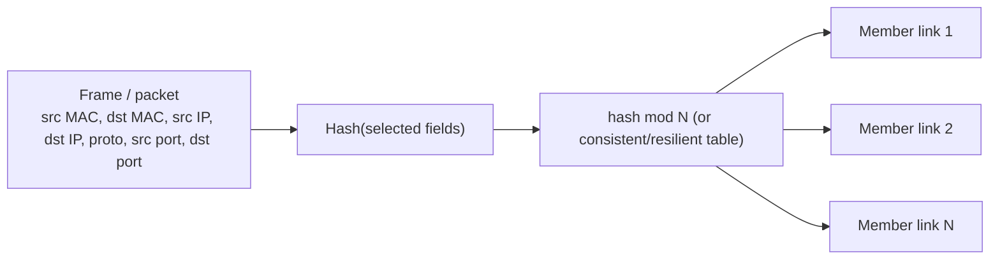

# 2.12 Link aggregation, LACP, MLAG and ECMP

| | |
|---|---|
| Level | Intermediate |
| Priority tier | 0 |
| Lab venue | Linux VM with network namespaces; optional containerlab/FRR |
| Part | Part 2: Networking, from first principles to AI fabrics |
| Status | Drafted, labs **untested** |

## Why this matters for AI infrastructure

A GPU server needs bandwidth *and* resilience: a management or storage connection that survives a switch reboot, a leaf pair that can be upgraded without draining racks, and a fabric whose parallel links all carry traffic. The tools are link aggregation (bonding/LACP) on the host and the first hop, multi-chassis variants (MLAG, vPC, EVPN multihoming) to span two switches, and ECMP at layer 3 across spines. The catch is hashing: aggregated links do not scale linearly, flows pin to one member, and a handful of elephant flows (all-reduce, checkpoint writes) can saturate one link while its siblings sit idle. Understanding the hash and the failure behaviour is the difference between 800 Gb/s of useful bandwidth and a congested link nobody can explain.

## Prerequisites and outcomes

You should know Ethernet/VLANs/STP (2.3, 2.11) and host routing (2.5).

After this chapter you can:

- Explain why parallel links need a flow-to-member mapping, why per-packet round robin is avoided, and how hash inputs determine balance.
- Describe LACP (802.1AX/802.3ad): actors, partners, system priority, keys, active/passive, fast/slow timers, aggregation selection, and failure detection.
- Configure Linux bonding (modes 0 to 6, `xmit_hash_policy`, `miimon`, `lacp_rate`, `min_links`), netplan/NetworkManager/systemd-networkd bonds, and inspect `/proc/net/bonding`.
- Explain MLAG/vPC and EVPN multihoming, their failure modes, and why modern fabrics prefer routed designs.
- Explain routed ECMP, hash fields, polarization, resilient/consistent hashing, flowlets and adaptive routing, and elephant-versus-mouse flows.
- Design host attachment for management, storage, front-end and compute networks of an AI cluster, and know the classic cluster node roles and networks.

## 1. The problem: many parallel links, one conversation

Two switches are joined by two 100G links. Intuitively traffic should alternate: frame 1 on link A, frame 2 on link B. That is **round-robin**, and it maximises utilisation, but frames can arrive out of order (frame 2 overtakes frame 1 on a faster or less congested path), which forces receivers to reorder and TCP to mistake reordering for loss (duplicate ACKs, spurious fast retransmits, collapsed throughput). A few implementations use round robin where reordering is tolerated (Linux `balance-rr`, some RDMA fabrics with packet spraying and reordering-aware NICs), but almost everything else uses **flow hashing**: compute a hash over fields that are constant for a flow, take it modulo the number of members, and send every packet of that flow down the same member. Ordering is preserved; utilisation is statistical.



### Hash functions and why balance is imperfect

A hash maps a large input to a small fixed output deterministically, spreading inputs roughly evenly across the buckets. A toy hash (sum the digits) shows the properties: the same input always yields the same output (so a flow sticks to one link), you cannot recover the input from the output, and different inputs can *collide* into the same bucket. For load sharing you want collisions to be evenly spread, not avoided. Real switches and the kernel use CRC variants, XOR folds or Jenkins/Toeplitz-style hashes, often with a per-device seed.

Balance is statistical and depends on:

- **Entropy of the hash inputs.** Many hosts in one broadcast domain talking to each other have varied MACs; a few hosts talking to a single server have little MAC or IP variety, so hashing on L4 ports (src/dst port) adds the entropy. A single TCP connection between two hosts has exactly one 5-tuple and therefore uses **one** member, no matter how many links exist.
- **Flow sizes.** *Elephant flows* (storage transfers, backups, collective communication, checkpoint writes) carry most of the bytes; *mouse flows* (web requests, RPCs) are small. Two elephants hashed to the same link saturate it while others idle. Aggregated bandwidth "scales" only statistically with many flows.
- **Layer mismatch.** Hashing only on MACs (L2) is useless when all traffic goes to one gateway MAC (everything leaves via the router's MAC); hashing on L3/L4 fields fixes that.
- **Polarization.** If successive tiers (leaf then spine) use the same hash function and seed on the same fields, the flows that were selected for one link at the first tier all select the same link at the second, leaving paths unused. Vendors add per-device seeds, different hash functions/fields per tier, or use packet fields that change (e.g., inner headers).

The network engineer's task is to understand the traffic mix and pick the available hash fields that spread it best: L2 (src/dst MAC) for many hosts in one domain, L3 (src/dst IP) for routed traffic with many endpoints, L3+L4 (5-tuple) for few hosts with many connections; encapsulated traffic (VXLAN, GRE, IPsec) needs *inner-header* hashing or varied outer UDP source ports to create entropy (chapter 2.17). RDMA (RoCE v2) deliberately varies the UDP source port per queue pair, and NCCL uses multiple QPs per connection, precisely to give ECMP hashing something to spread.

## 2. Link aggregation and LACP

**Link aggregation** (IEEE 802.1AX, formerly 802.3ad; vendor names: EtherChannel, port-channel, bond, LAG, trunk (confusingly), team) bundles several physical links between two devices into one logical link. The bundle appears to spanning tree and routing as a single link (so STP does not block the members), carries more aggregate bandwidth than one member, and survives member failures (traffic rehashes onto remaining members).

**LACP** (Link Aggregation Control Protocol) negotiates and maintains the bundle:

- Each end is an **actor**; it advertises to its **partner** a system ID (system priority + MAC), a port key, port priority and state flags, in LACPDUs sent to the slow-protocols multicast address 01:80:C2:00:00:02.
- **Active** mode sends LACPDUs proactively; **passive** only responds. At least one side must be active. (Static "on" mode creates a bundle without protocol and is dangerous: a miswired or misconfigured member silently blackholes traffic.)
- A member joins the aggregate if its partner presents a consistent system ID and key, and the ports have matching speed/duplex/VLAN configuration. The side with the lower system priority decides which members are active when limits (maximum 8 active, up to 16 members with hot standby) are exceeded.
- **Timers**: slow (30 s hellos, 90 s timeout) or fast (1 s hellos, 3 s timeout). LACP detects failures that link-state alone cannot (a switch that is up but not forwarding on that port, mis-patching, a unidirectional fibre fault), so it tells the OS to rehash away from a failed member quickly. Use fast timers for servers.
- Collecting and distributing states: frames are only sent/accepted on members in "collecting/distributing" state after negotiation, preventing traffic from being sent into a bundle the other side has not accepted.

The hash applies independently in each direction: the switch chooses the member for server-bound traffic with its own hash, and the host chooses for switch-bound traffic with its own policy. A flow can leave on member 1 and return on member 2; this is normal and OK as long as both are in the bundle.

## 3. Linux bonding

The kernel `bonding` driver creates a bond device (`bond0`) that enslaves physical NICs.

| Mode | Name | Behaviour | Switch support needed |
|---|---|---|---|
| 0 | `balance-rr` | Round robin per packet | Static bundle; risk of reordering |
| 1 | `active-backup` | One active member; failover on link loss; MAC may move (`fail_over_mac`) | None (works with any switches, even two independent ones) |
| 2 | `balance-xor` | Hash of src/dst MAC (or per `xmit_hash_policy`) | Static bundle |
| 3 | `broadcast` | Transmit on all members | Rare, fault-tolerant |
| 4 | `802.3ad` | **LACP** | LACP on the switch; same speed/duplex |
| 5 | `balance-tlb` | Adaptive transmit load balancing, receives on one | None |
| 6 | `balance-alb` | Adaptive TLB plus receive balancing via ARP replies | None |

For servers, modes 1 (active-backup) and 4 (LACP) are the practical choices: active-backup when the two NICs go to two unrelated switches (no MLAG), LACP when they go to one switch or to an MLAG pair.

Key parameters:

- `miimon=100` (ms): link-state polling interval; `arp_interval`/`arp_ip_target` for ARP-probe monitoring (detects upstream failures that carrier cannot, but conflicts with LACP).
- `lacp_rate=fast|slow`, `ad_select`, `min_links` (minimum active members before the bond is considered up, so a bond doesn't stay "up" with too little bandwidth), `updelay`/`downdelay` (damping).
- `xmit_hash_policy`: `layer2` (src/dst MAC, default), `layer2+3` (adds IP), `layer3+4` (IP + ports; best spread for routed traffic though it may reorder fragments), `encap2+3`/`encap3+4` (hash on inner headers for tunnelled traffic), `vlan+srcmac`. The default is a poor choice for traffic going to one gateway.
- `primary` (preferred active member in active-backup), `fail_over_mac`, `arp_validate`.

```bash
# Netplan (Ubuntu)
network:
  version: 2
  ethernets: { ens1f0: {}, ens1f1: {} }
  bonds:
    bond0:
      interfaces: [ens1f0, ens1f1]
      parameters:
        mode: 802.3ad
        lacp-rate: fast
        mii-monitor-interval: 100
        transmit-hash-policy: layer3+4
        min-links: 1
      addresses: [10.30.4.45/24]
      mtu: 9000

# Runtime inspection
cat /proc/net/bonding/bond0              # mode, hash policy, per-slave state, LACP partner info, aggregator IDs
ip -d link show bond0 ; ip -s link show bond0
ethtool -i bond0 ; ethtool ens1f0        # speed/duplex must match across members
sudo nmcli con add type bond ifname bond0 bond.options "mode=802.3ad,miimon=100,lacp_rate=fast,xmit_hash_policy=layer3+4"
sudo nmcli con add type ethernet ifname ens1f0 master bond0
```

In `/proc/net/bonding/bond0` look for: `Aggregator ID` equal for all members (members in different aggregators means the partner presents different keys/system IDs, e.g., a miscabled port), `Partner Mac Address` (should be the switch/MLAG virtual MAC; `00:00:00:00:00:00` means no LACP partner), `MII Status: up`, `Actor/Partner Churn State` (non-zero churn means flapping negotiation), and per-slave failure counts. Verify balance by watching per-member counters during a multi-flow test (`ip -s link`, `sar -n DEV`, `iperf3 -P 16`).

Teaming (`teamd`) and OVS bonds are alternatives; modern distributions are returning to bonding. SR-IOV and DPDK have their own bonding approaches (VF LAGs, mlx5 "LAG" in hardware with `devlink`); GPU servers with ConnectX NICs may offload LAG to the NIC (`mlx5` hardware LAG) so RDMA traffic survives a bond; check your NIC documentation.

**Bonding and RDMA/GPU fabrics.** Do not bond the rails of a compute fabric: NCCL expects one NIC per GPU rail, with independent paths for each (and failover handled in the collective library or by the fabric's adaptive routing). Bond only the management, front-end and storage connections, and keep back-end rails independent so that the rail-optimised topology (chapter 2.18) is preserved.

## 4. Multi-chassis link aggregation (MLAG, vPC, EVPN multihoming)

LACP bundles terminate on one switch, so the switch is a single point of failure for the server (and for any upgrade). **MLAG** lets a bundle's members connect to *two* switches which present themselves to the server (and to STP and LACP) as one logical switch: Cisco vPC, Arista MLAG, Juniper MC-LAG/ESI-LAG, Cumulus/NVIDIA MLAG (CLAG), Dell VLT. Implementation: a proprietary control protocol and **peer link** between the two switches synchronise MAC tables, LACP state and ARP/ND; both use a common virtual system ID so the server sees one LACP partner; a keepalive path (often via the management network) detects peer failure to avoid split brain.

Properties and cautions:

- Server-facing: active/active forwarding over both switches; an entire switch can fail or be upgraded one at a time while servers stay connected.
- Complexity and failure modes: peer-link failure (split brain protection rules disable one side's ports), inconsistent configuration between peers (type-1/type-2 consistency errors), orphan ports (single-attached devices lose connectivity when the peer link or one peer fails), larger blast radius for software bugs, and difficult upgrades (ISSU limits).
- Proprietary: there is no multivendor MLAG; both peers must be the same product line.
- The standards-based replacement is **EVPN multihoming (ESI-LAG, RFC 7432)**: BGP EVPN type-1/type-4 routes coordinate a shared Ethernet Segment Identifier across leaves, giving active-active multihoming without a peer link (chapter 2.17).
- Design direction: shrink L2 domains and run **routed** connections to servers (BGP on the host or ECMP with `/32` loopbacks), which needs no MLAG at all. Many hyperscale and AI designs have dropped MLAG in favour of L3 to the host or to the leaf, keeping MLAG only for legacy/appliance attachment and management networks.

A typical GPU-server attachment table:

| Network | Typical attachment | Why |
|---|---|---|
| BMC / OOB management | Single 1G to an OOB switch (sometimes redundant) | Rarely needs bandwidth; isolated |
| In-band management / SSH | Bond (active-backup or LACP) to a leaf pair | Survives switch loss |
| Front-end / inference / client | LACP to MLAG pair or routed uplinks | Resilience + bandwidth |
| Storage | LACP or independent NICs with multipath (NFS nconnect, Lustre multi-rail, NVMe-oF multipath) | Higher storage throughput |
| Compute fabric (IB/RoCE) | One NIC per GPU, no bonding, rail-optimised leaves | Deterministic collectives |

## 5. Routed parallel links: ECMP

When parallel paths are **routed**, routing protocols install multiple equal-cost next hops for a prefix (chapter 2.13). Example: A can reach D through three different paths of cost 10 (A-B-D, A-D, A-C-D); all three go into the forwarding table, and a hash chooses one per flow. Unlike link aggregation, ECMP paths need not connect the same two devices, and no negotiation protocol is needed beyond the routing protocol itself.

Details:

- **Hash fields**: typically src/dst IP, protocol, src/dst port (the 5-tuple), sometimes the IPv6 flow label or inner headers for tunnels. The same hash function applies at every router, so seeds/fields differ per tier to avoid polarization.
- **Resilient (consistent) hashing**: with plain `hash mod N`, removing one next hop changes N and remaps almost all flows, reordering and disrupting them. Resilient hashing allocates a fixed table of buckets mapped to next hops so only the flows on the failed hop are reassigned; essential for stateful backends (load balancers, anycast services, firewalls) and desirable for TCP.
- **Elephant flows and flowlets**: standard ECMP cannot split one flow. Techniques: *flowlet switching* (re-hash when a gap in the flow exceeds the path-delay difference, so reordering is impossible), *packet spraying* with reordering-tolerant endpoints, *adaptive routing* (the switch picks the least-loaded path per packet or flowlet, as in InfiniBand AR and NVIDIA Spectrum-X for Ethernet), and *host-side multipathing* (multiple connections/QPs with varied ports, which is what NCCL and MPTCP do). These are central to AI fabric performance (chapter 2.19, Part 11).
- **Linux**: `ip route` multipath (chapter 2.5), `fib_multipath_hash_policy`, `ip route get ... ` with different source ports (`ip route get 10.200.0.1 ipproto tcp sport 40000 dport 443`) to see which next hop a given flow uses; `ethtool -N`/RSS hash functions (`ethtool -x`, `-X`) do the analogous job inside the NIC across receive queues.
- **Verifying distribution**: counters per interface on the switch (`show interface counters`), sFlow/IPFIX sampling, `ip -s link`, and synthetic tests with many flows of varied ports. A fabric with 8 spine uplinks should show nearly equal utilisation under many flows, and imbalance under few large flows is expected unless adaptive routing is on.

## 6. Cluster roles and networks (a practical map)

HPC/AI clusters have a stable set of node roles and networks that determine where aggregation, ECMP and bonding appear.

**Nodes.** *Compute nodes* (the counting field; keep them homogeneous and lean: sshd, network file-system client, monitoring agent, the scheduler daemon; minimise services such as cron, mail or NetworkManager where practical); *control/management node(s)* (cluster manager, scheduler controller, provisioning, databases; have at least two for resilience); *login/access nodes* (user-facing; strictly resource-limited because IDE remote plugins and heavy interactive use can paralyse them); *service nodes* (compilation, data-copy/transfer, licence servers, pre/post-processing nodes equipped with large RAM such as `256 GB` or more, visualisation with GPUs, storage servers, backup, authentication, logging, monitoring). Do not combine compute and service roles (for example an NFS server on a compute node): job interference and failures follow.

**Networks.** (1) A **compute/communication network** (InfiniBand or high-speed Ethernet/RoCE) for MPI/NCCL traffic: the most demanding in bandwidth and latency; (2) a **control/service network** (Ethernet) for SSH, scheduler traffic, provisioning, monitoring; (3) **management network** (IPMI/BMC/Redfish, out-of-band); (4) a **storage network** (often shared with or separated from compute); (5) the **external network** for users, with compute and storage nodes typically having no direct Internet access (NAT or proxies, chapter 2.9). Compare technologies by throughput *and* latency: Gigabit Ethernet roughly 30 to 100 µs, 10G Ethernet single-digit-to-tens of µs MPI latency, 100G RoCE/Ethernet and InfiniBand about 1 to 3 µs MPI latency, with real application throughput typically 1.5 to 2 times below the peak figure. Table figures vary by generation; re-measure with `ib_write_bw`/`ib_write_lat`/`osu_latency` for your hardware.

**Topologies** (details in chapter 2.18): *tree/star* (Ethernet; STP would block redundant links), *fat tree* (multiple root switches each connected to every switch at the next level; InfiniBand's workhorse; uses duplicate links, tolerant of switch failures except at the leaf), *hypercube* (N-dimensional, at most N hops, complex cabling), *multidimensional torus* (each dimension closes into a ring; max hops = sum of half-dimensions; used in some supercomputers), *dragonfly/dragonfly+* (all-to-all within groups, groups connected globally; reduces ports and cables while keeping hop counts low). Topology bottlenecks cancel fast links (two 1G switches joined by a single link); parallel inter-switch links must be aggregated consistently with compatible standards on both ends (EtherChannel/bonding/trunking implementations differ between vendors).

Storage hardware attachment (DAS, NAS, SAN, RAID levels, multipath) is covered in the storage part of the handbook; NUMA and CPU pinning in chapters 1.18 and 1.28.

## 7. Failure behaviour and troubleshooting

| Symptom | Likely cause | Check |
|---|---|---|
| One member carries all traffic | Hash policy too coarse (layer2 to one gateway), few flows, polarization | `xmit_hash_policy`, per-member counters, test with `-P 16` |
| Bond up but no connectivity | LACP mismatch (static on one side), wrong VLAN on member, MLAG peer inconsistency | `/proc/net/bonding/bond0` partner MAC, switch `show lacp`, `tcpdump -ni ens1f0 ether proto 0x8809` |
| Bond flaps | Bad optics/cable, LACP fast timers on a busy CPU, `miimon` too aggressive, link negotiation | `dmesg`, `ethtool -S`, churn counters |
| Throughput half of expected | Single flow pinned to one member; members at different speeds; MTU mismatch | `iperf3 -P`, `ethtool` speed, MTU on all hops |
| Packet reordering | `balance-rr`, ECMP flaps, per-packet spraying without tolerant endpoints | `nstat \| grep -i reorder`, `ss -ti` |
| Traffic blackholed after a switch failure | No `min_links`, MLAG split brain, wrong failover mode (ARP monitor with LACP), hash not updated | switch logs, keepalive path, `lacp_rate` |
| Some destinations unreachable via ECMP | One path blackholed (missing route/ACL/MTU), no BFD, sticky hash hides the fault | probe each path with varied source ports; BFD; `traceroute -T` with ports; paris-traceroute |
| After upgrade, flows shuffle | Plain modulo hashing remapped all flows | enable resilient/consistent hashing |

Procedure for host bonds: (1) physical (`ethtool`, optics, cabling, LLDP neighbours), (2) bond state (`/proc/net/bonding`), (3) switch-side LACP/MLAG state, (4) hash and flow distribution, (5) MTU/VLAN consistency, (6) failover test by downing each member and measuring recovery time with a continuous ping (`ping -i 0.1`) or `iperf3` with interval reporting.

## 8. Hands-on lab: build and break bonds and ECMP

First, run the self-checking Python lab (`code/part02/lacp_mlag_ecmp_lab.py`) locally. It verifies `xmit_hash_policy` (`layer2` vs `layer3+4`) flow distribution across bond members, plain `hash mod N` (`75%` flows moved) vs resilient hashing (`25%` moved) when 1 of 4 ECMP links fails, LACP `active`/`passive` negotiation rules, and `/proc/net/bonding/bond0` health checks.

```bash
python3 code/part02/lacp_mlag_ecmp_lab.py
```

Next, on a disposable Linux VM with `root` (all interactive VM commands below are `untested here`), work through these steps:

1. **LACP in software**: in two namespaces (or two VMs) create a bond on each side with two veth pairs between them (`mode=802.3ad`); inspect `/proc/net/bonding`, see the partner MAC, then set one side to `active-backup` or remove LACP to see negotiation fail.
2. **Hashing**: with `xmit_hash_policy=layer2`, run `iperf3 -P 8`; note one member carries everything when src/dst MACs are fixed; switch to `layer3+4` and watch the spread (`ip -s link`, `watch -d`); use different destination ports to show the hash effect; repeat with a single flow.
3. **Failover**: bring a member down (`ip link set veth1 down`), measure packet loss with a fast ping; adjust `miimon`/`lacp_rate fast`; test `min_links`.
4. **Round-robin reordering**: set `mode=balance-rr` and add `tc netem delay 5ms` on one member only; capture reordering (`nstat`, tcpdump) and the throughput collapse versus a hashed mode.
5. **ECMP**: use namespaces `a`, `r1`, `r2`, `b` with two equal-cost paths from `a` to `b`; add a multipath route; test distribution with `iperf3 -P 16`; query the path for different ports with `ip route get ... sport ... dport ...`; set `fib_multipath_hash_policy` 0, then 1; remove a next hop and count how many flows moved; compare with FRR's ECMP in a containerlab leaf-spine (chapter 2.27).
6. **Elephant flows**: run two large flows with engineered 5-tuples that collide (search ports until `ip route get` shows the same next hop) and observe 50% utilisation per path; discuss flowlet/adaptive routing.
7. **MLAG design exercise (paper)**: draw a rack with dual-homed servers and an MLAG pair; list the failure cases (peer link, keepalive, orphan port, single switch reboot) and expected behaviour; compare with a routed (BGP-to-host) alternative.
8. **Clean up**.

## 9. Common mistakes

- Expecting a bond to speed up a single TCP stream (it won't); testing with one flow and concluding the bond is broken.
- Leaving the default `layer2` hash policy for routed traffic; ignoring polarization across tiers.
- Static (non-LACP) bundles; mismatched LACP modes; members of different speeds in one bond.
- Using `balance-rr` for TCP traffic across an unknown network.
- Bonding compute-fabric rails, or placing two rails on one switch failure domain without understanding the topology.
- MLAG without a tested peer-link and keepalive design; forgetting orphan ports.
- Plain modulo ECMP behind stateful services (rehash storms on every change).
- Never testing failover and recovery time.

## 10. Interview angles

- "Why doesn't link aggregation scale linearly? How would you improve balance?"
- "Difference between LACP and a static port-channel; why prefer LACP?"
- "Which bonding mode would you use with one switch? With two independent switches? With an MLAG pair?"
- "What is MLAG? What can go wrong? What are the alternatives?"
- "Explain ECMP, hashing fields and polarization. What is resilient hashing?"
- "An elephant flow saturates one link while others are idle. What can you do?" (Entropy, multiple QPs/streams, flowlets, adaptive routing, flow-aware load balancing.)
- "How is a GPU server's networking attached and why are the compute rails not bonded?"
- "How would you test a bond's failover?"

## Exercises

1. **Why Per-Packet Round Robin Fails for TCP, Flow Hashing, and Hash Polarization (`CN` Chapter 7):** (a) Explain why alternating packets of a single TCP flow across parallel links (`balance-rr`) causes TCP throughput to collapse; (b) using `select_bond_member_by_hash()` in `code/part02/lacp_mlag_ecmp.py`, explain why `xmit_hash_policy=layer2` pins all 16 parallel TCP streams destined for an off-subnet NFS server onto a single bond member while `layer3+4` spreads them across all 4 members, and define **hash polarization**.
2. **LACP (`802.1AX` / `802.3ad`) Mechanics, Timers, and `/proc/net/bonding/bond0` Diagnostics:** (a) State the multicast MAC (`01:80:C2:00:00:02`) and EtherType (`0x8809`) used by LACPDUs, evaluate `evaluate_lacp_negotiation()` for `active`/`passive`/`off` combinations, and compare `slow` (`30 s / 90 s`) vs `fast` (`1 s / 3 s`) LACP timers; (b) using `audit_proc_bonding_status()`, explain what `Partner Mac Address: 00:00:00:00:00:00` and mismatched per-slave `Aggregator ID`s in `/proc/net/bonding/bond0` indicate.
3. **Linux Bonding Modes (`0`–`6`), `xmit_hash_policy`, and Why GPU Compute Rails Are Never Bonded:** Compare Linux bonding modes `0` (`balance-rr`), `1` (`active-backup`), `2` (`balance-xor`), and `4` (`802.3ad` LACP), state which mode to use for two uncoordinated switches versus an MLAG pair, and explain why the 8 back-end RoCE/InfiniBand NICs on an 8-GPU server are **never** placed in a bond.
4. **Multi-Chassis Link Aggregation (`MLAG`/`vPC`) vs. `EVPN Multihoming` (`RFC 7432`) vs. L3 Routed Hosts:** Describe how a proprietary `MLAG`/`vPC` switch pair works (peer link + keepalive + virtual system MAC), list four failure modes of MLAG (split brain, peer-link failure, orphan ports, upgrade lockstep), and contrast it with **EVPN multihoming (`ESI-LAG`)** and **L3 BGP/ECMP to the host**.
5. **Routed `ECMP`, Modulo-N vs. Resilient Hashing, Elephant Flows, Flowlets, and Adaptive Routing:** (a) Using `compare_modulo_vs_resilient_remap_pct(4)`, calculate what percentage of existing flows are remapped onto different links when 1 of 4 ECMP paths fails under plain `hash mod N` (`75.0%`) versus **resilient (consistent) hashing** (`25.0%`); (b) explain four techniques (`RoCEv2` UDP source-port variation across multiple QPs, **flowlet switching**, **packet spraying** with reordering-tolerant NICs, and **adaptive routing**) used to prevent **elephant-flow** collisions in AI fabrics.
6. **HPC and AI Cluster Node Roles, Five Network Types, and Interconnect Topologies (`SCL` Chapter 4):** (a) Contrast the four cluster node classes (*compute*, *control/management*, *login/access*, and *service* nodes with `256 GB+` RAM for pre/post-processing) and explain why running a storage/NFS server on a compute node is forbidden; (b) list the five cluster networks, compare the MPI latencies of `1G` Ethernet (`30–100 µs`), `10G` Ethernet, and `100G+` InfiniBand/RoCE (`1–3 µs`), and compare *fat-tree*, *hypercube*, *torus*, and *dragonfly* topologies.

## Checkpoint questions (20)

<details>
<summary>1. Why does per-packet round-robin load balancing (`balance-rr`) degrade TCP throughput across parallel links?</summary>

When consecutive packets of the same TCP flow are sent down different physical links with slightly different queue depths or latencies, later packets overtake earlier ones and arrive **out of order**. The receiving TCP stack immediately emits **duplicate ACKs** for the gap, causing the sender to mistake reordering for packet loss, trigger **spurious Fast Retransmits**, and repeatedly slash its congestion window (`cwnd`).
</details>

<details>
<summary>2. How does flow hashing solve the reordering problem, and how many links of a 4-port bond can a single TCP stream use?</summary>

**Flow hashing** computes a deterministic hash over packet header fields that stay constant for the life of a flow (such as the L3+L4 5-tuple) and maps `hash mod N` to one member link. Because every packet of a single TCP connection has the exact same 5-tuple, a single TCP connection uses **at most ONE physical member link** (`1 x 100G` out of `4 x 100G`), preserving packet order while scaling aggregate bandwidth statistically across many concurrent flows.
</details>

<details>
<summary>3. Why does Linux's default `xmit_hash_policy = layer2` fail to balance routed traffic, and what policy should you set instead?</summary>

`layer2` hashes only `(source MAC, destination MAC)`. When a server sends traffic to hundreds of remote IP addresses through its **default gateway**, every single outgoing packet has the **exact same source MAC (the server) and destination MAC (the gateway router)**—so 100% of routed traffic pins to a single bond member. Setting **`xmit_hash_policy = layer3+4`** hashes `(source IP, destination IP, L4 ports)` so flows spread evenly across all bond members (`encap3+4` hashes inner headers of VXLAN/tunnel packets).
</details>

<details>
<summary>4. What are Elephant flows and Mouse flows, and what is Hash Polarization across a leaf-spine fabric?</summary>

**Elephant flows** are large, long-lived, high-bandwidth transfers (`AllReduce` collectives, checkpoint writes, storage replication) while **mouse flows** are short, small requests (RPCs, DNS, SSH). If two elephant flows hash to the same 100G uplink, they collide and each gets only 50G while sibling links sit idle. **Hash polarization** occurs when a leaf switch and a spine switch use the exact same hash algorithm and seed on the same header fields: the subset of flows that hashed to Uplinks 1 at the leaf all hash to the *same* single link at the spine, leaving other spine links completely unused (prevented by per-switch hash seeds or varying fields per tier).
</details>

<details>
<summary>5. How does RoCE v2 (`RDMA over Converged Ethernet`) create hash entropy for ECMP and LACP switches?</summary>

RoCE v2 encapsulates InfiniBand transport packets inside **UDP datagrams with fixed destination port `4791`**. To prevent all RDMA traffic between two nodes from hashing to the same physical link, the NIC driver and `NCCL` **vary the outer UDP source port** across different Queue Pairs (`QP`s) (and open multiple QPs per GPU pair via `NCCL_IB_QPS_PER_CONNECTION`), giving 5-tuple ECMP and LACP hashes entropy to spread traffic across links.
</details>

<details>
<summary>6. What standard defines `LACP`, what multicast MAC and EtherType do `LACPDU`s use, and how do `Active` and `Passive` modes interact?</summary>

**LACP** (*Link Aggregation Control Protocol*) is defined by **IEEE `802.1AX`** (formerly **`802.3ad`**). Peers exchange **LACPDUs** sent to the link-local slow-protocols multicast MAC **`01:80:C2:00:00:02`** (EtherType **`0x8809`**). An **`Active`** port transmits LACPDUs proactively; a **`Passive`** port listens and replies only if it hears an LACPDU. Therefore `Active + Active` and `Active + Passive` form a bundle, whereas `Passive + Passive` never negotiates.
</details>

<details>
<summary>7. Why is dynamic `LACP` strongly preferred over a static (`mode=on` / `balance-xor`) port-channel, and what are the `fast` vs. `slow` LACP timers?</summary>

A static bundle has no negotiation protocol: if a cable is plugged into the wrong switch or a fiber fails unidirectionally (link light stays UP while TX or RX is dead), the sender keeps hashing 50% of its traffic into a black hole. **LACP** verifies that all member links terminate on the same partner System ID and Key and puts ports into `Collecting/Distributing` state only after two-way agreement. **Slow timers** send hellos every `30 s` (`90 s` timeout); **Fast timers (`lacp_rate = fast`)** send hellos every **`1 s` (`3 s` timeout)** and should be used on servers.
</details>

<details>
<summary>8. Compare Linux bonding Mode `1` (`active-backup`) and Mode `4` (`802.3ad` LACP), and state when each is used.</summary>

- **Mode `1` (`active-backup`)**: keeps one slave interface active and fails over to the backup slave on link loss (`miimon=100`). Requires **zero switch configuration** and works when the two server NICs connect to **two completely independent switches** that do not run MLAG.\n- **Mode `4` (`802.3ad` LACP)**: uses all member links active-active via flow hashing (`xmit_hash_policy=layer3+4`). Requires the switch ports to be configured as an **LACP port-channel** on either a single switch or an **MLAG / EVPN-multihomed** switch pair.
</details>

<details>
<summary>9. In `/proc/net/bonding/bond0`, what do `Partner Mac Address: 00:00:00:00:00:00`, mismatched `Aggregator ID`s, and `min_links` mean?</summary>

- **`Partner Mac Address: 00:00:00:00:00:00`**: the server is receiving **no LACPDUs** from the switch (LACP is not enabled on the switch port, or the port is suspended).\n- **Different `Aggregator ID`s across slaves** (e.g., `ens1f0` has Aggregator ID `1` and `ens1f1` has Aggregator ID `2`): the two cables are plugged into two switches that do not share an MLAG/LACP system ID, so only one aggregator is active.\n- **`min_links = N`**: forces the bond interface itself to report link `DOWN` (triggering upper-layer failover) if fewer than `N` member links are active.
</details>

<details>
<summary>10. Why must you NEVER bond the 8 back-end compute NICs (`ens1f0..ens8f0`) on an 8-GPU training server?</summary>

In a rail-optimized GPU server, each GPU `i` (`0..7`) is paired on a local PCIe switch (`PIX`) with its dedicated NIC `i` connected to Rail `i` leaf switches. `NCCL` discovers this exact GPU-to-NIC topology (`nvidia-smi topo -m`) and schedules deterministic collective rings/trees per rail. Bonding those NICs hides the individual devices behind a single Linux virtual interface, destroys PCIe/NUMA locality (routing GPU 0's DMA out NIC 5 across the CPU socket interconnect), and breaks RDMA queue-pair binding.
</details>

<details>
<summary>11. What is Multi-Chassis Link Aggregation (`MLAG` / `vPC`), and how do two physical switches pretend to be one LACP partner?</summary>

**MLAG** (Cisco `vPC`, Arista `MLAG`, Cumulus/NVIDIA `CLAG`) connects two Top-of-Rack leaf switches with an inter-switch **peer link** and an out-of-band **keepalive link**. The two switches synchronize MAC tables, ARP/ND state, and LACP state and advertise the **exact same virtual LACP System ID (MAC)** to dual-homed servers—so the server sees a single 2-port LACP bundle while being physically connected to two separate switches for rack-level high availability.
</details>

<details>
<summary>12. What are the main operational risks of proprietary `MLAG` pairs, and how does `EVPN Multihoming` (`ESI-LAG`, RFC 7432) improve on them?</summary>

Proprietary MLAG requires same-vendor switch pairs, a dedicated high-bandwidth peer link, complex **split-brain / dual-active** shutdown rules if the peer link fails, and careful handling of single-attached **orphan ports**. **EVPN Multihoming (`ESI-LAG`, RFC 7432)** is an open IETF standard that assigns a shared 10-byte **Ethernet Segment Identifier (`ESI`)** to the server's LAG and coordinates MAC/ARP/multicast state across leaf switches using **BGP EVPN Type-1 and Type-4 routes** over the L3 spine—requiring **no physical peer link** between the leaves and supporting 2 or more multihomed leaves across vendors.
</details>

<details>
<summary>13. How does Layer 3 Equal-Cost Multipath (`ECMP`) differ from Layer 2 Link Aggregation (`LACP`)?</summary>

**LACP** bundles parallel physical links between the **same two devices** (or an MLAG pair) into a single L2 interface. **ECMP** operates at **Layer 3**: a routing protocol (`BGP`, `OSPF`, `IS-IS`) installs multiple equal-cost next hops for a prefix pointing to **completely independent next-hop routers** (such as 8 separate spine switches), requiring no L2 bundle protocol or shared switch state.
</details>

<details>
<summary>14. Why does plain `hash mod N` ECMP disrupt 75% of flows when 1 of 4 paths fails, and how does Resilient (Consistent) Hashing fix it?</summary>

With plain `bucket = hash % N`, changing `N` from `4` to `3` changes the remainder for **`3/4 = 75%` of all hash values**—rerouting healthy flows onto different paths, causing out-of-order TCP packets, and breaking stateful load balancers/firewalls (which lose connection state when flows shift to a new appliance). **Resilient / consistent hashing** maps hashes onto a fixed power-of-two indirection table of buckets assigned to next hops; when 1 of 4 next hops fails, **only the buckets belonging to the failed hop (`25%`)** are reassigned to surviving hops while the other `75%` of flows stay untouched.
</details>

<details>
<summary>15. Explain Flowlet Switching, Packet Spraying, and Adaptive Routing for overcoming ECMP elephant-flow collisions in AI fabrics.</summary>

- **Flowlet switching**: detects microsecond idle gaps ("flowlets") within a single flow that are larger than the maximum path-delay difference across spine paths, and safely re-hashes the next burst onto a less congested link without causing packet reordering.\n- **Packet spraying**: spreads individual packets of a single RDMA flow across all available spine links in parallel, relying on **out-of-order-tolerant RDMA NICs** (`NVIDIA ConnectX-7/8` with Spectrum-X or InfiniBand) to reorder packets in hardware at the receiver.\n- **Adaptive Routing (`AR`)**: switches dynamically choose the egress port with the shortest real-time queue depth per packet or flowlet.
</details>

<details>
<summary>16. How do you check which ECMP next hop the Linux kernel will pick for a specific TCP flow 5-tuple?</summary>

Run **`ip route get <dst_ip> from <src_ip> iif <dev> ipproto tcp sport <src_port> dport <dst_port>`**. By varying `sport` or `dport` (with `net.ipv4.fib_multipath_hash_policy = 1`), you can observe the kernel selecting different `via <nexthop>` paths from the multipath route.
</details>

<details>
<summary>17. Name the four node classes in an HPC/AI cluster (`SCL` Chapter 4) and explain why you must never run a storage/service daemon on a compute node.</summary>

(1) **Compute nodes** (homogeneous, stripped of unnecessary daemons), (2) **Control / management nodes** (Slurm/Kubernetes controllers, provisioning, databases; deployed in HA pairs), (3) **Login / access nodes** (user SSH entry points with strict cgroup/ulimit caps so VS Code remote servers or compiles cannot crash them), and (4) **Service nodes** (storage servers, data movers, license servers, and **pre/post-processing nodes** with `256 GB+` RAM). Running an NFS or service daemon on a compute node steals CPU cores, RAM, and NIC bandwidth from the local rank—turning that compute node into a **straggler** that slows down every multi-node job using it.
</details>

<details>
<summary>18. List the five distinct functional networks in a production supercomputer / AI cluster (`SCL` Chapter 4).</summary>

(1) **Compute / communication fabric** (InfiniBand or lossless RoCEv2 Ethernet for MPI/NCCL collectives), (2) **Control / service network** (Ethernet for SSH, Slurm/kubelet control, provisioning, and monitoring), (3) **Out-of-Band (`OOB`) management network** (isolated Ethernet for BMC/IPMI/Redfish/iKVM), (4) **Storage network** (dedicated or shared high-bandwidth fabric to Lustre/BeeGFS/NVMe-oF), and (5) **External / frontend network** (user login and ingress/egress via NAT/proxies).
</details>

<details>
<summary>19. Compare the typical MPI/RDMA point-to-point latency of `1 GbE`, `10 GbE`, and `100–400G` InfiniBand / RoCE, and the rule of thumb for real application bandwidth (`SCL` Chapter 4).</summary>

- **`1 GbE` (TCP/IP)**: `~30 to 100 µs` latency.\n- **`10 GbE`**: single-digit to tens of `µs`.\n- **`100G–400G` InfiniBand / RoCEv2 RDMA**: **`~1 to 3 µs`** latency.\nAs a practical rule (`SCL` Ch. 4), real-world application throughput on a cluster fabric is typically **`1.5 to 2 times lower`** than raw theoretical peak wire speed due to protocol headers, collective synchronization barriers, and message-size mix.
</details>

<details>
<summary>20. Compare the five classic cluster interconnect topologies: Tree/Star, Fat-Tree (Clos), Hypercube, Multidimensional Torus, and Dragonfly (`SCL` Chapter 4).</summary>

- **Tree / Star**: simple hierarchy, but root switches become bandwidth bottlenecks and single points of failure.\n- **Fat-Tree (Clos)**: multiple spine/root switches connected to every leaf so bisection bandwidth stays constant (or controlled) at each tier; the standard topology for InfiniBand and Ethernet AI clusters.\n- **Hypercube**: `N`-dimensional cube with `2^N` nodes and at most `N` hops.\n- **Multidimensional Torus (3D/6D)**: grid where each axis wraps around into a ring (max hops = sum of half-dimensions; low cable cost for nearest-neighbor physics simulations).\n- **Dragonfly / Dragonfly+**: tightly coupled all-to-all local groups connected by global optical links, minimizing global hop count and long optical cables at exascale.
</details>

## Sources and review notes

- **Sources read in full:**
  - `computer-networking-problems-and-solutions` — Russ White and Ethan Banks, *Computer Networking Problems and Solutions*, **Chapter 7: Packet Switching** (equal-cost multipath ECMP, link aggregation, hash algorithms, LACP, multichassis link aggregation MLAG, and routed parallel links).
  - `supercomputers-for-linux-sysadmins-managing-modern-hpc-clusters-and-supercomputers-from-software-to` — Sergey Zhumatiy, *Supercomputers for Linux SysAdmins*, **Chapter 4: Supercomputer Hardware** (compute, control/management, login/access, and service nodes with `256 GB+` RAM, the 5 cluster networks, latency/throughput comparisons `30–100 µs` 1G Eth vs `1–3 µs` IB/RoCE and `1.5–2x` real-vs-peak bandwidth ratio, and topologies tree / fat-tree / hypercube / torus / dragonfly; RAID levels and SMP/NUMA parts of Chapter 4 are covered in Chapters 1.13, 1.17, 6.2, and 6.4).
- **Run here:** `python3 code/part02/lacp_mlag_ecmp_lab.py` (12 passed, 0 failed).
- **Explicitly labelled inferences:** The Linux `bonding` mode table (`0`–`6`), Netplan/`nmcli` LACP `layer3+4` configuration, GPU-server 5-network attachment table (never bonding compute rails), EVPN multihoming (`RFC 7432`), and resilient-hashing / flowlet / packet-spraying notes synthesize the Linux kernel bonding documentation, IEEE 802.1AX, and RFC 7432 (cross-referenced with Chapters 1.18, 1.28, 2.3, 2.5, 2.9, 2.11, 2.13, 2.17–2.19, 2.27, and Part 11, plus original study items 21, 22, 23, 24, 25, 26, 27, 28, 29, and 30).
- **Not verified on live hardware:** All interactive VM commands (`ip link`, `/proc/net/bonding/bond0`, `nmcli`, `ethtool`, `iperf3 -P`, `tc netem`) are marked (untested here) and must be executed on a disposable Linux VM.
