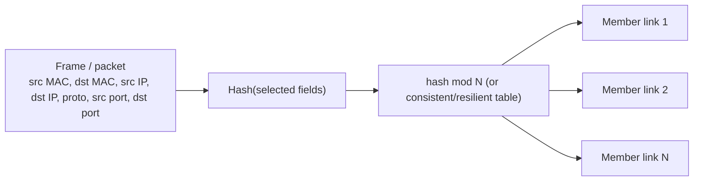

# 2.12 Link aggregation, LACP, MLAG and ECMP

| | |
|---|---|
| Level | Intermediate |
| Priority tier | 0 |
| Lab venue | Linux VM with network namespaces; optional containerlab/FRR |
| Part | Part 2: Networking, from first principles to AI fabrics |
| Status | Drafted, labs **untested** |

## Why this matters for AI infrastructure

Picture a GPU server whose storage connection goes dark because the switch it plugs into reboots. The training job was mid-epoch, and one planned maintenance window has just taken it down. A GPU server needs bandwidth and resilience at the same time. A management or storage connection must survive a switch reboot. A leaf pair must be upgradable without draining racks, and every parallel link in the fabric should carry traffic.

The first tool is link aggregation, built from bonding and LACP on the host and at the first hop. Several cables are bound together so that they behave like one. Multi-chassis variants such as MLAG, vPC and EVPN multihoming stretch the same idea across two switches. ECMP at layer 3 spreads traffic across the spines.

The catch is hashing. Aggregated links do not scale linearly, because each flow pins to one member. A few large flows, called elephant flows, such as all-reduce traffic or checkpoint writes, can saturate one link while its siblings sit idle. Understanding the hash and its failure behaviour is what separates 800 Gb/s of useful bandwidth from a congested link nobody can explain. So decide how you hash before you count on the bond's bandwidth.

## Prerequisites and outcomes

Before you start, you should know Ethernet, VLANs and STP from chapters 2.3 and 2.11. You should also know host routing from chapter 2.5. New terms such as bond, member and hash are explained where they first appear.

When you have finished, use this list as a self-check. Each line is something you should now be able to do.

- Explain why parallel links need a flow-to-member mapping. You will also see why per-packet round robin is avoided, and how hash inputs decide the balance.
- Describe LACP as defined in 802.1AX and 802.3ad. That covers its actors, partners, system priority, keys, active and passive modes, fast and slow timers, aggregation selection and failure detection.
- Configure Linux bonding with modes 0 to 6, `xmit_hash_policy`, `miimon`, `lacp_rate` and `min_links`. You will set up bonds with netplan, NetworkManager or systemd-networkd, and inspect `/proc/net/bonding`.
- Explain MLAG, vPC and EVPN multihoming, along with their failure modes. You will understand why modern fabrics prefer routed designs.
- Explain routed ECMP, hash fields, polarization, resilient and consistent hashing, flowlets and adaptive routing. You will also tell elephant flows apart from mouse flows.
- Design host attachment for the management, storage, front-end and compute networks of an AI cluster. You will know the classic cluster node roles and networks as well.

## 1. The problem: many parallel links, one conversation

Suppose you join two switches with two 100G links and expect traffic to split evenly. The obvious approach is round-robin: frame 1 goes on link A, frame 2 on link B, and so on. It is how a dealer hands out cards. Round-robin maximises utilisation. The trouble is ordering. Frame 2 can overtake frame 1 on a faster or less congested path, so the receiver has to put them back in order.

TCP treats that reordering as loss, because from its point of view a packet that arrives late looks the same as one that never arrived. The result is duplicate ACKs, spurious fast retransmits and collapsed throughput. A few implementations use round-robin where reordering is tolerated. Linux `balance-rr` is one, and some RDMA fabrics use packet spraying with reordering-aware NICs. Almost everything else uses flow hashing.

Flow hashing computes a hash over fields that stay constant for a flow, takes it modulo the number of members, and sends every packet of that flow down the same member. In plain words, all the packets of one conversation take the same cable, so they stay in order. Ordering is preserved. Utilisation, however, becomes statistical.



### Hash functions and why balance is imperfect

A hash maps a large input to a small fixed output, and it spreads inputs roughly evenly across the buckets. Imagine a toy hash that sums the digits of a number. The same input always gives the same output, so a flow sticks to one link. You cannot recover the input from the output, and different inputs can collide into the same bucket. For load sharing, you want those collisions spread evenly, not avoided. Think of sorting a crowd into queues by the last digit of their ticket number. Everyone with the same last digit joins the same queue.

Real switches and the kernel use CRC variants, XOR folds, or Jenkins and Toeplitz style hashes. Many of them add a per-device seed.

Balance is statistical, which means it improves with numbers, like coin tosses. It depends on the entropy of the hash inputs, the sizes of the flows and the layer you hash on. Entropy means how much the inputs vary. Many hosts in one broadcast domain that talk to each other have varied MACs. A few hosts that talk to a single server show little MAC or IP variety, so hashing on the L4 source and destination ports adds the entropy you need. A single TCP connection between two hosts has exactly one 5-tuple, so it uses one member no matter how many links exist.

Flow sizes matter just as much. Elephant flows, such as storage transfers, backups, collective communication and checkpoint writes, carry most of the bytes. Mouse flows, such as web requests and RPCs, are small. If two elephants hash to the same link, that link saturates while the others sit idle. It is like two lorries picking the same lane on a motorway while the other lanes carry only small cars. Aggregated bandwidth scales only statistically, and only with many flows.

Hashing only on MAC addresses, which is layer 2, fails when all traffic goes to one gateway. Every packet leaves through the router's MAC, so every packet hashes to the same member. Hashing on layer 3 or layer 4 fields fixes that.

Polarization happens when successive tiers, such as leaf and then spine, use the same hash function and seed on the same fields. The flows picked for one link at the first tier all pick the same link at the second. Paths go unused as a result. It is like two sorting offices in a row that sort letters by the same rule, so the second office never sees any mix. Vendors avoid this with per-device seeds, different hash functions or fields per tier, or packet fields that change, such as inner headers.

The network engineer's job is to understand the traffic mix and pick the hash fields that spread it best. Use L2, the source and destination MAC, for many hosts in one domain. Use L3, the source and destination IP, for routed traffic with many endpoints. Use L3 plus L4, the 5-tuple, for a few hosts with many connections.

Encapsulated traffic, such as VXLAN, GRE or IPsec, needs inner-header hashing or varied outer UDP source ports to create entropy. Chapter 2.17 covers that. RDMA with RoCE v2 deliberately varies the UDP source port per queue pair. NCCL uses multiple QPs per connection, which gives ECMP hashing something to spread. So match the hash fields to the traffic you actually run, and check every tier for polarization.

## 2. Link aggregation and LACP

Link aggregation is standardised as IEEE 802.1AX, which was formerly 802.3ad. It bundles several physical links between two devices into one logical link. Spanning tree and routing see the bundle as a single link, so STP does not block the members. The bundle carries more aggregate bandwidth than one member, and it survives member failures because traffic rehashes onto the remaining members. If one cable fails, the bundle shrinks but does not break.

Vendors each choose their own name for the idea, so you will meet EtherChannel, port-channel, bond, LAG, team and trunk. The word trunk is the confusing one, because chapter 2.11 used it for a link that carries many VLANs, and some vendors use it for a bundle.

**LACP**, the Link Aggregation Control Protocol, negotiates and maintains the bundle. It is the conversation that lets the two ends agree on which cables belong together. Each end is an actor. It advertises to its partner a system ID built from the system priority and the MAC, a port key, a port priority and state flags. These arrive in LACPDUs, which go to the slow-protocols multicast address 01:80:C2:00:00:02.

Active mode sends LACPDUs proactively, while passive mode only responds. At least one side must be active. If you leave both sides passive, nothing gets negotiated, because each waits for the other to speak first. Static `on` mode creates a bundle without any protocol, and that is dangerous. A miswired or misconfigured member silently blackholes traffic.

Here is how the pairing works out in practice. If one end is active and the other is passive, the active end speaks first and the passive end answers, so the bundle forms. If both ends are active, both speak and the bundle forms quickly. If both ends are passive, the line stays silent and no bundle ever forms. The cables are plugged in and the lights are green, and yet no traffic is aggregated.

A member joins the aggregate when its partner presents a consistent system ID and key, and when its port matches in speed, duplex and VLAN configuration. When more members are offered than the limits allow, the side with the lower system priority decides which members are active. The limits are 8 active members, with up to 16 members in hot standby.

Timers decide how quickly you learn about a failure. The slow setting sends hellos every 30 s and times out after 90 s. The fast setting sends hellos every 1 s and times out after 3 s. Timers matter because LACP catches failures that link state alone cannot. A switch can be up but not forwarding on that port, a cable can be mis-patched, or a fibre can fail in one direction only. In each case LACP tells the OS to rehash away from the failed member quickly.

Frames only flow on members that have reached the "collecting/distributing" state after negotiation. That rule stops traffic being sent into a bundle the other side has not accepted.

The hash applies separately in each direction, which surprises many people. The switch chooses the member for server-bound traffic with its own hash. The host chooses the member for switch-bound traffic with its own policy. A flow can leave on member 1 and return on member 2. That is normal, and it works as long as both members are in the bundle. Use fast timers for servers, and keep static `on` mode out of any bundle you rely on.

## 3. Linux bonding

The kernel `bonding` driver creates a bond device, such as `bond0`, and enslaves physical NICs to it. From then on the applications talk to `bond0`, and the driver decides which physical cable carries each frame. Before you pick a mode, look at the table below. The mode decides what the switch must support.

| Mode | Name | Behaviour | Switch support needed |
|---|---|---|---|
| 0 | `balance-rr` | Round robin per packet | Static bundle; risk of reordering |
| 1 | `active-backup` | One active member; failover on link loss; MAC may move (`fail_over_mac`) | None (works with any switches, even two independent ones) |
| 2 | `balance-xor` | Hash of src/dst MAC (or per `xmit_hash_policy`) | Static bundle |
| 3 | `broadcast` | Transmit on all members | Rare, fault-tolerant |
| 4 | `802.3ad` | **LACP** | LACP on the switch; same speed/duplex |
| 5 | `balance-tlb` | Adaptive transmit load balancing, receives on one | None |
| 6 | `balance-alb` | Adaptive TLB plus receive balancing via ARP replies | None |

For servers, two modes are the practical choices. Mode 1, `active-backup`, suits NICs that go to two unrelated switches with no MLAG. It is a spare tyre: one link does the work and the other waits. Mode 4, LACP, suits NICs that go to one switch or to an MLAG pair.

When you tune a bond, start with link monitoring, because that is how the bond learns that a member has died. `miimon=100` sets the link-state polling interval in milliseconds. `arp_interval` and `arp_ip_target` turn on ARP-probe monitoring, which can detect upstream failures that carrier cannot. The catch is that ARP probing conflicts with LACP, so you cannot run both.

`lacp_rate` takes `fast` or `slow`. `ad_select` sets how the aggregator is selected. `min_links` sets the minimum number of active members before the bond counts as up, so a bond cannot stay up with too little bandwidth. `updelay` and `downdelay` add damping to state changes.

`xmit_hash_policy` decides what the hash looks at, which is the most important choice after the mode itself. `layer2` is the default, and it hashes the source and destination MAC. `layer2+3` adds the IP addresses. `layer3+4` adds the ports, which gives the best spread for routed traffic, although it may reorder fragments. `encap2+3` and `encap3+4` hash on the inner headers of tunnelled traffic, and `vlan+srcmac` is the last option. The default is a poor choice for traffic going to one gateway, because every packet carries the same gateway MAC.

Here is the arithmetic that makes the hash choice matter. Take the two 100G links from the earlier example. A single TCP connection uses one of them, so it tops out near 100G, even though the bond carries 200G in total. Two connections may share one link or may use both, depending on the luck of the hash, and sixteen connections will usually come close to using both evenly.

`primary` names the preferred active member in active-backup mode. `fail_over_mac` and `arp_validate` complete the list.

The block below holds a Netplan file for Ubuntu, the runtime checks and the NetworkManager equivalent. Notice that the NetworkManager options match the Netplan settings: 802.3ad, `miimon` 100, fast LACP and `layer3+4` hashing.

```bash
# Netplan (Ubuntu)
network:
  version: 2
  ethernets: { ens1f0: {}, ens1f1: {} }
  bonds:
    bond0:
      interfaces: [ens1f0, ens1f1]
      parameters:
        mode: 802.3ad
        lacp-rate: fast
        mii-monitor-interval: 100
        transmit-hash-policy: layer3+4
        min-links: 1
      addresses: [10.30.4.45/24]
      mtu: 9000

# Runtime inspection
cat /proc/net/bonding/bond0              # mode, hash policy, per-slave state, LACP partner info, aggregator IDs
ip -d link show bond0 ; ip -s link show bond0
ethtool -i bond0 ; ethtool ens1f0        # speed/duplex must match across members
sudo nmcli con add type bond ifname bond0 bond.options "mode=802.3ad,miimon=100,lacp_rate=fast,xmit_hash_policy=layer3+4"
sudo nmcli con add type ethernet ifname ens1f0 master bond0
```

Check the result in `/proc/net/bonding/bond0`, which reports the state of each member. Look at `Aggregator ID` first. It should match across all members. Members in different aggregators mean the partner presents different keys or system IDs, for example a miscabled port.

`Partner Mac Address` should show the switch or MLAG virtual MAC. The value `00:00:00:00:00:00` means there is no LACP partner. Check `MII Status: up` for the link itself. A non-zero `Actor/Partner Churn State` means the negotiation is flapping. Also watch the failure counts for each member.

To check the balance yourself, run a multi-flow test and watch the per-member counters. Use `ip -s link`, `sar -n DEV` or `iperf3 -P 16`. A single flow will not show balance, so run many. A test with one flow can only ever prove that one cable works.

Teaming with `teamd` and OVS bonds are alternatives. Modern distributions are returning to bonding, so start there. SR-IOV and DPDK have their own bonding approaches. These include VF LAGs and the `mlx5` "LAG" in hardware, configured with `devlink`. GPU servers with ConnectX NICs may offload LAG to the NIC, so RDMA traffic can survive a bond. Check your NIC documentation before you rely on it.

**Do not bond the rails of a compute fabric.** NCCL expects one NIC per GPU rail, with independent paths for each rail. Failover then happens in the collective library or in the fabric's adaptive routing. Bond only the management, front-end and storage connections. Keep back-end rails independent, so the rail-optimised topology in chapter 2.18 stays intact.

## 4. Multi-chassis link aggregation (MLAG, vPC, EVPN multihoming)

Picture a server whose two links both land on one switch. When that switch is upgraded, the server loses both links. LACP bundles terminate on one switch, so that switch is a single point of failure for the server, and for any upgrade. **MLAG** removes that dependency. A bundle's members connect to two switches, and those two switches present themselves to the server, and to STP and LACP, as one logical switch.

MLAG goes by different names on each vendor's platform. You will see Cisco vPC, Arista MLAG, Juniper MC-LAG or ESI-LAG, Cumulus or NVIDIA MLAG (CLAG), and Dell VLT.

Under the hood, MLAG relies on a proprietary control protocol. The two switches have to behave like one, so they constantly tell each other what they know. A peer link between the two switches synchronises MAC tables, LACP state, and ARP and ND. Both switches use a common virtual system ID, so the server sees one LACP partner. A keepalive path, often through the management network, detects peer failure and avoids split brain. Split brain means both switches believe the other has failed and both act as the sole owner.

On the server-facing side, both switches forward at once, active and active. An entire switch can fail, or be upgraded one at a time, while servers stay connected.

The cost is complexity, and most of the failure modes live there. A peer-link failure triggers split-brain protection rules, which disable one side's ports. Inconsistent configuration between peers produces type-1 and type-2 consistency errors. Orphan ports, which are single-attached devices, lose connectivity when the peer link or one peer fails. A software bug has a larger blast radius, and upgrades are harder because of ISSU limits.

MLAG is also proprietary. There is no multivendor MLAG, so both peers must come from the same product line.

The standards-based replacement is EVPN multihoming, known as ESI-LAG and defined in RFC 7432. BGP EVPN type-1 and type-4 routes coordinate a shared Ethernet Segment Identifier across leaves. That gives active-active multihoming without a peer link. Chapter 2.17 covers the details.

The design direction is to shrink the L2 domains and run routed connections to servers. If the layer-2 problem is too large to manage, remove the layer-2 problem. You can use BGP on the host, or ECMP with `/32` loopbacks, and that needs no MLAG at all. Many hyperscale and AI designs have dropped MLAG in favour of L3 to the host or to the leaf. They keep MLAG only for legacy or appliance attachment and management networks.

Most GPU servers mix several attachment types, one for each network. The table shows the typical choice for each network and the reason behind it.

| Network | Typical attachment | Why |
|---|---|---|
| BMC / OOB management | Single 1G to an OOB switch (sometimes redundant) | Rarely needs bandwidth; isolated |
| In-band management / SSH | Bond (active-backup or LACP) to a leaf pair | Survives switch loss |
| Front-end / inference / client | LACP to MLAG pair or routed uplinks | Resilience + bandwidth |
| Storage | LACP or independent NICs with multipath (NFS nconnect, Lustre multi-rail, NVMe-oF multipath) | Higher storage throughput |
| Compute fabric (IB/RoCE) | One NIC per GPU, no bonding, rail-optimised leaves | Deterministic collectives |

Notice that the compute fabric row is the only one with no bonding. It trades bonding for deterministic collectives, so that every GPU knows exactly which path its traffic takes. Decide each network's attachment from this table before you cable the server.

## 5. Routed parallel links: ECMP

Suppose a router must reach a destination over several equally good paths. Instead of picking one and leaving the others idle, it can use them all. When parallel paths are **routed**, the routing protocol installs them all as equal-cost next hops for the same prefix, as described in chapter 2.13. Take A, which can reach D through three paths of cost 10: A-B-D, A-D and A-C-D. All three go into the forwarding table, and a hash chooses one path per flow.

Unlike link aggregation, ECMP paths need not connect the same two devices. They can lead through entirely different routers. No negotiation protocol is needed beyond the routing protocol itself.

Four details shape how ECMP behaves in practice, and the first is the hash fields. The hash typically uses the source and destination IP, the protocol, and the source and destination port, which is the 5-tuple. Sometimes it also uses the IPv6 flow label or inner headers for tunnels. The same hash function applies at every router, so seeds or fields must differ per tier to avoid polarization.

The second detail is resilient hashing. With plain `hash mod N`, removing one next hop changes N, and that remaps almost all flows. Those flows are then reordered and disrupted. Imagine a hotel that reassigns every guest to a new room whenever one room becomes unavailable. Resilient hashing allocates a fixed table of buckets mapped to next hops, so only the flows on the failed hop are reassigned. It is essential for stateful backends such as load balancers, anycast services and firewalls, and it is desirable for TCP.

The numbers in the lab make the difference concrete. With four equal paths and plain modulo hashing, losing one path moves 75% of all flows to a different path, even though only a quarter of them were using the failed one. With resilient hashing, only the 25% that were on the failed path move. The three healthy paths keep every flow they already had, so nothing on them is reordered or reset.

The third detail concerns elephant flows. Standard ECMP cannot split one flow, so a large flow stays on one path. Several techniques work around that. Flowlet switching re-hashes when a gap in the flow exceeds the path-delay difference, so reordering is impossible. A flowlet is a burst of packets from one flow, separated from the next burst by a quiet gap. Packet spraying works with reordering-tolerant endpoints. Adaptive routing lets the switch pick the least-loaded path per packet or flowlet, as in InfiniBand AR and NVIDIA Spectrum-X for Ethernet. Host-side multipathing uses multiple connections or QPs with varied ports, which is what NCCL and MPTCP do. These techniques are central to AI fabric performance, covered in chapter 2.19 and Part 11.

The fourth detail is Linux, which gives you a few tools. `ip route` handles multipath, as chapter 2.5 explains, and `fib_multipath_hash_policy` controls its hashing. To see which next hop a given flow uses, run `ip route get` with different source ports, for example `ip route get 10.200.0.1 ipproto tcp sport 40000 dport 443`. Inside the NIC, `ethtool -N` and the RSS hash functions (`ethtool -x`, `-X`) do the analogous job across receive queues.

To verify the distribution, look at per-interface counters on the switch with `show interface counters`. You can also use sFlow or IPFIX sampling, `ip -s link`, and synthetic tests with many flows of varied ports. A fabric with 8 spine uplinks should show nearly equal utilisation under many flows. Imbalance under a few large flows is expected unless adaptive routing is on. So test ECMP with many flows before you trust it.

## 6. Cluster roles and networks (a practical map)

Before you wire anything, you need a map of which machine plays which role on which network. A cluster is not a pile of identical servers, and the cabling differs by role. HPC and AI clusters use a stable set of node roles and networks. Those roles and networks decide where aggregation, ECMP and bonding appear.

Start with the nodes. Compute nodes are the ones you count when you size a cluster, so keep them homogeneous and lean. They need sshd, a network file-system client, a monitoring agent and the scheduler daemon. Minimise services such as cron, mail or NetworkManager where practical.

Control and management nodes run the cluster manager, the scheduler controller, provisioning and the databases. Have at least two of them for resilience. Login and access nodes face users, so they are strictly resource-limited. IDE remote plugins and heavy interactive use can paralyse them.

Service nodes handle compilation, data copy and transfer, licence servers, and pre- and post-processing. Some of them need large RAM, such as `256 GB` or more. Others run visualisation with GPUs, storage servers, backup, authentication, logging and monitoring.

**Do not combine compute and service roles.** An NFS server on a compute node is one example. Job interference and failures follow.

A cluster usually has five networks, and each one has its own job. Network 1 is the compute network, InfiniBand or high-speed Ethernet/RoCE, which carries MPI and NCCL traffic. It is the most demanding network in bandwidth and latency. Network 2 is the control or service network, which is Ethernet. It carries SSH, scheduler traffic, provisioning and monitoring.

Network 3 is the management network, which carries IPMI, BMC and Redfish traffic out of band. Network 4 is the storage network, and it is often shared with compute or separated from it. Network 5 serves users. Compute and storage nodes typically have no direct Internet access, so they use NAT or proxies, covered in chapter 2.9.

Compare technologies on both throughput and latency. Gigabit Ethernet sits at roughly 30 to 100 µs. 10G Ethernet reaches single-digit-to-tens of µs MPI latency. 100G RoCE or Ethernet and InfiniBand reach about 1 to 3 µs MPI latency. Real application throughput is typically 1.5 to 2 times below the peak figure. These figures vary by generation, so re-measure them with `ib_write_bw`, `ib_write_lat` or `osu_latency` on your hardware.

Topology decides where the links go, and chapter 2.18 covers the details. A tree or star, which is Ethernet, has STP block the redundant links. A fat tree has multiple root switches, each connected to every switch at the next level. It is InfiniBand's workhorse. It uses duplicate links and tolerates switch failures except at the leaf. A hypercube is N-dimensional with at most N hops, but its cabling is complex.

A multidimensional torus closes each dimension into a ring, and its maximum hops equal the sum of the half-dimensions. Some supercomputers use it. Dragonfly and dragonfly+ connect all nodes within groups, and the groups connect globally. That reduces ports and cables while keeping hop counts low.

A bottleneck can cancel out fast links. Take two 1G switches joined by a single link, for example. Parallel inter-switch links must be aggregated consistently, with compatible standards on both ends. EtherChannel, bonding and trunking implementations differ between vendors, so check both ends.

The storage attachment options, DAS, NAS, SAN, RAID levels and multipath, belong to the storage part of the handbook. NUMA and CPU pinning are covered in chapters 1.18 and 1.28. Map each network to a role before you pick a bonding mode for it.

## 7. Failure behaviour and troubleshooting

When you debug a bond or an ECMP path, most problems show up as one of a few symptoms. The table maps each symptom to its likely cause and the check to run next. Use it as a lookup, and still confirm the cause with the check before you change anything.

| Symptom | Likely cause | Check |
|---|---|---|
| One member carries all traffic | Hash policy too coarse (layer2 to one gateway), few flows, polarization | `xmit_hash_policy`, per-member counters, test with `-P 16` |
| Bond up but no connectivity | LACP mismatch (static on one side), wrong VLAN on member, MLAG peer inconsistency | `/proc/net/bonding/bond0` partner MAC, switch `show lacp`, `tcpdump -ni ens1f0 ether proto 0x8809` |
| Bond flaps | Bad optics/cable, LACP fast timers on a busy CPU, `miimon` too aggressive, link negotiation | `dmesg`, `ethtool -S`, churn counters |
| Throughput half of expected | Single flow pinned to one member; members at different speeds; MTU mismatch | `iperf3 -P`, `ethtool` speed, MTU on all hops |
| Packet reordering | `balance-rr`, ECMP flaps, per-packet spraying without tolerant endpoints | `nstat \| grep -i reorder`, `ss -ti` |
| Traffic blackholed after a switch failure | No `min_links`, MLAG split brain, wrong failover mode (ARP monitor with LACP), hash not updated | switch logs, keepalive path, `lacp_rate` |
| Some destinations unreachable via ECMP | One path blackholed (missing route/ACL/MTU), no BFD, sticky hash hides the fault | probe each path with varied source ports; BFD; `traceroute -T` with ports; paris-traceroute |
| After upgrade, flows shuffle | Plain modulo hashing remapped all flows | enable resilient/consistent hashing |

Several rows trace back to hashing, so keep the hash step in mind as you read them. Those rows are the ones where a single fault looks like a capacity problem. A bond that carries all its traffic on one member is working as designed, just with the wrong hash.

When a host bond misbehaves, work through the layers in order. Step 1 covers the physical layer, using `ethtool`, optics, cabling and LLDP neighbours. Step 2 checks the bond state in `/proc/net/bonding`. Step 3 checks the switch-side LACP or MLAG state. Step 4 checks the hash and the flow distribution. Step 5 checks MTU and VLAN consistency across the path.

Step 6 is the failover test. Bring each member down, and measure the recovery time with a continuous ping (`ping -i 0.1`) or with `iperf3` and interval reporting. When you work through the steps, start with the cable. You will save time by not chasing switch settings for a fault in the optics.

## 8. Hands-on lab: build and break bonds and ECMP

A word on status first. The Python lab below has been run, while the interactive VM commands after it have not been run for this chapter, so treat each step as a first attempt and keep notes on what you see. Start with the self-checking Python lab, which runs on your own machine. It checks how `xmit_hash_policy` spreads flows across bond members, comparing `layer2` with `layer3+4`. It also compares plain `hash mod N`, which moves `75%` of flows, with resilient hashing, which moves `25%`, when 1 of 4 ECMP links fails. Finally, it checks the LACP `active` and `passive` negotiation rules and the `/proc/net/bonding/bond0` health checks. Run it with the command below.

```bash
python3 code/part02/lacp_mlag_ecmp_lab.py
```

The script checks its own results, so a clean run tells you the lab logic passed.

Next, move to a disposable Linux VM with `root` access.

1. In two namespaces, or on two VMs, create a bond on each side with two veth pairs between them, using `mode=802.3ad`. Then inspect `/proc/net/bonding`, see the partner MAC, and set one side to `active-backup`, or remove LACP, to watch the negotiation fail.
2. With `xmit_hash_policy=layer2`, run `iperf3 -P 8`. Note that one member carries everything when the src/dst MACs are fixed. Switch to `layer3+4` and watch the spread with `ip -s link` and `watch -d`. Use different destination ports to show the hash effect, then repeat the test with a single flow.
3. Bring a member down with `ip link set veth1 down`, and measure the packet loss with a fast ping. Adjust `miimon` and `lacp_rate fast`, then test `min_links`.
4. Set `mode=balance-rr`, and add `tc netem delay 5ms` on one member only. Capture the reordering with `nstat` and tcpdump, and compare the throughput collapse with a hashed mode.
5. Use namespaces `a`, `r1`, `r2` and `b`, with two equal-cost paths from `a` to `b`. Add a multipath route and test the distribution with `iperf3 -P 16`. Query the path for different ports with `ip route get ... sport ... dport ...`. Set `fib_multipath_hash_policy` to 0, then to 1. Remove a next hop and count how many flows moved. Finally, compare the results with FRR's ECMP in a containerlab leaf-spine from chapter 2.27.
6. Run two large flows with engineered 5-tuples that collide. Search ports until `ip route get` shows the same next hop, and observe 50% utilisation per path. Finally, discuss flowlet and adaptive routing.
7. On paper, draw a rack with dual-homed servers and an MLAG pair. List the failure cases: peer link, keepalive, orphan port and single switch reboot. Write down the expected behaviour for each, then compare the design with a routed alternative that uses BGP to the host.
8. When you finish, clean up.

Run the Python lab first, and move to the VM steps only after it passes.

## 9. Common mistakes

Most of these mistakes come from testing the wrong thing or trusting a default. Check your setup against this list before you call a bond broken. Many bonds that seem broken are working exactly as configured.

- You expect a bond to speed up a single TCP stream, but it will not. If you test with one flow and conclude the bond is broken, you have tested the wrong thing.
- You leave the default `layer2` hash policy in place for routed traffic, or you ignore polarization across tiers.
- You build static, non-LACP bundles, mix LACP modes, or put members of different speeds in one bond.
- You use `balance-rr` for TCP traffic across a network you do not know.
- You bond compute-fabric rails, or place two rails in one switch failure domain without understanding the topology.
- You run MLAG without a tested peer-link and keepalive design, or you forget the orphan ports.
- You use plain modulo ECMP behind stateful services, which causes rehash storms on every change.
- You never test failover or recovery time.

## 10. Interview angles

Interviewers use these questions to see whether you can reason about balance and failure, not just recite settings. Try to answer each one in plain words before you read further. A good answer explains what happens to one packet, then to one flow, then to a hundred flows.

- "Why doesn't link aggregation scale linearly? How would you improve balance?"
- "Difference between LACP and a static port-channel; why prefer LACP?"
- "Which bonding mode would you use with one switch? With two independent switches? With an MLAG pair?"
- "What is MLAG? What can go wrong? What are the alternatives?"
- "Explain ECMP, hashing fields and polarization. What is resilient hashing?"
- "An elephant flow saturates one link while others are idle. What can you do?" Possible answers include entropy, multiple QPs or streams, flowlets, adaptive routing and flow-aware load balancing.
- "How is a GPU server's networking attached and why are the compute rails not bonded?"
- "How would you test a bond's failover?"

## Exercises

You can answer most of these on paper, using the chapter as your reference. Where an exercise gives numbers, work them out by hand first, and let the code confirm you afterwards.

1. Start with why per-packet round robin fails for TCP, and why flow hashing and hash polarization matter. (a) Explain why alternating packets of a single TCP flow across parallel links (`balance-rr`) makes TCP throughput collapse. (b) Use `select_bond_member_by_hash()` in `code/part02/lacp_mlag_ecmp.py`. Explain why `xmit_hash_policy=layer2` pins all 16 parallel TCP streams destined for an off-subnet NFS server onto a single bond member, while `layer3+4` spreads them across all 4 members. Then define hash polarization in your own words, so you can explain it to a colleague.
2. Check your grasp of LACP (802.1AX and 802.3ad) mechanics, timers and bond diagnostics. (a) State the multicast MAC (`01:80:C2:00:00:02`) and the EtherType (`0x8809`) that LACPDUs use. Evaluate `evaluate_lacp_negotiation()` for each `active`, `passive` and `off` combination. Then compare the `slow` timers (`30 s / 90 s`) with the `fast` timers (`1 s / 3 s`). (b) Using `audit_proc_bonding_status()`, explain what `Partner Mac Address: 00:00:00:00:00:00` and mismatched per-slave `Aggregator ID`s in `/proc/net/bonding/bond0` indicate.
3. Work through Linux bonding modes `0` to `6`, `xmit_hash_policy`, and why GPU compute rails are never bonded. Compare modes `0` (`balance-rr`), `1` (`active-backup`), `2` (`balance-xor`) and `4` (802.3ad, LACP). State which mode to use for two uncoordinated switches, and which to use for an MLAG pair. Then explain why the 8 back-end RoCE or InfiniBand NICs on an 8-GPU server are never placed in a bond.
4. Compare three designs: MLAG or vPC, EVPN multihoming, and L3 routed hosts. Describe how a proprietary MLAG or vPC switch pair works, using its peer link, keepalive and virtual system MAC. List four failure modes of MLAG: split brain, peer-link failure, orphan ports and upgrade lockstep. Then contrast MLAG with EVPN multihoming (ESI-LAG, RFC 7432) and with L3 BGP and ECMP to the host.
5. Routed ECMP is the subject here, and the remapping numbers sit at its core. (a) Using `compare_modulo_vs_resilient_remap_pct(4)`, calculate what percentage of existing flows get remapped onto different links when 1 of 4 ECMP paths fails. Do this for plain `hash mod N`, which gives 75.0%, and for resilient (consistent) hashing, which gives 25.0%. (b) Explain four techniques that prevent elephant-flow collisions in AI fabrics: RoCEv2 UDP source-port variation across multiple QPs, flowlet switching, packet spraying with reordering-tolerant NICs, and adaptive routing.
6. Look at the cluster map in section 6. (a) Contrast the four cluster node classes: compute, control or management, login or access, and service nodes. Service nodes need 256 GB+ RAM for pre- and post-processing. Then explain why running a storage or NFS server on a compute node is forbidden. (b) List the five cluster networks. Compare the MPI latencies of 1G Ethernet (30–100 µs), 10G Ethernet, and 100G+ InfiniBand or RoCE (1–3 µs). Then compare fat-tree, hypercube, torus and dragonfly topologies.

## Checkpoint questions (20)

<details>
<summary>1. Why does per-packet round-robin load balancing (`balance-rr`) degrade TCP throughput across parallel links?</summary>

When you send consecutive packets of one TCP flow, they can take different physical links, and those links have slightly different queue depths or latencies. Later packets then overtake earlier ones and arrive out of order. The receiver sends duplicate ACKs for the gap, so the sender mistakes the reordering for packet loss, triggers spurious Fast Retransmits, and repeatedly cuts its congestion window (`cwnd`).
</details>

<details>
<summary>2. How does flow hashing solve the reordering problem, and how many links of a 4-port bond can a single TCP stream use?</summary>

Flow hashing computes a deterministic hash over header fields that stay constant for the life of a flow, such as the L3+L4 5-tuple. It maps `hash mod N` to one member link. If you look at a single TCP connection, every packet has the same 5-tuple, so one connection uses at most one physical member link, which is `1 x 100G` out of `4 x 100G`. Packet order stays intact, and aggregate bandwidth still scales statistically across many concurrent flows.
</details>

<details>
<summary>3. Why does Linux's default `xmit_hash_policy = layer2` fail to balance routed traffic, and what policy should you set instead?</summary>

`layer2` hashes only the source and destination MAC. A server that sends traffic to hundreds of remote IP addresses through its default gateway puts the same source MAC, its own, and the same destination MAC, the gateway router, on every packet. All of that routed traffic therefore pins to one bond member, which is 100% of it. Set `xmit_hash_policy = layer3+4` instead. It hashes the source IP, destination IP and L4 ports, so flows spread evenly across all bond members. For tunnel packets such as VXLAN, `encap3+4` hashes the inner headers.
</details>

<details>
<summary>4. What are Elephant flows and Mouse flows, and what is Hash Polarization across a leaf-spine fabric?</summary>

Elephant flows are large, long-lived, high-bandwidth transfers, such as AllReduce collectives, checkpoint writes and storage replication. Mouse flows are short, small requests, such as RPCs, DNS and SSH. Suppose two elephant flows hash to the same 100G uplink. They collide, and each gets only 50G while sibling links sit idle. Hash polarization happens when a leaf switch and a spine switch use the same hash algorithm and seed on the same header fields. The flows that landed on uplink 1 at the leaf then all land on one link at the spine, and the other spine links go unused. Per-switch hash seeds, or different fields per tier, prevent it.
</details>

<details>
<summary>5. How does RoCE v2 (RDMA over Converged Ethernet) create hash entropy for ECMP and LACP switches?</summary>

RoCE v2 wraps InfiniBand transport packets inside UDP datagrams with a fixed destination port, `4791`. If you leave it alone, all RDMA traffic between two nodes hashes to the same physical link. The NIC driver and NCCL therefore vary the outer UDP source port across different Queue Pairs (QPs). NCCL also opens multiple QPs per GPU pair through `NCCL_IB_QPS_PER_CONNECTION`. Those varied fields give the ECMP and LACP hashes the entropy they need to spread traffic across links.
</details>

<details>
<summary>6. What standard defines LACP, what multicast MAC and EtherType do LACPDUs use, and how do `Active` and `Passive` modes interact?</summary>

IEEE 802.1AX defines LACP, which was formerly 802.3ad. Peers exchange LACPDUs sent to the link-local slow-protocols multicast MAC `01:80:C2:00:00:02`, with EtherType `0x8809`. An `Active` port sends LACPDUs on its own initiative. A `Passive` port listens, and it replies only when it hears an LACPDU. So `Active` with `Active`, or `Active` with `Passive`, forms a bundle. `Passive` with `Passive` never negotiates.
</details>

<details>
<summary>7. Why is dynamic `LACP` strongly preferred over a static (`mode=on` / `balance-xor`) port-channel, and what are the `fast` vs. `slow` LACP timers?</summary>

If you configure a static bundle, it has no negotiation protocol. If a cable goes into the wrong switch, or a fibre fails in one direction, the link light can stay up while TX or RX is dead. The sender then keeps hashing 50% of its traffic into a black hole. LACP checks that every member link terminates on the same partner System ID and Key. It moves ports into the `Collecting/Distributing` state only after both sides agree. Slow timers send hellos every 30 s and time out at 90 s. Fast timers, set with `lacp_rate = fast`, send hellos every 1 s and time out at 3 s. Use fast timers on servers.
</details>

<details>
<summary>8. Compare Linux bonding Mode 1 (active-backup) and Mode 4 (802.3ad, LACP), and state when each is used.</summary>

- Mode `1` (`active-backup`) keeps one slave active and fails over to the backup slave on link loss, with `miimon=100`. It needs no switch configuration. Use it when you connect the two server NICs to two completely independent switches that do not run MLAG.
- Mode `4` (802.3ad, LACP) uses all member links at once through flow hashing, with `xmit_hash_policy=layer3+4`. The switch ports must form an LACP port-channel, either on a single switch or on an MLAG or EVPN-multihomed switch pair.
</details>

<details>
<summary>9. In `/proc/net/bonding/bond0`, what do `Partner Mac Address: 00:00:00:00:00:00`, mismatched `Aggregator ID`s, and `min_links` mean?</summary>

- `Partner Mac Address: 00:00:00:00:00:00` means the server receives no LACPDUs from the switch. Either LACP is not enabled on the switch port, or the port is suspended.
- Different `Aggregator ID` values across slaves, for example `ens1f0` on ID `1` and `ens1f1` on ID `2`, mean the two cables reach two switches that do not share an MLAG or LACP system ID. You will see only one aggregator active.
- `min_links = N` forces the bond interface itself to report link `DOWN` when fewer than `N` member links are active. That triggers upper-layer failover.
</details>

<details>
<summary>10. Why must you NEVER bond the 8 back-end compute NICs (`ens1f0..ens8f0`) on an 8-GPU training server?</summary>

In a rail-optimized GPU server, each GPU `i`, numbered 0 to 7, sits behind a local PCIe switch (`PIX`). It pairs with its own dedicated NIC `i`, which connects to rail `i` leaf switches. NCCL discovers this exact GPU-to-NIC map, which you can view with `nvidia-smi topo -m`, and it schedules deterministic collective rings and trees per rail. If you bond the NICs, you hide each device behind one Linux virtual interface. It also breaks PCIe and NUMA locality, so GPU 0's DMA might leave through NIC 5 across the CPU socket interconnect. And it breaks RDMA queue-pair binding.
</details>

<details>
<summary>11. What is Multi-Chassis Link Aggregation (MLAG / vPC), and how do two physical switches pretend to be one LACP partner?</summary>

MLAG, which Cisco calls vPC, Arista calls MLAG, and Cumulus or NVIDIA calls CLAG, joins two top-of-rack leaf switches. They share an inter-switch peer link and an out-of-band keepalive link. The two switches synchronize MAC tables, ARP and ND state, and LACP state. They advertise the same virtual LACP System ID, a MAC, to the dual-homed servers. The server therefore sees a single 2-port LACP bundle, even though its two cables go to two separate switches. That gives rack-level high availability.
</details>

<details>
<summary>12. What are the main operational risks of proprietary MLAG pairs, and how does EVPN Multihoming (ESI-LAG, RFC 7432) improve on them?</summary>

If you run proprietary MLAG, you take on several risks. It needs a switch pair from the same vendor and a dedicated high-bandwidth peer link. If the peer link fails, split-brain or dual-active shutdown rules apply. Single-attached orphan ports also need careful handling. EVPN multihoming, known as ESI-LAG under RFC 7432, is an open IETF standard. It gives the server's LAG a shared 10-byte Ethernet Segment Identifier (ESI). BGP EVPN Type-1 and Type-4 routes then coordinate MAC, ARP and multicast state across the leaf switches over the L3 spine. It needs no physical peer link between the leaves, and it supports 2 or more multihomed leaves across vendors.
</details>

<details>
<summary>13. How does Layer 3 Equal-Cost Multipath (ECMP) differ from Layer 2 Link Aggregation (LACP)?</summary>

LACP bundles parallel physical links between the same two devices, or an MLAG pair, into one Layer 2 interface. ECMP works at Layer 3. A routing protocol, such as BGP, OSPF or IS-IS, installs several equal-cost next hops for a prefix. When you look at ECMP, those next hops can be completely independent routers, such as 8 separate spine switches. ECMP needs no Layer 2 bundle protocol and no shared switch state.
</details>

<details>
<summary>14. Why does plain `hash mod N` ECMP disrupt 75% of flows when 1 of 4 paths fails, and how does Resilient (Consistent) Hashing fix it?</summary>

With plain `bucket = hash % N`, changing N from 4 to 3 changes the remainder for 3/4, or 75%, of all hash values. If you use plain hashing, healthy flows then move onto different paths. That causes out-of-order TCP packets, and it breaks stateful load balancers and firewalls, which lose connection state when flows shift to a new appliance. Resilient, or consistent, hashing maps hashes onto a fixed power-of-two indirection table of buckets assigned to next hops. When 1 of 4 next hops fails, only the buckets of the failed hop, 25%, are reassigned to the surviving hops. The other 75% of flows stay untouched.
</details>

<details>
<summary>15. Explain Flowlet Switching, Packet Spraying, and Adaptive Routing for overcoming ECMP elephant-flow collisions in AI fabrics.</summary>

- Flowlet switching detects microsecond idle gaps, called flowlets, within a single flow. A gap must be larger than the maximum path-delay difference across spine paths. The switch can then re-hash the next burst onto a less congested link without reordering packets.
- Packet spraying spreads the packets of a single RDMA flow across all available spine links in parallel. It relies on out-of-order-tolerant RDMA NICs, such as NVIDIA ConnectX-7/8 with Spectrum-X or InfiniBand, to reorder packets in hardware at the receiver.
- Adaptive Routing, or AR, has switches choose the egress port with the shortest real-time queue depth, per packet or per flowlet.
</details>

<details>
<summary>16. How do you check which ECMP next hop the Linux kernel will pick for a specific TCP flow 5-tuple?</summary>

Run `ip route get <dst_ip> from <src_ip> iif <dev> ipproto tcp sport <src_port> dport <dst_port>`. With `net.ipv4.fib_multipath_hash_policy = 1` set, varying `sport` or `dport` makes the kernel select different `via <nexthop>` paths from the multipath route, and you can see each one in the output.
</details>

<details>
<summary>17. Name the four node classes in an HPC/AI cluster (Supercomputers for Linux SysAdmins, chapter 4) and explain why you must never run a storage/service daemon on a compute node.</summary>

Class 1 is compute nodes, which stay homogeneous and free of unnecessary daemons. Class 2 is control and management nodes, which run Slurm or Kubernetes controllers, provisioning and databases, deployed in HA pairs. Class 3 is login and access nodes, the SSH entry points for users. They carry strict cgroup and ulimit caps, so VS Code remote servers or compiles cannot crash them. Class 4 is service nodes, which hold storage servers, data movers, license servers, and pre- and post-processing nodes with 256 GB+ RAM. Running an NFS or other service daemon on a compute node takes CPU cores, RAM and NIC bandwidth from the local rank. That makes the node a straggler, which slows every multi-node job that uses it.
</details>

<details>
<summary>18. List the five distinct functional networks in a production supercomputer / AI cluster (Supercomputers for Linux SysAdmins, chapter 4).</summary>

Network 1 is the compute or communication fabric, InfiniBand or lossless RoCEv2 Ethernet, which carries MPI and NCCL collectives. Network 2 is the control or service network, Ethernet, for SSH, Slurm or kubelet control, provisioning and monitoring. Network 3 is the out-of-band (OOB) management network, an isolated Ethernet network for BMC, IPMI, Redfish and iKVM. Network 4 is the storage network, a dedicated or shared high-bandwidth fabric to Lustre, BeeGFS or NVMe-oF. Network 5 is the external or front-end network, which handles user login and ingress and egress through NAT or proxies.
</details>

<details>
<summary>19. Compare the typical MPI/RDMA point-to-point latency of 1 GbE, 10 GbE, and 100–400G InfiniBand / RoCE, and the rule of thumb for real application bandwidth (Supercomputers for Linux SysAdmins, chapter 4).</summary>

If you compare them, 1 GbE over TCP/IP runs at roughly 30 to 100 µs of latency. 10 GbE runs at single-digit to tens of µs. 100G to 400G InfiniBand or RoCEv2 RDMA reaches about 1 to 3 µs. As a rule of thumb, real application throughput on a cluster fabric is typically 1.5 to 2 times lower than the raw theoretical peak wire speed. Protocol headers, collective synchronization barriers and the mix of message sizes account for the gap.
</details>

<details>
<summary>20. Compare the five classic cluster interconnect topologies: Tree/Star, Fat-Tree (Clos), Hypercube, Multidimensional Torus, and Dragonfly (Supercomputers for Linux SysAdmins, chapter 4).</summary>

- Tree or star: a simple hierarchy, but root switches become bandwidth bottlenecks and single points of failure.
- Fat-tree, also called Clos: several spine or root switches connect to every leaf, so bisection bandwidth stays constant, or controlled, at each tier. It is the standard topology for InfiniBand and Ethernet AI clusters.
- Hypercube: an N-dimensional cube with 2^N nodes and at most N hops.
- Multidimensional torus, in 3D or 6D: a grid where each axis wraps around into a ring. The maximum hops equal the sum of the half-dimensions. You will find its cabling cost low for nearest-neighbour physics simulations.
- Dragonfly or dragonfly+: tightly coupled all-to-all local groups, joined by global optical links. That keeps the global hop count low and cuts the number of long optical cables at exascale.
</details>

## Sources and review notes

- **Sources read in full:**
  - `computer-networking-problems-and-solutions` — Russ White and Ethan Banks, *Computer Networking Problems and Solutions*, **Chapter 7: Packet Switching** (equal-cost multipath ECMP, link aggregation, hash algorithms, LACP, multichassis link aggregation MLAG, and routed parallel links).
  - `supercomputers-for-linux-sysadmins-managing-modern-hpc-clusters-and-supercomputers-from-software-to` — Sergey Zhumatiy, *Supercomputers for Linux SysAdmins*, **Chapter 4: Supercomputer Hardware** (compute, control/management, login/access, and service nodes with `256 GB+` RAM, the 5 cluster networks, latency/throughput comparisons `30–100 µs` 1G Eth vs `1–3 µs` IB/RoCE and `1.5–2x` real-vs-peak bandwidth ratio, and topologies tree / fat-tree / hypercube / torus / dragonfly; RAID levels and SMP/NUMA parts of Chapter 4 are covered in Chapters 1.13, 1.17, 6.2, and 6.4).
- **Run here:** `python3 code/part02/lacp_mlag_ecmp_lab.py` (12 passed, 0 failed).
- **Explicitly labelled inferences:** The Linux `bonding` mode table (`0`–`6`), Netplan/`nmcli` LACP `layer3+4` configuration, GPU-server 5-network attachment table (never bonding compute rails), EVPN multihoming (`RFC 7432`), and resilient-hashing / flowlet / packet-spraying notes synthesize the Linux kernel bonding documentation, IEEE 802.1AX, and RFC 7432 (cross-referenced with Chapters 1.18, 1.28, 2.3, 2.5, 2.9, 2.11, 2.13, 2.17–2.19, 2.27, and Part 11, plus original study items 21, 22, 23, 24, 25, 26, 27, 28, 29, and 30).
- **Not verified on live hardware:** All interactive VM commands (`ip link`, `/proc/net/bonding/bond0`, `nmcli`, `ethtool`, `iperf3 -P`, `tc netem`) are marked (untested here) and must be executed on a disposable Linux VM.

