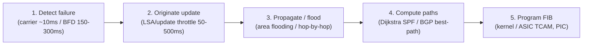

# 2.13 IP routing: static routes, dynamic routing and convergence

| | |
|---|---|
| Level | Intermediate |
| Priority tier | 0 |
| Lab venue | Linux VM with network namespaces and FRR (or containerlab) |
| Part | Part 2: Networking, from first principles to AI fabrics |
| Status | Drafted, labs **untested** |

## Why this matters for AI infrastructure

Every large AI fabric is routed. Leaf-spine data centres run BGP or OSPF between switches (and increasingly to the host), so that every link is active under ECMP and a failure is absorbed in milliseconds rather than the tens of seconds of spanning tree. To operate, design or debug such a fabric you need to know how routers *learn* where things are, how they avoid forwarding loops, how they notice failures and how quickly they converge, what happens when two routing systems are stitched together (redistribution), and which behaviour is protocol-specific and which is fundamental. This chapter is the theory chapter for routing: it explains the algorithms (distance vector, link state, path vector), the guarantees they give (loop freedom), failure detection (polling, event-driven, BFD), change distribution (flooding, hop by hop, centralised stores), fast-reroute techniques (loop-free alternates, disjoint paths) and the practical decisions (static versus dynamic, administrative distance, redistribution). The protocol-specific chapters (OSPF/IS-IS in 2.14, BGP in 2.15 and 2.16) build on it.

## Prerequisites and outcomes

You should know host routing and longest-prefix match (2.5), neighbour discovery and the control/data plane distinction (2.11).

After this chapter you can:

- Decide between static and dynamic routing and configure static routes, floating static routes and default routes on Linux and in FRR.
- Explain the control plane's job: learn topology, learn reachable destinations, compute loop-free paths, install forwarding state, react to change.
- Contrast reactive and proactive reachability learning, and the ways reachability is advertised (flooding, hop-by-hop, centralised).
- Explain distance-vector (Bellman-Ford) routing, count-to-infinity, split horizon, poison reverse and DUAL's feasibility condition.
- Explain link-state routing, Dijkstra's algorithm, partial and incremental SPF, areas and hierarchy.
- Explain path-vector routing and why BGP uses it.
- Explain loop-free paths: trees, loop-free alternates, remote LFAs, P/Q space, disjoint paths (Suurballe), maximally redundant trees.
- Explain how topology changes are detected (polling, event-driven, BFD) and distributed (flooding, hop-by-hop, central store) and the consistency trade-offs.
- Explain route redistribution: metric translation, routing loops, tags and filters, administrative distance.
- Reason about convergence time and tune it.

## 1. Static versus dynamic routing

**Static routes** are configured by hand (or by automation): `ip route add 10.30.0.0/16 via 10.20.0.254`. They are simple, deterministic, consume no CPU or bandwidth, and are a good fit for stub networks (a leaf with one uplink, a default route out of a site), for management networks, and for pinning specific flows. Their weakness is that they do not react: if the next hop fails the route stays installed and traffic blackholes, they do not scale (O(n^2) touch points for n networks), and errors are discovered by outage. Mitigations: static routes tracked by BFD/IP SLA so they are withdrawn when the next hop is unreachable, **floating static routes** with a higher administrative distance/metric as a backup, and configuration generated and verified by automation.

**Dynamic routing** uses a routing protocol so routers exchange reachability and adapt to failures: **IGPs** inside one administrative domain (RIP, OSPF, IS-IS, EIGRP) and the **EGP** BGP between domains and, with eBGP, inside modern data centres. Dynamic routing scales, converges after failure, supports ECMP and policy, but adds protocol complexity, convergence behaviour to understand, and attack surface (authenticate sessions, filter routes).

**Administrative distance (AD) / route preference.** When several sources (connected, static, OSPF, BGP, ...) offer a route to the same prefix, the router prefers the source with the lowest AD before comparing metrics (metrics from different protocols are not comparable). Typical defaults (vendor-specific): connected 0, static 1, eBGP 20, EIGRP 90, OSPF 110, IS-IS 115, RIP 120, iBGP 200 (Cisco-style); Linux/FRR `proto` and `metric` fields serve a similar role, and FRR's zebra applies distance values when several daemons offer the same prefix. A floating static route has AD 200+ so it only appears when the dynamic route disappears.

```bash
# Linux static and floating static
ip route add 10.30.0.0/16 via 10.20.0.254 metric 100
ip route add 10.30.0.0/16 via 10.20.0.253 metric 200       # backup (only used when the first is gone)
# FRR (zebra) static route and a floating backup, with BFD tracking
vtysh -c 'conf t' -c 'ip route 10.30.0.0/16 10.20.0.254 bfd' -c 'ip route 10.30.0.0/16 10.20.0.253 200'
```

A routing protocol is only as good as the underlying questions each control plane must answer. Sections 2 to 7 take them in turn.

## 2. What a control plane does

The data plane forwards packets using tables; the **control plane** builds those tables. It must:

1. **Learn the topology**: who are my neighbours and over which links (chapter 2.11 sections on neighbour detection and two-way connectivity).
2. **Learn reachable destinations**: which hosts, prefixes and services are attached where.
3. **Advertise** the information to other nodes, reliably, so everyone's view converges.
4. **Compute loop-free paths** (and optionally multiple paths and backups).
5. **Install** the results as forwarding state.
6. **React to change** (detect, distribute, recompute, reinstall) as quickly and safely as possible.

### Learning reachable destinations

- **Reactively** (on demand): when a router lacks a path it asks. Examples: ARP/ND (ask who owns an address), a controller/map-server lookup (LISP-style or SDN: the router queries a central controller that learned about every attached host), source-routing **explorer** packets (flood a probe that records the path; the destination or source then uses the recorded path as a source route). Reactive systems keep little state but add latency to the first packet and make the lookup service critical.
- **Proactively**: reachability is distributed as soon as it is known, so every node has what it needs before traffic arrives. Everything in this chapter is mainly proactive. The challenge is reliable, consistent distribution: a dropped update can create permanent loops or blackholes. Mechanisms: **sequence numbers** on packets or per-item NLRI with acknowledgements, **database descriptions** (lists or ranges of sequence numbers, sequence numbers paired with hashes so receivers can verify content, or a hash over a block of entries) exchanged on neighbour up and periodically so neighbours detect and repair missing or corrupted entries (OSPF database exchange and IS-IS CSNP/PSNP behave this way); and **keepalives** so that routes learned from a neighbour remain valid only while that neighbour is alive.
- **Hybrid**: a proactive control plane for infrastructure with reactive learning for hosts (e.g. EVPN advertises MAC/IP bindings when learned; ARP is reactive on the segment).

### Distribution models

| Model | How information spreads | Examples |
|---|---|---|
| **Flooding** | Each node forwards new information to all neighbours except the source, with sequence numbers to stop duplicates | OSPF LSAs, IS-IS LSPs |
| **Hop by hop** | Each node computes its own best result then tells neighbours only that result (summary of what it uses) | RIP, EIGRP, BGP |
| **Centralised store** | Nodes publish to and read from a database/controller that everyone reaches | SDN controllers, etcd/Kubernetes API, route reflectors (partly), LISP map servers |

## 3. Loop-free paths: trees, shortest paths and the algorithms

A path is loop-free if no packet can visit the same node twice. The simplest loop-free structure is a **tree** (spanning tree: the network is pruned so there is exactly one path between any two nodes); the cost is that redundant links are unused. Routing algorithms instead compute a **shortest-path tree rooted at each destination (or source)** over the full graph, which yields loop-free forwarding with all links usable by some destination.

Packets loop when two routers have inconsistent views of the topology at the same moment: A believes the best path to X is via B, and B (not yet updated) believes the best path is via A. Different algorithm families avoid or limit this differently.

### Distance vector (Bellman-Ford)

Each router knows its directly attached destinations and tells its neighbours its *distance* (metric) to every destination. Each router picks, for each destination, the neighbour that offers the lowest total (neighbour's advertised distance + cost of the link to that neighbour), and then advertises its own resulting distances. Information moves hop by hop; routers know only distance and next hop, not the topology. Pros: simple, low state, low CPU. Cons: slow convergence; **count to infinity** after a failure.

Count-to-infinity example: A–B–C in a line, and C attaches network N. B learns N at distance 1 from C, A learns N at 2 via B. If C's link to N fails, C removes N; before C's withdrawal reaches B, B hears from A "N at distance 2" (learned from B itself) and concludes N is reachable via A at 3; then A updates to 4 via B, and so on, counting upward until the metric reaches the protocol's "infinity" (16 in RIP). Meanwhile packets loop between A and B. Remedies:

- **Split horizon**: never advertise a route back out the interface you learned it from. **Poison reverse**: advertise it back with infinite metric. They stop two-node loops, but not longer loops.
- **Triggered updates**, **hold-down timers** (ignore worse information for a while after a withdrawal) and a small maximum diameter (RIP's 15 hops) are blunt tools.
- **DUAL (Diffusing Update Algorithm, Garcia-Luna-Aceves; EIGRP)** keeps distance-vector's low state but guarantees loop freedom at every instant. Key idea: for each destination a router tracks its *feasible distance* (FD, the best metric it has) and, for each neighbour, that neighbour's *reported distance* (RD). A neighbour is a **feasible successor** (a safe backup) if its RD is **less than my FD**: it is strictly closer to the destination than I am, so its path cannot go through me. If the successor fails and a feasible successor exists, switch to it instantly (local computation, no loops). If none exists the router goes **active**: it sends queries to its neighbours (a *diffusing computation*), waits for replies, and only then chooses a new path. This is why EIGRP converges in milliseconds when a feasible successor exists, but can suffer "stuck in active" if replies never return.
- **Path vector** (below) avoids loops by carrying the whole path.

Used today: RIP (obsolete, but a clear teaching case), EIGRP (Cisco/open since 2013), and the distance-vector *mechanics* inside BGP's best-path selection.

### Link state (Dijkstra)

Each router describes its own links (neighbours and costs) in a **link-state advertisement** and *floods* it to every router in the area, so all routers hold the same **link-state database** (LSDB) describing the whole topology. Each router then independently runs **Dijkstra's shortest path first (SPF)** with itself as root:

1. Start with the root in the "tree" set at cost 0, all else unknown (infinite).
2. Repeatedly take the closest node not yet in the tree (using a priority queue), add it, and relax its neighbours: if cost(root→n) + link cost to m < current cost to m, update m and record the first hop.
3. At the end each destination has a cost and a next hop; install the lowest-cost next hops (all equal-cost ones for ECMP).

Because every router computes from an identical database, the result is consistent and loop-free **once the databases are synchronised**; while a change is still flooding, routers can briefly disagree (micro-loops, section 6). Properties: fast convergence (flood plus SPF in tens to hundreds of ms), full topology knowledge (enables traffic engineering, fast reroute computation, and tools like LFA), but higher memory and CPU, and a need for **hierarchy** (areas/levels) in large networks to bound the LSDB and flooding scope. Optimisations: **partial SPF** (when only a leaf prefix changes, don't recompute the tree), **incremental SPF** (update only the part of the tree affected by a link change), SPF throttling/backoff timers (to avoid churn), and LSA/LSP pacing. OSPF and IS-IS are link-state (chapter 2.14). Data-centre variants of link state (e.g. OpenFabric, RIFT) adapt flooding to Clos fabrics.

### Path vector

A path-vector protocol advertises, for each destination, the **sequence of domains (AS numbers) the route has traversed** rather than just a metric. A router rejects any advertisement whose path already contains its own identifier: loops are impossible by construction. Policy is easy (prefer or reject paths through particular ASes), and the path is a human-readable record of how the route got here. Cost: slow convergence on failure ("path exploration": routers try successively longer alternatives), and more state per route. This is **BGP** (chapters 2.15 and 2.16); in data-centre eBGP with the same ASN-per-tier plans (and "allowas-in" or per-rack ASNs), the loop-prevention logic still shapes the design.

### Comparing families

| | Distance vector | Link state | Path vector |
|---|---|---|---|
| Knows | Distances and next hops | Whole topology | Paths (AS lists) |
| State per router | Low | High (LSDB) | Per-prefix per-path |
| Loop avoidance | Split horizon / DUAL | Consistent database; SPF | Own ID in path |
| Convergence | Slower (RIP) / fast (DUAL) | Fast | Slow without tuning |
| Policy | Limited | Limited | Rich |
| Examples | RIP, EIGRP | OSPF, IS-IS | BGP |

## 4. Alternate paths and fast reroute

Convergence after a failure takes time: detect, flood/advertise, recompute, update the FIB. To cut loss during that window, routers precompute **backup next hops** locally and switch instantly when the primary fails (**fast reroute**, sub-50 ms).

- **Loop-free alternate (LFA)**: for destination D, a neighbour N is a safe backup if N's own shortest path to D does not go back through me: *dist(N,D) < dist(N,me) + dist(me,D)* (the loop-free condition). The same idea as DUAL's feasibility condition, computed from the link-state database. LFA is simple but coverage is topology-dependent (full coverage in some rings/triangles, none in a simple ring of equal links).
- **The waterfall (continental divide) model** explains coverage graphically: think of the shortest-path tree toward D as water flowing downhill to D; a neighbour is a loop-free alternate only if it is "on the other side of the ridge", i.e., its flow reaches D without passing through me.
- **P space and Q space.** For a failed link, **P-space** is the set of nodes I can still reach by my shortest paths without using the failed link; **Q-space** is the set of nodes that can reach the destination's side without using it. If a node exists in both, a packet can be tunnelled there (**remote LFA, rLFA**) and from it continue normally to D: the tunnel (MPLS/LDP, SR) jumps over the unsafe region. Extending the idea to guarantee 100% coverage using the post-convergence path with segment-routing label stacks is **TI-LFA** (topology-independent LFA).
- **Disjoint paths**: for protection or multi-path load sharing, find two paths that share no link/node. Naively taking the shortest path then removing its links can fail even when disjoint pairs exist (a "trap"). **Suurballe's algorithm** finds the minimum-total-cost pair of link-disjoint paths in a two-connected network (compute shortest-path tree, reweight edges, remove path edges reversing direction, run again, combine). **Maximally redundant trees (MRT)** compute two spanning trees such that for any failure at least one tree still reaches every node, giving a topology-independent fast-reroute scheme. A *two-connected* network is one where no single link or node failure disconnects any node; design goal for fabrics.
- **ECMP as protection**: in Clos fabrics with many equal-cost paths, "fast reroute" is simply removing a failed next hop from the ECMP group in the forwarding hardware, which is hardware-fast and needs no fancy algorithm (cost: the traffic of that hop shifts onto others; resilient hashing limits flow reshuffling, chapter 2.12).

## 5. Detecting and reacting to topology changes

Reacting has three stages: detect the change, distribute information about it, and recompute/install.

### Detection

- **Polling (hello/dead-timer based)**: neighbours exchange periodic hellos; failure is declared after missing N in a row (OSPF default hello 10 s/dead 40 s; BGP keepalive 60 s/hold 180 s; tuned to seconds or sub-second in data centres). Cost: detection time is bounded below by the interval × N, and shortening intervals multiplies CPU load.
- **Event-driven**: the hardware or lower layer reports the failure directly (loss of light/carrier, interface down interrupt, Ethernet OAM, SONET alarms). Fast (microseconds to milliseconds) but only sees *local* link-state; it misses failures that don't drop carrier (remote switch crashed, forwarding plane stuck, a misconfiguration, a unidirectional fibre problem, a failure behind a transparent optical or L2 device). Physical-layer flaps also need **dampening** so a flapping link doesn't churn the network.
- **Comparing**: event-driven is faster but less complete; polling is universal but slower. Use both, with BFD as the fast general-purpose poll.
- **Bidirectional Forwarding Detection (BFD, RFC 5880)** is a lightweight hello protocol independent of any routing protocol, sent at 50 to 300 ms intervals (often offloaded to line cards/ASIC) over UDP (3784 single hop, 4784 multihop). It detects failure of the *forwarding path* between two endpoints in under a second and reports to clients (OSPF, IS-IS, BGP, static routes, LAGs) that tear down the adjacency at once, triggering reconvergence. Modes: asynchronous (continuous packets), with optional echo mode; sessions must be bidirectionally verified (the packets themselves carry what the sender sees: this is the two-way check from chapter 2.11). Tuning: aggressive timers and many sessions load control CPUs; flapping on congestion can cause outages if BFD packets are dropped (prioritise them in QoS).

```bash
# FRR example: BFD with BGP and OSPF
router bgp 65101
 neighbor 10.0.0.1 remote-as 65000
 neighbor 10.0.0.1 bfd
interface eth0
 ip ospf bfd
bfd
 peer 10.0.0.1
  receive-interval 100
  transmit-interval 100
  detect-multiplier 3
vtysh -c 'show bfd peers'
```

### Distributing change

Whichever model (flooding, hop by hop, centralised) distributes the change, the design questions are the same: reliability (retransmit until acknowledged), ordering and staleness (sequence numbers, timestamps), scope (flood only within the area or level), and the rate (throttle and batch to avoid storms). **Flooding** is robust and fast but every node processes every change; a flapping link in a huge flat domain consumes everyone's CPU, which is why hierarchy and flooding reduction exist. **Hop by hop** limits scope (a node only tells neighbours about its best path), at the price of path exploration. A **centralised store** gives a single consistent view and simple logic, but its failure or partition is a global problem and every node needs a reliable path *to* it (a bootstrapping problem).

**Consistency, accessibility, partitionability.** A routing system is a distributed database, so it faces the usual trade-off (CAP-like): during a partition you can keep forwarding with possibly stale data (available but inconsistent, risking loops/blackholes) or stop forwarding until consistent. Link-state IGPs favour availability with eventual consistency and rely on short convergence windows; centralised controllers favour consistency and need redundancy (clustered controllers, fallback to local routing if the controller is unreachable). Practical consequences: design for a fallback when the controller dies, keep control traffic prioritised, and test partitions.

### Convergence timeline



Time to restore forwarding after a link failure = detection + origination (hold-down/throttle) + propagation/flooding + computation + FIB installation (hardware programming, sometimes the largest term at scale) + (for BGP) advertisement timers (MRAI) and best-path recomputation. Typical ranges: carrier detection ~10 ms, BFD 150 to 900 ms, LSA throttle 50 to 500 ms, SPF 10 to 100 ms, FIB programming tens of ms to seconds for large tables. Tuning knobs: faster detection (BFD), event-driven (carrier-delay 0), SPF/LSA throttle timers, prefix-independent convergence (PIC: hierarchical FIB so one change updates thousands of prefixes at once), graceful restart/NSF to hide control-plane restarts, and ECMP with fast reroute for sub-50 ms local repair.

**Micro-loops.** While the network is converging, routers close to the failure may update before routers far from it, briefly forwarding packets back and forth. Mitigations: ordered FIB updates (update far routers first), local micro-loop avoidance (delay the update after the SPF), and segment-routing based post-convergence protection. In ECMP Clos fabrics micro-loops are rare because paths are shortest-path symmetrical.

## 6. Redistribution between control planes

Often one protocol must learn routes from another: merging two organisations' networks, running different protocols per business unit, migrating from one IGP to another, injecting static or connected routes, or injecting BGP-learned prefixes into an IGP. **Redistribution** (import/export) takes routes from protocol X's table and originates them into protocol Y. Two problems arise: **metrics** and **loops**.

### Metrics

Each protocol defines its own metric semantic: protocol X may use 1000 / speed in Gb (10G link = 100, 100G link = 10), protocol Y a hand-built table (10G = 20, 100G = 10). Summing or comparing them is meaningless. Three approaches:

1. **Set a metric at the redistribution point** (administrator assigns a seed metric such as 5 for everything from X, carried as an ordinary metric in Y). Simple; ignores which exit is best for the external destination.
2. **Accept the source protocol's metric** as the new metric (works only if ranges are compatible; a metric above Y's maximum is unusable).
3. **Carry the external metric in a separate field** (OSPF external type 2/E2 or E1; EIGRP external; BGP MED/local-pref), so each router can use both the internal cost to the exit point and the external cost. This costs more state but allows better steering. Implementations then must choose: nearest exit (hot-potato, minimising your own network's usage) or the exit with the lowest external metric (cold-potato, minimising the external network's usage).

### Loops

If routes are redistributed from X into Y at router A, and back from Y into X at router B (two redistribution points, two-way), a route can circle: A injects N into Y; B, hearing N from Y, injects it back into X (now looking like a new route with a worse or better metric), and A prefers that version, because administrative distance or metric made it look better than the original. The result is a routing loop or a suboptimal path. Mitigation:

- **Redistribute one way only where possible** (default routes down, aggregates up) and use summaries/defaults instead of full redistribution.
- **Route tags**: tag routes when they enter a protocol and filter out anything carrying that tag when redistributing back (`route-map`, `prefix-list`, tag matching in FRR).
- **Prefix filters** (permit only the prefixes you intend to exchange) and **administrative distance** manipulation so the original source is always preferred.
- **Single redistribution point** or controlled pair, with documentation.
- Make **external routes lower priority than internal** by design (OSPF's rule of E routes losing to intra-area routes).

```text
! FRR sketch: one-way redistribution from OSPF into BGP with tags and a prefix filter
route-map OSPF-TO-BGP permit 10
 match ip address prefix-list ALLOWED-SERVICES
 set tag 1001
route-map OSPF-TO-BGP deny 20
router bgp 65101
 address-family ipv4 unicast
  redistribute ospf route-map OSPF-TO-BGP
route-map BGP-TO-OSPF deny 5
 match tag 1001
route-map BGP-TO-OSPF permit 10
 match ip address prefix-list FROM-BGP
```

In AI data centres, typical redistribution is limited to connected/loopback/host routes into BGP (`redistribute connected` with a route-map), static defaults from border routers, and occasionally Kubernetes (Calico/Cilium/MetalLB speak BGP to the fabric, advertising pod CIDRs and service VIPs).

## 7. Choosing a protocol (preview)

| Environment | Typical choice | Reason |
|---|---|---|
| Small site, few routers | Static routes + a default | Simplicity |
| Enterprise campus / medium DC | OSPF (single or multi-area) or IS-IS | Fast, topology-aware, standard |
| Service provider backbone | IS-IS or OSPF + BGP (+ MPLS/SR) | Scale, TE |
| Large data-centre fabric | eBGP (each leaf/rack its own ASN or one ASN per tier) or OSPF/IS-IS underlay + BGP overlay | Simplicity of one protocol, policy, ECMP, scale of BGP (RFC 7938) |
| Between organisations | BGP | Policy, path vector |
| Server/pod prefix advertisement | BGP to the host (FRR, BIRD, Calico, Cilium) | No L2 stretch, ECMP to hosts |

## 8. Hands-on: routing on Linux with FRR

FRR (Free Range Routing; daemons `zebra`, `ospfd`, `bgpd`, `isisd`, `bfdd`) turns a Linux host or container into a router and is the standard for labs and for Cumulus/SONiC-class switches. Install from the FRR packages, enable the daemons in `/etc/frr/daemons`, and use `vtysh`:

```bash
sudo apt install frr frr-pythontools ; sudo sed -i 's/^ospfd=no/ospfd=yes/;s/^bgpd=no/bgpd=yes/;s/^bfdd=no/bfdd=yes/' /etc/frr/daemons ; sudo systemctl restart frr
sudo vtysh
  show ip route ; show ip route ospf ; show ip ospf neighbor ; show bgp summary ; show bfd peers
  conf t
   router ospf
    ospf router-id 10.255.0.1
    network 10.1.0.0/24 area 0
```

Zebra installs the winning routes in the kernel FIB with the appropriate `proto` (`proto ospf`, `proto bgp`): `ip route show proto bgp`. Netlink events (`ip monitor route`) show convergence in real time, a good way to measure it.

## 9. Hands-on lab: static routes, distance-vector failure, link state, and convergence

First, run the self-checking Python lab (`code/part02/ip_routing_convergence_lab.py`) locally. It verifies Administrative Distance (`AD`) selection (`connected 0` .. `iBGP 200`), DUAL's feasibility condition (`RD < FD`) vs LFA's loop-free inequality (`dist(N,D) < dist(N,S) + dist(S,D)`), Dijkstra's SPF algorithm with ECMP on a 4-node diamond, and the 5-stage convergence timeline.

```bash
python3 code/part02/ip_routing_convergence_lab.py
```

Next, on a disposable Linux VM using a four-router ring/diamond of network namespaces with FRR (all interactive VM commands below are `untested here`), work through these steps:

1. **Static**: configure static routes to reach every loopback; break a link and show the blackhole; add a floating route and BFD tracking; measure recovery.
2. **Distance vector**: run a RIP-like daemon (FRR `ripd`) on a line topology; fail the edge network and watch count-to-infinity with `ip route` polling and `ping`; enable split horizon/poison reverse and compare; shorten timers.
3. **Link state**: run OSPF (FRR) in the diamond; examine `show ip ospf database`, flood a change (bring a link down) and watch the LSA update; compute the SPF tree by hand for one router and compare with `show ip route`; observe ECMP (equal-cost paths).
4. **BFD**: attach BFD to OSPF and measure failover with a continuous 10 ms-interval ping when you `tc netem loss 100%` a link versus when you `ip link set down` it; compare with default 40 s dead timers.
5. **LFA**: enable `fast-reroute lfa` (if supported by the FRR version) or reason on paper: in a triangle topology compute LFA candidates with the loop-free condition and show the ring case that has none.
6. **Redistribution**: run OSPF in one half and RIP (or a second OSPF instance) in the other, redistribute two-way at two routers without filters and produce a loop (watch TTL expiry in `tcpdump`); fix with tags and filters.
7. **Convergence measurement**: script a loop with `ip monitor route | ts` and a timestamped ping; record detection, convergence and packet loss for each configuration and tabulate.
8. **Clean up**.

## 10. Common mistakes

- Static routes without health tracking (blackholes after a next-hop failure), or without a documented owner.
- Two-way redistribution at multiple points without tags and filters.
- Comparing metrics across protocols; forgetting administrative distance.
- Enabling aggressive BFD timers everywhere without control-plane protection and then causing flaps under load.
- Assuming "converged" means "FIB programmed": hardware programming time is part of convergence.
- Large flat link-state domains with unstable links and no throttling.
- Treating LFA as a guarantee; not checking coverage.
- Leaving default hello/dead timers in latency-critical fabrics.

## 11. Interview angles

- "Static versus dynamic routing: when would you choose each?"
- "Distance vector vs link state vs path vector: how does each avoid loops?"
- "What is count to infinity and how is it mitigated? What does DUAL's feasibility condition guarantee?"
- "Explain Dijkstra's algorithm in the context of OSPF; what is partial SPF?"
- "What is a loop-free alternate; when does a ring have none?"
- "How does BFD speed up convergence? What are the risks?"
- "What problems arise when redistributing between protocols and how do you prevent them?"
- "Break down convergence time after a link failure."

## Exercises

1. **Static vs. Dynamic Routing, Administrative Distance (`AD`), and Floating Static Routes:** (a) When is static routing preferred over dynamic routing, and how do **BFD tracking** and **floating static routes** overcome static routing's blackhole failure mode? (b) List the default Cisco/FRR Administrative Distance values (`DEFAULT_ADMIN_DISTANCE` in `code/part02/ip_routing_convergence.py`) for `connected`, `static`, `eBGP`, `EIGRP`, `OSPF`, `IS-IS`, `RIP`, and `iBGP`, and explain why `AD` is evaluated before protocol metrics.
2. **Distance-Vector (`Bellman-Ford`), Count-to-Infinity, Split Horizon, and `DUAL` Feasibility (`CN` Chapter 12):** (a) Trace the **count-to-infinity** loop on a 3-router line `A — B — C — N` when link `C–N` fails, and explain why **split horizon** and **poison reverse** stop 2-node loops but not 3-node loops; (b) state EIGRP **DUAL**'s feasibility condition (`RD < FD`) and explain what happens when a router has a feasible successor versus when it must go **Active**.
3. **Link-State (`Dijkstra SPF`), Partial vs. Incremental `SPF`, and Path-Vector (`BGP`) (`CN` Chapter 13):** (a) Trace `run_dijkstra_spf()` from root `A` on a 4-node diamond (`A–B=10, A–C=10, B–D=10, C–D=10`) to find the shortest cost and ECMP first hops to `D`; (b) distinguish a full SPF, an **incremental SPF (`iSPF`)**, and a **partial SPF (PRC)**, and contrast link-state loop avoidance with **path-vector (`BGP`)** loop avoidance.
4. **Fast Reroute (`LFA`, `P/Q` Space and `rLFA`, `TI-LFA`, and Suurballe's Disjoint Paths):** (a) Using `check_dual_and_lfa_conditions()`, evaluate whether neighbor `N` is a valid **DUAL feasible successor** and/or a valid **Loop-Free Alternate (`LFA`)** when `(dist(S,D)=10, dist(S,N)=5, dist(N,D)=8)`, when `dist(N,D)=12`, and in a symmetric ring `(10, 10, 20)`; (b) explain **P-space**, **Q-space**, **Remote LFA (`rLFA`)**, **TI-LFA**, and **Suurballe's algorithm** for link-disjoint paths.
5. **Failure Detection, CAP in Routing, Convergence Timeline, and Micro-Loops (`CN` Chapter 14):** (a) Compare **event-driven carrier detection** (`~10 ms`) with **hello polling** (`OSPF 10s/40s`, `BGP 60s/180s`) and **BFD** (`RFC 5880`, UDP `3784`/`4784`, `50–300 ms`); (b) using `compute_convergence_total_ms()`, sum the 5 stages of convergence (`detection`, `origination`, `propagation`, `compute`, `fib_install`), explain how **Prefix-Independent Convergence (`PIC`)** speeds up FIB updates, and define a transient **micro-loop**.
6. **Route Redistribution Metrics and Loop Prevention (`CN` Chapter 11):** Explain the three ways to handle incompatible metrics when redistributing routes from protocol X into protocol Y (seed metric, direct translation, separate external metric `E1` cold-potato vs `E2` hot-potato), and write the FRR `route-map` logic using **route tags (`tag 1001`)** and prefix-lists to prevent a two-way redistribution routing loop.

## Checkpoint questions (20)

<details>
<summary>1. What is Administrative Distance (`AD` / route preference), why is it evaluated before route metrics, and what are the standard default `AD` values?</summary>

Different routing protocols measure path cost in completely incompatible units (RIP counts hops, OSPF sums inverse bandwidth, BGP uses path attributes). When multiple protocols offer a route to the exact same prefix length, the router uses **Administrative Distance (`AD`)** to pick the most trustworthy protocol source **before** looking at metrics. Typical defaults: **Connected = `0`**, **Static = `1`**, **eBGP = `20`**, **EIGRP = `90`**, **OSPF = `110`**, **IS-IS = `115`**, **RIP = `120`**, **iBGP = `200`**.
</details>

<details>
<summary>2. What is a floating static route, and why should static routes on production routers be paired with `BFD`?</summary>

A **floating static route** is a backup static route configured with an Administrative Distance (`AD`) or `metric` higher than the primary dynamic/static route (e.g., `AD 200` so it loses to OSPF `110`), remaining dormant until the primary route is withdrawn. Because a plain static route stays installed in the FIB even if the next-hop router dies on a shared switch/VLAN, pairing it with **`BFD`** (`ip route 10.30.0.0/16 10.20.0.254 bfd`) withdraws the static route immediately when the next hop stops answering BFD heartbeats.
</details>

<details>
<summary>3. State the six core jobs of any routing control plane.</summary>

(1) **Discover local topology** (neighbors and links), (2) **Learn reachable destinations** (hosts, prefixes, services), (3) **Advertise and distribute** reachability reliably across the network, (4) **Compute loop-free paths** (and backups/ECMP), (5) **Install forwarding state** into the data-plane FIB, and (6) **React to topology changes** (detect, flood/update, recompute, and reprogram the FIB).
</details>

<details>
<summary>4. How do proactive routing protocols ensure that their distributed databases stay synchronized and reliable (`CN` Chapter 11)?</summary>

They combine three mechanisms: (1) **Sequence numbers and explicit acknowledgements** on update packets/LSAs so dropped updates are retransmitted and stale duplicates are ignored; (2) **Database description summaries** (sequence-number ranges or hashes, such as OSPF `DBD` packets and IS-IS `CSNP`/`PSNP` PDUs) exchanged at adjacency bring-up and periodically to detect missing records; and (3) **Keepalives / hellos** so routes learned from a failed neighbor are invalidated when the hold timer expires.
</details>

<details>
<summary>5. Compare the three reachability distribution models: Flooding, Hop-by-Hop, and Centralized Store.</summary>

- **Flooding** (`OSPF` LSAs, `IS-IS` LSPs): every node forwards raw link-state changes unmodified to all neighbors in the area, giving fast, identical topology databases at higher memory/CPU cost.\n- **Hop-by-Hop** (`RIP`, `EIGRP`, `BGP`): each node computes its own best path first and advertises **only its resulting best distance/path** to neighbors—hiding internal topology and reducing state at the cost of slower multi-hop path exploration.\n- **Centralized Store** (`SDN` controllers, `etcd`/Kubernetes API, InfiniBand `opensm`): nodes report state to and receive forwarding tables from a central cluster.
</details>

<details>
<summary>6. Explain the Bellman-Ford Distance-Vector algorithm, the \"Count-to-Infinity\" problem, and how Split Horizon and Poison Reverse help.</summary>

In **Bellman-Ford** (`1955–1958`), each router advertises its current distance to every destination to its immediate neighbors, and each neighbor selects `min(neighbor_distance + link_cost)`. If destination `N` behind `C` fails in `A — B — C — N`, `B` can hear `A`'s old route (which actually went through `B`) and think `N` is still reachable via `A` at cost `2 + 1 = 3`, causing `A` and `B` to increment costs back and forth (**count to infinity** until hitting RIP's `16`). **Split horizon** (never advertise a route back out the interface it was learned from) and **poison reverse** (advertise it back with cost `infinity`) stop 2-router loops, though 3+ router loops still require DUAL or path vectors.
</details>

<details>
<summary>7. How does EIGRP's `DUAL` (*Diffusing Update Algorithm*) guarantee loop freedom at every instant?</summary>

For each destination, DUAL tracks the router's own best historical metric (**Feasible Distance, `FD`**) and each neighbor's advertised metric (**Reported Distance, `RD`**). A neighbor is a **Feasible Successor** (an immediately usable, guaranteed loop-free backup) if and only if **`RD < FD`**—because the neighbor is strictly closer to the destination than this router, its path cannot possibly loop back through this router. If the primary successor fails and no neighbor satisfies `RD < FD`, the router enters the **`Active` state**, freezing the route and sending diffusing `Query` messages to neighbors until all `Reply` messages confirm a loop-free path.
</details>

<details>
<summary>8. Walk through Dijkstra's Shortest-Path First (`SPF`) algorithm (`1959`) in Link-State protocols (`OSPF`, `IS-IS`).</summary>

Starting from the local router as `root` (`cost = 0`) and all other nodes at `cost = ∞`:\n(1) Pop the unvisited node `u` with the smallest tentative distance from the priority queue and add it to the shortest-path tree;\n(2) For each neighbor `v` of `u` with link cost `w`, if `dist[u] + w < dist[v]`, update `dist[v] = dist[u] + w` and set `first_hop[v] = first_hop[u]` (or merge `first_hop` sets if `dist[u] + w == dist[v]` for **ECMP**);\n(3) Repeat until all reachable nodes are in the tree.
</details>

<details>
<summary>9. What is the difference between a Full `SPF`, an Incremental `SPF` (`iSPF`), and a Partial `SPF` (`PRC`)?</summary>

- **Full SPF**: recomputes the entire shortest-path tree for all routers in the area.\n- **Incremental SPF (`iSPF`)**: when a link metric changes or fails, recomputes **only the affected subtree** below that link rather than the whole graph.\n- **Partial SPF / Partial Route Calculation (`PRC`)**: when an IP prefix attached to a router (`leaf`) is added or removed without any router-to-router link change, the topology tree itself has not changed—so the router updates only that prefix's FIB entry without re-running Dijkstra.
</details>

<details>
<summary>10. How does a Path-Vector protocol (`BGP`) prevent routing loops, and what is \"path exploration\"?</summary>

Every BGP route advertisement carries an **`AS_PATH`** attribute listing the exact sequence of Autonomous System Numbers (`ASN`s) the announcement traversed. When a router receives an update, it checks whether its **own ASN is already present in `AS_PATH`**; if so, it rejects the route immediately, making steady-state routing loops impossible. When a primary path fails, **path exploration** occurs as downstream routers try and withdraw successively longer alternate AS paths before settling on the final state.
</details>

<details>
<summary>11. State the Loop-Free Alternate (`LFA`, RFC 5286) inequality and explain the \"Waterfall\" (Continental Divide) model (`CN` Chapter 12).</summary>

For source router `S` and destination `D`, an alternate neighbor `N` is a **Loop-Free Alternate (`LFA`)** if and only if:\n**`dist(N, D) < dist(N, S) + dist(S, D)`**\nmeaning `N`'s shortest path to `D` does not traverse `S`. In the **waterfall model**, imagine elevation equal to distance from `D` so packets flow downhill toward `D`; a continental divide (ridge) separates nodes whose water flows directly toward `D` from nodes whose water flows back through `S`. An LFA is any neighbor sitting on the `D` side of that ridge.
</details>

<details>
<summary>12. Define `P-space`, `Q-space`, Remote LFA (`rLFA`, RFC 7490), and Topology-Independent LFA (`TI-LFA`).</summary>

When link `S–E` fails: **`P-space`** is the set of routers reachable from `S` along shortest paths **without** crossing `S–E`; **`Q-space`** is the set of routers from which packets reach `E`/`D` along shortest paths **without** crossing `S–E`. In a symmetric ring where no direct neighbor of `S` is in `Q-space`, **Remote LFA (`rLFA`)** finds a **`PQ` node** in `P-space ∩ Q-space` and tunnels repaired packets from `S` to the `PQ` node, from which they flow normally to `D`. **`TI-LFA`** uses **Segment Routing (`SR`)** label/SID stacks to steer repaired traffic along the exact post-convergence path, guaranteeing **100% loop-free fast-reroute coverage** in any connected topology.
</details>

<details>
<summary>13. Why can a naive \"find shortest path, delete its links, find second shortest path\" algorithm fail to find disjoint paths, and what does Suurballe's algorithm do?</summary>

In "trap" topologies, the single shortest path traverses a bridge link that cuts across both sides of the network, blocking any second completely disjoint path even when a pair of slightly longer link-disjoint paths exists. **Suurballe's algorithm** (1) finds the shortest path tree, (2) reweights edges and reverses the edges of the first shortest path, (3) runs Dijkstra a second time, and (4) cancels the reversed shared edges to yield the **minimum-total-cost pair of link-disjoint paths** in any two-connected graph.
</details>

<details>
<summary>14. Compare Event-Driven failure detection, Routing-Protocol Hello Polling, and `BFD` (`RFC 5880`).</summary>

- **Event-driven (Loss of Light / Carrier)**: detects local physical link down in **`~1 to 10 ms`**, but cannot detect a wedged remote router CPU, a silent forwarding-plane drop, or a failure behind an L2/optical box.\n- **Routing Hello Polling**: detects end-to-end neighbor liveliness, but default timers are slow (`OSPF 40 s`, `BGP 180 s`).\n- **`BFD` (`RFC 5880`, UDP ports `3784` single-hop / `4784` multihop)**: runs lightweight forwarding-plane heartbeats (e.g., `50–100 ms` x `3` = **`150–300 ms`**) often offloaded to NIC/switch hardware, notifying all registered protocols (`BGP`, `OSPF`, static routes) simultaneously.
</details>

<details>
<summary>15. How does Eric Brewer's `CAP` theorem (`Consistency`, `Accessibility`/`Availability`, `Partition tolerance`) apply to routing control planes (`CN` Chapter 14)?</summary>

During a network partition or topology change, a distributed routing system cannot simultaneously be **100% Consistent** (zero loops or stale paths) and **100% Accessible** (forwarding packets without interruption). Distributed link-state and distance-vector protocols choose **Accessibility + eventual consistency** (continuing to forward packets immediately while updates propagate, accepting brief millisecond micro-loops or drops), whereas strict centralized SDN controllers that require controller consensus before forwarding choose **Consistency** over availability if the controller partition fails.
</details>

<details>
<summary>16. Break down the five sequential components of total network convergence time after a link failure.</summary>

`Total Convergence Time` = (1) **Failure Detection** (`carrier loss ~10 ms` or `BFD 150–300 ms`) + (2) **Update Origination** (`LSA generation throttle / hold-down`) + (3) **Update Propagation** (`flooding or hop-by-hop serialization/queuing`) + (4) **Path Recomputation** (`Dijkstra SPF` or `BGP best-path`) + (5) **FIB Hardware Programming** (updating ASIC `SRAM`/`TCAM` forwarding entries, optimized from `O(prefixes)` to `O(1)` via hierarchical **Prefix-Independent Convergence `PIC`**).
</details>

<details>
<summary>17. What is a transient \"micro-loop\" during link-state convergence, and how is it mitigated?</summary>

While an LSA flood is propagating and routers run SPF at slightly different times, Router A (which has already updated its FIB to route around a failed link via Neighbor B) may forward packets to Neighbor B (which has **not yet updated its FIB** and still points back to Router A), bouncing packets back and forth until `TTL` expires or B finishes updating its FIB. Mitigations include **LFA / TI-LFA fast reroute**, **Ordered FIB (`oFIB`)** updates (updating far routers before near routers), and local micro-loop avoidance delays.
</details>

<details>
<summary>18. What are the three ways to handle incompatible metrics when redistributing routes from Protocol X into Protocol Y (`CN` Chapter 11)?</summary>

(1) **Assign a fixed seed metric** at the redistribution boundary (simple, but loses internal distance visibility inside Protocol X); (2) **Translate / copy the source metric directly** (only works if metric scales overlap); or (3) **Carry the external metric in a separate attribute alongside internal cost** (such as OSPF External Type 1 `E1` vs Type 2 `E2`, or BGP `MED`), enabling either **hot-potato routing** (exit to the nearest border router) or **cold-potato routing** (exit at the border router closest to the final external destination).
</details>

<details>
<summary>19. How does mutual (two-way) redistribution between two routing protocols at two boundary routers cause a permanent routing loop, and how do Route Tags prevent it?</summary>

Suppose Boundary Router 1 redistributes prefix `P` from Protocol A (e.g., OSPF, `AD 110`) into Protocol B (e.g., RIP/eBGP). Boundary Router 2 learns `P` via Protocol B and—if Protocol B has a lower `AD` or preferred metric—installs it and redistributes `P` **back into Protocol A**; routers in Domain A now route toward Router 2, which routes back into Domain B toward Router 1 in a circle. Prevent it by setting a **Route Tag** (`set tag 1001`) when redistributing `A -> B` and blocking any route matching `tag 1001` in the `B -> A` `route-map` (alongside prefix-lists and `AD` tuning).
</details>

<details>
<summary>20. How does `FRR` (`Free Range Routing`) split work between `zebra` and protocol daemons (`bgpd`, `ospfd`, `isisd`, `bfdd`) on Linux?</summary>

Each protocol daemon (`bgpd`, `ospfd`, `isisd`) runs its own control plane and computes its best protocol routes; it then sends those candidate routes to the central **`zebra`** daemon. **`zebra`** maintains the master Linux RIB, resolves Administrative Distance (`AD`) winners and recursive next hops, coordinates with **`bfdd`**, and programs the winning routes into the **Linux kernel FIB** via `netlink` (`ip route show proto bgp` / `proto ospf`).
</details>

## Sources and review notes

- **Sources read in full:**
  - `computer-networking-problems-and-solutions` — Russ White and Ethan Banks, *Computer Networking Problems and Solutions*, **Chapter 11: Topology Discovery** (learning reachable destinations reactively and proactively, advertising and distributing reachability, and redistribution between control planes with metrics and loops), **Chapter 12: Unicast Loop-Free Paths 1** (trees, alternate loop-free paths LFA, the waterfall model, P/Q space and remote LFAs, Bellman-Ford `1955–1958`, and DUAL), **Chapter 13: Unicast Loop-Free Paths 2** (Dijkstra SPF `1959`, partial and incremental SPF, LFA/rLFA calculation, path vector, disjoint paths Suurballe's algorithm, maximally redundant trees MRT, and two-connected graphs), and **Chapter 14: Reacting to Topology Changes** (polling and event-driven detection, BFD, flooding / hop-by-hop / centralized distribution, CAP theorem Consistency/Accessibility/Partitionability in routing, convergence timeline, and micro-loops).
  - `how-linux-works-3rd-edition` — Brian Ward, *How Linux Works*, 3rd ed., **Chapter 9: Understanding Your Network and Its Configuration** (routes, kernel routing table, default gateways, and routers).
- **Run here:** `python3 code/part02/ip_routing_convergence_lab.py` (12 passed, 0 failed).
- **Explicitly labelled inferences:** The 5-stage convergence Mermaid diagram, FRR `vtysh` BFD and `route-map` tag redistribution configurations, and Prefix-Independent Convergence (`PIC`) / Clos ECMP fast-reroute notes synthesize RFCs 2328 (OSPFv2), 5286 (LFA), 5880 (BFD), 7490 (rLFA), and 7938 (BGP in Large-Scale Data Centers) and the FRR documentation (cross-referenced with Chapters 2.5, 2.11, 2.12, 2.14, 2.15, 2.16, and 2.27, plus original study items 21, 22, 23, 24, 25, 26, 27, 28, 29, 30, 31, 32, 33, 34, and 35).
- **Not verified on live hardware:** All interactive VM and FRR commands (`ip route`, `vtysh`, `ospfd`, `bgpd`, `bfdd`, `ripd`, `ip monitor route`) are marked (untested here) and must be executed on a disposable Linux VM or containerlab topology.
