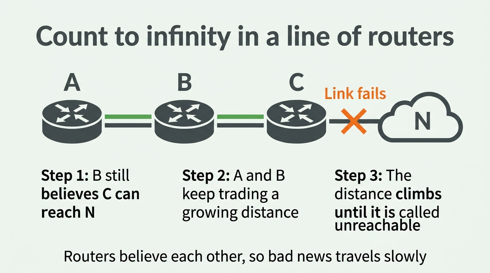
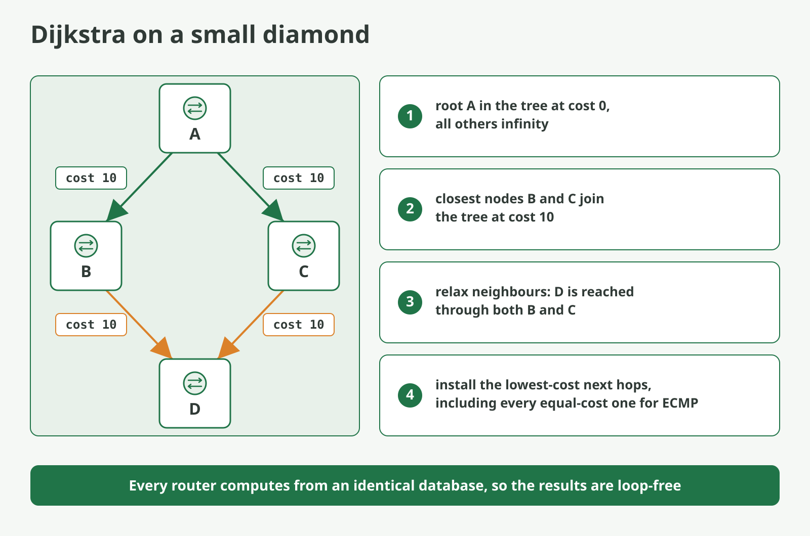
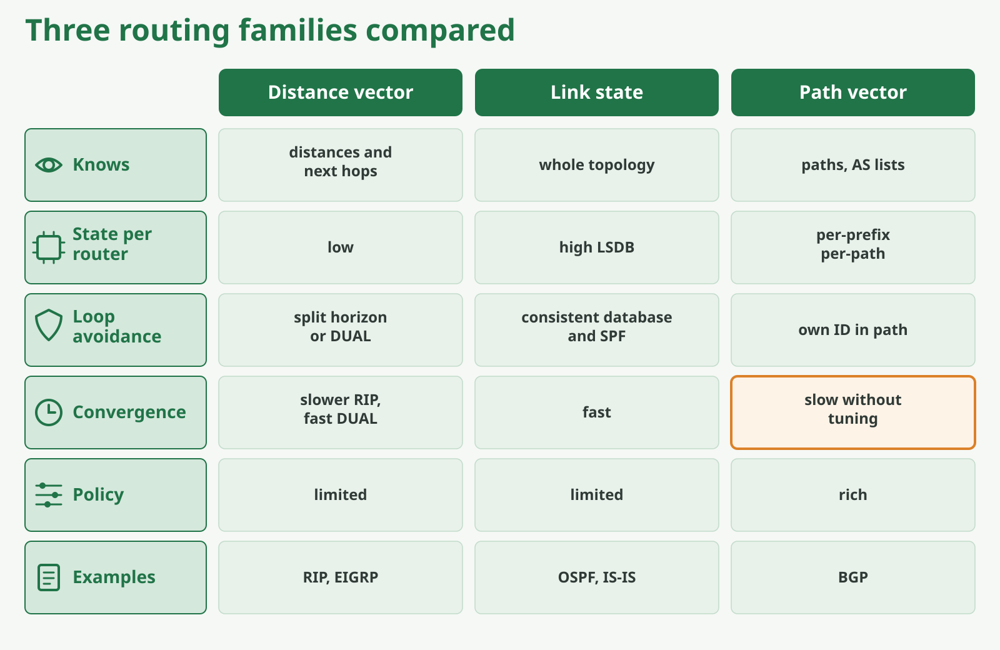
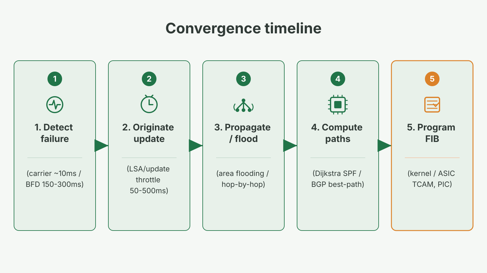
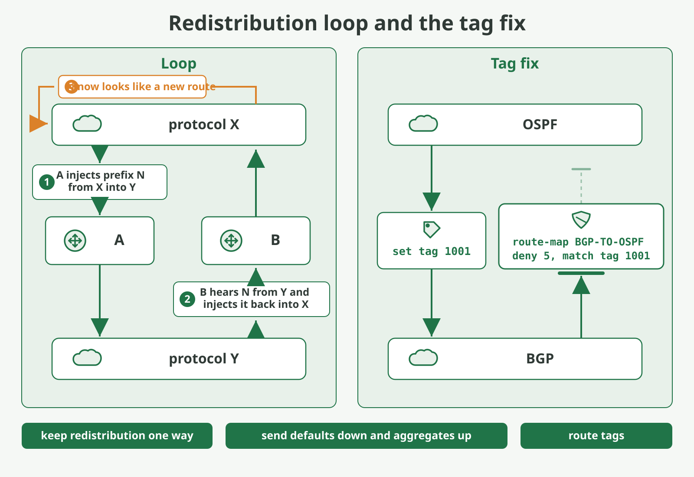

# 2.13 IP routing: static routes, dynamic routing and convergence

| | |
|---|---|
| Level | Intermediate |
| Priority tier | 0 |
| Lab venue | Linux VM with network namespaces and FRR (or containerlab) |
| Part | Part 2: Networking, from first principles to AI fabrics |
| Status | Drafted, labs **untested** |

## Why this matters for AI infrastructure

Picture a leaf-spine data centre where a link fails in the middle of a large training run. A cable is pulled, an optic dies, or a switch reboots. How fast the routers send traffic another way decides how much work is lost. Every large AI fabric is routed. Leaf-spine data centres run BGP or OSPF between switches, and increasingly between switches and hosts. Because every link stays active under ECMP, a failure is absorbed in milliseconds. Spanning tree, the older approach, needs tens of seconds.

To operate, design or debug such a fabric, you need to answer four questions. How do routers learn where things are, and how do they avoid forwarding loops? How do they notice failures, and how quickly do they converge? What happens when two routing systems are joined, which is called redistribution? And which behaviour belongs to one protocol, while which is fundamental to all of them? Almost every confusing routing incident comes back to one of these four.

Think of this as the chapter that explains routing before any particular protocol enters the room. The story starts with the simplest approach, a person writing routes by hand, and shows where that approach breaks. From there it asks what a routing system must do for itself, which is learn the topology, learn what is reachable, tell others, compute loop-free paths, install them and react to change. Loop freedom turns out to be the hard part, and three families of algorithm, distance vector, link state and path vector, each solve it differently. Failures raise further questions: how a router notices one, by polling, by events or with BFD, how the news spreads, and how a backup path can be ready before it is needed, with loop-free alternates and disjoint paths. The practical decisions come last, namely static versus dynamic, administrative distance and redistribution. The protocol chapters build on this one. OSPF and IS-IS come in 2.14, and BGP in 2.15 and 2.16.

## Prerequisites and outcomes

Before you start, you should know host routing and longest-prefix match, which are covered in 2.5. You should also know neighbour discovery and the difference between the control plane and the data plane, which are covered in 2.11. Any other term is explained where it first appears.

Use this list as a self-check when you finish. Each line is something you should now be able to do.

- Decide between static and dynamic routing, and configure static routes, floating static routes and default routes on Linux and in FRR.
- Explain the control plane's job: learning the topology and the reachable destinations, computing loop-free paths, installing forwarding state and reacting to change.
- Contrast reactive and proactive reachability learning, and the ways reachability is advertised: flooding, hop by hop, or through a centralised store.
- Explain distance-vector (Bellman-Ford) routing, count-to-infinity, split horizon, poison reverse and DUAL's feasibility condition.
- Explain link-state routing, Dijkstra's algorithm, partial and incremental SPF, and areas and hierarchy.
- Explain path-vector routing, and why BGP uses it.
- Explain loop-free paths: trees, loop-free alternates, remote LFAs, P/Q space, disjoint paths, Suurballe's algorithm and maximally redundant trees.
- Explain how topology changes are detected (by polling, by events and with BFD) and distributed (by flooding, hop by hop or through a central store), along with the consistency trade-offs.
- Explain route redistribution, including metric translation, routing loops, tags, filters and administrative distance.
- Reason about convergence time, and tune it.

## 1. Static versus dynamic routing

Suppose a small branch site has one uplink and a few hosts. Someone has to tell its router where to send traffic for everything else. Static routes are the simplest answer. You configure each route by hand, or your automation does it for you: `ip route add 10.30.0.0/16 via 10.20.0.254`. It is like writing down directions for a driver once and never updating them.

A static route is simple and deterministic. It uses no CPU or bandwidth, and there is nothing to go wrong in a conversation between routers. It suits stub networks, such as a leaf with one uplink or a default route out of a site. It also suits management networks and pinning specific flows.

Static routes have one serious weakness: they never react. If the next hop fails, the route stays installed, and traffic disappears into a blackhole. The driver keeps following directions to a bridge that has fallen into the river. Static routes also do not scale well. The number of touch points grows as O(n^2) for n networks, so the manual work grows quickly. Errors are often found only when an outage happens. You can soften this. A static route tracked by BFD or IP SLA is withdrawn when its next hop becomes unreachable. A floating static route, with a higher administrative distance or metric, serves as a backup. Automation can also generate and verify the configuration.

A concrete failure makes the point. A leaf has a static default route toward its one uplink. The uplink switch loses power. The leaf still holds the route and still sends every packet to the dead next hop, so everything leaving the rack is silently discarded. With a tracked route or a floating backup on a second uplink, the leaf would notice and switch within moments.

Dynamic routing takes a different approach. A routing protocol lets routers exchange reachability and adapt when something fails. It is like drivers who radio each other about road closures. Inside one administrative domain, routers use an IGP (interior gateway protocol) such as RIP, OSPF, IS-IS or EIGRP. Between domains, BGP is the EGP (exterior gateway protocol). With eBGP, it also runs inside modern data centres. Dynamic routing scales, converges after a failure, and supports ECMP and policy. It also brings protocol complexity, convergence behaviour you must understand, and an attack surface. You should authenticate sessions and filter routes.

Sometimes several sources offer a route to the same prefix. A router may hear about one destination from a static line, from OSPF and from BGP at the same moment, so it needs a rule for whom to believe. Administrative distance (AD) decides which source wins. The router compares AD first and looks at metrics only afterwards, because metrics from different protocols cannot be compared directly. A cost of 20 in one protocol and a cost of 20 in another mean entirely different things. Defaults vary by vendor. Cisco-style systems use the values in this table.

| Source | Typical AD |
|---|---|
| Connected | 0 |
| Static | 1 |
| eBGP | 20 |
| EIGRP | 90 |
| OSPF | 110 |
| IS-IS | 115 |
| RIP | 120 |
| iBGP | 200 |

Linux and FRR use the `proto` and `metric` fields for a similar role. FRR's zebra applies distance values when several daemons offer the same prefix. A floating static route has an AD of 200 or more, so it appears only after the dynamic route disappears.

```bash
# Linux static and floating static
ip route add 10.30.0.0/16 via 10.20.0.254 metric 100
ip route add 10.30.0.0/16 via 10.20.0.253 metric 200       # backup (only used when the first is gone)
# FRR (zebra) static route and a floating backup, with BFD tracking
vtysh -c 'conf t' -c 'ip route 10.30.0.0/16 10.20.0.254 bfd' -c 'ip route 10.30.0.0/16 10.20.0.253 200'
```

The first two lines add a primary route and a backup with a higher metric. The last line sets up the same pair in FRR, with BFD tracking on the primary. Decide for each route whether a silent blackhole is acceptable. If it is not, add tracking or a floating backup. A routing protocol is only as good as its answers to a few basic questions, and sections 2 to 7 take them in turn.

## 2. What a control plane does

A router does two jobs that look similar but are separate. The data plane forwards packets using tables, which is the fast, simple job. The control plane builds those tables, which is the slow, thoughtful job. The control plane has six jobs, and they repeat for as long as the network is up.

1. Learn the topology, which means finding its neighbours and the links to them. Chapter 2.11 covers neighbour detection and two-way connectivity in detail.
2. Learn the reachable destinations: which hosts, prefixes and services sit where.
3. Advertise that information to other nodes, reliably, so that everyone's view converges.
4. Compute loop-free paths, and optionally several paths and backups.
5. Install the results as forwarding state.
6. React to change by detecting it, distributing it, recomputing and reinstalling.

When you read the protocol sections, check which of these six jobs each protocol handles.

### Learning reachable destinations

Reactive learning waits until a router lacks a path, and then it asks. It is like looking up a phone number only when you need to call. ARP and neighbour discovery (ND) ask who owns an address. In LISP-style or SDN designs, the router can query a central controller that already knows about every attached host. Source-routing explorer packets work in a similar way. A probe floods out and records its path, and the destination or source then uses that recorded path as a source route. Reactive systems keep little state. They add latency to the first packet, though, and they make the lookup service critical.

Proactive learning does the opposite. Reachability is distributed as soon as it is known, so every node has what it needs before traffic arrives. It is like printing a phone book and handing a copy to everyone. Almost everything in this chapter works this way. The hard part, and the one you should watch most closely, is reliable, consistent distribution, because one dropped update can create a permanent loop or blackhole.

Many real designs mix the two, using each where it fits. The infrastructure runs proactively, while hosts are often learned reactively. EVPN, for example, advertises MAC and IP bindings once they are learned, and ARP stays reactive on the local segment.

### Distribution models

Three models describe how reachability spreads through the network. They differ in who tells whom. The table lists each one with examples.

| Model | How information spreads | Examples |
|---|---|---|
| **Flooding** | Each node forwards new information to all neighbours except the source, with sequence numbers to stop duplicates | OSPF LSAs, IS-IS LSPs |
| **Hop by hop** | Each node computes its own best result, then tells neighbours only that result (summary of what it uses) | RIP, EIGRP, BGP |
| **Centralised store** | Nodes publish to and read from a database or controller that everyone reaches | SDN controllers, etcd/Kubernetes API, route reflectors (partly), LISP map servers |

Flooding gives every node the full picture, at the cost of processing every change. It is a town crier who tells everyone every piece of news. Hop by hop is lighter, because each node shares only its best result, like a neighbour who tells you only the route that works for them. A central store gives everyone one place to look, but the whole network then depends on that store. When you design a fabric, decide which model will carry its reachability information.

## 3. Loop-free paths: trees, shortest paths and the algorithms

Picture two routers that briefly disagree about the topology. Router A believes the best path to X runs through B. Router B has not yet updated, so it believes the best path runs through A. Packets bounce between them until one of the routers catches up. Two people each telling a visitor "ask the other one" will send the visitor back and forth the same way.

A path is loop-free if no packet can visit the same node twice. The simplest loop-free structure is a tree. In a spanning tree, the network is pruned so that exactly one path joins any two nodes. The cost is that redundant links sit unused. Routing algorithms take a different approach. They compute a shortest-path tree rooted at each destination, or at each source, over the full graph. That gives loop-free forwarding, and every link can serve some destination.

The disagreement in the opening example is what causes loops. Each algorithm family avoids or limits that disagreement in its own way.

### Distance vector (Bellman-Ford)

Each router knows its directly attached destinations. It tells its neighbours its distance, or metric, to every destination, rather like asking for directions and being told "it is five miles from here". For each destination, a router picks the neighbour that offers the lowest total. That total is the neighbour's advertised distance plus the cost of the link to that neighbour. The router then advertises its own resulting distances. Information moves hop by hop, and routers know only distances and next hops, not the whole topology. The benefits are simplicity, low state and low CPU use. The drawbacks are slow convergence and count to infinity after a failure.

Count to infinity is easiest to follow in a line of routers, so follow it step by step. Take A, B and C in a row, with network N attached to C. B learns N at distance 1 from C, and A learns N at distance 2 through B. Now C's link to N fails, and C removes N. Before that withdrawal reaches B, B hears from A that N is at distance 2. That route actually came from B itself. So B concludes that N is reachable through A at distance 3, and A updates its own entry to 4 through B. The two routers keep raising the metric one step at a time, until it reaches the protocol's infinity. In RIP, that value is 16. Packets loop between A and B the whole time. Each router believes the other, and neither can see that the original source is gone.



*Figure 2.13.1. Routers keep trusting each other's old distance after a link fails.*

Several remedies exist, and as you will see, each has limits. Split horizon means a router never advertises a route back out the interface it learned it from. It is the rule "do not tell me what I just told you". Poison reverse goes further and advertises the route back with an infinite metric. Both stop two-node loops, but neither stops longer loops. Triggered updates, hold-down timers and a small maximum diameter are blunt tools. A hold-down timer makes a router ignore worse information for a while after a withdrawal. RIP's maximum diameter is 15 hops.

DUAL, the Diffusing Update Algorithm from Garcia-Luna-Aceves, keeps the low state of distance vector. It also guarantees loop freedom at every instant. Each router tracks two values for each destination. The feasible distance (FD) is the best metric the router has itself. The reported distance (RD) is the metric a neighbour reports for that destination. A neighbour becomes a feasible successor, a safe backup, when its RD is less than the router's FD. Such a neighbour is strictly closer to the destination, so its path cannot run back through this router. If the successor fails and a feasible successor exists, the router switches to it at once. That switch is a local calculation, so it creates no loop. If no feasible successor exists, the router goes active. It sends queries to its neighbours in a diffusing computation, waits for replies, and only then picks a new path. This is why EIGRP converges in milliseconds when a feasible successor exists. It can get stuck in active if the replies never return.

Today RIP is obsolete, but it remains a clear teaching case, because its weaknesses are the weaknesses of the whole family. EIGRP, a Cisco protocol open since 2013, is still in use. The distance-vector mechanics also appear inside BGP's best-path selection.

### Link state (Dijkstra)



*Figure 2.13.2. Each router runs Dijkstra on the same database and keeps every equal-cost next hop.*

In a link-state protocol, each router describes its own links in a link-state advertisement (LSA). That advertisement lists its neighbours and their costs. The router floods it to every router in the area. Every router then holds the same link-state database (LSDB), which describes the whole topology. In effect, everyone ends up holding the same map of the network. Each router runs Dijkstra's shortest path first (SPF) algorithm on its own copy, with itself as the root. The steps are these.

1. The root starts in the tree at cost 0, and every other node starts at infinity.
2. The router takes the closest node not yet in the tree, using a priority queue, and adds it. It then relaxes that node's neighbours. If the cost to the root plus the link cost to a neighbour is lower than the neighbour's current cost, the router updates it and records the first hop.
3. At the end, each destination has a cost and a next hop. The router installs the lowest-cost next hops, including every equal-cost one for ECMP.

Try the steps on a small diamond. The root is A, and the links A–B, A–C, B–D and C–D each cost 10. A starts at cost 0. The closest nodes are B and C, each at cost 10, and they join the tree. Relaxing their neighbours gives D a cost of 20 through B and also a cost of 20 through C. Because both costs are equal, both first hops are kept, and A installs two equal-cost next hops for D. That is how the same algorithm that finds the shortest path also finds the ECMP paths.

Because every router computes from an identical database, the results agree and are loop-free once the databases are synchronised. If you run the algorithm by hand on that database, you reach the same answer as every other router. While a change is still flooding, though, routers can briefly disagree. That causes micro-loops, which section 5 covers. Link state converges fast. Flooding plus SPF takes tens to hundreds of milliseconds. Routers also know the whole topology, which supports traffic engineering, fast-reroute calculation and tools such as LFA. The price is higher memory and CPU use. Large networks therefore need hierarchy, in the form of areas or levels, to bound the size of the LSDB and the scope of flooding.

Several optimisations keep the cost down. Partial SPF skips recomputing the tree when only a leaf prefix changes. Incremental SPF updates only the part of the tree that a link change affects. SPF throttling and backoff timers avoid churn, and LSA and LSP pacing spreads out the flooding. OSPF and IS-IS are link-state protocols, covered in chapter 2.14. Data-centre variants such as OpenFabric and RIFT adapt flooding to Clos fabrics.

### Path vector

A path-vector protocol advertises, for each destination, the sequence of domains (AS numbers) that the route has crossed. It does not advertise just a metric. It is like a postcard that collects a stamp from each country it passes through. A router rejects any advertisement whose path already contains its own identifier, so loops are impossible by construction. Policy is easy, because you can prefer or reject paths through particular ASes. The path also gives a readable record of how the route got there. The cost is slow convergence on failure. Routers try successively longer alternatives, which is called path exploration, and each route needs more state.

This family is BGP, covered in chapters 2.15 and 2.16. In data-centre eBGP, the same ASN-per-tier plans appear, with `allowas-in` or per-rack ASNs. The loop-prevention logic still shapes the design.

### Comparing families



*Figure 2.13.3. Each routing family trades state, convergence speed and policy richness differently.*

The table puts the three families side by side. Read down each column to see what a family trades away to gain its strength.

| | Distance vector | Link state | Path vector |
|---|---|---|---|
| Knows | Distances and next hops | Whole topology | Paths (AS lists) |
| State per router | Low | High (LSDB) | Per-prefix per-path |
| Loop avoidance | Split horizon / DUAL | Consistent database; SPF | Own ID in path |
| Convergence | Slower (RIP) / fast (DUAL) | Fast | Slow without tuning |
| Policy | Limited | Limited | Rich |
| Examples | RIP, EIGRP | OSPF, IS-IS | BGP |

Distance vector keeps state low, and its speed depends on the variant. Link state knows the whole topology and converges fast, at a higher memory cost. Path vector offers the richest policy, but it converges slowly unless you tune it. Decide which of these guarantees your fabric needs before you choose a family.

## 4. Alternate paths and fast reroute

A failure does not fix itself at once. The network must detect it, advertise it, recompute the paths and update the forwarding table. Packets are lost during that window. Fast reroute shrinks the window. Routers precompute backup next hops locally, so they can switch the moment the primary fails, like a driver who already knows the detour before the road is closed. The goal is repair in under 50 ms.

A loop-free alternate (LFA) is a backup next hop that cannot loop back to you. For a destination D, a neighbour N is a safe backup if N's own shortest path to D does not go back through you. The test is this loop-free condition:

*dist(N,D) < dist(N,me) + dist(me,D)*

It is the same idea as DUAL's feasibility condition, but it is computed from the link-state database. LFA is simple, yet its coverage depends on the topology. Some rings and triangles get full coverage. A simple ring of equal links gets none.

A small numeric case shows the test. Say the distance from you to D is 10, the distance from you to your neighbour N is 5, and N's own distance to D is 8. The test asks whether 8 is less than 5 plus 10, which is true, so N can safely carry your traffic. Change N's distance to D to 12 and the test fails, because N's best path to D probably goes back through you. In a symmetric ring, with the numbers 10, 10 and 20, the inequality is not met either, which is why a simple ring has no loop-free alternate.

The waterfall model, which some people call the continental divide model, shows coverage as a picture. Imagine the shortest-path tree toward D as water flowing downhill to D. A neighbour is a loop-free alternate only when it sits on the far side of the ridge, so its water reaches D without passing through you.

Now take a failed link. P-space is the set of nodes you can still reach by shortest paths that avoid the failed link. Q-space is the set of nodes that can reach the destination side without using that link. If a node sits in both sets, a packet can be tunnelled to it. This is a remote LFA (rLFA). From that node, the packet continues normally to D, so the tunnel jumps over the unsafe region. The tunnel can use MPLS with LDP, or SR. Extending the idea to guarantee 100% coverage gives TI-LFA, or topology-independent LFA. It uses the post-convergence path with segment-routing label stacks.

Protection and load sharing sometimes need two paths that share no link or node. The naive method takes the shortest path, removes its links and looks again. That can fail even when a disjoint pair exists, because the shortest path can form a trap. Suurballe's algorithm finds the pair of link-disjoint paths with the lowest total cost, in a two-connected network. It computes the shortest-path tree, reweights the edges, removes the path edges that reverse direction, runs again and combines the results. Maximally redundant trees (MRT) take another approach. They compute two spanning trees, so that after any single failure at least one tree still reaches every node. That gives a topology-independent fast-reroute scheme. A two-connected network is one where no single link or node failure disconnects any node. That is the design goal for fabrics.

ECMP can act as protection too. In Clos fabrics with many equal-cost paths, fast reroute can be as simple as removing a failed next hop from the ECMP group. Forwarding hardware does this quickly, and no special algorithm is needed. The cost is that the failed hop's traffic shifts onto the others. Resilient hashing limits how many flows get reshuffled, as chapter 2.12 explains.

Before you rely on LFA, check its coverage on your own topology.

## 5. Detecting and reacting to topology changes

Reacting to a failure takes three stages, like a fire brigade that has to hear the alarm, call the crews and then arrive. The router first detects the change. Then it distributes news of the change. Finally, it recomputes the paths and installs them. Detection comes first, and its speed sets the floor for everything that follows.

### Detection

Polling uses periodic hellos. Neighbours exchange hellos on a timer, and a failure is declared after several go unanswered in a row. It is the "still there?" check. OSPF defaults to a 10 s hello and a 40 s dead timer. BGP defaults to a 60 s keepalive and a 180 s hold time. Data centres tune these down to seconds or even sub-second values. Detection time is therefore bounded below by the interval times N, and shorter intervals raise CPU load.

Event-driven detection works differently. The hardware or a lower layer reports the failure directly, like a smoke alarm that does not wait for someone to smell burning. Examples are loss of light, an interface-down interrupt, Ethernet OAM and SONET alarms. This is fast, taking microseconds to milliseconds. It sees only the local link, though. It misses failures that do not drop the carrier, such as a remote switch that has crashed, a stuck forwarding plane, a misconfiguration, a one-way fibre fault, or a failure behind a transparent optical or L2 device. Physical flaps also need dampening, so that a flapping link does not churn the whole network.

Event-driven detection is faster but less complete. Polling works everywhere, but it is slower. Most designs use both, with BFD as the fast, general-purpose poll.

Bidirectional Forwarding Detection (BFD, RFC 5880) is a lightweight hello protocol that is independent of any routing protocol. It exists to make the "still there?" check fast and cheap. It sends packets every 50 to 300 ms, and hardware such as line cards or ASICs often handles them. It runs over UDP, on port 3784 for single hop and port 4784 for multihop. BFD detects a failure in the forwarding path between two endpoints in under a second. It then reports to its clients, such as OSPF, IS-IS, BGP, static routes and LAGs. Those clients tear down the adjacency at once, which triggers reconvergence.

BFD runs in asynchronous mode, with continuous packets, and it can add an optional echo mode. A session must be verified in both directions. The packets carry what the sender sees, which is the two-way check from chapter 2.11. Aggressive timers and many sessions load the control CPUs. If congestion drops BFD packets, the link can flap and cause outages, so prioritise BFD in QoS.

```bash
# FRR example: BFD with BGP and OSPF
router bgp 65101
 neighbor 10.0.0.1 remote-as 65000
 neighbor 10.0.0.1 bfd
interface eth0
 ip ospf bfd
bfd
 peer 10.0.0.1
  receive-interval 100
  transmit-interval 100
  detect-multiplier 3
vtysh -c 'show bfd peers'
```

The configuration turns on BFD for a BGP neighbour and an OSPF interface. You can use the last line to check the state of the BFD peers.

### Distributing change

Whichever model spreads the change, the same design questions come up. Reliability means retransmitting until the change is acknowledged. Ordering and staleness are handled with sequence numbers and timestamps. Scope decides how far the news travels, for example only within the area or level. Rate matters too, so throttling and batching prevent storms. Think of how a rumour must reach everyone once, in the right order, without causing a stampede.

Flooding is robust and fast, but every node processes every change. A flapping link in a huge flat domain uses everyone's CPU, which is why hierarchy and flooding reduction exist. Hop by hop limits scope, because a node tells its neighbours only about its best path. The price is path exploration. A centralised store gives one consistent view and simple logic. Its failure or partition is a global problem, though, and every node needs a reliable path to it. That is a bootstrapping problem.

A routing system is a distributed database, so it faces a CAP-like trade-off. That means that when the network splits, you cannot have both perfect consistency and perfect availability. During a partition, you can keep forwarding with possibly stale data. That keeps the network available but inconsistent, and it risks loops and blackholes. Or you can stop forwarding until the data is consistent. Link-state IGPs favour availability with eventual consistency, and they rely on short convergence windows. Centralised controllers favour consistency, and they need redundancy. Clustered controllers, or a fallback to local routing when the controller is unreachable, supply that redundancy. Design for that fallback, keep control traffic prioritised, and test partitions.

### Convergence timeline

The diagram shows the five stages a failure passes through before traffic moves to a new path. Each stage adds delay, so the total is the sum of all five.



*Figure 2.13.4. Convergence timeline, as a diagram.*

Restoring forwarding after a link failure adds up the stages. It is detection, plus origination (hold-down or throttle), plus propagation or flooding, plus computation, plus FIB installation. For BGP, add advertisement timers (MRAI) and best-path recomputation. FIB installation can be the largest term at scale. The typical ranges are in this table.

| Stage | Typical range |
|---|---|
| Carrier detection | about 10 ms |
| BFD detection | 150 to 900 ms |
| LSA throttle | 50 to 500 ms |
| SPF computation | 10 to 100 ms |
| FIB programming | tens of ms to seconds for large tables |

You have several knobs to turn. Faster detection comes from BFD, and event-driven detection can be set with `carrier-delay 0`. SPF and LSA throttle timers control the pace of recomputation. Prefix-independent convergence (PIC) uses a hierarchical FIB, so one change updates thousands of prefixes at once. Graceful restart, or NSF, hides control-plane restarts. ECMP with fast reroute gives sub-50 ms local repair.

**Micro-loops** are a short-lived problem during convergence. While the network converges, routers near the failure may update before routers far from it. They can then briefly forward packets back and forth. It is the traffic version of two people stepping aside to the same side in a corridor. Ordered FIB updates, which update far routers first, help. So do local micro-loop avoidance, which delays the update after the SPF, and segment-routing based post-convergence protection. In ECMP Clos fabrics, micro-loops are rare, because paths are symmetrical shortest paths. Check that assumption against your own topology before you rely on it.

## 6. Redistribution between control planes

Sometimes one protocol has to learn routes from another. Two routing languages have to be translated, and a translation can lose or distort meaning. You might merge two organisations' networks, run different protocols in different business units, or migrate from one IGP to another. You might also inject static or connected routes, or BGP-learned prefixes into an IGP. Redistribution, which is also called import and export, takes routes from protocol X's table and originates them into protocol Y. Two problems come with it: metrics and loops.

### Metrics

Each protocol defines its own metric, and the numbers do not mean the same thing. Protocol X might use 1000 divided by the speed in Gb, so a 10G link costs 100 and a 100G link costs 10. Protocol Y might use a hand-built table, where 10G costs 20 and 100G costs 10. Adding or comparing those values is meaningless. You have three ways to handle the mismatch.

1. Set a seed metric at the redistribution point. The administrator assigns one value, such as 5, to everything that comes from X, and it is carried as an ordinary metric in Y. This is simple, but it ignores which exit is best for the external destination.
2. Accept the source protocol's metric as the new metric. That works only when the ranges are compatible, because a metric above Y's maximum is unusable.
3. Carry the external metric in a separate field. OSPF external type 2 (E2) or type 1 (E1), EIGRP external routes, and BGP MED or local-pref all do this. Each router can then weigh both the internal cost to the exit point and the external cost. The price is more state, but the payoff is better steering. The router must still choose an exit. Nearest exit, called hot-potato routing, minimises use of your own network. The exit with the lowest external metric, called cold-potato routing, minimises use of the external network.

### Loops



*Figure 2.13.5. A route injected from one protocol into another can come back, and a route tag marks it so it is blocked on the way back.*

Loops appear when routes flow back and forth between protocols. Suppose router A injects a prefix N from X into Y. Router B then hears N from Y and injects it back into X. Now N looks like a new route, with a different metric. If administrative distance or metric makes that copy look better than the original, A prefers it. The result is a routing loop or a poor path. The route has gone round in a circle and come back looking like a stranger.

The fix starts with keeping redistribution one way wherever you can. Send default routes down and aggregates up, and use summaries and defaults instead of full redistribution. Route tags are the next tool. Tag a route when it enters a protocol, then filter out anything carrying that tag when it is redistributed back. In FRR, you do this with `route-map`, `prefix-list` or tag matching. Prefix filters let you permit only the prefixes you intend to exchange. Administrative distance can also be adjusted, so the original source always wins. Keep a single redistribution point, or a controlled pair, and document it. Finally, design external routes to rank below internal ones. OSPF's rule does this, because E routes lose to intra-area routes.

The following sketch shows one-way redistribution from OSPF into BGP, with a tag that stops the route from returning. The tag works like a stamp that says "this route already came from here".

```text
! FRR sketch: one-way redistribution from OSPF into BGP with tags and a prefix filter
route-map OSPF-TO-BGP permit 10
 match ip address prefix-list ALLOWED-SERVICES
 set tag 1001
route-map OSPF-TO-BGP deny 20
router bgp 65101
 address-family ipv4 unicast
  redistribute ospf route-map OSPF-TO-BGP
route-map BGP-TO-OSPF deny 5
 match tag 1001
route-map BGP-TO-OSPF permit 10
 match ip address prefix-list FROM-BGP
```

The `BGP-TO-OSPF` route-map denies anything carrying tag 1001, so a route that came from OSPF cannot go back. In AI data centres, redistribution is usually limited to connected, loopback and host routes into BGP, using `redistribute connected` with a route-map. Border routers often supply static defaults. Kubernetes networking such as Calico, Cilium or MetalLB sometimes joins too. These tools speak BGP to the fabric and advertise pod CIDRs and service VIPs. Keep redistribution as narrow as your design allows, because each extra direction adds a chance of a loop.

## 7. Choosing a protocol (preview)

Your environment decides which protocol fits. There is no single best protocol, only a best fit. The table gives a typical choice for each kind of network, along with the reason for it.

| Environment | Typical choice | Reason |
|---|---|---|
| Small site, few routers | Static routes + a default | Simplicity |
| Enterprise campus / medium DC | OSPF (single or multi-area) or IS-IS | Fast, topology-aware, standard |
| Service provider backbone | IS-IS or OSPF + BGP (+ MPLS/SR) | Scale, TE |
| Large data-centre fabric | eBGP (each leaf/rack its own ASN or one ASN per tier) or OSPF/IS-IS underlay + BGP overlay | Simplicity of one protocol, policy, ECMP, scale of BGP (RFC 7938) |
| Between organisations | BGP | Policy, path vector |
| Server/pod prefix advertisement | BGP to the host (FRR, BIRD, Calico, Cilium) | No L2 stretch, ECMP to hosts |

Use the table as a starting point. Match your network to a row, then check the reason in that row against your own constraints before you commit.

## 8. Hands-on: routing on Linux with FRR

Suppose you want a Linux host, or a container, to act as a router in your lab. FRR, which stands for Free Range Routing, does that job. Its daemons are `zebra`, `ospfd`, `bgpd`, `isisd` and `bfdd`. FRR is the standard for labs, and for Cumulus and SONiC class switches. Install it from the FRR packages, enable the daemons you need in `/etc/frr/daemons`, and work with them through `vtysh`.

```bash
sudo apt install frr frr-pythontools ; sudo sed -i 's/^ospfd=no/ospfd=yes/;s/^bgpd=no/bgpd=yes/;s/^bfdd=no/bfdd=yes/' /etc/frr/daemons ; sudo systemctl restart frr
sudo vtysh
  show ip route ; show ip route ospf ; show ip ospf neighbor ; show bgp summary ; show bfd peers
  conf t
   router ospf
    ospf router-id 10.255.0.1
    network 10.1.0.0/24 area 0
```

The first line installs FRR and switches on the OSPF, BGP and BFD daemons. The `vtysh` session then shows routes, neighbours and BFD peers, and it lets you configure OSPF.

Zebra installs the winning routes into the kernel FIB, tagged with the right `proto`, such as `proto ospf` or `proto bgp`. You can list the BGP routes with `ip route show proto bgp`. Netlink events, shown by `ip monitor route`, reveal convergence as it happens, which makes them a good way to measure it.

## 9. Hands-on lab: static routes, distance-vector failure, link state, and convergence

A word on status first. The Python lab below has been run, while the interactive VM commands after it have not been run for this chapter, so treat each one as unverified until you run it. Start with the self-checking Python lab, which runs on your own machine and needs no live network. Run `code/part02/ip_routing_convergence_lab.py` locally. It checks Administrative Distance (`AD`) selection, from `connected 0` up to `iBGP 200`. It checks DUAL's feasibility condition (`RD < FD`) against LFA's loop-free inequality (`dist(N,D) < dist(N,S) + dist(S,D)`). It runs Dijkstra's SPF algorithm with ECMP on a 4-node diamond, and it verifies the 5-stage convergence timeline.

```bash
python3 code/part02/ip_routing_convergence_lab.py
```

Next, you move to a disposable Linux VM with a four-router ring or diamond built from network namespaces, running FRR. Work through these steps in order.

1. Configure static routes to reach every loopback. Break a link and show the blackhole. Then add a floating route and BFD tracking, and measure the recovery.
2. Run a RIP-like daemon (FRR `ripd`) on a line topology. Fail the edge network and watch count-to-infinity with `ip route` polling and `ping`. Enable split horizon or poison reverse and compare the results. Then shorten the timers.
3. Run OSPF (FRR) in the diamond. Examine `show ip ospf database`, and flood a change by bringing a link down, then watch the LSA update. Compute the SPF tree by hand for one router, and compare it with `show ip route`. Observe the ECMP equal-cost paths.
4. Attach BFD to OSPF. Send a continuous ping at a 10 ms interval, and measure failover once when you `tc netem loss 100%` a link and once when you `ip link set down` it. Compare the results with the default 40 s dead timers.
5. Enable `fast-reroute lfa` if your FRR version supports it. If not, reason on paper. In a triangle topology, compute the LFA candidates with the loop-free condition, then show the ring case that has none.
6. Run OSPF in one half of the network, and RIP or a second OSPF instance in the other. Redistribute in both directions at two routers, with no filters, and produce a loop. Watch for TTL expiry in `tcpdump`. Then fix the loop with tags and filters.
7. Script a loop with `ip monitor route | ts` and a timestamped ping. Record detection, convergence and packet loss for each configuration, and put the results in a table.
8. Clean up.

## 10. Common mistakes

Most routing failures come from a handful of habits. Static routes without health tracking blackhole traffic after a next-hop failure, and they often lack a documented owner. Two-way redistribution at several points, without tags and filters, invites loops. Comparing metrics across protocols, or forgetting administrative distance, picks the wrong winner. Aggressive BFD timers everywhere can cause flaps under load if the control plane is not protected. Treating "converged" as "FIB programmed" ignores hardware programming time, which is part of convergence. Large flat link-state domains with unstable links need throttling. Treating LFA as a guarantee, without checking its coverage, is another trap. Finally, default hello and dead timers in latency-critical fabrics leave detection slow. Check your design against each of these before you go live.

## 11. Interview angles

If you are preparing for an interview, these questions test whether you can reason about routing, not just recite it. Picture a small network failing and describe what each router knows at each moment.

- Static versus dynamic routing: when would you choose each?
- Distance vector vs link state vs path vector: how does each avoid loops?
- What is count to infinity and how is it mitigated? What does DUAL's feasibility condition guarantee?
- Explain Dijkstra's algorithm in the context of OSPF; what is partial SPF?
- What is a loop-free alternate; when does a ring have none?
- How does BFD speed up convergence? What are the risks?
- What problems arise when redistributing between protocols and how do you prevent them?
- Break down convergence time after a link failure.

## Exercises

Work through these to check that you can trace and write the ideas, not just recall them. Where you can, check your answers against the lab script in section 9. Draw the small networks on paper, because most of the exercises become simple once you can see the nodes and links.

1. Start with static versus dynamic routing, administrative distance (`AD`) and floating static routes. First, explain when static routing is the better choice. Then explain how BFD tracking and floating static routes overcome the blackhole failure mode of static routing. Second, list the default Cisco and FRR administrative distance values for connected, static, eBGP, EIGRP, OSPF, IS-IS, RIP and iBGP. You will find them in `DEFAULT_ADMIN_DISTANCE`, in `code/part02/ip_routing_convergence.py`. Finally, explain why `AD` is evaluated before protocol metrics.

2. Take distance-vector (Bellman-Ford) routing, count-to-infinity, split horizon and DUAL's feasibility condition in turn. First, trace the count-to-infinity loop on the three-router line `A — B — C — N` when the link C–N fails. Then explain why split horizon and poison reverse stop two-node loops but not three-node loops. Second, state DUAL's feasibility condition, `RD < FD`. Explain what a router does when it has a feasible successor, and what it does when it must go Active.

3. Work through link-state routing. First, trace `run_dijkstra_spf()` from root `A` on a four-node diamond with the links `A–B=10`, `A–C=10`, `B–D=10` and `C–D=10`. Find the shortest cost to `D`, and the ECMP first hops that reach it. Second, distinguish a full SPF, an incremental SPF (`iSPF`) and a partial SPF (PRC). Then contrast link-state loop avoidance with path-vector loop avoidance in BGP.

4. Work through fast reroute. First, use `check_dual_and_lfa_conditions()` to evaluate whether neighbour `N` is a valid DUAL feasible successor, a valid loop-free alternate, or both. Test three cases: `dist(S,D)=10, dist(S,N)=5, dist(N,D)=8`, then the same case with `dist(N,D)=12`, then a symmetric ring with `(10, 10, 20)`. Second, explain P/Q space, remote LFA (rLFA), TI-LFA and Suurballe's algorithm for link-disjoint paths.

5. Work through failure detection and convergence. First, compare event-driven carrier detection, at about 10 ms, with hello polling, where OSPF uses 10 s and 40 s and BGP uses 60 s and 180 s. Then compare both with BFD, which is defined in RFC 5880, uses UDP ports `3784` and `4784`, and runs at 50 to 300 ms. Second, use `compute_convergence_total_ms()` to sum the five stages of convergence: detection, origination, propagation, compute and `fib_install`. Explain how prefix-independent convergence (PIC) speeds up FIB updates, and define a transient micro-loop.

6. Work through route redistribution. Explain the three ways to handle incompatible metrics when redistributing from protocol X into protocol Y: a seed metric, direct translation, and a separate external metric. For the external metric, contrast E1 hot-potato routing with E2 cold-potato routing. Then write the FRR `route-map` logic that uses route tags (`tag 1001`) and prefix-lists to prevent a two-way redistribution routing loop.

## Checkpoint questions (20)

<details>
<summary>1. What is Administrative Distance (AD / route preference), and why do you need it before route metrics? What are the standard default AD values?</summary>

Protocols measure cost in units that cannot be compared. RIP counts hops, OSPF sums inverse bandwidth, and BGP uses path attributes. When several protocols offer a route to the same prefix length, the router uses Administrative Distance (AD) to pick the most trusted source. It makes that choice before it looks at metrics. The usual defaults are: connected 0, static 1, eBGP 20, EIGRP 90, OSPF 110, IS-IS 115, RIP 120 and iBGP 200.
</details>

<details>
<summary>2. What is a floating static route, and why should you pair static routes on production routers with BFD?</summary>

A floating static route is a backup. It carries an AD or metric higher than the primary route, for example 200, so it loses to OSPF's 110 and stays dormant. It takes effect only when the primary route is withdrawn. A plain static route stays in the FIB even when its next-hop router dies on a shared switch or VLAN. Pairing it with BFD, as in `ip route 10.30.0.0/16 10.20.0.254 bfd`, withdraws the static route as soon as the next hop stops answering BFD heartbeats.
</details>

<details>
<summary>3. Which six core jobs must you expect any routing control plane to do?</summary>

1. Discover the local topology, meaning neighbours and links.
2. Learn the reachable destinations, such as hosts, prefixes and services.
3. Advertise and distribute that reachability reliably across the network.
4. Compute loop-free paths, along with backups and ECMP.
5. Install forwarding state into the data-plane FIB.
6. React to topology changes by detecting them, flooding or updating, recomputing and reprogramming the FIB.
</details>

<details>
<summary>4. How would you make sure proactive routing databases stay synchronized and reliable (Computer Networking Problems and Solutions, chapter 11)?</summary>

They use three mechanisms. First, sequence numbers and explicit acknowledgements on update packets or LSAs. Dropped updates are retransmitted, and stale duplicates are ignored. Second, database description summaries, such as sequence-number ranges or hashes, are exchanged when an adjacency comes up and periodically after that. OSPF DBD packets and IS-IS CSNP and PSNP PDUs work this way, and the summaries reveal missing records. Third, keepalives and hellos let routes learned from a failed neighbour be invalidated when the hold timer expires.
</details>

<details>
<summary>5. If you had to choose, how would you compare the three reachability distribution models: Flooding, Hop-by-Hop, and Centralized Store?</summary>

- Flooding (OSPF LSAs, IS-IS LSPs) sends every raw link-state change to all neighbours in the area. It gives fast, identical topology databases, at a higher memory and CPU cost.
- Hop-by-hop (RIP, EIGRP, BGP) has each node compute its own best path first, then advertise only the resulting best distance or path. That hides internal topology and reduces state, but multi-hop path exploration is slower.
- A centralised store (SDN controllers, etcd or the Kubernetes API, InfiniBand opensm) has nodes report state to a central cluster and receive forwarding tables from it.
</details>

<details>
<summary>6. How would you explain the Bellman-Ford Distance-Vector algorithm, the "Count-to-Infinity" problem, and how Split Horizon and Poison Reverse help?</summary>

In Bellman-Ford (1955–1958), each router advertises its current distance to every destination to its immediate neighbours. Each neighbour selects the minimum of the advertised distance plus the link cost. Suppose destination N, behind C, fails in A — B — C — N. B can hear A's old route, which actually went through B. B then thinks N is still reachable through A at cost 2 + 1 = 3. A and B keep raising their costs back and forth. That is count to infinity, which runs until it hits RIP's 16. Split horizon never advertises a route back out the interface it was learned from. Poison reverse advertises it back with an infinite cost. Both stop two-router loops, but loops of three or more routers still need DUAL or path vectors.
</details>

<details>
<summary>7. If you run EIGRP, how does DUAL (Diffusing Update Algorithm) guarantee loop freedom at every instant?</summary>

For each destination, DUAL tracks the router's own best historical metric, called the Feasible Distance (FD). It also tracks each neighbour's advertised metric, called the Reported Distance (RD). A neighbour is a Feasible Successor, an immediately usable and loop-free backup, only if RD < FD. That neighbour is strictly closer to the destination than this router, so its path cannot loop back through this router. If the primary successor fails and no neighbour meets RD < FD, the router enters the Active state. It freezes the route and sends diffusing Query messages to its neighbours. It waits until every Reply confirms a loop-free path.
</details>

<details>
<summary>8. Walk through Dijkstra's Shortest-Path First (SPF) algorithm (1959) in link-state protocols (OSPF, IS-IS), so you can follow each step.</summary>

Start from the local router as the root, with cost 0. Give every other node a cost of infinity. Then repeat these steps.

1. Pop the unvisited node `u` with the smallest tentative distance from the priority queue, and add it to the shortest-path tree.
2. For each neighbour `v` of `u` with link cost `w`, check whether `dist[u] + w` is less than `dist[v]`. If it is, set `dist[v] = dist[u] + w` and set `first_hop[v] = first_hop[u]`. For ECMP, merge the first-hop sets when `dist[u] + w` equals `dist[v]`.
3. Stop when every reachable node is in the tree.
</details>

<details>
<summary>9. What difference would you notice between a Full SPF, an Incremental SPF (iSPF), and a Partial SPF (PRC)?</summary>

- Full SPF recomputes the entire shortest-path tree for all routers in the area.
- Incremental SPF (iSPF) handles a link metric change or failure by recomputing only the subtree below that link, not the whole graph.
- Partial SPF, or Partial Route Calculation (PRC), applies when a prefix attached to a router is added or removed, with no router-to-router link change. The tree has not changed, so the router updates only that prefix's FIB entry and does not rerun Dijkstra.
</details>

<details>
<summary>10. How does a path-vector protocol (BGP) prevent routing loops, and what would you see as "path exploration"?</summary>

Every BGP advertisement carries an `AS_PATH` attribute, which lists the exact sequence of autonomous system numbers (ASNs) the announcement has crossed. When a router receives an update, it checks whether its own ASN is already in `AS_PATH`. If it is, the router rejects the route at once, so steady-state routing loops are impossible. When a primary path fails, path exploration follows. Downstream routers try and then withdraw successively longer alternative AS paths before they settle.
</details>

<details>
<summary>11. Could you state the Loop-Free Alternate (LFA, RFC 5286) inequality and explain the "Waterfall" (Continental Divide) model (Computer Networking Problems and Solutions, chapter 12)?</summary>

For source router S and destination D, an alternate neighbour N is a loop-free alternate (LFA) if and only if:

*dist(N, D) < dist(N, S) + dist(S, D)*

That means N's shortest path to D does not go through S. In the waterfall model, imagine elevation equal to distance from D, so that packets flow downhill toward D. A continental divide, or ridge, separates the nodes whose water flows straight to D from the nodes whose water flows back through S. An LFA is any neighbour on the D side of that ridge.
</details>

<details>
<summary>12. Could you define P-space, Q-space, Remote LFA (rLFA, RFC 7490), and Topology-Independent LFA (TI-LFA)?</summary>

When link S–E fails, P-space is the set of routers that S can reach on shortest paths that do not cross S–E. Q-space is the set of routers from which packets reach E or D on shortest paths that do not cross S–E. In a symmetric ring, no direct neighbour of S may sit in Q-space. A remote LFA (rLFA) then finds a PQ node in both P-space and Q-space. It tunnels repaired packets from S to that PQ node, and from there they flow normally to D. TI-LFA uses Segment Routing (SR) label or SID stacks to steer repaired traffic along the exact post-convergence path. That guarantees 100% loop-free fast-reroute coverage in any connected topology.
</details>

<details>
<summary>13. If you tried a naive "find shortest path, delete its links, find second shortest path" method, why can it fail to find disjoint paths, and what does Suurballe's algorithm do?</summary>

In trap topologies, the single shortest path crosses a bridge link that cuts across both sides of the network. That blocks any second fully disjoint path, even when a pair of slightly longer link-disjoint paths exists. Suurballe's algorithm first finds the shortest-path tree. It then reweights the edges and reverses the edges of the first shortest path. It runs Dijkstra a second time and cancels the reversed shared edges. The result is the minimum-total-cost pair of link-disjoint paths in any two-connected graph.
</details>

<details>
<summary>14. Compare Event-Driven failure detection, Routing-Protocol Hello Polling, and BFD (RFC 5880). When would you rely on each?</summary>

- Event-driven detection (loss of light or carrier) spots a local physical link down in about 1 to 10 ms. It cannot detect a wedged remote router CPU, a silent forwarding-plane drop, or a failure behind an L2 or optical box.
- Routing hello polling detects end-to-end neighbour liveness, but its default timers are slow: 40 s for OSPF and 180 s for BGP.
- BFD (RFC 5880, UDP ports 3784 for single-hop and 4784 for multihop) runs lightweight forwarding-plane heartbeats. For example, 50 to 100 ms multiplied by 3 gives 150 to 300 ms. Hardware often offloads it, and it notifies every registered protocol, such as BGP, OSPF and static routes, at the same time.
</details>

<details>
<summary>15. How would you apply Eric Brewer's CAP theorem (Consistency, Accessibility/Availability, Partition tolerance) to routing control planes (Computer Networking Problems and Solutions, chapter 14)?</summary>

During a partition or a topology change, a distributed routing system cannot be fully consistent, with zero loops or stale paths, and fully accessible, forwarding without interruption, at the same time. Distributed link-state and distance-vector protocols choose accessibility with eventual consistency. They keep forwarding while updates propagate, and they accept brief micro-loops or drops. Strict centralised SDN controllers, which need controller consensus before they forward, choose consistency over availability if the controller partition fails.
</details>

<details>
<summary>16. Could you break down the five sequential components of total network convergence time after a link failure?</summary>

Total convergence time adds up five parts, in order. It starts with failure detection, either carrier loss at about 10 ms or BFD at 150 to 300 ms. Next comes update origination, meaning the LSA generation throttle or hold-down. Update propagation follows, which is flooding, or hop-by-hop serialisation and queuing. Then path recomputation runs, either Dijkstra SPF or BGP best-path selection. Finally, FIB hardware programming updates the ASIC SRAM or TCAM entries. Hierarchical prefix-independent convergence (PIC) reduces that last step from O(prefixes) to O(1).
</details>

<details>
<summary>17. If you see a transient "micro-loop" during link-state convergence, what is it, and how is it mitigated?</summary>

While an LSA flood spreads and routers run SPF at slightly different times, router A may already route traffic around a failed link through neighbour B. B may not have updated its FIB yet, so it still points back to A. Packets then bounce between them until the TTL expires or B finishes updating. Mitigations include LFA and TI-LFA fast reroute, ordered FIB (oFIB) updates that refresh far routers before near routers, and local micro-loop avoidance delays.
</details>

<details>
<summary>18. What are the three ways you can handle incompatible metrics when redistributing routes from Protocol X into Protocol Y (Computer Networking Problems and Solutions, chapter 11)?</summary>

1. Assign a fixed seed metric at the redistribution boundary. This is simple, but it loses internal distance visibility inside protocol X.
2. Translate or copy the source metric directly. This works only when the metric scales overlap.
3. Carry the external metric in a separate attribute beside the internal cost, such as OSPF external type 1 (E1) or type 2 (E2), or BGP MED. That allows hot-potato routing, which exits at the nearest border router, or cold-potato routing, which exits at the border router closest to the final external destination.
</details>

<details>
<summary>19. How could mutual (two-way) redistribution between two routing protocols at two boundary routers cause a permanent routing loop, and how can you prevent it with Route Tags?</summary>

Suppose boundary router 1 redistributes prefix P from protocol A, for example OSPF with AD 110, into protocol B, for example RIP or eBGP. Boundary router 2 learns P through B. If B has a lower AD or a better metric, router 2 installs P and redistributes it back into A. Routers in domain A then send traffic toward router 2, which sends it back into domain B toward router 1, so the traffic circles. To prevent this, set a route tag, such as `set tag 1001`, when redistributing from A into B. Then block any route that matches tag 1001 in the route-map that runs from B back to A. Prefix lists and AD tuning help too.
</details>

<details>
<summary>20. How would you describe the split of work between zebra and the protocol daemons (bgpd, ospfd, isisd, bfdd) in FRR (Free Range Routing) on Linux?</summary>

Each protocol daemon, such as bgpd, ospfd or isisd, runs its own control plane and computes its best protocol routes. It then sends those candidates to the central zebra daemon. Zebra keeps the master Linux RIB, resolves the AD winners and recursive next hops, and works with bfdd. It then programs the winning routes into the Linux kernel FIB through netlink. You can check the result with `ip route show proto bgp` or `proto ospf`.
</details>

## Sources and review notes

- **Sources read in full:**
  - `computer-networking-problems-and-solutions` — Russ White and Ethan Banks, *Computer Networking Problems and Solutions*, **Chapter 11: Topology Discovery** (learning reachable destinations reactively and proactively, advertising and distributing reachability, and redistribution between control planes with metrics and loops), **Chapter 12: Unicast Loop-Free Paths 1** (trees, alternate loop-free paths LFA, the waterfall model, P/Q space and remote LFAs, Bellman-Ford `1955–1958`, and DUAL), **Chapter 13: Unicast Loop-Free Paths 2** (Dijkstra SPF `1959`, partial and incremental SPF, LFA/rLFA calculation, path vector, disjoint paths Suurballe's algorithm, maximally redundant trees MRT, and two-connected graphs), and **Chapter 14: Reacting to Topology Changes** (polling and event-driven detection, BFD, flooding / hop-by-hop / centralized distribution, CAP theorem Consistency/Accessibility/Partitionability in routing, convergence timeline, and micro-loops).
  - `how-linux-works-3rd-edition` — Brian Ward, *How Linux Works*, 3rd ed., **Chapter 9: Understanding Your Network and Its Configuration** (routes, kernel routing table, default gateways, and routers).
- **Run here:** `python3 code/part02/ip_routing_convergence_lab.py` (12 passed, 0 failed).
- **Explicitly labelled inferences:** The 5-stage convergence Mermaid diagram, FRR `vtysh` BFD and `route-map` tag redistribution configurations, and Prefix-Independent Convergence (`PIC`) / Clos ECMP fast-reroute notes synthesize RFCs 2328 (OSPFv2), 5286 (LFA), 5880 (BFD), 7490 (rLFA), and 7938 (BGP in Large-Scale Data Centers) and the FRR documentation (cross-referenced with Chapters 2.5, 2.11, 2.12, 2.14, 2.15, 2.16, and 2.27, plus original study items 21, 22, 23, 24, 25, 26, 27, 28, 29, 30, 31, 32, 33, 34, and 35).
- **Not verified on live hardware:** All interactive VM and FRR commands (`ip route`, `vtysh`, `ospfd`, `bgpd`, `bfdd`, `ripd`, `ip monitor route`) are marked and must be executed on a disposable Linux VM or containerlab topology.

