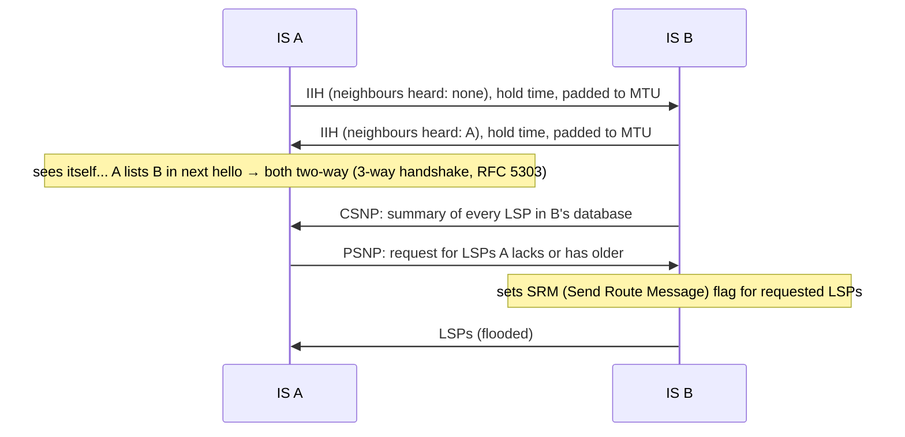
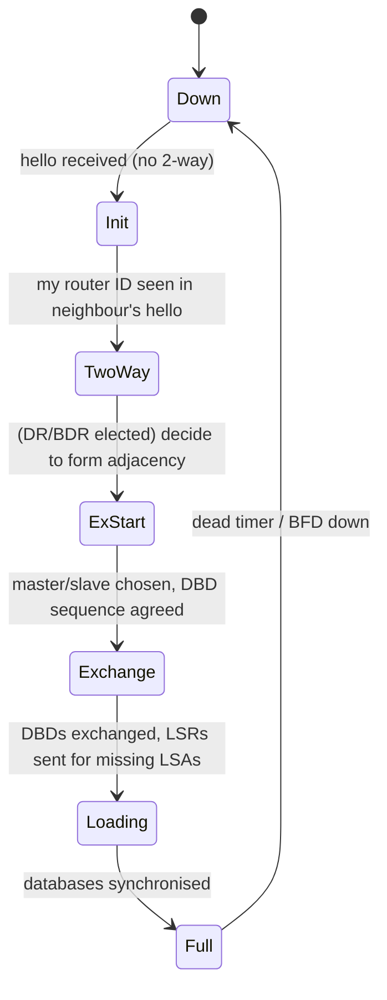

# 2.14 Distance-vector and link-state protocols: RIP, EIGRP, OSPF and IS-IS

| | |
|---|---|
| Level | Intermediate |
| Priority tier | 0 |
| Lab venue | Linux VM with FRR in namespaces/containerlab |
| Part | Part 2: Networking, from first principles to AI fabrics |
| Status | Drafted, labs **untested** |

## Why this matters for AI infrastructure

Picture an AI cluster where one rack suddenly cannot reach the others. Training jobs stall, and the first question is which router has the wrong view of the network. In many AI data centres, the **underlay** is the routed network that gives every switch loopback and link reachability. That underlay is often OSPF, IS-IS or eBGP.

Kubernetes clusters with Calico or Cilium may speak BGP or OSPF to the fabric. HPC sites run OSPF in management networks. On-prem GPU clouds inherit enterprise networks full of OSPF and EIGRP.

You will be asked to read an OSPF neighbour table. You may need to explain why an adjacency is stuck in EXSTART, which is usually an MTU problem. You will also design areas, explain DR and BDR elections on a shared segment, and compare IS-IS with OSPF for a new fabric. This chapter explains the protocols that implement the algorithms of chapter 2.13, and it prepares you for those tasks. It covers how Spanning Tree, RIP and EIGRP work as the distance-vector family, and how OSPF and IS-IS form neighbours, flood reliably and calculate paths. Configuration and troubleshooting are shown in FRR.

## Prerequisites and outcomes

Before you start, you should be comfortable with the control-plane ideas from chapter 2.13. Those are neighbour discovery, flooding, SPF and convergence. You should also know the VLAN and STP basics from chapter 2.11.

When you finish this chapter, you will be able to do the following.

- Explain how STP builds a loop-free tree and learns reachability. Show how RIP and EIGRP implement Bellman-Ford and DUAL.
- Explain IS-IS in full: OSI and NSAP addressing, levels, the single LSP with TLVs and fragments, the hello, CSNP and PSNP exchange, SRM flags, flooding, flushing and metrics.
- Explain OSPF: router IDs, packet types, LSA types, neighbour states from Down to Full, DR and BDR, areas, ABRs and ASBRs, network types, costs, reference bandwidth, timers and authentication.
- Compare OSPF and IS-IS, and choose between them for a given network.
- Configure OSPF and IS-IS in FRR. That includes point-to-point links, unnumbered interfaces, BFD, passive interfaces, summarisation and ECMP.
- Troubleshoot adjacency and database problems, such as an MTU mismatch, bad timers, a wrong area ID, failed authentication, duplicate router IDs and a network type mismatch.
- Apply link-state routing to a Clos underlay.

## 1. Spanning Tree as a control plane

Spanning Tree, from chapter 2.11, is itself a distance-vector-style control plane. It does not compute shortest paths to every destination. It computes a loop-free tree instead.

Here is how that tree gets built, and you can follow the steps in order. Every switch advertises the best root it knows in its BPDUs. The switches converge on the minimum, so the lowest bridge ID becomes the root. Each switch then picks its root port by the lowest cost to the root. Each segment elects a designated port, and the remaining ports are blocked. This is the Bellman-Ford idea with a single destination, which is the root.

Reachability works differently. Bridges learn host MAC addresses from the source addresses of incoming frames, and they flood frames to unknown destinations. Nothing advertises reachability, so the learning is reactive and driven by the data plane.

The limits matter once a network grows. A single tree wastes capacity, converges slowly in its classic form, and has no hierarchy. Flat L2 domains also grow their broadcast load. That is why routing protocols took over the scale-out job. When your network outgrows one tree, plan on a routing protocol instead.

## 2. RIP: the simplest distance-vector protocol

Every RIP router sends its whole routing table to its neighbours on a timer. That is nearly the whole protocol. The Routing Information Protocol is Bellman-Ford made concrete. RIPv2 is defined in RFC 2453, and RIPng carries the same idea to IPv6.

Each router sends its table every 30 seconds. The updates go to multicast address 224.0.0.9 on UDP 520. The metric is hop count. A metric of 16 means unreachable, which RIP calls infinity. That limit caps a RIP network at 15 hops.

Choosing a route is simple too, and you can check it by hand. For each destination, a router takes the neighbour that advertises the lowest hop count, adds 1, and installs that route. A route that is not refreshed for 180 s times out. It is flushed after 240 s.

Several rules fight count-to-infinity, where bad routes keep counting upward. Triggered updates, split horizon with poison reverse and hold-down timers all work against it. RIP is trivial to configure and understand. Its weaknesses are slow convergence, measured in tens of seconds to minutes, and periodic full-table updates that waste bandwidth. Its hop count ignores link speed, and it has no hierarchy. Use RIP only for tiny networks and teaching, and recognise it when you find it on legacy gear.

## 3. EIGRP: DUAL-based distance vector

Imagine a branch link that fails at the worst possible moment. You want traffic on a backup path at once, without waiting for every router to recompute. The Enhanced Interior Gateway Routing Protocol, or EIGRP, was originally built by Cisco, and its basic functions were published as RFC 7868. It keeps the distance-vector habit of exchanging information only with neighbours. It adds DUAL from chapter 2.13, which guarantees loop freedom and instant failover.

EIGRP discovers neighbours with multicast hellos to 224.0.0.10, using IP protocol 88. Neighbours must match their K-values and AS number. The hold time is three times the hello interval. By default on fast links, that gives 5 s or 15 s.

Updates travel over RTP, the Reliable Transport Protocol. Updates, queries, replies and acks are sequenced and retransmitted when needed. Because of that, EIGRP sends only the changes, never full tables.

EIGRP's default metric combines bandwidth and delay, and it can add load and reliability. In classic mode, the metric is `metric = 256 × (10^7/min bandwidth in kb/s + sum of delays / 10)`. For fast links, wide metrics are used instead.

Each router keeps a successor, which is the next hop with the lowest metric. It also keeps any feasible successor, a neighbour whose reported distance is below the router's own feasible distance. A feasible successor is an instantly usable backup. If the successor fails and a feasible successor exists, the router switches at once and sends no queries. Without one, the route goes active. The router queries its neighbours and converges after the replies. If a neighbour never answers, the route is "stuck in active".

Unequal-cost load balancing with `variance` is unique to EIGRP. EIGRP is not production-grade in FRR, and you mostly meet it in Cisco enterprise networks. For new designs, prefer OSPF, IS-IS or BGP.

## 4. Link-state protocols: the shared model

Someone asks whether your fabric runs OSPF or IS-IS. The answer starts with what the two share. OSPF and IS-IS implement the same link-state model. Each router discovers its neighbours and verifies two-way connectivity. It then synchronises a database through reliable flooding, and it runs Dijkstra's SPF. The two protocols differ mainly in packaging. Read the table for those differences, because they show up in configuration and in troubleshooting.

| Aspect | OSPF | IS-IS |
|---|---|---|
| Runs over | IP (protocol 89), multicast 224.0.0.5/6 (v2); IPv6 link-local FF02::5/6 (v3) | Directly on layer 2 (CLNS), not IP |
| Data marshalling | Fixed-length fields, several LSA types | Single LSP per router, TLVs, fragmentable |
| Node identity | 32-bit router ID (looks like an IPv4 address, is not one) | 6-byte System ID inside an NSAP/NET |
| Hierarchy | Areas (backbone Area 0) with ABRs; strict area-0 centred | Levels (L1 intra-area, L2 backbone; routers can be L1, L2, or L1/L2); area boundary on links not routers |
| Multi-access | DR/BDR election; pseudo-node via Network LSA | DIS election per level; pseudo-node LSP |
| Address families | OSPFv2 IPv4; OSPFv3 IPv6 (and IPv4 via AFs) | One instance carries IPv4, IPv6 and others via TLVs |
| Extensibility | New LSA types/Opaque LSAs | New TLVs easily |
| Typical home | Enterprise, data centre | Service providers, large data centres |

You can notice that the shortest-path math is the same in both protocols. Only the wrapping differs for you to learn. The rest of this chapter takes each protocol in turn, starting with IS-IS.

## 5. IS-IS in depth

Why does IS-IS look so different from OSPF? IS-IS stands for Intermediate System to Intermediate System, and it came out of the OSI protocol suite. In that suite, a router is an Intermediate System (IS) and a host is an End System (ES). IS-IS runs at the link layer, next to IP rather than on top of it. It does not need IP addressing to bring up adjacencies, and it never forwards IS-IS packets. Its addresses differ from the addresses it routes, which keeps nodes and destinations clearly apart. That also makes the protocol robust to IP misconfiguration.

### NSAP/NET addressing

Each IS has an OSI address, called a NET (network entity title). An example is `49.0001.1921.6800.1001.00`. The address has three parts, as the block below shows.

```text
49.0001 . 1921.6800.1001 . 00
 AFI+area      System ID      N-selector (always 00 for a router)
```

Read the block from left to right. Everything left of the last 7 bytes is the area address. The `49` is the private AFI, and `0001` is the area. The 6-byte System ID comes next. It must be unique within the domain, and by convention it is derived from a loopback IP. For example, 192.168.1.1 becomes 1921.6800.1001. The final byte, the N-selector (also called the NSAP), is `00` for the router itself.

Routers with the same area address belong to the same area and flooding domain. Mismatched areas form only Level 2 adjacencies.

### Packets and marshalling

IS-IS uses three kinds of PDUs. Hellos (IIH) find and check neighbours. Sequence number PDUs come in two forms: the CSNP is complete, and the PSNP is partial. Link state PDUs (LSPs) carry the routing data.

Each IS originates one logical LSP. That LSP describes the IS itself, its adjacent ISes and its attached destinations. The data is encoded as TLVs, which are type-length-value records. TLV 2/22 carries neighbour reachability, and 22 is the extended-metric form. TLV 128/135 carries IPv4 reachability, and 135 is the extended form. TLV 236 and 237 cover IPv6. Segment routing and other extensions use further TLVs.

TLV space is large, so the logical LSP is split into fragments. Each fragment floods as its own LSP. When one piece changes, only that fragment is re-flooded. This TLV design is why IS-IS gained new address families without a redesign. The original 6-bit metrics, called narrow, are replaced by 24/32-bit "wide" metrics. You should always enable the wide metrics.

### Neighbour formation

The sequence below shows how two neighbours come up. Read it from top to bottom.



Each hello carries the list of neighbours the sender has heard. That list is the two-way check. The hello also carries the hold time the peer should use. A typical setup uses a 10 s hello and a 30 s hold, with faster timers when you need quicker convergence. Hello padding fills the hello out to the interface MTU during adjacency formation, so an MTU mismatch shows up early. An adjacency that comes up but later fails on large LSPs is the classic sign that padding is missing.

Once two-way is confirmed, the neighbours exchange CSNPs. A CSNP is a complete summary of a database. They compare the summaries and request missing or outdated LSPs with PSNPs. The flooding process then walks the LSPs with the SRM flag set and sends them.

### Reliable flooding

Every IS in the flooding domain must hold an identical database, or loops become possible. Each LSP header carries the fields that keep this true. The remaining lifetime counts down from 1200 s. It forces a periodic refresh, ages out stale information, and a zero value means purge. The LSP ID combines the system ID, pseudonode ID and fragment number. The sequence number tells you which copy is newer, and it stops old replays. The checksum and flags (attached, overload, partition) finish the header.

On a point-to-point link, the steps run like this. The originator sets SRM toward each neighbour. The neighbour acknowledges by sending a PSNP or CSNP that lists the LSP. When the LSP arrives, the neighbour compares sequence numbers. If the copy is newer, the neighbour stores it and floods it onward on its other links.

You have three ways to remove information. You can originate a newer fragment without the data. You can flood a zero-lifetime purge. Or you can let the lifetime expire, and nodes then re-flood the zero-age LSP. The protocol calls that last case flushing.

On broadcast (multi-access) links, a Designated Intermediate System (DIS) is elected for each level. The highest priority wins, and then the highest MAC address. The election is pre-emptive and has no backup. The DIS creates a pseudo-node that represents the LAN. It multicasts CSNPs on a schedule to keep the LAN's databases synchronised. That replaces a full adjacency between every pair of routers. Data-centre links are point-to-point, so configure `isis network point-to-point` and skip the DIS entirely.

### Levels, overload and metrics

Level 1 routers know their own area. Level 2 routers form the backbone between areas. L1/L2 routers connect both, and that is the default type. For a modern single-area data-centre underlay, run everything as Level 2 only. That keeps the network flat and avoids L1/L2 complexity. Level 1 only also works.

The overload bit tells other routers not to use this IS for transit. You set it during maintenance, or while BGP converges after boot. The attached bit makes L1 routers install a default route toward an L1/L2 router.

Metrics come in two styles. Narrow metrics are 6-bit, with a maximum of 63 per link. Wide metrics are 24/32-bit. Set `metric-style wide`. The cost defaults to 10 per interface unless you configure it. Scale the metrics by link speed yourself.

### FRR IS-IS example

The FRR configuration below puts these ideas into practice on a leaf switch. Read the router block first, then the interface lines. The `vtysh` line at the end shows the neighbours, the database, the routes and the interface state.

```text
interface lo
 ip router isis FABRIC
 isis passive
interface swp1
 ip router isis FABRIC
 isis network point-to-point
 isis metric 10
 isis hello-interval 1
 isis hello-multiplier 3
 isis bfd
router isis FABRIC
 net 49.0001.1921.6800.1001.00
 is-type level-2-only
 metric-style wide
 lsp-gen-interval 1
 fast-reroute ti-lfa level-2 proto ipv4      ! if supported
vtysh -c 'show isis neighbor' -c 'show isis database detail' -c 'show isis route' -c 'show isis interface detail'
```

## 6. OSPF in depth

OSPF stands for Open Shortest Path First. It is the most widely deployed IGP. OSPFv2 is defined in RFC 2328 for IPv4. OSPFv3 is defined in RFC 5340 for IPv6, and it can carry IPv4 through address families. OSPF runs directly over IP, using protocol 89.

### Router ID, packets and LSAs

Every OSPF router needs a router ID. It is a 32-bit identifier written like an IPv4 address. Set it explicitly rather than letting the router derive one. An example is `ospf router-id 10.255.0.1`, usually on the loopback. The router ID is not an IP address, and it does not have to be reachable. Duplicate router IDs cause database fights and instability.

OSPF uses fixed-length fields. That keeps parsing cheap and packets small, which was a sensible choice when CPUs and links were scarce. Instead of one TLV blob, OSPF splits its information into LSA types. Each type has its own originator and flooding scope, so check those two columns when you read a database.

| LSA type | Name | Generated by | Contents | Flooding scope |
|---|---|---|---|---|
| 1 | Router LSA | Every router (one per router per area) | Router's links, neighbours and attached prefixes | Area |
| 2 | Network LSA | DR on multi-access segments | Routers attached to the segment | Area |
| 3 | Inter-area prefix (Summary) LSA | ABR | Prefixes from other areas | Area |
| 4 | Inter-area router (ASBR summary) LSA | ABR | Route to an ASBR | Area |
| 5 | AS-external LSA | ASBR | Redistributed external prefixes (E1/E2 metric types) | Whole AS (except stub areas) |
| 7 | NSSA external LSA | ASBR in an NSSA | External prefixes inside an NSSA, translated to type 5 by the ABR | NSSA area |
| 9/10/11 | Opaque LSAs | extensions (TE, segment routing) | | link/area/AS |

Each router originates exactly one Router LSA, type 1, per area. Links are inferred from neighbour and prefix entries. They are not advertised as separate objects. OSPF has five packet types. Hello is type 1, Database Description (DBD) is type 2, Link State Request (LSR) is type 3, Link State Update (LSU) is type 4, and Link State Acknowledgment is type 5.

### Neighbour state machine

A neighbour moves through a fixed set of states. The diagram shows the path, and the steps below it tell you what happens at each stop.



1. Hello comes first. The neighbours must agree on hello and dead intervals, area ID, and network type and subnet mask on multi-access links. They must also agree on authentication, stub flags and MTU. The MTU appears in DBD packets. A mismatch leaves the adjacency stuck in ExStart or Exchange.
2. Two-way is confirmed when each router sees its own ID in the neighbour's list of neighbours seen. On broadcast networks, only the DR and BDR reach Full with everyone. Other pairs stay in 2-Way.
3. In ExStart and Exchange, the master and slave are chosen. The DBDs summarise each database, with headers that carry the LS age, ID, advertising router, sequence and checksum.
4. In Loading, LSRs request what is missing, LSUs deliver the LSAs, and LSAcks confirm them.
5. Full means the databases are synchronised, and SPF runs.

### Reliable flooding

The LSA header carries several fields. LS Age counts up to MaxAge, which is 3600 s. Routers refresh their own LSAs every 30 min, and at MaxAge the LSA is flushed. The LS ID, advertising router, LS sequence number and checksum complete the header. A higher sequence number means a newer LSA.

When an LSA changes, it floods in an LSU to every neighbour except the one it came from. Each receiver acknowledges it, either explicitly in an LSAck or implicitly by flooding it back. The receiver installs the LSA only if it is newer by sequence, and then it floods onward. The originator retransmits until it gets an acknowledgment. Flooding stays inside an area, so you control the flooding cost by sizing the area.

### Network types, DR and BDR

The network type decides whether OSPF runs an election. The table compares the common types, so you can pick the right one.

| Network type | Behaviour | Use |
|---|---|---|
| Broadcast | DR/BDR election; hello 10 s/dead 40 s | Ethernet segments |
| **Point-to-point** | No election, adjacency immediately; hello 10/40 (set faster) | Router-to-router links; **use this for data-centre fabric** (`ip ospf network point-to-point`) |
| NBMA / point-to-multipoint | For non-broadcast media | Legacy WAN |
| Unnumbered | P2P using a loopback's address | Save addresses in fabrics |

On a broadcast segment with n routers, a full mesh of adjacencies needs n(n-1)/2 flooding relationships. OSPF avoids that by electing a Designated Router (DR) and a Backup DR (BDR). The election picks the highest priority, and then the highest router ID. It is non-pre-emptive. Every other router becomes adjacent only to the DR and BDR. Those routers send updates to 224.0.0.6, and the DR floods to 224.0.0.5. The DR also originates the Network LSA. Priority 0 means a router never becomes DR.

Changing the DR requires clearing the process. Avoid relying on the election, and use point-to-point networks in fabrics.

### Areas and hierarchy

A large flat OSPF domain puts everyone's SPF and flooding load on every router. Areas split the autonomous system to limit that load. Area 0, the backbone, connects all the other areas. Area border routers (ABRs) attach to several areas. They keep a database for each area, and they summarise prefixes between areas as type 3 LSAs. Autonomous system boundary routers (ASBRs) inject external routes as type 5 LSAs.

Special area types reduce state. A stub area drops external LSAs and uses a default route instead. A totally stubby area also drops inter-area routes. An NSSA is a stub area that can still originate external routes through type 7 LSAs. Inter-area routing acts like distance vector at the ABR level, so areas must stay loop-free through the backbone. Modern data centres usually use a single area of up to a few hundred routers. Larger scales often avoid OSPF in favour of IS-IS or BGP.

### Cost, SPF and ECMP

Cost equals the reference bandwidth divided by the interface bandwidth, with a minimum of 1. The default reference is 100 Mb/s, so every link at or above 100 Mb/s costs 1. Always set `auto-cost reference-bandwidth` high, to 400000 or more Mb/s, and set it the same on every router. Otherwise, set the interface costs explicitly.

SPF throttling controls how fast your router reacts. `timers throttle spf 50 100 5000` sets the initial delay, the hold time and the maximum. LSA throttling also affects reaction time.

ECMP installs equal-cost paths together, up to the `maximum-paths` limit. Some implementations default to 4. Raise the limit to the width of your fabric, such as 64.

Authentication can be plain text, which you should never use, or MD5, or HMAC-SHA as defined in RFC 5709. You set it per interface or per area. OSPFv3 uses IPsec instead. Keep the reference bandwidth consistent across routers, or the costs will disagree.

### FRR OSPF example

This FRR configuration puts the pieces together for a fabric switch. Read the router block first, then the interface lines. The `vtysh` line at the end shows the result.

```text
router ospf
 ospf router-id 10.255.0.1
 auto-cost reference-bandwidth 400000
 maximum-paths 64
 timers throttle spf 50 100 2000
 passive-interface default
 no passive-interface swp1
 no passive-interface swp2
interface lo
 ip ospf area 0
interface swp1
 ip ospf area 0
 ip ospf network point-to-point
 ip ospf hello-interval 1
 ip ospf dead-interval 4
 ip ospf bfd
 ip ospf cost 10
vtysh -c 'show ip ospf neighbor' -c 'show ip ospf interface' -c 'show ip ospf database' -c 'show ip ospf route' -c 'show ip ospf database router self-originate'
```

For IPv6, use `ipv6 ospf6` and `router ospf6`.

## 7. OSPF versus IS-IS: choosing

Choosing between the two is a question about your team as much as about the protocol. The table compares them on the points that usually decide it.

| Consideration | Prefer OSPF | Prefer IS-IS |
|---|---|---|
| Familiarity / tooling / hiring | ✔ Everywhere | Strong in carriers, less in enterprise |
| Multi-protocol (IPv4+IPv6) | v2+v3 (or AFs) | One process carries both |
| Hierarchy | Areas with ABRs, backbone centricity | Levels, boundary on links, flexible |
| Extensibility | LSA types | TLVs (easy) |
| Stability under load | Good | Often more stable at very large scale |
| Adjacency independence from IP | Needs IP | Doesn't (robust) |
| Multi-instance / MPLS TE / SR | Supported | Strong SR/TE heritage |

Both protocols converge in sub-second time with tuning and BFD. In practice, choose the one your organisation can operate. For hyperscale AI fabrics, eBGP (RFC 7938) and link-state variants such as RIFT are common, and chapter 2.16 covers them. OSPF and IS-IS serve as the underlay in smaller or EVPN designs.

## 8. Operations and troubleshooting

Start with the neighbour state. When an OSPF neighbour will not form, the state shown by `show ip ospf neighbor` tells you where it gets stuck. The table matches each stuck state to its likely causes and the checks that confirm them.

| State stuck | Cause | Check |
|---|---|---|
| Down / no neighbour | No hellos: interface down/passive, wrong area, ACL blocks proto 89, auth mismatch, subnet mismatch, hello/dead mismatch | `show ip ospf interface`, `tcpdump -ni swp1 proto 89`, config diff |
| Init | One-way: neighbour doesn't hear me (unidirectional link, filter) | tcpdump on both ends |
| 2-Way (broadcast) | Normal for non-DR/BDR pairs | DR election |
| ExStart/Exchange | **MTU mismatch**, duplicate router ID | `ip link`, `show ip ospf interface`, `ip ospf mtu-ignore` (workaround only) |
| Loading | Lost LSRs/LSUs, large LSAs vs MTU, rate-limiting | `show ip ospf neighbor detail`, counters |
| Full but routes missing | Area/stub/filter policy, summary or distribute-list, wrong network type, redistribution | `show ip ospf database`, route-maps |

The ExStart and Exchange row deserves a second look from you. It names two causes, an MTU mismatch and a duplicate router ID. The 2-Way row is different, because a 2-Way state is normal for pairs that are not the DR or BDR. Don't treat it as a fault.

IS-IS troubleshooting follows the same pattern. Check `show isis neighbor`, where the state is Up or Initializing. Mismatched area addresses form only Level 2 adjacencies. The usual suspects are a mismatched `is-type`, authentication, MTU or padding, duplicate System IDs, the overload bit set, a narrow versus wide metrics mismatch, and a `network point-to-point` mismatch. Duplicate System IDs show up as a flapping `show isis database`, where the same ID comes from two sources.

Several generic tools help. `tcpdump -ni swp1 'proto 89'` captures OSPF, and `ether proto 0xfefe` or `isis` captures IS-IS. Packet counters and logs show adjacency events, for example through `debug ospf adj`. Use `ip route show proto ospf` to list the installed OSPF routes, and use `vtysh` database dumps to inspect state. Compare the databases of two routers, because they must be identical within an area. Watch the SPF run counts in the `show ip ospf` statistics to spot flapping. Finally, `ip monitor route` timestamps convergence for you.

For fabrics, make every link point-to-point. Advertise the loopback /32 as both the router ID and the service address. Keep one area, or run IS-IS as Level 2 only. Run BFD at 100-300 ms, keep the reference bandwidth consistent, and make `passive-interface default` the baseline. Size ECMP to at least the uplink count. Turn on authentication, and protect the control plane with CoPP. Avoid redistributing host routes without a reason, which keeps the routing table small. Finally, stagger maintenance with overload or graceful shutdown, using `max-metric router-lsa on-startup/administrative`, so traffic drains before reloads.

## 9. Hands-on lab: OSPF and IS-IS in FRR

Start with the self-checking Python lab. You can run it on your own machine. It checks the IS-IS `NET` parsing for `49.0001.1921.6800.1001.00`. It also checks how a loopback IPv4 address becomes a System ID, so `192.168.1.1` turns into `1921.6800.1001`. The OSPF `auto-cost reference-bandwidth` math is verified next, comparing the `100 Mb/s` default with the tuned `400,000 Mb/s`. Last, the lab walks the OSPF neighbour states (`Down`, `Init`, `2-Way`, `ExStart/Exchange`, `Full`) and the classic EIGRP composite metrics.

```bash
python3 code/part02/ospf_isis_protocols_lab.py
```

The rest of the lab needs a disposable Linux VM with FRR, either in containerlab or in network namespaces. Every interactive VM command below is `untested here`. Work through these steps in order, and keep your own notes as you go.

1. Configure the setup above in Area 0. Watch the state progression with `debug ospf adj` or `watch vtysh -c 'show ip ospf neighbor'`. Then inspect the LSDB. Find the Router LSAs, and compare the `show ip ospf route` output with the SPF you calculated by hand. Note the ECMP between hosts.
2. Set one interface MTU to 1400 and the other to 1500. Observe ExStart. Then try `mtu-ignore`, and discuss why it is only a workaround.
3. Put three routers on a bridge. Observe the DR and BDR election and the 2-Way states. Change the priority. Then reconfigure the links as point-to-point, and compare the adjacency counts.
4. Split the routers into Areas 0, 1 and 2. Observe the type 3 LSAs at the ABRs. Make Area 2 stub, and see the default route it receives. Add an ASBR with `redistribute connected`, and look for the type 5 LSA.
5. Measure failover three ways: with default timers, with `hello 1/dead 4`, and with BFD at 100 ms ×3. Use a timestamped ping for each run.
6. Show the reference-bandwidth trap by mixing 1G, 10G and 100G links with default costs. Then fix it with `auto-cost`.
7. Replicate the topology with IS-IS Level 2, wide metrics and point-to-point links. Inspect `show isis database detail` and identify the TLVs. Flush an LSP by shutting down a loopback. Disable hello padding, then enable it again, and observe how MTU detection changes.
8. Run the same failure scripts against OSPF and IS-IS. Compare convergence, CPU use and LSDB sizes. Use `ip monitor route | ts` to timestamp the changes.
9. Enable OSPF MD5 or SHA authentication, then show the mismatch failure.
10. Finish by cleaning up.

Repeat step 2 first, since an MTU mismatch is the usual cause of a stuck ExStart.

## 10. Common mistakes

Watch for these mistakes in your own configs, and in any config you review.

- Leaving the default OSPF reference bandwidth in place, so every fast link costs 1, or running inconsistent costs across routers.
- Setting the broadcast network type on point-to-point Ethernet links. That adds a needless DR election and slows convergence.
- Skipping explicit router IDs, reusing duplicate IDs or System IDs, or treating `mtu-ignore` as a permanent fix.
- Running OSPF on every interface, including server-facing ones, instead of setting `passive-interface default`.
- Making Area 0 non-contiguous, or hanging areas off non-backbone areas without virtual links. That is a design bug.
- Using narrow IS-IS metrics on a modern network, or mixing L1 and L2 without a reason.
- Setting over-aggressive timers without BFD or CPU protection, and running without authentication.
- Running large flat domains with unstable links and no SPF or LSA throttling.

## 11. Interview angles

Use these questions to test yourself. Try to answer each one out loud, then check the section it points back to.

- "Walk through OSPF neighbour states. What causes ExStart to be stuck?"
- "What is the DR/BDR for? What happens if the DR fails? How do you avoid it?"
- "List the OSPF LSA types and who generates them."
- "Why does IS-IS run directly on layer 2? What is a NET?"
- "Compare OSPF and IS-IS for a new data-centre underlay."
- "How do OSPF/IS-IS ensure database synchronisation and remove stale information?"
- "What is the reference-bandwidth problem?"
- "What is a stub/NSSA area for?"
- "How do you make OSPF converge in under a second?"
- "How does RIP prevent count to infinity? How does EIGRP's feasibility condition guarantee loop-freedom?"

## Exercises

Answer each part in your own words before you run any code. The exercises build from the distance-vector protocols to the link-state ones.

1. Start with Spanning Tree, RIP and EIGRP as distance-vector control planes. This exercise draws on *Computer Networking Problems and Solutions*, chapter 15. In the first part, explain how Spanning Tree's Root Bridge election maps onto Bellman-Ford distance-vector routing with a single destination, and how STP learns host reachability. In the second part, contrast RIP, which uses `UDP 520`, `224.0.0.9`, 30 s full-table updates and a maximum of 15 hops, with EIGRP, which uses `IP proto 88`, `224.0.0.10`, Reliable Transport `RTP` and the DUAL condition `RD < FD`. Then calculate the EIGRP classic composite metric with `compute_eigrp_classic_metric()` in `code/part02/ospf_isis_protocols.py`, for `min_bw = 10,000 kb/s` and `total_delay = 100` tens of microseconds. The result should be `281,600`.
2. Next, work on IS-IS. This exercise draws on *Computer Networking Problems and Solutions*, chapter 16. Explain why IS-IS runs directly over Layer 2 (`CLNS`) rather than IP. Then use `ipv4_to_isis_system_id()` and `parse_isis_net()` to convert the loopback `192.168.1.1` into a 6-byte System ID, `1921.6800.1001`, and to decode `49.0001.1921.6800.1001.00`. Finally, explain how IS-IS uses padded IIH hellos, CSNP, PSNP and the SRM flag to synchronise its TLV-based LSP fragments. Also explain why `metric-style wide`, with its 24/32-bit metrics, must replace the legacy 6-bit narrow metrics, which top out at 63.
3. Cover the OSPF packet types and LSA types. List the five OSPF packet types. Then state the purpose and flooding scope of LSA types 1, 2, 3, 4, 5 and 7. Use `diagnose_ospf_neighbor_state()` to trace the seven neighbour states, `Down -> Init -> 2-Way -> ExStart -> Exchange -> Loading -> Full`. For an adjacency stuck in `Down`, `Init`, `2-Way` or `ExStart`/`Exchange`, state the exact root cause.
4. Compare DR and DIS elections with point-to-point links and the reference-bandwidth trap. Explain why OSPF (with its DR and BDR) and IS-IS (with its DIS) elect a pseudo-node on broadcast Ethernet segments. Explain why data-centre leaf-spine links should always set `network point-to-point`. Then use `compute_ospf_interface_cost()` to compare the OSPF costs for 1G, 10G, 100G and 400G links. Run the comparison twice, once with the default 100 Mb/s reference bandwidth and once with `auto-cost reference-bandwidth 400000`.
5. Compare the two hierarchies, and then drain a switch. Set OSPF's area hierarchy, which has Area 0 as the backbone, ABRs, ASBRs and stub or NSSA areas, against IS-IS's level hierarchy, which has Level 1, Level 2 and L1/L2, with its boundary on links rather than routers. Then explain how the IS-IS overload bit and OSPF `max-metric router-lsa` let you drain transit traffic off a spine or leaf switch before maintenance.
6. Finally, write the FRR configuration for a leaf switch. Use either single-area OSPF or `level-2-only` IS-IS, running over the point-to-point fabric links `swp1` and `swp2`, with loopback `lo` at `10.255.0.1/32`. Include `passive-interface default`, `bfd`, `maximum-paths 64`, and either wide metrics or reference-bandwidth metrics.

## Checkpoint questions (20)

<details>
<summary>1. In what sense is Spanning Tree a distance-vector protocol, and how does it learn host reachability (Computer Networking Problems and Solutions, chapter 15)?</summary>

Spanning Tree's Root Bridge and Root Port election is a single-destination Bellman-Ford distance-vector calculation. Switches exchange BPDUs that advertise `{root_id, cost_to_root}`. Each switch picks the port with the lowest cumulative path cost to the Root Bridge. Routing protocols advertise prefixes proactively in the control plane. STP learns host MAC reachability reactively, in the data plane. It reads the source MAC address of arriving data frames, and it floods unknown destinations.
</details>

<details>
<summary>2. How does RIP (RFC 2453) work, what are its timers and hop limit, and why is it unsuitable for modern data centers?</summary>

RIP routers send their entire routing table as multicast to 224.0.0.9 on UDP port 520, every 30 seconds. A route is invalid after 180 s and flushed after 240 s. RIP uses pure hop count as its metric, so it ignores whether a link is 10 Mb/s or 400 Gb/s. A metric of 16 is infinity, which limits a path to 15 hops. RIP has no concept of areas or hierarchy. It also takes tens of seconds to minutes to converge after a link failure, which is why it does not suit modern data centres.
</details>

<details>
<summary>3. What three architectural improvements did EIGRP (RFC 7868) introduce over classic distance-vector protocols like RIP?</summary>

EIGRP introduced three improvements.

- Explicit neighbour discovery and the Reliable Transport Protocol, or RTP. RTP runs on IP protocol 88 and uses multicast 224.0.0.10. EIGRP sends only incremental, sequenced and acknowledged updates when something changes, instead of periodic full-table dumps.
- DUAL, the Diffusing Update Algorithm. It tracks the Feasible Distance (FD) and the Reported Distance (RD). A Feasible Successor, where RD < FD, guarantees 100% loop freedom and sub-second local failover.
- A composite metric built from minimum path bandwidth and cumulative delay. It also supports unequal-cost load balancing with `variance`.
</details>

<details>
<summary>4. Why does IS-IS run directly over Layer 2 (CLNS) instead of IP, and how is an IS-IS NET (49.0001.1921.6800.1001.00) structured?</summary>

IS-IS, which stands for Intermediate System to Intermediate System, is defined in ISO 10589 and RFC 1195. It was designed in the OSI suite to run directly over the data-link layer, using EtherType or SNAP. Forming adjacencies therefore does not depend on IPv4 or IPv6 interface addresses. Remote IP hops also cannot spoof IS-IS control packets.

A Network Entity Title, or NET, such as `49.0001.1921.6800.1001.00`, has three parts. Read them from right to left.

- `00` is the N-Selector (NSEL), one byte. It is always `00` for the router itself.
- `1921.6800.1001` is the System ID, six bytes or 12 hex digits. It is conventionally formed by zero-padding the router's loopback IP, `192.168.001.001`.
- `49.0001` is the area address, one to 13 bytes. `49` is the private AFI, and `0001` is the area ID.
</details>

<details>
<summary>5. How does IS-IS marshal routing data into LSPs, and why did TLV encoding make IS-IS easier to extend for IPv6 and Segment Routing than OSPFv2?</summary>

Each IS-IS router originates a single logical Link State PDU (LSP). The LSP can be split into up to 256 independently flooded fragments. Its body is a sequence of extensible Type-Length-Value (TLV) records. Examples are TLV 22 for extended neighbour reachability, TLV 135 for IPv4 prefixes and TLV 236 for IPv6 prefixes. For example, adding IPv6 (RFC 5308) or Segment Routing needed only new TLV numbers inside the same protocol instance. OSPFv2 had fixed-format 32-bit IPv4 headers, so IPv6 required a whole new protocol version, OSPFv3 (RFC 5340).
</details>

<details>
<summary>6. Explain the roles of IIH, CSNP, PSNP, and the SRM flag in IS-IS adjacency formation and reliable flooding.</summary>

- IIH (IS-IS Hello) discovers neighbours and proves two-way connectivity, using the 3-way point-to-point handshake in RFC 5303. Hellos are padded to the full interface MTU, so an MTU mismatch fails at once.
- CSNP (Complete Sequence Number PDU) is a summary catalogue of every LSP header in the sender's database. It carries the LSP ID, sequence number, remaining lifetime and checksum. It is exchanged when a point-to-point adjacency comes up, and the DIS sends it periodically on broadcast LANs.
- PSNP (Partial Sequence Number PDU) requests missing or newer LSPs found in a CSNP. On point-to-point links, it also acknowledges received LSPs.
- The SRM (Send Route Message) flag is set per interface on an LSP. It marks the LSP for transmission, and the router retransmits it until a PSNP acknowledges it.
</details>

<details>
<summary>7. Why must you always configure `metric-style wide` in IS-IS, and what does the IS-IS overload bit do?</summary>

Narrow metrics, carried in TLVs 2 and 128, use a 6-bit link metric. That allows a maximum of 63 per link and 1023 for the total path. Those values are too coarse to tell 1G, 10G, 100G and 400G links apart. `metric-style wide` provides 24-bit link metrics and 32-bit path metrics, carried in TLVs 22, 135 and 236.

The overload (OL) bit tells every other router never to route transit traffic through this router. The router still routes to prefixes attached directly to it. You can use the bit to drain traffic before a switch maintenance reboot. It also helps while BGP converges after boot, through `set-overload-bit on-startup`.
</details>

<details>
<summary>8. List the five OSPF packet types (IP protocol 89) and the two OSPF multicast addresses.</summary>

The five OSPF packet types, which you should know by name, are these.

- Hello, which discovers neighbours and keeps them alive.
- Database Description (DBD), which exchanges LSA header summaries and checks the interface MTU.
- Link State Request (LSR), which asks for specific missing or newer LSAs.
- Link State Update (LSU), which carries the full flooded LSAs.
- Link State Acknowledgment (LSAck), which explicitly acknowledges LSUs.

The two multicast addresses are 224.0.0.5 (FF02::5), AllSPFRouters, and 224.0.0.6 (FF02::6), AllDRRouters. Only the DR and BDR listen on AllDRRouters.
</details>

<details>
<summary>9. Match OSPF LSA Types 1, 2, 3, 4, 5, and 7 to who originates them and their flooding scope.</summary>

- Type 1 (Router LSA) is originated by every router, one per area. It lists the router's links, neighbours and costs, and it floods within the area.
- Type 2 (Network LSA) is originated by the DR on broadcast or multi-access links. It lists the routers attached to that LAN, and it floods within the area.
- Type 3 (Summary LSA) is originated by an ABR. It advertises prefixes from one area into another, and it floods into adjacent areas.
- Type 4 (ASBR Summary LSA) is originated by an ABR. It advertises how to reach an ASBR.
- Type 5 (AS-External LSA) is originated by an ASBR for redistributed external routes, which carry E1 or E2 metrics. It floods across the entire AS, except in stub and NSSA areas.
- Type 7 (NSSA External LSA) is originated by an ASBR inside an NSSA. It floods only within the NSSA, and the NSSA ABR translates it into Type 5.
</details>

<details>
<summary>10. Walk through the seven OSPF neighbor states (Down -> Init -> 2-Way -> ExStart -> Exchange -> Loading -> Full).</summary>

- If you see Down, no Hello has been received.
- Init means a Hello arrived, but it does not list my own router ID yet, so the link is one-way.
- 2-Way means bidirectional communication is confirmed, because my router ID appears in the neighbour's Hello. On broadcast links, the DR and BDR are elected at this point, and pairs of DROTHER routers stop here.
- ExStart means the master and slave are chosen by highest router ID, to sequence the DBD exchange.
- Exchange means the routers swap DBD summaries and check that the interface MTU matches.
- Loading means the routers send LSRs for missing or outdated LSAs, and receive LSUs in reply.
- Full means the link-state databases are fully synchronised, and Dijkstra SPF runs.
</details>

<details>
<summary>11. What are the six parameters in an OSPF Hello packet that MUST match for two routers to form an adjacency, and what causes an adjacency to stick in ExStart / Exchange?</summary>

Two routers must match on six parameters: the area ID, the hello and dead intervals, the subnet mask on broadcast or multi-access links, the authentication type and key, the stub or NSSA area flags, and unique router IDs. When two routers reach 2-Way and then stick in ExStart or Exchange, the most common cause is an interface MTU mismatch. The MTU is recorded in the DBD packet, and the router with the smaller MTU rejects the larger DBD. A duplicate router ID is the other cause.
</details>

<details>
<summary>12. Why do broadcast segments elect a DR and BDR in OSPF (or a DIS in IS-IS), and why should data-center leaf-spine links always configure point-to-point mode?</summary>

On a broadcast Ethernet segment with n routers, a full mesh of adjacencies needs n(n - 1) / 2 adjacencies and quadratic LSA flooding. Electing a Designated Router (DR) and a Backup DR (BDR) creates a logical star, a pseudo-node. Every DROTHER forms Full adjacencies only with the DR and BDR.

Consider a data-centre fabric, where every cable is a point-to-point link between two routers. If the links stay in default broadcast mode, they waste seconds waiting on the 40 s DR wait timer, and they generate useless Type 2 Network LSAs. Always set `ip ospf network point-to-point`. IS-IS uses `isis network point-to-point` for the same purpose.
</details>

<details>
<summary>13. What is the OSPF auto-cost reference-bandwidth trap, and how do you fix it on a 10G/100G/400G fabric?</summary>

OSPF calculates interface cost as `cost = max(1, reference_bandwidth / interface_bandwidth)`. The default reference bandwidth comes from the 1990s, and it is 100 Mb/s. With that default, every link at 100 Mb/s, 1 Gb/s, 10 Gb/s, 100 Gb/s and 400 Gb/s gets the same cost of 1. For example, OSPF then treats a 1G management link and a 400G spine link as equal.

Fix it by setting `auto-cost reference-bandwidth 400000`, which is 400 Gb/s expressed in Mb/s. Set the same value on every router in the domain. You can also set an explicit `ip ospf cost` on each interface.
</details>

<details>
<summary>14. Compare OSPF Stub, Totally Stubby, and NSSA (Not-So-Stubby) areas.</summary>

- A stub area blocks Type 4 and Type 5 AS-External LSAs at the ABR. It replaces them with a single Type 3 default route, 0.0.0.0/0.
- A totally stubby area blocks Type 3 inter-area Summary LSAs as well as Types 4 and 5. Only intra-area Type 1 and Type 2 LSAs remain, plus the single ABR default route.
- A Not-So-Stubby Area (NSSA) blocks external Type 5 LSAs from entering, as a stub area does. It still lets an ASBR inside the area inject external routes as Type 7 LSAs. The ABR translates those into Type 5 for the rest of the network.
</details>

<details>
<summary>15. How do OSPF and IS-IS age out and flush stale LSAs/LSPs from the Link-State Database?</summary>

If you inspect an OSPF LSA, you will see that its LS Age counts up from 0 to MaxAge, which is 3600 s, or one hour. The originator refreshes the LSA every 1800 s, which is 30 minutes. To withdraw or flush an LSA at once, the originator floods it with LS Age set to 3600.

In IS-IS, each LSP's Remaining Lifetime counts down from 1200 s, the 20-minute default. To flush an LSP immediately, a router floods it with Remaining Lifetime set to 0. That is a zero-age purge.
</details>

<details>
<summary>16. Compare how OSPF and IS-IS place area boundaries on routers versus links.</summary>

In OSPF, the area boundary sits inside the router. Each interface belongs to a specific area, and an ABR keeps separate LSDBs for Area 0 and each attached area. In IS-IS, the boundary sits on the links between routers. A whole router belongs to a single area through its NET. You get hierarchy from whether an adjacency is Level 1 (intra-area), Level 2 (inter-area backbone) or Level 1/2. That makes a flat `level-2-only` data-centre underlay trivial to run.
</details>

<details>
<summary>17. Why should every router in an OSPF or IS-IS fabric set passive-interface default?</summary>

If you leave out `passive-interface default`, OSPF and IS-IS send multicast Hellos out every IP-enabled interface. That includes server-facing access ports and management VLANs. A misconfigured or compromised server or container could then form a routing adjacency and inject bogus routes into the fabric. Set `passive-interface default`, and then explicitly enable adjacencies with `no passive-interface swp1..N` on the switch-to-switch fabric uplinks. This advertises connected prefixes without accepting neighbour adjacencies on host ports.
</details>

<details>
<summary>18. How do you gracefully drain traffic off an OSPF or IS-IS spine switch before a planned maintenance reboot?</summary>

Before you reboot the switch or shut down its ports, make it unattractive for transit. Every leaf then recomputes SPF and shifts ECMP flows onto the remaining spines, with zero packet loss.

- In OSPF, configure `max-metric router-lsa administrative`. It sets all transit link costs in the Router LSA to 65535. Add `max-metric router-lsa on-startup 120` to wait for BGP on boot.
- In IS-IS, configure `set-overload-bit`, and add `set-overload-bit on-startup 120` for the boot case.
</details>

<details>
<summary>19. Compare OSPF External Metric Type 1 (E1) and Type 2 (E2).</summary>

- E2 (External Type 2) is the default. The route's cost is only the external metric that the ASBR advertises. It ignores the internal OSPF cost to reach the ASBR, so it behaves in a cold-potato style unless ties apply.
- E1 (External Type 1) adds the internal OSPF cost to reach the ASBR to the external metric. Routers can then factor internal fabric distance into their choice of exit.
</details>

<details>
<summary>20. Summarize the six best-practice configuration rules for running an OSPF or IS-IS underlay in an AI leaf-spine fabric.</summary>

Use one flat domain, which means Area 0 in OSPF or `is-type level-2-only` in IS-IS. Configure every switch-to-switch link as `network point-to-point`. Give each router a dedicated `/32` loopback for the `router-id` or the NET System ID. Set `auto-cost reference-bandwidth 400000` for OSPF, or `metric-style wide` for IS-IS, and set `maximum-paths 64`. Enable BFD at `100 ms x 3`, along with fast SPF and LSA timers such as `timers throttle spf 50 100 2000`. Finally, enable `passive-interface default`, authentication with HMAC-SHA, and startup overload or max-metric protection.
</details>

## Sources and review notes

- **Sources read in full:**
  - `computer-networking-problems-and-solutions` — Russ White and Ethan Banks, *Computer Networking Problems and Solutions*, **Chapter 15: Distance Vector Control Planes** (Spanning Tree loop-free tree and reactive MAC learning, RIP RFC `1058`/`2453` and its Bellman-Ford mapping, and EIGRP RFC `7868` neighbor discovery, reliable transport protocol RTP, classic composite metric, and DUAL topology-change reaction) and **Chapter 16: Link State and Path Vector Control Planes** (history of OSPF `1989` / OSPFv2 RFC `2328` / OSPFv3 RFC `5340` and IS-IS ISO `10589` / RFC `1195`, IS-IS OSI/NSAP `NET` addressing, TLV marshaling and LSP fragments, IIH/CSNP/PSNP and `SRM` flags, reliable flooding and flushing, OSPF fixed-field marshaling, LSA types `1`–`7`/`9`–`11` and packet types `1`–`5`, neighbor state machine, and multi-access `DR`/`BDR` vs `DIS` pseudo-nodes; BGP sections of Chapter 16 are covered in Chapter 2.15).
- **Run here:** `python3 code/part02/ospf_isis_protocols_lab.py` (15 passed, 0 failed).
- **Explicitly labelled inferences:** The FRR `ospfd` and `isisd` Clos underlay configurations, OSPF neighbor stuck-state troubleshooting table (`Down`, `Init`, `2-Way`, `ExStart`/`Exchange` MTU mismatch, `Loading`, `Full`), and graceful maintenance drain (`max-metric router-lsa` / `set-overload-bit`) synthesize RFCs 1195, 2328, 2453, 5303, 5340, 5709, 7868, and 7938 and the FRR user guide (cross-referenced with Chapters 2.7, 2.11, 2.13, 2.15, 2.16, and 2.27, plus original study items 21, 23, 25, 26, 27, 28, 29, 31, 33, 34, 35, 36, 37, 38, 39, and 40).
- **Not verified on live hardware:** All interactive VM and FRR commands (`vtysh`, `show ip ospf neighbor`, `show ip ospf database`, `show isis neighbor`, `show isis database detail`, `tcpdump proto 89`) are marked (untested here) and must be executed on a disposable Linux VM or containerlab topology.
